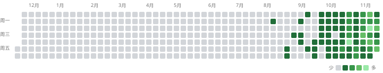

<!-- ragdoll:activity:start -->

## Ragdoll 活动概览

| 指标 | 数值 | 说明 |
| --- | ---: | --- |
| 估算总成本 | $489.37 | 14,292/21,742 条用量已定价 |
| 总 Token | 2,868,132,270 | 35 个会话缺少用量 |
| 会话 | 860 | 当前归档范围 |

### Token 活跃度

2025-11-20 至 2026-11-19 · 按本地日期统计，绿色越浅表示用量越高。

### 项目活动

| 项目 | Token | 会话 | 估算成本 |
| --- | ---: | ---: | ---: |
| Codex | 940,592,323 | 327 | $132.56 |
| codex-question-bank | 569,428,124 | 65 | $90.42 |
| Motion | 372,419,111 | 36 | $141.94 |
| DSH | 277,434,181 | 54 | $15.02 |
| Ragdoll | 225,661,073 | 52 | $29.97 |
| PrivateWork | 189,404,570 | 52 | $33.83 |
| Autovisor | 64,526,961 | 28 | $1.17 |
| HappaTools | 35,304,320 | 38 | $2.27 |

### 最近会话

| 会话 | 来源 | 项目 | 更新日期 |
| --- | --- | --- | --- |
| [添加仓库信息 README 自动生成](sessions/codex/codex_881e020946e4746dba6b97b8/transcript.md) | codex | Ragdoll | 2026-11-19 |
| [Guardian review](sessions/codex/codex_d18971acb620fb4a28e939e2/transcript.md) | codex | Ragdoll | 2026-11-19 |
| [填写问卷星表单](sessions/codex/codex_be56c3fae68b9f69425bdcb1/transcript.md) | codex | PrivateWork | 2026-11-19 |
| [Guardian review](sessions/codex/codex_7d9eaeb4f5eb9592cb75923f/transcript.md) | codex | PrivateWork | 2026-11-19 |
| [按 DeepSeek v4.1 Flash 峰价显示股价](sessions/codex/codex_074c80b00cb7fab9c4200e8c/transcript.md) | codex | Ragdoll | 2026-11-19 |
| [Guardian review](sessions/codex/codex_f5c9dc8420f5ebc6994bf9e2/transcript.md) | codex | Ragdoll | 2026-11-19 |

成本按当前价格表以美元估算，实际账单以服务商为准。

<!-- ragdoll:activity:end -->
