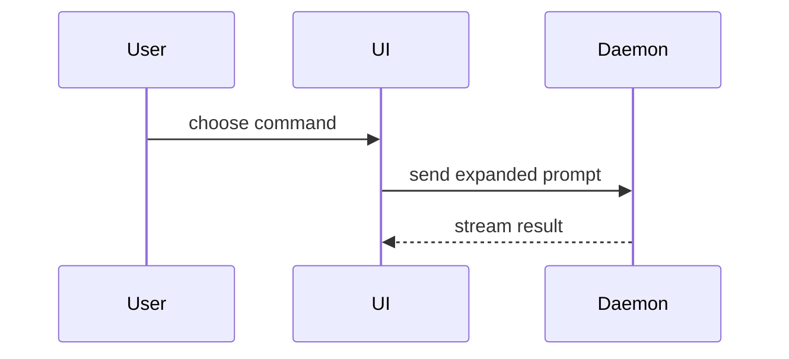

# Codex skill 重新安装

来源：claude

项目：/Users/oyamahappa/Documents/Agent/Claude

## user · 2026-10-31T06:35:33Z

您能把我codex安装过的skill全部安装一遍吗

## assistant · 2026-10-31T06:35:37Z

{
  "type": "thinking",
  "thinking": "",
  "signature": "CAQSvQYKEAgTGAI4AUIIdGhpbmtpbmcSDMuKI96pggPohZgAuRoMjxmQJVYkbVsgFsTDIjDLEP/MSWXQU73XLic3h9JW4n6BagtW4r1BVBLGNJpXYAF7xHSAUoHT0Z0IVUSPqoEq2gXiyj4Tsz02mLdknJuh/dYq6YRB9/OsX+tp6x4l1QyaHtGZPNs24vtlnDFXD7C5YvbPrw7rzxW8V8L9YHzX4STHlv+5zZN07FTObKJ2FWRNdMgODTyWSkD27jvL6condumnHkcl5Vq5giVJnLjjPAJHcjZayLSDvNJWExx4ZZa4lTCrhDRfOC+9o2hZunQpaPXEIAmy1wUgupt3/9+mMNmvag9TIWD98AxX7uNIenA8QKgDIvDNtKEHH3rPNL99n6XfW1bbfCjAPfbT0ZpyMv3oCBnIOackCpJLYeeOfyQjYpCwgjsA9GHUC3v7bQktgxxsiWmaYqK4PSkG9e5A0rKdUzLLAEYxsuNL5mYNtDh1thd091ZdDZ5Zufnra9OltDh4YhLJZ1PT6Vj3+xWQu56fT4a3pL9HdezcN5bi7JyUUJmi6WXoUpMCAkOIa9KJPxGhcUbounhRbdLbYxJjAUd1bsM+mYSoy4hdOAwm8nlwvTN6dqncV9F+1kkLHTz4cCRDyg1M5VH4uNQn+fHTOV9b6q6kGfFb7EfYOxmYwKs/j/0weJwnGyWLhpgMk2+gStcmgx2wqF8z3RqwmxLHtQ3DCm7DNZFEaUgnCHdzBaD5dWfVveK9jdUT3+h55P4B8rDVaY8jplyuuyNn9jZSjjwFQ+ShpsZEI5tjrLIbzkgzRNk/M9WxoHb/8ieDUhiRs7HMXJY6MvlnHu3AHMP6suFFW57FFxw4AEuYYtyO19o13TNqsVxppEFVcyhEAc1EDCnjloigY3EJ2t8j26VON3I/T8YHvJ4LuwVSsf4xno2mwkAJma+W3lSuKzvbzYyMXARW5haJL7+lTcMaW0CDsZ1p/4F1SLD8Zq65zrqdq7coBYBYO7x4iwqGi1CD2hg/Lo+awunI8GvZHxB9RliHuudv+47jKaRhJhaGFwP2yRKCG45EA7Om1f1WhcZiylcpm2tVfmwWXP2zsz9lGAE="
}

## assistant · 2026-10-31T06:35:38Z

mcp__ccd_turn__update_plan
{
  "items": [
    {
      "content": "盘点 Codex 已安装的 skill",
      "status": "in_progress"
    },
    {
      "content": "对比 Claude Code 现有 skill",
      "status": "pending"
    },
    {
      "content": "安装缺失的 skill",
      "status": "pending"
    },
    {
      "content": "验证安装结果",
      "status": "pending"
    },
    {
      "content": "写入开发记录与对话归档并推送",
      "status": "pending"
    }
  ],
  "scope": "first_task"
}

## user · 2026-10-31T06:35:38Z

Plan shown (5 steps).

## assistant · 2026-10-31T06:35:41Z

Bash
{
  "command": "echo \"--- ~/.codex\"; ls -la ~/.codex 2>&1; echo \"--- ~/.codex/skills\"; ls -la ~/.codex/skills 2>&1; echo \"--- ~/.codex/skills/.system\"; ls -la ~/.codex/skills/.system 2>&1; echo \"--- ~/.agents/skills\"; ls -la ~/.agents/skills 2>&1; echo \"--- ~/.claude/skills\"; ls -la ~/.claude/skills 2>&1; echo \"--- project\"; ls -la /Users/oyamahappa/Documents/Agent/Claude /Users/oyamahappa/Documents/Agent/Claude/.agents/skills /Users/oyamahappa/Documents/Agent/Claude/.claude/skills 2>&1",
  "description": "List Codex and Claude skill directories"
}

## assistant · 2026-10-31T06:35:42Z

Bash
{
  "command": "find ~/.codex ~/.agents -type f -name SKILL.md -not -path '*/node_modules/*' 2>/dev/null; echo \"--- config\"; grep -n -iE 'skill|plugin|marketplace' ~/.codex/config.toml 2>&1 | head -60",
  "description": "Find all SKILL.md files under Codex directories and check config"
}

## user · 2026-10-31T06:35:42Z

Exit code 1
--- ~/.codex
total 513080
drwxr-xr-x   61 oyamahappa  staff       1952 Oct 31 14:31 .
drwxr-x---+  77 oyamahappa  staff       2464 Oct 31 14:35 ..
-rw-r--r--    1 oyamahappa  staff       5511 Aug  1 15:53 ..codex-global-state.json.tmp-1785570809738-3ad8be0c-2a29-4b5b-9161-ac328389d4dc
-rw-r--r--@   1 oyamahappa  staff       6148 Aug  3 09:37 .DS_Store
-rw-r--r--    1 oyamahappa  staff     567712 Oct 31 14:31 .codex-global-state.json
-rw-r--r--    1 oyamahappa  staff     567712 Oct 31 14:31 .codex-global-state.json.bak
drwxr-xr-x    3 oyamahappa  staff         96 Oct 27 00:13 .hook-trust
-rw-------    1 oyamahappa  staff          3 Aug  3 09:38 .sandbox_migration
-rw-r--r--    1 oyamahappa  staff          0 Oct  4 15:26 .sqlite-maintenance.lock
drwxr-xr-x  259 oyamahappa  staff       8288 Oct 31 08:22 .tmp
-rw-r--r--    1 oyamahappa  staff      16713 Oct 19 19:53 AGENTS.md
drwxr-xr-x   14 oyamahappa  staff        448 Oct 26 11:34 ambient-suggestions
drwxr-xr-x  127 oyamahappa  staff       4064 Oct 31 14:30 archived_sessions
-rw-------    1 oyamahappa  staff       4368 Oct 27 00:18 auth.json
drwxr-xr-x    7 oyamahappa  staff        224 Sep 11 21:50 cache
-rw-r--r--    1 oyamahappa  staff       1910 Oct 30 20:39 chrome-native-hosts-v2.json
drwx------    2 oyamahappa  staff         64 Sep 30 16:51 code-review-plugin
drwxr-xr-x    5 oyamahappa  staff        160 Oct 31 14:30 computer-use
-rw-------    1 oyamahappa  staff      10465 Oct 31 08:57 config.toml
-rw-------    1 oyamahappa  staff       8267 Oct 10 11:12 config.toml.rea.backup
drwx------    4 oyamahappa  staff        128 Oct 30 20:09 dictation-history
drwxr-xr-x    5 oyamahappa  staff        160 Oct 18 09:11 generated_images
-rw-r--r--    1 oyamahappa  staff      32768 Oct 12 10:45 goals_1.sqlite
-rw-r--r--    1 oyamahappa  staff      32768 Oct 31 14:30 goals_1.sqlite-shm
-rw-r--r--    1 oyamahappa  staff          0 Oct 31 14:30 goals_1.sqlite-wal
-rw-r--r--    1 oyamahappa  staff         36 Jul 25 22:37 installation_id
drwx------    3 oyamahappa  staff         96 Oct 30 20:39 ipc
-rw-r--r--    1 oyamahappa  staff   82051072 Oct 31 14:31 logs_2.sqlite
-rw-r--r--    1 oyamahappa  staff      98304 Oct 31 13:59 logs_2.sqlite-shm
-rw-r--r--    1 oyamahappa  staff   43247672 Oct 31 14:35 logs_2.sqlite-wal
drwxr-xr-x    3 oyamahappa  staff         96 Oct 21 13:34 mcp-oauth-locks
-rw-r--r--    1 oyamahappa  staff      45056 Oct 12 10:35 memories_1.sqlite
-rw-r--r--    1 oyamahappa  staff     464856 Oct 31 14:35 models_cache.json
drwxr-xr-x    3 oyamahappa  staff         96 Sep 17 13:13 node_repl
drwxr-xr-x    3 oyamahappa  staff         96 Aug  3 09:44 pets
drwxr-xr-x    7 oyamahappa  staff        224 Oct 30 20:39 plugins
drwxr-xr-x    3 oyamahappa  staff         96 Aug  3 09:38 process_manager
drwx------    2 oyamahappa  staff         64 Oct 30 09:52 project-metadata-locks
-rw-r--r--    1 oyamahappa  staff      40960 Oct 14 22:39 queue_1.sqlite
-rw-r--r--    1 oyamahappa  staff      32768 Oct 27 00:19 queue_1.sqlite-shm
-rw-r--r--    1 oyamahappa  staff          0 Oct 27 00:18 queue_1.sqlite-wal
drwxr-xr-x   28 oyamahappa  staff        896 Sep 23 15:02 reverse-skill
drwxr-xr-x    2 oyamahappa  staff         64 Sep 30 16:49 rollout-migrations
drwx------@   3 oyamahappa  staff         96 Aug 26 20:55 rules
-rw-r--r--    1 oyamahappa  staff      35317 Oct 31 14:31 session_index.jsonl
-rw-r--r--    1 oyamahappa  staff          0 Oct 30 21:24 session_index.jsonl.lock
drwxr-xr-x    3 oyamahappa  staff         96 Aug  3 09:38 sessions
drwxr-xr-x    5 oyamahappa  staff        160 Oct 31 14:30 shell_snapshots
drwxr-xr-x   86 oyamahappa  staff       2752 Oct 30 09:48 skills
drwxr-xr-x    9 oyamahappa  staff        288 Oct 30 20:38 sqlite
-rw-r--r--    1 oyamahappa  staff    9838592 Oct 31 10:37 state_5.sqlite
-rw-r--r--    1 oyamahappa  staff      32768 Oct 31 14:29 state_5.sqlite-shm
-rw-r--r--    1 oyamahappa  staff    2846952 Oct 31 14:31 state_5.sqlite-wal
drwxr-xr-x    7 oyamahappa  staff        224 Oct 31 14:31 thread-writer-locks
-rw-r--r--    1 oyamahappa  staff  104570880 Oct 31 10:27 thread_history_1.sqlite
-rw-r--r--    1 oyamahappa  staff      32768 Oct 31 14:30 thread_history_1.sqlite-shm
-rw-r--r--    1 oyamahappa  staff    2146552 Oct 31 14:31 thread_history_1.sqlite-wal
drwxr-xr-x    4 oyamahappa  staff        128 Oct 17 17:39 tmp
-rw-------    1 oyamahappa  staff          0 Oct 30 20:09 transcription-history.jsonl
drwxr-xr-x    3 oyamahappa  staff         96 Jul 25 22:37 vendor_imports
drwxr-xr-x    3 oyamahappa  staff         96 Aug  3 09:38 visualizations
--- ~/.codex/skills
total 0
drwxr-xr-x  86 oyamahappa  staff  2752 Oct 30 09:48 .
drwxr-xr-x  61 oyamahappa  staff  1952 Oct 31 14:31 ..
drwxr-xr-x   8 oyamahappa  staff   256 Oct 27 22:19 .system
drwxr-xr-x   3 oyamahappa  staff    96 Aug 12 14:15 apple-design
drwxr-xr-x  20 oyamahappa  staff   640 Sep  3 14:29 archify
drwxr-xr-x   5 oyamahappa  staff   160 Oct 21 13:20 ask-matt
drwxr-xr

... [2295 characters truncated] ...

 i-have-adhd
drwxr-xr-x   4 oyamahappa  staff   128 Sep 30 11:45 idea-evaluator
drwxr-xr-x   3 oyamahappa  staff    96 Oct 16 12:46 image-to-code-skill
drwxr-xr-x   3 oyamahappa  staff    96 Oct 16 12:46 imagegen-frontend-mobile
drwxr-xr-x   3 oyamahappa  staff    96 Oct 16 12:46 imagegen-frontend-web
drwxr-xr-x   4 oyamahappa  staff   128 Oct 21 13:20 implement
drwxr-xr-x   4 oyamahappa  staff   128 Oct 21 13:20 implement-spec
drwxr-xr-x   5 oyamahappa  staff   160 Oct 21 13:20 improve-codebase-architecture
drwxr-xr-x   5 oyamahappa  staff   160 Sep 30 11:53 interview
drwxr-xr-x   4 oyamahappa  staff   128 Sep 30 11:45 intro-drafter
drwxr-xr-x   5 oyamahappa  staff   160 Sep 30 11:53 job-apply
drwxr-xr-x   4 oyamahappa  staff   128 Sep 30 11:53 job-match
drwxr-xr-x   5 oyamahappa  staff   160 Sep 30 11:53 make-resume
drwxr-xr-x   8 oyamahappa  staff   256 Oct 21 13:20 mattpocock-teach
drwxr-xr-x   3 oyamahappa  staff    96 Oct 16 12:46 minimalist-skill
drwxr-xr-x   4 oyamahappa  staff   128 Sep 30 11:53 offer
drwxr-xr-x   3 oyamahappa  staff    96 Oct 16 12:46 output-skill
drwxr-xr-x   4 oyamahappa  staff   128 Sep 30 11:45 paper-polish
drwxr-xr-x   4 oyamahappa  staff   128 Sep 30 11:45 paper-writer
drwxr-xr-x  12 oyamahappa  staff   384 Sep 30 11:54 patent-disclosure-skill
drwxr-xr-x   5 oyamahappa  staff   160 Oct 21 13:20 pr
drwxr-xr-x   4 oyamahappa  staff   128 Sep 30 11:45 pre-submission-reviewer
drwxr-xr-x   5 oyamahappa  staff   160 Sep 30 11:53 project-guide
drwxr-xr-x   6 oyamahappa  staff   192 Oct 21 13:20 prototype
drwxr-xr-x   4 oyamahappa  staff   128 Sep 30 11:45 rebuttal-guidance
drwxr-xr-x   3 oyamahappa  staff    96 Oct 16 12:46 redesign-skill
drwxr-xr-x   4 oyamahappa  staff   128 Oct 21 13:20 research
drwxr-xr-x   4 oyamahappa  staff   128 Oct 21 13:20 retro
drwxr-xr-x   9 oyamahappa  staff   288 Oct 21 13:20 setup-matt-pocock-skills
drwxr-xr-x   3 oyamahappa  staff    96 Oct 16 12:46 soft-skill
drwxr-xr-x   4 oyamahappa  staff   128 Oct 16 12:46 stitch-skill
drwxr-xr-x   9 oyamahappa  staff   288 Oct 16 12:46 taste-skill
drwxr-xr-x   3 oyamahappa  staff    96 Oct 16 12:46 taste-skill-v1
drwxr-xr-x   3 oyamahappa  staff    96 Oct 16 12:46 taste-skill-v2-experimental
drwxr-xr-x   6 oyamahappa  staff   192 Oct 21 13:20 tdd
drwxr-xr-x   3 oyamahappa  staff    96 Sep 11 21:52 teach
drwxr-xr-x   4 oyamahappa  staff   128 Sep 30 11:45 tech-paper-template
drwxr-xr-x   4 oyamahappa  staff   128 Oct 21 13:20 to-questionnaire
drwxr-xr-x   4 oyamahappa  staff   128 Oct 21 13:20 to-spec
drwxr-xr-x   4 oyamahappa  staff   128 Oct 21 13:20 to-tickets
drwxr-xr-x   6 oyamahappa  staff   192 Oct 21 13:20 triage
drwxr-xr-x   4 oyamahappa  staff   128 Sep 30 11:45 vibe-research-workflow
drwxr-xr-x   4 oyamahappa  staff   128 Oct 21 13:20 wait-what
drwxr-xr-x   4 oyamahappa  staff   128 Oct 21 13:20 wayfinder
drwxr-xr-x   5 oyamahappa  staff   160 Oct 21 13:20 wizard
drwxr-xr-x   5 oyamahappa  staff   160 Oct 21 13:20 writing-for-agents
--- ~/.codex/skills/.system
total 8
drwxr-xr-x   8 oyamahappa  staff   256 Oct 27 22:19 .
drwxr-xr-x  86 oyamahappa  staff  2752 Oct 30 09:48 ..
-rw-r--r--   1 oyamahappa  staff    17 Oct 27 22:19 .codex-system-skills.marker
drwxr-xr-x   8 oyamahappa  staff   256 Oct 27 22:19 imagegen
drwxr-xr-x   8 oyamahappa  staff   256 Oct 27 22:19 openai-docs
drwxr-xr-x   4 oyamahappa  staff   128 Oct 27 22:19 review-agent
drwxr-xr-x   8 oyamahappa  staff   256 Oct 27 22:19 skill-creator
drwxr-xr-x   7 oyamahappa  staff   224 Oct 27 22:19 skill-installer
--- ~/.agents/skills
total 0
drwxr-xr-x  8 oyamahappa  staff  256 Oct 26 11:50 .
drwxr-xr-x  5 oyamahappa  staff  160 Sep 23 15:02 ..
drwxr-xr-x  3 oyamahappa  staff   96 Aug  3 17:00 apple-design
drwxr-xr-x  3 oyamahappa  staff   96 Aug 22 21:57 convert-documents-to-markdown
lrwxr-xr-x@ 1 oyamahappa  staff   45 Oct 26 11:50 ego-browser -> /Users/oyamahappa/.local/share/ego/ego-skills
drwxr-xr-x  8 oyamahappa  staff  256 Sep 11 22:51 gpt-image-2-style-library
drwxr-xr-x  8 oyamahappa  staff  256 Aug  3 17:00 hatch-pet
drwxr-xr-x  4 oyamahappa  staff  128 Oct 10 11:12 reverse-engineer-anything
--- ~/.claude/skills
total 0
drwx------@  3 oyamahappa  staff   96 Oct 26 11:50 .
drwx------@ 11 oyamahappa  staff  352 Oct 31 14:35 ..
lrwxr-xr-x@  1 oyamahappa  staff   45 Oct 26 11:50 ego-browser -> /Users/oyamahappa/.local/share/ego/ego-skills
--- project
ls: /Users/oyamahappa/Documents/Agent/Claude/.agents/skills: No such file or directory
ls: /Users/oyamahappa/Documents/Agent/Claude/.claude/skills: No such file or directory
/Users/oyamahappa/Documents/Agent/Claude:
total 104
drwxr-xr-x@  6 oyamahappa  staff    192 Oct 31 14:34 .
drwxr-xr-x   9 oyamahappa  staff    288 Oct 26 18:24 ..
drwxr-xr-x  12 oyamahappa  staff    384 Oct 31 14:34 .git
-rw-r--r--@  1 oyamahappa  staff  19752 Oct 20 16:06 Claude.md
-rw-r--r--@  1 oyamahappa  staff  13404 Oct 26 18:26 bubble-sort.html
-rw-r--r--   1 oyamahappa  staff  15935 Oct 26 19:24 bucket-sort.html

## user · 2026-10-31T06:35:42Z

<persisted-output>
Output too large (126KB). Full output saved to: /Users/oyamahappa/.claude/projects/-Users-oyamahappa-Documents-Agent-Claude/73abeee9-6915-4b83-971e-94a3c5677930/tool-results/bkx0nio2s.txt

Preview (first 2KB):
/Users/oyamahappa/.agents/skills/hatch-pet/SKILL.md
/Users/oyamahappa/.agents/skills/reverse-engineer-anything/SKILL.md
/Users/oyamahappa/.agents/skills/convert-documents-to-markdown/SKILL.md
/Users/oyamahappa/.agents/skills/apple-design/SKILL.md
/Users/oyamahappa/.agents/skills/gpt-image-2-style-library/SKILL.md
/Users/oyamahappa/.codex/skills/research/SKILL.md
/Users/oyamahappa/.codex/skills/taste-skill-v1/SKILL.md
/Users/oyamahappa/.codex/skills/gsap-plugins/SKILL.md
/Users/oyamahappa/.codex/skills/paper-polish/SKILL.md
/Users/oyamahappa/.codex/skills/gsap-timeline/SKILL.md
/Users/oyamahappa/.codex/skills/gsap-scrolltrigger/SKILL.md
/Users/oyamahappa/.codex/skills/image-to-code-skill/SKILL.md
/Users/oyamahappa/.codex/skills/diagnosing-bugs/SKILL.md
/Users/oyamahappa/.codex/skills/gsap-performance/SKILL.md
/Users/oyamahappa/.codex/skills/imagegen-frontend-mobile/SKILL.md
/Users/oyamahappa/.codex/skills/code-review/SKILL.md
/Users/oyamahappa/.codex/skills/gsap-core/SKILL.md
/Users/oyamahappa/.codex/skills/pre-submission-reviewer/SKILL.md
/Users/oyamahappa/.codex/skills/to-tickets/SKILL.md
/Users/oyamahappa/.codex/skills/human-writing/SKILL.md
/Users/oyamahappa/.codex/skills/deep-research/SKILL.md
/Users/oyamahappa/.codex/skills/ask-matt/SKILL.md
/Users/oyamahappa/.codex/skills/wizard/SKILL.md
/Users/oyamahappa/.codex/skills/improve-codebase-architecture/SKILL.md
/Users/oyamahappa/.codex/skills/to-questionnaire/SKILL.md
/Users/oyamahappa/.codex/skills/to-spec/SKILL.md
/Users/oyamahappa/.codex/skills/codebase-design/SKILL.md
/Users/oyamahappa/.codex/skills/gsap-utils/SKILL.md
/Users/oyamahappa/.codex/skills/triage/SKILL.md
/Users/oyamahappa/.codex/skills/prototype/SKILL.md
/Users/oyamahappa/.codex/skills/paper-writer/SKILL.md
/Users/oyamahappa/.codex/skills/cli-hub-meta-skill/SKILL.md
/Users/oyamahappa/.codex/skills/pr/SKILL.md
/Users/oyamahappa/.codex/skills/cli-anything/SKILL.md
/Users/oyamahappa/.codex/skills/gsap-frameworks/SKILL.md
...
</persisted-output>

## assistant · 2026-10-31T06:35:44Z

{
  "type": "thinking",
  "thinking": "",
  "signature": "CAQSggYKEAgTGAI4AUIIdGhpbmtpbmcSDNawmK1Kjt51WeLUNhoM7vmge3ZNsdgsq4ejIjDM1wMcI9N6SK4SXgi7kQ9wuT4M5o1gPwHPUmmKY87Q3vC8BhgG/0prHfbapwG4ZS8qnwUnafIVru0+KuRF8aUDBn2SuayvML1WMqFh01vPjFUiWnQKf3RbHZ52c0oq5RNG2YQx1M4fh5AlBT7LZ2k8m5mXzaCCh9Fs6eX6V1g07/lo2bpgFfJD6FzsvqW32e0VCxARvU1S0CQiD31zC/aIoaS2pYsuMwBttEpo71RX6vxONg/VMtbt13rcZZ99Zc+iWVxNNXrZsOry7LmnnFLTNi1a8dIEC5hs8n4SEmxM+Y3t3yXEfpPAvMMlrSK9VFFYDxVXpAsmorIQIja0PyBuH0nH33SjwK/d+UOMgG2YIsbGe7b6NJzj7gIUlYEqq1eNCKLVilWtMu1BZ9lnF58DT3EN9bN45xFLEzGffeWmj0WEYqkCusKlzkDXfLf7u45z9i1vzSCy8iEAF1GvRIMzejEuATJnVZWX8CMmsmVCQ6o0UCUDMVxlQnoHBgORgqulKRU47QMXBpWWZ1ugP59j/UBImxxnnSxvtyww6b2p53aFJyf2Ejh+7gFIIE5ELVJjc0JH8nmi9DOCh7QlVt0rqjz7ObXwvdAYLXg8+fxb/jKq9VuXxlE4iFzHYgI1mdajjNgWBukgr2/47o78FKD5lmo1PvDZ39GAIawCHxLHs/mwRrRHAlFx/m0JJgvdulcnUMXqDdXfpegLijeDjN+8vqD7QWktIcPkJHyP8s5MJxIC8y4HauCVbFIrEwoPORWGHcSZqThaQgzW0guTHtH5cWjymKbxpPrFjb5s4apjYd+5ydqg69I5nsf3CagL7FEY14Q2NU9SmHDn2RIur5TVgGn670eXlKvb/BMcszU6Qx5wDaYDxTD5BhGpbBl5SdZYI0P9chaDJvzpDmPeex5zKfN3i0Gy2v2zedVbBjRAG/yMHi4Z4m+QW3nSADfi6HgCahgB"
}

## assistant · 2026-10-31T06:35:49Z

Bash
{
  "command": "F=/Users/oyamahappa/.claude/projects/-Users-oyamahappa-Documents-Agent-Claude/73abeee9-6915-4b83-971e-94a3c5677930/tool-results/bkx0nio2s.txt; wc -l \"$F\"; echo \"--- by top dir\"; sed -E \"s#^/Users/oyamahappa/##\" \"$F\" | awk -F/ '{print $1\"/\"$2\"/\"$3}' | sort | uniq -c | sort -rn | head -30; echo \"--- ~/.codex/skills direct (top-level)\"; ls -1 ~/.codex/skills | wc -l; for d in ~/.codex/skills/*; do [ -f \"$d/SKILL.md\" ] || echo \"NO SKILL.md: $d ($(ls -A \"$d\" | tr '\\n' ' '))\"; done; echo \"--- nested in codex skills\"; grep -E '^/Users/oyamahappa/\\.codex/skills/' \"$F\" | awk -F/ 'NF>7' | sed 's#/Users/oyamahappa/.codex/skills/##' | head -60; echo \"--- symlinks\"; find ~/.codex/skills -maxdepth 1 -type l -exec ls -l {} \\;; echo \"--- sizes\"; du -sh ~/.codex/skills ~/.agents/skills; du -sh ~/.codex/skills/* | sort -rh | head -10",
  "description": "Summarize Codex skill locations, counts and sizes"
}

## assistant · 2026-10-31T06:35:51Z

Bash
{
  "command": "ls -la ~/.codex/plugins ~/.codex/plugins/cache 2>&1; echo \"--- config plugin sections\"; grep -nE '^\\[(plugins|marketplaces|skills)' ~/.codex/config.toml; grep -nE 'enabled' ~/.codex/config.toml | head -40; echo \"--- reverse-skill\"; ls ~/.codex/reverse-skill | head -30; echo \"--- vendor_imports\"; ls ~/.codex/vendor_imports/*; echo \"--- claude plugins\"; ls -la ~/.claude/plugins 2>&1; cat ~/.claude/plugins/installed_plugins.json 2>/dev/null | head -40",
  "description": "Inspect Codex plugins, config sections and Claude plugins"
}

## user · 2026-10-31T06:35:52Z

    1355 /Users/oyamahappa/.claude/projects/-Users-oyamahappa-Documents-Agent-Claude/73abeee9-6915-4b83-971e-94a3c5677930/tool-results/bkx0nio2s.txt
--- by top dir
 608 .codex/.tmp/plugins
 287 .codex/.tmp/marketplaces
 211 .codex/plugins/cache
  46 .codex/reverse-skill/skills
  42 .codex/reverse-skill/CTF-Sandbox-Orchestrator
   9 .codex/skills/patent-disclosure-skill
   8 .codex/.tmp/bundled-marketplaces
   5 .codex/skills/.system
   1 9:source = "/Users/oyamahappa
   1 98:[plugins."productivity@knowledge-work-plugins"]//
   1 95:[plugins."computer-use@openai-bundled"]//
   1 92:[plugins."chrome@openai-bundled"]//
   1 89:[plugins."unified-computer-use@openai-bundled"]//
   1 86:[plugins."browser@openai-bundled"]//
   1 83:[plugins."superpowers@openai-curated"]//
   1 80:[plugins."sepia@sepia"]//
   1 7:[marketplaces.openai-bundled]//
   1 77:[plugins."reverse-skill@reverse-skill-local"]//
   1 74:[plugins."superpowers@superpowers-dev"]//
   1 71:[plugins."ponytail@ponytail"]//
   1 68:[plugins."ars-codex@ars-codex"]//
   1 65:[plugins."codex-app-tools@openai-bundled"]//
   1 62:[plugins."template-creator@openai-primary-runtime"]//
   1 59:[plugins."presentations@openai-primary-runtime"]//
   1 56:[plugins."spreadsheets@openai-primary-runtime"]//
   1 53:[plugins."pdf@openai-primary-runtime"]//
   1 50:[plugins."documents@openai-primary-runtime"]//
   1 47:[plugins."visualize@openai-bundled"]//
   1 45:source = "https://github.com
   1 42:[marketplaces.knowledge-work-plugins]//
--- ~/.codex/skills direct (top-level)
      83
--- nested in codex skills
.system/openai-docs/SKILL.md
.system/imagegen/SKILL.md
.system/review-agent/SKILL.md
.system/skill-creator/SKILL.md
.system/skill-installer/SKILL.md
patent-disclosure-skill/skills/patent-reader/SKILL.md
patent-disclosure-skill/skills/patent-disclosure/SKILL.md
patent-disclosure-skill/skills/patent-docket/SKILL.md
patent-disclosure-skill/skills/patent-application/SKILL.md
patent-disclosure-skill/skills/patent-search/SKILL.md
patent-disclosure-skill/skills/patent-map/SKILL.md
patent-disclosure-skill/skills/patent-exam-policy/SKILL.md
patent-disclosure-skill/skills/patent-oa/SKILL.md
--- symlinks
--- sizes
 40M	/Users/oyamahappa/.codex/skills
2.4M	/Users/oyamahappa/.agents/skills
 13M	/Users/oyamahappa/.codex/skills/drawio-reconstruction
 12M	/Users/oyamahappa/.codex/skills/patent-disclosure-skill
7.3M	/Users/oyamahappa/.codex/skills/archify
2.0M	/Users/oyamahappa/.codex/skills/gpt-image-2-style-library
1.7M	/Users/oyamahappa/.codex/skills/taste-skill
1.2M	/Users/oyamahappa/.codex/skills/drawio-skill
352K	/Users/oyamahappa/.codex/skills/hatch-pet
228K	/Users/oyamahappa/.codex/skills/cli-anything
124K	/Users/oyamahappa/.codex/skills/idea-evaluator
120K	/Users/oyamahappa/.codex/skills/human-writing

## user · 2026-10-31T06:35:52Z

/Users/oyamahappa/.codex/plugins:
total 0
drwxr-xr-x   7 oyamahappa  staff   224 Oct 30 20:39 .
drwxr-xr-x  61 oyamahappa  staff  1952 Oct 31 14:31 ..
drwxr-xr-x   2 oyamahappa  staff    64 Oct 30 20:40 .marketplace-plugin-source-staging
drwxr-xr-x   3 oyamahappa  staff    96 Oct 30 20:39 .plugin-appserver
drwxr-xr-x   2 oyamahappa  staff    64 Oct 30 09:47 .remote-plugin-install-staging
drwxr-xr-x  12 oyamahappa  staff   384 Oct 21 13:27 cache
drwxr-xr-x   3 oyamahappa  staff    96 Sep  3 14:28 data

/Users/oyamahappa/.codex/plugins/cache:
total 0
drwxr-xr-x  12 oyamahappa  staff  384 Oct 21 13:27 .
drwxr-xr-x   7 oyamahappa  staff  224 Oct 30 20:39 ..
drwxr-xr-x   3 oyamahappa  staff   96 Oct 27 15:34 ars-codex
drwxr-xr-x  13 oyamahappa  staff  416 Oct 28 18:43 knowledge-work-plugins
drwxr-xr-x   8 oyamahappa  staff  256 Oct 30 20:39 openai-bundled
drwxr-xr-x   3 oyamahappa  staff   96 Oct 11 23:44 openai-curated
drwxr-xr-x  16 oyamahappa  staff  512 Oct 30 09:47 openai-curated-remote
drwxr-xr-x   7 oyamahappa  staff  224 Oct 30 20:40 openai-primary-runtime
drwxr-xr-x   3 oyamahappa  staff   96 Oct 30 20:19 ponytail
drwxr-xr-x   3 oyamahappa  staff   96 Sep 23 15:04 reverse-skill-local
drwxr-xr-x   3 oyamahappa  staff   96 Oct 15 18:34 sepia
drwxr-xr-x   3 oyamahappa  staff   96 Oct 22 10:25 superpowers-dev
--- config plugin sections
7:[marketplaces.openai-bundled]
11:[marketplaces.openai-primary-runtime]
15:[marketplaces.ars-codex]
21:[marketplaces.ponytail]
26:[marketplaces.superpowers-dev]
32:[marketplaces.reverse-skill-local]
37:[marketplaces.sepia]
42:[marketplaces.knowledge-work-plugins]
47:[plugins."visualize@openai-bundled"]
50:[plugins."documents@openai-primary-runtime"]
53:[plugins."pdf@openai-primary-runtime"]
56:[plugins."spreadsheets@openai-primary-runtime"]
59:[plugins."presentations@openai-primary-runtime"]
62:[plugins."template-creator@openai-primary-runtime"]
65:[plugins."codex-app-tools@openai-bundled"]
68:[plugins."ars-codex@ars-codex"]
71:[plugins."ponytail@ponytail"]
74:[plugins."superpowers@superpowers-dev"]
77:[plugins."reverse-skill@reverse-skill-local"]
80:[plugins."sepia@sepia"]
83:[plugins."superpowers@openai-curated"]
86:[plugins."browser@openai-bundled"]
89:[plugins."unified-computer-use@openai-bundled"]
92:[plugins."chrome@openai-bundled"]
95:[plugins."computer-use@openai-bundled"]
98:[plugins."productivity@knowledge-work-plugins"]
101:[plugins."sales@knowledge-work-plugins"]
104:[plugins."customer-support@knowledge-work-plugins"]
107:[plugins."product-management@knowledge-work-plugins"]
110:[plugins."marketing@knowledge-work-plugins"]
113:[plugins."legal@knowledge-work-plugins"]
116:[plugins."finance@knowledge-work-plugins"]
119:[plugins."data@knowledge-work-plugins"]
122:[plugins."enterprise-search@knowledge-work-plugins"]
125:[plugins."bio-research@knowledge-work-plugins"]
128:[plugins."cowork-plugin-management@knowledge-work-plugins"]
48:enabled = true
51:enabled = true
54:enabled = true
57:enabled = true
60:enabled = true
63:enabled = true
66:enabled = true
69:enabled = true
72:enabled = true
75:enabled = true
78:enabled = true
81:enabled = true
84:enabled = true
87:enabled = true
90:enabled = true
93:enabled = true
96:enabled = true
99:enabled = true
102:enabled = true
105:enabled = true
108:enabled = true
111:enabled = true
114:enabled = true
117:enabled = true
120:enabled = true
123:enabled = true
126:enabled = true
129:enabled = true
138:enabled = false
186:ambient-suggestions-enabled = true
189:enabled-reasoning-efforts = ["low", "medium", "high", "xhigh", "ultra", "persistent", "max"]
190:toys-confetti-enabled = true
326:enabled = false
330:enabled = false
--- reverse-skill
AGENTS.md
CHANGELOG.md
CLAUDE.md
CTF-Sandbox-Orchestrator
LICENSE
README-kali.md
README.md
README_AI.md
README_zh.md
RULES.md
RULES_zh.md
SECURITY.md
VERSION
burp-mcp-full
docs
examples
kali
plugins
reports
reverse-skill.png
scripts
skills
--- vendor_imports
/Users/oyamahappa/.codex/vendor_imports/skills-curated-cache.json
--- claude plugins
total 5312
drwxr-xr-x   3 oyamahappa  staff       96 Oct 26 19:24 .
drwx------@ 11 oyamahappa  staff      352 Oct 31 14:35 ..
-rw-------   1 oyamahappa  staff  2719005 Oct 26 19:24 plugin-directory-cache-v2.json

## assistant · 2026-10-31T06:36:07Z

{
  "type": "thinking",
  "thinking": "",
  "signature": "CAQSwiEKEAgTGAI4AUIIdGhpbmtpbmcSDL6YiSdtPmMMCQzevxoMliW2Kmb2W8Ghcfi8IjAKxRJ+/M8NrdIP7uVi5w4hUuJ3029rNtT37rKN/viOA0gyLrX6d4xZ2wklwzzD+S8q3yDerwP90fCiGHIUkN/ymAt9wamIPR/zuvOznQ13NM7pDV0r6MzPsZPlVTPvGPAAphnPLqSWIiFKWcCv2aRYhEf7yq37zpyluyxflpj7c9OhNgIIk9FrKuAr2bm9tvWuCgRMAiEIlvqCQ+oCeHMe2m09H9L45mDEMvQk/p1ylm+sVmFQxF2z6mldiAeR4AMDkUmUWJxcS5t3+mIIE18Eff+avwx7v1mX/YbBoHDdjAAEXlxAo8uBIvZHeTpKkE4qc7uZv0fpsFrTY/Fo5gxfPWoWTWdA6L0xZt828eLqurb4ev+qopApMeK9NDamJR7rSYczSZN6xubcljzPlesphUKCNM+C5YwK9gC8kd4tPNs4KoptLjNPGh2/sIhijBXt+WsYKiz+2kQvaRzVLhoOlFipPLprxIkU4MKlDFfiPEm3ZLLKs9s/s1aezRNZyqxAiJDKS2kWoUjtoIG351vXd94RwvifAQjvq6C7G3XVkI/FTYceibv8x0JjYCYqxH0GM07X3wzoKYLX5Ahl38i83npstgXhKIQRnJBMen1BwNAj9g3o3ZsuicRT1QaPkjQW7rBHNfksZhcROdNHwXDNdVl3XqlhAhIrlmmFTwxFAvNoT4EqevCfgDHuNXTKgiLy8wxPPdoKE0jo0dfqW+m81TfbTRDQ5uV8d3u2UV1EKLlgUYYp+PFR2VBN2eKScMxs7ioD2vl6VxkUb+XtL699+4Z9889HGhMB5MZnSue2r16dTAYsTGBXxnu3ekOF9ZBOr7XrxfH92WO2I0+bKS7lx0lyXby6/TbiNkP5BaEjhS1aiJhr5NZvwMO40GeuvWba5nXjBjSnkDwSQyKqJqkkeFvKUKvXkjZMtl2zg+ktSWOiv/WSr2rxuhDrlGbBkTGSMNZeoiPsMSLyCYTbyukicZCMy3rYmohd/n491Ee1NyjirPgHKHY92QLzKxpRM5tA7VtT+olwGLoLgUELN7Y/gMu+ZFhzzmhezTHvN1ZybwZ/IofAD1rWDNE+rVog38yK2Njm4bqAZCeT24wYG1yPZmpzxMwpF5ECCzfOnGOkthh2xLZZnLcqb1OxeE2TvMfeE8JyNjYiscSSpbHMuCGaGf8HHKPqhRMsv7RE9Ww+pDhKczuhChZglbiNk4cGwm3cCHS4X+QRluPjyH6orPJXC+vJLfs44onwVfRPVgVAHY+lcvU3cCklmxUcbLwZ1uZrKk8AAPka7upxuMCvLNnNBJpUm41XrApeaIa5sk/ZMcyCJ4JyvUORl3QwaBuzG2PO74doQShCzP56NpvBFN8XijO6tFrCRlH7VuhS8G05ffTaEDLVmnqHUCGCOLOSgnEIRhvM1AUYoqCP76tL/Mqh0AXjcYTw65KZsdr7y6T4iIg9YoNZ2smIDeQwfXl++rItLTgtbxi3S1iKf3bpkxjW9NXAoFGRPyngcB4wyq8U2eMCzst8o74Q0Hpe3xkGaAiaTMUfq468OtnO2t5owJlAHH1J4wBI2B7n7XDbfNNuw9HwS4ioRoTUp/lHfNDXKfj8Dukxu6oj1An7bDNUI2cA2AQVjtT1xtZ3XEcpfcpMxmqEHPnAYa2Efqyz5DivazGk+KY1oshi677OiULZroFieSK2QrTJTj8GBuSvUb2tP1WRbPG3qVZLd5pMv1QNgHBjTKbYkBGiVMEX/8ZY1+hwGoFEyronGVi6JE8akShj1DWpuEUYn1JYNBWuL/GdqznMYPADhPvXqHr/PaXkO+/lmm+2pFFF7vtUU7NT3rKS/VycqsEYj7fZSjppzKg/E9yjFdyhj8AWMnrKG6mSLUnTBvvzQM4rKoHDHSs/g3m74gwsqMCE9NFKvQnuVsiabNS/nxRpZ0Oa4oRPyYhur2M39eLTO4mdaK+VhQIzJs/jpN7HjpFFZwILGDp02CCNAFKlWzfLqFFOHQn7rGXxUVWxhGbtVTVWk4G3be1B3jzl15f4RBlWl4Ro9ivoRZfRERbz5d5SOP9u1IU6Bep0mGUix9zSYKXrB0b3lEtyxPVErVFazF+rjXh3k16GrO3Q0Z3BPumKb5ziRfoZoAcQBbxACXaKegqziW4qHCOWr9m/3T+Uh3po1P4DeLUcRIk6mLNUhZg163JQvO7dmeYjo0TCk5tt4ZwDKvsX5MyrEztYnWqvDbHdmRTDTd9Ux8G6BtMyZm1I3LQmZBmKnO6GMn+H1Xa29EwmIEJgoo3bYGYhfQf+qNCuUVr0LHm3edXa0TC0zjYD+JrhH5vuxwkOe6eR0XNvtMnqd9ubYwRrjaV3f3p3J8pniJAoCpT1p/TiHz5NZTjMQP5PI8a656yJOp6ztg+moxVGUQ+gN7/6AWqRV3hdZwv7xkDFwTKJ4BvrDpB36tAPMRWq25uYrkr1ZKK8ih2lMmnJZvWr6Y2kt3L4gv3PBCzuFG+t0qKiK95A0mSkJfP+Amt6emF8A3yGEsZKi/GSnmbFIS/fsqFTs7P3mr9/+YCbmg14XeoX4fwDHRszhGJSexsuO9qnbnRS7t4IzXnv/EwKrVBcSunzmeH1ASLaNjLhMfLsnfekqooUZgxpp8zou/8gvO8Qlg+Mn9SRhf7VlhR6HKt7admg+K/Ynt4QuSmRXOZhN+K8SleYSxuRsvog5xjCCuaKEkcr/y/UyN9Aw1lT0NB3ejlFiiPTveD+TwlJ7YLfa9azz3A/OxBuZORtg/4LQEhJkVWa4dRbUut1r2+kqQahLug5VUUQtUi6FvLQRLOcsj5nxyVyCBim5cGWm9CVCC5XM4XZFG2sUfcRMNM/Kk5jhmRLMZapzpxNDr1KQO2woyIpYZArBx6WDQbglsKVI1uUig2xvKuqihTRGAzlbTOET+Aav9jTsFb0qqz/NbGxBbf3/sghi6zRiLzZ2WN3ZPzX9xSkxPHsXLPWoNE/F9dC797YfvxK4fzPRugBOoO9e6aAYua8zPXAxAgQGX821Xuklu3AZN4PkfJddoyoSbsYfEKVsVlm+qMLwfltZyJNztAGRfHf2M45QTbrp7K3r3azcprOsDnFH27Wl5hfBrQYOv29cGiMB5Af6cRZEwyZn8g4xcqBHOw+GqWsbFkn5dBRSQT7tn/bgR5ntd/Px2+VwbcBT82QCNdcwFF7o/miv0S4J5ViiutFXWrzmt83Ekz1Rz3ccRGLVYK8dAwx9+RzAUocC5Qc+pk/KTUJaNrvsmM0mMj6wvRBOB+3wS04iwkV/EpJZMbfJeBLD4Djex0WLzQ5B98ORRV6aJbpF85lXkDFyic8m2Alw+6gP8Cckp5up5anYodnjP9shqg/I+LKp4Jza/mX+OG1nDZ/vgKre1MaraTVsQLN4D/y9v7NiH+4uqtRHMX5r370C3RSg0jXusN6/uPZAJXuJNMOOthUjLF07FebYRlPW4V8mzNysXBvfb9+eE7+ldsj+E6ndCME8txTK0Qwfk7s9SQj3vuTw89evttK+3/+2ZwrZZbnJP+I1b7KR55Xp/pDV5QR/wBXn7ahWUAIiBGhLapPrmSb1i5yzUjjcjTUf4ad4lWEhz99YPUWxyM7mtHzHXTzzmDumElcYdQUGAQDb1VX7ggMO0N3snIBMipnqwIQ4SyoFQU+615BDjONECv9eBOV4z5s35qqGVRLLkDsB3R3kROM+wnUcTyHMBCg5tVzrljewyqqIsbRjKN/FzTreZ7HZOeWdRlzS6tDAQSRHyH2yXuZ3v9G80dXiZXAuRVTqzwg/S0ggoDbYPIB/m4g7q1DLpPcnUlmzBAXabOoXAeR3vmzQpVIqS6tg01zeocfVMrV5H6G26wlxJyecx5cUQp2Mtp7ndBO49sn0tlIhr3fg5FMWTnueWJ+cR+i0Kcr+p/cuoTkadAcKduggXmvE6+KImUn9ug7ISHZJemNjnmaS3ivySPaJk0aKTaCxN4yXi+Fyv89uOOn+LxvhBb4JPci26c482xZ3O8bCA6hVTb4sDYtHnfruYMfbweUbu1+75jyldAdFrNQEqR+/a9/TNWPaixTY6FAwZ/9oIVDwKwYPNFSdHNAx3am01AtBuOsEWc9eC6L624FifTGyuQg3q6ph/HCAQhN/PcRSOn94IHO20wt4bs6n3S4WGK6NWbJjyMfBYnOu8f8neFQOv7ktxljl6k4wkMcxRK7ty6ZcPjLNJumBnfzsM8fV0GTqolC91WgBONR23Qwr25UIHZpd3JFuRJB0oqTmoU1CWO4J4vZDJl6AFOdVJFuf6KXbwfOw+H2ZfB6ciMQ6U+/T9pidcZRY56m+Vz0rEvXyoCDt0rAHulZ0/hfQIVVupOVDJGkkIYp2jKxg/5cExEHAxaXCp58B3fXn8kioQor+WbSqdnTCcVCwiox9gCFv4X8Dgz9HH6N3JZC59lvVAhO/bP+YI1zyFSWquncFskubdDUfLOZUKwSCq7ALsyVxmNoU1/zu6oqu1WdhpWWtpnBKjXw0hBZRXN3YDtip/kBuiFlaREhDb6cL9vFRxNrEP9lbi0AD3+7nFrBrTcBHbIH1+yqGyIObvQUnN1SJHuTTER5/GF4+2DkfKveei2v07DSf0XmBdNabdFWhwZSTDpFq1odx9h04aieTSmN7aNc0x9WVetPJPqtyxFrMexuAo0CpLeBw+k/Y1hP1mHbwtE3eq63bK0rglgrKB9JAunWlJr9BmQnPumV3myNsmfdfHipzHezPA6+/DczlD6tMXYTLN5iqnruk/id4aTs2dl9qug62u2Difc+7TCIpXX5c3z80wuA9l4TY+xYng1c5L935JJ9ud9mjAWVPKxooiJrKhmSvP0Qba8IRx3ZVmwW8QolhokJKxyFuuQ0SQzuVb+wMxcowGDeYmlSItiG9zcNIo+TMrzqueeOqMn84UulnPFKGow6YbUNN9cosJ1yZYS3pGzaynSPMleG8xRwl4koGBUyqQWVUaT1c9rqFlWW4LosVNx1h5b/MlhL4jlT59HoF5LMTHBnWlgwmM/4fIXxr7ZjdiHwoF2HPsnh7OrWjAqzM/R+cSbC0oa5SVFQqXMWlGBuiyZAIt4d/n1p1INAy92gyN5ToQnNxkB0weMZ9SK3UoKXlZwHH6uAzPI+F0uCo1edHooL8gbTpeK4bVB7knSFXxCypWYzz7HRQy6pE/jCAsnLI/M9MygitVo6/I8AeCeDsWfDaphukaLoryTPaKHeKa9NKWCximEGchHh7CBVFNAd+8qC0RqV7dtoUFCnl0d8u6TjUF9Wq/u5uSZHJyITCjCrvaXaSDqEbhJA9axnajepPvlV8JF95+IIOScx7UQcb9Qrvu3H23GEqMQupK+2v9gV/aVJHz/ZjpWIuiO59XV4Rak/NhCCYvHj9NmSpl2wU06xftbaTP/3BDLcSx91mI6T+n29HO5TigYdp/MdPlrHgfH4ld/+CzDjQPpxgMmgzLH3TmJBP9wgI2U5y5/iO0zy22lfw/qDlq95gjhMu0d//5tJ9oMe46mI+AtNIRJ6iTqGamTdv5PTJLFBcjg5zBp7ZiBPe8JF7PjZQqR0jDEDscy7+rqn7ZB/zIcvv7IFjZ94PfgF/u/ox4sV2uyOTEMmbxl4PoV0OqWgDIiOjXakcRboPpbu7u+5IcGgajAYAQ=="
}

## assistant · 2026-10-31T06:36:11Z

Bash
{
  "command": "cd /Users/oyamahappa/Documents/Agent/Claude; git ls-files | head -20; echo \"--- gitignore\"; ls -a; cat .gitignore 2>&1 | head; echo \"--- remote\"; git remote -v; echo \"--- memory/docs\"; ls memory docs context 2>&1; echo \"--- python\"; python3 --version; python3 -c \"import yaml; print('yaml', yaml.__version__)\" 2>&1; echo \"--- plugin cache depth\"; find ~/.codex/plugins/cache -mindepth 3 -maxdepth 3 -type d | sed \"s#$HOME/.codex/plugins/cache/##\" | head -70; echo \"--- codex skills config\"; sed -n '1,46p' ~/.codex/config.toml | grep -vE 'token|key|secret' ; grep -n -A3 -E '^\\[\\[?skills' ~/.codex/config.toml",
  "description": "Check repo state, Python YAML availability and plugin cache layout"
}

## user · 2026-10-31T06:36:12Z

Claude.md
bubble-sort.html
bucket-sort.html
--- gitignore
.
..
.git
Claude.md
bubble-sort.html
bucket-sort.html
cat: .gitignore: No such file or directory
--- remote
origin	https://github.com/OyamaMeek/Claude-Work.git (fetch)
origin	https://github.com/OyamaMeek/Claude-Work.git (push)
--- memory/docs
ls: context: No such file or directory
ls: docs: No such file or directory
ls: memory: No such file or directory
--- python
Python 3.9.6
Traceback (most recent call last):
  File "<string>", line 1, in <module>
ModuleNotFoundError: No module named 'yaml'
--- plugin cache depth
ponytail/ponytail/5.3.3
superpowers-dev/superpowers/7.0.1
sepia/sepia/0.12.4
openai-primary-runtime/documents/26.1029.11837
openai-bundled/unified-computer-use/26.1027.30824
openai-bundled/visualize/1.0.66
openai-bundled/browser/26.1027.30824
openai-bundled/codex-app-tools/26.1027.30824
openai-bundled/chrome/26.1027.30824
openai-bundled/computer-use/1.0.1001641
openai-curated-remote/openai-templates/0.1.1
openai-curated-remote/app-69ea4ed2cf7c8191b742ef3622479ddd/4.0.1
openai-curated-remote/cloud-environment/0.1.2
openai-curated-remote/app-69fe0bf66c8481919c513d799406436e/3.0.0
openai-curated-remote/plugin-management/0.1.0
openai-curated-remote/notion/3.0.3
openai-curated-remote/google-calendar/1.2.7
openai-curated-remote/sites/1.1.2
openai-curated-remote/github/0.1.13-77c10e110b37
openai-curated-remote/google-drive/0.1.22
openai-curated-remote/work-pets/0.1.6
openai-curated-remote/superpowers/7.0.1
openai-curated-remote/gmail/0.1.10
openai-curated-remote/google-contacts/1.0.0
openai-curated/superpowers/11c74d6b
reverse-skill-local/reverse-skill/1.0.1
knowledge-work-plugins/customer-support/1.3.0
knowledge-work-plugins/enterprise-search/1.3.0
knowledge-work-plugins/cowork-plugin-management/0.2.2
knowledge-work-plugins/sales/2.1.0
knowledge-work-plugins/bio-research/1.2.0
knowledge-work-plugins/product-management/1.2.0
knowledge-work-plugins/marketing/1.2.0
knowledge-work-plugins/finance/1.3.0
knowledge-work-plugins/legal/1.3.0
knowledge-work-plugins/data/1.1.0
knowledge-work-plugins/productivity/1.3.1
ars-codex/ars-codex/3.24.0
openai-primary-runtime/template-creator/26.1029.11837
openai-primary-runtime/spreadsheets/26.1029.11837
openai-primary-runtime/pdf/26.1029.11837
openai-primary-runtime/presentations/26.1029.11837
--- codex skills config
notify = ["/Users/oyamahappa/.codex/computer-use/Codex Computer Use.app/Contents/SharedSupport/SkyComputerUseClient.app/Contents/MacOS/SkyComputerUseClient", "turn-ended"]
sandbox_mode = "workspace-write"
model = "gpt-6.1-sol"
model_reasoning_effort = "high"
service_tier = "default"

[marketplaces.openai-bundled]
source_type = "local"
source = "/Users/oyamahappa/.codex/.tmp/bundled-marketplaces/openai-bundled"

[marketplaces.openai-primary-runtime]
source_type = "local"
source = "/Users/oyamahappa/.cache/codex-runtimes/codex-primary-runtime/plugins/openai-primary-runtime"

[marketplaces.ars-codex]
last_updated = "2026-08-22T11:00:54Z"
source_type = "git"
source = "https://github.com/Imbad0202/academic-research-skills-codex.git"
ref = "main"

[marketplaces.ponytail]
last_updated = "2026-09-03T05:15:36Z"
source_type = "git"
source = "https://github.com/DietrichGebert/ponytail.git"

[marketplaces.superpowers-dev]
last_updated = "2026-09-18T10:00:36Z"
source_type = "git"
source = "https://github.com/obra/superpowers.git"
ref = "main"

[marketplaces.reverse-skill-local]
last_updated = "2026-09-23T07:04:12Z"
source_type = "local"
source = "/Users/oyamahappa"

[marketplaces.sepia]
last_updated = "2026-09-30T03:37:19Z"
source_type = "git"
source = "https://github.com/Nanako0129/sepia.git"

[marketplaces.knowledge-work-plugins]
last_updated = "2026-10-21T05:29:43Z"
source_type = "git"
source = "https://github.com/anthropics/knowledge-work-plugins.git"

324:[[skills.config]]
325-path = "/Users/oyamahappa/.agents/skills/hatch-pet/SKILL.md"
326-enabled = false
327-
328:[[skills.config]]
329-path = "/Users/oyamahappa/.codex/skills/hatch-pet/SKILL.md"
330-enabled = false

## assistant · 2026-10-31T06:36:21Z

{
  "type": "thinking",
  "thinking": "",
  "signature": "CAQSkxQKEAgTGAI4AUIIdGhpbmtpbmcSDIJfCWg5HQhZwNtpDhoMvzY/ZqsybIEpFnnlIjCZYrQWeHGAw8dlmDYvSkhQzq1ujWmbonkCz20Aaneolr1PlqIMGH/4eLMYkPsNvPwqsBPTG+DyrPqh5kO+wCB0WHYKXHoW7aoMYNYIQvj6J/GGWDzARsZsXjfUdwkPLTvUAx/vZk72gPYm1/uvK5GerZTYGQPOXj58bhuJmjJ6sWKZ0O+OrHLI9nm9Py1qEQ/E9r49MqMgqmQxzPFt1uwh/ud1LYbYTWKJtqOdXAI//Rw0LiN1UvmD//KKVwKuf7b6audxyujIp70iqjtlqYv8Q0BU4hpWtLsVBM2rqE53f008wmuUw824jYERENojAWBrvoSNA2vTLvcUf7N8CHDyT+pGTkLSv4NFUzTvnahFfh46Gj4AmZeAvEOAZO+H+YVzPig0HIOaKl6VMf0oGw0se4NgtEfL1xGj8qCfm432F3TxZqywidO7gjm6h2KyGzUAiemfhN9gwPj1e+RPGjr3FCs82zPUEBt3rFaQbZLxJfYIpNuv+lP1YM48l12IFg7s2DGmfrX/dUEwz3zJesvxvrH3MrdX2E85YI82D6eJq0dL7nzX8HPMwt0AlOkSCMAIkq5gv77+NoIfYim8h0Rk085dltAFrbOF9iLe2ogn/2fLyqplgPQ1uuU4+by9kORpgg7/PEG9F19YbJQ5Ejp1+hsSZ9s/gPygvgM8Cw+NjZbOOtBibs4W+r4luurRTv24UvWhyYOkFzBodYkI/kRnMHwIakRos+cb7Q7lyaKKOYngG0RPf1mpb2l0aqogImdNKAP3EiSUa3z1/prXwJ+JUZCeN85mx8yD6s1kNIj7FZjHAYUaciL3jUHXbnmQXZroHJe5eIR9c6qIB70C/tSz0zyZNjRtZ4kEvhb4rKcHoeyfgfUGxVZ9N69X2HWxDaSeG1xDCO9CThHi1MS1QA5SMkJzh3v2UbUlCF1Egfky9ms6u7NMhb9tkzmh7abW5GPNmV4d1WyAZ/DR6DAsyUzE9hfY2hgU83n4vrD8oKHw2nRsTX7jsHbiG8zlylW3FTNPMLASFATo2Y7QcPTYbGND4m3KueOmNCUNZ0WtKcbzkOa7OzaS4GDhMEeLbTvu2KGkgB3Lz7/HeEX8jQTv1kas9l8R4wmKRf+BYLTUvxqpfXIlIUlM8ZLqbGSWfsvjw+qkIzvKm65aCBWfAPQTCYh1fyCdmy92DGoVFM96MBsoeNZXh9sQ+zX2hJYOoF/NBRktfZj2n1SdvYGek8YC7DxQYRsrs13WNtTopteeGQWyTzJKbaOjE+kKkO3rTNEjzTw+ufh/pvUDu/6xwXX3WctvJA4PpAaYoCXKjE7iYYjFJ3iM81L5ey7T19nux/pNUbyrjtfdLq11VEAVTewUONCNA5tMjyms3JyFLGfb+9VhzUTr98R+G9VCPzbTutDPr2KeVy49sQVt+kZuNVCB45SO/IPoFINia3SeH8z6jFYoe/DPAx6+KAqu3kYxgjWiT85s/Df/oHbzxVI4bsuON6WgF3ayKgUfWUtZHfyNNB+hG7cyl6KCFv31ZWGwSqBMY4jWn6e8ecaXNkTKtbuac/zAKSKBS/0A9yUgeYxjQD8fRIVEKzEXu8pKMuvspgodkHp/GPmJCiP522+9uwu41s4mDq0oFLCRZIejktMrrkPXEhs61oy80Y8+evgsjJ1gVcI9Fa5hL24bAXnqdlNMb/p0TNIir/DYdQYTMCPJDeTihXcIB+R5xmxmEPjY0126QKN/QNdLj9zoDwu/jxHzwbtQV9Ma/dFwi8Nx77521yNYWaKCpBck71Aiao9xCKC/fsiDJE4FwJH+u/6trG4VMUP67N9kVGCiGhcs84PMXlu/HUW3lupdbwE9tz+Y78ZMY4NBiPgya/vnQjeySUwf5sQ3RBtvn3baeNnMoOgO5K/LNca6tocwpfihh0mpBpCc6yOXFA70bXPEHMRBi3mwSiCuemQNsY/RBCQuTke4FAZMFX73xGxRZG9ckJOUd/shURmOFS9X9LbviUJrow70rlJ/7LfXv9mB0OCf7Z5GweVu/7CsOTydPZGah+b2i5xwEiH7TvfjdM+whr5lFr337fXqSHfs+7xrUcJ6tOirXsU5KaTgnxehuhTuKo2PxMVZaYy389GCNlC1Gvl4fMq3+x8N8QSSZHAI7mPZZeurpeIWHDanDYS+HnjRD+WGbvfe4+2R22Uy+X7Xf/WzBU26CxX/ySD+hRxJ03ElZhhW2Kok/XSg7O9gxOPBifjbEBHKee/WIYUuI76Yh0YpdXyD7XXx5TiU2CZY55gD6TgmxGAkWBYD+1/ZEhLsWtUlgEUpgzdJdowxFjm8JWkFi3x0tggxYfShHWBaKqBQc3Po78CAX2AFzbhwRACBYd1VO6gmSR6t7JPHwM2MYLMxylWO5lDC0tfimuryNwlvMVVs+YEbah47VntsMhrdxAOaALTM12+CkDIJ44+KX8JBkMqM2eDg1CJJy7ECfJLgmg02jBkXRenIkSoMBJGqloHtSVcED9HeBaXRQ+hnMU6QywGyBobhUZ/fvJ/jrtj++X8qP5orh2FHyxx75OGjwc516wRJ0xyF8CBY4wkMxw9ZiTi7HUhCn3eW5MPn0z2xYTWSMihEl1Zo+FO+GsXxFF4HYDAKp1ZqvbJjz8yMCeAoXloEiemAmV4UfvCSYSKzxTdQEow8qfidpG6SNMy3K/Kna2HSuJX3OJRYuvnfvUKhBJOaJrkAkCqeRDuETf8KVjp100Sph2MgppCBJHEjnPlEnaX3R+yqFGklf6jMVSwiGcherJuhpZjRBy0TythYmNcfVzltToRSnH79bzsHssP6pJRCtaPI3aIBM4Xoh7zCOfqaFvywwJoWmRAYBP5QKiNK8azE5FEQ4SrXG4xoy4GjqePFX2SaaP7jOdR83tKZ/D4YdwaBDrxze4ljjyGpW8f4wwcHswRzaEWqB0Pe8qDuJ5zEE3HauyKab3dMv+0eRGleoyoCXBLSYbIvTz7mW2LSr9SzyoSMH4QBHFEWlSogz80VPxCtRuPU43xz+5sAfHUsvjTKDASJiNd7glLO/klDvP7Ks0pz5WDQjz1pa0JVqecu7SZZRa7RGqYUzAe3lnnHKEwZ/+F508OymQ8O/uXAYImIWrpfgrvITAMts9oy0lcsfCzXXpZzz0I8/0ywqC6HFdMm9kv1f5aF5Hfc/ynrEwJg9WFqCaGphkFsRnhW+m1hyvAkHq1uHHcEFFvvflg4iQfRBQ//dOVDRCKls2ZOz7Ix51onyyWt+t6hQlBUcmQCzL2GLF4OwWjKw1uzRuj1uqu6HsixekmA6pv7zbsibjHyMsknspKFTCc8Gyi/cPzL8vz214OhLErFoSCcl+IYQHw7ezJZ6UbFXNgHAKP1LzQa4wxoxBgB"
}

## assistant · 2026-10-31T06:36:21Z

Write
{
  "file_path": "/Users/oyamahappa/Documents/Agent/Claude/.gitignore",
  "content": "*\n!.gitignore\n!AGENTS.md\n!context/\n!context/**\n!docs/\n!docs/**\n!memory/\n!memory/**\n"
}

## assistant · 2026-10-31T06:36:34Z

Write
{
  "file_path": "/Users/oyamahappa/Documents/Agent/Claude/.agent/skill-migration/inventory.rb",
  "content": "require 'yaml'\nrequire 'json'\nrequire 'digest'\nrequire 'find'\n\nHOME = Dir.home\nOUT = File.join(__dir__, 'inventory.json')\n\ndef scan_root(root, group)\n  found = []\n  return found unless File.directory?(root)\n  Find.find(root) do |path|\n    base = File.basename(path)\n    if File.directory?(path) && %w[node_modules .git __pycache__].include?(base)\n      Find.prune\n    end\n    found << { path: path, group: group } if base == 'SKILL.md'\n  end\n  found\nend\n\ndef tree_hash(dir)\n  digest = Digest::SHA256.new\n  files = []\n  Find.find(dir) do |p|\n    if File.directory?(p) && %w[.git node_modules __pycache__].include?(File.basename(p))\n      Find.prune\n    end\n    files << p if File.file?(p) && File.basename(p) != '.DS_Store'\n  end\n  files.sort.each do |p|\n    digest << p.sub(dir, '') << \"\\0\" << File.binread(p)\n  end\n  [digest.hexdigest, files.sum { |p| File.size(p) }, files]\nend\n\ndef parse_frontmatter(text)\n  m = text.match(/\\A---\\r?\\n(.*?)\\r?\\n---\\s*(\\r?\\n|\\z)/m)\n  return [nil, 'missing_frontmatter'] unless m\n  begin\n    data = YAML.safe_load(m[1])\n    return [nil, 'frontmatter_not_mapping'] unless data.is_a?(Hash)\n    [data, nil]\n  rescue StandardError => e\n    [nil, \"yaml_error: #{e.message.lines.first.strip}\"]\n  end\nend\n\nentries = []\nentries += scan_root(File.join(HOME, '.codex/skills'), 'codex-skills')\nentries += scan_root(File.join(HOME, '.agents/skills'), 'agents-skills')\nentries += scan_root(File.join(HOME, '.codex/plugins/cache'), 'codex-plugin')\n\nrows = entries.map do |e|\n  dir = File.dirname(e[:path])\n  text = File.read(e[:path], encoding: 'utf-8', invalid: :replace, undef: :replace)\n  data, error = parse_frontmatter(text)\n  hash, bytes, files = tree_hash(dir)\n  rel = dir.sub(HOME + '/', '')\n  plugin = nil\n  if e[:group] == 'codex-plugin'\n    parts = rel.split('/')\n    plugin = { marketplace: parts[3], name: parts[4], version: parts[5] }\n  end\n  {\n    dir: dir,\n    rel: rel,\n    group: e[:group],\n    plugin: plugin,\n    dir_name: File.basename(dir),\n    name: data && data['name'],\n    description: data && data['description'].to_s,\n    description_chars: data ? data['description'].to_s.length : 0,\n    error: error,\n    hash: hash,\n    bytes: bytes,\n    file_count: files.length,\n    executables: files.count { |f| File.executable?(f) || f =~ /\\.(sh|py|js|mjs|ts|rb)$/ },\n    frontmatter_keys: data ? data.keys : []\n  }\nend\n\nFile.write(OUT, JSON.pretty_generate(rows))\n\nputs \"total=#{rows.length}\"\nrows.group_by { |r| r[:group] }.each { |g, rs| puts \"#{g}: #{rs.length}\" }\nputs '--- by plugin'\nrows.select { |r| r[:plugin] }.group_by { |r| \"#{r[:plugin][:marketplace]}/#{r[:plugin][:name]}\" }.sort.each do |k, rs|\n  puts \"#{k}: #{rs.length}\"\nend\nputs '--- frontmatter errors'\nrows.select { |r| r[:error] }.each { |r| puts \"#{r[:rel]}: #{r[:error]}\" }\nputs '--- name differs from dir'\nrows.select { |r| r[:name] && r[:name] != r[:dir_name] }.each { |r| puts \"#{r[:rel]}: name=#{r[:name]}\" }\nputs '--- duplicate names'\nrows.group_by { |r| r[:name] || r[:dir_name] }.select { |_, rs| rs.length > 1 }.sort.each do |n, rs|\n  puts \"#{n}: #{rs.length} copies, #{rs.map { |r| r[:hash] }.uniq.length} distinct\"\n  rs.each { |r| puts \"    #{r[:rel]}\" }\nend\nputs '--- frontmatter keys'\nputs rows.flat_map { |r| r[:frontmatter_keys] }.tally.sort_by { |_, c| -c }.map { |k, c| \"#{k}=#{c}\" }.join(' ')\nputs \"--- description chars total=#{rows.sum { |r| r[:description_chars] }}\"\n"
}

## assistant · 2026-10-31T06:36:36Z

Bash
{
  "command": "ruby --version && ruby .agent/skill-migration/inventory.rb > .agent/skill-migration/inventory.txt 2>&1; echo exit=$?; wc -l .agent/skill-migration/inventory.txt; awk '/--- duplicate names/{exit} {print}' .agent/skill-migration/inventory.txt; tail -4 .agent/skill-migration/inventory.txt; git status --short",
  "description": "Run skill inventory script and show summary"
}

## user · 2026-10-31T06:36:37Z

File created successfully at: /Users/oyamahappa/Documents/Agent/Claude/.gitignore (file state is current in your context — no need to Read it back)

## user · 2026-10-31T06:36:37Z

File created successfully at: /Users/oyamahappa/Documents/Agent/Claude/.agent/skill-migration/inventory.rb (file state is current in your context — no need to Read it back)

## user · 2026-10-31T06:36:39Z

ruby 2.6.10p210 (2022-04-12 revision 67958) [universal.arm64e-darwin24]
exit=1
     153 .agent/skill-migration/inventory.txt
total=312
codex-skills: 96
agents-skills: 5
codex-plugin: 211
--- by plugin
ars-codex/ars-codex: 1
knowledge-work-plugins/bio-research: 6
knowledge-work-plugins/cowork-plugin-management: 2
knowledge-work-plugins/customer-support: 5
knowledge-work-plugins/data: 10
knowledge-work-plugins/enterprise-search: 5
knowledge-work-plugins/finance: 8
knowledge-work-plugins/legal: 9
knowledge-work-plugins/marketing: 8
knowledge-work-plugins/product-management: 8
knowledge-work-plugins/productivity: 4
knowledge-work-plugins/sales: 36
openai-bundled/visualize: 1
openai-curated-remote/app-69ea4ed2cf7c8191b742ef3622479ddd: 1
openai-curated-remote/cloud-environment: 1
openai-curated-remote/google-drive: 5
openai-curated-remote/notion: 6
openai-curated-remote/openai-templates: 20
openai-curated-remote/plugin-management: 1
openai-curated-remote/sites: 2
openai-curated-remote/superpowers: 15
openai-curated-remote/work-pets: 3
openai-curated/superpowers: 14
openai-primary-runtime/documents: 1
openai-primary-runtime/pdf: 1
openai-primary-runtime/presentations: 1
openai-primary-runtime/spreadsheets: 2
openai-primary-runtime/template-creator: 1
ponytail/ponytail: 12
reverse-skill-local/reverse-skill: 1
sepia/sepia: 6
superpowers-dev/superpowers: 15
--- frontmatter errors
--- name differs from dir
.codex/skills/brutalist-skill: name=industrial-brutalist-ui
.codex/skills/gpt-tasteskill: name=gpt-taste
.codex/skills/image-to-code-skill: name=image-to-code
.codex/skills/mattpocock-teach: name=teach
.codex/skills/minimalist-skill: name=minimalist-ui
.codex/skills/output-skill: name=full-output-enforcement
.codex/skills/redesign-skill: name=redesign-existing-projects
.codex/skills/soft-skill: name=high-end-visual-design
.codex/skills/stitch-skill: name=stitch-design-taste
.codex/skills/taste-skill: name=design-taste-frontend
.codex/skills/taste-skill-v1: name=design-taste-frontend-v1
.codex/skills/taste-skill-v2-experimental: name=design-taste-frontend-v2-experimental
.codex/plugins/cache/openai-curated-remote/cloud-environment/0.1.2/skills/runtime: name=cloud-environment-runtime
.codex/plugins/cache/openai-curated-remote/notion/3.0.3/skills/setup: name=notion-setup
.codex/plugins/cache/openai-primary-runtime/presentations/26.1029.11837/skills/presentations: name=Presentations
.codex/plugins/cache/openai-primary-runtime/spreadsheets/26.1029.11837/skills/spreadsheets: name=Spreadsheets
    .codex/plugins/cache/openai-curated/superpowers/11c74d6b/skills/writing-skills
    .codex/plugins/cache/openai-curated-remote/superpowers/7.0.1/skills/writing-skills
    .codex/plugins/cache/superpowers-dev/superpowers/7.0.1/skills/writing-skills
--- frontmatter keys
?? .gitignore

## assistant · 2026-10-31T06:36:41Z

{
  "type": "thinking",
  "thinking": "",
  "signature": "CAQSxgUKEAgTGAI4AUIIdGhpbmtpbmcSDO5IkZHvlm6NEQkCfBoMyJl93QNFmLgtPUiUIjA0rM+BJvExWIuZp3JT6/Vlj7JQHdceBZUQ0LkLYmA9j6NnCTi1JCQ8mc2JCBCGH4Uq4wR+YsQaaHfiBlSU4uEeCZySpIDwAy1PbwY3481MBWqMfH/PCdIjkDosMn/S2c8omtHe7XaLSGPj979FofnYKRzsMsQkavXFi2PdP6tZMhUD+FY+Is3+39gYMgJSBlvuiNIiSNTaQI7rTy9tz21WycVT6vN8ONKemPkr3aXcz590W2jGi2y8quZQshlpVxxl8CBx1H3XJD8eaIjEx5hb7yDkXMhf7rPytTtq/oehTrAuKhaXOwNY/xHuvGwKV/QvV2GU1dB0aYs6w0Di6jKDnh3qYYiCbeoTO+Y8XmRgnJtneVjZ3La1/A+55ahCPxPKcatLguonDGUtod4T17RgsuMpTSQnlIUDHP4CO68CxdXZokpwogX00BIZUsSRoAPDqRSTVBIqE1ldb8y37HqnAHAFvQ0GPvyH1d2gvUGXTG9UqCYksa5VLwIgaOrOsIBkITTnlQubL2MbNZQH3bOxC8ZMgRQumBXL/rlbUgi5ff5r/k/YaozN+FqmMsnhM4xH5SCxkqm4afp8k65xQcLymnQB9zMaEQv2t3XofGxts+jvtlIIHow0/DgWFJn/XEBJrZGThcV7eaWShkkyYy4YVqgRjnwsiEFoINiOWZI6mj0R1oM2t7pTvdedvWKger0c7fcqalXi5knGUqkiK8RtlXk6FcMBKO4YdX4fpZdbvcw3CKhLY0BulhtrjggrpOkmdmeqEPP2EzUk9oyy2ZNq5XhqJEEjSLQgJizeyA8YRZ4x+glT6OzR3qVMVN9LZcLUEtDyojMQx/NjU78QDGf10EiB5dkBpTtjsq+HJ2VuISEzjh7eDBgB"
}

## assistant · 2026-10-31T06:36:41Z

妹妹，我正在盘点 Codex 的 skill：目前找到 312 份，分布在用户目录和插件缓存里，其中有不少重复。下一步查清重复项和同名冲突，再开始安装。

## assistant · 2026-10-31T06:36:43Z

Edit
{
  "replace_all": false,
  "file_path": "/Users/oyamahappa/Documents/Agent/Claude/.agent/skill-migration/inventory.rb",
  "old_string": "puts rows.flat_map { |r| r[:frontmatter_keys] }.tally.sort_by { |_, c| -c }.map { |k, c| \"#{k}=#{c}\" }.join(' ')",
  "new_string": "puts rows.flat_map { |r| r[:frontmatter_keys] }.group_by { |k| k }.map { |k, v| [k, v.length] }.sort_by { |_, c| -c }.map { |k, c| \"#{k}=#{c}\" }.join(' ')"
}

## assistant · 2026-10-31T06:36:47Z

Bash
{
  "command": "ruby .agent/skill-migration/inventory.rb > .agent/skill-migration/inventory.txt 2>&1; echo exit=$?; awk '/--- duplicate names/{p=1} p' .agent/skill-migration/inventory.txt | grep -vE '^    ' ; echo '--- keys'; tail -3 .agent/skill-migration/inventory.txt; echo '--- user-level names'; ruby -rjson -e 'r=JSON.parse(File.read(\".agent/skill-migration/inventory.json\")); puts r.reject{|x|x[\"plugin\"]}.map{|x|x[\"name\"]||x[\"dir_name\"]}.uniq.sort.join(\" \")'; echo '--- codex-specific refs in user-level'; grep -rlE '\\.codex/|CODEX_HOME|\\$CODEX' ~/.codex/skills ~/.agents/skills --include=SKILL.md 2>/dev/null | wc -l; echo '--- CTF/reverse'; sed -n '1,25p' ~/.codex/plugins/cache/reverse-skill-local/reverse-skill/1.0.1/skills/*/SKILL.md | cut -c1-300; echo '--- plugin-level hooks/mcp'; find ~/.codex/plugins/cache -maxdepth 5 \\( -name 'hooks.json' -o -name '.mcp.json' \\) | sed \"s#$HOME/##\" | head -30",
  "description": "Show duplicate names, frontmatter keys and Codex-specific references"
}

## user · 2026-10-31T06:36:49Z

The file /Users/oyamahappa/Documents/Agent/Claude/.agent/skill-migration/inventory.rb has been updated successfully. (file state is current in your context — no need to Read it back)

## user · 2026-10-31T06:36:50Z

exit=0
--- duplicate names
apple-design: 2 copies, 1 distinct
brainstorming: 3 copies, 3 distinct
competitive-brief: 2 copies, 2 distinct
diagnosing-superpowers: 2 copies, 2 distinct
dispatching-parallel-agents: 3 copies, 3 distinct
executing-plans: 3 copies, 3 distinct
finishing-a-development-branch: 3 copies, 3 distinct
gpt-image-2-style-library: 2 copies, 1 distinct
hatch-pet: 2 copies, 1 distinct
ponytail: 2 copies, 2 distinct
ponytail-audit: 2 copies, 2 distinct
ponytail-debt: 2 copies, 2 distinct
ponytail-gain: 2 copies, 2 distinct
ponytail-help: 2 copies, 2 distinct
ponytail-review: 2 copies, 2 distinct
receiving-code-review: 3 copies, 3 distinct
requesting-code-review: 3 copies, 3 distinct
start: 2 copies, 2 distinct
subagent-driven-development: 3 copies, 3 distinct
systematic-debugging: 3 copies, 3 distinct
teach: 2 copies, 2 distinct
test-driven-development: 3 copies, 3 distinct
using-git-worktrees: 3 copies, 3 distinct
using-superpowers: 3 copies, 3 distinct
verification-before-completion: 3 copies, 3 distinct
writing-plans: 3 copies, 3 distinct
writing-skills: 3 copies, 3 distinct
--- frontmatter keys
description=312 name=311 argument-hint=47 license=36 user-invocable=21 disable-model-invocation=17 metadata=12 homepage=6 allowed-tools=3 compatibility=2 version=1
--- description chars total=83374
--- keys
--- frontmatter keys
description=312 name=311 argument-hint=47 license=36 user-invocable=21 disable-model-invocation=17 metadata=12 homepage=6 allowed-tools=3 compatibility=2 version=1
--- description chars total=83374
--- user-level names
apple-design archify ask-matt benchmark-paper-template brandkit cli-anything cli-hub-meta-skill code-review codebase-design contributor convert-documents-to-markdown deep-research design-taste-frontend design-taste-frontend-v1 design-taste-frontend-v2-experimental diagnosing-bugs domain-modeling drawio-reconstruction drawio-skill evidence-recap figure-designer full-output-enforcement gpt-image-2-style-library gpt-taste graphify great-resume grill-me grill-with-docs grilling gsap-core gsap-frameworks gsap-performance gsap-plugins gsap-react gsap-scrolltrigger gsap-timeline gsap-utils handoff hatch-pet high-end-visual-design human-writing humanizer i-have-adhd idea-evaluator image-to-code imagegen imagegen-frontend-mobile imagegen-frontend-web implement implement-spec improve-codebase-architecture industrial-brutalist-ui interview intro-drafter job-apply job-match make-resume minimalist-ui offer openai-docs paper-polish paper-writer patent-application patent-disclosure patent-disclosure-skill patent-docket patent-exam-policy patent-map patent-oa patent-reader patent-search pr pre-submission-reviewer project-guide prototype rebuttal-guidance redesign-existing-projects research retro reverse-engineer-anything review-agent setup-matt-pocock-skills skill-creator skill-installer stitch-design-taste tdd teach tech-paper-template to-questionnaire to-spec to-tickets triage vibe-research-workflow wait-what wayfinder wizard writing-for-agents
--- codex-specific refs in user-level
       6
--- CTF/reverse
---
name: reverse-skill-router
description: Use the reverse-skill repository from Codex for authorized reverse engineering, security analysis, CTF, and defensive testing tasks. Requires the reverse-skill repository to be available as the current workspace or an explicitly supplied local path.
---

# Reverse Skill Codex adapter

This plugin is an optional Codex entry point. The repository remains the canonical, client-neutral implementation.

When the current workspace is the `reverse-skill` repository:

1. Read `RULES.md` at the repository root.
2. Run the platform-native `skills/scripts/master-route` entry with the user's task to select the PRIMARY skill from `skills/config/routing.json`.
3. Before any target action, create and validate `work/<case>/scope.md` with the platform-native `case-init` and `case-guard` scripts.
4. Open the selected `skills/<PRIMARY>/SKILL.md` and follow its task-specific instructions.
5. Resolve tools only through the generated `skills/tool-index.md`; do not register MCP servers or install tools unless the user requested that action.

If the repository is not the current workspace and no local repository path was supplied, explain that this adapter does not bundle a second copy of the router. Ask the user to open or clone `https://github.com/zhaoxuya520/reverse-skill` and then continue from its `RULES.md`.

Do not treat the presence of this plugin, a target name, or a sample path as authorization. Authorization comes from the repository's scope contract.
--- plugin-level hooks/mcp
.codex/plugins/cache/openai-bundled/unified-computer-use/26.1027.30824/.mcp.json
.codex/plugins/cache/openai-bundled/codex-app-tools/26.1027.30824/.mcp.json
.codex/plugins/cache/knowledge-work-plugins/customer-support/1.3.0/.mcp.json
.codex/plugins/cache/knowledge-work-plugins/enterprise-search/1.3.0/.mcp.json
.codex/plugins/cache/knowledge-work-plugins/sales/2.1.0/.mcp.json
.codex/plugins/cache/knowledge-work-plugins/bio-research/1.2.0/.mcp.json
.codex/plugins/cache/knowledge-work-plugins/product-management/1.2.0/.mcp.json
.codex/plugins/cache/knowledge-work-plugins/marketing/1.2.0/.mcp.json
.codex/plugins/cache/knowledge-work-plugins/finance/1.3.0/.mcp.json
.codex/plugins/cache/knowledge-work-plugins/legal/1.3.0/.mcp.json
.codex/plugins/cache/knowledge-work-plugins/data/1.1.0/.mcp.json
.codex/plugins/cache/knowledge-work-plugins/productivity/1.3.1/.mcp.json
.codex/plugins/cache/openai-curated-remote/notion/3.0.3/.mcp.json
.codex/plugins/cache/superpowers-dev/superpowers/7.0.1/hooks/hooks.json

## assistant · 2026-10-31T06:37:15Z

{
  "type": "thinking",
  "thinking": "",
  "signature": "CAQS6TYKEAgTGAI4AUIIdGhpbmtpbmcSDBotkkLFpacjhyTopBoM9DbywW/r+L/VNKR2IjCKu6HkxlT+OD7aKMrsHyEouNieTFj+/+o5gICbrdYaEhg0njrspXAwPCllnSPKGzYqhjapdtG4WJqF5m6aoDu57DjAebhhFwFbqhUjBnzk8jppJEZy3dnBDY2F4OHMJr4ig/XT/CO7N7oVvdVHymggzVefJN4CQxwyam/2EMYr2e/nQkeHkw28t+IlTDIRWViNfhXC92ZCgTkjYyFReO/XlTe2A6mxYGQVGQlR2QMKBpVvvgg9ORxobHelLVK64sfG27W68IaqgE5QXhXDhxeBjIzfWLWh16xwj9VLfMyAfXliCjLZqWojWetTCrnSfTRvJWoIZNSwkVBVuD5xVhF56ZI9oz1D5kEYenDQn6cp2Srwspb/+/hL+KcSEHuJ8ZiJJ0LpbLHV2RsKdQCjbZL6qpdnKXbT5rMzL8xQVjBdpAsanuKTw4PdcTlPUXltBmLs1Mhjxza2wuuqeLmcxi5hmIP5pLpduseacci1G+F31bKIqXWvE6xVv5oCpd/mzLROL7LQpr/tdrXv45nSJ/iPqnWdRlbdOU3ep7ToRUhRW9NwxqsFsNPcFDF+fCC5mNpy+kDmoIf24+6Jpwij5CuyhXH2ZRI8HlVmhQFYbLtaIKIdTs7jzXiLVnSOfRhNPktIYxiSXXfgu12IrkHCzcbtJIfn6Y6tDlTTSIfEF/Y9KTd1MGXGtbAQ3+v9v66i2pZnILCJWn2ZcJ8qBHfwGliNlVU+rKdBNMwPbBCKh6WI6Jtg3fdQw7PLZ1aUqhhVPBuddOgRnnHBcDGIPJ2mqvYsxPT0Ooc4ewp0CVNiMPOxpAB0yrciegidXcAHRY2+VzhGCdvzi4CIW4+egQUNABZX2k4Iv9pixoxNR6TXX9Rf/Oo+IvEhsDRGQZDvsLRnq4H1zVd78xgiUpalLaMEn3wNT1sSUy+7T8SZRfTl5B4ioQPFb5aX0YJ3BMDDDe3hQ86/nmCOSXoi0g7SfOle6hw8XPX8ZoQgCarn8itbF0XhU37m8rNS8fzpGr85yu8+39Fm3YJ4/CttSUD2Y/bbCY5cp0mvNwRcS0q5uOeizwfoOmZeHuDE+eiUZgFXT2O5Hhooant0dwIVIwubJndazEXscqEYDoVo8PyMk1hCUn4d6bIOl0eXCe3bVvm5p2btlpYO9rMJbJffzPDWScUWe1jAqKz+NQUc5JYOVaR/P09pfkG5niSfGrJACnwkWS/C/s1aaqv+0NVYLiad25TtDYrXTA5AQoBYv1yc/2GJgZLc0Y9Oi5INL5Uprw9umHgvhDJhU3XXaWVMKfUkGMWmzpelysWjNdO9isvTnz2MkukjRq9wBznKLL+0mvGRyCgKspId4z0IPKxpQ1I0a1QNV7CfjQNuulUpZcet8nbxCNrT1UD40vwq4eTmrxmcKKBiGVgCF6woOZnj0UC6AYgUGRu06tgCQBX8dZaDCASTuv2QF/g/+L0H9BegdSWxJSvxEtp9PYjWxMna7qfuGfeiV51PllhLwU2aqE5V8dW8QF3mOJYWCvicnP78vwHGENdgPBpPSZfTaGKe140FkvMu829HVKXDZUD/drK+7c4MXXnkXN5J0IjMx0XfGRKmyFAX2OUN9rj0ix5uZuFkdEoqrBvv6yWj1M8D37hsbEhRckIUUkFPkPFySLlYFkoPDxKmmBSIkg+NRZPHyQuiv7l4G/0vavz+3kQ3Mxz22fQdBjUVv9o2TxEb6jGikBHgg3z+Iism1y7cWdAmIWkiWJFhndczMk+S54wHJ7YRagdHgJmnSIY5pSxAH5/Gprvj37GOaiHhfo6IbP1sCAOoxsEGZgcO6uzZEajdznnTrzgNaM8sWesmuzjU+wPS6I6ro6yzOtooidDtVipjOBpt3fKNN3YJotiVx5HGLtaKGltQ2hRJV95nRMUXkqRXTa6v6sofxc2IbE6jaFiYjCZoiVtv7vrdQS4xYmxxm0+crO0wulxy9Wzs/0kyeQIQcHVkRWz8fZQt7xO8x2T+Euei4urhBzSiGxi1VkBFNIxahGkQQob74W6u0Gzp2B9UKXdrUMIHVTat6EjBg1D5fXs1P1kWVxxSsftdBgVK12YoKg9G3Jd1QrOFoUdfSf27poOjnqB9oEPlKhYOMeLSn0IFvvRNHtjUIfSw9rpMf1U5t1QCQrL3bYj0cXgLGDW0UXmy2QCBiieHQPnSffZyFg2rx7PPTnrl0LGNlkmFpYFsJRZPHxWNjbEFQUAFmYNndlvfIuiWD/RyPfGf5zM3L34nkkD7s+QJfp8v8rYiVNHJI1gYL6UZ8rNop3B+SVCFzimEadBHqKb+jDL5wg8tVBXwaMCLNKENC6RJBLUxgTPOXCR0OXNdsLktPaUicWg4K/vMu5ZQpQ4dsoA8skHJFq8sR8Qi9GKVkBAfFp+dOdLDRDDqneGMQ17k0Hg7z8IoZqU5co0U5D2rQo+8LFgka37J4yH5e9JKjh4hMmeJPytR3Nm8rzALwRP+foi0Sc62mMP/A8VjtQWDVH4tVe1V4dlG5yy1kpgtiWe2J7RCXqwZD+6MmWZluqaH34QqIl47hIWnR1Bv8GN4AYa4IfTYp/HHcB8S9SMGu21eDL2Rgj/0/JYx0+ja+/Q0mytYEAcVs5fj8stL+91cJ2o+/NRSf2EehyLdw637NdL/Bbzthe4M/CWXody3RpDVYOBXCn8/oNi1MLNeTusN082wAXp14XldFcCwF82kuEp3eMYYltDC205KwU0EMj8jQCNrtns4pPg/EWC1fWNf/0UDa5FRNdUkRLAkx5HtsdcmHj3Ywtuyr45xjshasEBw8eSpmBx7DHhwXuHqSaf1TNEUAnJscSkMeX41zcyCp7XkIOIldVQLGu+bYI0ORZrfqUHl6yRYwMkTklqKo4+W76DUaeiHV5TVFGl3Q+/3uYqnQ0vvqB29J9E7XYdxPL7PVAhuyM49WnxjCYSkH+XmKd+FCscCe6rLs27sVi9eoCueMEhJk3jdgXnNfNamPOLALxRYpM34GC56iHfxGddx1Nn1cGM4AtMeuiDisGLi09knRuM3azU8opuccEJQaYx0tKvdrYKsnNIG9Mm1yfcAmATfhDQ0ocM2IngYUVAXvuDhW9ygqx6HRxH+hUt/rfSDyBe29C3+JNW0gsa65Un+OzuLvsokidfjAXKIUaV8zsWxDE2S+DogWe8cYJt63fC7iDM/K8NUJCAxMU1Lb8/gE+p0ZdW5FhLvlpExMvxi21hWqRE67jJ5JZEmOkEf5hrlAZXjBP5mEMDdCfQwaj2ozySKOpL9Nvy46kq75sbfSB7QwhuiZIYd1WceeljQiC+5Eg4Du2zMPTiQwVCyTF5I2VW4qgh6y1KZalvOUBARd4/Ag5sCTXmkfONiiex0rMwpYxVyj9zNPbUdDkgEGYLwuLZXkPK8IbnU2qJIwU49bRRl0m+CbzbN2dAZ3b5PJWKV9ELtkHyvbVy43ocvWr5NR1Fx4b9nmSDX4t3f1oegR8K45SkgNjl1IDKbP5/RNosspGgavrlriw04SFSmY9d3mU83GK4bJbAbbzzVZMrfDuntvPtcZl2YFhaxVzIFvwUBj6zysVdhby8NYoO2bZt2ERpo9FsS/dK+E458AomHoxWWQeepQaQ2Bq/umrh7Wz3MkcdIhOZzSutkID8Mn5vA7LoIjYs10Ccs3AhuJwxVkfZWJIeayBP2WdXLhV/lr5iNpP7dP9M6hL8V2kdZ+9Cfq4APM6CV8/O0EUE5isUG7bWoDQCiA02phsir2SehVUrCzlA+d1SVozK0X7RWo/uf13l2I9p9DVdc6W/fxr625fN3rnI0EsFBLasYWMwxSicCDpLo/pZx6HKIRMOCSkDvmOsrNqrN1lbWJ/yuzfbyi5yplMzA55p9uxExu/gFuaiYUOsMsPnwPMxr2obVDxo+KmjKmrci5Gsl0+bdkH3tJ1pg5vfy9hUDF32xgh1sg1CAtuS5zmW69U/U1znfw1iX2PV8EOJ8Pn+fmU5/ZghNUhIRoeL04lLo+DCybLe/u3EyzpCbrYBJ1LpbwLbmFPfFM649TnY2VUoXXelvmJ8U8AJs03Rqhy7xUOKDuuoJX7ztDALgaClzA2GDLM9r/iT9AD60vfJSKRQzhtousQNpPyUvzYdDm5J3JW8eeH4I/6Qta5KsDvX6QP1t7wyPPe3yq9YyM1KzkAozduPh6CnsoYdnJeahfVNJFxnakIcHgtBpLU9nnkfGn6J65cxSm4SnnWK4+6VjcM/KKgZk95/v+64HwI7hFiXjLROvGLDco4qOTdfy7yVMj0qAqRlXIxrFbVslE7F312yXQVWJySTSKw28Dto6SivSfCbAMJyLoOSz+YtgdbVzLk+X4nJVUVkyQ1piBHq0wn4XJH9eBqZYtnY6Vh7z0HV/cyZnvY4WEu4X5EOkbGo2/KC4PsredCLG1daAbj6z9GkDaReid1BDhR8YHTEjhNa086Y0boxFwZsOabFA+D7qAr4AmEJQ1phg4JeG6iPXgFn9+Vkc6Z7kYOGtUE1IKLbuMF3XB0E1+4YTXv3TmnRxO8KrmU6IaYJCuACFoM9pLAV2JYIj4gnQImbq/PWO0BozWVpMK6YkAZhFnbHuY7GPbB21yjMRERC3ruRPIbI2gdY4JsMO4LGohbRla4qvbZs27QmqoyMbbvQWHPaZDxIQYVf5vYj74eqZeyU+24xbwssU2fs4KE38LSOSzeQwox8Ndvlg9UJQwFf0Gn43OS+RztQbTxMH4q3sKCgaRbL1vd2NsG0aNPtC7UBJmk/+nPXJaPuY6f34eJkKSRxwZBWzQbleSj5cz94okWIcl0KLJM4epeFnIGgey+b1EnVT4Y2IVmhns1ZPcWBFkrquKyagQyeqwuS6VPsf6DXtC7VUp1esAALnMtzqyCJEKoJArNIspOMmUlTJE7WHUA+3UiKkryvwF7wlLyFRcHVbkbNOz70mb4XNXTPIBaiyK3V6vKgrQ6HXN/q7IIH3zXte3XBSGZ+GHp4Sli9elBbHHWRQ2pzOyKP9+YqAsCwvMRe6R9zjU8l6Uy4lMxj+mwpwL7D/sCCpK2NqZLFDh4imF1qAQIpH+r+usx7KSLV9ZnIgR+NmjO4z2hA5HqgWeYbJtDYydch4fPIJoG3iMlkKtVHBaG3YMsuXRN/a/SlEpaVP+NC9mgF1GvtbxrYrfi/YBbronyHMw7tXjzC1r7TJr2ngN9ZEVdurkuLvCPTRT76Q/L6U2v8i7C2ft2mv3rTb3rJZwRO1kuJ98laOlZNgIk7oCS7RCB31xK/ICASIRCFvzvQNyhf2TORcqb+u5g8EAatgJmaoxz8iXwnChsPA0YbJ9CMbpqcsEvPE4ZCVFt5SYDgA6HB45SS1aMtbjHmaGMkQ73n0saDlJxBwwWwzgaWy6uHqFyF68HtBjCCl1rU7bbrRz2mrlQ8IjggIvsyJcuIKRnoN/cu+uZ3If9YzQLYAOyO2vezqJj6o4e/Op4E++p+uC5BVyIJC0zp0df6VeXTYTTNijGyBiCzQXjQpunGcZIAFd/dpYoxQycpC5IxcqX3rw4Z18JvAxfpHcWCgCma+XnXltZOklxW+XB1ATFaVi23OF27pK8vMXdutwf6STfX62CgBG+qqNi4SMKI5JKWGB8yuJ3EuBQTESYziICsgmlYFpGX/oxg2br0TO/jYTcPFxjlOtMWvQAJtpPY5UVa/7eDqyjduQ8hgDJck35TXYiK+ioUxJS0h7C/tHP4Aa8iY0sU4KjxAyGgHZ3BTgt7xL0iMwQvP5HEGCNQrln6n6uJln4AuGowaR0ZtLJ4T6ot1VAElJeODbevCTj3a15RguP72cxOuDhX/rkivOrFPzFRh2DPe+T5HeOSm9/7Y3622j8uFcKOgzee6X7p+C/qF1qLJvx7RJD87HAYNZe8Z1sIYmeVChW9TIhdlzTOUaXY40USSad7Hl3W77oC8xYH7+M0cYrUiSjSD8JdHNJBXyjtE0X+LZKBbqIfCI/QXhL635Eh8n4mGu6awC1QfePOQMYu+lnLqXX5cVgkAFZZAS+quMFgZOb9WMplKNbbFJOfxtDerejH1Yj0ciIHfHxGnZifwOYHi0CTOdHzoPfsegfseLnKmRPnep+PI7K4aiHXDU4JR7d1OFOfaKBCYmk3FtpkdIHcjTPBjShhG1pq9VLzQtVA4kGzOaLzCcCt0WulSO2SOjIW7awVc1LocECtKYy33eUdEADfauubXrBrEJ7ciCtCqKWg3p8Cl3WH4QYaKkK7oMntb2dFozovW1xbXUrEwB0G1fviO522ilyrRk30AwHLt3vGs5jKxtf5k6jJ1qFJ/vQi5e/FHAi0haZsb5m5WdR3b+uAatv/6q9nTpwEPGWr+jS5G2kB/yJ8kaEuZrbyhIEbiAaIyaPFIGFwF9qr7b6siq6QP5GLlgAf6+BFK4NmiNTRNJgn+1MTgArvwrPor4lpDTnh8Th1zWJGwaefxf2CWVUYc785h3lBu3lio/7kF3cRxd8R6YFp0yrJQqenFYFawMcv6Fh7jJYFrXaAG1dJ7/R1ZwvbN5zldYqMZTXFHjQezkB6NVE0vwG4ZuqRZKMUWbb6ji5UTXgyRPI4YDCACYsOcSm0CghGpOAIMTlsH3l4t81acaTJAByy+XsWxlC4qhQUA/vuIAE7oImuKGxzGySeF/SRxy8ZDAqj0395TepqijfkgjDcSCB4rlQFTEtlToiiiEnNIOYwuxdpoWkTC5IwH9WT6bt6Xoa+pT0xJhtUWheemu7BVDa5gde8R2bjvclf9HksiD6BvEft+sCquxZB3sl7g8mF+OHMlo377GPXwulWRWrlM3E8+NAHtAOmjgdqZccVqrxdsm3tjSWsLZsW+HXN6l8i27njAqwVdMa+OqTXKkGlgqBZuT3VAbo1YUxtOSXbFWdCowmt6XeofHjkseE3ABRZw/TiGHwwt4FNFzEJei50A2++/tnD72R6Fi35wSkxmPRjyy1MJaqkD8DxAa8dQodj42L81cirbaR7/KnYIL0JgFWW2MrqVpDyZGOa6haV1E6PPkBYZ5+piBQo1nxnTY12/xWPuPd85sJ7q2zInoYwyRL6YftUOfUP3NziRrfdHtjH+KGwtxxESJrjaGyk6roWhAUsZJf9CLTidZLzZDR18f3jYqxZmBbEggnZAE6B3zRdaQnBXEFpg1Jl6ptoCgFOmyq2DGzLDDMHgGodnQGjhsDuiOTDVl/Le3W+BXFjnatfPwqsOVBPWGSp0Jb3bu+QC0rQxTgA9gE2uSFG63EMZkM7AjNLqG8QrJIsCORJOsDxBJ+J0DcRkZ7W/S8ucBMBt0NboUo/+R6VHw/JkvNnk8pNnAITxd6vMTR/ZfNtT30mFV3qG0UVRGuDD74Yt2gmE843Wxo45aWVbD4OKql0t351Wj4m5JoAjey9RSA/jZRjLYjnuwUSDL+VMVYTzpponIpyLoHwzjfX9McLnQlUYMIcJ0dxPEge6+akyb0s6ILI71WyvcPWbu+XIkSOzlBxJduX9EMWOTUUxPySPqXCeH9ZASAfW6EfLRwAhS4bDVLNRrzJGt+HYRMYUqToBWjlWzIdAeuk+zjhaxs+M2q1YLWkkTogtBAWKTBFE7ugDMsuQp8cSPypfDYXLTl9gmfvMxKEB3EcSX7t+W6PZTEYIfsUQQ8aFLUq7OFb1YxviQDx4oklepJcdf0reYIt7gJ8svLm4FnlcBIgnBXwAwpbFJmIoK/4LJpE5/IetXspte/53DDicTH9N43aEtaRJfcyCrNmR5jI2CkvaZISYU1jSD4YqEU4DRfQ59dqAwGuToRBKB0q8cLvehJffnRDLZkKPcqowVB8kATf55vzTKSpI/lgmU2H8OoOJXbXkIcYJQlH3GBQ7FC5F28cZuY8lq/MfnXGDkAp7eV/7MmKRWZnmwdLqydcDIbIPhCIvPSbv43Mg39XWxjJR1FCp/vq2zGHTRtmDWF7gOk2ev9oIFEqpfjDA+xGcLJB4ATjz8Jy/x106G+ShncJVtRD60Wdi+f6VCG1FbID8Q5DcwnVvbulT1W5LRWngQQS4q7jFfRQ3f2VN7jiV0PhmieYIKwCY+cz1Jl3yU05Et0lI+5hGrlDCTErdkzqeFwqu20ntJXaEs4nq2GfHXHk1pZwW4UI6Xn2/5XhEayXnUXRbhpMVI4in+NpiWqVRLQGJKaEQemxR6iWOFfGF376X3Uh4rvoIiqKtbWqby3nxG64IzhQ3f9/PNrZ+xgj/vt3KonfLcLiVJ55Sr+YMVS5KyPeKkAMiFf2GV0/26/i30B5zOcK4gnj67rqdhSUj0+ooslwf8l/08k5HpSp8pdR+ATj8/E8owFJWBiljXdDUjBWkshpWbTxPjzyTeG/ie4GBK2m0R27bwJ6J782mIHXU5HsVUFMdcM7qiZfHOEgLdxLDpoOiURXpIrekWckQFbbCWOhhcAgnrreG5DbdVfLXvA/IWSRJUxdk7cNfP0qIq71O/IGkoFdyEQTY4nSx7ojEHZknz9f5mNNKxlO1HkQLcCzQaNpJEwJ1nQCsql1BBb7v4Zk9GUhQtxeEIRvksfPCpbUAqyfd10MoA/2OzHDMiKlrwvkPFAJ6QDyqkgllxR3YqR7oiwZHT8dOOitkU6RcyBgXuBZCfcgVvPIUG3nDYo29iBGkr+uKW7rCB6MV8U18jaNSzUV76vX7dGoxCvyPY8e5areUTMNLGKfODlTMwTe1koyCxQoF2/IqGvmIhrccXMRJxBVYaVTjbN9xrKqyGnqHgmy2Eu6I3tFtDqXf9CaS+Gzhz709FrPqTBUsGdF4WMQel3C+nI1QXFwzDUbmNoYc5QJ2MGSwazJV00kjEKTe5SVOw7C1j3uBMxxgrL+wnNatuKKgVNGh8kNgW8DuEd10uIYdiUFKZFlE+qqYQ/cX2PcG3qfJCGeushs9ofjpWkANubvlOkPg4rb6bC+7ClXZ5+e3KkMdAVnYGIoYw+VlyRFOgHNaIjaMbnfWzO8AN2eFalAN2rx+L53foeQToo98xMJx28EUHz5LNKmcFBQ4+RtEEz+Jo6tU+hPSS59tOxWl6uMlWseYcQD7ZPtT8lqa/6o0PjBQcG0WELwPypiRdN8lkzV0jVLrCfIAj8swNSwkagtUIluXbjlRypRBLWmq2/3wMXKgzQazkRqltJX9DTA/WvzwWPHmMJoj6DblyiZ6XV+eEQQyivUQ9tuw4RpYVTo3tb2XbGZDBriaWnioXT2vGw1Kd8pXuVdv3CBTXmogAWYXahQFJ/JoiowCAQb1EvG/6d8LRuk0PMMEOQmRwEzvBykmLDgYAQ=="
}

## assistant · 2026-10-31T06:37:22Z

Write
{
  "file_path": "/Users/oyamahappa/Documents/Agent/Claude/.agent/skill-migration/analyze.rb",
  "content": "require 'json'\n\nrows = JSON.parse(File.read(File.join(__dir__, 'inventory.json')))\nBUNDLED = %w[code-review simplify run init loop schedule security-review update-config keybindings-help\n             fewer-permission-prompts claude-api plugin-authoring dataviz ego-browser\n             artifact-design artifact-diagramming artifact-capabilities].freeze\n\nputs '--- names that collide with Claude Code skills in this session'\nrows.select { |r| BUNDLED.include?(r['name'] || r['dir_name']) }.each { |r| puts \"#{r['name']}: #{r['rel']}\" }\n\nputs '--- duplicates across distinct content (excluding superpowers/ponytail)'\nrows.group_by { |r| r['name'] || r['dir_name'] }.each do |n, rs|\n  next if rs.length < 2 || rs.map { |r| r['hash'] }.uniq.length < 2\n  next if rs.any? { |r| r['rel'] =~ %r{superpowers|ponytail} }\n  rs.each { |r| puts \"#{n}: #{r['rel']} bytes=#{r['bytes']}\" }\nend\n\nputs '--- ponytail layout'\nrows.select { |r| r['rel'] =~ /ponytail/ }.each { |r| puts r['rel'] }\n\nputs '--- skills referencing paths outside their directory'\nrows.each do |r|\n  text = File.read(File.join(r['dir'], 'SKILL.md'), encoding: 'utf-8', invalid: :replace, undef: :replace)\n  hits = text.scan(%r{\\.\\./[\\w./-]+|\\$\\{?(?:CLAUDE_PLUGIN_ROOT|PLUGIN_ROOT|CODEX_HOME)\\}?[\\w./-]*|~/\\.codex[\\w./-]*}).uniq\n  next if hits.empty?\n  puts \"#{r['rel']}: #{hits.first(4).join(' ')}\"\nend\n\nputs '--- case-sensitive or unusual names'\nrows.select { |r| (r['name'] || '') !~ /\\A[a-z0-9-]+\\z/ }.each { |r| puts \"#{r['rel']}: name=#{r['name'].inspect}\" }\n\nputs '--- missing name'\nrows.reject { |r| r['name'] }.each { |r| puts r['rel'] }\n"
}

## assistant · 2026-10-31T06:37:25Z

Bash
{
  "command": "ruby .agent/skill-migration/analyze.rb 2>&1 | cut -c1-220; echo '--- claude cli'; which claude; claude --version 2>&1 | head -1; echo '--- superpowers diff'; diff -rq ~/.codex/plugins/cache/superpowers-dev/superpowers/7.0.1/skills ~/.codex/plugins/cache/openai-curated-remote/superpowers/7.0.1/skills | head -8; diff -rq ~/.codex/plugins/cache/superpowers-dev/superpowers/7.0.1/skills ~/.codex/plugins/cache/openai-curated/superpowers/11c74d6b/skills | head -8; echo '--- write test'; test -w ~/.claude/skills && echo writable; echo '--- settings'; ls ~/.claude/; grep -nE 'skill|enabledPlugins' ~/.claude/settings.json 2>/dev/null | head",
  "description": "Analyze collisions, external references, CLI availability and superpowers copies"
}

## user · 2026-10-31T06:37:26Z

File created successfully at: /Users/oyamahappa/Documents/Agent/Claude/.agent/skill-migration/analyze.rb (file state is current in your context — no need to Read it back)

## user · 2026-10-31T06:37:26Z

--- names that collide with Claude Code skills in this session
code-review: .codex/skills/code-review
--- duplicates across distinct content (excluding superpowers/ponytail)
teach: .codex/skills/mattpocock-teach bytes=18205
teach: .codex/skills/teach bytes=4845
start: .codex/plugins/cache/knowledge-work-plugins/bio-research/1.2.0/skills/start bytes=3526
start: .codex/plugins/cache/knowledge-work-plugins/productivity/1.3.1/skills/start bytes=4919
competitive-brief: .codex/plugins/cache/knowledge-work-plugins/marketing/1.2.0/skills/competitive-brief bytes=13150
competitive-brief: .codex/plugins/cache/knowledge-work-plugins/product-management/1.2.0/skills/competitive-brief bytes=14774
--- ponytail layout
.codex/plugins/cache/ponytail/ponytail/5.3.3/.openclaw/skills/ponytail
.codex/plugins/cache/ponytail/ponytail/5.3.3/.openclaw/skills/ponytail-audit
.codex/plugins/cache/ponytail/ponytail/5.3.3/.openclaw/skills/ponytail-debt
.codex/plugins/cache/ponytail/ponytail/5.3.3/.openclaw/skills/ponytail-gain
.codex/plugins/cache/ponytail/ponytail/5.3.3/.openclaw/skills/ponytail-help
.codex/plugins/cache/ponytail/ponytail/5.3.3/.openclaw/skills/ponytail-review
.codex/plugins/cache/ponytail/ponytail/5.3.3/skills/ponytail
.codex/plugins/cache/ponytail/ponytail/5.3.3/skills/ponytail-audit
.codex/plugins/cache/ponytail/ponytail/5.3.3/skills/ponytail-debt
.codex/plugins/cache/ponytail/ponytail/5.3.3/skills/ponytail-gain
.codex/plugins/cache/ponytail/ponytail/5.3.3/skills/ponytail-help
.codex/plugins/cache/ponytail/ponytail/5.3.3/skills/ponytail-review
--- skills referencing paths outside their directory
.codex/skills/.system/imagegen: $CODEX_HOME/ $CODEX_HOME/generated_images/...
.codex/skills/.system/skill-creator: $CODEX_HOME/skills ~/.codex/skills ${CODEX_HOME
.codex/skills/.system/skill-installer: $CODEX_HOME/skills $CODEX_HOME/skills/ ~/.codex/skills
.codex/skills/cli-anything: ../cli-anything-plugin/HARNESS.md
.codex/skills/contributor: ../great-resume/references/claim-evidence-ledger.md
.codex/skills/drawio-reconstruction: ~/.codex
.codex/skills/graphify: ~/.codex/config.toml
.codex/skills/hatch-pet: ${CODEX_HOME
.codex/skills/make-resume: ../great-resume/references/claim-evidence-ledger.md ../../scripts/export-resume-pdf.mjs ../../assets/resume-data-template.json ../../assets/latex-resume/template.tex
.codex/skills/offer: ../../assets/asu/ ../../references/asu/ ../../assets/ ../../references/
.agents/skills/hatch-pet: ${CODEX_HOME
.codex/plugins/cache/ars-codex/ars-codex/3.24.0/skills/academic-research-suite: ${CLAUDE_PLUGIN_ROOT}
.codex/plugins/cache/knowledge-work-plugins/bio-research/1.2.0/skills/start: ../../CONNECTORS.md
.codex/plugins/cache/knowledge-work-plugins/cowork-plugin-management/0.2.2/skills/create-cowork-plugin: ${CLAUDE_PLUGIN_ROOT}
.codex/plugins/cache/knowledge-work-plugins/customer-support/1.3.0/skills/customer-escalation: ../../CONNECTORS.md
.codex/plugins/cache/knowledge-work-plugins/customer-support/1.3.0/skills/customer-research: ../../CONNECTORS.md
.codex/plugins/cache/knowledge-work-plugins/customer-support/1.3.0/skills/draft-response: ../../CONNECTORS.md
.codex/plugins/cache/knowledge-work-plugins/customer-support/1.3.0/skills/kb-article: ../../CONNECTORS.md
.codex/plugins/cache/knowledge-work-plugins/customer-support/1.3.0/skills/ticket-triage: ../../CONNECTORS.md
.codex/plugins/cache/knowledge-work-plugins/data/1.1.0/skills/analyze: ../../CONNECTORS.md
.codex/plugins/cache/knowledge-work-plugins/data/1.1.0/skills/build-dashboard: ../../CONNECTORS.md
.codex/plugins/cache/knowledge-work-plugins/data/1.1.0/skills/create-viz: ../../CONNECTORS.md
.codex/plugins/cache/knowledge-work-plugins/data/1.1.0/skills/explore-data: ../../CONNECTORS.md
.codex/plugins/cache/knowledge-work-plugins/data/1.1.0/skills/validate-data: ../../CONNECTORS.md
.codex/plugins/cache/knowledge-work-plugins/data/1.1.0/skills/write-query: ../../CONNECTORS.md
.codex/plugins/cache/knowledge-work-plugins/enterprise-search/1.3.0/skills/digest: ../../CONNECTORS.md
.codex/plugins/cache/knowledge-work-plugins/enterprise-search/1.3.0/skills/search: ../../CONNECTORS.md
.codex/plugins/cache/knowledge-work-plugins/enterprise-search/1.3.0/skills/search-strategy: ../../CONNECTORS.md
.codex/plugins/cache/knowledge-work-plugins/enterprise-search/1.3.0/skills/source-management: ../../CONNECTORS.md
.codex/plugins/cache/knowledge-work-plugins/finance/1.3.0/skills/financial-statements: ../../CONNECTORS.md
.codex/plugins/cache/knowledge-work-plugins/finance/1.3.0/skills/journal-entry: ../../CONNECTORS.md
.codex/plugins/cache/knowledge-work-plugins/finance/1.3.0/skills/sox-testing: ../../CONNECTORS.md
.codex/plugins/cache/knowledge-work-plugins/legal/1.3.0/skills/brief: ../../CONNECTORS.md
.codex/plugins/cache/knowledge-work-plugins/legal/1.3.0/skills/compliance-check: ../../CONNECTORS.md
.codex/plugins/cache/knowledge-work-plugins/legal/1.3.0/skills/legal-response: ../../CONNECTORS.md
.codex/plugins/cache/knowledge-work-plugins/legal/1.3.0/skills/review-contract: ../../CONNECTORS.md
.codex/plugins/cache/knowledge-work-plugins/legal/1.3.0/skills/signature-request: ../../CONNECTORS.md
.codex/plugins/cache/knowledge-work-plugins/legal/1.3.0/skills/triage-nda: ../../CONNECTORS.md
.codex/plugins/cache/knowledge-work-plugins/legal/1.3.0/skills/vendor-check: ../../CONNECTORS.md
.codex/plugins/cache/knowledge-work-plugins/marketing/1.2.0/skills/brand-review: ../../CONNECTORS.md
.codex/plugins/cache/knowledge-work-plugins/marketing/1.2.0/skills/campaign-plan: ../../CONNECTORS.md
.codex/plugins/cache/knowledge-work-plugins/marketing/1.2.0/skills/competitive-brief: ../../CONNECTORS.md
.codex/plugins/cache/knowledge-work-plugins/marketing/1.2.0/skills/draft-content: ../../CONNECTORS.md
.codex/plugins/cache/knowledge-work-plugins/marketing/1.2.0/skills/email-sequence: ../../CONNECTORS.md
.codex/plugins/cache/knowledge-work-plugins/marketing/1.2.0/skills/performance-report: ../../CONNECTORS.md
.codex/plugins/cache/knowledge-work-plugins/marketing/1.2.0/skills/seo-audit: ../../CONNECTORS.md
.codex/plugins/cache/knowledge-work-plugins/product-management/1.2.0/skills/competitive-brief: ../../CONNECTORS.md
.codex/plugins/cache/knowledge-work-plugins/product-management/1.2.0/skills/metrics-review: ../../CONNECTORS.md
.codex/plugins/cache/knowledge-work-plugins/product-management/1.2.0/skills/roadmap-update: ../../CONNECTORS.md
.codex/plugins/cache/knowledge-work-plugins/product-management/1.2.0/skills/sprint-planning: ../../CONNECTORS.md
.codex/plugins/cache/knowledge-work-plugins/product-management/1.2.0/skills/stakeholder-update: ../../CONNECTORS.md
.codex/plugins/cache/knowledge-work-plugins/product-management/1.2.0/skills/synthesize-research: ../../CONNECTORS.md
.codex/plugins/cache/knowledge-work-plugins/product-management/1.2.0/skills/write-spec: ../../CONNECTORS.md
.codex/plugins/cache/knowledge-work-plugins/productivity/1.3.1/skills/start: ../../CONNECTORS.md ${CLAUDE_PLUGIN_ROOT}/skills/dashboard.html
.codex/plugins/cache/knowledge-work-plugins/productivity/1.3.1/skills/task-management: ${CLAUDE_PLUGIN_ROOT}/skills/dashboard.html
.codex/plugins/cache/knowledge-work-plugins/productivity/1.3.1/skills/update: ../../CONNECTORS.md
.codex/plugins/cache/openai-bundled/visualize/1.0.66/skills/visualize: ~/.codex
.codex/plugins/cache/openai-curated/superpowers/11c74d6b/skills/writing-skills: ../some-skill
.codex/plugins/cache/openai-curated-remote/google-drive/0.1.22/skills/google-drive: ../google-drive-comments/SKILL.md ../google-docs/SKILL.md ../google-sheets/SKILL.md ../google-slides/SKILL.md
.codex/plugins/cache/openai-curated-remote/sites/1.1.2/skills/sites-remix: ../sites/SKILL.md ../sites/references/storage.md ../sites/references/identity-and-secrets.md
.codex/plugins/cache/openai-curated-remote/superpowers/7.0.1/skills/executing-plans: ../using-superpowers/references/ ../subagent-driven-development/scripts/sdd-workspace ../subagent-driven-development/scripts/review-pac
.codex/plugins/cache/openai-curated-remote/superpowers/7.0.1/skills/writing-skills: ../using-superpowers/references/codex-tools.md ../using-superpowers/references/gemini-tools.md
.codex/plugins/cache/openai-curated-remote/work-pets/0.1.6/skills/create-pet: ../../references/sprite-sheet-contract.md ../../references/upload-session.md
.codex/plugins/cache/openai-curated-remote/work-pets/0.1.6/skills/pets: ../create-pet/SKILL.md ../update-pet/SKILL.md
.codex/plugins/cache/openai-curated-remote/work-pets/0.1.6/skills/update-pet: ../../references/sprite-sheet-contract.md ../../references/upload-session.md
.codex/plugins/cache/openai-primary-runtime/template-creator/26.1029.11837/skills/template-creator: ${CODEX_HOME ~/.codex
.codex/plugins/cache/sepia/sepia/0.12.4/skills/sepia-hemingway: ../sepia/SKILL.md ../sepia/references/voice-skills.md ../sepia/references/voices/hemingway.md
.codex/plugins/cache/sepia/sepia/0.12.4/skills/sepia-recreate: ../sepia/SKILL.md
.codex/plugins/cache/sepia/sepia/0.12.4/skills/sepia-refactor: ../sepia/SKILL.md
.codex/plugins/cache/sepia/sepia/0.12.4/skills/sepia-review: ../sepia/SKILL.md
.codex/plugins/cache/sepia/sepia/0.12.4/skills/sepia-write: ../sepia/SKILL.md
.codex/plugins/cache/superpowers-dev/superpowers/7.0.1/skills/executing-plans: ../using-superpowers/references/ ../subagent-driven-development/scripts/sdd-workspace ../subagent-driven-development/scripts/review-package .
.codex/plugins/cache/superpowers-dev/superpowers/7.0.1/skills/writing-skills: ../using-superpowers/references/codex-tools.md ../using-superpowers/references/gemini-tools.md
--- case-sensitive or unusual names
.codex/skills/teach: name=nil
.codex/plugins/cache/openai-curated-remote/app-69ea4ed2cf7c8191b742ef3622479ddd/4.0.1/skills/Search: name="Search"
.codex/plugins/cache/openai-primary-runtime/presentations/26.1029.11837/skills/presentations: name="Presentations"
.codex/plugins/cache/openai-primary-runtime/spreadsheets/26.1029.11837/skills/spreadsheets: name="Spreadsheets"
--- missing name
.codex/skills/teach
--- claude cli
/opt/homebrew/bin/claude
2.1.268 (Claude Code)
--- superpowers diff
Only in /Users/oyamahappa/.codex/plugins/cache/openai-curated-remote/superpowers/7.0.1/skills/brainstorming: agents
Only in /Users/oyamahappa/.codex/plugins/cache/openai-curated-remote/superpowers/7.0.1/skills/diagnosing-superpowers: agents
Only in /Users/oyamahappa/.codex/plugins/cache/openai-curated-remote/superpowers/7.0.1/skills/dispatching-parallel-agents: agents
Only in /Users/oyamahappa/.codex/plugins/cache/openai-curated-remote/superpowers/7.0.1/skills/executing-plans: agents
Only in /Users/oyamahappa/.codex/plugins/cache/openai-curated-remote/superpowers/7.0.1/skills/finishing-a-development-branch: agents
Only in /Users/oyamahappa/.codex/plugins/cache/openai-curated-remote/superpowers/7.0.1/skills/receiving-code-review: agents
Only in /Users/oyamahappa/.codex/plugins/cache/openai-curated-remote/superpowers/7.0.1/skills/requesting-code-review: agents
Only in /Users/oyamahappa/.codex/plugins/cache/openai-curated-remote/superpowers/7.0.1/skills/subagent-driven-development: agents
Files /Users/oyamahappa/.codex/plugins/cache/superpowers-dev/superpowers/7.0.1/skills/brainstorming/SKILL.md and /Users/oyamahappa/.codex/plugins/cache/openai-curated/superpowers/11c74d6b/skills/brainstorming/SKILL.md differ
Only in /Users/oyamahappa/.codex/plugins/cache/openai-curated/superpowers/11c74d6b/skills/brainstorming: agents
Only in /Users/oyamahappa/.codex/plugins/cache/superpowers-dev/superpowers/7.0.1/skills/brainstorming: builder-check-prompt.md
Files /Users/oyamahappa/.codex/plugins/cache/superpowers-dev/superpowers/7.0.1/skills/brainstorming/scripts/frame-template.html and /Users/oyamahappa/.codex/plugins/cache/openai-curated/superpowers/11c74d6b/skills/brainstorming/scripts/frame-template.html differ
Files /Users/oyamahappa/.codex/plugins/cache/superpowers-dev/superpowers/7.0.1/skills/brainstorming/scripts/helper.js and /Users/oyamahappa/.codex/plugins/cache/openai-curated/superpowers/11c74d6b/skills/brainstorming/scripts/helper.js differ
Files /Users/oyamahappa/.codex/plugins/cache/superpowers-dev/superpowers/7.0.1/skills/brainstorming/scripts/server.cjs and /Users/oyamahappa/.codex/plugins/cache/openai-curated/superpowers/11c74d6b/skills/brainstorming/scripts/server.cjs differ
Files /Users/oyamahappa/.codex/plugins/cache/superpowers-dev/superpowers/7.0.1/skills/brainstorming/scripts/start-server.sh and /Users/oyamahappa/.codex/plugins/cache/openai-curated/superpowers/11c74d6b/skills/brainstorming/scripts/start-server.sh differ
Files /Users/oyamahappa/.codex/plugins/cache/superpowers-dev/superpowers/7.0.1/skills/brainstorming/scripts/stop-server.sh and /Users/oyamahappa/.codex/plugins/cache/openai-curated/superpowers/11c74d6b/skills/brainstorming/scripts/stop-server.sh differ
--- write test
writable
--- settings
backups
cache
plugins
projects
session-env
sessions
shell-snapshots
skills

## assistant · 2026-10-31T06:38:08Z

{
  "type": "thinking",
  "thinking": "",
  "signature": "CAQSo1MKEAgTGAI4AUIIdGhpbmtpbmcSDN/Iq2H1Z76C7pPfNxoMjRW0jOeJqAkp6ppsIjDBtq1wc2WomH/0A6bEC6kY8wDSuvDzI7mGTP6JwqVKrZL0eAyXoM/N2Y67l//4xTsqwFJx9XzmC3NVOT6Vk1H/iV/JXpQHstwx6qDyXEt9MdtIPQTvjLuV+Rlq/IPUoU6gcDvJoSn4r/o2rADcOD5DXhTjsQQXh3CY/PWCWMsozkI9NrC9WoqX/dJpWsdbh1yZV+bfYxomxQhik2LUn0W416luWBIUHweOdfZn9MOO7CYwX509grh51NRprdJcEizVdfwMhSi1ufKzGh9/xI7HYE4zTAoelkZQl038RBeZl6JH90mXTi9akrg6E/6XCMtX1ez9egck6rCf4bM9cLtLxteRTEOkiuCAsA5EUg75urXoeqoIkW95DV4oa22JRyleOaTWZ1NttadjRraRww+ZF946Uy3pudZ3QjS4QRJYThMCQDFFaJlTSk7vSOyxZPIlVi8lXv5wObnvr6VkFlDdItOGXpZRMd+r4ssvh+EO+EZ1Tm/LGXA/AsNp46Tt6Khe2zqjfQXSF1a4rpgd5D94iShC9JeNotuzOcdHk1TnNGn5CTDabuhHTwzpFEK80JGg+G8RZEoFYRK3VilqeivNnneo1n9aTEcwX+KstG1kFplUsazwaiy+BFSlAUPbQOSRHqCWGsgdYNqGprvXstMcbyhvrjqEthNaPk9hMaJfL6ZZyLbJieFc2dz9NPEHO+vaA2bfvlIrCFvWYbZkeANhhyc24albmTUZso11je5rGxfOXj4o8q99I5QzZ5xRpDz8LUcDVCGkddvvsdZgY26PTMZy2gVK2fWh/rRiclMD0uqG0doPu4YJ5zRhuQZHIkWvElVWS02N9uR/wDV9JRmtgkaiJlQnYr+eASAF3peyY1650A0ppjr7inET3xhpNOr2QnW6GZwDbRu2KAzf8lr0sSmL9UlOnq039wEOm+IK4SKQATrhBjafQ+2x+ugZZPVw3jaCMKt8Gh0X3Q6w338eL4gD3dN8h+ZnMcROR65uckNF3LJMBkdOvQMlcl9RIMrLJFZBM98S0ZEL6iixdnO+weVFTNnSXacPEag2p/Hwyjlhh4hQ5wHd3ZpufCRDaJ9LRZOGYH9KpMNPh1/7EyiJCs5FnjqGRRPuociyC5oW8L/iLCsNl7mS6PHB845YBMjcHR7GwATC6UjNVGMKWVxTbTfkA7dv5erULrh/bLJ0KZRQZeoAST7EJf3GZwkf0i/mDij9gBIIsU3mNp1WvPBh+45nDqB7Zh3GIxPDIvgW06P0BXQp45EFghC+Ee/ICFt8mfcXhmqnwPRH9fPiQS6I/t/y01KFUSqSMhqUzoWlGMxIxQr97bdU8uO1o5TRJi9l7zIi8A98fO6Cq9JV5eeouPV2JGQBmgmfIFWCb8Sf6Z/hvSul057DTaHu7b0fTWNco6pSBbg7wTaFT9moM9Qxw1jJHizbnU1OrVRQkNL//h+IeEJVUDyIGIZRx12vqcNbsaFv4C5Q+PBhR2SHkeNEb5W11xV7iupMP4aCJ0M3zo+4YVtN+goDHjhPD71fq4/ug1gYFnjFMV5emThz4RaZg3ROshJ5V/pNz11L/jSYMWJ/+doHb9sbIYi2+atO2479PUSDwAEqJswtm8nq4A+BkpVsUemw35YIgTHoBzocT3s23m3BIPKwF1YL/eqmM59PeXMsyxF9eYg5bCJLmUFbOZZcJlsKxWiD7NcmJgx6/s7PL+PWvN43mrXurJih+LDBHrxEN2js/7vSPlSH2CET/w6V9eUmoWgjIuUVXyH0GKjN+Z8BnTTQ7MOJQo16q5YPXjPMIzGKJ1v5A4WIB4YtER2XBePQ+9sUqJEZcnG3D5iPq20lf8+vilsgu1t2Owj3LKcybNfrUwX4KVLGaSmM7bgvr+JS8jmqIZtFWEV/DiLxTiMF4JoJCqqLEX9hwxC0wfPupkIbWupKB0K2hugG23w9SMlcQld30bujE32VrTWs9bUjMcP8yHjDorZRHzmcdtFnVth48e++fQ7tbsdymL1ouKX98Jgr+1aqx0WHCMRzgN2Vnx5URv648fzem2BwDhvjXDN6vRbseUa8avwy2Zd//Pg62kPyOP8wlAcARH99w50dRq1uPDpU83QCMQWFj4HxM2F/Uk4JaXACA+BX53OxOTUfXDwFIzaglCB7DfrQtY6lSp7KGdEotogjHsf65G9k/EeF6d77Fzx8vgsKf1SNesm7gNET9a0IRhgmyIrTNvbEPKjg+68eqh2OajyiktcGI6NZ9LTiDdzI9PEBPjVbRI6IomuWkgMH8sc9v0b0WwcJANQaI4rCpc3gNPsMXWhrAp+ySXxTE8QW/bOpG2S9gW63DVAOdvVnU3ctGer8sreyUjvzpYgB/vLN9JjjqmT2OEiang7z44/0tHxs9rPnzToni1NeQ0urmQs3VcYdFO6qcKmUcaJOzGepxT4Fop7/pxGhKtTmEebgjS+wgRCu6IGqAqkZ/2qtz2XPLMU5WGUK0SDTdx4PEUSyMPskd3RzQDMwX8TKJVq3HOS/3YlwiMsB2+ROKVb3TW99ceiSxQYC+puGNcx5pNblI7E1dvK2Qdm8N0XZmJVmhz3jj9do+OcM7fC/j2v4FdZnFSvaKnoBnvpuYhFqX6ZJvMpmxpbq6x1OcaTdfhcm+q6nOU3GdjK1bqbm6mYByfvdDri/h0Hzl/5coNsDvvkiTVoSVvBCnsJPkoLx4EDRw0v3RqKGVN7N6LFYbTX3umsSWkdKHe5RXQghSbrquMdQmplrH1OvpPc8pLaP3ktS7lZQ9IMSAin/U8twbR2HsS7Lgu/1cKAvK8riMQMvlPIUMUUr6S6+yOC2xBwST07Drb1fG2P1ti+F1RtXu0e99YGNHSwkmxg54/3psMzooKaZJ6gQ1E11o1DV6o8AjWMlk7oatESbGDhIxBxSQDFWqIDx/asmDwQ8ip3HtikCJ1QKb+YeniJm7HPKy6hZRgoOE4SkUhPyYaxoYy62+YSDWLnzHFqM21NP7V0+MbQzQ62rUL+NCjveaggvkRvH5LLzZTDMEN5V44VZzjffcXHEoraUGdEGZS+U8AozzPKJe+iQ/wo7O0NVLJZ+4hI+OyL7cz2r9CKlMQdw4kFGNpNuqEgFjwY4YViUi+mvbOZy2Lh79zHdGqBuj/he4nINp3jZorC/A9WlAP3vO0sMGrHXOZo1F25lSSyLuvDAzM+I0LRRUsuDrOlXgTl4lrpWOuHaCglYpUx7tpivU0vcmxGQPQU1yVxVk1D/F9jiz6F13wsh3UUWlQqgYMO6UnBtaSze7ZO2wYnymqQH8s8HTOS5gRePxB0oxpGtzgcDb4XVbsBRDSjQr9vtr1qeThmYKnmVXsLhPlir71eFtk1xv8T3x0oGcZsl0ENq1dlp4/wDFUoGiIqrqvLwqFAZLzPQ2zs1zojBqsqBbfXwHHXCLwqz/MeTRUGiXQSEAB8gYLxZO4gY9fMdA6jLaKR7zruA2j1ERvRcVRbz4rP6zl9wCxMehYerqA7C2NGC+7e8rxrjjAOl882uW9aYBi3QNmvGY+cNsQPDTSB5rSUytn4TMKiKEJ3xV1fm3M4Cg9CF2N6pDhPOI2rjJIWdrBDnt/IE9I4Lw+JzQaaoJByE638BUC7AEJNI+i+uZL8mVkm6f94D5vIBzMPFuBxxr8DwhfKhd9M+AQhJKS4vAT59XXawCUBatqAlRNgzoDvGGPm1bbSppeho0GK34Q/2WUTQkZcr4P+PLWGGCO7o6fXOenBcCoCPjNu17ttkQBi/XD5/6KJT1Hevu8siDteSlhgXOIBBIS/XQADnW8n2qzp+PPWTbO9vHgyFEr+VeXi45cCuc29X5jqereZ6NxESuycuv3YpsoMhSqF1lkRTpuYwgix3SgLMfNvthGwyeecglNEM7ohpVEo/H1QuXAgruuwHCgetQyYUOaKy4mQuaU3qYRWI0hpXpes2fRV0fvwzxLp9sc2y6sAJRDhHcZ6TsQDGXek6qN5vmzWAUXg52RdbyLOIBf2etExdLwdhUMdMg0tEem5yx7QhtAlXyKXfTRW8U5/EkkmdnWUjSgdr/VAjGW3kZE2DuMWkN/5MdOWxOH7jiZzAsHCotCqSS+R8Nct33SPqSYJF44DAl0QKdwHYvqY8d7+SkyE6moC0AP3vT/Nu6Xndb3DBTHH3RcRGmGpGnCD2CvZlDZSqXxXckOdWZwCA5cyZubz5dWnMK+1dkO1N8xcKhzOAnANC45C796vTZfUNfW7HvbXV1JklrsEasjLmKByWw549ZPuSR+IjU8WXlGV4TbC4NvU/6VZ5C8NRJOerbCrsprjfXy6fE52Zd0RSdezjWE91xrWxOLbIErJwwxhnU/8UfyPUozFRHYNe8qHWY3YUvOOmbBRrycyaoHAhFRLfOj2ohlnTDYOdMnqt5kEAezsvLTh3iqVVDFLF6xWoUj0BfjMuaB4pifGv6LmFAwUmzEA2XjJkLNQw1l8MT6WJhwniilJzmnCx9ahlPMVTgEfQPWJk5oMKD1fY/sYqnWbNEALIG2883lvBw27TXypK2u/HhqXMkx6yN8PkprITORBPbxPUaAdP3RGw5KQ4VRhJOK0ZkH3LWaf15w+XllrvwqX5KlDxmIxa7CARXIOSVUaq6HYFNu7OmorWxiBF0mqYSdL1W1OHEIUfyRlljJq3n2xdqpyf5DOm+T9mtdRZ5IFLDtBVgiawq+ZU7VoEc99uYstAhY2wDzs/YpMfKjhtXswB+nJFze7hGratE3YIVuR4SeOz2EZbGaVS00x4kJKeKJn0ypYAjjR9utIlbKLFbDQx3CYUofR1joiniod0QuCeWrdzRwhA9OLXvz7LoVmg7YxS/SDUd6zXI8A7lUgUVte+LCjdrgKWiODcfhRHShcwn0QqdcLhxmnM+zs7KctGnTaVmqAVXDFepRiYfaNcfZroov/4yZ2h1ldjG22llI20CcpsmLQrhY3/Fjis/OgWz0U+gQSLbtHlJ9grjEA9hLNb1Olc9eqspicYcTUDyUeFPvjPYkN3uuH/axtk62WNDeEiXwzgC+7HPdmIs2P6rSlRAu+1uzf6XRi8db61Gvr1lhMcwoTKGsv7MGgaNq6LFyxPlgcVzfqLumna3sof4Ol4fI33g44lajnwWUHKtCvNvkvCSefeSGXVGBoOkYW01DjNKWlb/k41pN3LfEV0xxs7O5arQzJeqnbAkFcTDXtz0C1XvW7WDIv8+AVPA41TiK5S6z3YfPbzomvOh0xbXaqwelxTqlsyA0Hw21QlXjH06pWZwseQdQr8ceEqe7yoseEqUrS7DhEIcxOKVdo+l5aa60lBOjwkpKA7PWByHCYnpC4Yu/ky4M31ClkeRXys5OuFGRrxpan7gnwBIF6uucP6bUrBXXy75/iiaBcuv+hrtj6KYwPMF6T/EGnds+M3CD3SimpGTOjx1N4k66VAGhRjsyM2nhkSNb0JDnPHsAa45U44JNVFnyQnwijpig6wDcbQETZsZy0Ci1xYXbS+m5xthlNtdeUVhbAlLxzch+EGmxWwUpxmUTvepimd1LsMuEROkKrO3MklhJzX+Kj4ybW5Rk2IXq5Bdn20csSitziWINiZLOwIh2TNwyqYQwdCBNl+gltYrbPd+ac2y87m6Nv6Qo6UAR9YL1ElVL9T3kRRJPvfWL+tebX2A8HY967FOSDlya4XcM4ZCPJcc5cuAJh2vzfZ5ALPyYjznajM4kKzBS5xHsoQgAwaSw7voMgHMlL2rt+VCCcX8XdPpQ+EkoLTBk9y5dLT9yVLS2D6KujUhVdo6TqpmDnPiz6gXpmR+uBL2hhQ2h957NvSrjRKOmfld6cwReUG97egJ1xK2e/Y46G05/JA01+Ykq/gkLsClsbLqX4n3HXWP3YRbSX7SX4bVfqGM0pWupLtjxlOqgSnHobyroy4RKJb+H/9VkoM1UlL5yyt30CBT+60jWcOni8LVDeChZdApkPKbNWOXEsOD8vrhlbMh+KwSrfFTnuCsoo1p2oUbjS9XKdvLN4+WCwMRpoTIwKpWiy7sxffPUrqUfSBplrFnft1TwdnHeyMM0ge3vE/3Bb424ql6ttEDe/alNG7qslK8mCTVAmT5FpWAyRzYlGJL8AmWW704rdjroaLQo7e1XCJ363PZX2fpKomui0QiqteWt0gSRdu1WSqW8E8lQ6hmw6wIP5/9wsnRY1LsUsHy69W26eF4SXNun/lhdYb6kF6eA/UAYKmVVkdgd52N10hmka4aatvahkvwfgJcXJ2DuktkjCBBsfx8p+w4WXgdHN+aJ9D+Py1zT0eggtM1RHHy7pS8wgaSwe7N6njifTUUaBJoOd8gvIuQNhCD5sVpg/FR4RV4gdiZ+frBeo7wbEHhh/ztob0h//ZHzJ/6Qtrae1g6d9Yi2GBf6dl4SwEskhObaXJt71ua/xbGy/kLofitezRsYXTKDSt8XyCgKrWP545mHNduf38W8VpmpL0sUXYTEOmumgJjtA8gNTalwWd4+zO17+VQnz4WC8Lt1oPQmKRVBgpXlqx/Fe6mRthr9tFCUUaTXbm/miBnk/Bfc8OJM3ZCivWMUShxCp4nTJ/KOCKm9+js/sjbTYoO+a+8X7Iw+YIvX1VOh0Dc7g7TfGV3ACo9Blws6GkYbBARYG75N36T/j+oQhrr4a1RpBZrGyjXbRYBOixPxMa/JwIAst5s0I1q6frrjo9mebd0rMenK4nw+1p4D2H1e59j8ZXKHS/Qd3uuT/OzeluaZE+gEHbkYou7I6rF9jkVMkdU4+QxM3vtO2lr/dyTCyH9gXQT8pjpcy/UUbcuQ4ikpzF7hMj6IUp9KharmPSqLw2/1Pgixe9RPnRHDg4ibt88EYgSk57GUzb2LAyS27yX8uuPW4pfkfl6VTDPrkjQX3qXU8Qpsun0mH4+2YCiTE5BhrrGB5pc2QzxEqqysYHB4iYiajN/FGKt4337cxsTdj8dt1PH/QWg+aRY6HV2OSGwGXxPXeWq2sXG8LeJ7blFmIVF7FHf62vVfdMm4p6aQyduoha/u7kCxrdNTU7P/v9iEKscm9VX14+vA/YbBjc0xMxhIWk3KWwD/hiDCUxC9Tth5BTAXvJI6yxNw5PqeAYzMiAwgcSI/mX0xnsYCMlIOM/ASO1jE2VzrgrcTExe7Stkh5oaDUQi0aTRFEt8r7dAk4YvkT/flxIam/Xlkqtz/421/N9Df/BA2eR6os7FYAd4x0o9jZwF3I7RaXGeRxZNAEaPEPZmqJpHVULQe7nUwVKtx+I4MkLlHC27rMfH9arlTB1gmMX9rjSvYJ1bNSJnT4MEzIUMG2/n+Dlsa4+ANBreyOD2NapihFnvJQhtppcAQfDjfwvf24bf/idYQaHT9r+5A888JdV0mSFcuQYxPB/AWgFc69pyfa8wUEFkaM6IXYXd6C2w31OvSxumMk1JgFLwvFkp3FsoZRJ1eYd6rnemiFCrcsKDNr3ZdJWhfwGm0rckxgFbzyGTniIENQJvuRG/XrH3piit0/EdvNgFxyGONxI8EOdEG9+5mXv140PhdiG0AqLWs3feUO3M053d8oLu0xSU+0AMc/XBvngL/EL6n+6zCNfPhXDurK5JVFUre7ZIW6reg8K25Q2stFJtLlPFtJege7EkG8eUZ7D3taiW9EjqAbneJqB54i1VV5uebfxHpniqTkBRNM03CF9D91EtNDWsM5OQFJ+3lLkDlUmt34kClxO1XwbY5xE4mDr223/KbZxDwedYffsBhT4343dLrBWKovHGsnlwc5cXcxyox2yUG+ib85wDVISy6VgEtmAxoII0rPKKj1v3P3qxXrTFjJsWF2eLMopWJTvAc/qWnrihkkuUjyVIf4Yt5bfzKWuNlzz+PRflbrX4Q12Q0Zm44vxWWBNFlBn2F+yozKdXfN972JMoxvVz/5FKDSGeYYBE3/9r/3pT4WAyp2/RB1UWMy0KQreI3HSTruTXCRvvASoZfToDgboODIRaj4rolYriSM/dOgs7HHfbZsYRSM28DXL0Scq6Bigtxqr9vEkyAV9NxhT51wn7ooQwIAh8pQa9c7U10ylckAxvVizrgwpMPXK/JV8ahd7rfdkUmAOXCBVJYOJIhjCid6Ij3K5/oU6i0NOcEfy5Jiz33aACFXXBUeFrruamrMSv9z0MIEWoSABT9j8aGFWxgIkhLhGmmN57G8fdY8biJN09eU5reeuMNCo2f2ocadZKoo1RR8hpPxCXtno1YQ+YkmOnculjLk5aIjn5adQg7hez1+e4GxJtGRZWvn42iyQYC+YhXlW6AfbyM5QSI/FBRM/N3bMPHORJ8rNWbGkCsv7hbEuO0o+PAhq0ul9y7/KoNfhgIH+a/+moMFp5PsY3Pd8WnkOg2//FA9DysUV77kk1T/gSlFBcdZegSgHsulu7Jq6EHDxV25hFC8fn3MXD9XM6AmA/HkE1qL0/RLLGJuP6DNZEbiP9myhPB/wefoPANvS78eINmEkvdcKWKpYeoTt8a2IHHdO/faDVkyfIjmtEJikulN+vVPdW2f97twYw4cI4dGvffEiKuJ41r8dfZgOUi2CFSs/vPjeO5ouHXcW2w4pGGzNnhrm43kb3mR8wyAWTxXgYzZC1GHN0XF0OYJSztTM+JorbgiT84XT+nUmjAtEe0s+U7cU6bYi83ENf41N8Z3CiyhrH/z7msR4znSMOJm/YRHrsM0RUzVFDtyT4oCo23R/lqma9tVxVHH/pbwhkoRrRP6v274gMFRWVmpFXrQ5C7c1BhO8bi2NsH1lsik1GOXoiSxkI+WlszwlzZiQCZIE2NbIjYFmnu855sTkwy+Ke4JxRe0jSLYh8At+Cwl72A98FDqMOkE21s5Pt0vN/DMitCDLT5Rjfmv6tg2iXkWV7SxYvFcMN6z5/5LlYDnIQfictNrRXBXjbw3ejHkz81AGgL9/YMfb7NdHxglOc6TcbjzB8Oape9pbAIjWg/2ZtnKrYT0mlEhBS5ZVYxOcPaMYsq+3I4ntnEGEQ+kQypngH7fHWvTn3vibUm/gaWrLgyyzdrPcET74N2DsxYVkEHdr4RbjEzLfy2KNV1OzGJbmHw7GlC/lKudOvzStRiMsiBwYlzuttKG/YaaXg/4nMCeT7WKf5oHFDsIVL6C4/ZK4QGjLnLrRqV8s75w/Q9d6ookkGQBmX+KGn6Kqaa7iozqKRlSYGNPCZMFMtB3KyjM/+OGymiuh+Thuh0BkWVwxhSkQsgJFtb+opdqlmM5I715VqLzArwziiEAjz6pdemH3u9uJgo2xFZG6t1jwWIsX2BOHwX3voxQlP4n0BM1iG8DCF5fjBHvRe+1T2LsxS4b7psoAyzUBZ2ioke/9d6heVqEuub9LTnrmMVf1gZgbHGarGuobRjc3raYYKnbzvc4u57x/P4/XiYFrHwmSd3gAFwvsQpMI6ev7jsyVKbAxE1bhoUwAmMpdxI73NNwLy9QWyGshXWU2ohJJR/sEocFa+EBKIt/bGBqXfnf74F9tzyjYLXC9+NgHcQ1yqq8X9e5tYiO5+WXDhDZcFFS31QDNF0HmAsi8x0hm7fwsP+/tWSxHu85f5RQX9iI8XUEYZ1+/ybD1s3lcqYd2FezInNAEcsdDMMvTPUSTxjzexoPI0UdVRR6+aiwEqbL9I8SwNVlTx03CSlt4j5qjwZpn5oBo/jkFXEa9iLwS/qcT7a0nS7OjZBqWUPM0biX+LRlpHCoWXrGq+GBKK9a0qkAsVQZle8EpK1Y5LjCYgm+zhHMc/AEmvJgPHFvPgmjiI14mBqU3g40Z+U8WwXVYZx6m6P/svjpmMEepLT935g5im7RvIVzAySos6dJBuZ8v4mnVCV4TFPp9EmU+o+Jv7GDXnKSeWfd3mKsHywvy1eN602PbgHcsoVj6mfYzqTOcTbYtKXhdvzL/BKE4KVUcz9Z+WeGOQQloXlUnQ/YodJUaN62kBICN/+LfTfjlp0NDe2uhcKelrsXF5MagWny8j+j6CfDnXvWJwolWlwHNsjVT0q9FC2u+1Xq/Q/APvlRkQwbuObU+VVzxw/vOK42s3RH9ls6VTlBlEaLbrY+gP42T0NWDUgAUp4B6hXVy/Mn0vMp+gxNtgZfoX/mTeMvWIr9cDYlaRGSDAXJD6rqf3p+hicqhmY8SyiCezBDCNYgpXMsSHsaRyu0okYpGJi2/uX+kEtwrg8rAnPYV+7cAy6gPa+Az4uGDr5Kq/2wepoCjgbcQhZ4cU/jRdvCpCF3i7OfBPDLquYPFaYoYr3fUbyxBwtAGlc5dPLtEMJm+ydho8qz2m/BoOC0fctJlXe2tN3kQzGEWuCOWGtDDnBUhs5f0MujqsDnqEF9skPXh8vEJ6bm2IgRpkGGzGzvtwxrAjlPEtImUpJqIgZq7N7vsXgUSWl13GnDEL0vxjar4ZH7qf3Fs/wNFtlFgC67Z+4OL8xTdd+SVTHGGn9a8zNErpmhw89+/KbjaWtO462Jj9SQaBwtnmiaLJ2w6Odb3hZn+lrtoXOglc/rVIKuLoQWTHw2PfpvIUo/GoxsZo9UwN1724yByrVTGY9Hbn4/yOeAtKWjri+63Na+FQ6Xp7X59JkPaywRreLOY6DV6Lh2Z5ssJ43iKFwBbMyYvYhYLLzpkeN6kIKoq9hqVvmac3vJ1Vz/grV3ehP76a8Ot9t4GRIC5pNHievEV5o9d3yJu38LtI91Q33fgoUj4x00g/GFQ93ecgyLdwo3DR6WO+I3BKBk8Auiy5PY8q1AJwVhnqTJ+GqAe/QUaBE8t48ChEI8Raouqk2Llp7c4UZKKPDPnUFfNiO3Vq3s2IzsvAdw2/ZmrGOepp3Gj06tBvC+8iRiLNYr2wTsV0mzmuJ4nn8cyM5+frwc806SqzqKlLbpXghTrem7HMsvoTu67Jqx4qYItZj3LunB4UNpnWaWo8EYFOBX8A/E48hFPrIskhrs14VJSBGhyS2BAjv1vOUzByUM8PT4gPiieQbOqb0mlOmUNXeZzWYysPO1Z10z9cUDP7adv3/svM9V/6Kvo644mGkP9zSEgx4F84/AVng3LfTFDCGLbY50ptL8v4MMiSh7/Pu/aq42828Wa62QrXsDywH5oP3qWP1OLteNnpau8IcElimLAFvZURkjG+u2IIKQmDR2Vw/cmLUZSTnMmR0t7OEOX1dC/e8cvpVSRxtKfFGngGcJ/iHOgOHfmZWCJD4myhvE5yzj7YtwjzdDgysfKLE0uDmAMnQhxgItZkLFgZMFknHiJ34oclHQ7O9K+mpT4XVkpeWR2yeHzL/YIW8Gmf1XcLxua9dUV16eUSU0kJM+yB6ini8BocO5Mwj1Lw0007LTbRTw0N3JPKJjE50aV17k0MIYCsFb7K4ONlzmGSTNdx5FNKIOC0NjBky4oLZh1F4RfHnS8Bb4idgMXZCRGtc/crCUerGbF4CDH221eh8rHn/23bFH0f07vKpmu7GPvfIIYk7xB40gDXRW6QPr+k0QSdbPbfeL54gMiiAKcTagokrI+NeUN1sVL3SFPCYG79EOTftA7MhjJS4gji0X0lxAg41ZIp2hXJnBClSM9GLG6knwPqj39P/7+3IpM/sn7roAQA43lcu7Vsl3X1OyiaIZGlxDTO+Ejli1b7f6s4X+VNrSek0osDCeOwgvB3HhB5LQrh3Q6O8zb9T8rybcOWkLoXrduoIvFNaYTgr7G1XNLh8NbSuZvIuaE+ENwgssInPSfRYLnznvmbOYKPnj9BD1JcCFSjDSw6nrsMVuH/UUdsYcJObYIGzknVBO4D2vs8EGOfrHBK1kSeo2T40ZNEEnHFu+mNBNCIbTlrX6gQeZtRuGCIz/86EOw3XKNwVwpdGAvmIkNhbVGhkJT8SBEQlpLsiZMIxoDD0cqqmpiipjzFj7sKTK+lJqPn0Z8w3VILB4hGtlmapP9yCSYpu8QY0n9mHv/2SxiEKHydJH0nqTr86hRfjMUzPJRvGEmGaJLykCIJ1Y5ix3HglNll82ISEK9YSyTAfHN/+SyU7YL3ELRtJBFjj0jKP37jqsUfG4mWQuMI8d4vODXd3q1BSXvidDZ54Hnypzip1JZA+bKdEWWINdDNnhNgp3/8+nUc84+J8Huw3hvzhvcbkj6rVgYra32g4IFq0Sc08eG62WTNODmmttZ8KQKwNAJlK4tec7B1DxljGW1D5PJVT1I3D3OWppFt3a5WTs2WQo8KeDZLqJJ+ovFXfp+7X0/1dJ2aN3xH7UK6c+JzrAA4v5j3JFqwuxt+t2vm3Sf5kgBHzva/SJkBx28c/qxmcWkfNW6642/rpq5tU5C9VfyvF+NYZhLRyIx80+uh5lZ/kLK8rioQFSzp5lo8mqRN6EU6ZsPO9wnvNRKtgfFdZNvqBxaqSJDXSHqF+p4lTz1jDe2xQ7xb/+wKs3AtkkoskdP78Hll94dyxz0OT2hJZRzPzd/Mmee4TTXv6XfrV7CxuMU/DjSbMf3Slqtcukiom/nG4Z+vaklenGw2ic+MAZVknay2yC4YRHl+aJiG/oZwLWzZoExhuhNMOepCsbB2efDvbVuXW33nxWxoM1nXnNIpPIUhzAfeLxH711ofsRpurLyDLFU5+SrkaRBZNlyxXPCvIG7bkTawvEVyyOCgPXcc3qzYBAYsYqoSMdQE+dAbf268LHzrozu1oMtt3EqI9a2K8i9a/pWctcUsHWx7jMpcYEJhymkMMgP1VxHeGiMcisx3EEMxnzABz6ONjfowg502JrLp/3sv6fvg1GFUZStJcrQzodIe8fDG7z++N2C9oW5i6pE4ziZIi3rBZoUZ/BW5DU8oquVprTCKa+HXaskB+0Le0Pk+gYoulek8ahv0vudpKJU8krBrdmmwidz1rnHK4eKauG2f8/UG+t2hUjwo/DN2di10IZQNOdfW0LLvcCXG6ZQlnAiykssOe/2qZWNJZQ6pc7sGN+ciYuvomwANxj7yZNfzgdtkRl4cM98SKVPdKcU/7C/nMX9BF0OW7vYCn7Cgsc8Pc96YotcfN3RrsNGMxL395oOp5twttKgHVK5nRQqTesiDQhq3eEoMugCffCGnThOOjGxqNKw0Z7VSwI2Ipcs4M3tmjDAVIRXSCdCp1gfvny4F5nyuYPD8rsbwEEyVncc9dX5GpBJLNybR7k33Obeor+CVbOoJKheh+4/4UY6iyAUpvckTDoOhNRdWUDZt9wmMsp4E2vNOr4onNV1IwVnURU28sEse6NRJbWlTB0LyHSgHfyZJC5EGgVKT+RS+nLNybjc3Sk5VMwM5dAdXnTFQPytIK/fOR42SP2mp73JLzD2JH1U8xToz7Eq0uklOIbvPQyc+tp8/IygoFkevZRjGOJbYdExtJS2hCDUTP3LEt+oY2vp/QZgm/JKNExVFNA/uQr3anQ5uSqqeFJAqaWAfxAL17ycWcPOoIBwsO5weTvgzFpbT3BiBoUroaa54WY2M17MVUkcN1k25KYDwoyMJ1FzCMOXtvlGPuIXSMm4Dk4ZMV9Kkiks2LomYgtE6o2mS3+IieRwZc8lXWgFYltixV67Sn4UlXMwHBdg0B1LTAHSm4r5hT0v6Vo+4ylnCNLUO4fKxAJIT78FhG9iCKTQlSXOzg2meCRZL+TKlX3JIsQo+QCxw5nf0qMpkEfdSciBaNvoCVRCWvHLdOE2D0Lkapv2R24xGgg+q7rHuxuME+u9mjJHulJVzmu7iqK9EhzNzMFTtuizQelZkTo/sE7If5T56PEWkNEMTd4GksBzh4Ub+TL6Gn7ApHhEXUoNP7cGdZiK69bh8Ep5wWpUI+jx5ye+NiSbmVAHaPh2pC2r5yqRBl67ym1lwZQUqS85VPkijl0vtK8hld2pYGU4QgpBPZWqJi4y9w+b+EAbO3M6HJHiow0j+Rm/QOURsryiXbz+e2m13OtaqbdnhSoa3IF0dvU3gojqYntzGCpANEh7AAluZLok+DQ1D4yvrsDez00YF7MpyCq5/xMFEVC3nt4Isw29oearrHW4CiF7CHlVxednKN0WV/CTtlvtFvahIglVExT4EYJQZmCikIaG+5KTDHo4ifQ1HabippREy5E7x247tRh7j0pp6r2wgYMZ4oFkY2KDwarQJ0PgDmuP1BO5GVw8wE6f5Hy+n7VEIqwPnYQ7nI4eJ52zlrLmWk0pNKa/aUYStEcgVbiDAP2Yw74YAQ=="
}

## assistant · 2026-10-31T06:38:13Z

Bash
{
  "command": "cd ~/.codex/plugins/cache; for p in */*/*; do m=\"\"; for c in .claude-plugin/plugin.json .codex-plugin/plugin.json; do [ -f \"$p/$c\" ] && m=\"$m $c\"; done; n=$(find \"$p/skills\" -name SKILL.md 2>/dev/null | wc -l | tr -d ' '); echo \"$p skills=$n size=$(du -sh \"$p\" | cut -f1) manifests:$m | $(ls -A \"$p\" | tr '\\n' ' ' | cut -c1-150)\"; done; echo '--- superpowers remote vs dev excluding agents'; diff -rq -x agents superpowers-dev/superpowers/7.0.1/skills openai-curated-remote/superpowers/7.0.1/skills | head -5; echo '--- app manifest'; grep -m2 -E '\"(name|displayName)\"' openai-curated-remote/app-69ea4ed2cf7c8191b742ef3622479ddd/4.0.1/.codex-plugin/plugin.json; echo '--- broken refs precheck'; ls -d ~/.codex/skills/cli-anything-plugin ~/.codex/assets ~/.codex/scripts ~/.codex/references 2>&1 | cut -c1-90; echo '--- system desc'; for s in review-agent openai-docs skill-installer imagegen; do grep -m1 '^description' ~/.codex/skills/.system/$s/SKILL.md | cut -c1-200; done; echo '--- node_modules'; find ~/.codex/skills ~/.agents/skills -type d -name node_modules -prune | head; echo '--- suspicious phrasing'; grep -rliE 'ignore (all )?(previous|prior) instructions|override (the )?system prompt|jailbreak' ~/.codex/skills ~/.agents/skills ~/.codex/plugins/cache/*/*/*/skills --include=SKILL.md 2>/dev/null | sed \"s#$HOME/##\"",
  "description": "Inspect plugin manifests, sizes and potential issues"
}

## user · 2026-10-31T06:38:14Z

ars-codex/ars-codex/3.24.0 skills=1 size= 43M manifests: .codex-plugin/plugin.json | .codex-plugin skills 
knowledge-work-plugins/bio-research/1.2.0 skills=6 size=872K manifests: .claude-plugin/plugin.json | .claude-plugin .mcp.json CONNECTORS.md LICENSE README.md skills 
knowledge-work-plugins/cowork-plugin-management/0.2.2 skills=2 size= 92K manifests: .claude-plugin/plugin.json | .claude-plugin LICENSE skills 
knowledge-work-plugins/customer-support/1.3.0 skills=5 size= 96K manifests: .claude-plugin/plugin.json | .claude-plugin .mcp.json CONNECTORS.md LICENSE README.md skills 
knowledge-work-plugins/data/1.1.0 skills=10 size=184K manifests: .claude-plugin/plugin.json | .claude-plugin .mcp.json CONNECTORS.md LICENSE README.md skills 
knowledge-work-plugins/enterprise-search/1.3.0 skills=5 size= 76K manifests: .claude-plugin/plugin.json | .claude-plugin .mcp.json CONNECTORS.md LICENSE README.md skills 
knowledge-work-plugins/finance/1.3.0 skills=8 size=128K manifests: .claude-plugin/plugin.json | .claude-plugin .mcp.json CONNECTORS.md LICENSE README.md skills 
knowledge-work-plugins/legal/1.3.0 skills=9 size=152K manifests: .claude-plugin/plugin.json | .claude-plugin .mcp.json CONNECTORS.md LICENSE README.md skills 
knowledge-work-plugins/marketing/1.2.0 skills=8 size=144K manifests: .claude-plugin/plugin.json | .claude-plugin .mcp.json CONNECTORS.md LICENSE README.md skills 
knowledge-work-plugins/product-management/1.2.0 skills=8 size=164K manifests: .claude-plugin/plugin.json | .claude-plugin .mcp.json CONNECTORS.md LICENSE README.md commands skills 
knowledge-work-plugins/productivity/1.3.1 skills=4 size=160K manifests: .claude-plugin/plugin.json | .claude-plugin .mcp.json CONNECTORS.md LICENSE README.md skills 
knowledge-work-plugins/sales/2.1.0 skills=36 size=472K manifests: .claude-plugin/plugin.json | .claude-plugin .mcp.json CONNECTORS.md LICENSE README.md skills 
openai-bundled/browser/26.1027.30824 skills=0 size= 14M manifests: .codex-plugin/plugin.json | .codex-plugin assets docs node_modules scripts skills 
openai-bundled/chrome/26.1027.30824 skills=0 size= 15M manifests: .codex-plugin/plugin.json | .codex-plugin assets docs extension-host node_modules scripts skills 
openai-bundled/chrome/latest skills=0 size=  0B manifests: .codex-plugin/plugin.json | .codex-plugin assets docs extension-host node_modules scripts skills 
openai-bundled/codex-app-tools/26.1027.30824 skills=0 size=1.3M manifests: .codex-plugin/plugin.json | .codex-plugin .mcp.json scripts server.mjs 
openai-bundled/computer-use/1.0.1001641 skills=0 size=908K manifests: .codex-plugin/plugin.json | .codex-plugin assets skills 
openai-bundled/unified-computer-use/26.1027.30824 skills=0 size= 12K manifests: .codex-plugin/plugin.json | .codex-plugin .mcp.json require-browser-access.mjs 
openai-bundled/visualize/1.0.66 skills=1 size=244K manifests: .codex-plugin/plugin.json | .codex-plugin assets skills 
openai-curated-remote/app-69ea4ed2cf7c8191b742ef3622479ddd/4.0.1 skills=1 size= 72K manifests: .codex-plugin/plugin.json | .app.json .codex-plugin skills 
openai-curated-remote/app-69fe0bf66c8481919c513d799406436e/3.0.0 skills=0 size=8.0K manifests: .codex-plugin/plugin.json | .app.json .codex-plugin 
openai-curated-remote/cloud-environment/0.1.2 skills=1 size= 48K manifests: .codex-plugin/plugin.json | .app.json .codex-plugin assets skills 
openai-curated-remote/github/0.1.13-77c10e110b37 skills=0 size= 56K manifests: .codex-plugin/plugin.json | .app.json .codex-plugin assets integrity.json 
openai-curated-remote/gmail/0.1.10 skills=0 size= 64K manifests: .codex-plugin/plugin.json | .app.json .codex-plugin README.md assets tests 
openai-curated-remote/google-calendar/1.2.7 skills=0 size= 84K manifests: .codex-plugin/plugin.json | .app.json .codex-plugin assets tests 
openai-curated-remote/google-contacts/1.0.0 skills=0 size= 16K manifests: .codex-plugin/plugin.json | .app.json .codex-plugin assets 
openai-curated-remote/google-drive/0.1.22 skills=5 size=1.0M manifests: .codex-plugin/plugin.json | .app.json .codex-plugin OWNERS assets skills 
openai-curated-remote/notion/3.0.3 skills=6 size=324K manifests: .codex-plugin/plugin.json | .app.json .codex-plugin .mcp.json LICENSE assets skills 
openai-curated-remote/openai-templates/0.1.1 skills=20 size= 26M manifests: .codex-plugin/plugin.json | .app.json .codex-plugin README.md assets skills tests 
openai-curated-remote/plugin-management/0.1.0 skills=1 size= 16K manifests: .codex-plugin/plugin.json | .app.json .codex-plugin assets skills 
openai-curated-remote/sites/1.1.2 skills=2 size=1.7M manifests: .codex-plugin/plugin.json | .app.json .codex-plugin OWNERS README.md analytics.yaml assets integrity.json scripts skills 
openai-curated-remote/superpowers/7.0.1 skills=15 size=788K manifests: .codex-plugin/plugin.json | .codex-plugin CODE_OF_CONDUCT.md LICENSE README.md assets skills 
openai-curated-remote/work-pets/0.1.6 skills=3 size=300K manifests: .codex-plugin/plugin.json | .app.json .codex-plugin assets references skills 
openai-curated/superpowers/11c74d6b skills=14 size=532K manifests: .codex-plugin/plugin.json | .codex-plugin CODE_OF_CONDUCT.md LICENSE README.md assets skills 
openai-primary-runtime/documents/26.1029.11837 skills=1 size=684K manifests: .codex-plugin/plugin.json | .codex-plugin README.md assets skills 
openai-primary-runtime/pdf/26.1029.11837 skills=1 size=108K manifests: .codex-plugin/plugin.json | .codex-plugin README.md assets skills 
openai-primary-runtime/presentations/26.1029.11837 skills=1 size=860K manifests: .codex-plugin/plugin.json | .codex-plugin README.md assets skills 
openai-primary-runtime/spreadsheets/26.1029.11837 skills=2 size=428K manifests: .codex-plugin/plugin.json | .app.json .codex-plugin README.md assets skills 
openai-primary-runtime/template-creator/26.1029.11837 skills=1 size=104K manifests: .codex-plugin/plugin.json | .codex-plugin assets skills 
ponytail/ponytail/5.3.3 skills=6 size= 25M manifests: .claude-plugin/plugin.json .codex-plugin/plugin.json | .agents .claude-plugin .clinerules .codex-plugin .cursor .devin-plugin .git .github .gitignore .grok-plugin .kimi-plugin .kiro .openclaw .opencode .qo
reverse-skill-local/reverse-skill/1.0.1 skills=1 size=8.0K manifests: .codex-plugin/plugin.json | .codex-plugin skills 
sepia/sepia/0.12.4 skills=6 size=1.9M manifests: .claude-plugin/plugin.json .codex-plugin/plugin.json | .agents .claude-plugin .coderabbit.yaml .codex-marketplace-install.json .codex-plugin .git .github .gitignore .qwenpaw-plugin CONTRIBUTING.md LICENSE 
superpowers-dev/superpowers/7.0.1 skills=15 size= 10M manifests: .claude-plugin/plugin.json .codex-plugin/plugin.json | .agents .antigravity-plugin .claude-plugin .codex-plugin .cursor-plugin .devin-plugin .git .gitattributes .github .gitignore .hermes-plugin .kimi-plug
--- superpowers remote vs dev excluding agents
--- app manifest
    "name": "Exa Labs Inc."
    "displayName": "Exa",
--- broken refs precheck
ls: /Users/oyamahappa/.codex/assets: No such file or directory
ls: /Users/oyamahappa/.codex/references: No such file or directory
ls: /Users/oyamahappa/.codex/scripts: No such file or directory
ls: /Users/oyamahappa/.codex/skills/cli-anything-plugin: No such file or directory
--- system desc
description: Perform a read-only, defect-first review of a specified code change and return every actionable finding. Use when another agent delegates review of uncommitted changes, a base-branch diff
description: "Use for Codex models/pricing, scheduled tasks, skills, settings, setup, troubleshooting, customization, automations, and self-knowledge—including 'you,' 'your,' 'this app,' or 'this co
description: Install Codex skills into $CODEX_HOME/skills from a curated list or a GitHub repo path. Use when a user asks to list installable skills, install a curated skill, or install a skill from a
description: "Generate or edit raster images when the task benefits from AI-created bitmap visuals such as photos, illustrations, textures, sprites, mockups, or transparent-background cutouts. Use whe
--- node_modules
--- suspicious phrasing
Shell cwd was reset to /Users/oyamahappa/Documents/Agent/Claude

## assistant · 2026-10-31T06:38:27Z

{
  "type": "thinking",
  "thinking": "",
  "signature": "CAQSgRcKEAgTGAI4AUIIdGhpbmtpbmcSDFn0SOrhdCPvx15RLxoM9cDQ05cmvm9nBqSSIjDyJzJviLEvK2U2vuTQd6A3TC3JRc/HPLfyWz0Et/3w1r62ebIjQvQzMamBJ3nVSdMqnhZJbxsW0/kCjljgIT1ZC+OTbuAau67u4Pbz/g1zUVrIvBR0tSmkAZ+C7Qh1rIJc17Nf0BgcdzymdMXZQ/mS3lZQ+ifHHSM/VrOv648h0UGtrFtwYKoiKT6xY1RKhk5AHGNNjphQng8WI9zvZq/eP8oy/38iNbvHZz/QdrG1RTxVz48viEC6wIVtna3EFaRMDPO1faax4Y7ILy6qNCPLxmjTG3m/v1su3aYivraCpukXfOmic5YtPCdbVfs7980Aa3vWAA6zPFtao24TteD7xTe0cwB3dn3ZRCP+ZAwx0w/430tI2w6cTML6iaX2F+Bxs+jAhpVmYThy8Sfy7f9MP0IeJyN8oxAb3GT6KbTomMA8m1YjBl1TlmGjPGktJ29KxtQK9OmEzAWstlxhlXREYJq5iCKfjRq/be2+2zuODN6ajN5WR6Trs9bcNobp71n41gPMIQ4IoSMb3S1y8S9Rb0rEdWo/H+2LSCebUvQUU/Li0t9egdA+2hfkLss+PPle2coVw6Xe9gYCc4sFvkR/Ab9J2jG7Np7XD44vD/vRJ859a8zNfS1U8Wlsjqx7rYkbVo0K4ynczS1+SEb6xRE8zwQS9RLgNS5cuXlcuXINEAVcyfDYO/prU3wX8JqK1p84Ql+NFNP1c54mHJNOVvoq+1zi4bzaPF2AahjmZWIypmTYwPwaR1H4/oTcEQ40grChsUjLKCct5CY5U0BYxcRkBncxWaC5x6E75yptjvphM2MHOAAm3nrjxGgxXbXnfgBjtOGfdrrwyCmljCH+wPWJa0qGSQxckgwrsCj/ONqECrLb2rukmGGDBUu8WdpuIR5prGSCWXFXTW0c5OHgAmCX2PNx5I/Pbp0athgOgHj/deIsUMkFDRuwGsfFaGKgg5CoFUDtaXqfQncNGuzm3AgvEj8Z3nGRch/U1ShpSA9ULZJEH3WSw6KJ4SWi/8yc9byJXhqaNvn2Dav1/UsKXtfnTQx4d0GSp56HppyNmHAlSW9zz/DL0ZnHNQm+LfvDuXhVeGkz2BVe/hmthfCsBlXSyo4IkOT4RAFrLaUAwpmJrHWXkV5jnoVkLG7ZV1/dzh8xiMy0gskKamYEhdXEHOjY2/QcZBr9XPrG1zqjGw8kuzPleO5RzKfW4DEgBpkH41DKVgIjZq6Ta+sW6LX8MdLSA8KhmfZDeESzvfGywRQ/LQhIfMNpelnq1ZoW8DcMswxeCKRHcyAYQUtHudPb64tJPdyKEfKjTEKOBNFe4KtLVh1inkT/2KWnQlTMfviME9vHsta4Xd2KQ33muJNlxjoFhcgtQCwsKQ1stjg4lXtMks0d/4ZS0Xl5YKvB9GWP3G4rkpDXfNEqn4WKHOO1Hzz+CgYtomLT4Mq+5lGfiprRdB7Xt2BCKMKdBsSBR0V/U/VczPEhGNRySPrXLJn3Ap0WkGjENlOJAkFmR42RZMxxZESz+IECJHYRvub4jzO7GGujqcE4h0Ya27UYuLBRMh60zcu+XlO6fPS/WjlKDcONwJRtFvW5zRUCHKVcX02BjSVWSXlVsr/jsULCUs9he2crK/KeBXFW9TUp36OTmz4W89ecvjzFlu4ilaXnF76CKWkEpoihR4BFmo97itWAOtNe6V46iK39WJAsKKwrW9FLhYlll64fibnB0jodZCLMZ4f28e3zGZRBSoxO0uDvc5EYto2VLGN9IPTUbsfbulqf3j7YRJrABe2ZIZPi77aVQcUAaQnTuH6Dkso16y5bh80Tm3k0gHGOErfslPszT79kicYELpV+CWQA2s0cQl0/1ooPCWGcZ0phCAz2uItcpzs7/0hji3PoJdJT0HkqkoCUvlefRjjhlPT6p0jTwiqpy0x/ixJHxw/hukinVfYEcISKjsTmjxPwI54TU0Ur5rVRnmcdV7bVgLAEKNwrM0iotyaUWG6VLG4c2ndoihkTcKyMhdu1yPIfylxgAzrt+kmZH+0RFXcOdkr2iUe4z346jjuDyUUBEKt6WmXw5DAyZogzKUCqPbe73sZLC2vIXAPLOuGP1i5OeFz/eoyQmNQ9U1c5dcjQ6oAx2tw5R6iz+IJmhGif4FRf+WrehZXym0wAjbrrSD1yWbr62FIDVvpYlaSgKWluUvp0Ph5+P9GFKay9zlZ8KxQ8+p+3Ka7UdmaiaIIXu4ZPZJJ5b5MPgFg6JQ7nm/n5RJojzZselKJrgFlBBh/Jp9duGOBdCfy7C0To5+NG83Bh0qVp1cM2iKs0Mwo7+T5E2OEbVlDwdwPjYq0CY0Vkt0bYmZmMjWbSok8BIGPFt8CMSFEZfzaV0G+MVBrK1Do9ovtj0v2g/3RtEil/+KFysII4To6lpgp3dVTdiPmRbYG32AkN8+B3ukScDoQVtfxkxA0Nx3I3X5Qi/BURkrxIuwzuPcP7MkyCLb5uoBUcayNej2REHiRG8P2CHQHTXnf3DF6FRkKXOV/FuyahDhkMwSdwDb/kt2ynyuG9P5DUqaJXcWVljVq1RzwLUPdPXw2nksY+JadReyLdOXAxlLRuzi1goMLvMYie6RahiWAalk8Zzj3ybaVTwBO8FMn/jbTLg2WZkX8vnVNe8jrivSZQgV4NDPzt1xO7dQxv8cOkx1KiGVtOWhYUcpV6N456TTDdjgCtUUtO9dxlTsPCAKH/d6mj8VLAMNuw6AapcLrh30lfMUTml69d0NVBJXqCX9ww+iy6yHmKj4ZSTvzfruaIruhH0brUzBmWTUjnENmjATedaZE6r7+MVzlCWykx2HzL36RUQfKxhpd96hsf5T9YZVyksoAjllCZf0FwB8voelXL0NnHTFjVwRLQfrDC5/qcbIDkf6figkMA98dEfhG3uedhXVvyNX0S+GAyBlD95GZM4Qe5EhYvkac7S3oFct5tGS2LuMPLiSA/ZqUEsKEwQYGT77NjDZNlVBIDxJEjNxKKmEnLVpZWfNbtUNQSq4HoF0n2U74+VwKbS935VDzKtrJQaLjqLo09xXffoMX2Kcz+jz5JiembtsBabX0DfXhPcHWhO1gjTLTY6F/hAV6icVtVDJWx98gj5gIOuka5NQCY6bY0XqrHd0Pgcp2tJAYigfG0du65jS3EXv7ictgU8NlhgacyTmGb7KiMIl/tbP7QM2wSRZpq5p7ZpPYQTMCRGaBIbSDx8XbHDafTa74j76nWD8aI42fd0xyi02v9oSrPDMz3p3SKtE8YBeK2LK2ta8hq3NZCsOzLcFu28ge+jp0vuXNMYqhiwkKta64tCzkwZ6QUHjoDpr74zeYq/dkV1b+dbtSTrDjQboqW9jlT+/APUiqJNDWYsBBQB6x+ZfxymeKG1HWwelFDuFLk0jLeCOHSpAKsFbC0xBHcCWUPvihlYIu3+HKLu+wGS44OBsMs0gnhTaxx6bQZ/hADbYiQqN5YLZ1cHNEtO72GswPk8uOVM9m9W971t7k7teL1GCMeM5SkmSPJHa+0SGGDsMLDa+hiNUt09Fhnd0PK3y4k5Lfc+6ZUaBph4dax8ZbvU3WE/nrodNuqNmfs7+d1+POGVVLnjlFvrvZuHAUYv+OWVg+7p8VqJTANWwin076nydlUIQonXICEyszfWYZDubhMNQ/gB4qF3iZ4TCklwM86yVURo5CM0YL7TJjwQ7JBiJEUaIDRQZfSeakAsqpZCZegVToQ9o5TLQw3HdZ+C0eBbI+Arflb8m1vooX/4zcAV9t1bEpxcfqYhJZVtb8FPvBXWXspLa62/2Uy+MLnyRctfYdwYFUQ2g/civJtHDwd1du6fcwE8KXRL12SpUPjKhwyhQXEY+g5dYRRZ41ygBgB"
}

## assistant · 2026-10-31T06:38:27Z

{
  "type": "thinking",
  "thinking": "盘点完成，现在写安装脚本：用户目录的skill直接复制到`~/.claude/skills`，插件内的skill打包成本地插件，保证相对路径和命名空间不被破坏。\n\n",
  "signature": "CAQSvQYKEQgTGAI4AUIJbmFycmF0aW9uEgzhbq2Lz3kOzRd8V9EaDMmbQGRpzAHOsbGd4iIwBcYTuHIX72QPgL1PP2vITPR0prp9eh7BBH+zBj0+cmS85FtcVNtUwLC77ZhS4h3RKtkFSYymRwyUwa+6x0I/kRyjffU29SSvyRLqf8KQ5EAWyGd9tRIhwYTmCnMbihzPSAgnVpQSo6VEdB3FXXdBJ5m8CDbof/htFwBXmRiojZzXReY75hyaH1ZDjmFdkHkNujHHv5hH41zmDhGXB2Xq7ERjOwuq89eKw90mObNLhAoVXEv9l7W/ikr0NlWfUTpDsYTPiAJDwHAp947W81mG8GyJFUVxT5nVNkQzHzLtlEitKABfKi12wUoNuhcji+TPULtmlKJJUJ18S/+3Tk/XCLkhWRa4E9HI6eg7Wy5olXiRUAdzOIKYX3GL3lg0XvFyw8jynhrWn8kNqLOVUwUZgl5vTUMxUIOtrE1BmrYffXqou4WuOc9okmnc2IRwtAtA3w21GlCwvMhNuODzDBBhTrWMApQIOk3u2t+Dqiz9j8bQPBIsm3JYNMGZxl1eVXmpBTmJPzdZ/+TWrEz9DUDknVfnQSX9g+ZX4VqlA9rxIyns0g07i89oeJqkBmvuOLngvpgyViD47DfDvOqvJs2izemAl4JC5j+vDN/ybrpmYJHceGG5DqilD1RMcZb6gYdz7uHWnrmm/X3mEsdUoxjC2QVXdDmDRK0djF1FPhXpkOTiLQcZcxEQEdrxtB3zoIfos4EdgDDHXI1+pQmvi8kurU7l9V/PQzYnl69y7BH02LFAPQ+etFCbNZICatwvL7E/VVQiONNe2TIl9p9nX7BsGvM7Yt51haa52XKB1pDdNB4AsAkAZbtJN+sLrALP5kqgQHa7/YwJFGAqN+z4k7mrOsXOlzoxCzTeOKluXtaiG1ZifaAwnagjpkDJSxgEbPTbDRbeGfxnIRG5jMfn3BSZBsWW+Qv/i6FquXG6l27YMZwTUtblzyaQbjAran+UgF7PAy3TnbpjPy4rAEkMMugmV3Qrp8qqWppOg95eKCPKh6B72zw1Jn4VMWyUsSpvLzYARfpnd6yc75V/7qClGAE="
}

## assistant · 2026-10-31T06:38:49Z

Write
{
  "file_path": "/Users/oyamahappa/Documents/Agent/Claude/.agent/skill-migration/install.rb",
  "content": "require 'json'\nrequire 'fileutils'\n\nHOME = Dir.home\nSKILLS = File.join(HOME, '.claude/skills')\nMARKET = File.join(HOME, '.claude/codex-imported')\nMARKET_NAME = 'codex-imported'.freeze\nCACHE = File.join(HOME, '.codex/plugins/cache')\nJUNK = %w[.DS_Store .git __pycache__ node_modules].freeze\n\n# 这些 skill 依赖 Codex 专属工具或已被用户在 Codex 中停用，只允许手动调用，避免在 Claude 中被自动触发\nMANUAL_USER = %w[imagegen openai-docs skill-installer review-agent skill-creator hatch-pet].freeze\nMANUAL_PLUGINS = %w[visualize exa google-drive notion cloud-environment plugin-management sites work-pets\n                    openai-templates documents pdf presentations spreadsheets template-creator].freeze\nRENAMES = { 'code-review' => 'codex-code-review', 'mattpocock-teach' => 'mattpocock-teach' }.freeze\n\nPLUGINS = [\n  ['ars-codex/ars-codex/3.24.0', 'academic-research-skills'],\n  ['knowledge-work-plugins/bio-research/1.2.0', 'bio-research'],\n  ['knowledge-work-plugins/cowork-plugin-management/0.2.2', 'cowork-plugin-management'],\n  ['knowledge-work-plugins/customer-support/1.3.0', 'customer-support'],\n  ['knowledge-work-plugins/data/1.1.0', 'data'],\n  ['knowledge-work-plugins/enterprise-search/1.3.0', 'enterprise-search'],\n  ['knowledge-work-plugins/finance/1.3.0', 'finance'],\n  ['knowledge-work-plugins/legal/1.3.0', 'legal'],\n  ['knowledge-work-plugins/marketing/1.2.0', 'marketing'],\n  ['knowledge-work-plugins/product-management/1.2.0', 'product-management'],\n  ['knowledge-work-plugins/productivity/1.3.1', 'productivity'],\n  ['knowledge-work-plugins/sales/2.1.0', 'sales'],\n  ['openai-bundled/visualize/1.0.66', 'visualize'],\n  ['openai-curated-remote/app-69ea4ed2cf7c8191b742ef3622479ddd/4.0.1', 'exa'],\n  ['openai-curated-remote/cloud-environment/0.1.2', 'cloud-environment'],\n  ['openai-curated-remote/google-drive/0.1.22', 'google-drive'],\n  ['openai-curated-remote/notion/3.0.3', 'notion'],\n  ['openai-curated-remote/openai-templates/0.1.1', 'openai-templates'],\n  ['openai-curated-remote/plugin-management/0.1.0', 'plugin-management'],\n  ['openai-curated-remote/sites/1.1.2', 'sites'],\n  ['openai-curated-remote/work-pets/0.1.6', 'work-pets'],\n  ['openai-primary-runtime/documents/26.1029.11837', 'documents'],\n  ['openai-primary-runtime/pdf/26.1029.11837', 'pdf'],\n  ['openai-primary-runtime/presentations/26.1029.11837', 'presentations'],\n  ['openai-primary-runtime/spreadsheets/26.1029.11837', 'spreadsheets'],\n  ['openai-primary-runtime/template-creator/26.1029.11837', 'template-creator'],\n  ['ponytail/ponytail/5.3.3', 'ponytail'],\n  ['reverse-skill-local/reverse-skill/1.0.1', 'reverse-skill'],\n  ['sepia/sepia/0.12.4', 'sepia'],\n  ['superpowers-dev/superpowers/7.0.1', 'superpowers']\n].freeze\n# 插件目录中，skill 通过相对路径引用的内容\nPLUGIN_KEEP = %w[skills references assets scripts CONNECTORS.md LICENSE README.md].freeze\n\ndef copy_tree(src, dst)\n  raise \"target exists: #{dst}\" if File.exist?(dst) || File.symlink?(dst)\n  FileUtils.mkdir_p(File.dirname(dst))\n  FileUtils.cp_r(src, dst, preserve: true)\n  Dir.glob(File.join(dst, '**', '*'), File::FNM_DOTMATCH).each do |p|\n    FileUtils.rm_rf(p) if JUNK.include?(File.basename(p)) && File.exist?(p)\n  end\nend\n\ndef edit_frontmatter(skill_md, name: nil, manual: false)\n  text = File.read(skill_md, encoding: 'utf-8')\n  m = text.match(/\\A---\\r?\\n(.*?)(\\r?\\n)---/m) or raise \"no frontmatter: #{skill_md}\"\n  body = m[1]\n  body = body.sub(/^name:.*$/, \"name: #{name}\") if name\n  if manual\n    if body =~ /^disable-model-invocation:/\n      body = body.sub(/^disable-model-invocation:.*$/, 'disable-model-invocation: true')\n    else\n      body += \"\\ndisable-model-invocation: true\"\n    end\n  end\n  File.write(skill_md, text.sub(m[1], body))\nend\n\ndef install_user_skills\n  roots = [File.join(HOME, '.codex/skills'), File.join(HOME, '.agents/skills')]\n  installed = {}\n  roots.each do |root|\n    Dir.children(root).sort.each do |d|\n      src = File.join(root, d)\n      next if d.start_with?('.') || File.symlink?(src) || !File.file?(File.join(src, 'SKILL.md'))\n      target = RENAMES.fetch(d, d)\n      next if installed[target]\n      copy_tree(src, File.join(SKILLS, target))\n      installed[target] = src\n    end\n  end\n  Dir.children(File.join(HOME, '.codex/skills/.system')).sort.each do |d|\n    src = File.join(HOME, '.codex/skills/.system', d)\n    next unless File.file?(File.join(src, 'SKILL.md'))\n    copy_tree(src, File.join(SKILLS, d))\n    installed[d] = src\n  end\n  nested = File.join(SKILLS, 'patent-disclosure-skill/skills')\n  Dir.children(nested).sort.each do |d|\n    next unless File.file?(File.join(nested, d, 'SKILL.md'))\n    File.symlink(File.join('patent-disclosure-skill/skills', d), File.join(SKILLS, d))\n    installed[d] = 'nested'\n  end\n  edit_frontmatter(File.join(SKILLS, 'codex-code-review/SKILL.md'), name: 'codex-code-review')\n  edit_frontmatter(File.join(SKILLS, 'mattpocock-teach/SKILL.md'), name: 'mattpocock-teach')\n  MANUAL_USER.each { |d| edit_frontmatter(File.join(SKILLS, d, 'SKILL.md'), manual: true) }\n  installed.keys\nend\n\ndef manifest_of(src)\n  [\".claude-plugin/plugin.json\", \".codex-plugin/plugin.json\"].each do |c|\n    path = File.join(src, c)\n    return JSON.parse(File.read(path)) if File.file?(path)\n  end\n  raise \"no manifest: #{src}\"\nend\n\ndef install_plugins\n  raise \"target exists: #{MARKET}\" if File.exist?(MARKET)\n  entries = PLUGINS.map do |rel, name|\n    src = File.join(CACHE, rel)\n    dst = File.join(MARKET, 'plugins', name)\n    FileUtils.mkdir_p(dst)\n    PLUGIN_KEEP.each { |k| copy_tree(File.join(src, k), File.join(dst, k)) if File.exist?(File.join(src, k)) }\n    source = manifest_of(src)\n    version = rel.split('/').last\n    description = source['description'].to_s\n    FileUtils.mkdir_p(File.join(dst, '.claude-plugin'))\n    File.write(File.join(dst, '.claude-plugin/plugin.json'),\n               JSON.pretty_generate('name' => name, 'version' => version, 'description' => description))\n    Dir.glob(File.join(dst, 'skills/*/SKILL.md')).each do |md|\n      fm_name = File.read(md, encoding: 'utf-8')[/^name:\\s*(.+)$/, 1]\n      lower = fm_name && fm_name.strip.delete('\"\\'').downcase\n      edit_frontmatter(md, name: (lower == fm_name.to_s.strip ? nil : lower), manual: MANUAL_PLUGINS.include?(name))\n    end\n    { 'name' => name, 'source' => \"./plugins/#{name}\", 'description' => description, 'version' => version }\n  end\n  FileUtils.mkdir_p(File.join(MARKET, '.claude-plugin'))\n  File.write(File.join(MARKET, '.claude-plugin/marketplace.json'),\n             JSON.pretty_generate('name' => MARKET_NAME,\n                                  'owner' => { 'name' => 'oyamahappa' },\n                                  'plugins' => entries))\n  entries.map { |e| e['name'] }\nend\n\nuser = install_user_skills\nplugins = install_plugins\nputs \"user_skills=#{user.length}\"\nputs \"plugins=#{plugins.length}\"\nFile.write(File.join(__dir__, 'plugin-names.txt'), plugins.join(\"\\n\") + \"\\n\")\n"
}

## assistant · 2026-10-31T06:38:51Z

Bash
{
  "command": "claude plugin --help 2>&1 | head -25; claude plugin marketplace --help 2>&1 | grep -E '^\\s+(add|list|remove)' ; ruby .agent/skill-migration/install.rb; echo exit=$?; ls ~/.claude/skills | wc -l; du -sh ~/.claude/skills ~/.claude/codex-imported; claude plugin validate ~/.claude/codex-imported 2>&1 | tail -15",
  "description": "Run the skill installer and validate the local marketplace",
  "timeout": 180000
}

## user · 2026-10-31T06:38:58Z

File created successfully at: /Users/oyamahappa/Documents/Agent/Claude/.agent/skill-migration/install.rb (file state is current in your context — no need to Read it back)

## user · 2026-10-31T06:39:02Z

Usage: claude plugin|plugins [options] [command]

Manage Claude Code plugins

Options:
  -h, --help                           Display help for command

Commands:
  details [options] <name>             Show a plugin's component inventory and
                                       projected token cost
  disable [options] [plugin]           Disable an enabled plugin
  enable [options] <plugin>            Enable a disabled plugin
  eval [options] [target]              Run eval cases (<eval dir>/**/case.yaml
                                       or prompt.md + graders/*.md; the eval dir
                                       is evals/ unless --eval-dir or the
                                       manifest says otherwise) against a plugin
                                       and report scored results. Target is a
                                       path, a plugin name, or a
                                       `plugin@marketplace` id — installed and
                                       skills-dir plugins both resolve (and add
                                       a no-plugin baseline arm)
  help [command]                       display help for command
  init|new [options] <name>            Scaffold a new plugin at
                                       ~/.claude/skills/<name>/ (auto-loads next
                                       session as <name>@skills-dir)
  add [options] <source>      Add a marketplace from a URL, path, or GitHub repo
  list [options]              List all configured marketplaces
  remove|rm [options] <name>  Remove a configured marketplace
user_skills=98
plugins=30
exit=0
      99
 40M	/Users/oyamahappa/.claude/skills
 90M	/Users/oyamahappa/.claude/codex-imported
  ❯ plugins[17] plugin.json → author: No author information provided. Consider adding author details for plugin attribution
  ❯ plugins[18] plugin.json → author: No author information provided. Consider adding author details for plugin attribution
  ❯ plugins[19] plugin.json → author: No author information provided. Consider adding author details for plugin attribution
  ❯ plugins[20] plugin.json → author: No author information provided. Consider adding author details for plugin attribution
  ❯ plugins[21] plugin.json → author: No author information provided. Consider adding author details for plugin attribution
  ❯ plugins[22] plugin.json → author: No author information provided. Consider adding author details for plugin attribution
  ❯ plugins[23] plugin.json → author: No author information provided. Consider adding author details for plugin attribution
  ❯ plugins[24] plugin.json → author: No author information provided. Consider adding author details for plugin attribution
  ❯ plugins[25] plugin.json → author: No author information provided. Consider adding author details for plugin attribution
  ❯ plugins[26] plugin.json → author: No author information provided. Consider adding author details for plugin attribution
  ❯ plugins[27] plugin.json → author: No author information provided. Consider adding author details for plugin attribution
  ❯ plugins[28] plugin.json → author: No author information provided. Consider adding author details for plugin attribution
  ❯ plugins[29] plugin.json → author: No author information provided. Consider adding author details for plugin attribution

✔ Validation passed with warnings

## assistant · 2026-10-31T06:39:04Z

{
  "type": "thinking",
  "thinking": "",
  "signature": "CAQS6QYKEAgTGAI4AUIIdGhpbmtpbmcSDAqoABElMF4fNcT7txoMnvZOP1L6sXd2eRB6IjABOx+FVH9mO+W3R+1AN34V/NKm9RsBydQ6G5RbDxBO7dckQJwX6DiEtZggmUtPqgYqhgYtMNImKXaStF4ErdTUTFQYKsbnj3fs5/jlrzRN9EQ2nAXyFQiv05QRmugCw8dJFs0dWex3Ell2DprrSNt4DEtHAZbPmcTlQYwvrI2G3JPjfkNU6zl/xvl5kbwqZtsZBz/iDOQn16fgllj69A12ZTOPPj1HOKthFlleMPYu8ZpFDpNcO7khs/AwS6OEvVi4j1W8/dQaITcqVl454glJE/ZAK5OPYL8lDz/pd8ADOj1/Sl7I+d1oiD86DppxRYJDLMXrT/JMJQeXXciGL+qHhQRP1ql2yaytMg4r9VxTNpwWpgr07/TVpCJMo/Dw4imiETHOXSGxev9ENDK8MPnUpLZSI/bRrgaO675P3qjGFq5XwmldZYveV7YxCt+t88XxSCSpQyCietv6U8k9MJuCP9vPCJiMvrqaHccOlir+Ub5sV5qPNKWq2B9DdncBW2oO9zJwHFKSdAcPe/8Adhs3jjV1BqXIthEyedX1xUKoKyhaGwTBPa9etUlmpJtQYbdh/hmLDT6Zk3vgllmJbtu30BJt7prbd2SkaLdH8ccBZg8ZAvGFbknmMrdvgP46Akhh+HLvyQOm5jE3P+AC6XGobN6Fm4SmZleXgRQNSODtrHx39qcI/xjhl+pd+zTbaLF7VMg23CrSnpoIgImzFzHr6Y6vfXx+qXT9LAGRkzr0pH1X1oxaKnjrxnIcpuhUn+TrFlsRY/naps8imV1GRJ7ZGS5rwFjrZlyHtaCEFG+BCl2B0cfYqLKBn8cgqf6xT6bd302qH+JkRZswTkQCRORX+Ru1fRCGLJ9HY7eaEsXE7WRnVsxQu0JcMTcYqyDnGvgfHnmGaGJFSurphvaC9wjaIbUBoNFT+pc4eKnvk6VGxVphj38lXZXmDVRjNo1fVZYk5zHqj7HGpBQX2lpIJHLbwnhoAToV2p6EwqsTjQwYEf9dIoXlsbmeJIZE254EeZjgG0/G1YpBfwAdzD9xzRjOD6IfpfGvmm9hJSw9B721MVLqXwIPbJ0+ML/5S52iY5PYAuLazEvI1KUYAQ=="
}

## assistant · 2026-10-31T06:39:05Z

mcp__ccd_turn__update_plan
{
  "done": [
    1,
    2
  ],
  "start": 3
}

## user · 2026-10-31T06:39:05Z

Plan updated: step 3 of 5 is in progress. App actions available now: commit, create_pr.

## assistant · 2026-10-31T06:39:08Z

Bash
{
  "command": "claude plugin marketplace add ~/.claude/codex-imported 2>&1 | tail -2; while read -r p; do printf '%s: ' \"$p\"; claude plugin install \"$p@codex-imported\" 2>&1 | tail -1 | cut -c1-120; done < .agent/skill-migration/plugin-names.txt; echo '--- list'; claude plugin list --json 2>/dev/null > .agent/skill-migration/plugin-list.json; ruby -rjson -e 'r=JSON.parse(File.read(\".agent/skill-migration/plugin-list.json\")); m=r.select{|x|x[\"id\"].to_s.end_with?(\"@codex-imported\")}; puts \"installed=#{m.length} enabled=#{m.count{|x|x[\"enabled\"]}} errors=#{m.count{|x|x[\"errors\"]&&!x[\"errors\"].empty?}}\"; m.select{|x|x[\"errors\"]&&!x[\"errors\"].empty?}.each{|x|puts x[\"id\"],x[\"errors\"]}'",
  "description": "Register local marketplace and install all 30 plugins",
  "timeout": 590000
}

## user · 2026-10-31T06:39:37Z

Adding marketplace…✔ Successfully added marketplace: codex-imported (declared in user settings)
academic-research-skills: Installing plugin "academic-research-skills@codex-imported"...✔ Successfully installed plugin: academic-research-skill
bio-research: Installing plugin "bio-research@codex-imported"...✔ Successfully installed plugin: bio-research@codex-imported (scope:
cowork-plugin-management: Installing plugin "cowork-plugin-management@codex-imported"...✔ Successfully installed plugin: cowork-plugin-managemen
customer-support: Installing plugin "customer-support@codex-imported"...✔ Successfully installed plugin: customer-support@codex-imported
data: Installing plugin "data@codex-imported"...✔ Successfully installed plugin: data@codex-imported (scope: user)
enterprise-search: Installing plugin "enterprise-search@codex-imported"...✔ Successfully installed plugin: enterprise-search@codex-import
finance: Installing plugin "finance@codex-imported"...✔ Successfully installed plugin: finance@codex-imported (scope: user)
legal: Installing plugin "legal@codex-imported"...✔ Successfully installed plugin: legal@codex-imported (scope: user)
marketing: Installing plugin "marketing@codex-imported"...✔ Successfully installed plugin: marketing@codex-imported (scope: user)
product-management: Installing plugin "product-management@codex-imported"...✔ Successfully installed plugin: product-management@codex-impo
productivity: Installing plugin "productivity@codex-imported"...✔ Successfully installed plugin: productivity@codex-imported (scope:
sales: Installing plugin "sales@codex-imported"...✔ Successfully installed plugin: sales@codex-imported (scope: user)
visualize: Installing plugin "visualize@codex-imported"...✔ Successfully installed plugin: visualize@codex-imported (scope: user)
exa: Installing plugin "exa@codex-imported"...✔ Successfully installed plugin: exa@codex-imported (scope: user)
cloud-environment: Installing plugin "cloud-environment@codex-imported"...✔ Successfully installed plugin: cloud-environment@codex-import
google-drive: Installing plugin "google-drive@codex-imported"...✔ Successfully installed plugin: google-drive@codex-imported (scope:
notion: Installing plugin "notion@codex-imported"...✔ Successfully installed plugin: notion@codex-imported (scope: user)
openai-templates: Installing plugin "openai-templates@codex-imported"...✔ Successfully installed plugin: openai-templates@codex-imported
plugin-management: Installing plugin "plugin-management@codex-imported"...✔ Successfully installed plugin: plugin-management@codex-import
sites: Installing plugin "sites@codex-imported"...✔ Successfully installed plugin: sites@codex-imported (scope: user)
work-pets: Installing plugin "work-pets@codex-imported"...✔ Successfully installed plugin: work-pets@codex-imported (scope: user)
documents: Installing plugin "documents@codex-imported"...✔ Successfully installed plugin: documents@codex-imported (scope: user)
pdf: Installing plugin "pdf@codex-imported"...✔ Successfully installed plugin: pdf@codex-imported (scope: user)
presentations: Installing plugin "presentations@codex-imported"...✔ Successfully installed plugin: presentations@codex-imported (scop
spreadsheets: Installing plugin "spreadsheets@codex-imported"...✔ Successfully installed plugin: spreadsheets@codex-imported (scope:
template-creator: Installing plugin "template-creator@codex-imported"...✔ Successfully installed plugin: template-creator@codex-imported
ponytail: Installing plugin "ponytail@codex-imported"...✔ Successfully installed plugin: ponytail@codex-imported (scope: user)
reverse-skill: Installing plugin "reverse-skill@codex-imported"...✔ Successfully installed plugin: reverse-skill@codex-imported (scop
sepia: Installing plugin "sepia@codex-imported"...✔ Successfully installed plugin: sepia@codex-imported (scope: user)
superpowers: Installing plugin "superpowers@codex-imported"...✔ Successfully installed plugin: superpowers@codex-imported (scope: u
--- list
installed=30 enabled=30 errors=0

## assistant · 2026-10-31T06:39:43Z

{
  "type": "thinking",
  "thinking": "",
  "signature": "CAQS7g4KEAgTGAI4AUIIdGhpbmtpbmcSDJVw93GALHc9PoT0HRoMHRTgXAqjTeEx3sfkIjAUjW3ufaSXlEswaDAjmoNd47G1W9YKAikCBdrJANmHouAha05DPDglfIf8kH8yM4oqiw5odHe+8wp/zRjOt8UQZvFirUCA2r4t0TCFw+N7FppctWkhS6R8fgYrtpitom5aDK5+4+kb5/Vxn8pfb7BfjICBXjLucwv5pAfg6aYzOi8ENGHqMR2fGhBba8B0OT50eW7S4xjfuNa90llu7aPuugaE95fjT9gUKWvY8ElS5tnz3NE25Jet8Q0UZJUTeIbMWwBTgsG0yuqE6Ahhq6Bqu8LePQdIGPyPWIvUpIp3vSeAx601tqIkCBmCEZTqzCyd5jYf1uTmuH42jRAu4ySMoBYFGD9RGS3EBbB7Ei+tJJ+Gut/OJrRwn9KPDzqmPpoR4sH0PMyUtmWcds+Wv1Ju92D29BSFX/pUFd7J8R6QD0MjjP+o1DLDHEY+GovOKfA/kgjoD3MgwyMrf9DzbFbfkgTgQZtUFk4dKNMJG1u8qlgu9wPPqMqH+xwHyEmWtyZxQuzP9h1creWzSYVlREoFgolyyhVFXFiPDjt5cA+Y5vVIqrg/NMtokFiJTc6k4VNcIxWi4BhG40YvsSvVyF1ZzKpG2V0Id1lwMb/+z/8QSM5J95V3dc1hVbfMW1pgKKRdywx3ZtMIHFqAHZNV7fpjLkSwbt3W7K8gRzTi5d19/6TqeoDkV9/XwqQ3LRCqLiLpgqv8pVk3ovoebhPcPWvcTtlGl3Wi9zRb6pF739Zgn/bilHCYzFrkKu8g+6Yfan9VhyEhdajHVoEtjw4/4Tl793Gyav6XHEEWSCtUing55HO3rVZWOfWmw6ZlzL06yUHkhihRtiuU2AkvKpcdOKjMjTo2qj3n3BpdgK7zjhWF7IAhB9ww+DFvDSpLnUxu6nfnzJggyaK6s984LuwFVVtZli4xiFYnFvPOuL/di40bw0vAnaUIJB+Ke4HsQZMTRCmw1WFp31PBKC5UMWxMq3CdSrOqGt5C1KGgAhj9XbknBTIy9dHZGnAxnPP7vmoARnxNXZIMWopD1/7zvJLsbX+qeqdp9t4aQM0YIVYNOiT6Qdho++k27LMLLoiVNyGQD9fjmuc1T+R1vc48eA+bFfiEX1y5wfWsRB+blppAPqMvgEvgZv0MXVQYPy8jguklBkd7GSySfnw2ObjGfi3DoOOXTijNJyfJ2Je43MLEGHmtSpWOcIq26HiBWW1nelYoxbjPXEE3Jcp9buP3bp7Y5LF16j9140CQRxNxroySoDrEYh6V5hLzRYmy431E1UzA5sxLtuX+290qOkYKINuZ41V7QeW4Qc1jhpFTRVFmKrHth7AlniJg8LbXPPx+tYhjrFT4dTcs1MKiLpv0KjfQFUnnfNMxEBOccmVqUOxnSVabPghrU37MTnxqi52ppAuIzLswDq/snxZaMLQS9nOcxLfh2inNgLGLa5K4+US7V0QAFzctSTIIJcZ4mmQTcEQILDhU2Lx+19tDKkUlfL2GyKNi1Ap6gawnsTDicO8O2vi/R+bvenAUYESmoBH/+fs+tczBoAAA7I/Pj74enpgMf7Nmvzdirpo43UcuHfVkrMwZSbHl3p2lsTt7qayt/Ce3TgqLrjAcvD3cYCSJg/2YjPT2m9cVir230GEixS3tw/bXSsrSJ0DWfUdu1AwdNRttQdba+XBXSqf35uYbAAOGuzB8F028Iju5QEnGNtL88gonXTmYO7EgNVPZNUxYZXYNBLl4VB3A/Qruba1p/wXA3uSzz8U7YBmW6ez+sy9/+BoidmHjAEIhlRBNDl8h/W7JnTz7YyrndZUBFlXb1NkdAJNMCgpEQ4Z2XbL3k4J0s0gPngAB+XosY7nB27SAPT0U3X8Ff4y47SnzkTUc7xOUI7X07+mdMHhfiTk+Eqm0jx0D4jM16hArQ2sQcLhyVkSyUGZLc5LdCN6eORA8FlbrJg0SQ9Ij1vfiEwOkCRrVnwwatOCcXNhthInhwNRfVBbPhRPG46dQ8CQ5eegGTJjbZjMzUaZ+nYAAXqdNv2/JBpo2vXO17aBoY3kl9bikojUF6k+axcwusUCoRqHC6uU1O8sXfrM9WKe7UIyrxHeO7/ZNrStUzLxjlqMYIJWk72pzyWj49qDs/3nsRDhKuSfw7O0FIXlnFrXHYlJOWhWKjnMOMjTiQGkOw0cpHO/nyijnDrvTJ86VBKNUMS3ST8JljC8xiCjU68SmQz/YFmaoRpzeyoVAK13JQLV9ai1QkZIZi/jrtKNF+91YiqrVUuREIJwf//MDLi+bov5hRY+6i/9o1UCzSqyz9tle7bkfipQCgHGeSH1tibAcnE9XnVbIULZTzOOG15HYjGgpVkgOIzbKI70dXd8yDhEsqB4WBWkjig17r0kBFO9B5sjbm6Ni7facWn+vCqwxORNfdeVjc5VXPKCCd77TkihiepFJmbjwvG4BOo0+qyQTc+Yy2BZvFhz2Sizxkbkh9YeOxyi2FAgYAQ=="
}

## assistant · 2026-10-31T06:39:53Z

Write
{
  "file_path": "/Users/oyamahappa/Documents/Agent/Claude/.agent/skill-migration/verify.rb",
  "content": "require 'json'\nrequire 'yaml'\nrequire 'open3'\n\nHOME = Dir.home\nSKILLS = File.join(HOME, '.claude/skills')\nCACHE = File.join(HOME, '.claude/plugins/cache/codex-imported')\nrows = JSON.parse(File.read(File.join(__dir__, 'inventory.json')))\n\ndef frontmatter(md)\n  text = File.read(md, encoding: 'utf-8')\n  YAML.safe_load(text[/\\A---\\r?\\n(.*?)\\r?\\n---/m, 1])\nend\n\nfailures = []\n\n# 用户目录 skill：与来源逐文件比较，只允许 SKILL.md 中有安装时的 frontmatter 改动\nuser_rows = rows.reject { |r| r['plugin'] }.uniq { |r| r['hash'] }\nuser_rows.each do |r|\n  base = r['dir_name'] == 'code-review' ? 'codex-code-review' : r['dir_name']\n  target = File.join(SKILLS, base)\n  unless File.file?(File.join(target, 'SKILL.md'))\n    failures << \"missing user skill: #{base}\"\n    next\n  end\n  out, = Open3.capture2('diff', '-rq', '-x', '.DS_Store', '-x', '__pycache__', '-x', 'SKILL.md', r['dir'], target)\n  failures << \"content differs: #{base}: #{out.lines.first(2).join}\" unless out.empty?\nend\n\n# 所有已安装 SKILL.md 的 frontmatter 必须可解析\ninstalled = Dir.glob(File.join(SKILLS, '*', 'SKILL.md')) + Dir.glob(File.join(CACHE, '*', '*', 'skills', '*', 'SKILL.md'))\nmanual = 0\ninstalled.each do |md|\n  fm = frontmatter(md)\n  failures << \"no description: #{md}\" if fm['description'].to_s.empty?\n  manual += 1 if fm['disable-model-invocation'] == true\nrescue StandardError => e\n  failures << \"bad frontmatter: #{md}: #{e.message}\"\nend\n\n# 插件 skill 的相对引用：来源能解析的，安装后也必须能解析\nbroken = []\nDir.glob(File.join(CACHE, '*', '*', 'skills', '*', 'SKILL.md')).each do |md|\n  File.read(md, encoding: 'utf-8').scan(%r{\\.\\./[\\w./-]+}).uniq.each do |ref|\n    clean = ref.chomp('.').chomp('/')\n    broken << \"#{md.sub(CACHE + '/', '')} -> #{clean}\" unless File.exist?(File.expand_path(clean, File.dirname(md)))\n  end\nend\n\nplugin_skills = Dir.glob(File.join(CACHE, '*', '*', 'skills', '*', 'SKILL.md')).length\nuser_skills = Dir.glob(File.join(SKILLS, '*', 'SKILL.md')).length\nputs \"user_skill_dirs=#{user_skills} plugin_skills=#{plugin_skills} total=#{user_skills + plugin_skills} manual_only=#{manual}\"\nputs \"source_rows_checked=#{user_rows.length}\"\nputs \"failures=#{failures.length}\"\nfailures.first(20).each { |f| puts \"  #{f}\" }\nputs \"unresolved_relative_refs=#{broken.length}\"\nbroken.first(20).each { |b| puts \"  #{b}\" }\nputs \"hooks_or_mcp_installed=#{Dir.glob(File.join(CACHE, '*', '*', '{hooks,.mcp.json}')).length}\"\n"
}

## assistant · 2026-10-31T06:40:00Z

Bash
{
  "command": "ruby .agent/skill-migration/verify.rb 2>&1 | cut -c1-200; echo '--- headless init'; claude -p \"只回复 OK\" --model claude-haiku-5-5 --output-format stream-json --verbose --max-turns 1 > .agent/skill-migration/init.jsonl 2>.agent/skill-migration/init.err; echo exit=$?; ruby -rjson -e 'l=File.readlines(\".agent/skill-migration/init.jsonl\").map{|x|JSON.parse(x)}; i=l.find{|x|x[\"type\"]==\"system\"&&x[\"subtype\"]==\"init\"}; s=i[\"skills\"]||[]; c=i[\"slash_commands\"]||[]; pl=(i[\"plugins\"]||[]); puts \"skills=#{s.length} slash_commands=#{c.length} plugins=#{pl.length}\"; puts \"ns_skills=#{s.count{|x|x.include?(\":\")}}\"; %w[code-review codex-code-review teach mattpocock-teach superpowers:using-superpowers sales:start productivity:start patent-search pdf:pdf reverse-skill:reverse-skill-router].each{|n| puts \"#{n}: #{c.include?(n)||s.include?(n)}\"}; r=l.find{|x|x[\"type\"]==\"result\"}; puts \"result=#{r&&r[\"result\"]} is_error=#{r&&r[\"is_error\"]}\"'; head -3 .agent/skill-migration/init.err | cut -c1-200; echo '--- token cost sample'; claude plugin details sales@codex-imported 2>&1 | tail -6 | cut -c1-160; echo '--- real load test'; claude -p \"/sepia:sepia-review 不要审查任何内容，只回答：这个 skill 的 SKILL.md 引用的上级目录文件 ../sepia/SKILL.md 是否存在？用 Read 读取后回答 存在 或 不存在。\" --model claude-haiku-5-5 --allowedTools Read --max-turns 4 2>&1 | tail -3 | cut -c1-300",
  "description": "Verify installed skills against sources and load them in a headless session",
  "timeout": 240000
}

## user · 2026-10-31T06:40:01Z

File created successfully at: /Users/oyamahappa/Documents/Agent/Claude/.agent/skill-migration/verify.rb (file state is current in your context — no need to Read it back)

## user · 2026-10-31T06:40:04Z

user_skill_dirs=99 plugin_skills=176 total=275 manual_only=69
source_rows_checked=98
failures=0
unresolved_relative_refs=0
hooks_or_mcp_installed=0
--- headless init
exit=1
skills=273 slash_commands=305 plugins=32
ns_skills=164
code-review: true
codex-code-review: true
teach: true
mattpocock-teach: true
superpowers:using-superpowers: true
sales:start: false
productivity:start: true
patent-search: false
pdf:pdf: true
reverse-skill:reverse-skill-router: true
result=Not logged in · Please run /login is_error=true
[claude-code:unrecognized_model] {"model":"claude-haiku-5-5","query_source":"sdk"}
--- token cost sample
  call-prep                      ~100      ~2.7k
  handle-objection               ~110      ~2.3k
  weekly-wrap                     ~70      ~2.3k

  On-invoke cost is paid each time a skill or agent fires.
  Token counts are estimates and may differ from actual usage.
--- real load test
"claude-haiku-5-5" isn't described by this version's model catalog; update Claude Code, or map it with behavesAs on a modelPicker row (or modelOverrides, if it is a provider id of a model this version knows). Until then auto-compact keeps this session within 200k tokens (the context window it assume
[claude-code:unrecognized_model] {"model":"claude-haiku-5-5","query_source":"sdk"}
Not logged in · Please run /login

## assistant · 2026-10-31T06:40:13Z

{
  "type": "thinking",
  "thinking": "",
  "signature": "CAQS+REKEAgTGAI4AUIIdGhpbmtpbmcSDFgX5l/QNIo4RRff4hoM4wkq31Qt8Xleq5qdIjDrGFkyINeEXEax/mUELam4fAXNjeHpKAPrX/dnzAIaQzrVn/lLmIzWDZvZi58lOFcqlhGmVdXn5O83vdcXXhbXnKa2Ph62BCFyvYfqFi47cHkDQY9cUmuvbnoi7bJy8j2Pwr3mUnn9hseTT/wYqaJZMJ+h4Gpe8joLGNQUuMGizvTQgdlDiw5DbHMFUlQB7w+ViAUaTG2iYfmBzLeyeDQNXNwHEMXKIreSkPEfamoJZi4njufAZ2t/7M7Fr5/hEyruTdVQ1PDp2Fww0REV4C5K2oEkfj7FxhRIODHXe8aRjVVadQC2X2hzxc4g8H/k0AFfc+7KqQQTfiNpYR+cXnaRMrdl6Aurpe/435en6RdTYUMHlJE4cmOJqmXTbf3rGIodnUshLyZzWjePre5o5JeSTbxuIFOeaZ9yJfvzTYShpFdu5AtNgof+qVPVHtMOFu5ujnft8Z1T7W+oo1yzeGIiq/X3my1ju9GcgFcbHr+dz/AKFRpyZA+ZNkpN9X3GsHn8x4bsADM4XycZ6gtunYufdNVoOVvbPJtYfexqXcpD7Cu70hT/TZySp0MbT1/ol+Sr4zEJvczOn1MKnvJKGeUFIs4mdBw1x9AIipYuBGVuTSA5qSl0Q5hU0XGKBORyvF52btFPvxl46OON2t5X6K3UWjxDDSXfIOnog1oAaMzSJ+jf3bEkKBRzM4XAKy0t6KMXJCBX2z194XqW7HRS1J8iMPpv575lXIw37BqFOkvM6lUD97qzG4dFPnexz3mbwo4E2gyocQHWWL3gJajPpl0NbdVP7jsGHIZb+om+rXSDjruVCcwzcIVP6ExRxVrdWx2SAIKhMePLogeRX7SeGPoq5UTgU82xyTaNw5P1e1ubbfnNHC9Oo4KdIr4ffj5F4OHEnrPf6HEi0Rw9tmkGg7ddX1viX66lkhAJ5aDDUodxeYzIlUzs8CyFOZdQWFxPHpfXPpC+6znVYTiL+e6ZkDpMDoRH2jQmuqMRJdEa3xlxZgFGEX9SZ8Dy9w9g8uKw9WU0cUBUvDyGWLtmnks+IMEQs5TaVdcDdfkiSzbgIpOdDVlINzRSUG+ORzlnCdVq/ZtOSB8P1MG0mDOHEHHWAedfp5LUALm4NkmWsGTgLf2GNIhKs4fPm7doSOeKnoXhBScqRIho+gjFmITHgLbyv2Ew7SxtI7w4DZ+BAEbdzp4h8m2O+siN5bTPEPfcVWHz4zN9ZWJlOCvyZE0EWKxjKJueiBWgknPvsmKBqYIcvOLKNafmm8cAJkX3RlIBpek0JQNAHpmdHwV3srKW2998CBLL7PAr6c4CntrtNc8xK2qKPy3FsjraZ9K3pX6QlLMCaQGWecqinc2Jj6pnZMfGq1HofhHAhWWgXHjuCDLbFxtfhb3bZAx/oxRpovFQc8bTidf4u+MYUOQXnMefIvJ862+qatGctPk/HMXomfK0jvKJjiB6JZvl2w18M1OTCw5cSC9eWDHw8RTNPB/BvVZlUDdsLAIdBefbEeZQhpJoolf2Uh4kyYxryLwcKGRItqbp6e/yWOSJnLbZ9LdS/V6Xy07nwsJjsUe/qXMhfJl65UjaKTIdyGfpvXzXAJw1I3tc1aCd/rILorWXKTQuOzSKYsUpL6jo6aCMSaRYeIPm9U7/mVszYyv4IskAz0pjiwtFCYZjdIFDla+JvhUPaERGrJ5A1sZanW3+oGBdhuY9q3UVzEXIh+Iu+0o97JBa1O5dr5R9QT9/R4wV6384jGmtmmlHVOREYHS+LnZKC5WypV96ouJlt7RRWQZ3eWhCwOuLLR4Qu36sWN4j9OEtCl9Zr4VQiSkYr0mIhHEmyj9GtdARRUDOzZWNPEkL2ROVqvV/lwRsVtAIGwSC/XffaH2W4ESjsZDpB0qAa/y19Sp7LgYrA42i0PX0c5229/QR/KvzOgO4FkPdqpsC5uNy5CZ4Zw91rGuVKWPEwqMj0ts7AwJMqMf9PFOTw+E9Giez40kM0pAUKhY2k1VJk/+pF72yEnW58V2HFjUKE0ICNWEDbWM5hWwdg/VbecwbRytUct40a3jhA14CU5n510zeyMJAUbw4me/1G69ogU8ECq2fS1GueBV+95jE2HGKOEL0UYx1AT67wQscBXmDOz6/PT6qF4rgIhyyCmvYr80ZdZ28QzaUaiNlin+FdGzfW1rsqc4BvIfbFiYacegdv8fHRXpDAusrMkIwnNcr+VTgQPTBc5xSJCIkZ+aC8mNPQtd+EtqxMw/yvoYk/dPzEdwwWBQqrVTZRyFdOD1Q67Qot3vwYyuyHpnYdQkxntsApnXo1V6ZyDUfkiN2dy4tpkhdGSz2RMVlO85AyT0eOfkgp0X6rhtHeRxvvUJ01xXZzEyvtDijmwB9q/rwNVlUvOfIsZp0dESY+NBUOl9jx5SxLfgmEtpLmkNRul5B2XVjp8B5IkXxaENwpJ/GNbh8dcOikjc+Ktc5B9qUNMddb5NioR+tyt2En/Tp4NA1e7QegyT3kemVI2xhRfmYZDHUhuTUycey0g1g3PoZm1WZdQ5+vE6HvL0l4iu3fX+GZCD9OK64hirdsdI3QABFCcS/sBZSXO+T0HN2O61kNHPh+/GEBtr7qxjUU6X5ydTT9ak1yOrDg8DHmB4g2dUYF1PWYRDTC2NaGJWv5H+PCIiKG5QCwwRSgoGotUAZI3v5TP48uEdLzE7+qAk1UNyieBRX4NaukvEFAY4Esn7Uu+o0kG1Ny4M5WmIgGfS8lRUqB/ACWxOyEVxovCsA8wejLc0RE0LJnjlauFUrG+G5xkPIa/bds1QLtG2h8I4IPnIVcd/X7BkXlfKGfEnlODkY+Ynbmawjgp1HIb4CBcyBjN2v0/9p7giCzeouK4etyqU0fTBahALcYSWSDHimhe9de/fIwE/wgGy7TGzW37NspazgghEZ7lZ3fVWL4n5kl1mDnuRL4ylQVGuPdFy1Aw28sDs+FIW5i+NiDbeSyZdtGR0ykWEnZ8odOZPjibb8+nXrIdNH1BgB"
}

## assistant · 2026-10-31T06:40:13Z

妹妹，安装已经完成，文件校验也通过了。我正在核对加载清单里缺失的名称，再实际调用一个 skill 确认能用。

## assistant · 2026-10-31T06:40:18Z

Write
{
  "file_path": "/Users/oyamahappa/Documents/Agent/Claude/.agent/skill-migration/compare-init.rb",
  "content": "require 'json'\nrequire 'yaml'\n\nHOME = Dir.home\nlines = File.readlines(File.join(__dir__, 'init.jsonl')).map { |l| JSON.parse(l) }\ninit = lines.find { |l| l['type'] == 'system' && l['subtype'] == 'init' }\nseen = (init['skills'] + init['slash_commands']).uniq\n\ndef fm(md)\n  YAML.safe_load(File.read(md, encoding: 'utf-8')[/\\A---\\r?\\n(.*?)\\r?\\n---/m, 1])\nend\n\nexpected = {}\nDir.glob(File.join(HOME, '.claude/skills/*/SKILL.md')).each do |md|\n  expected[File.basename(File.dirname(md))] = md\nend\nDir.glob(File.join(HOME, '.claude/plugins/cache/codex-imported/*/*/skills/*/SKILL.md')).each do |md|\n  plugin = md.split('/')[-5]\n  meta = fm(md)\n  expected[\"#{plugin}:#{meta['name'] || File.basename(File.dirname(md))}\"] = md\nend\n\nmissing = expected.keys.reject { |k| seen.include?(k) }\nputs \"expected=#{expected.length} seen=#{seen.length} missing=#{missing.length}\"\nmissing.sort.each do |k|\n  meta = fm(expected[k])\n  puts \"#{k} symlink=#{File.symlink?(File.dirname(expected[k]))} name=#{meta['name']} user-invocable=#{meta['user-invocable'].inspect} disable=#{meta['disable-model-invocation'].inspect}\"\nend\nputs \"--- plugins in init: #{init['plugins'].length}\"\nputs init['plugins'].map { |p| p['name'] }.join(' ')\n"
}

## assistant · 2026-10-31T06:40:21Z

Bash
{
  "command": "ruby .agent/skill-migration/compare-init.rb 2>&1 | cut -c1-260; echo '--- settings changes'; ruby -rjson -e 's=JSON.parse(File.read(File.expand_path(\"~/.claude/settings.json\"))); puts s.keys.join(\" \"); puts \"enabled=#{(s[\"enabledPlugins\"]||{}).length}\"'; ls -la ~/.claude/skills/patent-search ~/.claude/skills/ego-browser | head -3; echo '--- listing budget'; ruby -e 'require \"yaml\"; t=0;c=0; (Dir.glob(File.expand_path(\"~/.claude/skills/*/SKILL.md\"))+Dir.glob(File.expand_path(\"~/.claude/plugins/cache/codex-imported/*/*/skills/*/SKILL.md\"))).each{|m| f=YAML.safe_load(File.read(m,encoding:\"utf-8\")[/\\A---\\r?\\n(.*?)\\r?\\n---/m,1]); next if f[\"disable-model-invocation\"]==true; c+=1; t+=f[\"description\"].to_s.length}; puts \"auto_skills=#{c} description_chars=#{t}\"'",
  "description": "Compare expected skills with loaded list and measure description size"
}

## assistant · 2026-10-31T06:40:22Z

Skill
{
  "skill": "pr"
}

## user · 2026-10-31T06:40:23Z

File created successfully at: /Users/oyamahappa/Documents/Agent/Claude/.agent/skill-migration/compare-init.rb (file state is current in your context — no need to Read it back)

## user · 2026-10-31T06:40:23Z

expected=275 seen=305 missing=23
cloud-environment:cloud-environment-runtime symlink=false name=cloud-environment-runtime user-invocable=nil disable=true
data:data-visualization symlink=false name=data-visualization user-invocable=false disable=nil
data:sql-queries symlink=false name=sql-queries user-invocable=false disable=nil
data:statistical-analysis symlink=false name=statistical-analysis user-invocable=false disable=nil
enterprise-search:knowledge-synthesis symlink=false name=knowledge-synthesis user-invocable=false disable=nil
enterprise-search:search-strategy symlink=false name=search-strategy user-invocable=false disable=nil
enterprise-search:source-management symlink=false name=source-management user-invocable=false disable=nil
exa:search symlink=false name=search user-invocable=nil disable=true
finance:audit-support symlink=false name=audit-support user-invocable=false disable=nil
finance:close-management symlink=false name=close-management user-invocable=false disable=nil
finance:journal-entry-prep symlink=false name=journal-entry-prep user-invocable=false disable=nil
marketing:content-creation symlink=false name=content-creation user-invocable=false disable=nil
notion:notion-setup symlink=false name=notion-setup user-invocable=nil disable=true
patent-application symlink=true name=patent-application user-invocable=false disable=nil
patent-disclosure symlink=true name=patent-disclosure user-invocable=false disable=nil
patent-docket symlink=true name=patent-docket user-invocable=false disable=nil
patent-exam-policy symlink=true name=patent-exam-policy user-invocable=false disable=nil
patent-map symlink=true name=patent-map user-invocable=false disable=nil
patent-oa symlink=true name=patent-oa user-invocable=false disable=nil
patent-reader symlink=true name=patent-reader user-invocable=false disable=nil
patent-search symlink=true name=patent-search user-invocable=false disable=nil
productivity:memory-management symlink=false name=memory-management user-invocable=false disable=nil
productivity:task-management symlink=false name=task-management user-invocable=false disable=nil
--- plugins in init: 32
academic-research-skills bio-research cowork-plugin-management customer-support data enterprise-search finance legal marketing product-management productivity sales visualize exa cloud-environment google-drive notion openai-templates plugin-management sites wo
--- settings changes
enabledPlugins extraKnownMarketplaces
enabled=30
lrwxr-xr-x@ 1 oyamahappa  staff  45 Oct 26 11:50 /Users/oyamahappa/.claude/skills/ego-browser -> /Users/oyamahappa/.local/share/ego/ego-skills
lrwxr-xr-x  1 oyamahappa  staff  44 Oct 31 14:38 /Users/oyamahappa/.claude/skills/patent-search -> patent-disclosure-skill/skills/patent-search
--- listing budget
auto_skills=206 description_chars=61962

## user · 2026-10-31T06:40:23Z

Launching skill: pr

## user · 2026-10-31T06:40:23Z

Base directory for this skill: /Users/oyamahappa/.claude/skills/pr

Use this template for writing the PR body:

```markdown
## Summary

<diagram, diff-sketch, or tree>

## Evidence

- **Before:** <screenshot/output/failing test run>
  **After:** <screenshot/output/passing test run>

## Merge Danger

**Door:** <one-way or two-way>

<optional: description>

**Blast Radius:** <one-word description>

<optional: potential ramifications of merge>
```

## Sections

Skip all preambles and keep prose brief. Use the user's domain language from `GLOSSARY.md`.

### Summary

Pick the smallest view that makes the key point clear.

- Show logic or an algorithm as pseudocode:

```text
on(save)
  if content is unchanged
    return cached result
  write new content
  return fresh result
```

- Show runtime control flow as a call tree:

```text
submitForm
  createSession
    persistPrompt
    launchAgent
  navigateToSession
```

- Show UI structure as a component tree, including state and module boundaries that matter:

```text
<SessionPage> (apps/example/src/routes/session.tsx)
  useSessionEvents()
  <SessionToolbar>
    <RunSkillButton> (packages/ui)
```

- Show file responsibility or a broad refactor as a shallow file tree:

```text
src/
├── commands/       # parses user actions
├── sessions/       # owns session state
└── transport/      # sends API requests
```

- Show component interaction, control flow, or data flow with Mermaid:



- Use `diff` when the point is what changes and the surrounding shape already exists. Match the diff shape to the topic.

For a component change:

```diff
 <SessionPage>
   useSessionEvents()
   <SessionToolbar>
+    <RunSkillButton />
   <SessionTimeline>
+    <SkillResultCard />
```

For a file-layout change:

```diff
 src/
 ├── commands/
+│   └── show-me.ts       # expands the slash command
 ├── sessions/
-└── transport.ts
+└── transport/
+    ├── client.ts
+    └── stream.ts
```

For a call-tree or call-stack change:

```diff
 submitForm
   createSession
     persistPrompt
+    expandSkillMention
     launchAgent
-  navigateToSession
+  navigateToSession
+    subscribeToEvents
```

For a state or control-flow change:

```diff
 on(save)
-  write content
+  if content is unchanged
+    return cached result
+  write new content
+  invalidate cache
```

- Show the whole block when most of it is new, when omitted context would hide ownership or order, or when the user needs a copyable target shape:

```ts
function expandSkill(command: string): string {
  const skillName = command.slice(1);
  return `use the ${skillName} skill`;
}
```

#### Guidance

Place each visual next to the short text it supports. Keep only the calls, files, props, states, and boundaries needed to answer the user's current question or the options to resolve the current discussion point.

You may use one of these, you may use several, it is unlikely you will use all of them. Use your judgement and don't overwhelm the user.

### Evidence

Concrete evidence that the change works. Show a before and after.

Screenshots are S-tier - when the environment is set up for it and the change is visual.

Execution-based evidence is A-tier. Test results, console output. Show the exact test that now fails and passes, using pseudocode.

### Merge Danger

Describe whether it's a one-way or two-way door. You can walk back through two-way doors, but not one-way doors. A PR that is cheap to roll back is lower risk. Changes that involve destructive actions or hard-to-reverse decisions are one-way doors.

The blast radius is the potential impact or scope of the changes introduced by this PR. Consider all possibilities. Examples are layout shift, breakages for consumers, mobile responsiveness, etc.


## assistant · 2026-10-31T06:40:35Z

{
  "type": "thinking",
  "thinking": "",
  "signature": "CAQSixgKEAgTGAI4AUIIdGhpbmtpbmcSDGDdbx40RCQIFsjkRBoM6TyqXdamMzRnDaemIjBpO0cJQ08UJlKd3mK7vuG8y1ZAtTpvaRd1Es+qHLO1sh8qGrCr2j3a829lInitdocqqBdRoW5K8qdXF8JIgZ4lnXkZkpAfxEfkihQLBiWtGO+Q95gV7mfU1kHC8nV4aybXQUcRseyKPc8iuiI98XodPUOYpVe5VZQzv7Dt7VsgLnyJaa+TgvwzYhm2PVfP6IbgxL4+rJ2D3RDn/0CVvR6kH/40efDZ8sntTb9hS9jvCQfsL2OOcdAPie5i/zDRMjHV0RZasngDhSVJso73Z5A5087MZQAwuQbAp7g6R4rIyhgH1tIAdVN/KczUe7Nx21TSErKhd0HxvrAr7hjBVPMiZKb460+1aS5/WWf3DDXKieEwouZ3Imh4OCriRZcLtRu0pAjT7eNIAqQqpcFFdPUpevMciAfxpAv8FohZ8Lr8W2jQ9XubBf2yrk8M774zVKk+gGbiJ1Gty308e6z4ZyWTjyahIfoeAuksFiW5YveFesQlitoSOHHSGJJs3sJqyBjID/XDGEuaj9puhbOEaTKQRCgLcqbj79y7PidXKKda54n1Mx1v6tZrCyRR8xdjBU1mbep/BE8H9oOSxpb8DejJCVX/KaxC6SRr/h8qGGxuBWeQpnF2onuxv1Y2f/sRxJ8aK3s3o+1kvy8+n+GHy7zBKh/qkvZd2lHdqJJxo/srgx3w1X8qbhI1duLpnxlUxcBvQ0dai7dYNvuOV0ZWnP0UwuPMfBOppS+QQtMpoqRIBu1bqkvsnNJaHpvbnZUSPLZIj+Nv31QZe042hoaM4O0RvAGG0aEJlIs3AbaPM59KH1gcXDvJjerfU3NLeEE/E16LRyjcctQy85PrZCiouuIXxZmFu/uNfZzk6ie3x4tsLeR+YOI5rNEdno3nzwzbdNeWuubyc6lQk5caBpW9WIEdCfBSVp57ks/JgVM+3IeRAAXGoZtfW2NmMKpJThF/zPlmpJUh/hdyvZ8/bNFhQsObY9VYGWpPZJFK8MqOMaMMKabqqBWvTUp3cn7yMQRzUc2gyVoxZQC/XzlMLpLAcIoesSg1T80icSz8m+QMr/YgO3/q1HvFPqdpKf4DM2DV4yaKkQiLKhRE7elBIgkaN2bbpnBn/BDCxQXv7wISaZzrrKxheTgrOn30n5ojaRn7lr0MLhYJFh6CI/sUesYw17ap4ocq/+RFTAdxl23A6GHtdDqU3daMErS12XwM33piB1TaTwF3FTKF5NtcHSOO+ME0asRIPhXLyPYufjsP3aK6pOyRwUZMUfMrLeFxHKgD6ocIg4phtbDvi9RmLl6aRObxMHw0KXLPjcVG0gM8dSIoI+r7iYVMdiC1uzDcqq3Eg/YGPdA7v97hPWNnwvYi1oEsWsaJJ/VaxUveFawWfeTl7X2ZDmpjTdfEL69a4Tc+2OgtJUzrXIhplfsmmOKTCTKlpXfBb1xwiAe8o8LIGZniEiU/oLYPfOp2fFpuNkVx1FW0E3KTUX2o4UEbWJdWfmQtjvv0OWRhL2okXQe2XYeiKML2/1G8azOmYkV29eYRJzHM7Q1x9JAtqXvj8MNQ1+2O6fa1+TrfFZC7WoL5ybMtFIuVNVs7iNpwl5e2SzYDgGqrrtK4q1kTKCYfjHIUg1mZxqbCHkfwvvU5ZiW9IkJA4CFAAhPDuwSg0viKs8rtc2j0lNbhCGls+VX23bfW+Nm/TTF3cstLYttiQJFxD5XUfR+4LkPTbB7ntk/Op1TAP5sHbhITFoJjvoGdg5WC2LD8eBRSD0CWnuyFNPlvDSwUSeQRq4x38dv2ruh0tiJ0kIFwbmSclH8ik5KErrLYEHuxHL2S/DfwCzmTnH2sKfciO2FbLyv/hODH2cM4S+RTV2fNXfNAUnMCSJzmK6WK15LYvKwnrgrPDJbPUqQjBf064eMaSqR2R2Myn2Bjb0E/bxZ58cyptb96aw9l9kbgUt6+1nWKe6hvugyJ7dAJ2zwWEy25sPk7Y8a4xZ/lxGwW3zMvcIzkfpS1N6yy2DjrSI15Vp0BS9n5jayiiX18tPiaP2LkTgYxh4/ykILS0L4oqn0PpoqGlxl8BLciunS3Dyn1ZPQgxGvlQs9Jk4zALN/VMoo7bWUm5iGbO42JsD6nbXIXAdSwCVOSsqixGrVBzdcXXALRJlfc4mF0D95yZ+WLWSiA+s5ALlZ7/1LT0iVh2aasYQ/Esuu1GPmgF0JJcNUstUU7CFOHbmeMAqXG7V8Kr3g8wLwVIv9PXpqtkFh/JHcB7Xx8IOX67IUqZIycrOt8oZsUhOhQZTXs1WYKvgWqfM4jRCh+NU69MjdYRVBxdGEV6XElCroNoXjbqAsn8gdOlu1G2sZifiNG+kZfpZuZMd+79T3AX6DA4y0FuQKxEEAy8FMTpkM6LUP0n5zBT9P6k9IL297v02DoItSBN5JI4MtvlZDtSixn0mcwGycDMH0IQIbjyr7pZJd5nM5+bUnRU/5rLFYZvXS+u+fO8CwnrX7m9NzVtCfgDfGArGZKdKbMJ/8UEitUe9avnvKQSgYmEtoUlt+lldg1oNcS+VwnhnixIdLwvaV3pPoZ1vk+xET5bjRAmxvKyOFdMlmPdKvnuwMZEFxy0x+6YR4MqxEUml+yEzSKyAdw6rdw/efQlzXHdmPPMhFlJ3ePOeDm5PQyI40aZ8az2jxddwVQ/bkbkGiU/ofd0sTbk1Qxbs3t8LTzpw2u4E39Q26oMpGVVrrkCg3SZR7G2T8hxrAYyVYFHpYxxEUoMUEa2UeAhO4tQ2FN8TuGv6OofKZyeeom+2P0mg79NLUf65ARBKeOupMo14SK60tRO0wemcNxk6PqoknxlxVUxVAXwbUPOBOVxW5mTEvlCLTBXUproFQjo5PBTvJgvvW41xV4pBOhMyYKWE6oiq9hm5yMJQVyk14BrZYV19LXYNmD3DEBrABcZNMR08Z23EXFMTjrvz44NNotC6WVqMm7QzWZ7CBr1jL2P6tF4Rz3cW1HBEDygdRSblSVWRkCJKcL2hyT2I2YintJO8A2Ue8gvPa2hsHlxV/WUe+N+dkgHtMF06+/O9QeiWXD1FVFXC6rSNilS5KkbzlOBIa+Y+83I2W1z3pIqpTvjlXi0xVXQ2Q3htMFq58fWSaUHgro/BXaAptvWTYZCsueSKTgfZmQO+iDaJE+w+9ISNeFxqpMTTNnVqsKjlixxsu3IOuAVDyhzF/kLxiLQPb75LH5GEimXzFYKl98fV31QaB6mrxIc3CTlU8EDA+OsrqL2tpDGoybBm2LbPD9gp9MUohSo0NiupFa/zAhYIjeTYvtnmVlxTf6TAdU2us1bdPZcYyFAde39DNflg5/IPC+/8vFT21ppSo6r54159HwO6d89JPjr4B51zOOlIty/uhQ8RO0NyoAU6MIw/U00T0p44AiOAO2XfVocfp7ie219DucHweZg820a+HM90xaVGXVzn3iMzE8Il6B2+pWqQzz7A1vgmsBJNxG6LecxsGtCF/yboI9nKQQ3aXkxx6gqi+d7tajbLPdFQCSBPNNgKmppQ08S8XUxzKh4WKUg8qvylLGR2YlPL0EA0uhRanSkSG0lGi715NJkAGSKpFw4RLP877aW6WyE2F6aFir2xFGb9radsyvDennLvMLDbQ9F1RNiink7N1K42G4eOtGoxcnpVXQ3Csvv600ZFOS2JJh/Q/sUmo2+Sp2aTTuJ0/W+BZK3IGQpOIjg/KWHGqfD9alwqZclXRQMW6UlKVlmi1Yq7oTEec0XnGFhdBc3D2edVjFID53/+WdnTSP7qGKyp80SceuaIKaVCUsG+QoN6gtFdvKl7p2e5DF+acztpfQ+oU7wZRT0x9GCbudLDfEpLqgr6BHSjE9fRiAvrR62S3F2L+Q5BeRExeJbzmXKwP788fgbY+njgKWbJua//KZv7eeyPYKu6KrHpWUVYcyzpMr8Oj6bgsGy8UdwVWTQCYWVUwR04qVS3kezRenFiq/SUFfyduCDphVHIs4iJbBSxMb3BV+H/kiFQSm7BY+7FIvz70tLz+KYlzR2tVw/81rJhd3i0qhBIak3kCAq0nXZhgB"
}

## assistant · 2026-10-31T06:40:35Z

mcp__ccd_turn__update_plan
{
  "done": [
    3,
    4
  ],
  "start": 5
}

## user · 2026-10-31T06:40:35Z

Plan updated: step 5 of 5 is in progress. App actions available now: commit, create_pr.

## assistant · 2026-10-31T06:40:38Z

Bash
{
  "command": "date '+%Y-%m-%d %H:%M:%S'; ruby -rjson -e 'i=File.readlines(\".agent/skill-migration/init.jsonl\").map{|x|JSON.parse(x)}.find{|x|x[\"subtype\"]==\"init\"}; a=(i[\"skills\"]+i[\"slash_commands\"]).uniq; puts a.grep(/^(cloud-environment|exa|notion):/).join(\" \")'; git fetch origin 2>&1 | tail -1; git log --oneline origin/main..HEAD | wc -l; git status --short; git check-ignore -v .agent/skill-migration/install.rb",
  "description": "Get local time, check three skill names and git state"
}

## assistant · 2026-10-31T06:40:39Z

Edit
{
  "replace_all": false,
  "file_path": "/Users/oyamahappa/Documents/Agent/Claude/.gitignore",
  "old_string": "*\n!.gitignore\n!AGENTS.md",
  "new_string": "*\n!AGENTS.md"
}

## assistant · 2026-10-31T06:40:42Z

Write
{
  "file_path": "/Users/oyamahappa/Documents/Agent/Claude/memory/agents.md",
  "content": "# 代理与工具\n\n- 当前代理：Claude Code（桌面应用 Code 标签页），命令行版本 2.1.268。\n- 终端内的 `claude` 命令行尚未登录，无法发起模型请求；`claude plugin` 等本地管理命令可用。\n- Skill 位置：\n  - `~/.claude/skills/`：从 Codex 复制的用户级 skill（98 个，另有已存在的 `ego-browser`）。\n  - `~/.claude/codex-imported/`：本地 marketplace `codex-imported` 的来源目录，含 30 个插件。\n  - `~/.claude/plugins/cache/codex-imported/`：Claude Code 安装后的插件副本。\n- 迁移脚本与验证输出：`.agent/skill-migration/`（本地文件，不提交）。\n"
}

## assistant · 2026-10-31T06:40:45Z

Write
{
  "file_path": "/Users/oyamahappa/Documents/Agent/Claude/memory/plan.md",
  "content": "# 总体设计\n\n## Codex skill 迁移到 Claude Code\n\n- 用户级 skill：从 `~/.codex/skills`、`~/.codex/skills/.system`、`~/.agents/skills` 复制到 `~/.claude/skills`，内容相同的副本只保留一份。\n- 插件内 skill：打包为本地 marketplace `codex-imported`，以保留 `../../CONNECTORS.md` 等相对引用，并用插件命名空间区分同名 skill。\n- 插件只包含 skill 及其引用的文件，不包含 hooks、MCP 配置、`commands/` 和 `agents/`。\n- 同名处理：Codex 的 `code-review` 安装为 `codex-code-review`，避免覆盖 Claude Code 自带的 `/code-review`；`mattpocock-teach` 改用目录名，与 `teach` 区分。\n- 依赖 Codex 专属工具或连接器的 skill，以及用户在 Codex 中停用的 `hatch-pet`，设置 `disable-model-invocation: true`，只允许手动调用。\n"
}

## assistant · 2026-10-31T06:40:48Z

Write
{
  "file_path": "/Users/oyamahappa/Documents/Agent/Claude/memory/progress.md",
  "content": "# 任务进度\n\n## Codex skill 迁移（2026-10-31）\n\n- [x] 盘点 Codex skill：共 312 份 SKILL.md，含重复副本。\n- [x] 安装用户级 skill：98 个。\n- [x] 安装本地插件：30 个，含 176 个 skill。\n- [x] 校验文件内容、frontmatter、相对引用和加载清单。\n- [ ] 在新会话中实际调用一个插件 skill：当前会话的 skill 列表未包含新插件，终端 `claude` 未登录。\n\n## 范围外事项\n\n- 仓库仍跟踪 `Claude.md`、`bubble-sort.html`、`bucket-sort.html`，它们不在远端保留范围内；本次未处理。\n"
}

## assistant · 2026-10-31T06:40:51Z

Write
{
  "file_path": "/Users/oyamahappa/Documents/Agent/Claude/memory/verify.md",
  "content": "# 完成标准与检查\n\n## Skill 迁移\n\n- `ruby .agent/skill-migration/verify.rb`：`failures=0`、`unresolved_relative_refs=0`、`hooks_or_mcp_installed=0`。\n- `claude plugin validate ~/.claude/codex-imported`：通过。\n- `claude plugin list --json`：`codex-imported` 的 30 个插件均已启用且无错误。\n- 新会话中调用插件 skill，确认内容能够加载。\n"
}

## assistant · 2026-10-31T06:40:52Z

Write
{
  "file_path": "/Users/oyamahappa/Documents/Agent/Claude/memory/gotchas.md",
  "content": "# 注意事项\n\n- Claude Code 只发现 `~/.claude/skills/<name>/SKILL.md` 这一层；嵌套 skill 需要在第一层建立符号链接。\n- 插件内 skill 依赖插件目录结构（如 `../../CONNECTORS.md`、`${CLAUDE_PLUGIN_ROOT}`），不能直接平铺到 `~/.claude/skills`。\n"
}

## user · 2026-10-31T06:40:54Z

2026-10-31 14:40:52
exa:Search cloud-environment:runtime notion:notion-database-designer notion:notion-meeting-intelligence notion:notion-research-documentation notion:notion-spec-to-implementation notion:notion-weekly-project-digest notion:setup
       0
?? .gitignore
.gitignore:1:*	.agent/skill-migration/install.rb

## user · 2026-10-31T06:40:54Z

The file /Users/oyamahappa/Documents/Agent/Claude/.gitignore has been updated successfully. (file state is current in your context — no need to Read it back)

## user · 2026-10-31T06:40:54Z

File created successfully at: /Users/oyamahappa/Documents/Agent/Claude/memory/agents.md (file state is current in your context — no need to Read it back)

## user · 2026-10-31T06:40:54Z

File created successfully at: /Users/oyamahappa/Documents/Agent/Claude/memory/plan.md (file state is current in your context — no need to Read it back)

## user · 2026-10-31T06:40:54Z

File created successfully at: /Users/oyamahappa/Documents/Agent/Claude/memory/progress.md (file state is current in your context — no need to Read it back)

## user · 2026-10-31T06:40:54Z

File created successfully at: /Users/oyamahappa/Documents/Agent/Claude/memory/verify.md (file state is current in your context — no need to Read it back)

## user · 2026-10-31T06:40:54Z

File created successfully at: /Users/oyamahappa/Documents/Agent/Claude/memory/gotchas.md (file state is current in your context — no need to Read it back)

## assistant · 2026-10-31T06:40:55Z

{
  "type": "thinking",
  "thinking": "",
  "signature": "CAQS6AUKEAgTGAI4AUIIdGhpbmtpbmcSDGI8ZwvYviGtDFupGxoMRb34xa+QMJylBXBcIjD3DkHfGwQa8IZnMnctLJESUcVxKGmASlDv85dK6Kan3gVjIudc8RjOUjJz5LTjy00qhQVoHVIUfutaY+2sQZTdlyxjkDZIm2YuD7SKFutSSRRlAulW9BJS0TYT0SSUxc3r0V7xBOKMZQ1IUS3ALVzR/tBjdL3rlPCvbEVvUPo7NJmLsirFVyHhhtOAl+ZQ4MlEs9cAOCq4uj3+cyJF2UlQD4Bt/hrN2okgCZyoZbTEZEeUM6EDidwgBVimrkbojJ/wrOy3AFCAwQ6o58W7OjVl6MYadp4M0k8NTRIekqmrEWnHKLP4O30hHq77R1UjO+xerJrSr2QdKj+LABf341hNaqJS1prLn8Y8USdErdV0M7D4HFdgndNMjMSXQ4zFKncS89Czw2xXyCUSTG3cvMwSVyOfWtgHPIsD9Rd+KHmvoDM9qR81xtHbA4O0uRoWNMqSIW2MWjhtbeivOF/fiIelxfGuzXLE0D4XlLYB4G3Ch7jLCTzLTf3cUQuIGDofPlFpcEuZ8wviVTl4VYL2pplm44EaeLr4Jr3DhQ9pQQ9fIL38uHxUUI1ofdx+5Fgh1/B87y0EWgDwpu9LylSdHuFI/qonSazOWezP5Tc72agQa96yUkhTm7LazipI/XLC2Dw3v15bur8mZJ+E+fk9zvRLdWLDSXrJQ6xled1VnAx94uG4JbDrOIB158i/pqm25UkDSPbzrgg5EUHrr6wD0vAQPv53ZxBWbkcBu5C1W2mJVNo689ILxYl7ywDKIAN7IgiPm2UzhH4wkgq8fGLWuQqouDg1RLVTLQHOCTG4rXoToEIXUzrzPwUkPBXpLBPcupce8ttzCEqTyst8Qhpc8dfQ8iuGMAWpBlUZH3ukW+2LQja2LDx4nX2iPBKVttjiBz8mV6D07lmY/IsblUiovltyeEfiRzKgqTQYAQ=="
}

## assistant · 2026-10-31T06:41:03Z

Write
{
  "file_path": "/Users/oyamahappa/Documents/Agent/Claude/docs/CHANGELOG.md",
  "content": "## [2026-10-31 14:40] 将 Codex 已安装的 skill 安装到 Claude Code\n\n- **需求/问题描述**：\n  > 把 Codex 安装过的 skill 全部安装到 Claude Code。\n\n- **实际实现的功能与改动**：\n  - [用户级 skill]：从 `~/.codex/skills`、`.system`、`~/.agents/skills` 安装 98 个到 `~/.claude/skills`，其中 8 个专利子 skill 通过符号链接暴露。\n  - [插件 skill]：建立本地 marketplace `codex-imported`，安装 30 个插件，含 176 个 skill；不包含 hooks、MCP 配置、`commands/` 和 `agents/`。\n  - [同名处理]：`code-review` 安装为 `codex-code-review`；`mattpocock-teach` 与 `teach` 分开保存。\n  - [手动调用]：69 个依赖 Codex 专属能力或已在 Codex 停用的 skill 设置 `disable-model-invocation: true`。\n  - [未重复安装]：Codex 目录下内容相同的 3 份副本、`.openclaw` 下的 6 份 ponytail 副本、远端缓存中 skill 内容相同的 superpowers 7.0.1、较旧的 `openai-curated/superpowers`。\n  - [测试/验证]：`verify.rb` 结果为 `failures=0`、`unresolved_relative_refs=0`、`hooks_or_mcp_installed=0`；`claude plugin validate` 通过并有缺少作者信息的警告；`claude plugin list --json` 显示 30 个插件已启用且无错误；无头会话的初始化清单包含 30 个插件；在当前会话实际调用用户级 skill `pr` 成功。\n  - [未完成验证]：插件 skill 尚未实际调用；终端 `claude` 未登录，当前会话的 skill 列表也未包含新插件。\n\n- **涉及文件**：\n  - `memory/agents.md`、`memory/plan.md`、`memory/progress.md`、`memory/verify.md`、`memory/gotchas.md`（新增）\n  - `docs/CHANGELOG.md`（新增）\n  - `context/2026/10/31/14-40-52/对话.md`（新增）\n  - 本地未提交：`.gitignore`、`.agent/skill-migration/`、`~/.claude/skills/`、`~/.claude/codex-imported/`、`~/.claude/settings.json`\n\n- **Git 提交**：待提交\n\n---\n"
}

## assistant · 2026-10-31T06:41:05Z

Write
{
  "file_path": "/Users/oyamahappa/Documents/Agent/Claude/context/2026/10/31/14-40-52/对话.md",
  "content": "# 对话归档\n\n## 用户\n\n您能把我codex安装过的skill全部安装一遍吗\n\n## 助手\n\n妹妹，我正在盘点 Codex 的 skill：目前找到 312 份，分布在用户目录和插件缓存里，其中有不少重复。下一步查清重复项和同名冲突，再开始安装。\n\n## 助手\n\n妹妹，盘点已经完成，我现在写安装脚本：用户目录的 skill 直接复制到 `~/.claude/skills`，插件内的 skill 打包成本地插件，这样相对路径和命名空间都不会被破坏。\n\n## 助手\n\n妹妹，安装已经完成，文件校验也通过了。我正在核对加载清单里缺失的名称，再实际调用一个 skill 确认能用。\n"
}

## assistant · 2026-10-31T06:41:07Z

Bash
{
  "command": "git add memory/agents.md memory/plan.md memory/progress.md memory/verify.md memory/gotchas.md docs/CHANGELOG.md \"context/2026/10/31/14-40-52/对话.md\" && git diff --cached --name-status && git commit -q -m \"docs: record Codex skill migration to Claude Code\n\nCo-Authored-By: Claude Opus 5.5 <noreply@anthropic.com>\" && git log -1 --format='%h %s' && git status --short",
  "description": "Stage only collaboration docs and commit them"
}

## user · 2026-10-31T06:41:08Z

File created successfully at: /Users/oyamahappa/Documents/Agent/Claude/docs/CHANGELOG.md (file state is current in your context — no need to Read it back)

## user · 2026-10-31T06:41:08Z

File created successfully at: /Users/oyamahappa/Documents/Agent/Claude/context/2026/10/31/14-40-52/对话.md (file state is current in your context — no need to Read it back)

## user · 2026-10-31T06:41:08Z

A	"context/2026/10/31/14-40-52/\345\257\271\350\257\235.md"
A	docs/CHANGELOG.md
A	memory/agents.md
A	memory/gotchas.md
A	memory/plan.md
A	memory/progress.md
A	memory/verify.md
379805c docs: record Codex skill migration to Claude Code

## assistant · 2026-10-31T06:41:10Z

Edit
{
  "replace_all": false,
  "file_path": "/Users/oyamahappa/Documents/Agent/Claude/docs/CHANGELOG.md",
  "old_string": "- **Git 提交**：待提交",
  "new_string": "- **Git 提交**：`379805c docs: record Codex skill migration to Claude Code`"
}

## assistant · 2026-10-31T06:41:12Z

Bash
{
  "command": "git add docs/CHANGELOG.md && git commit -q -m \"docs: backfill commit hash in changelog\n\nCo-Authored-By: Claude Opus 5.5 <noreply@anthropic.com>\" && echo '--- to push'; git diff --name-status origin/main..HEAD; git push 2>&1 | tail -2; echo push_exit=$?; git status -sb | head -2",
  "description": "Commit changelog hash, review pending files and push"
}

## user · 2026-10-31T06:41:14Z

The file /Users/oyamahappa/Documents/Agent/Claude/docs/CHANGELOG.md has been updated successfully. (file state is current in your context — no need to Read it back)

## user · 2026-10-31T06:41:17Z

--- to push
A	"context/2026/10/31/14-40-52/\345\257\271\350\257\235.md"
A	docs/CHANGELOG.md
A	memory/agents.md
A	memory/gotchas.md
A	memory/plan.md
A	memory/progress.md
A	memory/verify.md
To https://github.com/OyamaMeek/Claude-Work.git
   1767dab..5f5ae61  main -> main
push_exit=0
## main...origin/main

## assistant · 2026-10-31T06:41:19Z

mcp__ccd_turn__wrap_up
{
  "recap": "Codex 的 skill 已安装到 Claude Code：98 个用户级 skill，30 个本地插件共 176 个 skill，文件校验全部通过。插件 skill 还没有实际调用过，需要新开会话才会加载。开发记录已提交并推送。"
}

## user · 2026-10-31T06:41:19Z

Nothing is pending, so the app draws no box; the recap is the session's status. Your closing message is your answer to the user: write it now, as the last thing you say this turn.

## assistant · 2026-10-31T06:41:33Z

妹妹，Codex 里的 skill 已经全部装到 Claude Code：98 个用户级 skill 和 30 个插件（共 176 个 skill）。重复的副本只保留了一份。插件 skill 要新开会话才会加载，目前还没有实际调用过，因为当前会话的列表里没有它们，终端的 `claude` 也没有登录。

## 安装位置

| 来源 | 数量 | 安装位置 | 调用方式 |
|---|---|---|---|
| `~/.codex/skills`、`.system`、`~/.agents/skills` | 98 个 | `~/.claude/skills` | `/tdd` |
| Codex 插件 | 30 个插件，176 个 skill | 本地插件来源 `codex-imported` | `/sepia:sepia-review` |

## 验证结果

- **文件内容：** 用户级 skill 与来源逐文件比较，除 `SKILL.md` 外没有差异。`SKILL.md` 只在改名或设为手动调用时改了 frontmatter。
- **格式与引用：** 所有 frontmatter 都能解析，插件 skill 的 `../` 相对引用全部有效。
- **插件状态：** 30 个插件都已启用且没有错误，`claude plugin validate` 通过，只有缺少作者信息的警告。
- **实际调用：** 用户级 skill `pr` 在当前会话调用成功。

## 与 Codex 的差异

- **改名：** `code-review` 改名为 `/codex-code-review`，避免覆盖 Claude Code 自带的 `/code-review`。`mattpocock-teach` 和 `teach` 原本同名，现在分开保存。
- **只能手动调用的 69 个：** 这些 skill 不会自动触发。它们主要依赖 Codex 专属工具或连接器，例如 `imagegen`、`openai-templates`、`notion` 和 OpenAI 的 `pdf`；`hatch-pet` 是因为您在 Codex 里停用了它。其中一部分在 Claude 里可能无法正常运行。
- **只装了 skill：** 插件的 hooks、MCP 配置、`commands/` 和 `agents/` 都没有装。所以 superpowers 不会在每次会话开始时自动注入，依赖连接器的 skill 要先另外连接对应服务。
- **只装一份的 superpowers：** 装的是 7.0.1，较旧的 `openai-curated` 版本没有装。

## 仍然存在的问题

- **skill 列表变大：** 现在有 206 个 skill 可以自动触发，描述合计 61,962 个字符，而且对所有项目生效。这可能增加每次会话的上下文占用，也更容易误触发。如果您感觉有影响，可以停用用不到的插件：

```bash
claude plugin disable sales@codex-imported
```

- **原本就失效的引用：** `make-resume`、`offer` 和 `cli-anything` 引用的部分文件在 Codex 目录里就不存在，所以这些引用在 Claude 里同样无效。

开发记录已经提交并推送到 `origin/main`，新增的 `.gitignore` 和安装脚本目录 `.agent/skill-migration/` 只保留在本地。
