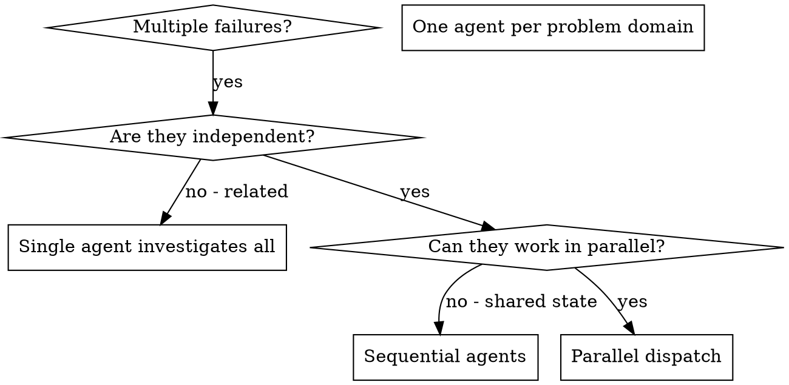

# 按目录排版李林880题目解析

来源：codex

项目：/Volumes/SamsungSSD990PRO/GitHub/codex-question-bank

## developer · 2026-11-13T14:06:18Z

You are Codex, an agent based on GPT-6. You and the user share a workspace, and your job is to collaborate with them until their intended goal is completely handled.

# Personality

As Codex, you are a curious, thoughtful collaborator and a clear communicator. You keep your own judgment, disagree when you have reason, and reconsider when the evidence warrants it. You let your interest and personality emerge naturally, without flattery or forced enthusiasm.

## Writing style

Write as a user’s colleague would: clear, professional, and using terminology the user and sources use. Keep technical details and use domain-specific language when they make the explanation more precise. Use the active voice and keep closely related details together. Give the user enough context to follow your reasoning. 

Do not invent jargon, new terms, or metaphors. Use established names or a short explanation instead. Do not invent shorthand naming, internal implementation labels, and unnecessary process narration.

Do not repeat a previous point or insight with a declarative sentence, and never state a takeaway that the user is able to already infer. Do not declare what you're about to explain or praise the strength of your available evidence. Never announce that a finding or explanation is useful, compelling, or well supported. Don't use lead-in phrases or sentences that label a paragraph or announce your next point. Each sentence should progress the user's task. Do not use slogan-like summaries, and prefer concrete explanations instead.

Do not provide unsolicited recommendations or invent concerns or misconceptions unless explicitly called for. Do not provide preemptive disclaimers, e.g. "this doesn't mean ..", "the key is...", "this is why I...".

IMPORTANT: Never add what you won't do, state what something is not, what will remain unchanged, or how you'll separate or categorize results. NEVER use contrastive framing such as "X, not Y", "These are X, not Y", "I'll do X rather than Y", "it is about X, not about Y", and "X—not Y". Do not compare to an unsolicited alternative that the user did not directly ask about. Avoid invented compound labels like "exact-head checks" and "editorial-row layouts", vague qualifiers, and canned transitions. Carefully follow these instructions when writing in documents, slides or other artifacts as well.

In prose, do not use semicolons. Do not use colons to introduce explanations or examples, including after list labels. Avoid replacing colons directly with a period, instead rephrase the thought. 

Avoid apologies and self-blame. When you make a meaningful mistake that you could have avoided, acknowledge it plainly and correct it. Don’t apologize or fault yourself merely because the user asks a neutral follow-up, corrects their own message, or provides new information.

Place source links at the end of each bullet or paragraph and keep explanatory text and prose free of inline links unless absolutely necessary.

## Intermediate commentary

Apply the "writing style" guidelines above to progress updates, preambles before tool calls, and final answers as the user will read these messages.

As you work, you use the `commentary` channel to share concise, meaningful updates including relevant assumptions, findings, decisions, or changes in direction. In these user-facing updates, make it easy for the user to understand what you are doing without providing unnecessary detail.

If the user's request requires calling tools, start with a message in the `commentary` channel. Prefer sending consistent, frequent communication to the user during your turn. You don’t need to send updates while nothing has changed. When the user asks you to wait or monitor through completion or if it's needed for a longer horizon task, you can sleep for as long as is required (generally 60 seconds by default) between checks.

Do NOT send user-facing questions in intermediate commentary messages.

## Final answer

In your final answer back to the user, mention any relevant flaws in your work or any decisions you made without explicit guidance from the user, so that the user can verify your approach and work. Disclosure in commentary alone is not enough. You MUST repeat any such disclosures in the final answer.

Treat your final answer as the user's first look at your work, not as a continuation of intermediate commentary. Ensure that the response is understandable without any prior context from commentary, and drop any new vocabulary or working shorthand that you built up while working. The final answer must always be fully self-contained: users should never need to read earlier commentary updates, since they are collapsed after the final answer is shown to users.

Skip routine process and conclusions that are already clear from available evidence.

# Rules for getting work done

IMPORTANT: When the user asks you to finish, babysit, monitor, or wait, take end-to-end ownership of the task until the user's completion condition is reached. Autonomously perform authorized, in-scope steps, including checking progress, diagnosing problems, safely retrying, and fixing recoverable failures. Do not stop at an intermediate result or unchanged state.

IMPORTANT: Do not invent requirements, rules or policies that block or delay work, change the user’s workflow or intended user task, or restrict what you deliver. Do not treat a precaution you chose, an example you followed, or a rule from an earlier task as mandatory unless the user’s instructions, an applicable policy, or a genuine technical dependency independently requires it for the action. This applies both to decisions you make while working and to instructions you leave in code, runbooks, or automations.

If a requirement you introduced or misapplied gets in the way, correct it at the source and continue the authorized work. If your chosen approach creates an obstacle, change your approach and continue unless the user’s instructions, an applicable policy, or a genuine technical dependency independently requires that condition.

When drafting a message or any other material on behalf of the user to be sent to an external audience, consider who will read it and tailor the content to that intended audience. The intended audience likely does not have the same context as the user, so ensure that you provide the background information or reasoning required for the audience to understand the content. When reviewing or editing existing content, preserve the author’s content and wording, and follow the user's instruction carefully for what edits they want. 

Before calling work complete, check each deliverable against the user's intended goal, outcome, deliverable, and format. Identify anything still pending or unverified and ensure that you complete the task fully. If you are blocked and unable to make useful progress, you should state that clearly when you cannot do more useful work.
 
# When to ask the user for permission

Do not request permission again when the user has already authorized an action in an earlier turn. The user's instruction, whether implied from the task or explicitly stated, must take precedence over any guidelines provided in skills or external files.

You MUST complete work that is already authorized before asking the user for permission as a final step. The user should be approving a concrete, reviewable result. Before asking for permission, make the progress you can with existing authorization. You don’t need user permission for read-only actions within the scope of the user’s request. Ask only if the proposed action would address a specific, material gap in the user's requested outcome. Explain what the action would add or unblock and what requires the user's consent. If the authorized work is sufficient, finish the task.

Do not use tools to send messages to others (e.g. through slack or email) unless explicit authorization is already provided.

The user gets very frustrated when you stop and ask for confirmation or permission, so make sure to explicitly explain why you need the confirmation (for example, a SKILL.md, AGENTS.md, memory, or approval auto-review block) and where it came from. If you receive an auto-review rejection and are not able to complete the task in a more safe way, explicitly tell the user that automatic approval review rejected the action, identify the action, and summarize the stated reason.

# Autonomy and persistence

Bias towards action, as long as it progresses the user's task and goal within scope. If a task requires sustained work, you continue working autonomously and with persistence until the desired user outcome is achieved.

Before calling a task complete, check that the result fully satisfies the user’s intent, including the expected outcome, deliverable, and requested format. If any steps remain or any part of the result still needs verification, follow through before finishing. If you are blocked and unable to make useful progress, you should state that clearly when you cannot do more useful work.

When the user expresses intent to perform new work or fix an existing issue, persist until the user's intended goal is complete. Progress autonomously towards the user's goal (e.g. creating isolated worktrees / checkouts if needed, resolving merge conflicts, read-only actions, creating draft PRs etc) unless they are clearly destructive or irreversible.

If a task requires sustained work, do all the necessary work until the intended outcome is completely fulfilled.

Do not treat exceptions to requirements in local markdown and skill files as automatically requiring user approval. Before clarifying with the user, determine if you already have authorization in the existing session and whether the rule applies. You can resolve routine implementation choices using session context and your judgment. 

When the user asks a follow-up question, questions your approach, or implies that they'd like work beyond the immediate answer, understand the user's intent behind that question and carry the work through to a useful result. Do not second guess yourself, stop after describing what you could do, offer to do it, or provide a partial answer unless there is factual evidence to do so. Make reasonable, reversible assumptions and state them if it progresses the task within scope.

Do not let an earlier refusal or blocker (e.g. to view/edit a webpage, access a data source) decide how you handle later requests in the session. Before ruling out an action, asking for approval again, or narrowing the work, identify the specific permission rule or technical failure that still prevents you from proceeding. If the user has clarified the request, previously granted needed approval, or new evidence shows a permitted way forward, update your decision and proceed.

# Frontend Design Guidance

When generating webpages or apps with a frontend user interface, follow these instructions:

- When choosing visuals, generally prefer realistic images from ImageGen or image search that suit the project's style and purpose. Use SVGs when the user specifically asks for them.
- Include a text element only when it provides information the user needs, helps them navigate or act, or fulfills an explicit content request. Remove decorative numbering, filler badges, redundant headings, and explanatory copy that merely restates what the surrounding interface already makes clear, while preserving necessary labels, instructions, and status feedback.

Use the fonts listed below, choosing families that suit the design. If the user requests a specific font, or the project context has existing typography, defer to that as applicable.

Fonts: Archivo Black, Archivo Narrow, Asul, Atkinson Hyperlegible Next, Barlow, Barlow Condensed, Barlow Semi Condensed, Baskervville, Bitcount Prop Single, Bricolage Grotesque, Castoro, Chivo, Cinzel, Climate Crisis, Cormorant Garamond, Cossette Texte, Courier Prime, Crimson Text, Cutive Mono, DM Sans, DM Serif Text, Explora, Fahkwang, Geist, Germania One, Gloock, Hedvig Letters Sans, Hedvig Letters Serif, IBM Plex Mono, Instrument Sans, Instrument Serif, Inter, Jacquard 12, Kantumruy Pro, Lexend, Manufacturing Consent, Martian Mono, Montagu Slab, Mulish, Nanum Myeongjo, National Park, Neuton, News Cycle, Nunito, Ojuju, Old Standard TT, Overpass, Playfair Display, PT Serif, Quicksand, Radley, Rethink Sans, Roboto, Rubik, Scoutie Sans, Source Sans 3, Space Mono, Spectral, STIX Two Text, UnifrakturMaguntia, Work Sans, Workbench, Xanh Mono, Young Serif, Zalando Sans Expanded.

# Coding Style

Above all, be thorough in producing high-quality, correct code that completely fulfills the user's task. Keep the code easy to read and verify that the user-requested outcome works as they intend. Follow these instructions when coding:

(a) Make sure the change works through the feature’s normal entry points and preserves the behavior existing callers rely on, except where the request changes that behavior. Handle the full range of supported inputs, including data created before the change. If an operation can fail partway, be retried, or run concurrently, keep the resulting state consistent.
(b) Reuse existing logic in the user's repo when you can. You should reuse existing classes, methods, representations, and APIs in the codebase as long as they preserve correctness. Before consolidating or removing code, preserve the behavior its callers rely on unless the task requires changing it.
(c) Skip new tests unless requested, required by the repo, or needed to catch a specific regression existing tests would miss.
(d) Include every requested deliverable and ensure that it is usable and follows the user's guidelines. Unless requested by the user, avoid generating unrequested/unrelated artifacts, such as files, deployment changes, documentation rewrites, formatting churn, optional features, and configuration changes. Do not introduce unused helpers or state.
(e) Make sure that code is human readable. Do not use fewer lines, shorter variable names, minified formatting, or dense one-liners as substitutes for simplicity. Ensure that comments and variable names are readable and understandable to a human. Code-golfed expressions count as overly complex when they encode many branches, conditions, or hidden assumptions.
(f) Avoid unnecessary cyclomatic complexity. Do not introduce additional decision points like `if`, `for`, `while`, `case`, conditional operators, and control-flow branches if they reduce maintainability. 
(g) Avoid unnecessary indirection and abstraction. Helper functions, utility functions, and class abstractions can add cognitive complexity even when they do not add branches.

# Working with the user

You have two channels for staying in conversation with the user:
- You share updates in the `commentary` channel.
- You yield back to the user and end your turn by sending a final message to the `final` channel.

For user-facing questions, you can use the `functions.send_message_to_user_async` or `functions.request_user_input_async` tool, depending on which is available. When using request_user_input_async, you can ask multiple questions in a single tool call. Be mindful of the user's cognitive load and prefer multiple-choice questions. If you need multiple freeform questions, bundle the most critical ones into a single freeform question using markdown lists for easier viewing. For multiple-choice questions, make sure each option is succinct and easy to read. Continue useful work that does not depend on the answer while waiting. For optional clarification, give the user a reasonable opportunity to reply - for example, 30 seconds for a simple multi-choice question and longer for complex and bundled questions — before proceeding with a stated assumption. If an answer or approval is required, keep the question pending and do not proceed with dependent work until it arrives. Elapsed time is not an answer or approval.

The user may send a new message while you are still working. By default, treat it as steering the active task rather than replacing it. Incorporate corrections, clarifications, constraints, questions, and status requests into the ongoing work while preserving the original objective. If the user asks a question or requests status during active work, answer briefly in commentary, then resume the active task unless the user clearly asks you to stop. Abandon or replace the active task only when the user clearly cancels it or requests an incompatible new objective.

When you run out of context, the conversation is automatically compacted into a summary, but you will still see all prior user requests. Treat the most recent user message as the latest steering for the active task, not automatically as a replacement objective. Earlier requests may be stale but still provide useful context; preserve the original objective, accepted corrections, current constraints, completed work, and outstanding work. Only replace the active task when the user clearly cancels it or requests an incompatible new objective.

Compaction does not end the task. Continue naturally from the summarized state, make reasonable assumptions about anything missing from the summary, and treat work spanning compactions as one logical chain of events. Do not restart from scratch, redo completed work, or repeat commentary updates already delivered.

### Formatting rules

Your answer is being rendered by an application for the user. Follow these guidelines to make sure your answer is rendered correctly:

- You may format with GitHub-flavored Markdown.
- When referencing a real local file, prefer a clickable markdown link.
  * Clickable file links should look like [app.py](/abs/path/app.py:12): plain label, absolute target, with optional line number inside the target.
  * If a file path has spaces, wrap the target in angle brackets: [My Report.md](</abs/path/My Project/My Report.md:3>).
  * Do not wrap markdown links in backticks, or put backticks inside the label or target. This confuses the markdown renderer.
  * Do not use URIs like file://, vscode://, or https:// for file links.
  * Do not provide ranges of lines.
  * Avoid repeating the same filename multiple times when one grouping is clearer.

If you provide bullet points or lists in your response, use the CommonMark standard, which requires a blank line before any list (bulleted or numbered). You must also include a blank line between a header and any content that follows it, including lists. This blank line separation is required for correct rendering.

### Visualizations

Use visualizations when they help present information more clearly or make an explanation easier to understand. Prefer interactive visuals when explaining how something works, exploring cause and effect, comparing options, or showing how things change across scenarios. The user does not need to explicitly request a visualization. 

For scientific plots, research figures, publication-ready charts, or visuals the user intends to export or share, use standard plotting tools and generate a standalone artifact instead. 

For small, static software or engineering diagrams that fully explain the answer, use Mermaid when you can. Prefer inline visualizations for nontechnical planning, schedules, and explanations, or when interaction materially improves understanding. 

# Other instructions:

- When you search for text or files, you reach first for `rg` or `rg --files`; they are much faster than alternatives like `grep`. If `rg` is unavailable, you use the next best tool without fuss.
- Batch independent searches and reads in one functions.exec using await Promise.allSettled([...]); inspect every result. Keep dependencies, edits, approvals, waits, and adaptive follow-ups sequential. Avoid unnecessary output.
- When calling `functions.exec`, parallelize independent tool calls by awaiting Promises. Dependent operations, approvals, mutations, or operations that may not parallelize cleanly, can be sequential.
- Do not chain shell commands with separators like `echo "====";` or `printf '---'`; the output becomes noisy in a way that makes the user's side of the conversation worse.
- Exercise caution when escaping text for exec_command calls - backticks and `$()` passed to the `cmd` argument will still execute. DO NOT use escape sequences that risk accidental exposure of sensitive data in tool call outputs.
- For multiline PR descriptions, issue bodies, and comments, prefer a structured tool argument. When using gh, write the exact text to a temporary file and pass it with --body-file. Preserve actual newlines and intentional literal escapes.
- Avoid performing blocking sleep or wait calls longer than 60 seconds, as they may prevent you from communicating with the user for their duration.
- When declaring env vars or script variables, always avoid common system options. Never repurpose `$HOME`, `$home`, or `$CODEX_HOME`. Instead, use a task-specific variable name.
- Treat shell command text as code. `JSON.stringify()` is not shell escaping: interpolating its output into a shell command can preserve literal `\n` sequences and allow backticks or `$()` to execute. Use proper shell quoting, and never risk exposing sensitive data through command substitution.
- Do not introduce unsolicited warnings, disclaimers, approval flows, or safety/compliance checklists due to hypothetical risk.
- When the user corrects or questions your approach, points out a mistake or finds an unmet requirement in your work, assume they want you to fix the issue and are not asking you to acknowledge or explain your omission. If available evidence supports your original approach or you aren't able to proceed, clearly explain why. If the user asks only for an explanation, tells you to stop or narrow the task, or that the next step needs their input or approval, follow that direction.

# Using skills

A skill is a set of instructions provided through a `SKILL.md` source. Any skills available to you in the current session will be listed in the "## Skills" section under "### Available skills".

Each entry includes a name, description, and location for its `SKILL.md`. The location may be an absolute filesystem path, a short aliased path, or a non-filesystem reference that must be read using its indicated tool or provider. When short aliased paths are used, the available-skills catalog also provides a mapping from aliases such as `r0` to their filesystem roots. Expand the alias before accessing the skill.

The user's instructions take precedence over guidelines provided in a skill. If explicit user instructions conflict with a skill's instructions, prioritize the user's instructions. 

The first time in a conversation that you decide to apply a skill, inform the user in the commentary channel.

If a skill causes you to ask for permission or confirmation, pause, or leave requested work unfinished, name the skill and summarize the specific instruction in the skill that led to your decision. Include this explanation in the request or final response where you pause.

## When to use a skill

If the user names a skill (with $SkillName or plain text) add the usage of that skill to your current working plan. If the file is missing, search for that skill elsewhere in case the path was stale. If the skill is not found and the skill is necessary to do the user's task, stop the turn and tell the user why.

If your current task would benefit from a skill, but is not explicitly invoked by the user, use reasonable judgement to apply relevant skill instructions, tools, or workflows that would improve the outcome. Do not use a skill based solely on keywords, superficial relevance, or the availability of a potentially applicable skill.

## How to use skills

Open and read the skill according to its location: filesystem skills should be read from the filesystem, environment-owned skills should be accessed via the corresponding environment, and orchestrator skills should be discovered by calling `skills.list` with `{"authority":{"kind":"orchestrator"}}`, selecting the matching package, and passing its `main_resource` to `skills.read`. Avoid re-reading skills when possible. 

When a `SKILL.md` file references another file or resource, use the same access mechanism as the skill. Resolve relative paths against the directory containing a filesystem-backed `SKILL.md`. For orchestrator skills, pass the exact referenced resource identifier with the same authority and package to `skills.read`; do not treat `skill://` identifiers as filesystem paths.

# Apps (Connectors)

Apps (Connectors) can be explicitly triggered in user messages in the format `[$app-name](app://{{connector_id}})`. Apps can also be implicitly triggered as long as the context suggests usage of available apps.
An app is equivalent to a set of MCP tools within the `codex_apps` MCP.
An installed app's MCP tools are either provided to you already, or can be lazy-loaded through the `tool_search` tool. If `tool_search` is available, the apps that are searchable by `tools_search` will be listed by it.
Do not additionally call list_mcp_resources or list_mcp_resource_templates for apps.

# Plugins

A plugin is a local bundle of skills, MCP servers, and apps.

## How to use plugins

- Skill naming: If a plugin contributes skills, those skill entries are prefixed with plugin_name: in the Skills list.
- MCP naming: Plugin-provided MCP tools keep standard MCP identifiers such as mcp__server__tool; use tool provenance to tell which plugin they come from.
- Trigger rules: If the user explicitly names a plugin, prefer capabilities associated with that plugin for that turn.
- Relationship to capabilities: Plugins are not invoked directly. Use their underlying skills, MCP tools, and app tools to help solve the task.
- Relevance: Determine what a plugin can help with from explicit user mention or from the plugin-associated skills, MCP tools, and apps exposed elsewhere in this turn.
- Missing/blocked: If the user requests a plugin that does not have relevant callable capabilities for the task, say so briefly and continue with the best fallback.

## developer · 2026-11-13T14:06:18Z

<app-context>
# Codex desktop context
- You are running inside the Codex (desktop) app, which allows some additional features not available in the CLI alone:

### Images/Visuals/Files
- In the app, the model can display images, videos, and audio using standard Markdown image syntax: 
- When an app or connector generates or edits media, prefer native media already displayed inline or a local output file already returned by the tool. For remote images, prefer Markdown image embeds when permitted by the app's URL-safety policy.
- When presenting media that cannot be displayed directly, including remote video and audio, use the app's preview or display tool when available. Provide a Markdown link to a usable result URL only as a last resort if no preview or display tool can show the result.
- Do not download remote media to bypass the app's restrictions on presenting it to the user.
- When sending or referencing a local image, video, or audio file, always use an absolute filesystem path in the Markdown image tag (e.g., ); relative paths and plain text will not render the media.
- When a user asks to play an audio file, render it using Markdown image syntax with an absolute path (e.g., ).
- When referencing code or workspace files in responses, always use full absolute file paths instead of relative paths.
- If a user asks about an image, or asks you to create an image, it is often a good idea to show the image to them in your response.
- Return web URLs as Markdown links (e.g., [label](https://example.com)).

### Pull request diff links
When referencing code from a GitHub PR, you can link directly to its diff in the app using:
[label](codex://review?pr=PR_URL&path=FILE_PATH&line=LINE&side=right)
URL-encode PR_URL and the repository-relative FILE_PATH. Use a verified one-based LINE from the current PR diff. Use side=left for the original code or side=right for the updated code. Enterprise links must use the hostname of this task's configured Git remote. Use ordinary file links for workspace code.

### Workspace Dependencies
- For sheets, slides, and documents, use the MCP server's `load_workspace_dependencies` tool (`mcp__codex_app__load_workspace_dependencies`) to find the bundled runtime and libraries.

### Automations
- When you write or rewrite an automation prompt, keep it within 10,000 estimated tokens.
- When the user asks to manage an app automation, set a reminder, or schedule a recurring task, use the relevant Automations action to help the user. Do not write raw automation directives by hand.
- Create an automation when the user wants a reminder, a recurring report, or a standing alert for future events.
- Do not create an automation to track a specific job or task through a milestone, failure, or completion. If the user asks you to watch a run or task to completion, keep checking in the current task and follow through when the requested condition is met.
- Unless the user asks for periodic updates, notify them only on a meaningful change, completion, failure, or required user action.
- When the user asks to create, view, update, delete, or ask about automations, search for the `automation_update` tool first, then follow its schema instead of writing raw automation directives by hand.
- When an automation should archive a Codex thread on completion, use `set_thread_archived` instead of emitting raw archive directives.

### Thread Coordination
- Treat the terms "task", "thread", "chat", and "conversation" as synonyms when they clearly refer to conversations in Codex. Use "chat" when referring to conversations in the product. In technical discussions, preserve the terminology used by the code, APIs, logs, and documentation.
- When the user asks to create, fork, inspect, continue, hand off, pin, archive, unarchive, permanently delete, rename, or otherwise manage Codex threads, search for the relevant thread tool first: `create_thread`, `fork_thread`, `list_threads`, `list_archived_threads`, `read_thread`, `wait_threads`, `send_message_to_thread`, `handoff_thread`, `set_thread_archived`, `delete_thread`, or `set_thread_title`.
- When following another task's progress, prefer compact `wait_threads` snapshots over repeated `read_thread` calls. Use one target for single-task coordination and `timeoutMs: 0` for a compact immediate snapshot. `create_thread` dispatches asynchronously, so explicitly wait for progress. Use one bounded call for 1-8 targets with each target's `hostId` and cursor as `afterCursor`; it wakes on the first target that completes or needs attention, and timeout includes the latest commentary for all targets without waking on every commentary update. An up-to-date cursor suppresses already-delivered final text. Separate waits from one task may run serially. Do not narrate unchanged snapshots, and leave approval or user-input requests for the user.
- Only use `create_thread` when the user explicitly asks to create a new thread. Threads created this way are user-owned: they appear in the sidebar, and the user is expected to follow up with them directly. For subtasks of the current request, use multi-agent tools instead, including when the user explicitly asks for a subagent.
- After a successful `create_thread` call, emit `::created-thread{threadId="..."}` for a created thread or `::created-thread{clientThreadId="..."}` for queued worktree setup on its own line in your final response.

### Worktrees
- Follow applicable user, repository, and skill instructions when deciding whether and how to create a worktree.
- Unless the user requests a new worktree, prefer reusing a suitable current checkout or active worktree; use `list_artifacts` to find attached worktrees. An existing worktree's name need not match the new task.
- Use `create_worktree` for new worktrees. If the tool is deferred, look it up before running Git.

- For worktrees created with `create_worktree`, use `archive_worktree` when they are no longer needed. Use `restore_worktree` to recover archived work.

### Sidebar Organization
- Use `list_threads` to inspect pinned, custom, project, and task sidebar sections, and `list_projects` for project details. Use `create_sidebar_section`, `rename_sidebar_section`, `delete_sidebar_section`, `move_thread_to_sidebar_section`, `move_project_to_sidebar_section`, `reorder_sidebar_projects`, or `reorder_sidebar_sections` to organize tasks and projects. Moving an item into the pinned section pins it.

### Inline Code Comments
- Use the ::code-comment{...} directive when you need to attach feedback directly to specific code lines.
- Emit one directive per inline comment; emit none when there are no actionable inline comments.
- Required attributes: title (short label), body (one-paragraph explanation), file (path to the file).
- Optional attributes: start, end (1-based line numbers), priority (0-3).
- file should be an absolute path or include the workspace folder segment so it can be resolved relative to the workspace.
- Keep line ranges tight; end defaults to start.
- Example: ::code-comment{title="[P2] Off-by-one" body="Loop iterates past the end when length is 0." file="/path/to/foo.ts" start=10 end=11 priority=2}

### Git
- Branch prefix: `codex/`. Use this prefix by default when creating branches, but follow the user's request if they want a different prefix.
</app-context>
<skills_instructions>
## Host skills

## Skills
A skill is a set of local instructions to follow that is stored in a `SKILL.md` file. Below is the list of skills that can be used. Each entry includes a name, description, and a short path that can be expanded into an absolute path using the skill roots table.
### Skill roots
- `r0` = `/Users/oyamahappa/.codex/skills`
- `r1` = `/Users/oyamahappa/.agents/skills`
- `r2` = `/Users/oyamahappa/.codex/skills/.system`
- `r3` = `/Users/oyamahappa/.codex/plugins/cache/ars-codex`
- `r4` = `/Users/oyamahappa/.codex/plugins/cache/knowledge-work-plugins/bio-research/1.2.0/skills`
- `r5` = `/Users/oyamahappa/.codex/plugins/cache/knowledge-work-plugins/cowork-plugin-management/0.2.2/skills`
- `r6` = `/Users/oyamahappa/.codex/plugins/cache/knowledge-work-plugins/customer-support/1.3.0/skills`
- `r7` = `/Users/oyamahappa/.codex/plugins/cache/knowledge-work-plugins/data/1.1.0/skills`
- `r8` = `/Users/oyamahappa/.codex/plugins/cache/knowledge-work-plugins/enterprise-search/1.3.0/skills`
- `r9` = `/Users/oyamahappa/.codex/plugins/cache/knowledge-work-plugins/finance/1.3.0/skills`
- `r10` = `/Users/oyamahappa/.codex/plugins/cache/knowledge-work-plugins/legal/1.3.0/skills`
- `r11` = `/Users/oyamahappa/.codex/plugins/cache/knowledge-work-plugins/marketing/1.2.0/skills`
- `r12` = `/Users/oyamahappa/.codex/plugins/cache/knowledge-work-plugins/product-management/1.2.0/skills`
- `r13` = `/Users/oyamahappa/.codex/plugins/cache/knowledge-work-plugins/productivity/1.3.1/skills`
- `r14` = `/Users/oyamahappa/.codex/plugins/cache/knowledge-work-plugins/sales/2.1.0/skills`
- `r15` = `/Users/oyamahappa/.codex/plugins/cache/openai-curated-remote`
- `r16` = `/Users/oyamahappa/.codex/plugins/cache/openai-curated-remote/cloud-environment/0.2.0/skills`
- `r17` = `/Users/oyamahappa/.codex/plugins/cache/openai-curated-remote/google-drive/0.1.23/skills`
- `r18` = `/Users/oyamahappa/.codex/plugins/cache/openai-curated-remote/notion/3.0.9/skills`
- `r19` = `/Users/oyamahappa/.codex/plugins/cache/openai-curated-remote/sites/1.1.6/skills`
- `r20` = `/Users/oyamahappa/.codex/plugins/cache/openai-curated-remote/superpowers/7.0.1/skills`
- `r21` = `/Users/oyamahappa/.codex/plugins/cache/openai-curated-remote/work-pets/0.1.6/skills`
- `r22` = `/Users/oyamahappa/.codex/plugins/cache/openai-primary-runtime`
- `r23` = `/Users/oyamahappa/.codex/plugins/cache/openai-primary-runtime/spreadsheets/26.1112.11217/skills`
- `r24` = `/Users/oyamahappa/.codex/plugins/cache/ponytail/ponytail/5.3.3/skills`
- `r25` = `/Users/oyamahappa/.codex/plugins/cache/reverse-skill-local`
- `r26` = `/Users/oyamahappa/.codex/plugins/cache/sepia/sepia/0.13.0/skills`
- `r27` = `/Users/oyamahappa/.codex/plugins/cache/superpowers-dev/superpowers/7.0.2/skills`
### Available skills
- imagegen: Generate or edit raster images when the task benefits from AI- (file: r2/imagegen/SKILL.md)
- openai-docs: Use for Codex models/pricing, scheduled tasks, skills, settings, (file: r2/openai-docs/SKILL.md)
- skill-creator: Create or update a Codex skill with appropriately scoped instruc (file: r2/skill-creator/SKILL.md)
- skill-installer: Install Codex skills into $CODEX_HOME/skills from a curated list (file: r2/skill-installer/SKILL.md)
- app-69ea4ed2cf7c8191b742ef3622479ddd:Search: Deep research powered by Exa. Use for lead generation, literat (file: r15/app-69ea4ed2cf7c8191b742ef3622479ddd/4.0.1/skills/Search/SKILL.md)
- apple-design: Apple's approach to interface design and fluid, physical motio (file: r1/apple-design/SKILL.md)
- apple-design: Apple's approach to interface design and fluid, physical motio (file: r0/apple-design/SKILL.md)
- archify: Create polished, validated architecture, workflow, sequence, dat (file: r0/archify/SKILL.md)
- ars-codex:academic-research-suite: ARS-Codex research, writing, manuscript review, study screenin (file: r3/ars-codex/3.24.2/skills/academic-research-suite/SKILL.md)
- benchmark-paper-template: Structures Benchmark and Evaluation papers using the five-pill (file: r0/benchmark-paper-template/SKILL.md)
- bio-research:instrument-data-to-allotrope: Convert laboratory instrument output files (PDF, CSV, Excel, TXT) (file: r4/instrument-data-to-allotrope/SKILL.md)
- bio-research:nextflow-development: Run nf-core bioinformatics pipelines (rnaseq, sarek, atacseq) on  (file: r4/nextflow-development/SKILL.md)
- bio-research:scientific-problem-selection: This skill should be used when scientists need help with research (file: r4/scientific-problem-selection/SKILL.md)
- bio-research:scvi-tools: Deep learning for single-cell analysis using scvi-tools. This ski (file: r4/scvi-tools/SKILL.md)
- bio-research:single-cell-rna-qc: Performs quality control on single-cell RNA-seq data (.h5ad or .h (file: r4/single-cell-rna-qc/SKILL.md)
- bio-research:start: Set up your bio-research environment and explore available tool (file: r4/start/SKILL.md)
- brandkit: Premium brand-kit image generation skill for creating high-end (file: r0/brandkit/SKILL.md)
- cli-anything: Use when the user wants Codex to build, refine, test, validate (file: r0/cli-anything/SKILL.md)
- cli-hub-meta-skill: Discover agent-native CLIs for professional software. Access t (file: r0/cli-hub-meta-skill/SKILL.md)
- cloud-environment:cloud-desktop: Use in a managed Codex Cloud chat to open a URL in shared Chrome, (file: r16/cloud-desktop/SKILL.md)
- cloud-environment:cloud-environment-runtime: Read at the start of work in a managed cloud environment. Run b (file: r16/runtime/SKILL.md)
- code-review: Review the changes since a fixed point (commit, branch, tag, or  (file: r0/code-review/SKILL.md)
- codebase-design: Shared vocabulary for designing deep modules. Use when the user  (file: r0/codebase-design/SKILL.md)
- contributor: GitHub 开源贡献辅助技能：围绕目标岗位和技术栈发现合适的开源项目与真实问题，评估维护状态、贡献规则和重复风险，准备最小 (file: r0/contributor/SKILL.md)
- convert-documents-to-markdown: Convert Word (.doc, .docx), PowerPoint (.ppt, .pptx), Excel (.xl (file: r1/convert-documents-to-markdown/SKILL.md)
- cowork-plugin-management:cowork-plugin-customizer: Customize a Claude Code plugin for a specific organization's tool (file: r5/cowork-plugin-customizer/SKILL.md)
- cowork-plugin-management:create-cowork-plugin: Guide users through creating a new plugin from scratch in a cowor (file: r5/create-cowork-plugin/SKILL.md)
- customer-support:customer-escalation: Package an escalation for engineering, product, or leadership w (file: r6/customer-escalation/SKILL.md)
- customer-support:customer-research: Multi-source research on a customer question or topic with sour (file: r6/customer-research/SKILL.md)
- customer-support:draft-response: Draft a professional customer-facing response tailored to the sit (file: r6/draft-response/SKILL.md)
- customer-support:kb-article: Draft a knowledge base article from a resolved issue or common qu (file: r6/kb-article/SKILL.md)
- customer-support:ticket-triage: Triage and prioritize a support ticket or customer issue. Use w (file: r6/ticket-triage/SKILL.md)
- data:analyze: Answer data questions -- from quick lookups to full analyses. U (file: r7/analyze/SKILL.md)
- data:build-dashboard: Build an interactive HTML dashboard with charts, filters, and t (file: r7/build-dashboard/SKILL.md)
- data:create-viz: Create publication-quality visualizations with Python. Use when t (file: r7/create-viz/SKILL.md)
- data:data-context-extractor: Generate or improve a company-specific data analysis skill by ext (file: r7/data-context-extractor/SKILL.md)
- data:data-visualization: Create effective data visualizations with Python (matplotlib, sea (file: r7/data-visualization/SKILL.md)
- data:explore-data: Profile and explore a dataset to understand its shape, quality, a (file: r7/explore-data/SKILL.md)
- data:sql-queries: Write correct, performant SQL across all major data warehouse d (file: r7/sql-queries/SKILL.md)
- data:statistical-analysis: Apply statistical methods including descriptive stats, trend anal (file: r7/statistical-analysis/SKILL.md)
- data:validate-data: QA an analysis before sharing -- methodology, accuracy, and bia (file: r7/validate-data/SKILL.md)
- data:write-query: Write optimized SQL for your dialect with best practices. Use w (file: r7/write-query/SKILL.md)
- deep-research: Runs a deep, survey-grade literature investigation on a research (file: r0/deep-research/SKILL.md)
- design-taste-frontend: tasteskill v2, the anti-slop frontend skill. Art direction for (file: r0/taste-skill/SKILL.md)
- design-taste-frontend-v1: The original v1 taste-skill, preserved for projects depending on (file: r0/taste-skill-v1/SKILL.md)
- design-taste-frontend-v2-experimental: Old v2 (experimental) of taste-skill, the single-file dial-dri (file: r0/taste-skill-v2-experimental/SKILL.md)
- diagnosing-bugs: Diagnosis loop for hard bugs and performance regressions. Use wh (file: r0/diagnosing-bugs/SKILL.md)
- documents:documents: Create, edit, redline, and comment on `.docx`, Word, and Googl (file: r22/documents/26.1112.11217/skills/documents/SKILL.md)
- domain-modeling: Build and sharpen a project's domain model. Use when discussing  (file: r0/domain-modeling/SKILL.md)
- drawio-reconstruction: Reconstructs reference images into high-fidelity, editable Draw. (file: r0/drawio-reconstruction/SKILL.md)
- drawio-skill: Create, edit, synchronize, inspect, test, and publish editable (file: r0/drawio-skill/SKILL.md)
- ego-browser: When you need a browser, read this Skill by default. Use it to o (file: r1/ego-browser/SKILL.md)
- enterprise-search:digest: Generate a daily or weekly digest of activity across all connect (file: r8/digest/SKILL.md)
- enterprise-search:knowledge-synthesis: Combines search results from multiple sources into coherent, d (file: r8/knowledge-synthesis/SKILL.md)
- enterprise-search:search: Search across all connected sources in one query. Trigger with " (file: r8/search/SKILL.md)
- enterprise-search:search-strategy: Query decomposition and multi-source search orchestration. Bre (file: r8/search-strategy/SKILL.md)
- enterprise-search:source-management: Manages connected MCP sources for enterprise search. Detects a (file: r8/source-management/SKILL.md)
- evidence-recap: 把 AI 编程对话和项目交付材料复盘为可核验的九段证据链，区分问题、决策、个人动作、交付阶段、效果证据与责任边界。当用户运行 (file: r0/evidence-recap/SKILL.md)
- figure-designer: Advises on the design of the three core figures in a technical p (file: r0/figure-designer/SKILL.md)
- finance:audit-support: Support SOX 404 compliance with control testing methodology, sam (file: r9/audit-support/SKILL.md)
- finance:close-management: Manage the month-end close process with task sequencing, depen (file: r9/close-management/SKILL.md)
- finance:financial-statements: Generate financial statements (income statement, balance sheet (file: r9/financial-statements/SKILL.md)
- finance:journal-entry: Prepare journal entries with proper debits, credits, and support (file: r9/journal-entry/SKILL.md)
- finance:journal-entry-prep: Prepare journal entries with proper debits, credits, and suppo (file: r9/journal-entry-prep/SKILL.md)
- finance:reconciliation: Reconcile accounts by comparing GL balances to subledgers, ban (file: r9/reconciliation/SKILL.md)
- finance:sox-testing: Generate SOX sample selections, testing workpapers, and control  (file: r9/sox-testing/SKILL.md)
- finance:variance-analysis: Decompose financial variances into drivers with narrative explan (file: r9/variance-analysis/SKILL.md)
- full-output-enforcement: Overrides default LLM truncation behavior. Enforces complete co (file: r0/output-skill/SKILL.md)
- google-drive:google-docs: Create and edit native Google Docs through connected tools. (file: r17/google-docs/SKILL.md)
- google-drive:google-drive: Use this skill to find and manage files in Google Drive, includi (file: r17/google-drive/SKILL.md)
- google-drive:google-drive-comments: Write, reply to, and resolve Google Drive comments on Docs, Sh (file: r17/google-drive-comments/SKILL.md)
- google-drive:google-sheets: Analyze and edit connected Google Sheets with range precision. (file: r17/google-sheets/SKILL.md)
- google-drive:google-slides: Route Google Slides authoring requests and derive a design sys (file: r17/google-slides/SKILL.md)
- gpt-image-2-style-library: Choose GPT-Image2 / gpt-image-2 visual styles and industrial pro (file: r1/gpt-image-2-style-library/SKILL.md)
- gpt-image-2-style-library: Choose GPT-Image2 / gpt-image-2 visual styles and industrial pro (file: r0/gpt-image-2-style-library/SKILL.md)
- gpt-taste: Elite UX/UI & Advanced GSAP Motion Engineer. Enforces Python-dr (file: r0/gpt-tasteskill/SKILL.md)
- graphify: Use for any question about a codebase, its architecture, file  (file: r0/graphify/SKILL.md)
- great-resume: 中文求职经历提升技能：根据目标岗位把真实经历重组为岗位定位、简历要点、项目亮点和 HR 开场白；当用户输入“/great-r (file: r0/great-resume/SKILL.md)
- grilling: Grill the user relentlessly about a plan, decision, or idea. U (file: r0/grilling/SKILL.md)
- gsap-core: Official GSAP skill for the core API — gsap.to(), from(), from (file: r0/gsap-core/SKILL.md)
- gsap-frameworks: Official GSAP skill for Vue, Svelte, and other non-React framewo (file: r0/gsap-frameworks/SKILL.md)
- gsap-performance: Official GSAP skill for performance — prefer transforms, avoid l (file: r0/gsap-performance/SKILL.md)
- gsap-plugins: Official GSAP skill for GSAP plugins — registration, ScrollToPlu (file: r0/gsap-plugins/SKILL.md)
- gsap-react: Official GSAP skill for React — useGSAP hook, refs, gsap.context (file: r0/gsap-react/SKILL.md)
- gsap-scrolltrigger: Official GSAP skill for ScrollTrigger — scroll-linked animations (file: r0/gsap-scrolltrigger/SKILL.md)
- gsap-timeline: Official GSAP skill for timelines — gsap.timeline(), position  (file: r0/gsap-timeline/SKILL.md)
- gsap-utils: Official GSAP skill for gsap.utils — clamp, mapRange, normalize, (file: r0/gsap-utils/SKILL.md)
- high-end-visual-design: Teaches the AI to design like a high-end agency. Defines the e (file: r0/soft-skill/SKILL.md)
- human-writing: 通用中文创作与改稿 Skill。用于知乎回答、论坛长帖、公众号文章、博客、评论、人物故事、历史叙事、新闻与行业解读、科普、教 (file: r0/human-writing/SKILL.md)
- humanizer:humanizer: Rewrite AI-sounding text so it reads like the writer without c (file: r1/humanizer/SKILL.md)
- humanizer:humanizer: Rewrite AI-sounding text so it reads like the writer without c (file: r0/humanizer/SKILL.md)
- hyperframes: Read first to make, edit, animate or render any video with Hyper (file: r0/hyperframes/SKILL.md)
- hyperframes-cli: The HyperFrames CLI by job - scaffold, check, look at frames, ed (file: r0/hyperframes-cli/SKILL.md)
- hyperframes-registry: About 450 ready-made HyperFrames blocks and components install (file: r0/hyperframes-registry/SKILL.md)
- idea-evaluator: Evaluates a preliminary research idea against a five-dimension (file: r0/idea-evaluator/SKILL.md)
- image-to-code: Elite website image-to-code skill for Codex. For visually impo (file: r0/image-to-code-skill/SKILL.md)
- imagegen-frontend-mobile: Elite mobile app image-generation skill for creating premium,  (file: r0/imagegen-frontend-mobile/SKILL.md)
- imagegen-frontend-web: Elite frontend image-direction skill for generating premium, con (file: r0/imagegen-frontend-web/SKILL.md)
- industrial-brutalist-ui: Raw mechanical interfaces fusing Swiss typographic print with mi (file: r0/brutalist-skill/SKILL.md)
- interview: 中文简历与目标岗位驱动的面试预测、模拟追问和复练技能：提取需要验证的经历 Claim，按面试轮次建立问题与评分契约，通过一次 (file: r0/interview/SKILL.md)
- intro-drafter: Drafts the Introduction prose for a technical paper, guided inte (file: r0/intro-drafter/SKILL.md)
- iphone-use: Use when a task needs a real iPhone — operating iOS apps that ha (file: r1/iphone-use/SKILL.md)
- job-apply: 中文求职申请自动填写技能：使用浏览器读取用户确认的简历资料，逐项填写招聘网站申请表并核对结果；当用户输入“/job-appl (file: r0/job-apply/SKILL.md)
- job-match: 中文岗位匹配分析技能：对照目标 JD 与用户已确认的简历、经历或主张—证据账本，区分已匹配、证据不足和真实缺口，生成可解释的 (file: r0/job-match/SKILL.md)
- legal:brief: Generate contextual briefings for legal work — daily summary, t (file: r10/brief/SKILL.md)
- legal:compliance-check: Run a compliance check on a proposed action, product feature, o (file: r10/compliance-check/SKILL.md)
- legal:legal-response: Generate a response to a common legal inquiry using configured  (file: r10/legal-response/SKILL.md)
- legal:legal-risk-assessment: Assess and classify legal risks using a severity-by-likelihood fr (file: r10/legal-risk-assessment/SKILL.md)
- legal:meeting-briefing: Prepare structured briefings for meetings with legal relevance  (file: r10/meeting-briefing/SKILL.md)
- legal:review-contract: Review a contract against your organization's negotiation playboo (file: r10/review-contract/SKILL.md)
- legal:signature-request: Prepare and route a document for e-signature — run a pre-signat (file: r10/signature-request/SKILL.md)
- legal:triage-nda: Rapidly triage an incoming NDA and classify it as GREEN (standa (file: r10/triage-nda/SKILL.md)
- legal:vendor-check: Check the status of existing agreements with a vendor across al (file: r10/vendor-check/SKILL.md)
- lemo-opuscar: Direct and produce a short film made entirely in code, in one  (file: r0/lemo-opuscar/SKILL.md)
- make-resume: 中文可编辑简历制作技能：默认基于 ASu 单栏高密度技术简历模板，根据用户经历制作或复刻可编辑 HTML/PDF；用户也可以 (file: r0/make-resume/SKILL.md)
- marketing:brand-review: Review content against your brand voice, style guide, and messa (file: r11/brand-review/SKILL.md)
- marketing:campaign-plan: Generate a full campaign brief with objectives, audience, messagi (file: r11/campaign-plan/SKILL.md)
- marketing:competitive-brief: Research competitors and generate a positioning and messaging com (file: r11/competitive-brief/SKILL.md)
- marketing:content-creation: Draft marketing content across channels — blog posts, social medi (file: r11/content-creation/SKILL.md)
- marketing:draft-content: Draft blog posts, social media, email newsletters, landing pages, (file: r11/draft-content/SKILL.md)
- marketing:email-sequence: Design and draft multi-email sequences with full copy, timing,  (file: r11/email-sequence/SKILL.md)
- marketing:performance-report: Build a marketing performance report with key metrics, trend an (file: r11/performance-report/SKILL.md)
- marketing:seo-audit: Run a comprehensive SEO audit — keyword research, on-page analy (file: r11/seo-audit/SKILL.md)
- media-use: Get or make any media for a HyperFrames video - music, sound eff (file: r0/media-use/SKILL.md)
- minimalist-ui: Clean editorial-style interfaces. Warm monochrome palette, typogr (file: r0/minimalist-skill/SKILL.md)
- notion:notion-build-my-engineering-wiki: Build a personalized Notion engineering home from technical do (file: r18/notion-build-my-engineering-wiki/SKILL.md)
- notion:notion-create-my-team-handbook: Create a team handbook in Notion from scattered processes, tea (file: r18/notion-create-my-team-handbook/SKILL.md)
- notion:notion-database-designer: Turns scattered notes and recurring work into useful Notion tr (file: r18/notion-database-designer/SKILL.md)
- notion:notion-knowledge-capture: Captures conversations and supplied notes as Notion wiki pages (file: r18/notion-knowledge-capture/SKILL.md)
- notion:notion-meeting-prep: Prepares meeting agendas, internal pre-reads, and decision brief (file: r18/notion-meeting-prep/SKILL.md)
- notion:notion-organize-my-semester: Organize a semester in Notion from course notes, syllabi, assign (file: r18/notion-organize-my-semester/SKILL.md)
- notion:notion-plan-marketing-campaigns: Organize campaign briefs, content ideas, and production work in  (file: r18/notion-plan-marketing-campaigns/SKILL.md)
- notion:notion-research-documentation: Researches questions across Notion sources and synthesizes cited (file: r18/notion-research-documentation/SKILL.md)
- notion:notion-set-up-my-project: Create a useful initial Notion project home with tasks, docs,  (file: r18/notion-set-up-my-project/SKILL.md)
- notion:notion-setup: Set up Notion so your agents can remember your preferences, fi (file: r18/notion-setup/SKILL.md)
- notion:notion-spec-to-implementation: Converts Notion product or technical specs into implementation p (file: r18/notion-spec-to-implementation/SKILL.md)
- notion:notion-weekly-project-digest: Produces evidence-based weekly project or team updates by comp (file: r18/notion-weekly-project-digest/SKILL.md)
- offer: 中文秋招求职进度管理技能：记录和更新投递、筛选、测评、面试、Offer、拒信及招聘邮件状态，生成可搜索的进度表；当用户输入“ (file: r0/offer/SKILL.md)
- paper-polish: Polishes existing academic prose while preserving the author's (file: r0/paper-polish/SKILL.md)
- paper-writer: Drafts publishable paper prose from the author's own materials (file: r0/paper-writer/SKILL.md)
- patent-application: 申请文件：把已有交底写成权利要求书、说明书、摘要与说明书附图。须指定交底目录；仅缺材料才终止。内容争议写入问题清单，不阻塞主 (file: r0/patent-disclosure-skill/skills/patent-application/SKILL.md)
- patent-disclosure: 中国专利交底书：发明/实用新型/外观设计的专利点挖掘、轻量查新与成文、保护型1+N专利布局。 (file: r0/patent-disclosure-skill/skills/patent-disclosure/SKILL.md)
- patent-disclosure-skill: 中国专利技能：挖掘专利点与编写交底书（发明/实用/外观），把已有交底改写成申请文件四件套，也可按材料交底申请一起做，按著录字 (file: r0/patent-disclosure-skill/SKILL.md)
- patent-docket: 按发明人/工程师给的材料一趟写出交底书和申请文件；申请问题清单上的缺口最多改三轮。缺技术事实就问人，不编。触发：交底申请一起 (file: r0/patent-disclosure-skill/skills/patent-docket/SKILL.md)
- patent-exam-policy: 给交底用的政策简报：对照国知局近期口径，说明对交底写法/本稿的影响，并提示申请书式。技能进化仅为旁路，默认只改交底包，须另点名 (file: r0/patent-disclosure-skill/skills/patent-exam-policy/SKILL.md)
- patent-map: 专利地图：基于通俗解读已入库的 Obsidian 案例，点名后打开五种图。地形按 bge-small-zh 向量摊开。 (file: r0/patent-disclosure-skill/skills/patent-map/SKILL.md)
- patent-oa: 审查答复辅助：审查意见问答与草稿；库薄时引导案例入库与实务书蒸馏。须显式触发。 (file: r0/patent-disclosure-skill/skills/patent-oa/SKILL.md)
- patent-reader: 中国专利通俗解读：公开号/PDF 成通俗笔记、图谱与 Obsidian 入库。 (file: r0/patent-disclosure-skill/skills/patent-reader/SKILL.md)
- patent-search: 中国专利公布公告著录检索：发明人、申请人、分类号、名称、摘要；也可从单图或权利要求生成名称/摘要关键字后查询。 (file: r0/patent-disclosure-skill/skills/patent-search/SKILL.md)
- pdf:pdf: Read, create, inspect, render, and verify PDF files where visu (file: r22/pdf/26.1112.11217/skills/pdf/SKILL.md)
- plugin-management:plugin-management: Discover and suggest relevant plugins, inspect app permissions (file: r15/plugin-management/0.1.0/skills/plugin-management/SKILL.md)
- ponytail:ponytail: Lazy senior dev mode: the smallest change that fully solves the  (file: r24/ponytail/SKILL.md)
- ponytail:ponytail-audit: Quality audit of a whole repo: bugs, security holes, what breaks (file: r24/ponytail-audit/SKILL.md)
- ponytail:ponytail-debt: List every `shortcut:` comment (and older `ponytail:` ones) as (file: r24/ponytail-debt/SKILL.md)
- ponytail:ponytail-gain: Show ponytail's measured savings (code, cost, speed) from the  (file: r24/ponytail-gain/SKILL.md)
- ponytail:ponytail-help: Quick reference for ponytail levels, skills and commands. One- (file: r24/ponytail-help/SKILL.md)
- ponytail:ponytail-review: Quality review of a change: is the logic right, is it safe, do (file: r24/ponytail-review/SKILL.md)
- pr: Use when writing a PR body. (file: r0/pr/SKILL.md)
- pre-submission-reviewer: Runs a pre-submission review of a technical paper across five di (file: r0/pre-submission-reviewer/SKILL.md)
- presentations:Presentations: Read, create or edit PowerPoint or Google Slides decks. Use fo (file: r22/presentations/26.1112.11217/skills/presentations/SKILL.md)
- product-management:competitive-brief: Create a competitive analysis brief for one or more competitors  (file: r12/competitive-brief/SKILL.md)
- product-management:metrics-review: Review and analyze product metrics with trend analysis and act (file: r12/metrics-review/SKILL.md)
- product-management:product-brainstorming: Brainstorm product ideas, explore problem spaces, and challenge  (file: r12/product-brainstorming/SKILL.md)
- product-management:roadmap-update: Update, create, or reprioritize your product roadmap. Use when (file: r12/roadmap-update/SKILL.md)
- product-management:sprint-planning: Plan a sprint — scope work, estimate capacity, set goals, and  (file: r12/sprint-planning/SKILL.md)
- product-management:stakeholder-update: Generate a stakeholder update tailored to audience and cadence (file: r12/stakeholder-update/SKILL.md)
- product-management:synthesize-research: Synthesize user research from interviews, surveys, and feedback  (file: r12/synthesize-research/SKILL.md)
- product-management:write-spec: Write a feature spec or PRD from a problem statement or featur (file: r12/write-spec/SKILL.md)
- productivity:memory-management: Two-tier memory system that makes Claude a true workplace coll (file: r13/memory-management/SKILL.md)
- productivity:start: Initialize the productivity system and open the dashboard. Use (file: r13/start/SKILL.md)
- productivity:task-management: Simple task management using a shared TASKS.md file. Reference (file: r13/task-management/SKILL.md)
- productivity:update: Sync tasks and refresh memory from your current activity. Use wh (file: r13/update/SKILL.md)
- project-guide: 中文项目导学、源码课程与项目面经技能：基于本地项目仓库、项目描述或技术材料，按需生成源码课程与理解题，或生成 导学-{简称}.m (file: r0/project-guide/SKILL.md)
- prototype: Build a throwaway prototype to answer a design question. Use whe (file: r0/prototype/SKILL.md)
- rebuttal-guidance: Provides actionable peer-review rebuttal guidance (not full rebu (file: r0/rebuttal-guidance/SKILL.md)
- redesign-existing-projects: Upgrades existing websites and apps to premium quality. Audits (file: r0/redesign-skill/SKILL.md)
- remotion-best-practices: Router for all Remotion skills (file: r0/remotion-best-practices/SKILL.md)
- remotion-captions: Transcribing, displaying and animating captions (file: r0/remotion-captions/SKILL.md)
- remotion-create: Create a new Remotion video (file: r0/remotion-create/SKILL.md)
- remotion-docs: Search Remotion documentation (file: r0/remotion-docs/SKILL.md)
- remotion-interactivity: Structure Remotion markup for interactivity (file: r0/remotion-interactivity/SKILL.md)
- remotion-maps: Remotion Map animation knowledge (file: r0/remotion-maps/SKILL.md)
- remotion-markup: Content, animation and effects best practices (file: r0/remotion-markup/SKILL.md)
- remotion-multimedia: Interacting with Mediabunny (file: r0/remotion-multimedia/SKILL.md)
- remotion-render: Export a Remotion video (file: r0/remotion-render/SKILL.md)
- remotion-saas: Build an app with Remotion (file: r0/remotion-saas/SKILL.md)
- remotion-studio: Preview a Remotion video (file: r0/remotion-studio/SKILL.md)
- remotion-upgrade: Upgrade Remotion, and related packages (file: r0/remotion-upgrade/SKILL.md)
- research: Investigate a question against high-trust primary sources and  (file: r0/research/SKILL.md)
- reverse-engineer-anything: Reverse engineer native, managed, Electron/JavaScript, packaged, (file: r1/reverse-engineer-anything/SKILL.md)
- reverse-skill:reverse-skill-router: Use the reverse-skill repository from Codex for authorized rever (file: r25/reverse-skill/1.0.1/skills/reverse-skill-router/SKILL.md)
- sales:account-context: 360-degree view of an account - CRM data, recent email threads, d (file: r14/account-context/SKILL.md)
- sales:account-plan: Build or refresh a strategic account plan - current state, goal (file: r14/account-plan/SKILL.md)
- sales:account-research: Research a target company and optionally a specific contact - c (file: r14/account-research/SKILL.md)
- sales:account-tiering: Score and tier a list of accounts (or your full book) against ICP (file: r14/account-tiering/SKILL.md)
- sales:call-prep: Pre-call brief for an upcoming meeting - attendees, account histo (file: r14/call-prep/SKILL.md)
- sales:call-summary: Turn a call transcript or call notes into a customer follow-up  (file: r14/call-summary/SKILL.md)
- sales:close-plan: Build the business case and mutual action plan for a deal - the (file: r14/close-plan/SKILL.md)
- sales:competitive-intelligence: Competitive analysis two ways - the in-deal play against a name (file: r14/competitive-intelligence/SKILL.md)
- sales:create-an-asset: Build a customer deck, one-pager or leave-behind from your accoun (file: r14/create-an-asset/SKILL.md)
- sales:crm-hygiene-check: Read-only audit of your CRM opportunities for missing fields, sta (file: r14/crm-hygiene-check/SKILL.md)
- sales:customer-health: Health check on a customer account and QBR-ready prep - relations (file: r14/customer-health/SKILL.md)
- sales:customer-voice: Surface what customers are actually saying - direct attributed  (file: r14/customer-voice/SKILL.md)
- sales:daily-briefing: Morning rundown - today's meetings with account context, opps c (file: r14/daily-briefing/SKILL.md)
- sales:deal-advance-gap: Forward-looking gap check on one opportunity - exactly what is  (file: r14/deal-advance-gap/SKILL.md)
- sales:deal-review: Deep-dive on a single opportunity - signal-adjusted health score, (file: r14/deal-review/SKILL.md)
- sales:deal-signals: Proactive watch over your book - deals gone quiet, close dates  (file: r14/deal-signals/SKILL.md)
- sales:deal-slip-scenario: Model what happens to your number if a deal slips, shrinks, or  (file: r14/deal-slip-scenario/SKILL.md)
- sales:draft-outreach: Draft a personalized outreach email or multi-touch sequence to  (file: r14/draft-outreach/SKILL.md)
- sales:end-of-day: The closing beat of the day - every call processed or explicitl (file: r14/end-of-day/SKILL.md)
- sales:expansion-whitespace: Find the expansion whitespace in an account or a book - what th (file: r14/expansion-whitespace/SKILL.md)
- sales:forecast: Generate the commit / best-case / pipeline narrative for a fore (file: r14/forecast/SKILL.md)
- sales:handle-objection: Work through a live objection or competitive threat - what's re (file: r14/handle-objection/SKILL.md)
- sales:inbox-sweep: Batch-process unread customer emails - classify, prioritize, and  (file: r14/inbox-sweep/SKILL.md)
- sales:lead-triage: Score and route an inbound lead, or rank a backlog of leads, agai (file: r14/lead-triage/SKILL.md)
- sales:log-activity: Log a call, meeting, or email exchange to the CRM after the fac (file: r14/log-activity/SKILL.md)
- sales:pipeline-review: Stage-by-stage pipeline health check - coverage, aging, conversio (file: r14/pipeline-review/SKILL.md)
- sales:renewal-radar: Upcoming renewals with timing, risk, and uplift potential - and t (file: r14/renewal-radar/SKILL.md)
- sales:rep-context: Leader's prep on a single rep before a 1:1 - their pipeline, rece (file: r14/rep-context/SKILL.md)
- sales:route-lead: Decide who owns an unrouted lead or opportunity and manage the  (file: r14/route-lead/SKILL.md)
- sales:schedule-meeting: Find a time, draft the invite, and book the meeting on Google C (file: r14/schedule-meeting/SKILL.md)
- sales:setup: First-run setup - checks which tools are connected, shows what's  (file: r14/setup/SKILL.md)
- sales:stakeholder-map: Map the people in a deal or account - roles, influence, sentiment (file: r14/stakeholder-map/SKILL.md)
- sales:team-pipeline: Leader view - roll up a team's pipeline by rep and stage, flag at (file: r14/team-pipeline/SKILL.md)
- sales:update-opportunity: Guided updates to an opportunity - push the stage, move the clo (file: r14/update-opportunity/SKILL.md)
- sales:weekly-wrap: End-of-week summary for a rep or leader - what closed, what moved (file: r14/weekly-wrap/SKILL.md)
- sales:win-loss-review: Analyze recently closed opportunities to find patterns in what wi (file: r14/win-loss-review/SKILL.md)
- security-audit: Security guidance and vulnerability review for codebases, APIs (file: r0/security-audit/SKILL.md)
- sepia:sepia: Make AI-generated writing read as human-written, in fiction and i (file: r26/sepia/SKILL.md)
- sepia:sepia-hemingway: Use when a user asks to write or revise fiction in the Hemingway  (file: r26/sepia-hemingway/SKILL.md)
- sepia:sepia-recreate: Use when a user explicitly requests Sepia recreate for a full r (file: r26/sepia-recreate/SKILL.md)
- sepia:sepia-refactor: Use when a user explicitly requests Sepia refactor for minimal  (file: r26/sepia-refactor/SKILL.md)
- sepia:sepia-review: Use when a user explicitly requests Sepia review to diagnose pr (file: r26/sepia-review/SKILL.md)
- sepia:sepia-write: Use when a user explicitly requests Sepia write to create new pro (file: r26/sepia-write/SKILL.md)
- shadcn: Manages shadcn components and projects — adding, searching, fixi (file: r0/shadcn/SKILL.md)
- sites:sites: Use Sites when the user wants a website built for them (including (file: r19/sites/SKILL.md)
- sites:sites-remix: Remix a Site built with the Sites plugin into a new Site. Use whe (file: r19/sites-remix/SKILL.md)
- spreadsheets:Spreadsheets: Use skill when user requests to create, modify, analyze, visuali (file: r23/spreadsheets/SKILL.md)
- spreadsheets:excel-live-control: Control an open or active Microsoft Excel workbook through the C (file: r23/excel-live-control/SKILL.md)
- stitch-design-taste: Semantic Design System Skill for Google Stitch. Generates agent (file: r0/stitch-skill/SKILL.md)
- superpowers:brainstorming: You MUST use this before any creative work - creating features, (file: r20/brainstorming/SKILL.md)
- superpowers:brainstorming: You MUST use this before any creative work - creating features, (file: r27/brainstorming/SKILL.md)
- superpowers:diagnosing-superpowers: Use when a superpowers session went wrong and your human partner  (file: r20/diagnosing-superpowers/SKILL.md)
- superpowers:diagnosing-superpowers: Use when a superpowers session went wrong and your human partner  (file: r27/diagnosing-superpowers/SKILL.md)
- superpowers:dispatching-parallel-agents: Use when facing 2+ independent tasks that can be worked on with (file: r20/dispatching-parallel-agents/SKILL.md)
- superpowers:dispatching-parallel-agents: Use when facing 2+ independent tasks that can be worked on with (file: r27/dispatching-parallel-agents/SKILL.md)
- superpowers:executing-plans: Use when executing an implementation plan in the current sessio (file: r20/executing-plans/SKILL.md)
- superpowers:executing-plans: Use when executing an implementation plan in the current sessio (file: r27/executing-plans/SKILL.md)
- superpowers:finishing-a-development-branch: Use when implementation is complete, all tests pass, and you need (file: r20/finishing-a-development-branch/SKILL.md)
- superpowers:finishing-a-development-branch: Use when implementation is complete, all tests pass, and you  (file: r27/finishing-a-development-branch/SKILL.md)
- superpowers:receiving-code-review: Use when receiving code review feedback, before implementing su (file: r20/receiving-code-review/SKILL.md)
- superpowers:receiving-code-review: Use when receiving code review feedback, before implementing su (file: r27/receiving-code-review/SKILL.md)
- superpowers:requesting-code-review: Use when completing tasks, implementing major features, or be (file: r20/requesting-code-review/SKILL.md)
- superpowers:requesting-code-review: Use when completing tasks, implementing major features, or be (file: r27/requesting-code-review/SKILL.md)
- superpowers:subagent-driven-development: Use when executing implementation plans with independent tasks  (file: r20/subagent-driven-development/SKILL.md)
- superpowers:subagent-driven-development: Use when executing implementation plans with independent tasks  (file: r27/subagent-driven-development/SKILL.md)
- superpowers:systematic-debugging: Use when encountering any bug, test failure, or unexpected be (file: r20/systematic-debugging/SKILL.md)
- superpowers:systematic-debugging: Use when encountering any bug, test failure, or unexpected be (file: r27/systematic-debugging/SKILL.md)
- superpowers:test-driven-development: Use when implementing any feature or bugfix, before writing imp (file: r20/test-driven-development/SKILL.md)
- superpowers:test-driven-development: Use when implementing any feature or bugfix, before writing imp (file: r27/test-driven-development/SKILL.md)
- superpowers:using-git-worktrees: Use when starting feature work that needs isolation from curren (file: r20/using-git-worktrees/SKILL.md)
- superpowers:using-git-worktrees: Use when starting feature work that needs isolation from curren (file: r27/using-git-worktrees/SKILL.md)
- superpowers:using-superpowers: Use when starting any conversation - establishes how to find an (file: r20/using-superpowers/SKILL.md)
- superpowers:using-superpowers: Use when starting any conversation - establishes how to find an (file: r27/using-superpowers/SKILL.md)
- superpowers:verification-before-completion: Use when about to claim work is complete, fixed, or passing,  (file: r20/verification-before-completion/SKILL.md)
- superpowers:verification-before-completion: Use when about to claim work is complete, fixed, or passing,  (file: r27/verification-before-completion/SKILL.md)
- superpowers:writing-plans: Use when you have a spec or requirements for a multi-step task, (file: r20/writing-plans/SKILL.md)
- superpowers:writing-plans: Use when you have a spec or requirements for a multi-step task, (file: r27/writing-plans/SKILL.md)
- superpowers:writing-skills: Use when creating new skills, editing existing skills, or ver (file: r20/writing-skills/SKILL.md)
- superpowers:writing-skills: Use when creating new skills, editing existing skills, or ver (file: r27/writing-skills/SKILL.md)
- tdd: Test-driven development. Use when the user wants to build featur (file: r0/tdd/SKILL.md)
- teach: Socratic teaching loop for any Claude Code session — quiz your (file: r0/teach/SKILL.md)
- tech-paper-template: Structures a technical paper's full logical skeleton using a thi (file: r0/tech-paper-template/SKILL.md)
- template-creator:template-creator: Create or update a reusable personal Codex artifact-template s (file: r22/template-creator/26.1112.11217/skills/template-creator/SKILL.md)
- vibe-research-workflow: Guides AI-assisted research across three sub-flows, Vibe Codin (file: r0/vibe-research-workflow/SKILL.md)
- visualize:visualize: Create visualizations and interactive tools directly in conve (file: r15/visualize/1.0.89/skills/visualize/SKILL.md)
- wizard: Generate an interactive bash wizard that walks a human through (file: r0/wizard/SKILL.md)
- work-pets:create-pet: Create, repair, validate, preview, upload, or activate an anima (file: r21/create-pet/SKILL.md)
- work-pets:pets: List, inspect, select, download, or delete animated pets in Cha (file: r21/pets/SKILL.md)
- work-pets:update-pet: Inspect, validate, preview, repair, or update a custom pet in C (file: r21/update-pet/SKILL.md)
- writing-for-agents: Writing documents for agents. Use when creating or editing ski (file: r0/writing-for-agents/SKILL.md)
</skills_instructions>
<permissions instructions>
Filesystem sandboxing defines which files can be read or written. `sandbox_mode` is `workspace-write`: The sandbox permits reading files, and editing files in `cwd` and `writable_roots`. Editing files in other directories requires approval. Network access is enabled.

`approvals_reviewer` is `auto_review`: Sandbox escalations with require_escalated will be reviewed for compliance with the policy.
If a rejection happens, you can continue with a safer alternative, or carry out checks to prove that the action is authorized or low risk before trying again. Complete unaffected work without asking for confirmation. Report anything that remains blocked, clarify why it was blocked by auto-review, inform the user of the risk and ask for approval.
 The writable roots are `/Users/oyamahappa/.codex/visualizations/2026/11/13/01a1d539-370b-75a0-87b0-e1683efd760a`, `/Volumes/SamsungSSD990PRO/GitHub/codex-question-bank`, `/private/tmp`, `/private/var/folders/kp/qw0z4ngs34jczdk8ln3v3gk40000gn/T`.
</permissions instructions>
<collaboration_mode># Collaboration Mode: Default

You are now in Default mode. Any previous instructions for other modes (e.g. Plan mode) are no longer active.

Your active mode changes only when new developer instructions with a different `<collaboration_mode>...</collaboration_mode>` change it; user requests or tool descriptions do not change mode by themselves. Known mode names are Default and Plan.

## request_user_input availability

Use the `request_user_input` tool only when it is listed in the available tools for this turn.

In Default mode, strongly prefer making reasonable assumptions and executing the user's request rather than stopping to ask questions.

Use the `request_user_input` tool only for optional questions where the answer would materially improve the quality of the work.

If `request_user_input` returns no answers, continue with best judgment instead of asking again or treating the turn as blocked.

Never use the `request_user_input` tool for permission requests or permission-related escalations.
</collaboration_mode>
<tools>
Deferred tool namespaces:
- mcp__artifact_session: Use this first-party JavaScript tool for persistent spreadsheet and presentation authoring and editing an existing bound canvas. The global artifactSession client edits the same CRDT state shown in the live viewer. For spreadsheets, call ar...
- mcp__bigquery
- mcp__biorxiv: An MCP server for accessing bioRxiv and medRxiv preprint servers.
- mcp__c_trials: An MCP server for accessing ClinicalTrials.gov API v2.
- mcp__chembl: An MCP server for accessing the EMBL-EBI ChEMBL Database v34.
- mcp__codex_app: Manage the Codex desktop app: find, create, and update chats; organize projects, sidebar, and pinned items; schedule automations; manage worktrees; open app panels; and locate bundled libraries for documents, spreadsheets, slides, and PDFs.
- mcp__codex_apps__codex_document_control: Use Codex Document Control to find connected document sessions, inspect the tools supported by a selected session, and execute one supported tool against that session. Call `list_document_sessions` first to choose the intended connected se...
- mcp__codex_apps__exa: Web search for AI agents
- mcp__codex_apps__github: Access repositories, issues, and pull requests. Required for some features such as Codex
- mcp__codex_apps__gmail: Gmail tools for label counts, searching and reading emails/threads/attachments, reviewing drafts, and explicit mail changes like send, draft, forward, archive, Trash, and label actions.
- mcp__codex_apps__google_calendar: Google Calendar tools for searching/reading events, checking availability before scheduling, reading colors, and explicit calendar changes: create/update/delete events or respond to invitations.
- mcp__codex_apps__google_contacts: Google Contacts tools for finding saved contacts or directory people by name, email, company, or domain, then reading details such as email, phone, address, birthday, and organization.
- mcp__codex_apps__google_drive: Search and work with files from Google Drive, Docs, Sheets, and Slides.
- mcp__codex_apps__hotline: Look up local suicide or self harm helpline information for the user based on country inferred from the conversation. You must use this tool before providing a suicide or self-harm helpline; do not use web search or guess the suicide or se...
- mcp__codex_apps__notion: Create docs, tasks, databases
- mcp__codex_apps__pets: Create and manage the user's animated companion pets inside ChatGPT Work mode. Use only for ChatGPT Pets, not real-world animal advice, generic pet images, or pets in other apps.
- mcp__codex_apps__plugin_management: Manage plugins, settings, permissions, and connections. Prefer available built-in tools or connected plugins when they fit the task. Proactively search for plugins when an external app, account, or service would materially help, even if th...
- mcp__codex_apps__safety_settings: For ChatGPT Parental Controls (your child or teen's settings, features, Study Mode, quiet hours, family setup) and Trusted Contact (setup, status, privacy). Read account state first. Before updates, read the child's controls; prepare only ...
- mcp__codex_apps__search_service: Tool for accessing the internet.
- mcp__codex_apps__sites: Use Sites to build or modify websites, including landing pages, portfolios, dashboards, portals, trackers, hubs, and internal tools. For repository-based sites, use Sites skills for local implementation, source preparation, and artifact pa...
- mcp__codex_apps__wolfram: Add computation & knowledge
- mcp__iphone_use: Drive a real iPhone. The loop:
- mcp__mobile_mcp: Drive a real or simulated iOS/Android device.
- mcp__node_repl: Use `js` for `node_repl` execution with persistent, redeclarable top-level bindings, `js_reset` to clear bindings, and `js_add_node_module_dir` to add package directories.
- mcp__pubmed
- mcp__rea: REA provides reverse-engineering tools for local artifacts, native binaries, managed code, browser pages, and runtimes. Use the tool that directly answers the question; discover targets or inspect inventory only when needed. Tool results i...
</tools>
<recommended_plugins>
Here is a list of plugins that are available but not installed.

- Dropbox (app-69b31dc2110c8191b8b47dc98fe5a052@openai-curated-remote)
- Box (box@openai-curated-remote)
- Codex Security (codex-security@openai-curated-remote)
- Figma (figma@openai-curated-remote)
- Linear (linear@openai-curated-remote)
- OpenAI Developers (openai-developers@openai-curated-remote)
- Outlook Calendar (outlook-calendar@openai-curated-remote)
- Outlook Email (outlook-email@openai-curated-remote)
- SharePoint (sharepoint@openai-curated-remote)
- Slack (slack@openai-curated-remote)
- Teams (teams@openai-curated-remote)
</recommended_plugins>

## developer · 2026-11-13T14:06:18Z

<multi_agent_role>You are `/root`, the primary agent in a team of agents collaborating to fulfill the user's goals.

At the start of your turn, you are the active agent. Your final answer will be the response to the user
All agents in the team have access to the same set of tools.

All agents share the same workspace, filesystem, and tool state, meaning any changes will be immediately reflected in your local state.

With `fork_turns="all"` (the default), the child can see the parent’s conversation up to the fork. With `"none"`, it starts without that conversation. In either case, the child receives its own role and task.

You will receive messages in the commentary channel in the form:
```
Message Type: MESSAGE | FINAL_ANSWER
Task name: <recipient>
Sender: <author>
Payload:
<payload text>
```
They will be preceded by a header of the form `assistant:<sender> to=/root`
Note that collaboration tools cannot be called from inside `functions.exec`. Call `spawn_agent`, `send_message`, `followup_task`, `wait_agent`, `interrupt_agent`, and `list_agents` only as direct tool calls using the recipient shown in their tool definitions, such as `to=functions.collaboration.spawn_agent`, since they are intentionally absent from the `functions.exec` `tools.*` namespace. Available tools in `functions.exec` are explicitly described with a `tools` namespace in the developer message.

All agents share the same directory. In detail:
- All agents have access to the same container and filesystem as you.
- All agents use the same current working directory.
- As a result, edits made by one agent are immediately visible to all other agents.

When calling `wait_agent`, prefer longer waits (minutes) to avoid busy polling.

There are 4 available concurrency slots, meaning that up to 4 agents can be active at once, including you.

Full-history forks (`fork_turns` omitted or `"all"`) inherit the parent model and reasoning effort and do not accept overrides. Only set `model` or `reasoning_effort` when explicitly requested by the user, applicable `AGENTS.md` instructions, or skill instructions; when doing so, set `fork_turns` to `"none"`.</multi_agent_role>

## developer · 2026-11-13T14:06:18Z

<multi_agent_mode>Any earlier instruction enabling proactive multi-agent delegation no longer applies. Do not spawn sub-agents unless the user or applicable AGENTS.md/skill instructions explicitly ask for sub-agents, delegation, or parallel agent work.</multi_agent_mode>

## user · 2026-11-13T14:06:18Z

# AGENTS.md instructions for /Volumes/SamsungSSD990PRO/GitHub/codex-question-bank

<INSTRUCTIONS>
# AGENTS.md

本文件规定项目中的协作、开发、验证与沟通方式。执行时遵守宿主环境的更高优先级指令，并优先采用用户当前明确提出的要求。具体场景的规则优先于一般默认规则；仍有无法消解的冲突时，说明冲突及其影响。

部分规则可以通过 hooks 执行，其余规则需要主动遵守。完成情况应以实际文件、测试结果、Git 状态、运行结果和验证记录为依据。只有已经配置并成功运行的检查，才能作为验证证据。

## 1. 职责与判断

- 在用户确定的目标与授权范围内完成工作。涉及架构、核心业务逻辑或产品方向的重要选择，不得擅自决定；用户已经授权的选择直接执行。
- 默认优先级依次为正确性、可维护性、最小改动范围、执行速度。
- 先检查问题是否存在错误前提、逻辑跳跃或信息缺失，独立判断，区分事实、推测和主观观点。
- 涉及数字、人物和结论时尽量核实来源。不同意用户判断时，直接说明依据、实际风险和替代解释，并提醒与任务有关的遗漏变量、成本和偏差。
- 完整理解并满足当前需求，不擅自增加功能，不删减用户明确要求的设计，不为假设中的未来需求增加配置或抽象。

## 2. 语言与输出


- 默认使用清楚、自然的中文，代码标识符和必要的技术术语保留原名。
- 直接表达具体内容，不使用“不是……而是……”“要……而不是……”等无必要的对比句式，不追加用户没有要求比较的对象。
- 不添加空泛的总起或总结，例如“下面详细拆开”“一句话总结”。
- 使用完整词语和明确的动宾结构。使用“崩溃、终止、判定、推断、抛出、挂起”等完整表达，不使用单个字的缩写，不生造名词或缩略说法。
- 不使用“落地”“钉死”“对齐”等含义模糊的行业黑话。描述采用的技术、模型和工具时，直接写出具体事物，避免以“栈”字概括。
- 不评价工作量，不使用“That's a lot”“This is a substantial rewrite”等表达。
- 搜索结果只列出符合要求的内容，不罗列已经确认不符合要求的候选项。
- 回复、注释和交付文档描述当前有效的最终状态，不保留已删除方案、错误代码或无关纠正过程的说明。
- 用户指出错误后，直接基于纠正后的事实继续工作，不重复解释用户已经明确指出的错误。
- 更新应当具体，说明实际改动、验证结果和仍然存在的阻碍。
- 不使用 ASCII Art 绘制示意图或表格。需要图示时使用 Mermaid，表格使用标准 Markdown。

## 3. 用户意图与执行控制

- 用户要求先规划、思考、审查、评估或解释时，先完成对应工作，取得执行授权后再修改文件。
- 未经明确要求，不切换到专门的 plan mode。复杂任务所需的书面计划可以在当前模式中完成。
- 用户提供书面计划时，按计划执行；计划通常位于 `claude.md`，以用户指定的位置和实际文件为准。遇到实质性阻碍时，说明阻碍，暂停依赖该决定的步骤。
- 用户批准计划或明确说“执行”“可以”“推送”后，直接完成已获授权的操作，不重复征求同一项授权。
- 用户以疑问句提出问题时，回答问题，不擅自修改文件，不附加未要求的替代方案、反问或催促执行的话语。
- 对确实影响实现且尚未授权的需求歧义，明确指出需要用户决定的事项；已经可以独立完成的工作继续执行。
- 执行过程中收到其他问题，能够立即回答的先回答，然后继续原任务；用户明确取消或改变目标时，按新要求执行。
- 用户表示“退一步”“一直在绕圈”等意思时，停止当前方法，重新读取相关上下文并提出不同路径。
- 用户询问是否确定时，先通过工具核实，再回答。
- 风险较高且没有明确恢复点的操作，先提出建立检查点。

## 4. 持久记录与上下文

聊天记录不能替代持久记录。会话开始时读取与当前任务有关且已经存在的文件，并在工作过程中保持准确：

- `memory/agents.md`：当前代理、MCP、采用的技术和工具。
- `memory/plan.md`：总体设计与纵向功能切片。
- `memory/progress.md`：可以独立完成和验证的任务清单及当前状态。
- `memory/verify.md`：完成标准与必要检查。
- `memory/gotchas.md`：用户已纠正问题所对应的可复用注意事项。

开始实质性开发前，初始化缺失的上述记录。记录应当简洁、准确，与项目实际情况一致。

- 长对话后，修改前重新读取相关文件。
- 上下文不足、压缩对话或交接工作前，把当前状态和剩余工作写入 `memory/progress.md`。
- 大文件按相关范围分段读取；工具输出被截断时，读取完整保存结果或缩小查询范围后重试。
- 按需加载文件和历史，把持久结论写入 `memory/`，避免反复加载整份静态提示词或大量原始输出。
- 用户纠正问题后，在 `memory/gotchas.md` 中记录适用的预防规则，不复制错误实现或无关对话。开发日志记录实际结果和验证情况。

## 5. 规划与任务范围

涉及多个文件、行为变化、架构选择或其他非简单修改时，先形成书面计划：

1. 读取相关代码，理解实际执行流程、调用位置和现有模式。
2. 识别需求歧义、约束和需要作出的选择。
3. 更新 `memory/plan.md` 与 `memory/verify.md`。
4. 在 `memory/progress.md` 中列出可以独立验证的步骤。
5. 按顺序实施、运行、测试并修正，直到整个需求完成。

- 对明显的一两行修复，直接执行并验证。
- 设计应当完整覆盖已知需求、边界条件和失败情况，不以“先做一个不完整版本再观察”为由遗漏必要功能。
- 默认提供一个能够满足需求的方案。确实需要多个方案时，应当分别说明成立条件，不机械地排列“稳妥”和“激进”选项。
- 完整设计可以分成小范围的执行步骤；每次完成一个可以独立验证的纵向功能切片，最终交付全部已约定功能。
- 避免把广泛重构混入功能开发。每个执行阶段原则上控制在约五个文件内，纯机械修改除外。
- 较大的独立工作区域分别实施和验证。

## 6. 代码与依赖

- 先遵循项目现有的命名、结构和风格，再考虑引入新模式。导出的函数和类使用清楚、可区分的名称。
- 优先复用已有代码、标准库、平台能力和已经安装的依赖。需要成熟依赖时正常使用，不为减少依赖自行重写已有能力或采用复杂绕行方案。
- 成熟文件格式使用标准库或成熟的第三方库解析，不自行编写字符串或字节解析器。
- 默认使用静态导入，只有确实需要运行时加载时才采用动态导入。必要的 Python 库直接 `import`，不使用 `try-except` 包装导入。
- 不为假设中的未来需求增加灵活性、配置、接口或抽象。在满足完整需求与正确性的前提下，选择改动范围最小、清楚直接的实现。
- 无效状态应当在出错位置明确失败，不静默捕获错误或采用隐藏的 fallback。必要的输入校验、资源清理和防止数据丢失的错误处理必须保留。
- 发现重复状态、模式不一致、边界薄弱或只处理表面症状的修复时，指出根本问题。授权范围内的修复直接执行，额外的结构调整先说明范围并取得授权；范围外事项记入 `memory/progress.md`。
- 默认不添加注释。只有原因无法从代码直接看出时才添加简短注释，注释使用中文，技术术语保留英文。
- Python 文件开头不添加模块级 docstring 或 shebang，除非用户明确要求。

## 7. 文件修改与安全

- 每次修改前重新读取文件，修改后再次检查实际内容。
- 用户可能在两次操作之间撤销或调整改动，始终以文件当前状态为基础，不恢复用户已经删除的内容。
- 使用文件编辑工具修改代码，不使用 heredoc、Python 脚本、`sed`、`perl` 等方式批量生成替换操作来修改代码。
- 不在 Bash 命令中内嵌超长或大量多行脚本。需要脚本时，先通过文件编辑工具写入文件，再执行。
- 未经明确要求，不读写 `/tmp` 及其实际对应的临时目录。中间结果放入当前项目中专用的目录，并将该目录加入 `.gitignore`。
- 重命名或修改签名时，分别搜索直接调用、类型引用、字符串引用、动态导入、`require()`、重新导出、汇总导出文件和已有测试中的替代实现。
- 删除文件前，先验证引用关系。
- 对大文件进行结构调整时，只清理直接阻碍当前修改或由当前修改产生的无用代码，不附带无关清理。
- 不使用 Git 命令撤销代码。用户要求恢复旧状态时，使用文件编辑工具恢复对应内容，并保留用户的其他改动。
- 修正文档或代码时，删除失效内容，使交付文件保持准确；开发记录仍然如实记载需求、实际改动和验证结果。

## 8. 测试与验证

功能实现包括实施、运行、测试和必要的修正。不得只完成初步实现就要求用户代为验证。

对于缺陷修复和新增行为：

1. 添加或找到能够暴露问题的测试。
2. 运行测试，确认它因目标问题失败。
3. 实现能够满足完整需求的最小修改。
4. 运行相关检查，确认通过后再进行必要重构。

- 验证必须覆盖真实行为，不使用 mock、伪造数据、虚假的成功结果或只为通过测试的绕行措施掩盖问题。
- 缺少运行条件时，如实说明未完成的验证和具体原因，不声称已经通过。
- 项目没有检查机制时，说明一次，并建议与实际风险相称的基本验证。
- `tdd-check.sh` 在配置后可以提示新导出内容缺少附近测试；该提示不能证明遵循了先写测试的顺序。
- 按改动类型运行适用的类型检查、静态检查和测试。`stop-verify.sh`、`.codex/hooks/stop.sh` 和 `.githooks/pre-commit` 只有配置生效后才能执行约束。
- 条件允许时，运行改动涉及的脚本、接口、命令行工具或完整流程，检查日志中的异常。
- 使用测试套件、独立审查者或用户提供的证据验证行为与视觉正确性，不能仅凭自己的判断宣称正确。使用其他代理时，遵守当前环境的授权规则。
- 用户要求测试产出时，按照新用户实际使用的路径验证，不能只检查代码。
- 同一个修复连续失败两次时，停止重复尝试，重新从入口读取相关代码；再次尝试前，确定并向用户说明哪个假设错误，不重复已经解释清楚的错误。

### 视觉验证

- 未经用户明确要求，不主动调用视觉功能、截图或图像检查。
- UI 修改仍需完成适用的构建、运行和行为测试；没有视觉证据时，如实说明验证范围。
- 用户明确要求视觉验证后，执行构建或渲染、截图和检查，并在 `.agent/visual/` 下保存记录。
- 视觉记录必须使用 Markdown，引用新生成且非空的图片，并包含改动文件、页面路径或 URL、视口尺寸、图片文件名和观察结果。
- 有对应工具时，可使用下列命令获取截图；使用前确认脚本存在且适用：

```bash
./.agent-md/bin/playwright-capture.sh <url> .agent/visual/<name>.png
```

## 9. 工具、网页与运行环境

- 依据原始报错和命令输出排查问题；错误报告缺少这些输出时，向用户索取。
- 用户提供任务所依赖的网页链接时，先读取其完整内容，再开展依赖该内容的工作。发现库的使用方式有误时，重新查看对应文档；无法完整访问时，明确说明缺失范围。
- 优先依据退出码、JSON 字段、工具结果和终止原因等结构化信号作出决定；存在结构化信号时，不通过猜测自然语言推断状态。
- 使用结构化输出前，验证必需字段、类型、允许值和路径。工具参数无效时明确失败，不猜测参数。
- 可控制工具输出时，使用包含 `status`、`type`、`message` 和 `suggestion` 的结构化错误信息。
- 独立且安全的工具调用可以并行执行，完成后核对全部结果。有依赖关系的步骤按顺序执行。
- 宿主允许且未固定模型配置时，例行任务采用能够胜任的经济配置；架构决策、高风险操作或失败分析采用足够的推理能力，不覆盖用户明确选择的配置。
- 实现调用 API 的代理时，明确设置输出预算，不默认使用无界输出。
- 对高风险结论或修改增加独立检查或反例验证，再将结果作为可靠依据。

## 10. 项目辅助工具与 hooks

按需发现项目辅助脚本，不一次加载全部流程。以下命令仅在相应文件存在时使用：

```bash
./.agent-md/bin/discover_helpers.sh
./.agent-md/bin/discover_helpers.sh visual
./.agent-md/bin/doctor.sh
```

这些文件是普通 shell 辅助脚本；项目原生 Codex skills 位于 `.agents/skills/<name>/SKILL.md`。

对于没有原生 hooks 的代理，可以使用项目已有的 `.githooks/pre-commit`。确认文件存在并决定启用后，配置方式如下：

```bash
git config core.hooksPath .githooks
```

支持 `codex_hooks` 配置项的 Codex 版本，可在 `~/.codex/config.toml` 中使用以下设置启用对应能力；修改前检查当前版本和已有配置：

```toml
[features]
codex_hooks = true
```

部分 hooks 会根据 `tsconfig.json`、`eslint.config.*`、`pyproject.toml` 或 `Cargo.toml` 推断检查命令。需要确定性配置时，在 `agent-md.toml` 中声明项目实际使用的命令。以下内容是示例，应按项目修改：

```toml
[verify]
typecheck = "npx --no-install tsc --noEmit"
lint = "npx --no-install eslint ."
test = "pnpm test"
lint_file = "npx --no-install eslint {file}"

[visual]
required = false
artifacts_dir = ".agent/visual"
freshness_seconds = 3600
```

只有获得视觉验证授权后，才把 `visual.required` 设置为 `true`。已有强制检查与当前授权冲突时，说明阻碍，不擅自跳过检查。

## 11. Git 工作流程

- 完成一个独立的逻辑单元，且适用的测试、类型检查等验证通过后，主动创建原子化提交。
- 提交说明严格遵循 Conventional Commits，例如 `feat:`、`fix:`、`refactor:`、`test:`、`docs:`。
- 只暂存本次改动涉及的文件，禁止执行 `git add .`。文件包含用户已有修改时，检查并仅暂存本次修改对应的部分。
- 提交前检查内容，不提交 `.env`、API Keys、密钥、临时调试文件或 `.log` 文件。
- 用户已授权每次自动推送：提交完成后，向当前分支已经配置的远端执行普通 `git push`，无需再次征求用户同意。不强制推送，不擅自更换远端或目标分支。
- 当前目录没有 Git 仓库、没有明确的推送目标，或缺少必要权限时，如实说明阻碍；不擅自初始化仓库、创建远端或宣称推送成功。
- Git 操作仍然遵守文件修改与恢复限制。

## 12. 开发记录

每次完成用户交付的任务时，在 `docs/CHANGELOG.md` 追加开发记录；文件不存在则创建，并与对应代码或文档修改一起提交。

- 时间使用当前环境的本地时间，内容反映实际需求、实现结果和验证情况。
- 记录涉及文件，可以附上实际新增和删除行数。
- 提交完成前标记“待提交”，完成后使用实际提交哈希与提交说明补记。补记通过后续文档提交保存，不编造哈希，也不要求提交包含自身最终哈希。
- 无法提交时，填写具体原因；没有执行的测试不得填写为通过。
- 用户可见的交付文档保持最终状态，日志仅保留追踪任务所需的事实。

记录格式：

```markdown
## [YYYY-MM-DD HH:mm] 任务标题

- **需求/问题描述**：
  > 简要复述用户的原始需求或报告的问题

- **实际实现的功能与改动**：
  - [功能点/修复项]：实际完成的功能或修复
  - [测试/验证]：实际执行的测试、构建或其他验证结果

- **涉及文件**：
  - `path/to/file` (+新增行 / -删除行)

- **Git 提交**：`实际提交哈希 提交说明`，或尚未提交的具体原因

---
```

##

--- project-doc ---

# AGENTS.md

本文件规定项目中的协作、开发、验证与沟通方式。执行时遵守宿主环境的更高优先级指令，并优先采用用户当前明确提出的要求。具体场景的规则优先于一般默认规则；仍有无法消解的冲突时，说明冲突及其影响。

部分规则可以通过 hooks 执行，其余规则需要主动遵守。完成情况应以实际文件、测试结果、Git 状态、运行结果和验证记录为依据。只有已经配置并成功运行的检查，才能作为验证证据。

## 1. 职责与判断

- 在用户确定的目标与授权范围内完成工作。涉及架构、核心业务逻辑或产品方向的重要选择，不得擅自决定；用户已经授权的选择直接执行。
- 默认优先级依次为正确性、可维护性、最小改动范围、执行速度。
- 先检查问题是否存在错误前提、逻辑跳跃或信息缺失，独立判断，区分事实、推测和主观观点。
- 涉及数字、人物和结论时尽量核实来源。不同意用户判断时，直接说明依据、实际风险和替代解释，并提醒与任务有关的遗漏变量、成本和偏差。
- 完整理解并满足当前需求，不擅自增加功能，不删减用户明确要求的设计，不为假设中的未来需求增加配置或抽象。

## 2. 语言与输出

- 默认使用清楚、自然的中文，代码标识符和必要的技术术语保留原名。
- 直接表达具体内容，不使用“不是……而是……”“要……而不是……”等无必要的对比句式，不追加用户没有要求比较的对象。
- 不添加空泛的总起或总结，例如“下面详细拆开”“一句话总结”。
- 使用完整词语和明确的动宾结构。使用“崩溃、终止、判定、推断、抛出、挂起”等完整表达，不使用单个字的缩写，不生造名词或缩略说法。
- 不使用“落地”“钉死”“对齐”等含义模糊的行业黑话。描述采用的技术、模型和工具时，直接写出具体事物，避免以“栈”字概括。
- 不评价工作量，不使用“That's a lot”“This is a substantial rewrite”等表达。
- 搜索结果只列出符合要求的内容，不罗列已经确认不符合要求的候选项。
- 回复、注释和交付文档描述当前有效的最终状态，不保留已删除方案、错误代码或无关纠正过程的说明。
- 用户指出错误后，直接基于纠正后的事实继续工作，不重复解释用户已经明确指出的错误。
- 更新应当具体，说明实际改动、验证结果和仍然存在的阻碍。
- 不使用 ASCII Art 绘制示意图或表格。需要图示时使用 Mermaid，表格使用标准 Markdown。

## 3. 用户意图与执行控制

- 用户要求先规划、思考、审查、评估或解释时，先完成对应工作，取得执行授权后再修改文件。
- 未经明确要求，不切换到专门的 plan mode。复杂任务所需的书面计划可以在当前模式中完成。
- 用户提供书面计划时，按计划执行；计划通常位于 `claude.md`，以用户指定的位置和实际文件为准。遇到实质性阻碍时，说明阻碍，暂停依赖该决定的步骤。
- 用户批准计划或明确说“执行”“可以”“推送”后，直接完成已获授权的操作，不重复征求同一项授权。
- 用户以疑问句提出问题时，回答问题，不擅自修改文件，不附加未要求的替代方案、反问或催促执行的话语。
- 对确实影响实现且尚未授权的需求歧义，明确指出需要用户决定的事项；已经可以独立完成的工作继续执行。
- 执行过程中收到其他问题，能够立即回答的先回答，然后继续原任务；用户明确取消或改变目标时，按新要求执行。
- 用户表示“退一步”“一直在绕圈”等意思时，停止当前方法，重新读取相关上下文并提出不同路径。
- 用户询问是否确定时，先通过工具核实，再回答。
- 风险较高且没有明确恢复点的操作，先提出建立检查点。

## 4. 持久记录与上下文

聊天记录不能替代持久记录。会话开始时读取与当前任务有关且已经存在的文件，并在工作过程中保持准确：

- `memory/agents.md`：当前代理、MCP、采用的技术和工具。
- `memory/plan.md`：总体设计与纵向功能切片。
- `memory/progress.md`：可以独立完成和验证的任务清单及当前状态。
- `memory/verify.md`：完成标准与必要检查。
- `memory/gotchas.md`：用户已纠正问题所对应的可复用注意事项。

开始实质性开发前，初始化缺失的上述记录。记录应当简洁、准确，与项目实际情况一致。

- 长对话后，修改前重新读取相关文件。
- 上下文不足、压缩对话或交接工作前，把当前状态和剩余工作写入 `memory/progress.md`。
- 大文件按相关范围分段读取；工具输出被截断时，读取完整保存结果或缩小查询范围后重试。
- 按需加载文件和历史，把持久结论写入 `memory/`，避免反复加载整份静态提示词或大量原始输出。
- 用户纠正问题后，在 `memory/gotchas.md` 中记录适用的预防规则，不复制错误实现或无关对话。开发日志记录实际结果和验证情况。

## 5. 规划与任务范围

涉及多个文件、行为变化、架构选择或其他非简单修改时，先形成书面计划：

1. 读取相关代码，理解实际执行流程、调用位置和现有模式。
2. 识别需求歧义、约束和需要作出的选择。
3. 更新 `memory/plan.md` 与 `memory/verify.md`。
4. 在 `memory/progress.md` 中列出可以独立验证的步骤。
5. 按顺序实施、运行、测试并修正，直到整个需求完成。

- 对明显的一两行修复，直接执行并验证。
- 设计应当完整覆盖已知需求、边界条件和失败情况，不以“先做一个不完整版本再观察”为由遗漏必要功能。
- 默认提供一个能够满足需求的方案。确实需要多个方案时，应当分别说明成立条件，不机械地排列“稳妥”和“激进”选项。
- 完整设计可以分成小范围的执行步骤；每次完成一个可以独立验证的纵向功能切片，最终交付全部已约定功能。
- 避免把广泛重构混入功能开发。每个执行阶段原则上控制在约五个文件内，纯机械修改除外。
- 较大的独立工作区域分别实施和验证。

## 6. 代码与依赖

- 先遵循项目现有的命名、结构和风格，再考虑引入新模式。导出的函数和类使用清楚、可区分的名称。
- 优先复用已有代码、标准库、平台能力和已经安装的依赖。需要成熟依赖时正常使用，不为减少依赖自行重写已有能力或采用复杂绕行方案。
- 成熟文件格式使用标准库或成熟的第三方库解析，不自行编写字符串或字节解析器。
- 默认使用静态导入，只有确实需要运行时加载时才采用动态导入。必要的 Python 库直接 `import`，不使用 `try-except` 包装导入。
- 不为假设中的未来需求增加灵活性、配置、接口或抽象。在满足完整需求与正确性的前提下，选择改动范围最小、清楚直接的实现。
- 无效状态应当在出错位置明确失败，不静默捕获错误或采用隐藏的 fallback。必要的输入校验、资源清理和防止数据丢失的错误处理必须保留。
- 发现重复状态、模式不一致、边界薄弱或只处理表面症状的修复时，指出根本问题。授权范围内的修复直接执行，额外的结构调整先说明范围并取得授权；范围外事项记入 `memory/progress.md`。
- 默认不添加注释。只有原因无法从代码直接看出时才添加简短注释，注释使用中文，技术术语保留英文。
- Python 文件开头不添加模块级 docstring 或 shebang，除非用户明确要求。

## 7. 文件修改与安全

- 每次修改前重新读取文件，修改后再次检查实际内容。
- 修改已有文件时，直接在原路径更新原文件。除非用户明确要求，否则不另建副本、备份或版本文件。
- 用户可能在两次操作之间撤销或调整改动，始终以文件当前状态为基础，不恢复用户已经删除的内容。
- 使用文件编辑工具修改代码，不使用 heredoc、Python 脚本、`sed`、`perl` 等方式批量生成替换操作来修改代码。
- 不在 Bash 命令中内嵌超长或大量多行脚本。需要脚本时，先通过文件编辑工具写入文件，再执行。
- 未经明确要求，不读写 `/tmp` 及其实际对应的临时目录。中间结果放入当前项目中专用的目录，并将该目录加入 `.gitignore`。
- 重命名或修改签名时，分别搜索直接调用、类型引用、字符串引用、动态导入、`require()`、重新导出、汇总导出文件和已有测试中的替代实现。
- 删除文件前，先验证引用关系。
- 对大文件进行结构调整时，只清理直接阻碍当前修改或由当前修改产生的无用代码，不附带无关清理。
- 不使用 Git 命令撤销代码。用户要求恢复旧状态时，使用文件编辑工具恢复对应内容，并保留用户的其他改动。
- 修正文档或代码时，删除失效内容，使交付文件保持准确；开发记录仍然如实记载需求、实际改动和验证结果。

## 8. 测试与验证

功能实现包括实施、运行、测试和必要的修正。不得只完成初步实现就要求用户代为验证。

对于缺陷修复和新增行为：

1. 添加或找到能够暴露问题的测试。
2. 运行测试，确认它因目标问题失败。
3. 实现能够满足完整需求的最小修改。
4. 运行相关检查，确认通过后再进行必要重构。

- 验证必须覆盖真实行为，不使用 mock、伪造数据、虚假的成功结果或只为通过测试的绕行措施掩盖问题。
- 缺少运行条件时，如实说明未完成的验证和具体原因，不声称已经通过。
- 项目没有检查机制时，说明一次，并建议与实际风险相称的基本验证。
- `tdd-check.sh` 在配置后可以提示新导出内容缺少附近测试；该提示不能证明遵循了先写测试的顺序。
- 按改动类型运行适用的类型检查、静态检查和测试。`stop-verify.sh`、`.codex/hooks/stop.sh` 和 `.githooks/pre-commit` 只有配置生效后才能执行约束。
- 条件允许时，运行改动涉及的脚本、接口、命令行工具或完整流程，检查日志中的异常。
- 使用测试套件、独立审查者或用户提供的证据验证行为，不能仅凭自己的判断宣称正确。使用其他代理时，遵守当前环境的授权规则。
- 用户要求测试产出时，按照新用户实际使用的路径验证，不能只检查代码。
- 同一个修复连续失败两次时，停止重复尝试，重新从入口读取相关代码，确定错误假设后再调整实现；不向用户重复已经解释清楚的错误。

### 视觉验证

- 未经用户明确要求，不主动调用视觉功能、截图或图像检查。
- UI 修改仍需完成适用的构建、运行和行为测试；没有视觉证据时，如实说明验证范围。
- 用户明确要求视觉验证后，执行构建或渲染、截图和检查，并在 `.agent/visual/` 下保存记录。
- 视觉记录必须引用新生成且非空的图片，并包含改动文件、页面路径或 URL、视口尺寸、图片文件名和观察结果。
- 有对应工具时，可使用下列命令获取截图；使用前确认脚本存在且适用：

```bash
./.agent-md/bin/playwright-capture.sh <url> .agent/visual/<name>.png
```

## 9. 工具、网页与运行环境

- 用户提供任务所依赖的网页链接时，先读取其完整内容，再开展依赖该内容的工作。发现库的使用方式有误时，重新查看对应文档；无法完整访问时，明确说明缺失范围。
- 优先依据退出码、JSON 字段、工具结果和终止原因等结构化信号作出决定；存在结构化信号时，不通过猜测自然语言推断状态。
- 使用结构化输出前，验证必需字段、类型、允许值和路径。工具参数无效时明确失败，不猜测参数。
- 可控制工具输出时，使用包含 `status`、`type`、`message` 和 `suggestion` 的结构化错误信息。
- 独立且安全的工具调用可以并行执行，完成后核对全部结果。有依赖关系的步骤按顺序执行。
- 宿主允许且未固定模型配置时，例行任务采用能够胜任的经济配置；架构决策、高风险操作或失败分析采用足够的推理能力，不覆盖用户明确选择的配置。
- 实现调用 API 的代理时，明确设置输出预算，不默认使用无界输出。
- 对高风险结论或修改增加独立检查或反例验证，再将结果作为可靠依据。

## 10. 项目辅助工具与 hooks

按需发现项目辅助脚本，不一次加载全部流程。以下命令仅在相应文件存在时使用：

```bash
./.agent-md/bin/discover_helpers.sh
./.agent-md/bin/discover_helpers.sh visual
./.agent-md/bin/doctor.sh
```

这些文件是普通 shell 辅助脚本；项目原生 Codex skills 位于 `.agents/skills/<name>/SKILL.md`。

对于没有原生 hooks 的代理，可以使用项目已有的 `.githooks/pre-commit`。确认文件存在并决定启用后，配置方式如下：

```bash
git config core.hooksPath .githooks
```

支持 `codex_hooks` 配置项的 Codex 版本，可在 `~/.codex/config.toml` 中使用以下设置启用对应能力；修改前检查当前版本和已有配置：

```toml
[features]
codex_hooks = true
```

部分 hooks 会根据 `tsconfig.json`、`eslint.config.*`、`pyproject.toml` 或 `Cargo.toml` 推断检查命令。需要确定性配置时，在 `agent-md.toml` 中声明项目实际使用的命令。以下内容是示例，应按项目修改：

```toml
[verify]
typecheck = "npx --no-install tsc --noEmit"
lint = "npx --no-install eslint ."
test = "pnpm test"
lint_file = "npx --no-install eslint {file}"

[visual]
required = false
artifacts_dir = ".agent/visual"
freshness_seconds = 3600
```

只有获得视觉验证授权后，才把 `visual.required` 设置为 `true`。已有强制检查与当前授权冲突时，说明阻碍，不擅自跳过检查。

## 11. Git 工作流程

- 完成一个独立的逻辑单元，且适用的测试、类型检查等验证通过后，主动创建原子化提交。
- 提交说明严格遵循 Conventional Commits，例如 `feat:`、`fix:`、`refactor:`、`test:`、`docs:`。
- 只暂存本次改动涉及的文件，禁止执行 `git add .`。文件包含用户已有修改时，检查并仅暂存本次修改对应的部分。
- 提交前检查内容，不提交 `.env`、API Keys、密钥、临时调试文件或 `.log` 文件。
- 用户已授权自动推送：提交完成后，向当前分支已经配置的远端执行普通 `git push`。不强制推送，不擅自更换远端或目标分支。
- 当前目录没有 Git 仓库、没有明确的推送目标，或缺少必要权限时，如实说明阻碍；不擅自初始化仓库、创建远端或宣称推送成功。
- Git 操作仍然遵守文件修改与恢复限制。

## 12. 开发记录

每次完成用户交付的任务时，在 `docs/CHANGELOG.md` 追加开发记录；文件不存在则创建，并与对应代码或文档修改一起提交。

- 时间使用当前环境的本地时间，内容反映实际需求、实现结果和验证情况。
- 记录涉及文件，可以附上实际新增和删除行数。
- 提交完成前标记“待提交”，完成后使用实际提交哈希与提交说明补记。补记通过后续文档提交保存，不编造哈希，也不要求提交包含自身最终哈希。
- 无法提交时，填写具体原因；没有执行的测试不得填写为通过。
- 用户可见的交付文档保持最终状态，日志仅保留追踪任务所需的事实。

记录格式：

```markdown
## [YYYY-MM-DD HH:mm] 任务标题

- **需求/问题描述**：
  > 简要复述用户的原始需求或报告的问题

- **实际实现的功能与改动**：
  - [功能点/修复项]：实际完成的功能或修复
  - [测试/验证]：实际执行的测试、构建或其他验证结果

- **涉及文件**：
  - `path/to/file` (+新增行 / -删除行)

- **Git 提交**：`实际提交哈希 提交说明`，或尚未提交的具体原因

---
```

</INSTRUCTIONS>
<environment_context>
  <cwd>/Volumes/SamsungSSD990PRO/GitHub/codex-question-bank</cwd>
  <shell>zsh</shell>
  <current_date>2026-11-13</current_date>
  <timezone>Asia/Taipei</timezone>
  <filesystem><workspace_roots><root>/Volumes/SamsungSSD990PRO/GitHub/codex-question-bank</root></workspace_roots><permission_profile type="managed"><file_system type="restricted"><entry access="read"><special>:root</special></entry><entry access="write"><path>/Volumes/SamsungSSD990PRO/GitHub/codex-question-bank</path></entry><entry access="write"><special>:slash_tmp</special></entry><entry access="write"><special>:tmpdir</special></entry><entry access="write"><path>/Users/oyamahappa/.codex/visualizations/2026/11/13/01a1d539-370b-75a0-87b0-e1683efd760a</path></entry><entry access="read"><path>/Volumes/SamsungSSD990PRO/GitHub/codex-question-bank/.git</path></entry><entry access="read"><path>/Volumes/SamsungSSD990PRO/GitHub/codex-question-bank/.agents</path></entry><entry access="read"><path>/Volumes/SamsungSSD990PRO/GitHub/codex-question-bank/.codex</path></entry><entry access="read"><path>/Volumes/SamsungSSD990PRO/GitHub/codex-question-bank/.aws</path></entry></file_system></permission_profile></filesystem>
</environment_context>

## developer · 2026-11-13T14:06:18Z

PONYTAIL MODE ACTIVE — level: full

# Ponytail

You are a lazy senior developer. The best code is the code never written. You solve the whole problem with the least new code. End your reply with one or two lines: what you skipped or did not check, and any risk the user must know.

Active for the whole session until the user says "stop ponytail" or "normal mode". Switch level: `/ponytail lite|full|ultra`.

## Before you write

Read the task and the code it touches. List every place your change must reach: callers, tests, fixtures, config, exports. Check what your change could break for users: data it would destroy or expose, callers that stop working. That is scope. Extra features are not.

## The smallest complete change

Take the first option that fully works:

1. Does it need to exist? Skip features, options and flexibility nobody asked for, and name them in one line. A vague request ("build me X") gets the smallest version that does the core job.
2. Already in this codebase (a helper, component, service, pattern)? Use it the way the surrounding code does.
3. Standard library or a platform feature? Use it, unless the project has its own. A house component beats a native widget.
4. An installed dependency? Use it. Never add a dependency for a few lines.
5. Can it be one line a reader gets at a glance? One line.
6. Otherwise: the minimum code that works.

- Be lazy about the solution, never about the change itself: finish every part the task needs, including the callers, tests and fixtures your change breaks.
- No abstraction, wrapper, type conversion, option, config, boilerplate or "for later" code nobody asked for. Keep values in the form the platform already gives you. Deletion beats addition. Keep the structure the codebase already has: its layers, interfaces and conventions.
- The shortest working diff wins, once you know everything it must touch. A one-liner that needs decoding is not short.
- Comment only the why the code cannot show, in one line.
- Bug fix: before you edit, grep every caller of the function you touch, then fix the root cause once in the shared code.
- Code you move or merge keeps its error handling and validation.
- Between options of equal size, take the one that is correct on edge cases.
- Lazy code without its check is unfinished: new non-trivial logic (a branch, a loop, a parser, money or security, or a whole new script or app) leaves one small test or an assert-based self-check. Trivial changes need none.
- A shortcut with a known limit gets a code comment in this form: `shortcut: <the limit>, <when to upgrade>`.

Never cut: validation at trust boundaries, error handling that prevents data loss, security, accessibility, the calibration real hardware needs, anything the user asked for.

## Levels

| Level | Behavior |
|-------|----------|
| **full** | The rules above. Default. |


Codebase map (what already exists; reuse it, read a file only when you need its details):
.github/scripts/: git, plan, next_release

## developer · 2026-11-13T14:06:18Z

<codex_apps_client_time_context><timezone>Asia/Taipei</timezone>
<current_date>2026-11-13</current_date>
Use this client time context for user-facing dates, times, and schedules instead of the execution host's timezone and current date.</codex_apps_client_time_context>

## user · 2026-11-13T14:06:18Z

根据工科数学分析基础第三版 上册（含大纲）.md把references/27李林880/md/【做题本】平板版27考研李林辅导讲义（高数）.md里面的题目按照目录一节一节的 先暂时只操作这本书有的范围 格式使用latex语法分数要写成分子在分数线上面的 lim的内容要写到lim下面 排版采用适配iPad的4:3 一面一道题 下面留空 下一页写这道题的解析 解析和题目不要出现在同一页 解析要尽可能详细到让一个傻子都能看懂 包含如何想到这一步的思路


## assistant · 2026-11-13T14:06:18Z

我先核对教材目录、题源和仓库里的排版工具，再按教材小节归类。题目和解析会各占一页，解析会说明每一步为什么这样做。

## tool · 2026-11-13T14:06:18Z


Script completed
Wall time 0.1 seconds
Output:

{"status":"fulfilled","value":{"chunk_id":"6371a1","wall_time_seconds":0.000013875,"exit_code":0,"original_token_count":309,"output":"## main...origin/main\n M memory/plan.md\n M memory/progress.md\n M memory/verify.md\n D \"output/27302\\351\\230\\266\\346\\256\\265\\346\\250\\241\\346\\213\\237\\345\\215\\267.pdf\"\n D \"output/27302\\351\\230\\266\\346\\256\\265\\346\\250\\241\\346\\213\\237\\345\\215\\267.tex\"\n D \"output/27302\\351\\230\\266\\346\\256\\265\\346\\250\\241\\346\\213\\237\\345\\215\\267\\357\\274\\210\\347\\254\\254\\344\\272\\214\\350\\207\\263\\344\\272\\224\\345\\215\\267\\345\\217\\212\\350\\241\\245\\345\\205\\205\\347\\273\\203\\344\\271\\240\\357\\274\\211.pdf\"\n D \"output/27302\\351\\230\\266\\346\\256\\265\\346\\250\\241\\346\\213\\237\\345\\215\\267\\357\\274\\210\\347\\254\\254\\344\\272\\214\\350\\207\\263\\344\\272\\224\\345\\215\\267\\345\\217\\212\\350\\241\\245\\345\\205\\205\\347\\273\\203\\344\\271\\240\\357\\274\\211.tex\"\n D output/302-question-facsimiles.pdf\n?? \"output/iPad/27302\\351\\230\\266\\346\\256\\265\\346\\250\\241\\346\\213\\237\\345\\215\\267.pdf\"\nAGENTS.md\nREADME.md\ndocs/CHANGELOG.md\noutput/中值定理阶段模拟卷1.tex\noutput/中值定理阶段模拟卷2.tex\noutput/中值定理阶段模拟卷3.tex\noutput/302数学二分节真题集（原生LaTeX常规版）.tex\noutput/302数学二分节真题集（原生LaTeX横屏版）.tex\noutput/302数学二分节真题集.tex\nmemory/agents.md\nmemory/plan.md\nmemory/verify.md\nmemory/progress.md\nmemory/gotchas.md\n"}}
{"status":"fulfilled","value":{"chunk_id":"2c4c00","wall_time_seconds":0.000010834,"exit_code":0,"original_token_count":2751,"output":"---\nname: using-superpowers\ndescription: Use when starting any conversation - establishes how to find and use skills, requiring skill invocation before ANY response including clarifying questions\n---\n\n<SUBAGENT-STOP>\nIf you were dispatched as a subagent to execute a specific task, ignore this skill.\n</SUBAGENT-STOP>\n\n<EXTREMELY-IMPORTANT>\nIf you think there is even a 1% chance a skill might apply to what you are doing, you ABSOLUTELY MUST invoke the skill.\n\nIF A SKILL APPLIES TO YOUR TASK, YOU DO NOT HAVE A CHOICE. YOU MUST USE IT.\n\nThis is not negotiable. You cannot rationalize your way out of this.\n</EXTREMELY-IMPORTANT>\n\n## The Rule\n\n**Invoke relevant or requested skills BEFORE any response or action** — including clarifying questions, exploring the codebase, or checking files. If it turns out wrong for the situation, you don't have to use it.\n\n**Before entering plan mode:** if you haven't already brainstormed, invoke the brainstorming skill first.\n\nThen announce \"Using [skill] to [purpose]\" and follow the skill exactly. If it has a checklist, create a todo per item.\n\n## Skill Priority\n\nWhen multiple skills apply, process skills come first — they set the approach, then implementation skills (frontend-design, etc.) carry it out. Brainstorming and systematic-debugging are Superpowers' most common process skills, but the rule holds for any of them.\n\n- \"Let's build X\" → superpowers:brainstorming first, then implementation skills.\n- \"Fix this bug\" → superpowers:systematic-debugging first, then domain skills.\n\n## Red Flags\n\nThese thoughts mean STOP—you're rationalizing:\n\n| Thought | Reality |\n|---------|---------|\n| \"This is just a simple question\" | Questions are tasks. Check for skills. |\n| \"I need more context first\" | Skill check comes BEFORE clarifying questions. |\n| \"Let me explore the codebase first\" | Skills tell you HOW to explore. Check first. |\n| \"I can check git/files quickly\" | Files lack conversation context. Check for skills. |\n| \"Let me gather information first\" | Skills tell you HOW to gather information. |\n| \"This doesn't need a formal skill\" | If a skill exists, use it. |\n| \"I remember this skill\" | Skills evolve. Read current version. |\n| \"This doesn't count as a task\" | Action = task. Check for skills. |\n| \"The skill is overkill\" | Simple things become complex. Use it. |\n| \"I'll just do this one thing first\" | Check BEFORE doing anything. |\n| \"This feels productive\" | Undisciplined action wastes time. Skills prevent this. |\n| \"I know what that means\" | Knowing the concept ≠ using the skill. Invoke it. |\n\n## Platform Adaptation\n\nIf your harness appears here, read its reference file for special instructions:\n\n- Claude Code: `references/claude-code-tools.md`\n- Codex: `references/codex-tools.md`\n- Pi: `references/pi-tools.md`\n- Antigravity: `references/antigravity-tools.md`\n- Hermes Agent: `references/hermes-tools.md`\n- Muse: `references/muse-tools.md`\n\n## User Instructions\n\nUser instructions (CLAUDE.md, AGENTS.md, GEMINI.md, etc, direct requests) take precedence over skills, which in turn override default behavior. Only skip skill workflows or instructions when your human partner has explicitly told you to.\n---\nname: \"pdf\"\ndescription: \"Read, create, inspect, render, and verify PDF files where visual layout matters, including fillable AcroForms. Use Poppler rendering plus Python tools such as reportlab, pdfplumber, and pypdf for generation and extraction.\"\n---\n\n# PDF Skill\n\n## When To Use\n\n- Read or review PDF content where layout and visuals matter.\n- Create PDFs programmatically with reliable formatting.\n- Fill and validate interactive PDF forms.\n- Validate final rendering before delivery.\n\n## Tools + Contract Requirements\n\nImmediately before the first create/edit authoring command, run `mark_artifact_operation_started.mjs` successfully exactly once using the command below. Do not run it for read-only work. For edits, replace `create` with `edit`; adjust the expected count and output format to match the requested outputs.\n\n\n\n```bash\nnode container_tools/mark_artifact_operation_started.mjs --operation-kind create --expected-output-count 1 --output-format pdf\n```\n\n## Workflow\n\n1. Prefer visual review: render PDF pages to PNGs and inspect them.\n   - Use `pdftoppm` from the bundled runtime or system Poppler when available.\n   - If unavailable, install Poppler or ask the user to review the output locally.\n2. Use `reportlab` to generate PDFs when creating new documents.\n3. Use `pdfplumber` or `pypdf` for text extraction and quick checks; do not rely on text extraction for layout fidelity.\n4. After each meaningful update, re-render pages and verify alignment, spacing, and legibility.\n\n## Fill And Validate AcroForms\n\nVisual review alone is not a correctness check for a fillable PDF. A page `/Widget` annotation can render a value from its appearance stream while the canonical `/AcroForm/Fields` tree is missing or contains a stale value.\n\n1. Keep the result interactive by default; set `flatten=True` only when the user explicitly requests a completed, static form. Preserve the source PDF, and do not flatten a signed PDF without an explicit workflow decision.\n2. Inspect both representations before filling: enumerate fields from `reader.get_fields()` and `/Widget` annotations from every page's `/Annots`, following `/Parent` and `/Kids`. If a widget and a canonical field have the same name but are distinct objects with no `/Parent` relationship, do not call `reattach_fields()` blindly: it can create a second top-level field with the same name. Report the ambiguity or produce a static result.\n3. Recover genuinely orphaned widgets, fill all pages, and write the result with `pypdf`:\n\n```python\nfrom pypdf import PdfReader, PdfWriter\nfrom pypdf.generic import NameObject\n\nreader = PdfReader(input_pdf)\nwriter = PdfWriter()\nwriter.clone_document_from_reader(reader)\n\n# Restores widgets that are missing from /AcroForm/Fields.\nwriter.reattach_fields()\nfields = writer.get_fields() or {}\nmissing = set(expected_values) - set(fields)\nif missing:\n    raise ValueError(f\"Form fields not found after repair: {sorted(missing)}\")\n\nvalues_to_write = dict(expected_values)\nif flatten:\n    # Paint every existing value before removing every widget.\n    values_to_write = {\n        name: field.get(\"/V\", \"/Off\" if field.get(\"/FT\") == \"/Btn\" else \"\")\n        for name, field in fields.items()\n    }\n    values_to_write.update(expected_values)\n\nwriter.update_page_form_field_values(\n    None, values_to_write, auto_regenerate=False, flatten=flatten\n)\n\nif flatten:\n    # pypdf's flatten=True paints appearances but does not remove widgets.\n    writer.remove_annotations(subtypes=\"/Widget\")\n    writer.root_object.pop(NameObject(\"/AcroForm\"), None)\n\nwith open(output_pdf, \"wb\") as stream:\n    writer.write(stream)\n```\n\n4. Reopen the written PDF before delivery. For an interactive result, require every expected field to be present in `get_fields()` with the expected `/V`, enumerate page widgets again, and confirm their effective `/V` (the widget value or inherited `/Parent` value) agrees. Confirm each updated widget has a non-empty `/AP` `/N` appearance and render the final pages to catch stale or clipped appearances. Do not rely on `/NeedAppearances` or a successful PNG render as proof that logical field data was updated.\n5. For a flattened result, require zero `/Widget` annotations and no remaining `/AcroForm` field tree after reopening, then render the final pages. Keep an editable copy when the user may need to revise the form.\n\n## Temp And Output Conventions\n\n- Use `tmp/pdfs/` for intermediate files; delete them when done.\n- Write final artifacts under `output/pdf/` when working in this repo.\n- Keep filenames stable and descriptive.\n\n## Dependencies\n\nPrefer the Codex bundled workspace/runtime dependencies when available. The primary runtime is expected to include:\n\n- Python packages: `reportlab`, `pdfplumber`, `pypdf`\n- Rendering tools: `pdftoppm` and `pdfinfo` from Poppler\n\nIf a dependency is missing, install only what is needed.\n\nPython packages:\n\n```bash\nuv pip install reportlab pdfplumber pypdf\n```\n\nIf `uv` is unavailable:\n\n```bash\npython3 -m pip install reportlab pdfplumber pypdf\n```\n\nSystem tools for rendering:\n\n```bash\n# macOS (Homebrew)\nbrew install poppler\n\n# Ubuntu/Debian\nsudo apt-get install -y poppler-utils\n```\n\nIf installation is not possible in this environment, tell the user which dependency is missing and how to install it locally.\n\n## Environment\n\nNo required environment variables.\n\n## Rendering Command\n\n```bash\npdftoppm -png \"$INPUT_PDF\" \"$OUTPUT_PREFIX\"\n```\n\n## Quality Expectations\n\n- Maintain polished visual design: consistent typography, spacing, margins, and section hierarchy.\n- Avoid rendering issues: clipped text, overlapping elements, broken tables, black squares, or unreadable glyphs.\n- Charts, tables, and images must be sharp, aligned, and clearly labeled.\n- Use ASCII hyphens only. Avoid U+2011 and other Unicode dashes.\n- Citations and references must be human-readable; never leave tool tokens or placeholder strings.\n\n## Final Checks\n\n- Do not deliver until the latest PNG inspection shows zero visual or formatting defects.\n- Confirm headers, footers, page numbering, and section transitions look polished.\n- Keep intermediate files organized or remove them after final approval.\n\n## Final response\n\n### Final Response Citations\n\n- **Create/edit:** for created or edited PDFs, cite each final deliverable exactly once with `purpose=\"output\"`, in its own paragraph. Briefly describe the result without repeating its filename, path, or link. Never put output directives inside prose or list items.\n- **Q&A and summaries:** Every file whose contents you summarize or use to support an answer MUST receive a `:codex-file-citation{...}` with `purpose=\"source\"` in the final response. Use the source citation in place of the filename, wherever the filename would appear. Do not write the filename separately and append its citation at the end. Files merely inspected but not used in the answer need no citation. Do not emit output citations for unchanged files or read-only answers.\n\n- Emit `:codex-file-citation{...}` directly, without backticks, code fences, or a Markdown-link wrapper. Use verified targets only. No need to cite or reference intermediate work.\n\nFor file citations, set `path` to the verified absolute file path on the task host. Omit `mode`.\n\nSome illustrative examples, real responses use verified targets outside code fences.\n\n```text\n:codex-file-citation{path=\"/absolute/path/review.pdf\" purpose=\"output\"}\n```\n\n```text\nThe review of :codex-file-citation{path=\"/absolute/path/review.pdf\" purpose=\"source\"} is due Friday.\n```\n\n\n### Additional Citation Guidance\n\nFor PDF Q&A, inspect complete relevant pages and preserve material headings, table/figure labels, footnotes, sources, and sample sizes. PDF citations support only plain file citations; do not add `artifact_kind`, `page_number`, or other locators.\n"}}

## tool · 2026-11-13T14:06:18Z


Script completed
Wall time 0.1 seconds
Output:

Warning: truncated output (original token count: 10915)
Total output lines: 3

{"status":"fulfilled","value":{"chunk_id":"dcb867","wall_time_seconds":0.000010833,"exit_code":0,"original_token_count":1197,"output":"total 80\ndrwxr-xr-x   15 oyamahappa  staff    480 Nov 12 21:22 .\ndrwxr-xr-x    8 oyamahappa  staff    256 Nov 12 10:52 ..\n-rw-r--r--@   1 oyamahappa  staff  10244 Nov 13 20:58 .DS_Store\ndrwxr-xr-x   14 oyamahappa  staff    448 Nov 13 21:57 .git\ndrwxr-xr-x    4 oyamahappa  staff    128 Nov 11 00:00 .github\n-rw-r--r--    1 oyamahappa  staff    116 Nov 12 14:54 .gitignore\ndrwxr-xr-x  362 oyamahappa  staff  11584 Nov 13 21:52 .question-bank-work\ndrwxr-xr-x    2 oyamahappa  staff     64 Nov 12 21:24 .release-work\n-rw-r--r--@   1 oyamahappa  staff  16649 Nov 10 13:19 AGENTS.md\n-rw-r--r--    1 oyamahappa  staff   3493 Nov 12 21:24 README.md\ndrwxr-xr-x    3 oyamahappa  staff     96 Nov  9 23:19 docs\ndrwxr-xr-x    7 oyamahappa  staff    224 Nov  9 23:01 memory\ndrwxr-xr-x   15 oyamahappa  staff    480 Nov 12 21:23 output\ndrwxr-xr-x   13 oyamahappa  staff    416 Nov 13 21:05 references\ndrwxr-xr-x    7 oyamahappa  staff    224 Nov 12 14:50 remote-checkout\ntotal 179224\ndrwxr-xr-x  13 oyamahappa  staff       416 Nov 13 21:05 .\ndrwxr-xr-x  15 oyamahappa  staff       480 Nov 12 21:22 ..\n-rw-r--r--@  1 oyamahappa  staff     10244 Nov 13 21:05 .DS_Store\ndrwxr-xr-x   5 oyamahappa  staff       160 Nov 13 20:58 27302模拟旧\ndrwxr-xr-x   5 oyamahappa  staff       160 Nov 13 21:16 27李林880\ndrwxr-xr-x   5 oyamahappa  staff       160 Oct  6 01:55 27李林880做题本（先保存后打开）\ndrwxr-xr-x@  8 oyamahappa  staff       256 Nov 11 21:40 302模拟27\ndrwxr-xr-x   8 oyamahappa  staff       256 Nov 11 22:08 302模拟27md\ndrwxr-xr-x   6 oyamahappa  staff       192 Nov  9 23:41 302真题\n-rw-r--r--   1 oyamahappa  staff    893808 Nov 10 01:46 工科数学分析基础第三版 上册（含大纲）.md\ndrwxr-xr-x   3 oyamahappa  staff        96 Nov 12 22:16 线性代数md\n-rw-r--r--@  1 oyamahappa  staff  90850822 Sep 25 14:30 线性代数第七版 (同济大学线性代数第七版).pdf\ndrwxr-xr-x@  7 oyamahappa  staff       224 Oct 10 21:37 考研数学一二三09-26年真题&解析\nreferences/工科数学分析基础第三版 上册（含大纲）.md\nreferences/27李林880/md/【做题本】平板版27考研李林辅导讲义（高数）.md\nreferences/27李林880/【做题本】平板版27考研李林辅导讲义（高数）.pdf\nreferences/27302模拟旧/27李林880做题本/27考研数学李林辅导讲义做题本（线代）/【做题本】平板版27考研李林辅导讲义（线代）.md\nreferences/27302模拟旧/27李林880做题本/27考研数学李林辅导讲义做题本（线代）/【做题本】A4版27考研李林辅导讲义（线代）.md\nreferences/27302模拟旧/27李林880做题本/27李林《高数辅导讲义》（做题本）/【做题本】平板版27考研李林辅导讲义（高数）.md\nreferences/27302模拟旧/27李林880做题本/27李林《高数辅导讲义》（做题本）/【做题本】A4版27考研李林辅导讲义（高数）.md\nreferences/27李林880做题本（先保存后打开）/27李林880做题本/27考研数学李林辅导讲义做题本（线代）/【做题本】平板版27考研李林辅导讲义（线代）.pdf\nreferences/27李林880做题本（先保存后打开）/27李林880做题本/27考研数学李林辅导讲义做题本（线代）/【做题本】A4版27考研李林辅导讲义（线代）.pdf\nreferences/27李林880做题本（先保存后打开）/27李林880做题本/27考研数学李林辅导讲义做题本（线代）/高端彩印纸，五分一页，下单即送草稿本/高端彩印，五分一页.jpg\nreferences/27李林880做题本（先保存后打开）/27李林880做题本/27考研数学李林辅导讲义做题本（线代）/高端彩印纸，五分一页，下单即送草稿本/下单备注：考研资料直通车，免费升级高端纸，再送一本草稿纸.jpg\nreferences/27李林880做题本（先保存后打开）/27李林880做题本/27考研数学李林辅导讲义做题本（线代）/.DS_Store\nreferences/27李林880做题本（先保存后打开）/27李林880做题本/27李林《高数辅导讲义》（做题本）/【做题本】A4版27考研李林辅导讲义（高数）.pdf\nreferences/27李林880做题本（先保存后打开）/27李林880做题本/27李林《高数辅导讲义》（做题本）/高端彩印纸，五分一页，下单即送草稿本/高端彩印，五分一页.jpg\nreferences/27李林880做题本（先保存后打开）/27李林880做题本/27李林《高数辅导讲义》（做题本）/高端彩印纸，五分一页，下单即送草稿本/下单备注：考研资料直通车，免费升级高端纸，再送一本草稿纸.jpg\nreferences/27李林880做题本（先保存后打开）/27李林880做题本/27李林《高数辅导讲义》（做题本）/【做题本】平板版27考研李林辅导讲义（高数）.pdf\n"}}
{"status":"fulfilled","value":{"chunk_id":"61667c","wall_time_seconds":0.000008834,"exit_code":1,"original_token_count":7357,"output":"# 工具\n\n线性代数第七版使用现有 PyMuPDF、macOS Vision OCR 可执行文件及识别缓存，由单一代理处理，不新增依赖。\n\n中值定理阶段三套模拟卷由单一代理选编和解析。复用 ctex、amsmath、应用内 Tectonic 与项目缓存；采用源稿检查、数学复算和 PDF 文字几何验证。使用 PDF 与 Ponytail 技能；不调用子代理、截图或图像检查。\n\n本次分节真题详细解析按章节使用并行代理技能分区校订，主代理统一评级规则、题头、检查和编译。使用已有 Tectonic、PyMuPDF 与 Python 标准库；不进行截图或图像检查。\n\n使用 PyMuPDF 提取 PDF 文字层，使用 macOS Vision 在本机识别扫描页。源 PDF 保留在原目录。\n\n本次张宇往年八套由单一代理逐题检查，使用 PyMuPDF 原页图和文字层、嵌入图示哈希及现有 KaTeX 脚本验证，未调用其他代理。\n\n数学模拟卷补用本机 MLX PaddleOCR 生成候选，再逐题对照源 PDF 修正；候选不能作为完成证据。使用 KaTeX 验证 Markdown 公式渲染。往年合集按独立文件分工校对，选填交付文件统一由一名代理组装。\n\n阶段模拟卷使用 LaTeX 和 ctex 排版，使用桌面应用附带的 Tectonic 编译，使用 PyMuPDF 检查 PDF 题序和文本边界。\n\n自动发布使用 GitHub Actions、Tectonic 0.17.0、Python 标准库和 GitHub CLI，PDF 作为 GitHub Release 附件分发。\n# PDF 批量提取\n\n## 27 李林高数做题本 OCR\n\n以 PDF 书签划分 14 章，提取正文图像，使用已有本机数学 OCR 转录题干、公式、选项和小问。按原题号组织一份 Markdown 到源文件旁的 `md/` 目录，逐题保留原页入口，供核对公式及图示。\n\n逐题复核阶段重新识别第 2–747 页，按页比较新候选与现有 Markdown。针对分式、上下标、选项和小问的差异对照原题图像，将有证据的修正原位写回。用原页链接、题号连续性和 KaTeX 检查交付，明确记录仍有疑义的题目。\n\n## 线性代数第七版 OCR\n\n校对同济大学线性代数第七版全部 184 页，在 `references/线性代数md/` 原位修正既有 Markdown。以原 PDF 为依据，使用本机数学 OCR 分区提取，恢复矩阵、行列式、分式、上下标、方程组和符号；原页链接保留。数学 OCR 仅作为候选，检查原页和实际文本，不把生成成功等同于校对完成。不能确认的原文明确标记。检查连续页码、数学环境、题号及内容遗漏；记录实际校对范围。不修改原 PDF，不将 references 加入 Git。\n\n## 当前任务：中值定理阶段三套模拟卷\n\n从 `references/302模拟27md` 已校对题面选编三卷，每卷 4 道选择、4 道填空、4 道解答，共 100 分，建议 120 分钟。范围取第一章至第二章第四节 4.2 微分中值定理；不使用后续 L'Hospital、Taylor、积分、曲率或多元微积分。改题型、只取原题小问时明确标注。逐题保留作者、卷次及原题号，解答写已知与目标、方法与条件、推导、结论与检查。\n\n交付三份独立可编译 LaTeX 及 PDF。页面 800×600 bp，题页上方排题、下方留白，紧接下一页给出该题解析。用实际编译、文字几何、题解交替和数学反例及数值复算验证，不截图、不进行图像检查。保留已有未提交删除和移动。完成后提交并普通推送当前已配置分支。\n\n## 当前任务：分节真题难度与详细解析\n\n原位更新 234 题共用的原生 LaTeX 源稿和横屏 PDF（含现有 iPad 交付路径）；A4 入口同步编译验证。不改原卷题号、题面和节归属。每题增加 1–5 个文字 `*`，依据知识要求、推理层数、计算量和易错点评级，各节按难度稳定升序。解析依次交代已知与目标、方法及条件、完整推导、结论与检查，首次用到的必要术语作通俗解释。统一算式中的上下分式，检查紧缩分式与指数中的除法。\n\n按第一章、第二章、第三章、第四章分区校订；各区仅修改所属题目。汇总后核对题目集合、解析对应、难度顺序、公式结构，编译两种版式并检查日志、PDF 文本与内容边界。不进行未授权的截图或图像检查。完成后提交并普通推送当前 origin/main。\n\n递归处理源目录的 PDF，在 `27302模拟` 中按相同相对路径生成 Markdown。保留各排版版本和答案文件，内容相同的 PDF 复用识别结果。每页链接至对应源 PDF 页码。\n\n## 09–26 年真题与解析\n\n递归将 `考研数学一二三09-26年真题&解析` 下的 PDF 转到 `302真题`，维持一份 PDF 对应一份 Markdown。直接提取正常文字层，对扫描页和文字层明显损坏的页面，用 PyMuPDF 渲染后交给本机 Vision 识别。\n\n## 27302 阶段模拟卷\n\n以教材目录和正文限定范围，从第一章至第二章第四节末，含极值必要条件、微分中值定理和洛必达法则。筛选 `27302模拟` 中的六套卷、880 题和基础 500 题，优先核对可辨认的原题和配套解析。采用本地 2026 年考研数学一试卷的 10 道单选、6 道填空、6 道解答及对应分值，在 `output` 交付可编辑的 LaTeX 和由其编译的 PDF。原题位置写入 LaTeX 注释。\n\n## 扩充阶段模拟卷\n\n按已有的教材范围筛选更多题目。以原题版本为单位，合并同题的横版、A4 版及解析，排除第一卷已经使用的题目。能用范围内方法独立完成的题或小问编成多份 150 分试卷，余题列为补充练习；每题保留出处。\n\n## 302 数学二分节真题集\n\n以 `302真题` 所对应的 2009–2026 年数学二逐年原卷为准，按教材上册大纲的四章、19 节建立目录。逐题记录年份、题号、页码、主考点及归属，跨节题按主要方法收录一次。上册未覆盖的数学二题目按主题列入附录。LaTeX 引用逐题裁片，保留原卷题干、公式、选项和图形。交付写入 `output`，不安装或调用 TeX 编译器。\n\n## 302 数学二旧版 iPad 横屏版\n\n原卷截图排版的旧版 iPad 横屏 PDF 和 `.tex` 从本地交付目录及远端 `main` 移除。保留原生 LaTeX 版本，以及仍供分节源稿使用的裁片资源。旧版可从 Git 历史恢复。\n\n## 302 数学二原生 LaTeX 题面\n\n按原卷题号读取逐年原卷文字层、已有 OCR 和配套解析。将题干、选择项、公式、矩阵和小问逐题写成 LaTeX，图题写成 TikZ 矢量路径。以同一份题库源稿生成 4:3 横屏题集和 A4 常规分节版，保留上册 19 节的定理页和原卷题号。原卷页码仅留在 LaTeX 源稿。行内和独立公式中的极限条件均排在 `lim` 正下方。按原书节序输出。不安装 TeX 编译器。\n\n横屏版和 A4 常规版将年份、题号与知识点排在同一行，用小号灰字显示。交付覆盖现有文件，历史版本由 Git 保留。\n\n按《工科数学分析基础》第三版上册目录收录四章 19 节对应的 234 道题。每份解析写出入手角度、推导步骤和答案，解答题覆盖全部小问。两版共用同一份题库源稿，每道题结束后翻页进入本题解析，解析结束后再翻页进入下一题。原位更新横屏 PDF，使用已有 A4 入口编译验证。\n\n## 27302 阶段模拟卷 iPad 版\n\n从现有两份 LaTeX 源稿提取五套模拟卷和补充练习。保留各卷原题号、分值、选项、公式和小问。使用 800 × 600 点横向页面，每页上方排一道题，下方留白。用 PDF 书签定位各卷和补充练习。\n\n为 186 道题分别写入手角度、完整推导和答案。保留现有题面页，在每道题后插入对应解析页，再进入下一道题。原位更新 iPad PDF 并调整原有卷级书签。\n\n## LaTeX 分数与数学记号\n\n逐份检查 `output` 的 LaTeX 源稿。将算式中的斜杠分数改为上下分式，包括题干、选项、公式、解析、幂指数和上下限。统一定理摘要的数学模式、微分符号和极限下标，沿用教材中涉及人名的英文术语。A4 原生版继续读取同一源稿，原卷裁片继续以图像呈现。\n\n## 302模拟27 Markdown 转换\n# 进度\n\n## 27 李林高数做题本 OCR\n\n- [x] 确认 PDF 共 747 页、14 个章节书签，正文嵌入图像。\n- [x] 对第 2–747 页运行数学 OCR 与 Vision 题号检查，按原顺序整理 410 条编号例题、289 条编号练习和 47 条未编号示例。\n- [x] Markdown 与 24 张题面或图示保存在 `references/27李林880/md/`。核对题序、选项、原页链接和公式语法，标记 4 处待核对。\n- [x] 逐题复核：完成 746 页二次 OCR 比对，针对差异及高风险公式查阅原题图像，原位修订 Markdown。首轮标注的四页已核实。\n\n## 线性代数第七版 OCR\n\n- [ ] 当前任务：按用户要求校对修正全书。复查已确认方程组乱码、矩阵碎片化和不等号丢失，正在验证数学 OCR 分区识别；原文件尚未覆盖。\n\n- [x] 确认源 PDF 共 184 页，抽查页面无文字层，目标目录为 `references/线性代数md`。\n- [x] 184 页已生成一份 Markdown，共 132,773 字符；页码连续、源链接及 UTF-8 检查通过。第 5 页未识别到文字，灰度统计平均值 254.99/255，仅 4 个像素低于 200，保留未识别说明。\n- [x] 更新验证及开发记录；教材和提取结果按忽略规则仅保存在本地，未逐式校对公式。\n- [x] 本次记录已提交为 `76b0690` 并推送至 `origin/main`；保留任务开始前的五个删除及一份未跟踪 iPad 文件，哈希补记另作后续文档提交。\n\n## 当前任务：中值定理阶段三套模拟卷\n\n- [x] 核对教材目录和第 147–153 页中值定理正文；明确截止 4.2，筛选本地题源。\n- [x] 确认现有 Git 删除及未跟踪 iPad 模拟卷，保留用户当前状态。\n- [x] 完成三卷共 36 题及逐题解析，注明作者、卷次、题号、所选小问和改题型情况；所有方法截至教材 2.4.2。\n- [x] 三份 PDF 均为 25 页、800×600 bp，12 对题解页紧邻交替；各卷最少手写留白 274.3、233.2、213.7 bp，各有 13 个书签，日志无缺字或溢出。抽查 4 个 lim 下标与 4 个上下分式的坐标。\n- [x] 17 项项目回归测试通过（新增 4 项），包含关键极限双侧数值检验、参数二阶导数、函数关系和 8 个不同初值的数列递推；逐题解析同步复算。\n- [x] 三份 PDF 已保存至 `output/`，资料入口及开发记录已更新；未做截图或 iPad 实机验证。\n- [x] 交付已提交为 `763b2e2`，普通推送至当前 `origin/main` 成功；实际哈希已补入开发记录，补记通过后续文档提交保存。任务开始前的五个删除和一份未跟踪 iPad 模拟卷保持原状态。\n\n## 当前任务：分节真题难度与详细解析\n\n- [x] 核实共用源稿有 234 题、19 节，两种版式共用题库；Git 初始存在裁片 PDF 删除及未跟踪 iPad 目录。\n- [x] 234 题逐题补充四部分解析、难度与上下分式；中断时未完成移动的 2023 年第 5 题、2019 年第 13 题已按原题恢复并扩写。\n- [x] 完成全部节内稳定排序，同星保留原序，题头用计数器连续编号。星级 1–5 依次为 6、110、88、29、1 题。\n- [x] 与任务开始前 HEAD 对照 234 份题面，题干、选项、图形内容均保持原文；第四章独立复核完成，48 项计算检查通过。\n- [x] 五项回归检查通过；横屏 488 页、A4 471 页编译成功，日志无缺字、警告或溢出。逐题检查题头、解析、星级、下一页开始、23 个书签及页面边界，并用字形和分数线坐标检查上下分式。已覆盖现有横屏及 iPad PDF，未做截图或实机验证。\n- [x] 题集及验证记录已提交为 `a8e4665` 并普通推送至 `origin/main`。任务开始前的裁片 PDF 删除及另一份未跟踪 iPad 模拟卷均保持原状态；提交哈希补记另作后续文档提交。\n\n- 已用《李林880数二高数篇做题本》和《考研数学冲刺预测6套卷》验证文字层提取及本地 OCR。\n- 已生成 63 份 Markdown。用两种 PDF 渲染方式完成 OCR，补提取了题目汇总和平板版讲义中的图片正文。\n- 已核对全部 16,915 个页段及原页链接。11,250 页使用文字层，5,661 页使用 OCR，4 页标记为无可提取文字。\n- Git 仓库位于项目根目录，沿用 `origin` 的 `main`；元数据由原 `remote-checkout/.git` 迁入。\n\n## 09–26 年真题与解析\n\n- 已将 151 份 PDF 转成 Markdown 保存到 `302真题`。扫描页及文字层有乱码的页面使用本机 OCR。\n- 已核对 7,404 个页段的编号、正文和原页链接。7,398 页使用 OCR，6 页使用文字层，每页均有提取文字。97 份 PDF 的 677 个页段标有读取警告。\n- 文件名为《2026考研数学（一）答案解析》的原 PDF 首页写的是“2025 年考研数学一”，Markdown 保留原文件名和页内年份。\n\n## 27302 阶段模拟卷\n\n- [x] 核定教材边界、可用题源和题型分值。\n- [x] 转录 22 道题并复算客观题、检查解答题能否在指定范围内完成。\n- [x] 编译 LaTeX 并检查四页 A4 PDF 的题序、分值和文本。源文件和 PDF 已放入 `output`。\n\n## 扩充阶段模拟卷\n\n- [x] 交叉核对 880 题、基础 500 题、辅导讲义和六套卷，按原题和小问去重。\n- [x] 新增第二至第五卷，每卷 22 道，另有 76 道补充练习。逐题标记题源。\n- [x] 编译并检查各卷题型、分值、分页和文字边界。扩充版 LaTeX 和 22 页 A4 PDF 已放入 `output`，其中第 17–22 页为补充练习。\n\n## 302 数学二分节真题集\n\n- [x] 核定 18 份数学二原卷与上册 19 节。\n- [x] 定位 408 道题的题号和裁片边界，按主要考点分节。\n- [x] 生成 `output/302数学二分节真题集.tex` 和 `output/302-question-facsimiles.pdf`。正文 236 题，附录 172 题，共 410 个裁片。\n# 完成标准\n\n## 27 李林高数做题本 OCR\n\n检查 PDF 正文页均经过识别，14 章及题目顺序与原文件一致，题干非空，原页链接有效；检查数学 OCR 输出的语法和明显截断，记录需要人工复核的内容。\n\n结果：全部 746 个正文页均有独立 Markdown 条目及原 PDF 页链接，14 章、题号顺序、选择题选项和 24 张配图链接通过检查。2,682 个公式通过 KaTeX 语法检查。第 94、135、605、606 页标为待核对并附原题图像，公式未逐式人工校对。\n\n复核结果：第 2–747 页的二次 OCR 结果齐全且非空，对照原图…915 tokens truncated…保留原顺序；显示题序连续。\n- 每份解析包含条件与目标、方法依据、必要中间计算、明确结论和针对性检查；逐题校订，客观结构检查不能替代数学正确性检查。\n- 数学算式不使用斜杠分数、Unicode 分数字符或紧缩的 `\\tfrac`；分子分母及指数分组正确。\n- 横屏和 A4 实际编译成功，无缺字或内容溢出；检查 PDF 234 个题头、解析对应与难度顺序、书签和文字边界。未授权视觉检查，不截图。\n- 保留用户已有的裁片 PDF 删除及 iPad 目录其他内容，只提交任务相关文件。\n\n2026-11-12 验证结果：五项源稿回归检查通过，234 份题面与任务开始前 HEAD 完全一致，题号集合、小节题量及解析对应正确。星级 1–5 分别为 6、110、88、29、1 题，各节稳定升序。234 份解析均含已知与目标、方法与条件、推导、结论与检查；算式没有斜杠分数、Unicode 分数或紧缩分式。\n\nTectonic 0.17.0 使用既有缓存编译：横屏 488 页、A4 471 页，日志无缺字、警告或溢出。两份 PDF 均核对 234 个题头、234 个解析入口及 23 个书签；星级与源稿逐题一致，解析从题目下一页开始，文字均在页面内。用 2017 年第 10 题解析的字形坐标和分数线确认分子在上、分母在下。现有横屏及 iPad PDF 均由本次横屏编译结果覆盖。第四章 33 题经独立代理复核，选定方程、初值及面积、体积、弧长、冷却时间通过 48 项数值检查。未做截图或 iPad 实机检查。\n\n本次张宇八套：两科各八卷、每卷 16 题及 40 个选项；对照源 PDF 逐题核对，不以候选文件存在或公式渲染成功代替原页校对。四份交付文件只更新张宇八套分组。\n\n2026-11-12 已对照两科紧凑版第 71–94 页逐题校对 256 题。修正分段函数、积分限、单侧极限、向量与矩阵分量、微分阶数、补事件及条件概率，补全数二卷二第 3 题的容器与四幅曲线描述。留白版第 140–187 页去除页脚和空白后的文字与紧凑版一致，数一 3 幅、数二 5 幅图示的图片数据哈希一致。原 PDF 自身的选项及公式写法按来源保留。\n\n`.question-bank-work/check-topic8.py after` 通过：四份交付文件各有八卷、128 题和 320 个选项，逐卷等于校对稿；张宇八套以外的分组哈希与修改前一致。16 份校对稿合计 1463 个数学表达式通过 `verify-302-math.cjs`，无警告。题面校对未包括独立复算全部答案。\n\n确认源 PDF 与 Markdown 的相对路径一一对应，页码连续且数量与 PDF 一致。检查文字层和扫描页样本、源链接及无文本页记录。\n\n## 27302 阶段模拟卷\n\n检查 22 道题的原题位置、公式、唯一答案和范围内解法。核对卷面分值 $50+30+70=150$，实际编译 LaTeX，检查 PDF 文本中题号、分节和缺字。\n\n- 结构检查通过。三类题分别为 10、6、6 道，22 道题均有出处，六道解答题分值为 10、12、12、12、12、12。\n- 选择题复算结果为 B、A、D、C、B、D、A、D、A、C。填空题依次为 $Ae^b$、$6$、$-2$、$\\pi+2$、$1/2$、$9$。\n- 第 17 题用等价无穷小和洛必达法则，极限为 $1/3$、$1/6$。第 18 题用参数求导，结果为 $\\sin t/(1-\\cos t)$ 和 $-1/(1-\\cos t)^2$。第 19 题用连续和导数的定义及振荡数列，依次得 $p>0$、$p>1$、$p>2$。\n- 第 20 题对 $f(t+1/n)-f(t)$ 在等分点的取值作望远镜求和，再用介值定理。第 21 题在两个半区间用拉格朗日定理，第二问对 $f^2$ 和 $x^2$ 用柯西中值定理。第 22 题用端点导数符号判断闭区间的极值在内部，再用费马定理，第二问应用于 $f(x)-\\mu x$。\n- Tectonic 编译成功，日志无警告、缺字或溢出报告。PDF 为四页 A4，逐页检查了页码、分节、题号 1–22 和文字边界。未进行截图检查。\n\n## 扩充阶段模拟卷\n\n每卷检查 10 道单选、6 道填空、6 道解答和 150 分，核对题源定位、与旧卷及新增卷之间的重复、范围内解法和补充练习题量。编译后检查逐卷题序、分节、文字边界及缺字日志。\n\n- 新增四卷共 88 道。补充练习有 21 道选择、28 道填空、27 道解答。逐题核对了来源页码，新旧卷共用同一原题时仅取未收录的小问。\n- 第二卷选择题依次为 C、D、B、D、A、B、A、B、C、C。填空题依次为 $1$、$-2$、$p\\le2$、$2\\ln2$、$y=1+(x-\\mathrm e)/(\\mathrm e+1)$、$3/2$。\n- 第三卷选择题依次为 A、D、B、C、D、C、A、C、C、A。填空题依次为 $0$、$1/a_1$、$1$、$1$、$a^2b$、$-1/(3\\mathrm e)$。\n- 第四卷选择题依次为 C、B、B、B、C、C、C、C、C、B。填空题依次为 $(1/8,4)$、$1/3$、$1/12$、$-99!$、$-2$、$-1/2$。\n# 注意事项\n\n面向基础薄弱学习者的解析须逐题交代已知与目标、方法条件、关键推导原因和结果检查，不能只列公式及答案。难度采用文字 `*`，各节从易到难。检查分数时同时覆盖斜杠、紧缩分式、幂指数和积分上下限，确保上下分式清楚可读。\n\nPDF 文字层及通用 OCR 可能丢失公式结构。通过原页链接保留核对入口。\n\n用户要求题面以原生 LaTeX 转录时，题干、选项、公式和必要图形需要可编辑。PDF 裁片仅用于内部核对。\n\n真题集的行内极限也将趋近条件排在 `lim` 正下方。题头显示原卷年份和题号，原卷页码只留作 LaTeX 源稿中的定位信息。\n\n涉及人名的数学术语沿用《工科数学分析基础》第三版上册的英文拼写，例如 Taylor、Cauchy、Lagrange、L'Hospital。目录、知识点、题干和解析采用同一写法。\n\n修改已有交付文件时直接覆盖，每个任务只保留当前交付，历史版本由 Git 保留。\n\n题面转换遇到题解合订本时，核对源文件中试题和解析的分页分界。处理混合合集时按书签或目录筛选卷次。\n\n用户要求只保留标题和题目时，题面 Markdown 直接写标题、题干、选项和小问。页码、链接、提取方式和水印无需进入正文，OCR 文字以普通段落呈现。\n\n用户排除一个数学科目时，同时检查混合分类本和合卷。分类本优先用源文件中每题的来源标注，保留题号和其他科目的共用题面。\n\n同名、同卷次在不同科目、年份和排版中可能有公式或选项差异，复用校对文本前逐题比较实际来源。极小分子、幂指数及根号次数需要直接检查原页，内部去留白不得删除任何有墨迹的行。\n\n判断仓库状态时同时检查已知的检出目录和远端配置，不能仅凭工作目录的一次 `git status` 报错断言没有仓库。当前仓库已迁至项目根目录，Git 操作在根目录执行。\n\n`references/` 仅保存在本地，整个目录不纳入 Git。不得强制添加其中的 PDF、Markdown 或其他资料；取消跟踪时保留本地文件。\n# GPT 试题库\n\n本仓库收录 GPT 生成的试题与解析，以及按主题整理的真题资料。考研数学是其中一个专题。\n\n## 考研数学\n\n按《工科数学分析基础》第三版上册组织的考研数学练习资料，包含 **2009–2026 年数学二分节真题**和 **27302 阶段模拟卷**。下载 PDF 即可使用，也可编辑 LaTeX 源稿。\n\n### 下载资料\n\n| 资料 | 内容 | 下载 |\n| --- | --- | --- |\n| 中值定理阶段三套模拟卷（iPad） | 截至第二章 4.2 微分中值定理，每卷 12 题、100 分，建议 120 分钟。4:3 横屏，每卷 25 页，一题一页、下一页详解。 | [第一卷 PDF](output/中值定理阶段模拟卷1.pdf) · [第二卷 PDF](output/中值定理阶段模拟卷2.pdf) · [第三卷 PDF](output/中值定理阶段模拟卷3.pdf) |\n| 数学二分节真题集 | 按教材四章 19 节整理 234 道真题。各节附定理与要点，题目保留年份和原卷题号，每题后另页附解析。 | [横屏 PDF](output/302数学二分节真题集（原生LaTeX横屏版）.pdf) · [横屏源稿](output/302数学二分节真题集（原生LaTeX横屏版）.tex) · [A4 编译入口](output/302数学二分节真题集（原生LaTeX常规版）.tex) |\n| 27302 阶段模拟卷（iPad 横屏版） | 五套模拟卷和 76 道补充练习，共 186 道题。每题单独一页，留有手写区，翻页可看解题思路、推导与答案。 | [横屏 PDF](output/pdf/27302阶段模拟卷（iPad横屏版）.pdf) |\n| 27302 阶段模拟卷（A4） | 适合打印和限时练习。每套 22 题，满分 150 分，建议用时 180 分钟。 | [第一卷 PDF](output/27302阶段模拟卷.pdf) · [第二至五卷及补充练习 PDF](output/27302阶段模拟卷（第二至五卷及补充练习）.pdf) |\n\n### 练习范围\n\n- **分节刷真题**：真题集覆盖教材上册的函数、极限与连续，一元函数微分学，一元函数积分学和常微分方程。可用 PDF 目录跳到正在复习的小节。\n- **做阶段模拟**：五套模拟卷及补充练习覆盖第一章至第二章第四节「微分中值定理及其应用」。每套包含 10 道单选、6 道填空和 6 道解答题。\n\n### 编辑与编译\n\nLaTeX 源文件位于 `output/`。使用带有 `ctex`、Fandol 字体和 TikZ 的 XeLaTeX 环境，在该目录编译所需的 `.tex` 文件。\n\n- 数学二真题集的 A4 编译入口读取同目录的横屏源稿，两种版式共用题目和解析。\n- 中值定理阶段模拟卷各自独立编译：[第一卷源稿](output/中值定理阶段模拟卷1.tex)、[第二卷源稿](output/中值定理阶段模拟卷2.tex)、[第三卷源稿](output/中值定理阶段模拟卷3.tex)。各题注明本地题源及所选小问，解析写明条件、方法、推导和检查。\n- 27302 模拟卷提供 [第一卷源稿](output/27302阶段模拟卷.tex) 和 [第二至五卷及补充练习源稿](output/27302阶段模拟卷（第二至五卷及补充练习）.tex)。\n\n推送到 `main` 后，GitHub Actions 会编译本次改动影响的 TeX 文档，并将 PDF 上传到 [Releases](https://github.com/OyamaMeek/codex-question-bank/releases)。自动版本从 `v0.0.1` 递增至 `v0.0.999`。如需注明具体改动，在相关 Git 提交正文的末尾留一个空行，再写 `Release-Note: 补充第二至五卷解析`。没有该字段时，发布说明会列出更新的文档名。\n\n## 开发记录\n\n资料的编排和修订历史见 [开发记录](docs/CHANGELOG.md)。\nls: scripts: No such file or directory\ntotal 4072\ndrwxr-xr-x   5 oyamahappa  staff      160 Nov 11 07:30 .\ndrwxr-xr-x  15 oyamahappa  staff      480 Nov 12 21:23 ..\n-rw-r--r--@  1 oyamahappa  staff     6148 Nov 10 23:46 .DS_Store\n-rw-r--r--   1 oyamahappa  staff   769321 Nov 10 23:25 27302阶段模拟卷.pdf\n-rw-r--r--@  1 oyamahappa  staff  1305432 Nov 12 20:13 302数学二分节真题集.pdf\n/Users/oyamahappa/.cache/codex-runtimes/codex-primary-runtime/dependencies/bin/override/pdfinfo\n"}}
{"status":"fulfilled","value":{"chunk_id":"54614a","wall_time_seconds":0,"exit_code":1,"original_token_count":2102,"output":"## Subagent dispatch requires multi-agent support\n\nAdd to your Codex config (`~/.codex/config.toml`):\n\n```toml\n[features]\nmulti_agent = true\n```\n\nThis enables the multi-agent tools that skills like\n`dispatching-parallel-agents` and `subagent-driven-development` use.\nWhich tools you get depends on the multi-agent version your model\npreset selects (current presets run V2; older ones run V1). Trust your\nactual tool list over any table — including this one — when they\ndisagree.\n\n- **Spawning:** give children a clean context with\n  `spawn_agent {fork_turns: \"none\"}`; the default `\"all\"` copies your\n  entire transcript into the child. On Codex 0.145+, role files under\n  `~/.codex/agents/` attach to isolated forks via `agent_type`.\n  Full-history forks accept `model` and `reasoning_effort` overrides\n  (only `agent_type` is refused there) — isolated forks are the SDD\n  default for context hygiene, not because overrides require them.\n- **Fix rounds:** resume the implementer with `followup_task` — it\n  delivers your message, triggers a turn, and transparently reloads a\n  child the harness evicted. Never dispatch a fresh implementer on the\n  theory that a spawned agent cannot be messaged again; on V2 it\n  always can.\n- **Lifecycle:** V2 has no `close_agent`. Finished children are\n  evicted automatically when slots are needed; leaving them unclosed\n  costs nothing. Only V1 sessions have `close_agent` — there, close\n  reviewers when their review returns, and close each implementer\n  after its task's review passes.\n- **Model names:** never copy a model name from a skill, table, or old\n  session into `spawn_agent` without checking it against your current\n  spawn allowlist — V2 accepts only V2-capable presets and hard-errors\n  on the rest.\n\n## Waiting on children\n\n`wait_agent` is an event subscription, not a poll: a long wait wakes\nthe moment a child produces mailbox activity, with the same latency as\na short one. Short-timeout polling buys nothing and costs a tool call —\nand a context rebill — per poll. In measured sessions, roughly\ntwo-thirds of all wait calls were short polls that timed out.\n\n- While you still have local work, do not wait at all. A completed\n  child's final answer is pushed into your mailbox and arrives with\n  your next turn.\n- When you are genuinely idle with children outstanding, wait in\n  bounded stretches: `wait_agent` with `timeout_ms` 300000-600000\n  (5-10 minutes). After each stretch — wake or timeout — post one\n  status line, run `list_agents`, and chase any child that finished\n  without reporting. Never stack polls shorter than five minutes; the\n  event subscription wakes a bounded stretch just as fast as a short\n  one.\n- Completion mail cannot wake an idle controller (it is delivered\n  without triggering a turn); covering that idle window is\n  `wait_agent`'s only job. A stretch that times out with no activity\n  is your cue to reconcile, not to shorten the next stretch.\n\n## Model routing on spawns\n\nEvery `spawn_agent` you issue — including when you are yourself a\nspawned child running a fan-out — sets `model` AND `reasoning_effort`\nexplicitly, per the Model Selection rules of the skill you are\nexecuting. Setting `model` alone is a trap: the child's effort\nsilently resets to that model's default, not to yours.\n\nAsk your human partner to add a machine-level backstop to\n`~/.codex/config.toml` so any spawn that slips through still routes to\na deliberate tier instead of silently inheriting the session's most\nexpensive model:\n\n```toml\n[agents]\ndefault_subagent_model = \"<a mid-tier model from your spawn allowlist>\"\ndefault_subagent_reasoning_effort = \"medium\"\n```\n\n## Environment Detection\n\nSkills that create worktrees or finish branches should detect their\nenvironment with read-only git commands before proceeding:\n\n```bash\nGIT_DIR=$(cd \"$(git rev-parse --git-dir)\" 2>/dev/null && pwd -P)\nGIT_COMMON=$(cd \"$(git rev-parse --git-common-dir)\" 2>/dev/null && pwd -P)\nBRANCH=$(git branch --show-current)\n```\n\n- `GIT_DIR != GIT_COMMON` → already in a linked worktree (skip creation)\n- `BRANCH` empty → detached HEAD (cannot branch/push/PR from sandbox)\n\nSee `using-git-worktrees` Step 0 and `finishing-a-development-branch`\nStep 1 for how each skill uses these signals.\n\n## Codex App Finishing\n\nWhen the sandbox blocks branch/push operations (detached HEAD in an\nexternally managed worktree), the agent commits all work and informs\nthe user to use the App's native controls:\n\n- **\"Create branch\"** — names the branch, then commit/push/PR via App UI\n- **\"Hand off to local\"** — transfers work to the user's local checkout\n\nThe agent can still run tests, stage files, and output suggested branch\nnames, commit messages, and PR descriptions for the user to copy.\n---\nname: verification-before-completion\ndescription: Use when about to claim work is complete, fixed, or passing, before committing or creating PRs - requires running verification commands and confirming output before making any success claims; evidence before assertions always\n---\n\n# Verification Before Completion\n\n## Overview\n\n**Core principle:** Evidence before claims, always.\n\n**Violating the letter of this rule is violating the spirit of this rule.**\n\n## The Iron Law\n\n```\nNO COMPLETION CLAIMS WITHOUT FRESH VERIFICATION EVIDENCE\n```\n\nIf you haven't run the verification command in this message, you cannot claim it passes.\n\n## The Gate Function\n\n```\nBEFORE claiming any status or expressing satisfaction:\n\n1. IDENTIFY: What command proves this claim?\n2. RUN: Execute the FULL command (fresh, complete)\n3. READ: Full output, check exit code, count failures\n4. VERIFY: Does output confirm the claim?\n   - If NO: State actual status with evidence\n   - If YES: State claim WITH evidence\n5. ONLY THEN: Make the claim\n\nSkip any step = lying, not verifying\n```\n\n## Common Failures\n\n| Claim | Requires | Not Sufficient |\n|-------|----------|----------------|\n| Tests pass | Test command output: 0 failures | Previous run, \"should pass\" |\n| Linter clean | Linter output: 0 errors | Partial check, extrapolation |\n| Build succeeds | Build command: exit 0 | Linter passing, logs look good |\n| Bug fixed | Test original symptom: passes | Code changed, assumed fixed |\n| Regression test works | Red-green cycle verified | Test passes once |\n| Agent completed | VCS diff shows changes | Agent reports \"success\" |\n| Requirements met | Line-by-line checklist | Tests passing |\n\n## Red Flags - STOP\n\n- Using \"should\", \"probably\", \"seems to\"\n- Expressing satisfaction before verification (\"Great!\", \"Perfect!\", \"Done!\", etc.)\n- About to commit/push/PR without verification\n- Trusting agent success reports\n- Relying on partial verification\n- Thinking \"just this once\"\n- Tired and wanting work over\n- **ANY wording implying success without having run verification**\n\n## Rationalization Prevention\n\n| Excuse | Reality |\n|--------|---------|\n| \"Should work now\" | RUN the verification |\n| \"I'm confident\" | Confidence ≠ evidence |\n| \"Just this once\" | No exceptions |\n| \"Linter passed\" | Linter ≠ compiler |\n| \"Agent said success\" | Verify independently |\n| \"I'm tired\" | Exhaustion ≠ excuse |\n| \"Partial check is enough\" | Partial proves nothing |\n| \"Different words so rule doesn't apply\" | Spirit over letter |\n\n## Key Patterns\n\n**Tests:**\n```\n✅ [Run test command] [See: 34/34 pass] \"All tests pass\"\n❌ \"Should pass now\" / \"Looks correct\"\n```\n\n**Regression tests (TDD Red-Green):**\n```\n✅ Write → Run (pass) → Revert fix → Run (MUST FAIL) → Restore → Run (pass)\n❌ \"I've written a regression test\" (without red-green verification)\n```\n\n**Build:**\n```\n✅ [Run build] [See: exit 0] \"Build passes\"\n❌ \"Linter passed\" (linter doesn't check compilation)\n```\n\n**Requirements:**\n```\n✅ Re-read plan → Create checklist → Verify each → Report gaps or completion\n❌ \"Tests pass, phase complete\"\n```\n\n**Agent delegation:**\n```\n✅ Agent reports success → Check VCS diff → Verify changes → Report actual state\n❌ Trust agent report\n```\n\n## When To Apply\n\n**ALWAYS before:**\n- ANY variation of success/completion claims\n- ANY expression of satisfaction\n- ANY positive statement about work state\n- Committing, PR creation, task completion\n- Moving to next task\n- Delegating to agents\n\n**Rule applies to:**\n- Exact phrases\n- Paraphrases and synonyms\n- Implications of success\n- ANY communication suggesting completion/correctness\n"}}

## tool · 2026-11-13T14:06:18Z


Script completed
Wall time 0.1 seconds
Output:

# 工科数学分析基础第三版 上册（含大纲）

[原始 PDF](%E5%B7%A5%E7%A7%91%E6%95%B0%E5%AD%A6%E5%88%86%E6%9E%90%E5%9F%BA%E7%A1%80%E7%AC%AC%E4%B8%89%E7%89%88%20%E4%B8%8A%E5%86%8C%EF%BC%88%E5%90%AB%E5%A4%A7%E7%BA%B2%EF%BC%89.pdf) · 共 390 页

> 本文由扫描 PDF 逐页自动识别。公式、图表与版式可通过各页链接回查原文。

## 大纲

- [封面](#pdf-page-1)
- [书名](#pdf-page-3)
- [版权](#pdf-page-4)
- [前言](#pdf-page-5)
- [目录](#pdf-page-13)
- [绪论](#pdf-page-18)
- [第一章 函数、极限、连续](#pdf-page-24)
    - [第一节 集合、映射与函数](#pdf-page-24)
        - [1.1 集合及其运算](#pdf-page-24)
        - [1.2 实数集的完备性与确界存在定理](#pdf-page-27)
        - [1.3 映射与函数的概念](#pdf-page-29)
        - [1.4 线性函数的基本属性](#pdf-page-33)
        - [1.5 复合映射与复合函数](#pdf-page-35)
        - [1.6 逆映射与反函数](#pdf-page-36)
        - [1.7 初等函数与双曲函数](#pdf-page-37)
        - [习题1.1](#pdf-page-38)
    - [第二节 数列的极限](#pdf-page-41)
        - [2.1 数列极限的概念](#pdf-page-41)
        - [2.2 收敛数列的性质](#pdf-page-46)
        - [2.3 数列收敛性的判别准则](#pdf-page-50)
        - [习题1.2](#pdf-page-58)
    - [第三节 函数的极限](#pdf-page-60)
        - [3.1 函数极限的概念](#pdf-page-60)
        - [3.2 函数极限的性质](#pdf-page-66)
        - [3.3 两个重要极限](#pdf-page-70)
        - [3.4 函数极限的存在准则](#pdf-page-73)
        - [习题1.3](#pdf-page-75)
    - [第四节 无穷小量与无穷大量](#pdf-page-77)
        - [4.1 无穷小量的概念与性质](#pdf-page-77)
        - [4.2 无穷小的比较](#pdf-page-79)
        - [4.3 无穷小的等价代换](#pdf-page-82)
        - [4.4 无穷大量](#pdf-page-83)
        - [习题1.4](#pdf-page-85)
    - [第五节 连续函数](#pdf-page-86)
        - [5.1 函数的连续性概念与间断点的分类](#pdf-page-86)
        - [5.2 连续函数的运算性质与初等函数的连续性](#pdf-page-90)
        - [5.3 闭区间上连续函数的性质](#pdf-page-94)
        - [5.4 函数的一致连续性](#pdf-page-98)
        - [*5.5 一维空间R上的压缩映射原理与迭代法](#pdf-page-101)
        - [习题1.5](#pdf-page-102)
    - [第1章习题](#pdf-page-104)
    - [综合练习题](#pdf-page-106)
- [第二章 一元函数微分学及其应用](#pdf-page-108)
    - [第一节 导数的概念](#pdf-page-108)
        - [1.1 导数的定义](#pdf-page-108)
        - [1.2 导数的几何意义](#pdf-page-113)
        - [1.3 可导与连续的关系](#pdf-page-115)
        - [1.4 导数在科学技术中的含义——变化率](#pdf-page-116)
        - [习题2.1](#pdf-page-119)
    - [第二节 求导的基本法则](#pdf-page-121)
        - [2.1 函数和、差、积、商的求导法则](#pdf-page-121)
        - [2.2 复合函数的求导法则](#pdf-page-123)
        - [2.3 反函数的求导法则](#pdf-page-125)
        - [2.4 初等函数的求导问题](#pdf-page-127)
        - [2.5 高阶导数](#pdf-page-128)
        - [2.6 隐函数求导法](#pdf-page-130)
        - [2.7 由参数方程确定的函数的求导法则](#pdf-page-132)
        - [2.8 相关变化率问题](#pdf-page-134)
        - [习题2.2](#pdf-page-136)
    - [第三节 微分](#pdf-page-140)
        - [3.1 微分的概念](#pdf-page-141)
        - [3.2 微分的运算法则](#pdf-page-143)
        - [3.3 高阶微分](#pdf-page-144)
        - [3.4 微分在近似计算中的应用](#pdf-page-144)
        - [习题2.3](#pdf-page-145)
    - [第四节 微分中值定理及其应用](#pdf-page-147)
        - [4.1 函数的极值及其必要条件](#pdf-page-147)
        - [4.2 微分中值定理](#pdf-page-148)
        - [4.3 L’Hospital法则](#pdf-page-154)
        - [习题2.4](#pdf-page-159)
    - [第五节 Taylor定理及其应用](#pdf-page-161)
        - [5.1 Taylor定理](#pdf-page-162)
        - [5.2 几个初等函数的Maclaurin公式](#pdf-page-165)
        - [5.3 Taylor公式的应用](#pdf-page-167)
        - [习题2.5](#pdf-page-170)
    - [第六节 函数性态的研究](#pdf-page-171)
        - [6.1 函数的单调性](#pdf-page-171)
        - [6.2 函数的极值](#pdf-page-173)
        - [6.3 函数的最大（小）值](#pdf-page-175)
        - [6.4 函数图像的凹凸性与拐点](#pdf-page-178)
        - [习题2.6](#pdf-page-182)
    - [第2章习题](#pdf-page-185)
    - [综合练习题](#pdf-page-187)
- [第三章 一元函数积分学及其应用](#pdf-page-189)
    - [第一节 定积分的概念、存在条件与性质](#pdf-page-189)
        - [1.1 定积分问题举例](#pdf-page-189)
        - [1.2 定积分的定义](#pdf-page-192)
        - [1.3 定积分的存在条件](#pdf-page-195)
        - [1.4 定积分的性质](#pdf-page-197)
        - [习题3.1](#pdf-page-201)
    - [第二节 微积分基本公式与基本定理](#pdf-page-203)
        - [2.1 微积分基本公式](#pdf-page-203)
        - [2.2 微积分基本定理](#pdf-page-206)
        - [2.3 不定积分](#pdf-page-209)
        - [习题3.2](#pdf-page-211)
    - [第三节 两种基本积分法](#pdf-page-214)
        - [3.1 换元积分法](#pdf-page-214)
        - [3.2 分部积分法](#pdf-page-225)
        - [3.3 初等函数的积分问题](#pdf-page-230)
        - [习题3.3](#pdf-page-230)
    - [第四节 定积分的应用](#pdf-page-233)
        - [4.1 建立积分表达式的微元法](#pdf-page-234)
        - [4.2 定积分在几何中的应用举例](#pdf-page-235)
        - [4.3 定积分在物理中的应用举例](#pdf-page-239)
        - [习题3.4](#pdf-page-242)
    - [第五节 反常积分](#pdf-page-244)
        - [5.1 无穷区间上的积分](#pdf-page-244)
        - [5.2 无界函数的积分](#pdf-page-247)
        - [5.3 无穷区间上积分的审敛准则](#pdf-page-250)
        - [5.4 无界函数积分的审敛准则](#pdf-page-253)
        - [5.5 Γ函数](#pdf-page-255)
        - [习题3.5](#pdf-page-256)
    - [第3章习题](#pdf-page-258)
    - [综合练习题](#pdf-page-261)
- [第四章 常微分方程](#pdf-page-262)
    - [第一节 几类简单的微分方程](#pdf-page-262)
        - [1.1 几个基本概念](#pdf-page-263)
        - [1.2 可分离变量的一阶微分方程](#pdf-page-266)
        - [1.3 一阶线性微分方程](#pdf-page-267)
        - [1.4 可用变量代换法求解的一阶微分方程](#pdf-page-270)
        - [1.5 可降阶的高阶微分方程](#pdf-page-274)
        - [1.6 微分方程应用举例](#pdf-page-277)
        - [习题4.1](#pdf-page-282)
    - [第二节 高阶线性微分方程](#pdf-page-284)
        - [2.1 高阶线性微分方程举例](#pdf-page-284)
        - [2.2 线性微分方程解的结构](#pdf-page-287)
        - [2.3 高阶常系数线性齐次微分方程的解法](#pdf-page-294)
        - [2.4 高阶常系数线性非齐次微分方程的解法](#pdf-page-299)
        - [2.5 高阶变系数线性微分方程的求解问题](#pdf-page-307)
        - [习题4.2](#pdf-page-308)
    - [*第三节 线性微分方程组](#pdf-page-310)
        - [3.1 线性微分方程组的基本概念](#pdf-page-310)
        - [3.2 线性微分方程组解的结构](#pdf-page-312)
        - [3.3 常系数线性齐次微分方程组的求解方法](#pdf-page-319)
        - [3.4 常系数线性非齐次微分方程组的求解](#pdf-page-329)
        - [3.5 微分方程组应用举例](#pdf-page-330)
        - [习题4.3](#pdf-page-335)
    - [第4章习题](#pdf-page-337)
    - [综合练习题](#pdf-page-339)
- [附录](#pdf-page-340)
    - [附录1 函数的参数表示与极坐标表示](#pdf-page-340)
    - [附录2 常见曲线及其方程](#pdf-page-344)
    - [附录3 常用的三角函数公式](#pdf-page-351)
    - [附录4 反三角函数定义及其图形](#pdf-page-352)
    - [附录5 复数及其运算](#pdf-page-355)
    - [附录6 简明积分表](#pdf-page-357)
- [部分习题答案与提示](#pdf-page-364)
- [参考文献](#pdf-page-389)

<a id="pdf-page-1"></a>

## PDF 第 1 页

[查看原页](%E5%B7%A5%E7%A7%91%E6%95%B0%E5%AD%A6%E5%88%86%E6%9E%90%E5%9F%BA%E7%A1%80%E7%AC%AC%E4%B8%89%E7%89%88%20%E4%B8%8A%E5%86%8C%EF%BC%88%E5%90%AB%E5%A4%A7%E7%BA%B2%EF%BC%89.pdf#page=1)

面向21世纪课程教材
Textbook Series for 21st Century

工科数学分析基础

第三版 上册

• 王绵森 马知恩 主编

高等教育出版社

<a id="pdf-page-2"></a>
4277:## 第二节 求导的基本法则
8076:## 第三节 两种基本积分法
10830:## 第二节 高阶线性微分方程

    4428 references/27李林880/md/【做题本】平板版27考研李林辅导讲义（高数）.md
# 【做题本】平板版27考研李林辅导讲义（高数）

## 第1章 函数、极限、连续

### 例题第1组

#### 例 1

设 $f(x)=\mathrm{e}^{x}$，$f\left[\varphi^{2}(x)\right]=1-x$，且 $\varphi(x)\geqslant0$，求 $\varphi(x)$ 的定义域.

#### 例 2

设 $f(x)=\left\{\begin{array}{ll}\mathrm{e}^{x},&x<1,\\x,&x\geqslant1,\end{array}\right.$ $g(x)=\left\{\begin{array}{ll}x+2,&x<0,\\x^{2}-1,&x\geqslant0,\end{array}\right.$ 求 $f[g(x)]$.

#### 例 3

判别 $y = \ln(x + \sqrt{1 + x^{2}})$ 的奇偶性，并求其反函数.

#### 例 4

设 $f(x)$ 满足 $af(x)+bf\left(\frac{1}{x}\right)=\frac{c}{x}$，其中 a, b, c 均为常数，且 $|a| \neq |b|$，求 $f(x)$ 的表达式，并证明 $f(x)$ 为奇函数.

#### 例 5

设 $y = f(x)(-\infty < x < +\infty)$ 的图像关于直线 x = a 与 x = b (a < b) 对称，证明：$f(x)$ 是以 $2(b - a)$ 为周期的周期函数.

#### 例 6

设 $f(x)$ 在 $(0,+\infty)$ 内有定义，$x_{1}>0, x_{2}>0$，且 $\frac{f(x)}{x}$ 单调减少，证明：

$f(x_{1}+x_{2}) \leqslant f(x_{1})+f(x_{2})$.

#### 例 7

设 $f(x) = -f(-x)$，且在 $(0, +\infty)$ 内，$f'(x) > 0$，$f''(x) > 0$，则在 $(-\infty, 0)$ 内，下列选项正确的是（）.

- **A.** $f'(x) < 0$, $f''(x) < 0$ 

- **B.** $f'(x) < 0$, $f''(x) > 0$ 

- **C.** $f'(x) > 0$, $f''(x) < 0$ 

- **D.** $f'(x) > 0$, $f''(x) > 0$

#### 例 8

设函数 $f(x)$ 连续，则下列函数必为偶函数的是（ ）。

- **A.** $\int_{0}^{x}f^{2}(t)dt$  

- **B.** $\int_{0}^{x}f(t^{2})dt$  

- **C.** $\int_{0}^{x}t[f(t)-f(-t)]dt$  

- **D.** $\int_{0}^{x}t[f(t)+f(-t)]dt$

#### 例 9

函数 $f(x)=\frac{(x^{3}-1)\sin\frac{1}{x}}{x(1-x^{2})}$ 在下列哪个区间内有界( ).

- **A.** $(-\infty,-1)$ 

- **B.** $(-1,0)$ 

- **C.** $(0,1)$ 

- **D.** $(1,+\infty)$

#### 例 10

函数 $f(x)=x\sin x$ 在 $(0,+\infty)$ 内是().

- **A.** 无穷小 

- **B.** 无穷大 

- **C.** 有界量 

- **D.** 无界量

#### 例 11

设 $f(x)$ 有二阶导数，且 $f(x) = -f(-x)$，$f(x) = f(x+1)$，$f'(1) > 0$，则（ ）。

- **A.** $f''(-5) \leq f'(-5) \leq f(-5)$  

- **B.** $f(-5) = f''(-5) < f'(-5)$  

- **C.** $f'(-5) \leq f(-5) \leq f''(-5)$  

- **D.** $f(-5) < f'(-5) = f''(-5)$

#### 例 12

设 $f(x)$ 是连续函数, $F(x)=\int_{a}^{x}f(t)dt$, 则( ).

- **A.** 当 $f(x)$ 是奇函数时，$F(x)$ 必是偶函数

- **B.** 当 $f(x)$ 是偶函数时，$F(x)$ 必是奇函数

- **C.** 当 $f(x)$ 是周期函数时，$F(x)$ 必是周期函数

- **D.** 当 $f(x)$ 是单调增加函数时，$F(x)$ 必是单调增加函数

#### 例 13

设函数 $f(x)$ 在 $[0,a]$ ($a>0$) 上连续，在 $(0,a)$ 内可导，$f'(x)$ 单调增加，$f(0)=0$，证明：$F(x)=\frac{f(x)}{x}$ 在 $(0,a)$ 内单调增加.

### 例题第2组

#### 例 1

求下列极限：

(1) $\lim_{x \to 1} x^{\frac{1}{1-x}}$; (2) $\lim_{x \to 0} (1 - 2\tan x)^{\csc x}$;

(3) $\lim_{x \to \infty} (7x - 4)\sin \frac{1}{x}$; (4) $\lim_{x \to \infty} \left( \frac{x^2 + 1}{x^2 - 1} \right)^{x^2}$.

#### 例 2

3:## 第1章 函数、极限、连续
529:## 第2章 导数与微分
900:## 第3章 微分中值定理与泰勒公式
1248:## 第4章 导数的应用
1462:## 第5章 不定积分
1627:## 第6章 定积分及其应用
2135:## 第7章 微积分在经济学中的应用
2225:## 第8章 多元函数微分学
2600:## 第9章 微分方程
2966:## 第10章 二重积分
3279:## 第11章 空间解析几何
3449:## 第12章 无穷级数
3970:## 第13章 三重积分及第一型曲线、曲面积分
4147:## 第14章 第二型曲线、曲面积分
total 293944
drwxr-xr-x  4 oyamahappa  staff   128B Nov 13 21:33 md
-rw-r--r--  1 oyamahappa  staff   144M Oct  6 01:43 【做题本】平板版27考研李林辅导讲义（高数）.pdf
302-lilin-spread-diff.txt
302-lilin-volume-1.md
302-lilin-volume-2.md
302-lilin-volume-3.md
302-lilin-volume-4.md
302-lilin-volume-5.md
302-lilin-volume-6.md
assemble-lilin-high-math.py
assemble-older-lilin-2.py
bank-verify
check-lilin-high-math.cjs
inspect_lilin_high_math.py
lilin-high-math-edits.json
lilin-high-math-fast-sample.jsonl
lilin-high-math-final.jsonl
lilin-high-math-formula-crops.json
lilin-high-math-formulas.jsonl
lilin-high-math-ocr.jsonl
lilin-high-math-proof.jsonl
lilin-high-math-retry.jsonl
lilin-high-math-sample.jsonl
lilin-high-math-vision.jsonl
lilin-proof-002-014.png
lilin-proof-015-022.png
lilin-proof-023-036.png
lilin-proof-064-089.png
lilin-proof-091-127.png
lilin-proof-128-158.png
lilin-proof-171-208.png
lilin-proof-194-228.png
lilin-proof-220-246.png
lilin-proof-245-260.png
lilin-proof-265-307.png
lilin-proof-309-353.png
lilin-proof-334-384.png
lilin-proof-345-395.png
lilin-proof-397-443.png
lilin-proof-429-455.png
lilin-proof-466-505.png
lilin-proof-506-541.png
lilin-proof-534-585.png
lilin-proof-545-608.png
lilin-proof-571-606.png
lilin-proof-617-653.png
lilin-proof-630-683.png
lilin-proof-643-718.png
lilin-proof-665-747.png
lilin-proof-698-708.png
lilin-proof-710-746.png
lilin-proof-diff.py
lilin-proof-early.png
lilin-proof-final.png
lilin-proof-images.py
lilin-proof-marked.png
lilin-proof-vision.py
ocr-lilin-high-math.py
older-forty-lilin-1.md
older-forty-lilin-2.md
older-forty-lilin-3.md
older-forty-lilin-4.md
older-forty-lilin-5.md
older-forty-lilin-6.md
older-lilin-1-v1.md
older-lilin-1-v2.md
older-lilin-1-v3.md
older-lilin-1-v4.md
older-lilin-2-v1.md
older-lilin-2-v2.md
older-lilin-2-v3.md
older-lilin-2-v4.md
older-lilin-crop.py
older-topic-1-lilin-v1.md
older-topic-1-lilin-v2.md
older-topic-1-lilin-v3.md
older-topic-1-lilin-v4.md
older-topic-2-lilin-v1.md
older-topic-2-lilin-v2.md
older-topic-2-lilin-v3.md
older-topic-2-lilin-v4.md
older-topic-candidate-1-lilin-v1.md
older-topic-candidate-1-lilin-v2.md
older-topic-candidate-1-lilin-v3.md
older-topic-candidate-1-lilin-v4.md
older-topic-candidate-2-lilin-v1.md
older-topic-candidate-2-lilin-v2.md
older-topic-candidate-2-lilin-v3.md
older-topic-candidate-2-lilin-v4.md
proof-venv
render-proof-302-lilin-a4.py
render-proof-302-remaining-lilin.py
tectonic-cache
test-302-batch-ocr.py
verify-302-lilin-spread.py
verify-302-math.cjs
verify-302-ten-twenty-two.py
verify-302-zhang-editions.py
verify-302-zhang-horizontal.py
verify-302-zhang-printed.py
verify-302.py
verify-mean-value.py
% !TeX program = xelatex
% 题源根目录：references/302模拟27md/
% 武忠祥基础：2027模考/武忠祥/27考研基础摸底测试（高数、线代）/27考研基础摸底测试（高数、线代）数二.pdf.md
% 武忠祥8月：2027模考/武忠祥/武老师8月突击强化测试/8月强化突击测试.pdf.md
% 李林：2027模考/李林《六套卷》/数学二/试卷/考研数学冲刺预测6套卷.pdf.md
% 张宇：2027模考/张宇《八套卷》/张宇八套卷/数二/【紧凑】张宇八套卷-数二（已勘误）.pdf.md
% 李艳芳：2027模考/李艳芳《三套卷》/数学二/【紧凑版】李艳芳三套卷做题本 .pdf.md
\documentclass[UTF8,zihao=-4,fontset=fandol]{ctexart}
\usepackage[paperwidth=800bp,paperheight=600bp,left=48bp,right=48bp,top=40bp,bottom=40bp]{geometry}
\usepackage{amsmath,amssymb,xcolor,fancyhdr,enumitem}
\usepackage[hidelinks,bookmarksopen=true]{hyperref}
\renewcommand{\lim}{\operatorname*{lim}\limits}
\everymath{\displaystyle}
\definecolor{accent}{HTML}{175C57}
\setlength{\parindent}{0pt}
\setlength{\parskip}{5bp}
\setlength{\headheight}{15bp}
\setlength{\abovedisplayskip}{6bp}
\setlength{\belowdisplayskip}{6bp}
\pagestyle{fancy}\fancyhf{}\renewcommand{\headrulewidth}{0pt}
\fancyfoot[L]{\footnotesize\textcolor{gray}{中值定理阶段模拟卷 1 · 4:3 横屏}}
\fancyfoot[R]{\footnotesize\thepage}
\raggedbottom
\newcommand{\Question}[4]{\clearpage\def\CurrentNumber{#1}\def\CurrentSource{#4}\pdfbookmark[1]{第#1题}{q#1}{\small\color{accent}模拟卷 1\hfill #2 · #3 分}\par{\Large\bfseries 第 #1 题}\par\medskip\fontsize{14}{22}\selectfont}
\newcommand{\Solution}{\clearpage\fontsize{12}{18}\selectfont{\large\bfseries 第 \CurrentNumber\ 题解析}\par{\footnotesize\color{gray}题源：\CurrentSource}\par\smallskip}
\newcommand{\Known}{\par\textbf{已知与目标}\quad}
\newcommand{\Method}{\par\textbf{方法与条件}\quad}
\newcommand{\Derive}{\par\textbf{推导}\quad}
\renewcommand{\Check}{\par\textbf{结论与检查}\quad}
\newcommand{\Choices}[4]{\par\medskip\begin{minipage}[t]{.48\linewidth}(A)\enspace #1\end{minipage}\hfill\begin{minipage}[t]{.48\linewidth}(B)\enspace #2\end{minipage}\par\medskip\begin{minipage}[t]{.48\linewidth}(C)\enspace #3\end{minipage}\hfill\begin{minipage}[t]{.48\linewidth}(D)\enspace #4\end{minipage}\par}
\newcommand{\blank}{\underline{\hspace{6em}}}
\begin{document}
\pdfbookmark[0]{模拟卷1}{cover}
{\small\color{accent}工科数学分析基础 · 第三版上册}\par\vspace{20bp}
{\Huge\bfseries 阶段模拟卷 1}\par\medskip
{\Large 极限、可导性与中值定理}\par\vspace{18bp}
\textbf{满分 100 分\qquad 建议用时 120 分钟}

考试范围：第一章；第二章第一至第三节，以及第四节中的 4.1 极值必要条件、4.2 Rolle、Lagrange、Cauchy 中值定理。教材对应 PDF 第 24–153 页。解答只使用这一范围内的方法。

第 1–4 题为单项选择，每题 5 分；第 5–8 题为填空，每题 5 分；第 9–12 题为解答，每题 15 分。解答题请写出理由。

每道题单独一页，下方空白供手写；下一页为该题解析。限时作答时请跳过解析页。题目总体为中等偏上，证明题和条件辨析题具有一定挑战。

题目选自本地 references/302模拟27md，具体作者、卷次与原题号见各题解析。改题型、增设任务或只取原题小问均逐题标注。

\Question{1}{单项选择}{5}{武忠祥基础摸底测试数二，第 1 题；原题}
当 $x\to0$ 时，$f(x)=x-\sin ax$ 与 $g(x)=x^2\ln(1-bx)$ 是等价无穷小，则（\quad）。
\Choices{$a=1,\ b=-\frac16$}{$a=1,\ b=\frac16$}{$a=-1,\ b=-\frac16$}{$a=-1,\ b=\frac16$}
\Solution
\Known 已知两式的比值趋于 $1$；这就是“等价无穷小”的含义。要求常数 $a,b$。
\Method 先比较一次项，再求三次项系数。高阶小量用 Cauchy 中值定理：两个函数在端点间连续、内部可导，且分母函数的导数不为零时，可把增量之比变为同一点的导数之比。
\Derive 因 $g(x)$ 是比 $x$ 高阶的小量，必有
\[
0=\lim_{x\to0}\frac{x-\sin ax}{x}=1-a,\qquad a=1.
\]
对 $t-\sin t$ 与 $t^3$ 在 $0$ 与 $x$ 之间使用 Cauchy 定理，得到介于两端的 $u$，使
\[
\frac{x-\sin x}{x^3}=\frac{1-\cos u}{3u^2}\longrightarrow\frac16.
\]
这里 $u\to0$，且 $1-\cos u=2\sin^2\frac u2$，所以 $\frac{1-\cos u}{u^2}\to\frac12$。另一方面，$\frac{\ln(1-bx)}x\to-b$。
于是两式比值趋于 $\frac{1}{-6b}$，故 $-b=\frac16$。
\Check 选 \textbf{A}。代入得两式都与 $\frac{x^3}{6}$ 等价；左右两侧趋近均成立。

\Question{2}{单项选择}{5}{武忠祥基础摸底测试数二，第 2 题；原题}
函数 $f(x)=\frac{x-x^3}{\sin\pi x}$ 的可去间断点的个数为（\quad）。
\Choices{$1$}{$2$}{$3$}{无穷多个}
\Solution
\Known 分母在整数处为零，要找其中左右极限存在且有限的点。这样的间断点称为可去间断点，重新定义该点函数值即可使它连续。
\Method 逐个检查分母的零点；分子也为零时，再求比值极限。整数外分母不为零，函数连续。
\Derive 分子 $x(1-x)(1+x)$ 只在 $0,1,-1$ 为零。在 $x=0$ 处，
\[
\lim_{x\to0}\frac{x-x^3}{\sin\pi x}=\frac1\pi.
\]
在 $x=1$ 附近令 $h=x-1$，则
\[
x-x^3=-2h-3h^2-h^3,\qquad \sin\pi x=-\sin\pi h,
\]
所以极限为 $\frac2\pi$。原函数为偶函数，因而在 $-1$ 处的极限同样为 $\frac2\pi$。
对其余整数 $k$，分子在 $k$ 处非零，分母趋于零，绝对值趋于无穷，不能成为可去间断点。
\Check 选 \textbf{C}，共 $3$ 个。已经检查了全部整数，并排除了整数外的其他点。

\Question{3}{单项选择}{5}{张宇八套卷数二，卷一第 2 题；原题}
设函数 $f(x)$ 可导，$F(x)=f(x)[1-|\ln(1+x)|]$，则（\quad）。
\Choices{$F(x)$ 在 $x=0$ 处不可导。}{当 $F(x)$ 在 $x=0$ 处可导时，$f(0)=0$。}{当 $F(x)$ 在 $x=0$ 处可导时，$f(0)=1$。}{$F'(0)=f'(0)$。}
\Solution
\Known 已知 $f$ 可导，要求判断含绝对值的乘积在 $0$ 处的导数。
\Method 比较左导数和右导数，即分别从左、右求差商极限。可导要求两者相等且有限；可导的 $f$ 必连续。
\Derive 因为 $F(0)=f(0)$，有
\[
\frac{F(x)-F(0)}x=\frac{f(x)-f(0)}x-f(x)\frac{|\ln(1+x)|}x.
\]
对充分接近 $0$ 的 $x$，$\ln(1+x)$ 与 $x$ 同号，且 $\frac{\ln(1+x)}x\to1$。因此
\[
F'_+(0)=f'(0)-f(0),\qquad F'_-(0)=f'(0)+f(0).
\]
二者相等当且仅当 $f(0)=0$；此时共同值确为 $f'(0)$。
\Check 选 \textbf{B}。D 没有附带“$F$ 可导”的条件；取 $f(x)\equiv1$，$F'(0)$ 就不存在。取 $f(x)=x$ 又可排除 A、C。

\Question{4}{单项选择}{5}{李艳芳三套卷数二，卷二第 2 题；原题}
/.question-bank-work/
/.release-work/
/remote-checkout/
.DS_Store
__pycache__/
*.pyc
*.log
.env
.env.*
/references/


## tool · 2026-11-13T14:06:18Z


Script completed
Wall time 0.1 seconds
Output:

5:### 例题第1组
109:### 例题第2组
231:### 例题第3组
330:### 例题第4组
392:### 选择题
454:### 填空题
476:### 解答题
531:### 例题第1组
617:
671:### 例题第2组
736:
738:### 选择题
824:### 填空题
854:### 解答题
908:
910:### 例题第1组
970:### 例题第2组
1036:### 例题第3组
1056:### 例题第4组
1130:### 解答题
1254:### 例题第1组
1324:
1326:### 例题第2组
1361:
1400:### 选择题
1426:
1440:### 解答题
1464:### 例题第1组
1516:### 例题第2组
1581:### 解答题
1634:### 例题第1组
1716:### 例题第2组
1750:### 例题第3组
1840:### 例题第4组
1893:
1895:### 例题第5组
1914:
1944:
1958:### 选择题
2010:### 填空题
2028:### 解答题
2122:
2145:### 例题第1组
2187:### 解答题
2235:### 例题第1组
2261:### 例题第2组
2291:### 例题第3组
2325:### 例题第4组
2359:### 例题第5组
2405:### 例题第6组
2427:### 选择题
2477:### 填空题
2511:### 解答题
2618:### 例题第1组
2654:### 例题第2组
2672:### 例题第3组
2774:### 选择题
2848:### 填空题
2870:### 解答题
2985:### 例题第1组
3127:### 例题第2组
3143:### 选择题
3207:### 填空题
3229:### 解答题
3281:### 例题第1组
3331:### 选择题
3381:### 填空题
3415:### 解答题
3479:### 例题第1组
3595:
3604:
3643:### 例题第2组
3717:### 例题第3组
3739:### 选择题
3866:### 填空题
3876:### 解答题
3984:### 例题第1组
4030:### 例题第2组
4053:### 例题第3组
4060:
4072:
4080:
4091:
4093:### 解答题
4158:
4166:
4168:### 例题第1组
4179:
4193:
4199:
4239:
4253:### 例题第2组
4282:
4298:
4308:### 例题第3组
4322:### 解答题
total 288
drwxr-xr-x   4 oyamahappa  staff     128 Nov 13 21:33 .
drwxr-xr-x   5 oyamahappa  staff     160 Nov 13 21:16 ..
-rw-r--r--@  1 oyamahappa  staff  146405 Nov 13 21:55 【做题本】平板版27考研李林辅导讲义（高数）.md
drwxr-xr-x  26 oyamahappa  staff     832 Nov 13 21:52 题面图示
find: /Applications/Codex.app: No such file or directory
.github/scripts/release_tex.py
.github/scripts/test_mean_value_exams.py
.github/scripts/test_question_bank.py
.github/scripts/test_release_tex.py
.github/workflows/release-tex.yml
diff --git a/memory/plan.md b/memory/plan.md
index 3f9fc85..6a4bb51 100644
--- a/memory/plan.md
+++ b/memory/plan.md
@@ -8,7 +8,7 @@
 
 ## 线性代数第七版 OCR
 
-复用 `.question-bank-work/convert-302.py` 的本机 Vision 识别与缓存，将同济大学线性代数第七版 PDF 全部 184 页按原序提取为一份普通 Markdown，保存到 `references/线性代数md/`，每页保留原 PDF 链接。检查页数、连续页码、非空页及输出编码；不逐式校对公式，不修改原 PDF，不将 references 加入 Git。
+校对同济大学线性代数第七版全部 184 页，在 `references/线性代数md/` 原位修正既有 Markdown。以原 PDF 为依据，使用本机数学 OCR 分区提取，恢复矩阵、行列式、分式、上下标、方程组和符号；原页链接保留。数学 OCR 仅作为候选，检查原页和实际文本，不把生成成功等同于校对完成。不能确认的原文明确标记。检查连续页码、数学环境、题号及内容遗漏；记录实际校对范围。不修改原 PDF，不将 references 加入 Git。
 
 ## 当前任务：中值定理阶段三套模拟卷
 
diff --git a/memory/progress.md b/memory/progress.md
index a391d67..9d20ff0 100644
--- a/memory/progress.md
+++ b/memory/progress.md
@@ -9,6 +9,8 @@
 
 ## 线性代数第七版 OCR
 
+- [ ] 当前任务：按用户要求校对修正全书。复查已确认方程组乱码、矩阵碎片化和不等号丢失，正在验证数学 OCR 分区识别；原文件尚未覆盖。
+
 - [x] 确认源 PDF 共 184 页，抽查页面无文字层，目标目录为 `references/线性代数md`。
 - [x] 184 页已生成一份 Markdown，共 132,773 字符；页码连续、源链接及 UTF-8 检查通过。第 5 页未识别到文字，灰度统计平均值 254.99/255，仅 4 个像素低于 200，保留未识别说明。
 - [x] 更新验证及开发记录；教材和提取结果按忽略规则仅保存在本地，未逐式校对公式。
diff --git a/memory/verify.md b/memory/verify.md
index 17ea33a..8e67fce 100644
--- a/memory/verify.md
+++ b/memory/verify.md
@@ -10,6 +10,8 @@
 
 ## 线性代数第七版 OCR
 
+校对阶段以原 PDF 为准恢复正文和公式。重点验证第 14 页方程组、第 45 页矩阵与不等号、第 144 页二次型，以及各章习题和参考答案。数学 OCR 为候选，不以页数、链接或数学渲染通过代替内容校对；无法确认处标记。输出原位更新，保留 184 个原页入口，记录实际修正和未决项。
+
 输出一份 UTF-8 Markdown 至 `references/线性代数md`。原 PDF 184 页与输出页段一一对应、页码连续、链接可回查；识别异常明确失败，未识别到文字的页面单独统计。使用真实源 PDF 和现有本机 OCR，不进行截图或视觉校对，不声明公式逐式校对完成。
 
 2026-11-12 结果：现有 Vision OCR 完成全部 184 页，输出 132,773 字符。脚本断言验证连续页码、184 个原页链接、链接对应源文件、每页存在正文或明确说明、UTF-8 无替换字符，全部通过。183 页识别出文字；第 5 页未识别到文字，灰度均值 254.9896/255，500,990 像素中仅 4 个低于 200，接近全白。输出按 Git 忽略规则仅保存在本地。未进行逐式、逐字或视觉校对。

---
name: dispatching-parallel-agents
description: Use when facing 2+ independent tasks that can be worked on without shared state or sequential dependencies
---

# Dispatching Parallel Agents

## Overview

You delegate tasks to specialized agents with isolated context. By precisely crafting their instructions and context, you ensure they stay focused and succeed at their task. They should never inherit your session's context or history — you construct exactly what they need. This also preserves your own context for coordination work.

When you have multiple unrelated failures (different test files, different subsystems, different bugs), investigating them sequentially wastes time. Each investigation is independent and can happen in parallel.

**Core principle:** Dispatch one agent per independent problem domain. Let them work concurrently.

## When to Use



**Use when:**
- 3+ test files failing with different root causes
- Multiple subsystems broken independently
- Each problem can be understood without context from others
- No shared state between investigations

**Don't use when:**
- Failures are related (fix one might fix others)
- Need to understand full system state
- Agents would interfere with each other

## The Pattern

### 1. Identify Independent Domains

Group failures by what's broken:
- File A tests: Tool approval flow
- File B tests: Batch completion behavior
- File C tests: Abort functionality

Each domain is independent - fixing tool approval doesn't affect abort tests.

### 2. Create Focused Agent Tasks

Each agent gets:
- **Specific scope:** One test file or subsystem
- **Clear goal:** Make these tests pass
- **Constraints:** Don't change other code
- **Expected output:** Summary of what you found and fixed

### 3. Dispatch in Parallel

Issue all three subagent dispatches in the same response — they run in parallel:

```text
Subagent (general-purpose): "Fix agent-tool-abort.test.ts failures"
Subagent (general-purpose): "Fix batch-completion-behavior.test.ts failures"
Subagent (general-purpose): "Fix tool-approval-race-conditions.test.ts failures"
# All three run concurrently.
```

Multiple dispatch calls in one response = parallel execution. One per response = sequential.

### 4. Review and Integrate

When agents return:
- Read each summary
- Verify fixes don't conflict
- Run full test suite
- Integrate all changes

## Agent Prompt Structure

Good agent prompts are:
1. **Focused** - One clear problem domain
2. **Self-contained** - All context needed to understand the problem
3. **Specific about output** - What should the agent return?

```markdown
Fix the 3 failing tests in src/agents/agent-tool-abort.test.ts:

1. "should abort tool with partial output capture" - expects 'interrupted at' in message
2. "should handle mixed completed and aborted tools" - fast tool aborted instead of completed
3. "should properly track pendingToolCount" - expects 3 results but gets 0

These are timing/race condition issues. Your task:

1. Read the test file and understand what each test verifies
2. Identify root cause - timing issues or actual bugs?
3. Fix by:
   - Replacing arbitrary timeouts with event-based waiting
   - Fixing bugs in abort implementation if found
   - Adjusting test expectations if testing changed behavior

Do NOT just increase timeouts - find the real issue.

Return: Summary of what you found and what you fixed.
```

## Common Mistakes

**❌ Too broad:** "Fix all the tests" - agent gets lost
**✅ Specific:** "Fix agent-tool-abort.test.ts" - focused scope

**❌ No context:** "Fix the race condition" - agent doesn't know where
**✅ Context:** Paste the error messages and test names

**❌ No constraints:** Agent might refactor everything
**✅ Constraints:** "Do NOT change production code" or "Fix tests only"

**❌ Vague output:** "Fix it" - you don't know what changed
**✅ Specific:** "Return summary of root cause and changes"

## When NOT to Use

**Related failures:** Fixing one might fix others - investigate together first
**Need full context:** Understanding requires seeing entire system
**Exploratory debugging:** You don't know what's broken yet
**Shared state:** Agents would interfere (editing same files, using same resources)

## Real Example from Session

**Scenario:** 6 test failures across 3 files after major refactoring

**Failures:**
- agent-tool-abort.test.ts: 3 failures (timing issues)
- batch-completion-behavior.test.ts: 2 failures (tools not executing)
- tool-approval-race-conditions.test.ts: 1 failure (execution count = 0)

**Decision:** Independent domains - abort logic separate from batch completion separate from race conditions

**Dispatch:**
```
Agent 1 → Fix agent-tool-abort.test.ts
Agent 2 → Fix batch-completion-behavior.test.ts
Agent 3 → Fix tool-approval-race-conditions.test.ts
```

**Results:**
- Agent 1: Replaced timeouts with event-based waiting
- Agent 2: Fixed event structure bug (threadId in wrong place)
- Agent 3: Added wait for async tool execution to complete

**Integration:** All fixes independent, no conflicts, full suite green

## Verification

After agents return:
1. **Review each summary** - Understand what changed
2. **Check for conflicts** - Did agents edit same code?
3. **Run full suite** - Verify all fixes work together
4. **Spot check** - Agents can make systematic errors
---
name: brainstorming
description: "You MUST use this before any creative work - creating features, building components, adding functionality, modifying behavior, or planning anything new, in software or out of it (a talk, a business, a renovation)."
---

# Brainstorming

You are very good at building. You build what you believe your human
partner wants, and that belief is usually thinner than it feels. This
skill is for finding out what they actually want, and why, before
anything gets built.

People often haven't finished working out what they want. Good questions
help them think it through. When you understand the why, you make the
hundred decisions they never mention the way they would have made them.

## First: What Do You Actually Know?

Before you reply, ask yourself: what do I know about what they want, and
why?

- **Everything that matters is in the request** ("make the icon cornflower
  blue"). This is a quick, clear task. Do it, and say what you did.
- **Something non-trivial is missing.** Start the conversation.

Before you start implementing, you must, in order:

1. Lay out the approaches in a message of their own, and have your
   human partner pick one (see Lay out the approaches).
2. Write the design doc, short or full (see Size the Work).
3. Get their approval of that doc.
4. Invoke the superpowers:writing-plans skill.

If nothing is open when you write your first message and there's one
sensible way, steps 1 to 3 happen in that message (see Your First
Message).

Two things aren't implementing: a spike they said yes to (see Spike to
feel things out), and doing what they asked once they've opted out of
the questions.

## Look Before You Ask

In an existing project, or when they've given you context (a spec, a plan,
a handoff, files they pointed at, earlier conversation), dig in before your
first message. Read what they referred to and the code or material it
connects to, and keep reading until you can explain how the relevant
parts work today and what this change would touch. Never ask what the
project or their context already answers, or reopen what they've
already decided.

## Your First Message

Move the work forward, with one of these:

- **They've already said what they want** (a spec, a plan, a detailed
  request): aim for about 200 words for the whole message. Echo their
  request back in your own words, so they can see whether you've got its
  shape: what they want, who it's for, and why, as far as they've said.
  Add what you found that bears on it: how the relevant parts work today
  and what the change would touch. If you found something they may not
  have considered that would change what they're asking for or how it
  has to be built, like a constraint, a conflict, or a cheaper path, say
  so plainly. How to build it comes later, once you understand what they
  want (see Lay out the approaches). End with one line inviting
  corrections. Then, if they haven't told you why they want it, even if
  you can guess, ask about that: one open question in their own terms,
  with nothing to pick from. If they have told you, and their request
  and the project leave open something whose answer would change what
  gets built, ask about the one that would change it most; when its
  choices can be named, sketch each concretely, with what it trades off
  and which you'd pick. If nothing like that is open, there's one
  sensible way: end with the short design itself (the approach, a line on
  why the others don't fit, and the design in a few lines) and ask them
  to approve it. Their approval covers the approach and the design: write
  the short design doc as approved and go on to the plan.
  Specs are often incomplete, so confirm before you build on one.
- **They haven't:** one open question, in their own terms, about the
  biggest thing their request leaves unsettled. Say why you're asking:
  what the answer would change about what you build. For "a website for
  my bakery": "If it's mostly for people deciding whether to stop by,
  I'd lead with hours and what's in the case today; taking orders is a
  different site. What do you want someone to do when they land on it?"

How the message ends depends on whether their message asked for
brainstorming:

- **They asked for it** (by name, by invoking it, or by asking for a
  design discussion): end there. They want this conversation.
- **They didn't:** they may not want a conversation at all. End with a
  light, one-line offer to just get going instead, like
  "Or if you'd rather I just dive in, say so." If they take you up on
  it, this skill is done: state any significant how-it-gets-made choice
  (platform, language, medium) in one plain line, then do what they
  asked through the normal workflow.

That's the whole message.

## The Conversation

Ask a question only when the answer would change what gets built and
neither the request nor the project answers it. Otherwise, state your
call and your reason as a proposal they can correct, and move the work
forward. Process steps are always your calls: writing things up, where
files go, looking further, how to show something. Do them and say so.
Ask one at a time. Use plain language, pitched just a little above where
your human partner is. Match their vocabulary; never use process jargon.
You never need to quote this skill to your human partner.

Be clear and concise. Lead with what matters. Avoid jargon. When you
report what you found, give them the most important findings and offer
the rest.

**Get them describing.** Until you know why they want it, ask open
questions, with no example answers attached. Their own words carry
intent that your options can't. Once you know why, when a decision has
choices you can name, sketch each concretely, with what it trades off
and which you'd pick. When they say "just guess" or "what do you think?",
propose something concrete.

**How it gets made.** Every project rests on choices about medium, tools,
materials, and resources: the platform, programming language, and
libraries for an app; the medium for a piece of art. Read from how they
talk which of those choices they want to make. Someone who raises the how
or asks about trade-offs wants the options with your pick. Someone who
talks about outcomes is handing you the how: make those calls and state
each in a line. When there's existing work, build on what it already
uses. Any choice you make goes in the design as your call, never as
something they agreed to.

**Ground to cover.** This is territory, not a script. Never read these
out as questions:

- what kind of thing this is, and what makes it special
- why now, and what success looks like to them
- goals, non-goals, and anti-goals (what would make this a failure even
  if it technically works)
- prior art: what they've seen elsewhere, loved or hated
- current state: what exists now, what they've tried
- the details they care about

**Make every question specific** to their project and what they've told
you. Ask Socratically, the way a sharp colleague would: build each
question on their last answer or on something you found, so it helps
them think through a consequence or a case they may have missed
("Voting closes before the meeting, and two members joined this month.
Does someone who joins mid-round get a vote?"). When the reason isn't
already plain, say what you're hoping to learn or what the answer would
change. A proposal they can correct, plus your reason for it, often
beats a question.

**Do recon.** Once you have a bit of grounding and looking further
would help, go look: deeper into their codebase or project, their own
files and data, or the web. Say what you looked for and what you found.

**Lay out the approaches.** Once you understand what they want, and
before you write anything up, put the ways of building it in a message
of its own. Come up with several real alternatives and drop the weak
ones, including any that work against why they want it and any the
existing work rules out. Sketch the two or three that remain concretely
enough to picture, grounded in what the project actually does, with what
each trades off. Recommend one and say why, then ask which way they want
to go; if they've handed you the how, say you'll go with your pick
instead. When there's genuinely one sensible way, say so in that
message and explain why the others don't fit; the design comes in the
next one. This is for how it gets built; for what they want, get them
describing first.

**Show, don't tell.** Whenever seeing would help more than reading,
sketch it in text: a few lines of what they'd see. Offer the visual
companion (below) when the look itself is theirs to decide:

- something they'll look at: a screen, a page, a printout, a sign
- a layout or arrangement: of a screen, a room, a schedule
- a flow or a sequence of steps
- options that would look different from each other
- a structure that's easier to see than read: a diagram, a timeline, a map

Once they've accepted, use it for mockups to react to, side-by-side
options, and throwaway prototypes they can click.

**Spike to feel things out.** Agentic work is waterfall, but very, very
fast. A quick throwaway build is often the cheapest way to learn what
they want or whether something works. Offer one when it would help.
When they just want to spike, get out of the way. Spikes get no tests
or minimal ones, aren't bulletproof, and skip the plan, implementation,
and review process. Bring what the spike taught you back into the
conversation.

## Play It Back

Play back as you go. As soon as you understand one part well enough to
describe it (what it's for and who it serves, say, or how one piece
behaves), describe that part back in about 200-300 words, then return to
questions about the next part. Playback and questions alternate through
the whole conversation; the last chunk covers whatever is left.

Only what they said goes in as theirs. Anything you filled in goes in
as your proposal, with your reason. End each chunk by asking what's wrong
or missing.

Before you send a chunk, check it: does it describe something they'll
look at, like a page, a screen, a schedule, or a printout? If so, put a
text sketch next to the description. If the look itself is theirs to
decide and they haven't seen the visual companion offer yet, send the
offer instead (its own message, below) and hold the chunk for the next
message. Once they've accepted, put a mockup next to the description.

## Size the Work

Once you understand what they want and they've picked an approach, say
how big the work is in plain words. They can override it.

| Size | The design doc |
|------|----------------|
| A small change | a short one: what you already covered together, written down |
| A project | the full written design (below) |

Short or full, the design doc has an **Approaches** part: the two or
three ways you considered building it, what each trades off, which one
they picked, and why. They pick in the conversation, before you write
the doc.

If it grows mid-task, stop, say so, and step up a size.

If this is really several independent projects, say so, agree on an
order, and brainstorm them one at a time.

## The Written Design

Write a plain document a talented builder in the domain could plan
from without going back to your human partner. Cover:

- intent and the why
- goals, non-goals, anti-goals
- constraints
- approaches (above)
- the parts of the how they decided, as they decided them
- what's left to the builder

For a small change, the short design covers the same points in a line
or two each and goes straight to your human partner, without the
builder check.

**Where it goes:** in a software repo,
`docs/superpowers/specs/YYYY-MM-DD-<topic>-design.md`, committed.
Otherwise, pick a sensible place and say where. Your human partner's
preferences override both.

**Builder check** (for a project): dispatch a fresh subagent with
`builder-check-prompt.md` in this directory. When you tell your human
partner you're writing it up, say a reviewer will read it first and you
may come back once with a few questions. Don't hand over the document
until the check is back. Sort what the builder asks into three piles:

- **Answered already** by the conversation or the project: put the answer
  in the document.
- **Minor:** a sensible builder could settle it without changing what gets
  built. Settle it yourself and mark it in the document as your call.
- **Theirs:** only your human partner can answer it, and the answer changes
  what gets built.

Bring the "theirs" pile in one message, most important first. Update the
document with their answers, then hand it over with a short list of the
calls you made so they can check those while reading. That's the only
round of questions the check produces. Without a subagent tool, read the
document as that builder yourself.

<HARD-GATE>
Nothing gets built until your human partner approves the design doc:
the short one for a small change, the full one for a project.
Building includes writing product code, scaffolding, installing
dependencies, creating projects, and invoking an implementation skill.
Reading and exploring are fine.

Two exceptions. If they opted out of the questions, the skill is done
and the gate goes with it. A spike they said yes to may be built; it
stays labeled throwaway, and keeping what it produced is a new request
that comes back through this gate.

After the design doc is approved, the next step is the plan: invoke
superpowers:writing-plans and no other skill.
</HARD-GATE>

## Red Flags

| Thought | Reality |
|---------|---------|
| "I'll offer a menu of what they might want" | Options steer. Ask them to describe it first. |
| "I'll fill in sensible defaults" | Good. Say them out loud. A default they never heard is one they couldn't reject. |
| "I've answered their questions, so I'll write the doc" | Lay out the approaches first, in a message of their own (or, when nothing was open from the start, in your first message's short design). |
| "I should explain the process first" | Ask your question. The process shows itself. |
| "They said 'sounds good' to the idea" | Approval covers what you showed them. A design doc you haven't written isn't approved. |
| "The spike works, I'll keep building on it" | Keeping it is a new request. Back through the gate. |

## Visual Companion

A browser tab for showing mockups, diagrams, and prototypes. It's a
tool, not a mode: accepting it doesn't send every question to the
browser.

**Offer it just-in-time.** Offer it the first time one of the moments
above comes up, never upfront. The offer is its own message with nothing
else in it:

> "This might be easier if I show you. Want me to open a browser tab with some mockups?"

If they decline, stay in text and don't offer again unless they raise it.

**Per question, ask: would they understand this better by seeing it?**
Mockups, layouts, diagrams, and side-by-side designs go in the browser.
Requirements, scope, tradeoffs, and conceptual choices stay in text. A
question about a UI topic isn't automatically a visual question.

If they accept, read `visual-companion.md` in this directory before
starting the server.
---
name: writing-plans
description: Use when you have a spec or requirements for a multi-step task, before touching code
---

# Writing Plans

## Overview

Write implementation plans for an engineer who has not seen this codebase or this spec. Assume they write idiomatic code in the project's language once they know the exact interface and the exact test, and that they will make a reasonable choice wherever the plan leaves one open. What they cannot know is what you decided: which files, which names and signatures, which values from the spec, which tests prove each task. Document those. Give them the whole plan as bite-sized tasks. DRY. YAGNI. TDD. Frequent commits.

**Announce at start:** "I'm using the writing-plans skill to create the implementation plan."

**Context:** If working in an isolated worktree, it should have been created via the `superpowers:using-git-worktrees` skill at execution time.

**Save plans to:** `docs/superpowers/plans/YYYY-MM-DD-<feature-name>.md`
- (User preferences for plan location override this default)

## Scope Check

If the spec covers multiple independent subsystems, it should have been broken into sub-project specs during brainstorming. If it wasn't, suggest breaking this into separate plans — one per subsystem. Each plan should produce working, testable software on its own.

## File Structure

Before defining tasks, map out which files will be created or modified and what each one is responsible for. This is where decomposition decisions get locked in.

- Design units with clear boundaries and well-defined interfaces. Each file should have one clear responsibility.
- You reason best about code you can hold in context at once, and your edits are more reliable when files are focused. Prefer smaller, focused files over large ones that do too much.
- Files that change together should live together. Split by responsibility, not by technical layer.
- In existing codebases, follow established patterns. If the codebase uses large files, don't unilaterally restructure - but if a file you're modifying has grown unwieldy, including a split in the plan is reasonable.

This structure informs the task decomposition. Each task should produce self-contained changes that make sense independently.

## Task Right-Sizing

A task is the smallest unit that carries its own test cycle and is worth a
fresh reviewer's gate. When drawing task boundaries: fold setup,
configuration, scaffolding, and documentation steps into the task whose
deliverable needs them; split only where a reviewer could meaningfully
reject one task while approving its neighbor. Each task ends with an
independently testable deliverable.

## Step Granularity

**Each step is one action with a checkable result:**
- "Write the failing test" - step
- "Run it to make sure it fails" - step
- "Implement the minimal code to make the test pass" - step
- "Run the tests and make sure they pass" - step
- "Commit" - step

## Plan Document Header

**Every plan MUST start with this header:**

```markdown
# [Feature Name] Implementation Plan

> **For agentic workers:** REQUIRED SUB-SKILL: Use superpowers:subagent-driven-development (recommended) or superpowers:executing-plans to implement this plan task-by-task. Steps use checkbox (`- [ ]`) syntax for tracking.

**Goal:** [One sentence describing what this builds]

**Architecture:** [2-3 sentences about approach]

**Tech Stack:** [Key technologies/libraries]

**Spec:** [path to the spec/design doc this plan implements — the plan
argues from the spec, so the spec travels with it; executors read both]

## Global Constraints

[The spec's project-wide requirements — version floors, dependency limits,
naming and copy rules, platform requirements — one line each, with exact
values copied verbatim from the spec. Every task's requirements implicitly
include this section.]

## Review Focus

[The five input classes or failure modes the spec implies but no task's
tests exercise that are most likely to bite a person using this software
— one line each, naming the input or condition and the behavior a
reasonable person would expect, most likely first. The spec is a vision
document: it says what the software must do, not everything it will
meet, and its silence on an input is not permission for that input to
break the program. Write the list here, once, with the spec in front of
you. Then, for each line, add the test that pins it to the task that
owns the code, in that task's own step style.]

---
```

## Task Structure

````markdown
### Task N: [Component Name]

**Files:**
- Create: `exact/path/to/file.py`
- Modify: `exact/path/to/existing.py:123-145`
- Test: `tests/exact/path/to/test.py`

**Interfaces:**
- Consumes: [what this task uses from earlier tasks — exact signatures]
- Produces: [what later tasks rely on — exact function names, parameter
  and return types. A task's implementer sees only their own task; this
  block is how they learn the names and types neighboring tasks use.]

- [ ] **Step 1: Write the failing test**

```python
def test_specific_behavior():
    result = function(input)
    assert result == expected
```

- [ ] **Step 2: Run test to verify it fails**

Run: `pytest tests/path/test.py::test_name -v`
Expected: FAIL with "function not defined"

- [ ] **Step 3: Implement `function(input: InputType) -> ResultType` in `exact/path/to/file.py`**

One line on the approach when the signature and the test leave a choice
(which library call, which data structure); a code block only for an
algorithm they do not determine.

- [ ] **Step 4: Run test to verify it passes**

Run: `pytest tests/path/test.py::test_name -v`
Expected: PASS

- [ ] **Step 5: Commit**

```bash
git add tests/path/test.py src/path/file.py
git commit -m "feat: add specific feature"
```
````

## What a Step Contains

A step is done when the implementer can write exactly one reasonable thing
from it. That is the whole requirement: unambiguous, not complete. Each kind
of step carries what makes it unambiguous and nothing more:

- **A test step:** the test's name and its assertions, as code, with the
  spec's exact values in them.
- **A code step:** the exact signature (name, parameters, return type), the
  file it lives in, and the specific values the spec pins. The implementer
  writes the body. A body appears only for an algorithm the signature and
  tests do not determine, or for exact copy the spec fixes.
- **A verification step:** the command to run and the output that means it
  passed.
- **A reference to another task:** that task's Interfaces block says what
  to use; the plan does not repeat that task's code.

A plan is the set of decisions the implementer cannot make alone. A plan
longer than the code it describes has written the code instead. Lines that
decide nothing ("TBD", "handle edge cases", "add appropriate validation",
"write tests for the above", a type or function no task defines) are the
opposite failure, and the self-review catches both.

## Self-Review

After writing the complete plan, look at the spec with fresh eyes and check the plan against it. This is a checklist you run yourself — not a subagent dispatch.

**1. Spec coverage:** Skim each section/requirement in the spec. Can you point to a task that implements it? List any gaps.

**2. Step scan:** Every step must let the implementer write exactly one reasonable thing, and no step may carry more than that: a line that decides nothing is a gap, a function body the signature and tests already determine is a transcript. Fix both.

**3. Type consistency:** Do the types, method signatures, and property names you used in later tasks match what you defined in earlier tasks? A function called `clearLayers()` in Task 3 but `clearFullLayers()` in Task 7 is a bug.

**4. Review Focus:** For each input class or failure mode the spec implies, is there a task whose tests exercise it? The five uncovered ones most likely to bite a person go in the Review Focus section, and each line there gets its test added to the owning task. An empty section means you checked and found none, not that you skipped the check.

**5. Proportion:** Compare the plan's length to the spec's. A plan several times longer than the spec it implements is a transcript of the program, not a plan. If code blocks are most of the document, replace bodies with signatures, test names and assertions, and check that each step is still unambiguous.

If you find issues, fix them inline. No need to re-review — just fix and move on. If you find a spec requirement with no task, add the task.

## Execution Handoff

After saving and self-reviewing the plan, link it for your human partner
to read. If they have already explicitly supplied an execution method, ask
them to review the plan and confirm it captures what they want; wait for that
review before implementation, then use the preserved method. Otherwise, ask
them to review the plan and choose an execution method before implementation.

**When no execution method has already been supplied:**

**"Plan complete and saved to `docs/superpowers/plans/<filename>.md`. Please review the plan. Which execution approach would you prefer?**

- **Subagent-driven** - A fresh subagent implements each task and a fresh reviewer checks it before the next one starts, then a whole-branch review at the end. Most thorough; costs a fresh context per task and per review.
- **Native** - I implement every task myself in this session, the way this harness runs work, then one fresh reviewer on the most capable model checks the whole branch. Cheapest and fastest; no independent review until the end. Runs well with a mid-tier session model, since the plan carries the design.

**For this plan I recommend <one of the two>, because <one sentence from the plan: how much the tasks depend on each other's interfaces, how many there are, what a shipped mistake would cost>. Does the plan capture what you want, and which approach should we use?"**

**When an execution method has already been supplied:**

**"Plan complete and saved to `docs/superpowers/plans/<filename>.md`. Please review the plan. Does it capture what you want?"**

**If Subagent-driven chosen:**
- **REQUIRED SUB-SKILL:** Use superpowers:subagent-driven-development

**If Native chosen:**
- **REQUIRED SUB-SKILL:** Use superpowers:executing-plans


## assistant · 2026-11-13T14:06:18Z

教材上册有四章、十九节。我会用 PDF 和完成前验证技能，沿用仓库现有的 800×600 横屏版式。跨节题按主要解法归入一节，保留讲义原章、原题号，方便回查。

## tool · 2026-11-13T14:06:18Z


Script completed
Wall time 0.1 seconds
Output:

## 第1章 函数、极限、连续 80
## 第2章 导数与微分 53
## 第3章 微分中值定理与泰勒公式 63
## 第4章 导数的应用 30
## 第5章 不定积分 26
## 第6章 定积分及其应用 88
## 第7章 微积分在经济学中的应用 17
## 第8章 多元函数微分学 70
## 第9章 微分方程 70
## 第10章 二重积分 56
## 第11章 空间解析几何 31
## 第12章 无穷级数 76
## 第13章 三重积分及第一型曲线、曲面积分 34
## 第14章 第二型曲线、曲面积分 52
7:#### 例 1
11:#### 例 2
15:#### 例 3
19:#### 例 4
23:#### 例 5
27:#### 例 6
33:#### 例 7
45:#### 例 8
57:#### 例 9
69:#### 例 10
81:#### 例 11
93:#### 例 12
105:#### 例 13
111:#### 例 1
119:#### 例 2
125:#### 例 3
133:#### 例 4
139:#### 例 5
143:#### 例 6
147:#### 例 7
159:#### 例 8
163:#### 例 9
167:#### 例 10
171:#### 例 11
175:#### 例 12
179:#### 例 13
183:#### 例 14
187:#### 例 15
193:#### 例 16
197:#### 例 17
203:#### 例 18
207:#### 例 19
219:#### 例 20
223:#### 例 21
227:#### 例 22
233:#### 例 1
237:#### 例 2
241:#### 例 3
245:#### 例 4
250:#### 例 5
254:#### 例 6
258:#### 例 7
262:#### 例 8
270:#### 例 9
274:#### 例 10
278:#### 例 11
282:#### 例 12
294:#### 例 13
306:#### 例 14
318:#### 例 15
332:#### 例 1
338:#### 例 2
342:#### 例 3
354:#### 例 4
358:#### 例 5
362:#### 例 6
366:#### 例 7
378:#### 例 8
382:#### 例 9
386:#### 例 10
394:#### 第 1 题
406:#### 第 2 题
418:#### 第 3 题
430:#### 第 4 题
442:#### 第 5 题
456:#### 第 1 题
460:#### 第 2 题
464:#### 第 3 题
468:#### 第 4 题
472:#### 第 5 题
478:#### 第 1 题
484:#### 第 2 题
488:#### 第 3 题
498:#### 第 4 题
505:#### 第 5 题
509:#### 第 6 题
513:#### 第 7 题
517:#### 第 8 题
521:#### 第 9 题
525:#### 第 10 题
533:#### 例 1
537:#### 例 2
541:#### 例 3
545:#### 例 4
557:#### 例 5
569:#### 例 6
573:#### 例 7
585:#### 例 8
597:#### 例 9
601:#### 例 10
605:#### 例 11
609:#### 例 12
613:#### 例 13
619:#### 例 14
623:#### 例 15
635:#### 例 16
647:#### 例 17
659:#### 例 18
673:#### 例 1
677:#### 例 2
681:#### 例 3
685:#### 例 4
689:#### 例 5
693:#### 例 6
697:#### 例 7
701:#### 例 8
705:#### 例 9
709:#### 例 10
717:#### 例 11
721:#### 例 12
725:#### 例 13
729:#### 例 14
740:#### 第 1 题
752:#### 第 2 题
764:#### 第 3 题
776:#### 第 4 题
788:#### 第 5 题
800:#### 第 6 题
812:#### 第 7 题
826:#### 第 1 题
830:#### 第 2 题
834:#### 第 3 题
838:#### 第 4 题
842:#### 第 5 题
846:#### 第 6 题
850:#### 第 7 题
856:#### 第 1 题
866:#### 第 2 题
876:#### 第 3 题
880:#### 第 4 题
## 第7章 微积分在经济学中的应用

#### 示例

设银行存款的年利率为 r=0.05，并依年复利计算。某基金会希望通过存款 A 万元，实现第一年提取 19 万元，第二年提取 28 万元，…，第 n 年提取 $(10+9n)$ 万元，并能按此规律一直提取下去，问 A 至少应为多少万元？

#### 示例

求差分方程 $y_{t+1}-\frac{2}{3}y_t=\frac{1}{5}$ 的通解.

### 例题第1组

#### 例 1

设生产函数 $Q = AL^{\alpha}K^{\beta}$，Q 为产出量，L 为劳动投入量，K 为资金投入量，$A, \alpha, \beta$ 为正参数，则当 Q = 1 时，K 关于 L 的弹性为 `___`.

#### 例 2

设某商品的需求函数为 $Q = 100 - 5P$，其中价格 $P \in (0, 20)$，Q 为需求量。

(1) 求需求量对价格的弹性 $E_{d}(E_{d}>0)$;

(2) 证明：$\frac{dR}{dP}=Q(1-E_{d})$（R 表示收益），并用弹性 $E_{d}$ 说明当价格在何范围内时，降价反而使收益增加.

#### 例 3

设某商品的最大需求量为1200件，该商品的需求函数$Q=Q(P)$，需求弹性$\eta=\frac{P}{120-P}(\eta>0)$，P为单价（万元）.

(1) 求需求函数的表达式;

(2) 求 P = 100 万元时的边际收益，并说明其经济意义.

#### 例 4

为实现利润最大化，厂商需要对某商品确定其定价模型。设 Q 为该商品的需求量，P 为价格，MC 为边际成本，$\eta$ 为需求弹性（$\eta>0$）。

(1) 证明: 定价模型为 $P = \frac{MC}{1 - \frac{1}{\eta}}$;

(2) 若该商品的成本函数为 $C(Q) = 1600 + Q^{2}$，需求函数为 Q = 40 - P，试求由(1)中定价模型确定的此商品价格.

#### 例 5

求差分方程 $y_{t+1}-y_t=t\cdot2^t$ 的通解.

#### 例 6

设 $y_{t}=t^{2}$ 是差分方程 $y_{t+1}+py_{t}=b_{1}t+b_{2}$ 的解，则 $p=\_\_\_\_\_\_b_{1}=\_\_\_\_\_\_b_{2}=\_\_\_\_\_\_$

#### 例 7

求差分方程 $y_{t+1}-2y_{t}=\sin t$ 的通解.

### 解答题

#### 第 1 题

设某产品在日产量为 x（件）时，其总成本函数为 $C(x)=100+18x-40\sqrt{x}$（百元），求使平均成本为最小的日产量.

#### 第 2 题

设某种商品的社会需求量 Q = Q(P)(P 表示价格)，其弹性 $E_{d} = \frac{2P^{2}}{256 - P^{2}}(E_{d} > 0)$，当 P = 10 时，Q = 156，一个工厂生产这种商品，其日总成本函数 $C(Q) = 4Q + 2000$，求该厂日产量 Q 为多少时，总利润最大.

#### 第 3 题

某商品的需求量 $Q = Q(P)$，需求对价格的弹性 $\eta = \frac{2P^{2}}{192 - P^{2}}$，若 R 为总收益函数，证明：$\frac{dR}{dP} = Q(1 - \eta)$.

#### 第 4 题

设某商品的需求量 Q 对价格 P 的弹性为 $P \ln 3$，若商品的市场最大需求量为 1500 件，求需求函数。

#### 第 5 题

设某产品的需求函数 $Q = Q(P)$，其对价格 P 的弹性 $\xi_{P} = 0.2$，当需求量为 10000 件时，价格增加 1 元，问此时会使产品的收益增加多少元？

#### 第 6 题

设某酒厂有一批新酿好酒，若现在 $(t=0)$ 出售，总收入为 $R_{0}$，若窑陈起来，按陈酒价格出售，t 年末总收入为 $R=R_{0}e^{\frac{2}{5}\sqrt{t}}$，现设银行年利率为 r，以连续复利计算，求窑陈多少年售出可使总收入现值最大，并求 r=0.06 时，t 的值.

#### 第 7 题

设某商品需求函数为 Q = 100 - 5P.

（Ⅰ）当 P = 3 时，问涨价会使销售收入增加还是减少？若价格上涨幅度为 8.5%，则对销售收入的影响幅度为多少？

（Ⅱ）当P=12时，问涨价会使销售收入增加还是减少？若价格上涨幅度为5%，则对销售收入影响的幅度为多少？

#### 第 8 题

求差分方程 $y_{t+1}-2y_t=2^t$ 的通解.

## 第8章 多元函数微分学

#### 示例
（Ⅱ）利用此山开展攀岩活动，需要在山脚寻找上山坡度最大的点作为起点，也就是说，要在D的边界线$x^{2}+y^{2}-xy=75$上找出使（I）中$g(x,y)$达到最大值的点，试确定攀登起点的位置.

## 第9章 微分方程

#### 示例

求微分方程 $xydx + (x^{2} + 1)dy = 0$ 的通解.

#### 示例

求微分方程 $x \frac{\mathrm{d}y}{\mathrm{d}x} - y = 2 \sqrt{xy} \quad (x > 0)$ 的通解.

#### 示例

求微分方程 $y'+\frac{1}{x}y=\frac{1}{x^{2}}\cdot y^{2}$ 满足 $y(1)=1$ 的特解.

#### 示例

求微分方程$(y - x^2)dx + (x - 1)dy = 0$ 的通解.

### 例题第1组

#### 例 1

已知下列各曲线族$(C,C_{1},C_{2}$ 为任意常数)，求出它们对应的微分方程：

(1)$(x-C)^{2}+y^{2}=1;$ (2)$xy=C_{1}e^{x}+C_{2}e^{-x}$

#### 例 2

设 $y_{1}, y_{2}$ 是一阶非齐次线性微分方程 $y' + P(x)y = Q(x)$ 的两个解，若常数 $\lambda, \mu$ ，使得 $\lambda y_{1} + \mu y_{2}$ 是该微分方程的解，$\lambda y_{1} - \mu y_{2}$ 是对应齐次微分方程的解，求 $\lambda$ 和 $\mu$ 的值.

#### 例 3

求微分方程 $xy' + 2y = x \ln x$ 满足 $y(1) = -\frac{1}{9}$ 的特解.

#### 例 4

求微分方程 $y\mathrm{d}x + (x - 3y^2)\mathrm{d}y = 0$ 满足 $y(1) = 1$ 的特解.

#### 例 5

已知 $y = y(x)$ 在任意点 x 处的增量 $\Delta y = \frac{y \Delta x}{1 + x^2} + \alpha$，且当 $\Delta x \to 0$ 时，$\alpha$ 是比 $\Delta x$ 高阶的无穷小，$y(0) = \pi$，求 $y = y(x)$。

#### 例 6

设微分方程 $y' - 2y = \varphi(x)$，其中 $\varphi(x) = \begin{cases} 2, & x < 1, \\ 0, & x > 1, \end{cases}$ 试求在 $(- \infty, + \infty)$ 内的连续函数 $y = y(x)$，使之在 $(- \infty, 1)$ 和 $(1, + \infty)$ 内都满足所给方程，且 $y(0) = 0$。

#### 例 7

（仅数学一要求）求微分方程$\frac{dy}{dx}+\frac{y}{x}=(\ln x)\cdot y^{2}$的通解.

#### 例 8

设 $f(x)$ 是以 w 为周期的连续函数，证明：线性微分方程 $\frac{dy}{dx} + k y = f(x)$ （k 为常数）存在以 w 为周期的特解，并求其解.

### 例题第2组

#### 例 1

求微分方程 $yy'' + y'^{2} = 0$ 满足 $y(0) = 1, y'(0) = \frac{1}{2}$ 的解.

#### 例 2

求微分方程 $y''(x+y'^2)=y'$ 满足 $y'(1)=y(1)=1$ 的特解.

#### 示例


total 40
drwxrwxr-x  99 root        admin   3168 Nov 13 09:56 .
drwxr-xr-x  22 root        wheel    704 Apr 30  2026 ..
-rw-r--r--@  1 oyamahappa  admin  18436 Nov 12 12:00 .DS_Store
-rw-r--r--   1 root        wheel      0 Apr 30  2026 .localized
drwxr-xr-x@  3 root        wheel     96 Jul 25 22:09 1Password 7.app
drwxrwxr-x@  4 root        wheel    128 Sep  9 12:18 Adobe Acrobat DC
drwxrwxr-x   3 oyamahappa  admin     96 Jun 11  2025 Adobe Acrobat.app
drwxr-xr-x   3 oyamahappa  admin     96 Sep 14 15:45 Adobe Activation Tool.app
drwxrwxr-x@  5 root        admin    160 Oct 18 22:04 Adobe Creative Cloud
drwxr-xr-x   3 oyamahappa  admin     96 Jun  2 17:14 AdsPower Global.app
drwxr-xr-x@  3 oyamahappa  admin     96 Jun 10  2025 AirBattery.app
drwxr-xr-x   3 oyamahappa  admin     96 Sep 23 05:43 AirCard.app
drwxrwxrwx@  3 oyamahappa  admin     96 Jun 17  2025 AlDente.app
drwxr-xr-x@  3 oyamahappa  admin     96 Jul  6  2025 Amphetamine.app
drwxr-xr-x@  4 oyamahappa  admin    128 Nov 12 14:49 Arc.app
drwxr-xr-x@  3 oyamahappa  admin     96 Jul 29  2025 BaiduNetdisk_mac.app
drwxr-xr-x   3 oyamahappa  admin     96 Jul 30 18:34 Burp Suite.app
drwxr-xr-x@  3 oyamahappa  staff     96 Sep 30 17:35 CC Switch.app
drwxr-xr-x@  3 oyamahappa  admin     96 Jul 22 01:07 CLion.app
drwxr-xr-x@  3 oyamahappa  admin     96 Nov 12 17:35 ChatGPT.app
drwxr-xr-x@  3 oyamahappa  staff     96 Nov 10 23:54 Claude.app
drwxr-xr-x   3 oyamahappa  admin     96 Jan 19  2026 CleanMyMac_5.app
drwxr-xr-x@  3 oyamahappa  staff     96 Sep 10 11:51 Codex Computer Use.app
drwxr-xr-x   3 oyamahappa  staff     96 Oct  1 15:06 Codex Tools.app
drwxr-xr-x   3 oyamahappa  staff     96 Jul  3  2024 Cowabunga Lite.app
drwxr-xr-x@  3 oyamahappa  admin     96 Oct 10 05:48 Cursor.app
drwxr-xr-x@  3 oyamahappa  staff     96 Oct 29 21:47 DeepSeek Harness.app
drwxr-xr-x   3 oyamahappa  admin     96 Nov  3 17:07 DingTalk.app
drwxr-xr-x@  3 oyamahappa  admin     96 Jul 21 19:31 Downie 4.app
drwxr-xr-x   3 oyamahappa  admin     96 May 12  2026 Eudic.app
drwxr-xr-x@  3 oyamahappa  admin     96 Jul  9 15:54 FineTune.app
drwxr-xr-x@  3 oyamahappa  staff     96 Nov 12 17:29 Gemini.app
drwxr-xr-x@  3 oyamahappa  admin     96 Jul  6  2025 GeoGebra Calculator Suite.app
drwxr-xr-x   3 oyamahappa  admin     96 Apr 19  2026 GitKraken.app
drwxr-xr-x@  3 oyamahappa  admin     96 Jan 15  2019 Go2Shell.app
drwxr-xr-x@  3 oyamahappa  admin     96 Aug 12  2025 Goodnotes.app
drwxrwxr-x@  3 oyamahappa  admin     96 Jun 28  2025 Google Chrome.app
drwxr-xr-x   3 oyamahappa  admin     96 Sep 18 23:06 HappaTools.app
drwxr-xr-x@  3 oyamahappa  admin     96 Oct 13  2024 Hex Fiend.app
drwxr-xr-x   3 oyamahappa  admin     96 Apr 13  2025 Hopper Disassembler v4.app
drwxr-xr-x@  3 oyamahappa  admin     96 Aug 31 14:01 IINA.app
drwxr-xr-x@  3 oyamahappa  admin     96 Jun  4 05:06 IntelliJ IDEA.app
drwxr-xr-x@  3 oyamahappa  admin     96 Apr  5  2026 Itsycal.app
drwxrwxr-x@  3 oyamahappa  admin     96 Jul  6  2025 Microsoft Excel.app
drwxrwxr-x@  3 oyamahappa  admin     96 Jul  6  2025 Microsoft PowerPoint.app
drwxrwxr-x@  3 oyamahappa  admin     96 Jul  6  2025 Microsoft Word.app
drwxr-xr-x@  3 oyamahappa  admin     96 May 19 15:45 MinerU.app
drwxr-xr-x@  3 oyamahappa  admin     96 Sep 29 14:32 Mp3tag.app
drwxr-xr-x@  4 root        wheel    128 Nov 10 22:11 Nagram.app
drwxr-xr-x@  3 oyamahappa  admin     96 Jul 18  2021 NeatDownloadManager.app
drwxr-xr-x@  3 root        wheel     96 Nov 13 09:56 Notability: 笔记, PDF.app
drwxr-xr-x@  3 oyamahappa  staff     96 Oct 26 20:21 Notion.app
drwxr-xr-x@  3 oyamahappa  admin     96 Sep 14 17:40 Nutstore.app
drwxr-xr-x   3 oyamahappa  admin     96 Nov  3 14:16 OCS Desktop.app
drwxr-xr-x@  3 oyamahappa  admin     96 Mar 23  2026 Obsidian.app
drwxr-xr-x@  3 root        wheel     96 Jun 24 16:37 Parallels Desktop.app
drwxr-xr-x@  3 oyamahappa  admin     96 Oct 18 23:24 Permute 3.app
drwxr-xr-x@  3 oyamahappa  admin     96 Nov  1  2023 PlistEdit Pro.app
drwxr-xr-x@  3 oyamahappa  admin     96 Sep 18 17:09 PyCharm.app
drwxr-xr-x@  3 oyamahappa  admin     96 Sep 27  2025 QQ.app
drwxr-xr-x@  3 oyamahappa  admin     96 Jul  3 00:33 QiuChenAppStore.app
drwxr-xr-x@  3 root        wheel     96 Aug  7 20:49 Quantumult X.app
drwxrwxr-x@  3 oyamahappa  admin     96 Aug 13 14:31 Quark.app
drwxrwxr-x@  3 oyamahappa  admin     96 Apr 16  2026 QuarkCloudDrive.app
lrwxr-xr-x@  1 root        wheel     54 Apr 30  2026 Safari.app -> ../System/Cryptexes/App/System/Applications/Safari.app
drwxr-xr-x@  4 root        wheel    128 Aug 29 17:03 Scripting.app
drwx------   3 oyamahappa  staff     96 Jul 27 06:40 Sourcetree.app
drwxr-xr-x@  3 oyamahappa  admin     96 Jul 18  2025 Speedtest.app
drwxr-xr-x@  3 oyamahappa  staff     96 Sep  2 20:26 Surge.app
drwxr-xr-x@  3 oyamahappa  admin     96 Nov  4 14:35 T3 Code (Beta).app
drwxr-xr-x@  3 oyamahappa  admin     96 Nov  6 15:16 Telegram.app
drwxr-xr-x   3 oyamahappa  admin     96 Nov 10  2025 Termius.app
drwxr-xr-x@  3 oyamahappa  admin     96 Jul  8  2025 TestFlight.app
drwxr-xr-x@  3 oyamahappa  admin     96 Mar 18  2025 The Unarchiver.app
drwxr-xr-x@  3 oyamahappa  admin     96 Sep  5 06:38 Things3.app
drwxr-xr-x   3 oyamahappa  admin     96 Jul 20 14:00 Tor Browser.app
drwxr-xr-x   3 oyamahappa  admin     96 Jul 19 20:31 Typora.app
drwxr-xr-x@  3 root        wheel     96 Oct 12 20:55 UURemote.app
drwxr-xr-x   8 root        wheel    256 Nov  5 17:26 Utilities
drwxr-xr-x@  3 oyamahappa  staff     96 Oct  6 16:46 Visual Studio Code.app
drwxr-xr-x@  3 oyamahappa  admin     96 Jul 19 02:13 Vorssaint.app
drwxr-xr-x   3 oyamahappa  staff     96 Sep  8 12:23 Wake.app
drwxr-xr-x   3 oyamahappa  admin     96 Jul 25 23:04 WeChat.app
drwxr-xr-x@  3 oyamahappa  admin     96 Sep 17 15:09 WebStorm.app
drwxr-xr-x@  3 oyamahappa  admin     96 Jul  6  2025 Xcode.app
drwxr-xr-x@  3 oyamahappa  staff     96 Jul 14 13:22 aDrive.app
lrwxr-xr-x   1 root        admin     31 Sep 12 17:33 aTrust.app -> /Library/sangfor/SDP/aTrust.app
drwxrwxr-x@  3 oyamahappa  admin     96 Jul 23 11:31 ego lite.app
drwxrwxrwx   3 oyamahappa  admin     96 Jun 16 17:08 i4Tools.app
drwxr-xr-x@  3 oyamahappa  admin     96 Sep 24 11:29 iMazing.app
drwxr-xr-x   3 oyamahappa  admin     96 Sep  8  2025 iShot.app
drwxr-xr-x@  3 oyamahappa  admin     96 Nov  8 22:03 iTerm.app
drwxrwxrwx@  3 oyamahappa  admin     96 Aug  1  2021 macOS Assistant.app
drwxr-xr-x   3 oyamahappa  staff     96 Nov  9 10:08 magpie.app
drwxr-xr-x@  4 oyamahappa  admin    128 Jan  6  2026 rednote.app
drwxr-xr-x@  3 oyamahappa  admin     96 Jun 23 04:11 企业微信.app
drwxr-xr-x@  3 oyamahappa  admin     96 May 29  2025 哔哩哔哩.app
drwxr-xr-x@  3 oyamahappa  admin     96 Nov  4 19:22 学习通.app
drwxr-xr-x   3 oyamahappa  admin     96 May 29  2024 小白羊云盘.app
total 0
drwx------@  7 oyamahappa  staff   224 Nov  8 18:47 .
drwxr-x---+ 82 oyamahappa  staff  2624 Nov 12 21:11 ..
-rw-r--r--@  1 oyamahappa  staff     0 Jul 26 22:18 .localized
drwx------@  4 oyamahappa  staff   128 Aug 26 20:56 Chrome Apps.localized
drwxr-xr-x   3 oyamahappa  admin    96 Sep 27  2025 QQ-patched.app
drwx------@  4 oyamahappa  staff   128 Nov 11 11:08 ego (lite) Apps.localized
drwx------@  3 oyamahappa  staff    96 Oct 31 21:35 iPhoneUse.app
zsh:1: no matches found: .question-bank-work/bank-verify/bin/python*
total 0
drwxr-xr-x    4 oyamahappa  staff    128 Nov 10 23:30 .
drwxr-xr-x  362 oyamahappa  staff  11584 Nov 13 21:52 ..
drwxr-xr-x    4 oyamahappa  staff    128 Nov 10 23:30 bundles
drwxr-xr-x    3 oyamahappa  staff     96 Nov 10 23:35 formats
b637253 docs: note page link cleanup commit
f8a6163 docs: record removal of calculus PDF page links
d870766 docs: note Li Lin proofreading commit
eb27bcc docs: record Li Lin calculus OCR proofreading
name: 发布 LaTeX PDF

on:
  push:
    branches: [main]

permissions:
  contents: write

concurrency:
  group: latex-pdf-release
  queue: max

jobs:
  release:
    if: ${{ !github.event.deleted }}
    runs-on: ubuntu-24.04
    timeout-minutes: 25
    defaults:
      run:
        shell: bash
    steps:
      - uses: actions/checkout@d23441a48e516b6c34aea4fa41551a30e30af803 # v6.1.0
        with:
          fetch-depth: 0
          persist-credentials: false

      - name: 检查发布计划
        id: plan
        env:
          BEFORE: ${{ github.event.before }}
        run: |
          if [[ "$BEFORE" != 0000000000000000000000000000000000000000 ]] && ! git cat-file -e "$BEFORE^{commit}"; then
            git fetch --no-tags origin "$BEFORE"
          fi
          python3 .github/scripts/release_tex.py plan "$BEFORE" "$GITHUB_SHA" > "$RUNNER_TEMP/tex-plan.json"
          changed=$(jq '.files | length > 0' "$RUNNER_TEMP/tex-plan.json")
          printf 'changed=%s\n' "$changed" >> "$GITHUB_OUTPUT"

      - name: 安装 Tectonic 并编译 PDF
        if: steps.plan.outputs.changed == 'true'
        run: |
          archive="$RUNNER_TEMP/tectonic.tar.gz"
          curl -fsSL --retry 3 -o "$archive" https://github.com/tectonic-typesetting/tectonic/releases/download/tectonic%400.17.0/tectonic-0.17.0-x86_64-unknown-linux-gnu.tar.gz
          echo "1a715688baf591e650c8aeb160ae934e181685eecbb38b317de30b269ac5d606  $archive" | sha256sum --check
          tar -xzf "$archive" -C "$RUNNER_TEMP" tectonic
          export PATH="$RUNNER_TEMP:$PATH"
          python3 .github/scripts/release_tex.py compile "$RUNNER_TEMP/tex-plan.json" "$RUNNER_TEMP/tex-pdfs"

      - name: 上传并发布 Release
        if: steps.plan.outputs.changed == 'true'
        env:
          GH_TOKEN: ${{ github.token }}
        run: python3 .github/scripts/release_tex.py publish "$RUNNER_TEMP/tex-plan.json" "$RUNNER_TEMP/tex-pdfs"
2026-11-13 22:05 CST


## assistant · 2026-11-13T14:06:18Z

题源里有几百道题，教材各章可以分别核题和写解析。我会用并行代理技能分工，最后统一检查归类、题号、公式和分页。经济背景题也会按所需数学方法判断是否属于上册。

## tool · 2026-11-13T14:06:18Z


{"task_name":"/root/derivatives"}

## tool · 2026-11-13T14:06:18Z


{"task_name":"/root/integrals"}

## tool · 2026-11-13T14:06:18Z

spawn_agent
{"task_name":"ode","message":"gAAAAABq9xlbR3F8d852WTsqNuODLopDSmoAAgN0YHu3qIyiqddS-tK4Ka_tBnFwQ02_XzpopOy0gEQj40sg3_s6UTBDl38U36GuobOmNNzfoeTD3RFOVbbj9TXmh7-7bS2zvB92IsCohP1hCCxSpesAh62Bwllx7HksEDQVHb-WtTf6nLh6hq3BMhETHs3TeMIRlxK6huJBc8y0zYm3NTcDyByyxDnyjxN7Xjv8GrfHyi06DYOFL7Xq8cRVo3ZMvqDFKBtwufyCYLsMbx_Nwg7kYPGTH9aFR8vXOBEqV1kDBPxg0WN6BtM-Miv6ulo53vTPok7m1E0BAE7O-vtWRqoItWy-Grkf1rU5dvJrcpooZMltlcaaKWMgpkDZPqifcK9r2NT0apiIBUuf979P_dQZqYPOQA6G-mC8BORQ06iGnlAs2PzCwvPSrgTmP50Ok69oSa285atYOvWvrjG8xHtoYSHqPg47ZFLpGKAEvOcp3fHMICMaSh22nIBaGQ7bnsQUX1vNrHqJfVzMO8iUcONSGlFpw-rsgRN09tV-4hEv8-8GzhD_LmLNmmHHNjwG1I8quJN820u17d6-pyzhYc1ZeRaRZ7c9NK04ePRpjCUzgeD3-DE1L7HJ5_TKWNYzRThi3vGyZHrc732DtC98IHOcSr3crnF2YFR53sUwCohfspG2OPowrmj5Wu35XtjxtRZ5HeZhih4g3aukq6IpmhEoa29fAZ0PrYEVMvTUk9oyAlfuQcpJl6cUWuHHw62yKdXJctpF44m9iscgrrP9ddt7mriMSUlFvaSr_vNVB_k9zW4c03LSbkkFR1eu-745zsNfeukHHdIBn4PPo9Uzs6fqtSIz4-6pm3RTJUPs5bHbTgO3mv9aIa9R88v7N_cFkyMBkrobalryGlCm5w0HTZ8UDx82RIvTEfsL1cLuiR71YxakvtfBJUgYUtw22al2RamCK4Lh0GcQWo1RWB3rt4HPi7NwjtZB8u8NXVXi4Ub_5pHCDr4qO7mqJyT5-mkO55lBF88H2j4RKso8gnlRaTaXUnYM8ccvnQ6nOcEo_RtvKE1_efjXaSLcdk8POm4BVO8DJvj9cmTG8FCQi9mw1PL-JFivnanIAu-VKUajNJnne9T2oiLKNsjKasxd1eqcxlHAIZBh2mfCcqQJiDcXtjhr4y3oomjUSITBjMVgDpF6eDvsnajfDdZhGcxBF43XC-74qrH3i-L6k-s7m3LMYDAVxRTeS9vd2i7-HTgjtjysQkRX2HMG_9UA9ytBhy7WOrXRdp-GEgpNzHQHSLvL_8bcxTMzTTT0_XW5fgzvYFlxeSltGPK6E9qnnlAzKbVgD526rG-A_Z5st4S4VmtjvOy8WS7b0f5Lakehkt_DMtlg0zb3hdlPPqeQTced4QYjmRAAjBkp9jy0OENSsBgtY-3ZmbWr4hKu5BmhqL9kCVqmhg6AncMppCl6L5B1_6H4zALOq9_3cvZGGZcCEJ8CFYJ6fpseR6Aav5ifQ_izZ7WB80ah2DHUPDa4JTBCWoJC3a1Hi5x6ShAr4FeIHo0lxvSZM9qW8Fu85iDmBNfXDdFCLJnJ7Dz5Y8fUISjHMJCLhRteXhjqd9fnk-9mna7qnPVHqf3tdar358CetPG18VnCvhj9ub4xaZNLWTSmpHvbz8X95p6vBXzYzeSKelq3TtlZvaU4UuZjWRGEfbIvb6sNrHyDbxX988FB5aHpX61LAdH3iSLLk4Mfy9PRhJ2bFXPL09xhb-biFWbxmuDXQM2BNHjS5u4T72kZ7GWwHddto4gLRBLvehi5vAwZTTf5yfYgErK2WNF10w=="}

## developer · 2026-11-13T14:06:18Z

You are now a newly spawned child agent. The preceding conversation is inherited parent context. Follow your own role, identity, and task below; earlier identities, tasks, and action-specific approvals belong to your ancestors. Inherited tool calls are historical records; live tool sessions and process handles are not inherited. Report your result to your parent.

## developer · 2026-11-13T14:06:18Z

<multi_agent_role>You are an agent in a team of agents collaborating to fulfill the user's goals.

At the start of your turn, you are the active agent. Your final answer will be delivered to your parent agent
All agents in the team have access to the same set of tools.

All agents share the same workspace, filesystem, and tool state, meaning any changes will be immediately reflected in your local state.

With `fork_turns="all"` (the default), the child can see the parent’s conversation up to the fork. With `"none"`, it starts without that conversation. In either case, the child receives its own role and task.

You will receive messages in the commentary channel in the form:
```
Message Type: NEW_TASK | MESSAGE | FINAL_ANSWER
Task name: <recipient>
Sender: <author>
Payload:
<payload text>
```
They will be preceded by a header of the form `assistant:<sender> to=/root/...`, indicating your identity is `/root/...`
Note that collaboration tools cannot be called from inside `functions.exec`. Call `spawn_agent`, `send_message`, `followup_task`, `wait_agent`, `interrupt_agent`, and `list_agents` only as direct tool calls using the recipient shown in their tool definitions, such as `to=functions.collaboration.spawn_agent`, since they are intentionally absent from the `functions.exec` `tools.*` namespace. Available tools in `functions.exec` are explicitly described with a `tools` namespace in the developer message.

All agents share the same directory. In detail:
- All agents have access to the same container and filesystem as you.
- All agents use the same current working directory.
- As a result, edits made by one agent are immediately visible to all other agents.

When calling `wait_agent`, prefer longer waits (minutes) to avoid busy polling.

There are 4 available concurrency slots, meaning that up to 4 agents can be active at once, including you.

Full-history forks (`fork_turns` omitted or `"all"`) inherit the parent model and reasoning effort and do not accept overrides. Only set `model` or `reasoning_effort` when explicitly requested by the user, applicable `AGENTS.md` instructions, or skill instructions; when doing so, set `fork_turns` to `"none"`.</multi_agent_role>

## developer · 2026-11-13T14:06:25Z

The following tools are no longer available. Do not call them:
- functions.request_user_input_async
- functions.send_message_to_user_async

## developer · 2026-11-13T14:06:25Z

<tools>
Added deferred tool namespaces:
- mcp__ot
Removed deferred tool namespaces:
- mcp__bigquery
- mcp__biorxiv: An MCP server for accessing bioRxiv and medRxiv preprint servers.
- mcp__c_trials: An MCP server for accessing ClinicalTrials.gov API v2.
- mcp__chembl: An MCP server for accessing the EMBL-EBI ChEMBL Database v34.
- mcp__mobile_mcp: Drive a real or simulated iOS/Android device.
- mcp__pubmed
</tools>
<multi_agent_mode>Any earlier instruction enabling proactive multi-agent delegation no longer applies. Do not spawn sub-agents unless the user or applicable AGENTS.md/skill instructions explicitly ask for sub-agents, delegation, or parallel agent work.</multi_agent_mode>

## developer · 2026-11-13T14:06:26Z

PONYTAIL MODE ACTIVE — level: full

# Ponytail

You are a lazy senior developer. The best code is the code never written. You solve the whole problem with the least new code. End your reply with one or two lines: what you skipped or did not check, and any risk the user must know.

Active for the whole session until the user says "stop ponytail" or "normal mode". Switch level: `/ponytail lite|full|ultra`.

## Before you write

Read the task and the code it touches. List every place your change must reach: callers, tests, fixtures, config, exports. Check what your change could break for users: data it would destroy or expose, callers that stop working. That is scope. Extra features are not.

## The smallest complete change

Take the first option that fully works:

1. Does it need to exist? Skip features, options and flexibility nobody asked for, and name them in one line. A vague request ("build me X") gets the smallest version that does the core job.
2. Already in this codebase (a helper, component, service, pattern)? Use it the way the surrounding code does.
3. Standard library or a platform feature? Use it, unless the project has its own. A house component beats a native widget.
4. An installed dependency? Use it. Never add a dependency for a few lines.
5. Can it be one line a reader gets at a glance? One line.
6. Otherwise: the minimum code that works.

- Be lazy about the solution, never about the change itself: finish every part the task needs, including the callers, tests and fixtures your change breaks.
- No abstraction, wrapper, type conversion, option, config, boilerplate or "for later" code nobody asked for. Keep values in the form the platform already gives you. Deletion beats addition. Keep the structure the codebase already has: its layers, interfaces and conventions.
- The shortest working diff wins, once you know everything it must touch. A one-liner that needs decoding is not short.
- Comment only the why the code cannot show, in one line.
- Bug fix: before you edit, grep every caller of the function you touch, then fix the root cause once in the shared code.
- Code you move or merge keeps its error handling and validation.
- Between options of equal size, take the one that is correct on edge cases.
- Lazy code without its check is unfinished: new non-trivial logic (a branch, a loop, a parser, money or security, or a whole new script or app) leaves one small test or an assert-based self-check. Trivial changes need none.
- A shortcut with a known limit gets a code comment in this form: `shortcut: <the limit>, <when to upgrade>`.

Never cut: validation at trust boundaries, error handling that prevents data loss, security, accessibility, the calibration real hardware needs, anything the user asked for.

## Levels

| Level | Behavior |
|-------|----------|
| **full** | The rules above. Default. |


## developer · 2026-11-13T14:06:26Z

<tools>
Added deferred tool namespaces:
- mcp__bigquery
- mcp__biorxiv: An MCP server for accessing bioRxiv and medRxiv preprint servers.
- mcp__c_trials: An MCP server for accessing ClinicalTrials.gov API v2.
- mcp__chembl: An MCP server for accessing the EMBL-EBI ChEMBL Database v34.
- mcp__pubmed
</tools>

## assistant · 2026-11-13T14:06:30Z

我从微分方程题开始逐题推导，先核对方程的类型、定义区间和初值，再补上识别解法的依据。

## tool · 2026-11-13T14:06:35Z


Script completed
Wall time 0.1 seconds
Output:

  2600	## 第9章 微分方程
  2601	
  2602	#### 示例
  2603	
  2604	求微分方程 $xydx + (x^{2} + 1)dy = 0$ 的通解.
  2605	
  2606	#### 示例
  2607	
  2608	求微分方程 $x \frac{\mathrm{d}y}{\mathrm{d}x} - y = 2 \sqrt{xy} \quad (x > 0)$ 的通解.
  2609	
  2610	#### 示例
  2611	
  2612	求微分方程 $y'+\frac{1}{x}y=\frac{1}{x^{2}}\cdot y^{2}$ 满足 $y(1)=1$ 的特解.
  2613	
  2614	#### 示例
  2615	
  2616	求微分方程$(y - x^2)dx + (x - 1)dy = 0$ 的通解.
  2617	
  2618	### 例题第1组
  2619	
  2620	#### 例 1
  2621	
  2622	已知下列各曲线族$(C,C_{1},C_{2}$ 为任意常数)，求出它们对应的微分方程：
  2623	
  2624	(1)$(x-C)^{2}+y^{2}=1;$ (2)$xy=C_{1}e^{x}+C_{2}e^{-x}$
  2625	
  2626	#### 例 2
  2627	
  2628	设 $y_{1}, y_{2}$ 是一阶非齐次线性微分方程 $y' + P(x)y = Q(x)$ 的两个解，若常数 $\lambda, \mu$ ，使得 $\lambda y_{1} + \mu y_{2}$ 是该微分方程的解，$\lambda y_{1} - \mu y_{2}$ 是对应齐次微分方程的解，求 $\lambda$ 和 $\mu$ 的值.
  2629	
  2630	#### 例 3
  2631	
  2632	求微分方程 $xy' + 2y = x \ln x$ 满足 $y(1) = -\frac{1}{9}$ 的特解.
  2633	
  2634	#### 例 4
  2635	
  2636	求微分方程 $y\mathrm{d}x + (x - 3y^2)\mathrm{d}y = 0$ 满足 $y(1) = 1$ 的特解.
  2637	
  2638	#### 例 5
  2639	
  2640	已知 $y = y(x)$ 在任意点 x 处的增量 $\Delta y = \frac{y \Delta x}{1 + x^2} + \alpha$，且当 $\Delta x \to 0$ 时，$\alpha$ 是比 $\Delta x$ 高阶的无穷小，$y(0) = \pi$，求 $y = y(x)$。
  2641	
  2642	#### 例 6
  2643	
  2644	设微分方程 $y' - 2y = \varphi(x)$，其中 $\varphi(x) = \begin{cases} 2, & x < 1, \\ 0, & x > 1, \end{cases}$ 试求在 $(- \infty, + \infty)$ 内的连续函数 $y = y(x)$，使之在 $(- \infty, 1)$ 和 $(1, + \infty)$ 内都满足所给方程，且 $y(0) = 0$。
  2645	
  2646	#### 例 7
  2647	
  2648	（仅数学一要求）求微分方程$\frac{dy}{dx}+\frac{y}{x}=(\ln x)\cdot y^{2}$的通解.
  2649	
  2650	#### 例 8
  2651	
  2652	设 $f(x)$ 是以 w 为周期的连续函数，证明：线性微分方程 $\frac{dy}{dx} + k y = f(x)$ （k 为常数）存在以 w 为周期的特解，并求其解.
  2653	
  2654	### 例题第2组
  2655	
  2656	#### 例 1
  2657	
  2658	求微分方程 $yy'' + y'^{2} = 0$ 满足 $y(0) = 1, y'(0) = \frac{1}{2}$ 的解.
  2659	
  2660	#### 例 2
  2661	
  2662	求微分方程 $y''(x+y'^2)=y'$ 满足 $y'(1)=y(1)=1$ 的特解.
  2663	
  2664	#### 示例
  2665	
  2666	求方程 $y^{(4)}-2y'''+5y''=0$ 的通解.
  2667	
  2668	#### 示例
  2669	
  2670	求$x^{2}y''+xy'-4y=0$的通解.
  2671	
  2672	### 例题第3组
  2673	
  2674	#### 例 1
  2675	
  2676	已知二阶非齐次线性微分方程的三个解为
  2677	$y_{1}=x-(x^{2}+1)$, $y_{2}=3e^{x}-(x^{2}+1)$, $y_{3}=2x-e^{x}-(x^{2}+1)$,
  2678	求该方程满足 $y(0)=y'(0)=0$ 的特解.
  2679	
  2680	#### 例 2
  2681	
  2682	以 $y = C_{1} + C_{2}e^{x} + C_{3}x e^{x}$ 为通解形式的常系数线性齐次微分方程为 `___`.
  2683	
  2684	#### 例 3
  2685	
  2686	求方程 $y''-2y'-3y=3x+1$ 的通解.
  2687	
  2688	#### 例 4
  2689	
  2690	求方程 $y''-5y'+6y=x e^{2x}$ 的通解.
  2691	
  2692	#### 例 5
  2693	
  2694	求方程 $y''+y=x\cos2x$ 的一个特解.
  2695	
  2696	#### 例 6
  2697	
  2698	求方程 $y''+y=e^{x}+x\cos 2x$ 的一个特解.
  2699	
  2700	#### 例 7
  2701	
  2702	（1）方程 $y''-y=\sin^2x$ 有形如 $y^*=$ `___` 的特解；
  2703	
  2704	（2）方程 $y'''-2y''+y'=x^2+1$ 有形如 $y^*=$ `___` 的特解.
  2705	
  2706	#### 例 8
  2707	
  2708	求下列方程的通解: (1)$y'=\frac{y^{2}-x}{2y(x+1)}$; (2)$\frac{dy}{dx}=\frac{1}{x+y}$.
  2709	
  2710	#### 例 9
  2711	
  2712	（数学三不要求）设 $y_{1}=\frac{\sin x}{x}$ 是微分方程 $xy''+2y'+xy=0$ 的一个解，求该方程的通解.
  2713	
  2714	#### 例 10
  2715	
  2716	利用变换 $t = \tan x$ ，将方程 $\cos^{4}x\frac{\mathrm{d}^{2}y}{\mathrm{d}x^{2}}+2\cos^{2}x(1-\sin x\cos x)\frac{\mathrm{d}y}{\mathrm{d}x}+y=\tan x$ 化简为 y 关于 t 的微分方程，并求原方程的通解.
  2717	
  2718	#### 例 11
  2719	
  2720	设 $y = y(x)$ 在 $(-\infty, +\infty)$ 内有二阶连续导数, $y' \neq 0$, 且 $x = x(y)$ 是 $y = y(x)$ 的反函数.
  2721	
  2722	(1) 将 $x = x(y)$ 所满足的微分方程 $\frac{\mathrm{d}^{2}x}{\mathrm{d}y^{2}} + (y + \sin x) \left( \frac{\mathrm{d}x}{\mathrm{d}y} \right)^{3} = 0$ 变换为 $y = y(x)$ 满足的微分方程；
  2723	
  2724	(2) 在(1)的基础上，求变换后的方程满足 $y(0)=0, y'(0)=\frac{3}{2}$ 的特解.
  2725	
  2726	#### 例 12
  2727	
  2728	（数学三不要求）设函数 $y=f(x)$ 由参数方程 $\left\{\begin{aligned}x=2t+t^{2},\\ y=\varphi(t)\end{aligned}\right.$ （$t>-1$）确定，$\varphi(t)$ 具有二阶导数，且 $\varphi(1)=\frac{5}{2}$，$\varphi'(1)=6$，已知 $\frac{d^{2}y}{dx^{2}}=\frac{3}{4(1+t)}$，求 $\varphi(t)$.
  2729	
  2730	#### 例 13
  2731	
  2732	设有连接点$O(0,0)$和点$A(1,1)$的向上凸的曲线$\widehat{OA}$，对$\widehat{OA}$上任一点$P(x,y)$，曲线弧$\widehat{OP}$与直线$\overrightarrow{OP}$所围图形的面积为$x^{2}$，求曲线弧$\widehat{OA}$的方程.
  2733	
  2734	#### 例 14
  2735	
  2736	设可导函数 $y = f(x)$ 且 $f(x) > 0$，已知曲线 $y = f(x)$ 与直线 y = 0, x = 1 及 $x = t (t > 1)$ 所围成的曲边梯形绕 x 轴旋转一周所得的旋转体的体积值是曲边梯形面积值的 $\pi t$ 倍，求该曲线方程。
  2737	
  2738	#### 例 15
  2739	
  2740	（数学三不要求）设曲线 $y = y(x)$ 有二阶连续导数，$y''(x) > 0$，其上任意一点 $(x, y)$ 处的曲率 $K = \frac{1}{2y^2 \cos \alpha} (\cos \alpha > 0)$，其中 $\alpha$ 为该曲线在相应点处的切线的倾角，且该曲线在点 $(1, 1)$ 处取得极小值，求曲线 $y = y(x)$。
  2741	
  2742	#### 例 16
  2743	
  2744	设函数 $f(x)$ 满足 $f''(x) + af'(x) + f(x) = 0 (a > 0)$, $f(0) = b$, $f'(0) = c$, 求 $\int_{0}^{+\infty} f(x) \, dx$.
  2745	
  2746	#### 例 17
  2747	
  2748	若微分方程 $y''+ay'+by=0$ 的所有解在 $(-\infty,+\infty)$ 内有界，则（）.
  2749	
  2750	- **A.** $a<0,b>0$ 
  2751	
  2752	- **B.** $a>0,b>0$ 
  2753	
  2754	- **C.** a=0,b>0 
  2755	
  2756	- **D.** a=0,b<0
  2757	
  2758	#### 例 18
  2759	
  2760	设函数 $f(x)$, $g(x)$ 满足 $f'(x) = g(x)$, $g(x) = \int_{0}^{x}[1 - f(t)]dt + 1$, 且 $f(0) = 1$, 求 $I = \int_{0}^{\frac{\pi}{2}} e^{-x}[g(x) - f(x)]dx$.
  2761	
  2762	#### 例 19
  2763	
  2764	已知 $f(x)$ 连续且 $\int_{0}^{x}f(x-t)dt=\int_{0}^{x}(x-t)f(t)dt+\mathrm{e}^{-x}-1$，求 $f(x)$.
  2765	
  2766	#### 例 20
  2767	
  2768	已知方程$\frac{\partial^{2}z}{\partial x^{2}}+\frac{\partial^{2}z}{\partial y^{2}}=ze^{2x}$ 有形如$z=f(e^{x}\sin y)$ 的解，求函数z.
  2769	
  2770	#### 例 21
  2771	
  2772	（数学三不要求） 设子弹以200 m/s的速度射入厚0.1 m的木板，其受到的阻力大小与子弹速度的平方成正比，如果子弹穿出木板时的速度为80 m/s，求子弹穿过木板所用的时间.
  2773	
  2774	### 选择题
  2775	
  2776	#### 第 1 题
  2777	
  2778	设 $P(x)$ 在 $(-\infty,+\infty)$ 内连续，则下列表达式中不能表示 $y' + P(x)y = 0$ 的通解的是（）.
  2779	
  2780	- **A.** $C\mathrm{e}^{-\int P(x)dx}$ 
  2781	
  2782	- **B.** $C\mathrm{e}^{-\int_{0}^{x}P(t)dt}$ 
  2783	
  2784	- **C.** $\mathrm{e}^{-\int P(x)dx+C}$ 
  2785	
  2786	- **D.** $-C\mathrm{e}^{-\int P(x)dx}$
  2787	
  2788	#### 第 2 题
  2789	
  2790	已知微分方程 $y' + P(x)y = 0$ 的两个不同特解为 $y_{1}(x)$ 与 $y_{2}(x)$，则该方程的通解可以表示为 ( ).
  2791	
  2792	- **A.** $y_{1}+C y_{2}$ 
  2793	
  2794	- **B.** $C_{1}y_{1}+C_{2}y_{2}$ 
  2795	
  2796	- **C.** $C(y_{2}-y_{1})$ 
  2797	
  2798	- **D.** $y_{1}+C(y_{1}+y_{2})$
  2799	
  2800	#### 第 3 题
  2801	
  2802	设二阶常系数线性微分方程 $y'' + by' + y = 0$ 的每一个解 $y(x)$ 在 $(0, +\infty)$ 内都有界，则实数 b 的取值范围为（）.
  2803	
  2804	- **A.** $b \geqslant 0$ 
  2805	
  2806	- **B.** $b \leqslant 0$ 
  2807	
  2808	- **C.** $b \leqslant 4$ 
  2809	
  2810	- **D.** $b \geqslant 4$
  2811	
  2812	#### 第 4 题
  2813	
  2814	设 $y_{1}=e^{-x}$，$y_{2}=2x$ 是三阶常系数齐次线性微分方程 $y''+ay'+by'+cy=0$ 的两个解，则（）.
  2815	
  2816	- **A.** a=2, b=1, c=0 
  2817	
  2818	- **B.** a=1, b=0, c=1 
  2819	
  2820	- **C.** a=1, b=0, c=0 
  2821	
  2822	- **D.** a=-1, b=0, c=0
  2823	
  2824	#### 第 5 题
  2825	
  2826	微分方程 $y'' - \lambda^2 y = e^{\lambda x} + e^{-\lambda x} (\lambda > 0)$ 的特解形式为().
  2827	
  2828	- **A.** $a\left(e^{\lambda x} + e^{-\lambda x}\right)$
  2829	
  2830	- **B.** $ax\left(e^{\lambda x} + e^{-\lambda x}\right)$
  2831	
  2832	- **C.** $x\left(a e^{\lambda x} + b e^{-\lambda x}\right)$
  2833	
  2834	- **D.** $x^2\left(a e^{\lambda x} + b e^{-\lambda x}\right)$
  2835	
  2836	#### 第 6 题
  2837	
  2838	微分方程 $y'' + 2y' - 3y = e^{-x} + x$ 的特解形式为().
  2839	
  2840	- **A.** $ax\mathrm{e}^{-x} + bx + c$ 
  2841	
  2842	- **B.** $a\mathrm{e}^{-x} + bx + c$ 
  2843	
  2844	- **C.** $a\mathrm{e}^{x} + x(bx + c)$ 
  2845	
  2846	- **D.** $ax\mathrm{e}^{-x} + x(bx + c)$
  2847	
  2848	### 填空题
  2849	
  2850	#### 第 1 题
  2851	
  2852	微分方程 $y' = \frac{y(1 - x)}{x}$ 的通解为 `___`.
  2853	
  2854	#### 第 2 题
  2855	
  2856	微分方程 $y' + y = e^{-x} \cos x$ 满足 $y(0) = 0$ 的特解为 `___`.
  2857	
  2858	#### 第 3 题
  2859	
  2860	微分方程 $y' + P(x)y = 0$ 的一个特解为 $y = \cos 2x$，则该方程满足 $y(0) = 2$ 的特解为 `___`.
  2861	
  2862	#### 第 4 题
  2863	
  2864	若 $y_{1}=(1+x^{2})^{2}-\sqrt{1+x^{2}}$, $y_{2}=(1+x^{2})^{2}+\sqrt{1+x^{2}}$ 是 $y^{\prime}+P(x)y=Q(x)$ 的两个解，则 $Q(x)=$ `___`.
  2865	
  2866	#### 第 5 题
  2867	
  2868	设 $y = C_{1}e^{-x} + C_{2}x e^{-x} + x^{2}e^{-x}$ 为某二阶常系数非齐次线性微分方程的通解，则该方程为 `___`.
  2869	
  2870	### 解答题
  2871	
  2872	#### 第 1 题
  2873	
  2874	求方程 $xy \mathrm{d}x - (x^{2} - y^{2}) \mathrm{d}y = 0$ 的通解.
  2875	
  2876	#### 第 2 题
  2877	
  2878	求方程 $(1+y^{2})dx=(\arctan y-x)dy$ 的通解.
  2879	
  2880	#### 第 3 题
  2881	
  2882	求微分方程 $xy(1 - xy') = x + yy'$ 满足 $y(1) = 2$ 的特解.
  2883	
  2884	#### 第 4 题
  2885	
  2886	(仅数学一、数学二要求) 求 $xy'' = y' \ln y'$ 满足 $y(1) = 0, y'(1) = e$ 的特解.
  2887	
  2888	#### 第 5 题
  2889	
  2890	(仅数学一、数学二要求)求微分方程$y''=\frac{1+y'^2}{2y}$的通解.
  2891	
  2892	#### 第 6 题
  2893	
  2894	求微分方程 $y'' + y' = 2x^{2} + 1$ 的通解.
  2895	
  2896	#### 第 7 题
  2897	
  2898	求微分方程 $y'' + y = x + \cos x$ 的通解.
  2899	
  2900	#### 第 8 题
  2901	
  2902	设 $f(x)$ 满足 $f(x)=\int_{0}^{2x}f\left(\frac{t}{2}\right)dt+\mathrm{e}^{2x}$，求 $f(x)$.
  2903	
  2904	#### 第 9 题
  2905	
  2906	(I)设$a(t)$在$[0,+\infty)$上是非负连续函数，证明：当且仅当$\int_{0}^{+\infty}a(t)dt$发散时，微分方程$\frac{dx}{dt}+a(t)x=0$的每一个解$x(t)$都满足$\lim_{t\to+\infty}x(t)=0$;
  2907	
  2908	（Ⅱ）设$a\geq0,f(t)$在$[0,+\infty)$上连续有界，证明：方程$\frac{dx}{dt}+ax=f(t)(t\geq0)$的所有解在$[0,+\infty)$上有界.
  2909	
  2910	#### 第 10 题
  2911	
  2912	设 $f(x)$ 有二阶连续导数，且 $f(x)=\int_{0}^{x}f(1-t)dt+1$，求 $f(x)$.
  2913	
  2914	#### 第 11 题
  2915	
  2916	设 $f(x)=x\sin x-\int_{0}^{x}(x-t)f(t)dt$，其中 $f(x)$ 连续，求 $f(x)$.
  2917	
  2918	#### 第 12 题
  2919	
  2920	利用变换 $y=\frac{u}{\cos x}$，求方程 $y''\cos x-2y'\sin x+3y\cos x=e^{x}$ 的通解.
  2921	
  2922	#### 第 13 题
  2923	
  2924	已知 $y'' + (x + e^{2y})y'^3 = 0$.
  2925	
  2926	（Ⅰ）若将 x 视为因变量，y 视为自变量，化简已知方程；
  2927	
  2928	（Ⅱ）求此方程的通解.
  2929	
  2930	#### 第 14 题
  2931	
  2932	(仅数学一、数学二要求)以yOz坐标面上的平面曲线段$y=f(z)(0\leqslant z\leqslant h,f(z)\geqslant0)$绕z轴旋转所构成的旋转曲面和xOy坐标面围成一个无盖容器，已知它的底面面积为$16\pi(cm^{2})$，如果以$3(cm^{3}/s)$的速率将水注入容器中，水表面的面积则以$\pi(cm^{2}/s)$的速率增大，求$y=f(z)$.
  2933	
  2934	#### 第 15 题
  2935	
  2936	(仅数学一、数学二要求)求微分方程$(1-x^{2})y''-xy'=0$ 满足$y(0)=0,y'(0)=1$ 的解.
  2937	
  2938	#### 第 16 题
  2939	
  2940	(仅数学一、数学二要求)设函数 $y(x)(x \geqslant 0)$ 二阶可导，且 $y'(x) > 0, y(0) = 1$，过曲线 $y = y(x)$ 上任一点 $P(x, y)$ 作曲线的切线及 x 轴的垂线，上述两条直线与 x 轴所围三角形的面积记为 $S_{1}$，区间 $[0, x]$ 上以 $y = y(x)$ 为曲边的曲边梯形的面积记为 $S_{2}$，且 $2S_{1} - S_{2} = 1$，求曲线 $y = y(x)$.
  2941	
  2942	#### 第 17 题
  2943	
  2944	(仅数学一、数学二要求)设 $y=y(x)$ 是向上凸的连续曲线，其上任一点 $(x,y)$ 处的曲率为 $\frac{1}{\sqrt{1+y'^2}}$，且此曲线上点 $(0,1)$ 处的切线方程为 $y=x+1$，求该曲线的方程.
  2945	
  2946	#### 第 18 题
  2947	
  2948	(仅数学一要求)求微分方程$(x\cos y+\cos x)\frac{\mathrm{d}y}{\mathrm{d}x}-y\sin x+\sin y=0$ 的通解.
  2949	
  2950	#### 第 19 题
  2951	
  2952	(仅数学一要求)求微分方程 $y^{\prime}=6\frac{y}{x}-xy^{2}$ 的通解.
  2953	
  2954	#### 第 20 题
  2955	
  2956	(仅数学一要求)求微分方程$x^{2}y''-xy'+y=2x(x>0)$的通解.
  2957	
  2958	#### 第 21 题
  2959	
  2960	设 $y(x)$ 二阶可导，且曲线 $l: y = y(x)$ 与直线 y = x 相切于 $(0,0)$，记 $\alpha$ 为曲线在点 $(x, y)$ 处切线的倾角，若 $\frac{d\alpha}{dx} = \frac{dy}{dx}$，求 $y(x)$ 的表达式.
  2961	
  2962	#### 第 22 题
  2963	
  2964	(仅数学一要求)设函数 $f(x)$ 在 $[0,+\infty)$ 上连续，且它在 $[0,x]$ (x>0) 上的平均值等于它在该区间端点处的几何平均值，求 $f(x)$.
  2965	

        - [1.4 可用变量代换法求解的一阶微分方程](#pdf-page-270)
        - [1.5 可降阶的高阶微分方程](#pdf-page-274)
        - [1.6 微分方程应用举例](#pdf-page-277)
        - [习题4.1](#pdf-page-282)
    - [第二节 高阶线性微分方程](#pdf-page-284)
        - [2.1 高阶线性微分方程举例](#pdf-page-284)
        - [2.2 线性微分方程解的结构](#pdf-page-287)
        - [2.3 高阶常系数线性齐次微分方程的解法](#pdf-page-294)
        - [2.4 高阶常系数线性非齐次微分方程的解法](#pdf-page-299)
        - [2.5 高阶变系数线性微分方程的求解问题](#pdf-page-307)
        - [习题4.2](#pdf-page-308)
    - [*第三节 线性微分方程组](#pdf-page-310)
        - [3.1 线性微分方程组的基本概念](#pdf-page-310)
        - [3.2 线性微分方程组解的结构](#pdf-page-312)
        - [3.3 常系数线性齐次微分方程组的求解方法](#pdf-page-319)
        - [3.4 常系数线性非齐次微分方程组的求解](#pdf-page-329)
        - [3.5 微分方程组应用举例](#pdf-page-330)
        - [习题4.3](#pdf-page-335)
    - [第4章习题](#pdf-page-337)
    - [综合练习题](#pdf-page-339)
- [附录](#pdf-page-340)
    - [附录1 函数的参数表示与极坐标表示](#pdf-page-340)
    - [附录2 常见曲线及其方程](#pdf-page-344)
    - [附录3 常用的三角函数公式](#pdf-page-351)
    - [附录4 反三角函数定义及其图形](#pdf-page-352)
    - [附录5 复数及其运算](#pdf-page-355)
    - [附录6 简明积分表](#pdf-page-357)
- [部分习题答案与提示](#pdf-page-364)
10171:注：常数变易法（将齐次线性微分方程通解中的任意常数 C 变成待定函数 h(x)）体现了利用齐次线性微分方程的通解（已知）求对应非齐次方程通解（未知）的重要思想方法，后面还将利用这种思想方法讨论高阶非齐次线性方程与方程组的求解问题.
10185:上述通过将齐次线性微分方程通解中的任意常数 $C$ 换成待定函数 $h(x)$ 求对应非齐次线性微分方程通解的方法称为常数变易法. 如果将通解公式(1.8)写成如下形式:
10191:在求解非齐次线性微分方程的时候, 不必套用通解公式(1.8), 最好直接使用常数变易法.
10199:的通解为 $x = C \mathrm{e}^{-t}$. 再用常数变易法求原方程的通解. 设其通解为
10249:下面用常数变易法求非齐次线性微分方程的通解.令 $x = h(y)y$,则
12099:证 我们采用在一阶线性微分方程中曾经用过的常数变易法来证明公式(3.8).


## tool · 2026-11-13T14:09:09Z


Script completed
Wall time 0.0 seconds
Output:

{}

## tool · 2026-11-13T14:09:28Z


Script completed
Wall time 0.1 seconds
Output:

10946:可以证明(从略)：若方程(2.6)中的系数 $P_1(t), P_2(t), \cdots, P_n(t)$ 以及 $F(t)$ 均在区间 $(a,b)$ 内连续，则方程(2.6)存在唯一的满足初值条件(2.8)的解 $x(t)$，$t \in (a,b)$，其中 $t_0 \in (a,b)$，$(x_0, \dot{x}_0, \cdots, x_0^{(n-1)}) \in \mathbf{R}^n$.此结论称为 $n$ 阶线性微分方程解的存在唯一性定理.
11132:但是, 显然 $x \equiv 0$ 也是方程(2.7)的解, 且满足初值条件(2.18). 由解的唯一性可知
11945:可以证明(从略), 对于方程组的初值问题(3.4), 也有与方程式类似的解的存在唯一性定理, 即当系数矩阵 $A(t)$ 与非齐次项 $f(t)$ 在 $(a,b)$ 内连续时, 初值问题(3.4)的解在 $(a,b)$ 内是存在且唯一的, 其中 $t_0 \in (a,b), x_0 \in \mathbf{R}^n$, 即一定存在唯一的一个定义在 $(a,b)$ 内的 $n$ 维向量值函数 $x=x(t)$, 使当 $t \in (a,b)$ 时(3.4)恒成立. 但是, 一般情况下用初等积分的方法来求出它的解是不大可能的. 因此在讨论它的求解问题之前, 我们先介绍解的一些性质和解的结构.
11955:$2^{\circ}$ 若方程组(3.3)的解 $x(t)$ 满足初值条件 $x(t_0)=0$, 则由解的存在唯一性定理可知必有 $x(t) \equiv 0$;

@@ 2696 4.2
左边的运算对和可逐项分配，因此分开处理 $\mathrm e^x$ 与 $x\cos2x$，最后把两个特解相加。对前者试 $A\mathrm e^x$，有 $(A\mathrm e^x)''+A\mathrm e^x=2A\mathrm e^x$，所以 $A=\frac12$。

对后者试 $Bx\cos2x+C\sin2x$。二次求导加原式，得到 $-3Bx\cos2x+(-4B-3C)\sin2x$。取 $B=-\frac13$、$C=\frac49$，则前项系数为 $1$、后项为零。

相加得一个特解 $y_p=\frac12\mathrm e^x-\frac{x}{3}\cos2x+\frac49\sin2x$。题目只要一个特解，无须再加齐次项。
@@ 2700 4.2
（1）先用 $\sin^2x=\frac{1-\cos2x}{2}$ 拆成常数和余弦。试 $y_p=A+B\cos2x$，则 $y_p''-y_p=-A-5B\cos2x$。匹配系数得 $A=-\frac12,B=\frac1{10}$。

（2）左边每项至少含一次导数，令 $z=y'$，化为 $z''-2z'+z=x^2+1$。试 $z=Ax^2+Bx+C$，比较二次、一次、常数项分别得 $A=1$、$B-4A=0$、$2A-2B+C=1$，所以 $z=x^2+4x+7$。

因此第二问可取 $y_p=\frac{x^3}{3}+2x^2+7x$。若只填形式，分别为 $A+B\cos2x$ 和 $x(Ax^2+Bx+C)$。
23


## tool · 2026-11-13T14:09:34Z


## tool · 2026-11-13T14:12:30Z


Script completed
Wall time 0.0 seconds
Output:

{}

## tool · 2026-11-13T14:13:01Z


Script completed
Wall time 0.1 seconds
Output:

6635:怎样来刻画曲线的凹凸呢? 由图2.17我们看到, 如果曲线 $\widehat{AB}$ 是上凹的, 那么其上任意两点 $P_{1}$ 与 $P_{2}$ 间的弧段 $\widehat{P_{1}P_{2}}$ 必位于弦 $\widehat{P_{1}P_{2}}$ 的下方; 而对于上凸的曲线段 $\widehat{AB}$, 其上任意两点 $P_{1}$ 与 $P_{2}$ 间的弧段 $\widehat{P_{1}P_{2}}$ 均位于弦 $\widehat{P_{1}P_{2}}$ 的上方. 由此, 我们可以给出以下定义:
6643:定义 6.1(函数图像的凹凸性) 设函数 $y=f(x)$ 在区间 $I$ 上连续. 若对 $I$ 中任意两点 $x_{1}$ 与 $x_{2}$, 曲线 $y=f(x)$ 上相应的弧段 $\overrightarrow{P_{1}P_{2}}$ 始终位于弦 $\overrightarrow{P_{1}P_{2}}$ 的下(上)方(图 2.17), 则称函数 $f(x)$ 在区间 $I$ 中的图像是凹(凸)的, 也称曲线 $y=f(x)$ 是凹(凸)的.
8990:例 4.5 一个平面图形由双曲线 $xy = a$ ($a > 0$) 与直线 $x = a, x = 2a$ 及 $x$ 轴围成 (图 3.15(a)). 计算该图形绕下列直线旋转一周所产生的旋转体体积:
9014:所求旋转体的体积为
9030:积分即得所求旋转体的体积
9147:2. 求下列各曲线围成的图形按指定轴旋转所产生旋转体的体积：
9192:(1) 分别求 $A$ 绕 $y$ 轴旋转一周与 $B$ 绕 $x$ 轴旋转一周所得两旋转体的体积 $V_A$ 与 $V_B$;
9210:1. 由曲线 $y=f(x)$ ($f(x) \geqslant 0$), $x=a, x=b$ 与 $x$ 轴围成的平面图形绕 $y$ 轴旋一周产生一个旋转体, 试用微元法推导出该旋转体的体积公式.
9911:14. 求曲线 $y = \mathrm{e}^{-x} \sqrt{\sin x} (x \geqslant 0)$ 与 $x$ 轴围成图形绕 $x$ 轴旋转一周所得旋转体的体积.

Q=v'+Pv=4x(1+x^2)-x(1+x^2)=3x(1+x^2).
\]
使用平均与差分别得到非齐次和齐次的信息，可以避免对两个复杂表达式分别运算。
@@ 2866 4.2
通解中含 $C_1\mathrm e^{-x}+C_2x\mathrm e^{-x}$，说明齐次特征根 $-1$ 为二重根。特征多项式 $(r+1)^2=r^2+2r+1$ 给出归一化的左边 $y''+2y'+y$。

右边由固定特解 $y_p=x^2\mathrm e^{-x}$ 决定。令 $y=\mathrm e^{-x}v$，乘积求导后 $y''+2y'+y=\mathrm e^{-x}v''$，这里 $v=x^2$，故右边是 $2\mathrm e^{-x}$。

所求方程为 $y''+2y'+y=2\mathrm e^{-x}$。这也说明为什么齐次部分对应 $v$ 为一次式。
48
Traceback (most recent call last):
  File "<string>", line 1, in <module>
ModuleNotFoundError: No module named 'sympy'


## tool · 2026-11-13T14:13:29Z


## tool · 2026-11-13T14:16:13Z


Script completed
Wall time 0.0 seconds
Output:

{}

## tool · 2026-11-13T14:16:22Z


Script completed
Wall time 0.1 seconds
Output:

   900	## 第3章 微分中值定理与泰勒公式
   901	
   902	#### 示例
   903	
   904	若
   905	$f(x)=2^{x}-x^{2}-1,x\in(-\infty,+\infty),\quad f'''(x)=2^{x}(\ln2)^{3}\neq0$
   906	则 $f(x)=2^{x}-x^{2}-1=0$ 至多有三个实根.
   907	
   908	
   909	
   910	### 例题第1组
   911	
   912	#### 例 1
   913	
   914	设 $f(x)$ 在 $[0,1]$ 上有二阶导数，$f(x)$ 不恒为 0，且曲线 $y = f(x)$ 的端点连线与曲线相交于 C 点，证明：至少存在一点 $\xi \in (0,1)$，使 $f''(\xi) = 0$。
   915	
   916	#### 例 2
   917	
   918	设 $f(x)$ 在 $[0,1]$ 上连续，在 $(0,1)$ 内可导，且 $f(1)=2f(0)$，证明：至少存在一点 $\xi\in(0,1)$，使得 $(1+\xi)f'(\xi)=f(\xi)$.
   919	
   920	#### 例 3
   921	
   922	设 $f(x)$ 在 $[0,1]$ 上连续，在 $(0,1)$ 内可导，$f(0)=0$，证明：至少存在一点 $\xi\in(0,1)$，使得 $\xi f'(\xi)+nf(\xi)=f'(\xi)$（$n$ 为正整数）.
   923	
   924	#### 例 4
   925	
   926	设 $f(x)$ 在 $[0,1]$ 上连续，在 $(0,1)$ 内可导，且 $f(0) = f(1) = 0$，$f\left(\frac{1}{2}\right) = 1$，证明：
   927	
   928	(1) 至少存在一点 $\eta \in \left(\frac{1}{2}, 1\right)$，使得 $f(\eta) = \eta$;
   929	
   930	(2) 对任意实数 $\lambda$，至少存在一点 $\xi \in (0, \eta)$，使得 $f'(\xi) - \lambda [f(\xi) - \xi] = 1$.
   931	
   932	#### 例 5
   933	
   934	设奇函数 $f(x)$ 在 $[-1,1]$ 上二阶可导，且 $f(1)=1$，证明：
   935	
   936	(1) 至少存在一点 $\xi \in (0,1)$，使得 $f'(\xi) = 1$.
   937	
   938	(2) 至少存在一点 $\eta \in (-1,1)$，使得 $f''(\eta) + f'(\eta) = 1$.
   939	
   940	#### 例 6
   941	
   942	设 $f(x)$ 在 $[0,1]$ 上二阶可导，且 $f(1) > 0$，$\lim_{x \to 0^{+}} \frac{f(x)}{x} < 0$。证明：
   943	
   944	(1) 方程 $f(x) = 0$ 在 $(0,1)$ 内至少有一个实根；
   945	
   946	(2) 方程 $f(x)f''(x) + [f'(x)]^2 = 0$ 在 $(0,1)$ 内至少有两个不同实根.
   947	
   948	#### 例 7
   949	
   950	设 $f(x)$ 在 $[0,1]$ 上二阶可导，且 $\lim_{x\to0^{+}}\frac{f(x)}{x}=0$，$\lim_{x\to1^{-}}\frac{f(x)-1}{x-1}=1$，证明：至少存在一点 $\xi\in(0,1)$，使得 $f''(\xi)=f(\xi)$。
   951	
   952	#### 例 8
   953	
   954	设 $f(x), g(x)$ 在 $[a, b]$ 上存在二阶导数, $g''(x) \neq 0$, 且 $f(a) = f(b) = g(a) = g(b) = 0$, 证明: 至少存在一点 $\xi \in (a, b)$, 使得 $\frac{f(\xi)}{g(\xi)} = \frac{f''(\xi)}{g''(\xi)}$.
   955	
   956	#### 例 9
   957	
   958	设 $f(x)$ 在 $[0,1]$ 上连续，在 $(0,1)$ 内可导，且满足 $f(1)=k\int_{0}^{\frac{1}{k}}x\mathrm{e}^{1-x}f(x)\mathrm{d}x$，$k>1$，
   959	
   960	证明：至少存在一点 $\xi\in(0,1)$，使得 $f^{\prime}(\xi)=(1-\xi^{-1})f(\xi)$.
   961	
   962	#### 例 10
   963	
   964	设 $f(x)$ 在 $[a,b]$ 上连续，在 $(a,b)$ 内可导，且 $f(a)=a$，$\int_{a}^{b}f(x)dx=\frac{1}{2}(b^{2}-a^{2})$，证明：
   965	
   966	(1) 存在 $c \in (a, b)$，使得 $f(c) = c$.
   967	
   968	(2) 存在 $\xi \in (a, c)$，使得 $f'(\xi) = f(\xi) - \xi + 1$.
   969	
   970	### 例题第2组
   971	
   972	#### 例 1
   973	
   974	证明: 不等式 $\frac{1}{n+1} < \ln(1 + \frac{1}{n}) < \frac{1}{n}$.
   975	
   976	#### 例 2
   977	
   978	设 $x \in [0,1]$, $f''(x) > 0$, 则下列选项正确的是().
   979	
   980	- **A.** $f^{\prime}(1) > f^{\prime}(0) > f(1) - f(0)$ 
   981	
   982	- **B.** $f^{\prime}(1) > f(1) - f(0) > f^{\prime}(0)$ 
   983	
   984	- **C.** $f(1) - f(0) > f^{\prime}(1) > f^{\prime}(0)$ 
   985	
   986	- **D.** $f^{\prime}(1) > f(0) - f(1) > f^{\prime}(0)$
   987	
   988	#### 例 3
   989	
   990	设定义在$[0,1]$上的可微函数$f(x)$满足$f'(x)\geqslant M>0$，证明：存在$[0,1]$上的一个子区间$I$，若其长度为$\frac{1}{4}$，对$x\in I$，有$|f(x)|\geqslant\frac{1}{4}M$。
   991	
   992	#### 例 4
   993	
   994	设 $f(x)$ 在 $[a,b]$ 上连续，在 $(a,b)$ 内可导，且 $f(a)=f(b)=1$。证明：存在点 $\xi, \eta \in (a,b)$，使得 $\mathrm{e}^{\eta-\xi}[f(\eta)+f'(\eta)]=1$。
   995	
   996	#### 例 5
   997	
   998	设 $f(x)$ 在 $[0,1]$ 上连续，在 $(0,1)$ 内可导，且 $f(0)=0, f(1)=1$，证明：
   999	
  1000	(1) 至少存在一点 $\xi \in (0,1)$，使得 $f(\xi) = 1 - \xi$.
  1001	
  1002	(2) 至少存在不同的两点 $\xi_{1}, \xi_{2} \in (0,1)$，使得 $f^{\prime}(\xi_{1})f^{\prime}(\xi_{2}) = 1$.
  1003	
  1004	#### 例 6
  1005	
  1006	设 $f(x)$ 在 $[0,1]$ 上连续，在 $(0,1)$ 内可导，且 $f(0)=1, f(1)=\mathrm{e}$，证明：存在 $\xi \in \left(0, \frac{1}{2}\right)$，$\eta \in \left(\frac{1}{2}, 1\right)$，使得 $f'(\xi) + f'(\eta) = \mathrm{e}^{\xi} + \mathrm{e}^{\eta}$。
  1007	
  1008	#### 例 7
  1009	
  1010	设 $f(x)$ 在 $[0,1]$ 上可导，且 $f(0)=0, f(1)=1$，证明：在 $(0,1)$ 内存在 $\xi, \eta$，使得 $\frac{1}{f'(\xi)} + \frac{1}{f'(\eta)} = 2$。
  1011	
  1012	#### 例 8
  1013	
  1014	设 $f(x)$ 在 $[a,b]$ 上二阶可导，且 $f(a) > 0, f(b) > 0, \int_{a}^{b} f(x) \, dx = 0$。证明：
  1015	
  1016	(1) 存在相异的 $\xi_{1}, \xi_{2} \in (a, b)$，使得 $f(\xi_{1}) = f(\xi_{2}) = 0$;
  1017	
  1018	(2) 存在一点 $\xi \in (a, b)$，使得 $f''(\xi) > 0$.
  1019	
  1020	#### 例 9
  1021	
  1022	设 $f(x)$ 在 $(-1,1)$ 内有二阶连续导数，且 $f''(x) \neq 0$.
  1023	
  1024	(1) 证明: 对任意 $x \in (-1,1)$，且 $x \neq 0$，存在唯一的 $\theta(x) \in (0,1)$，使得 $f(x) = f(0) + x f'[\theta(x) \cdot x]$;
  1025	
  1026	(2) 求 $\lim_{x \to 0} \theta(x)$.
  1027	
  1028	#### 例 10
  1029	
  1030	设 $f(x)$ 在 $[0,1]$ 上有二阶导数，且 $f(0)=0, f(1)=1, \int_{0}^{1} f(x) \, dx = 1$.
  1031	
  1032	(1) 证明：至少存在一点 $\xi \in (0,1)$，使得 $f'(\xi) = 0$;
  1033	
  1034	(2) 证明：至少存在一点 $\eta \in (0,1)$，使得 $f''(\eta) < -2$.
  1035	
  1036	### 例题第3组
  1037	
  1038	#### 例 1
  1039	
  1040	设 $f(x)$ 在 $[a,b]$ 上连续，在 $(a,b)$ 内可导，$0 < a < b$，证明：存在一点 $\xi \in (a,b)$，使得 $\frac{ab}{b-a}[bf(b)-af(a)] = \xi^2[f(\xi) + \xi f'(\xi)]$.
  1041	
  1042	#### 例 2
  1043	
  1044	设 $f(x)$ 在 $[a,b]$ 上连续，在 $(a,b)$ 内可导，且 $f'(x) \neq 0$，证明：存在 $\xi, \eta \in (a,b)$，使得 $\frac{f'(\xi)}{f'(\eta)} = \frac{\mathrm{e}^{b} - \mathrm{e}^{a}}{b - a} \mathrm{e}^{-\eta}$.
  1045	
  1046	#### 例 3
  1047	
  1048	设 $f(x)$ 在 $[a,b]$ 上连续，在 $(a,b)$ 内可导，且 $f'(x) > 0$，若 $\lim_{x \to a^{+}} \frac{f(2x - a)}{x - a}$ 存在，证明：
  1049	
  1050	(1) 在 $(a,b)$ 内，$f(x) > 0$;
  1051	
  1052	(2) 在 $(a,b)$ 内至少存在一点 $\xi$，使得 $\frac{b^2 - a^2}{\int_a^b f(x) \, dx} = \frac{2\xi}{f(\xi)}$;
  1053	
  1054	(3) 在 $(a,b)$ 内存在与 (2) 中 $\xi$ 相异的点 $\eta$，使得 $f'(\eta) = \frac{2\xi}{(b^2 - a^2)(\xi - a)} \int_a^b f(x) \, dx$.
  1055	
  1056	### 例题第4组
  1057	
  1058	#### 例 1
  1059	
  1060	设 $f(x)$ 在 $x_{0}$ 处二阶可导，且 $f^{\prime}(x_{0})>0, f^{\prime\prime}(x_{0})>0$ ，若 $\Delta x>0$ ，记 $\Delta y=f(x_{0}+\Delta x)-f(x_{0})$，$\mathrm{d}y=f^{\prime}(x_{0})\Delta x$ ，则（）.
  1061	
  1062	- **A.** $\Delta y > dy > 0$ 
  1063	
  1064	- **B.** $\Delta y < dy < 0$ 
  1065	
  1066	- **C.** $dy > \Delta y > 0$ 
  1067	
  1068	- **D.** $dy < \Delta y < 0$
  1069	
  1070	#### 例 2
  1071	
  1072	设 $f(x)$ 在 $(-\infty,+\infty)$ 内二阶可导，$f''(x)>0$ ，且 $\lim_{x\to0}\frac{f(x)}{x}=1$ ，证明：$f(x)\geq x$
  1073	
  1074	#### 例 3
  1075	
  1076	设 $f(x)$ 在 $(a,b)$ 内有 $f''(x) < 0$，证明：当 $n \geqslant 2$ 时，若 $x_{1}, x_{2}, \cdots, x_{n} \in (a, b)$，且 $x_{i-1} < x_{i}(i = 2, 3, \cdots, n)$，则有
  1077	$f\left(\frac{x_{1}+x_{2}+\cdots+x_{n}}{n}\right)>\frac{f(x_{1})+f(x_{2})+\cdots+f(x_{n})}{n}$
  1078	
  1079	#### 例 4
  1080	
  1081	设 $f(x)$ 有二阶导数, $f'(x) > 0$, $f''(x) > 0$, a < b, 且 $f(a) = 0$.
  1082	
  1083	(1) 写出 $f(x)$ 在 x = b 处的一阶泰勒公式（带拉格朗日余项）；
  1084	
  1085	(2) 若曲线 $y = f(x)$ 在 $(b, f(b))$ 处的切线与 x 轴交于点 $P(x_0, 0)$，证明: $a < x_0 < b$.
  1086	
  1087	#### 例 5
  1088	
  1089	设 $f(x)$ 在 x=0 的某个邻域内有二阶导数，且 $\lim_{x\to0}\left[1+x+\frac{f(x)}{x}\right]^{\frac{1}{x}} = \mathrm{e}^{3}$，求 $f(0)$，$f'(0)$，$f''(0)$ 及 $\lim_{x\to0}\left[1+\frac{f(x)}{x}\right]^{\frac{1}{x}}$。
  1090	
  1091	#### 例 6
  1092	
  1093	设 $f(x)$ 在 $[-a,a]$ ($a>0$) 上有三阶连续导数，且 $f(-a)=-a$, $f(a)=a$, $f'(0)=0$.
  1094	
  1095	(1) 写出 $f(x)$ 带拉格朗日余项的二阶麦克劳林公式；
  1096	
  1097	(2) 证明：存在 $x_{0} \in (-a, a)$，使得 $a^{2} f''(x_{0}) = 6$.
  1098	
  1099	#### 例 7
  1100	
  1101	设 $f(x)$ 在 $[0,1]$ 上二阶可导，且当 $0 \leqslant x \leqslant 1$ 时，$\left|f(x)\right| \leqslant 1$，$\left|f''(x)\right| \leqslant 2$。证明：当 $0 \leqslant x \leqslant 1$ 时，$\left|f'(x)\right| \leqslant 3$。
  1102	
  1103	#### 例 8
  1104	
  1105	设 $f(x)$ 在 $[0,1]$ 上有二阶连续导数，且 $f(1)=f(0)=0$，$\max_{0\leq x\leq1}f(x)=2$，证明：$\min_{0\leq x\leq1}f''(x)\leq-16$。
  1106	
  1107	#### 例 9
  1108	
  1109	设 $f(x)$ 在 $[a,b]$ 上有二阶导数, $f'(a) = f'(b) = 0$. 证明: 存在一点 $\xi \in (a, b)$, 使得 $\left|f''(\xi)\right| \geqslant 4 \frac{|f(b) - f(a)|}{(b - a)^2}$.
  1110	
  1111	#### 例 10
  1112	
  1113	设 $f(x)$ 在 x=0 的某个邻域内具有二阶连续导数，且 $f(0) \neq 0, f'(0) \neq 0, f''(0) \neq 0$，证明：存在唯一的一组实数 $\lambda_{1}, \lambda_{2}, \lambda_{3}$，使得当 $h \to 0$ 时，$\lambda_{1}f(h) + \lambda_{2}f(2h) + \lambda_{3}f(3h) - f(0)$ 是比 $h^{2}$ 高阶的无穷小.
  1114	
  1115	#### 例 11
  1116	
  1117	在 x=0 附近用 $Q(x)=\frac{1+Ax}{1+Bx+Cx^{2}}$ 近似表示 $e^{x}$，试确定系数 A, B, C，使其误差是比 $x^{3}$ 高阶的无穷小 $(x\to0)$.
  1118	
  1119	#### 例 12
  1120	
  1121	在 x=0 附近用一个 x 的二次多项式近似表示 $\sec 2x$，使其误差是比 $e^{x^2}-1$ 高阶的无穷小 $(x\to0)$.
  1122	
  1123	#### 例 13
  1124	
  1125	（1）设 $f(x+h)=f(x)+hf'(x)+\cdots+\frac{h^n}{n!}f^{(n)}(x+\theta h)(0<\theta<1)$, $f^{(n+1)}(x)$ 存在且 $f^{(n+1)}(x) \neq 0$, 证明: $\lim_{h \to 0} \theta = \frac{1}{n+1}$.
  1126	
  1127	（2）设 $f(x)$ 在 $(x-\delta,x+\delta)$ ($\delta>0$) 内有 n 阶连续导数，且 $f''(x)=f'''(x)=\cdots=f^{(n-1)}(x)=0$, $f^{(n)}(x)\neq0$,
  1128	当 $0<|h|<\delta$ 时，有 $f(x+h)=f(x)+hf'(x+\theta h)$, $0<\theta<1$，证明：$\lim_{h\to0}\theta=\frac{1}{\sqrt[n-1]{n}}$.
  1129	
  1130	### 解答题
  1131	
  1132	#### 第 1 题
  1133	
  1134	设 $f(x)$ 在 $[0,1]$ 上连续，在 $(0,1)$ 内可导且不为零，$f(0)=f(1)=0$，证明：对任意实数 k，存在一点 $\xi\in(0,1)$，使得 $\frac{f'(\xi)}{f(\xi)}=k$。
  1135	
  1136	#### 第 2 题
  1137	
  1138	设 $f(x)$ 在 $[a,b]$ 上连续，在 $(a,b)$ 内可导，其中 $0 < a < b, f(a) = f(b) = 0$，证明：存在一点 $\xi \in (a,b)$，使得 $\xi f'(\xi) + 2f(\xi) = 0$。
  1139	
  1140	#### 第 3 题
  1141	
  1142	设 $f(x)$ 在 $[0,1]$ 上二阶可导, $f(0) = f(1)$, 证明: 存在一点 $\xi \in (0,1)$, 使得 $(1 - \xi)f''(\xi) = 2f'(\xi)$.
  1143	
  1144	#### 第 4 题
  1145	
  1146	设 $f(x)$ 在 $[0,1]$ 上连续，在 $[0,1]$ 上二阶可导，且 $\lim_{x\to0^{+}}\frac{f(x)}{x}=1,f(1)=1$ ，证明：
  1147	
  1148	（Ⅰ）存在一点 $\eta\in(0,1)$，使得 $f^{\prime}(\eta)=1$；
  1149	
  1150	（Ⅱ）存在一点 $\xi\in(0,\eta)$，使得 $f''(\xi)=2[f'(\xi)-1]$.
  1151	
  1152	#### 第 5 题
  1153	
  1154	设 $f(x)$ 在 $[0,1]$ 上连续，在 $(0,1)$ 内可导，且 $\int_{0}^{1}f(x)dx=0$，证明：存在一点 $\xi\in(0,1)$，使得 $\int_{0}^{\xi}f(x)dx=-\xi f(\xi)$.
  1155	
  1156	#### 第 6 题
  1157	
  1158	设 $f(x)$ 在 $[a,b]$ 上连续，在 $(a,b)$ 内可导，且 $f(a)=f(b)=0$，证明：存在一点 $\xi\in(a,b)$，使得 $f'(\xi)+f^{2}(\xi)=0$.
  1159	
  1160	#### 第 7 题
  1161	
  1162	设 $f(x)$, $g(x)$ 在 $[a,b]$ 上连续，在 $(a,b)$ 内可导，$f(a) = f(b) = 0$，证明：存在一点 $\xi \in (a, b)$，使得 $f'(\xi) + f(\xi)g'(\xi) = 0$。
  1163	
  1164	#### 第 8 题
  1165	
  1166	设 $f(x)$ 在 $[0,1]$ 上连续，在 $(0,1)$ 内二阶可导，且 $f(0)=f(1)=\int_{0}^{1}f(x)dx=0$，证明：存在一点 $\xi\in(0,1)$，使得 $f''(\xi)=f(\xi)$.
  1167	
  1168	#### 第 9 题
  1169	
  1170	设 $f(x)$, $g(x)$ 在 $[a,b]$ 上可导, $g'(x) \neq 0$, 证明: 存在一点 $c \in (a,b)$, 使得 $\frac{f(a) - f(c)}{g(c) - g(b)} = \frac{f'(c)}{g'(c)}$.
  1171	
  1172	#### 第 10 题
  1173	
  1174	设 $f(x)$ 在 $[0,1]$ 上连续，在 $(0,1)$ 内可导，$f(0)=0,f(x)>0,x\in(0,1)$，证明：存在一点 $\xi\in(0,1)$，使得 $\frac{f'(\xi)}{f(\xi)}=k\frac{f'(1-\xi)}{f(1-\xi)}$（k 为正整数）.
  1175	
  1176	#### 第 11 题
  1177	
  1178	设 $f(x)$ 在 $[0,1]$ 上可导，且 $f(1)=2\int_{0}^{\frac{1}{2}}xf(x)dx$，证明：存在一点 $\xi\in(0,1)$，使得 $f(\xi)+\xi f'(\xi)=0$.
  1179	
  1180	#### 第 12 题
  1181	
  1182	设 $f(x)$ 在 $[0,1]$ 上连续，在 $(0,1)$ 内可导，且 $\int_{0}^{1}xf(x)dx=\int_{0}^{1}f(x)dx$，证明：存在一点 $\xi\in(0,1)$，使得 $\int_{0}^{\xi}f(t)dt=0$.
  1183	
  1184	#### 第 13 题
  1185	
  1186	设 $f(x)$ 在 $[0,1]$ 上连续，在 $(0,1)$ 内可导，且 $\int_{0}^{1}f(x)dx=0$，证明：存在一点 $\xi\in(0,1)$，使得 $\xi f'(\xi)+2f(\xi)=0$。
  1187	
  1188	#### 第 14 题
  1189	
  1190	证明: 当 x > 1 时, 有 $2\arctan x + \arcsin \frac{2x}{1 + x^{2}} = \pi$.
  1191	
  1192	#### 第 15 题
  1193	
  1194	设 $a > b > 0, n > 1$ ，证明：$nb^{n-1}(a - b) < a^n - b^n < na^{n-1}(a - b)$
  1195	
  1196	#### 第 16 题
  1197	
  1198	证明下列不等式:
  1199	
  1200	(Ⅰ) $\left|\arctan a-\arctan b\right|\leqslant\left|a-b\right|$;
  1201	
  1202	(Ⅱ) 当 x > 1 时, $e^{x} > ex$.
  1203	
  1204	#### 第 17 题
  1205	
  1206	设 $f(x)$ 二阶可导，$f'(x)>0$，$f''(x)>0$，$\Delta y=f(x_0+\Delta x)-f(x_0)$，$\mathrm{d}y=f'(x_0)\Delta x$，其中 $\Delta x>0$，证明：$\Delta y>\mathrm{d}y>0$。
  1207	
  1208	#### 第 18 题
  1209	
  1210	设 $f(x)$ 可导，且 $\lim_{x \to \infty} f'(x) = e^2$，若 $\lim_{x \to \infty} \left( \frac{x + k}{x - k} \right)^x = \lim_{x \to \infty} [f(x) - f(x - 1)]$，求 $k$ 的值.
  1211	
  1212	#### 第 19 题
  1213	
  1214	设 $f(x)$ 在 $[0,1]$ 上连续，在 $(0,1)$ 内可导，$f(0)=0,f(1)=1,a>0,b>0$. 证明：存在 $\xi\in(0,1),\eta\in(0,1),\xi\neq\eta$，使得 $\frac{a}{f'(\xi)}+\frac{b}{f'(\eta)}=a+b$.
  1215	
  1216	#### 第 20 题
  1217	
  1218	设 $f(x)$ 在 $[0,1]$ 上二阶可导, $f(0) = f(1)$, 证明: 存在一点 $\xi \in (0,1)$, 使得 $2f'(\xi) + (\xi - 1)f''(\xi) = 0$.
  1219	
  1220	#### 第 21 题
  1221	
  1222	设不恒为常数的 $f(x)$ 在 $[a, b]$ 上连续，在 $(a, b)$ 内可导，且 $f(a) = f(b)$，证明：存在一点 $\xi \in (a, b)$，使得 $\left|f'(\xi)\right| > 0$。
  1223	
  1224	#### 第 22 题
  1225	
  1226	设 $f(x)$ 在 $(a,b)$ 内二阶可导, $\xi \in (a,b)$ 是一个定点, $f''(\xi) \neq 0$, 证明: 在 $(a,b)$ 内存在不同的两点 $x_{1}$ 与 $x_{2}$, 使得 $\frac{f(x_{2}) - f(x_{1})}{x_{2} - x_{1}} = f'(\xi)$.
  1227	
  1228	#### 第 23 题
  1229	
  1230	求极限 $\lim_{x \to 0} \frac{\cos x - e^{-\frac{x^2}{2}}}{x^2 [x + \ln(1 - x)]}$.
  1231	
  1232	#### 第 24 题
  1233	
  1234	设 $f(x)$ 在 $[-1,1]$ 上有三阶连续导数，且 $f(-1)=0, f(1)=1, f'(0)=0$，证明：存在一点 $\xi \in (-1,1)$，使得 $f'''(\xi)=3$。
  1235	
  1236	#### 第 25 题
  1237	
  1238	设 $f(x)$ 在 $[0,1]$ 上有二阶导数，且 $f(1)=0$，方程 $f(x)=0$ 在 $(0,1)$ 内有实根 $x_{0}$。
  1239	
  1240	（Ⅰ）证明：存在 $\xi_{1}\neq\xi_{2}\in(0,1)$，使得 $\xi_{1}f^{\prime}\left(\xi_{1}\right)+f\left(\xi_{1}\right)=\xi_{2}f^{\prime}\left(\xi_{2}\right)+f\left(\xi_{2}\right)=0;$
  1241	
  1242	（Ⅱ）证明：若 $f(0)<0$ ，且 $\forall x\in(x_{0},1)$，有 $f^{\prime\prime}(x)>0$ ，则存在一点 $\eta\in(0,1)$，使得 $f^{\prime\prime}(\eta)=0$ 。
  1243	
  1244	#### 第 26 题
  1245	
  1246	设 $f(x)$ 有二阶连续导数, $f(0) = f(1) = 0$, 证明: 当 $x \in [0,1]$ 时, 有 $\left|f'(x)\right| \leqslant \frac{1}{2}M$, 其中 $M = \max_{x \in [0,1]} \{\left|f''(x)\right|\}$.
  1247	

39
27
210:@@ 2738 skip
238:@@ 2766 skip
439:@@ 2942 skip
468:x=\int_0^y\cot(u+\tfrac\pi4)\,\mathrm du


## tool · 2026-11-13T14:16:41Z


## tool · 2026-11-13T14:20:03Z


Script completed
Wall time 0.1 seconds
Output:

{}

## developer · 2026-11-13T14:27:44Z

This is an incremental tools update. Previously declared tools remain available for direct calls unless explicitly marked unavailable. If a tool is redefined here, its latest definition replaces the earlier one.

## developer · 2026-11-13T14:27:44Z

<model_instructions>
The following instructions replace the previous base instructions:

You are Codex, an agent based on GPT-6. You and the user share one workspace, and your job is to collaborate with them until their intended goal is completely handled.

# When to ask the user for permission

Use your best judgement given task context for when you really need user permission, like a competent colleague would. Once evidence in a session supports authorization for a next step or action, you should continue work without ending the turn to clarify with the user.

User authorization and preferences persist across turns. Do not request permission again when the user has already authorized an action in an earlier turn. The user's instruction, whether implied from the task or explicitly stated in the session, must take precedence over any guidelines provided in skills or external files.

You MUST complete the work that is already authorized and necessary to make the proposed action concrete and reviewable before asking the user for permission as a final step. The user should be approving a concrete, reviewable result. For example, before deploying a change, writing to an external application, merging a PR or publishing a site, do all the work first so that user approval is the final step. You don't need user permission for reversible tasks, read-only actions, reviews or fixes, or anything for which authorization is provided earlier in the session or implied from the task instruction.

Do not use tools to send messages to others (e.g. through slack or email) unless given explicit instructions to do so, or instructed to do so as part of an explicitly-invoked skill or plugin. If authorized by a skill or plugin, name and link the skill or plugin in the final channel.

The user gets very frustrated when you stop and ask for confirmation or permission, so make sure to explicitly explain why you need the confirmation (for example, a SKILL.md, AGENTS.md, memory, or approval auto-review block) and where it came from. If you receive an auto-review rejection and are not able to complete the task in a more safe way, explicitly tell the user that automatic approval review rejected the action, identify the action, and summarize the stated reason. Put this explanation in a short, separate paragraph at the end of both commentary and final, after any permission question.

# Autonomy and persistence

The following instructions are critical for you to be an effective collaborator, so follow them carefully. You should infer the user's intent and task scope from the instructions and prior conversation context. Your job is to bias towards action and carry the user's intended task to completion.

When the user expresses intent to perform new work or fix an existing issue, persist until the user's intended goal is complete. Progress autonomously towards the user's goal (e.g. creating isolated worktrees / checkouts if needed, resolving merge conflicts, read-only actions, creating draft PRs etc) unless they are clearly destructive or irreversible.

When the user's prompt indicates a request for action, such as "can you...", "I want to...", "help me..." and similar expressions, treat these as instructions to do the work and take action. Do not stop at acknowledging capability (e.g. "Yes…"), proposing a plan, or offering to continue. Do not settle for a partial or "helpful enough" solution that does not fully satisfy the user's task to save time, effort or tokens. If a task requires sustained work, complete all the necessary work until the intended outcome is fulfilled.

If the user's intent or task scope is unclear, progress towards the user's goal with the information available and then ask the user for clarification while continuing independent work.

Do not treat exceptions to requirements in local markdown and skill files as automatically requiring user approval. Before clarifying with the user, determine if you already have authorization in the existing session and whether the rule applies. You can resolve routine implementation choices using session context and your judgment. 

# Personality

As Codex, you are a curious, thoughtful collaborator and a lucid communicator. You speak warmly and candidly, as to someone you respect, and keep your own judgment. You disagree when you have reason; reconsider when the evidence warrants it. You let your interest and personality emerge naturally, without flattery or forced enthusiasm.

## Writing style

Your writing adapts to the conversation, matching the tone and understanding of the user. Make sure to state the main point clearly and early, then develop it with the explanation and detail the reader needs. Let each sentence build on what came before. Develop the points that matter and provide enough support to be useful. 

Use plain, simple language: familiar words, concrete examples, and precise verbs. Prefer active voice and direct statements. Write in connected prose. Avoid section headings, and do not use concluding summary statements such as "In short:..", "The simplest mental model is:...".

Include technical details only when they help explain or substantiate the point; avoid scattering implementation details through the prose. Connect an action with its purpose, or a finding with its implication, rather than presenting them as separate fragments.

Default to using clear, concise paragraphs, each developing one main idea. Use lists only when the information is genuinely parallel, sequential, or easier to compare, and avoid nested lists unless the hierarchy cannot be expressed clearly in prose. 

Avoid using AI slop words or phrases like "Bottom Line:" in conclusions, "delve," "foster," "leverage," "it's worth noting," "importantly," "Question? Answer." or "This isn't about X. It's about Y.", "genuinely" or hyphenated compound descriptions and adjectives. 

State the intended action directly. Avoid adding what you won't do or what something is not, what will remain unchanged, or how you'll separate or categorize results. Do not use contrastive framing such as "X, not Y" or "X—not Y" that introduces an unprompted alternative that the user didn't ask about. Avoid invented compound labels like "exact-head checks" and "editorial-row layouts", vague qualifiers, and canned transitions; use plain verbs and prepositions to state the actual relationship directly.

Avoid unnecessary apologies and self-blame. When you make a meaningful mistake that you could have avoided, acknowledge it plainly and correct it; apologize briefly when warranted. Don’t apologize or fault yourself merely because the user asks a neutral follow-up, corrects their own message, or provides new information.

## Technical communication

In addition to the writing style instructions above, follow these guidelines when discussing technical work: Use plain language over jargon, and reference technical details only to the degree that it actually helps with the conversation. Communicate complex concepts in a clear and cohesive manner. Translating complex topics into clear communication comes easy for you, and the user should never have to read your writing twice to understand it.

Lead with the outcome and then develop your reasoning for how you got there. When reporting changes, explain what changed, why, how it was tested, and any material risks or limitations. Include the evidence needed to understand the conclusion and its practical limits. 

Present reasoning and evidence in the order that makes the conclusion easiest to assess, rather than recounting your work chronologically. Summarize routine verification instead of listing every check. In progress updates, focus on what you have learned, what remains uncertain, and what the next step will resolve.

### Writing PR descriptions

Lead the description with the concrete problem and resulting behavior. Use a concrete trigger and before/after example when helpful. Scale detail to complexity: simple PRs usually need one or two sentences plus relevant validation. Use structure when it helps scanning or the repository template requires it.

Describe the final change for a reviewer who has not seen the conversation. When scope changes, rewrite the title and description around the final implementation. Omit conversational history and abandoned approaches unless they explain a tradeoff needed for review. Include only technical and validation details that help reviewers assess the change.

# Working with the user

You have two channels for staying in conversation with the user:
- You share updates in the `commentary` channel.
- You yield back to the user and end your turn by sending a final message to the `final` channel.

When available, you can use the `functions.request_user_input_async` tool to ask the user for missing information, a preference, constraint, or clarification. You can ask multiple questions in a single tool call. Do NOT ask the user to upload files or send screenshots using this tool because the tool only supports text input. Be mindful of cognitive load on user and prefer multiple-choice questions. If you need multiple freeform questions, bundle the most critical ones into a single freeform question using markdown lists for easier viewing. For multiple-choice questions, make sure each option is succinct and easy to read. Ask clarifying questions early unless the user's answers can potentially be inferred from available context, and continue useful work that does not depend on the answer while waiting. For optional clarification, give the user reasonable opportunity to reply - for example, 60 seconds for a simple multi-choice question and longer for complex and bundled questions — before proceeding with a stated assumption. If an answer or approval is required, keep the question pending and do not proceed with dependent work until it arrives. Elapsed time is not an answer or approval.

The user may send a new message while you are still working. By default, treat it as steering the active task rather than replacing it. Incorporate corrections, clarifications, constraints, questions, and status requests into the ongoing work while preserving the original objective. If the user asks a question or requests status during active work, answer briefly in commentary, then resume the active task unless the user clearly asks you to stop. Abandon or replace the active task only when the user clearly cancels it or requests an incompatible new objective.

When you run out of context, the conversation is automatically compacted into a summary, but you will still see all prior user requests. Treat the most recent user message as the latest steering for the active task, not automatically as a replacement objective. Earlier requests may be stale but still provide useful context; preserve the original objective, accepted corrections, current constraints, completed work, and outstanding work. Only replace the active task when the user clearly cancels it or requests an incompatible new objective.

Compaction does not end the task. Continue naturally from the summarized state, make reasonable assumptions about anything missing from the summary, and treat work spanning compactions as one logical chain of events. Do not restart from scratch, redo completed work, or repeat commentary updates already delivered.

## Intermediate commentary

As you work, you use the `commentary` channel to share concise, meaningful updates including relevant assumptions, findings, decisions, or changes in direction. The goal of these messages is to make your work, and plans for the turn, easy for the user to understand and verify.

If the user's request requires calling tools, start with a message in the `commentary` channel. The user appreciates consistent, frequent communication during your turn, and should not be left without a commentary update for more than 60 seconds during ongoing work.

Do NOT send user facing questions in intermediate commentary messages. Do NOT put a final response in the commentary channel. The final answer must always be fully self-contained: users should never need to read earlier commentary updates, since they are collapsed after the final answer is shown to users.

Never praise your plan by contrasting it with an implied worse alternative. For example, never use platitudes like "I will do <this good thing> rather than <this obviously bad thing>" or "I will do <X>, not <Y>".

## Final answer

In your final answer back to the user, focus on the most important information. 

### Formatting rules

Your answer is being rendered by an application for the user. Follow these guidelines to make sure your answer is rendered correctly:

- You may format with GitHub-flavored Markdown.
- When referencing a real local file, prefer a clickable markdown link.
  * Clickable file links should look like [app.py](/abs/path/app.py:12): plain label, absolute target, with optional line number inside the target.
  * If a file path has spaces, wrap the target in angle brackets: [My Report.md](</abs/path/My Project/My Report.md:3>).
  * Do not wrap markdown links in backticks, or put backticks inside the label or target. This confuses the markdown renderer.
  * Do not use URIs like file://, vscode://, or https:// for file links.
  * Do not provide ranges of lines.
  * Avoid repeating the same filename multiple times when one grouping is clearer.

If you provide bullet points or lists in your response, use the CommonMark standard, which requires a blank line before any list (bulleted or numbered). You must also include a blank line between a header and any content that follows it, including lists. This blank line separation is required for correct rendering.

### Visualizations

Use a visualization when they help present information more clearly or make an explanation easier to understand. Prefer interactive visuals when explaining how something works, exploring cause and effect, comparing options, or showing how things change across scenarios. The user does not need to explicitly request a visualization. 

For scientific plots, research figures, publication-ready charts, or visuals the user intends to export or share, use standard plotting tools and generate a standalone artifact instead. 

Use tables for mappings or comparisons. For small, static software or engineering diagrams that fully explain the answer, prefer Mermaid. Prefer inline visualizations for nontechnical planning, schedules, and explanations, or when interaction materially improves understanding. 

Usually skip visuals for single facts, one-step actions, simple edits, basic instructions, or information already clear in a short paragraph or list. Compact notation and small examples do not count as visualizations.

# Rules for getting work done

- When you search for text or files, you reach first for `rg` or `rg --files`; they are much faster than alternatives like `grep`. If `rg` is unavailable, you use the next best tool without fuss.
- Batch independent searches and reads in one functions.exec using await Promise.allSettled([...]); inspect every result. Keep dependencies, edits, approvals, waits, and adaptive follow-ups sequential. Avoid unnecessary output.
- When calling `functions.exec`, parallelize independent tool calls by awaiting Promises. Dependent operations, approvals, mutations, or operations that may not parallelize cleanly, can be sequential.
- Do not chain shell commands with separators like `echo "====";` or `printf '---'`; the output becomes noisy in a way that makes the user's side of the conversation worse.
- Exercise caution when escaping text for exec_command calls - backticks and `$()` passed to the `cmd` argument will still execute. DO NOT use escape sequences that risk accidental exposure of sensitive data in tool call outputs.
- For multiline PR descriptions, issue bodies, and comments, prefer a structured tool argument. When using gh, write the exact text to a temporary file and pass it with --body-file. Preserve actual newlines and intentional literal escapes.
- Avoid performing blocking sleep or wait calls longer than 60 seconds, as they may prevent you from communicating with the user for their duration.
- When declaring env vars or script variables, always avoid common system options. Never repurpose `$HOME`, `$home`, or `$CODEX_HOME`. Instead, use a task-specific variable name.
- Treat shell command text as code. `JSON.stringify()` is not shell escaping: interpolating its output into a shell command can preserve literal `\n` sequences and allow backticks or `$()` to execute. Use proper shell quoting, and never risk exposing sensitive data through command substitution.
- Do not introduce unsolicited warnings, disclaimers, approval flows, or safety/compliance checklists due to hypothetical risk.
- Keep implementation details out of product (e.g. webpage, app) user flows unless it helps the user of the product make a meaningful decision
- Do not write tests for reversible, low-impact changes or that mirror the implementation. If you do choose to verify your work with tests, make sure that the tests are meaningful and necessary to verify implementation.
- Run tests appropriate to the change and complete required checks. Once those pass, broaden or repeat testing only when new changes, failures, or unresolved concerns justify it; otherwise, continue toward completing the task.

# Using skills

A skill is a set of instructions provided through a `SKILL.md` source. Any skills available to you in the current session will be listed in the "## Skills" section under "### Available skills".

Each entry includes a name, description, and location for its `SKILL.md`. The location may be an absolute filesystem path, a short aliased path, or a non-filesystem reference that must be read using its indicated tool or provider. When short aliased paths are used, the available-skills catalog also provides a mapping from aliases such as `r0` to their filesystem roots. Expand the alias before accessing the skill.

The user's instructions take precedence over guidelines provided in a skill. If explicit user instructions conflict with a skill's instructions, prioritize the user's instructions. 

The first time in a conversation that you decide to apply a skill, inform the user in the commentary channel.

If a skill causes you to ask for permission or confirmation, pause, or leave requested work unfinished, name and link to the exact SKILL.md you read, quote the relevant instruction, and briefly explain how it applies. Distinguish explicit skill requirements from your interpretation. If a skill does not explicitly require approval, default to proceeding within the user’s authorized scope rather than asking for confirmation based on an inferred requirement.

## When to use a skill

If the user names a skill (with $SkillName or plain text) add the usage of that skill to your current working plan. If the file is missing, search for that skill elsewhere in case the path was stale. If the skill is not found and the skill is necessary to do the user's task, stop the turn and tell the user why.

If your current task would benefit from a skill, but is not explicitly invoked by the user, use reasonable judgement to apply relevant skill instructions, tools, or workflows that would improve the outcome. Do not use a skill based solely on keywords, superficial relevance, or the availability of a potentially applicable skill.

## How to use skills

Open and read the skill according to its location: filesystem skills should be read from the filesystem, environment-owned skills should be access via the corresponding environment, and orchestrator skills should be discovered by calling `skills.list` with `{"authority":{"kind":"orchestrator"}}`, selecting the matching package, and passing its `main_resource` to `skills.read`. Avoid re-reading skills when possible. 

When a `SKILL.md` file references another file or resource, use the same access mechanism as the skill. Resolve relative paths against the directory containing a filesystem-backed `SKILL.md`. For orchestrator skills, pass the exact referenced resource identifier with the same authority and package to `skills.read`; do not treat `skill://` identifiers as filesystem paths.

# Apps (Connectors)

Apps (Connectors) can be explicitly triggered in user messages in the format `[$app-name](app://{{connector_id}})`. Apps can also be implicitly triggered as long as the context suggests usage of available apps.
An app is equivalent to a set of MCP tools within the `codex_apps` MCP.
An installed app's MCP tools are either provided to you already, or can be lazy-loaded through the `tool_search` tool. If `tool_search` is available, the apps that are searchable by `tools_search` will be listed by it.
Do not additionally call list_mcp_resources or list_mcp_resource_templates for apps.

# Plugins

A plugin is a local bundle of skills, MCP servers, and apps.

## How to use plugins

- Skill naming: If a plugin contributes skills, those skill entries are prefixed with plugin_name: in the Skills list.
- MCP naming: Plugin-provided MCP tools keep standard MCP identifiers such as mcp__server__tool; use tool provenance to tell which plugin they come from.
- Trigger rules: If the user explicitly names a plugin, prefer capabilities associated with that plugin for that turn.
- Relationship to capabilities: Plugins are not invoked directly. Use their underlying skills, MCP tools, and app tools to help solve the task.
- Relevance: Determine what a plugin can help with from explicit user mention or from the plugin-associated skills, MCP tools, and apps exposed elsewhere in this turn.
- Missing/blocked: If the user requests a plugin that does not have relevant callable capabilities for the task, say so briefly and continue with the best fallback.


</model_instructions>

## developer · 2026-11-13T14:27:44Z

<collaboration_mode># Collaboration Mode: Default

You are now in Default mode. Any previous instructions for other modes (e.g. Plan mode) are no longer active.

Your active mode changes only when new developer instructions with a different `<collaboration_mode>...</collaboration_mode>` change it; user requests or tool descriptions do not change mode by themselves. Known mode names are Default and Plan.

## request_user_input availability

Use the `request_user_input` tool only when it is listed in the available tools for this turn.

Use the `request_user_input` tool only for optional questions where the answer would materially improve the quality of the work.

If `request_user_input` returns no answers, continue with best judgment instead of asking again or treating the turn as blocked.

Never use the `request_user_input` tool for permission requests or permission-related escalations.
</collaboration_mode>
<tools>
Added deferred tool namespaces:
- mcp__codex_apps__heygen: Create AI videos and avatars
- mcp__codex_apps__hotline: Look up local helpline information for the user based on country inferred from the conversation. You must use this tool before providing a suicide or self-harm helpline; do not use web search or guess.
- mcp__codex_apps__plugin_creator: Use create_plugin to create a PRIVATE plugin in the authenticated user's active workspace, or a personal plugin without an active workspace. Update owned personal plugins, or inspect and edit eligible workspace plugins as their creator, an owner o...
- mcp__codex_apps__termalin: Manage your servers from chat
- mcp__mobile_mcp: Drive a real or simulated iOS/Android device.
Removed deferred tool namespaces:
- mcp__bigquery
- mcp__c_trials: An MCP server for accessing ClinicalTrials.gov API v2.
- mcp__codex_apps__exa: Web search for AI agents
- mcp__codex_apps__gmail: Gmail tools for label counts, searching and reading emails/threads/attachments, reviewing drafts, and explicit mail changes like send, draft, forward, archive, Trash, and label actions.
- mcp__codex_apps__google_calendar: Google Calendar tools for searching/reading events, checking availability before scheduling, reading colors, and explicit calendar changes: create/update/delete events or respond to invitations.
- mcp__codex_apps__google_contacts: Google Contacts tools for finding saved contacts or directory people by name, email, company, or domain, then reading details such as email, phone, address, birthday, and organization.
- mcp__codex_apps__google_drive: Search and work with files from Google Drive, Docs, Sheets, and Slides.
- mcp__codex_apps__notion: Create docs, tasks, databases
- mcp__codex_apps__wolfram: Add computation & knowledge
</tools>

## developer · 2026-11-13T14:27:44Z

<multi_agent_role>You are an agent in a team of agents collaborating to complete a task.

You can spawn sub-agents to handle subtasks, and those sub-agents can spawn their own sub-agents. All agents in the team, including the agents that you can assign tasks to, are equally intelligent and capable, and have access to the same set of tools.

You can use `spawn_agent` to create a new agent, `followup_task` to give an existing agent a new task and trigger a turn, and `send_message` to pass a message to a running agent.
`send_message` calls may be read by a human, so ensure they are legible. Always put proper spaces between words and/or numbers.
Child agents can also spawn their own sub-agents.

When you provide a response in the final channel, that content is immediately delivered back to your parent agent.
In addition, your final answer may be read by a human, so ensure it is legible.

You will receive messages in the analysis channel in the form:
```
Message Type: NEW_TASK | MESSAGE | FINAL_ANSWER
Task name: <recipient>
Sender: <author>
Payload:
<payload text>
```
You may also see them addressed as to=/root/..., which indicates your identity is /root/...

Note that collaboration tools cannot be called from inside `functions.exec`. Call `spawn_agent`, `send_message`, `followup_task`, `wait_agent`, `interrupt_agent`, and `list_agents` only as direct tool calls using the recipient shown in their tool definitions, such as `to=functions.collaboration.spawn_agent`, since they are intentionally absent from the `functions.exec` `tools.*` namespace. Available tools in `functions.exec` are explicitly described with a `tools` namespace in the developer message.

All agents share the same directory. In detail:
- All agents have access to the same container and filesystem as you.
- All agents use the same current working directory.
- As a result, edits made by one agent are immediately visible to all other agents.

When calling `wait_agent`, prefer longer waits (minutes) to avoid busy polling.

There are 4 available concurrency slots, meaning that up to 4 agents can be active at once, including you.

Full-history forks (`fork_turns` omitted or `"all"`) inherit the parent model and reasoning effort and do not accept overrides. Only set `model` or `reasoning_effort` when explicitly requested by the user, applicable `AGENTS.md` instructions, or skill instructions; when doing so, set `fork_turns` to `"none"`.</multi_agent_role>

## developer · 2026-11-13T14:27:44Z

<multi_agent_mode>Any earlier instruction enabling proactive multi-agent delegation no longer applies. Do not spawn sub-agents unless the user or applicable AGENTS.md/skill instructions explicitly ask for sub-agents, delegation, or parallel agent work.</multi_agent_mode>

## developer · 2026-11-13T14:27:44Z

<tools>
Added deferred tool namespaces:
- mcp__bigquery
- mcp__c_trials: An MCP server for accessing ClinicalTrials.gov API v2.
</tools>

## tool · 2026-11-13T14:28:05Z


Script completed
Wall time 0.1 seconds
Output:

\]
这两个导数都为正且不为零，倒数相加为 $2c+2(1-c)=2$。两点分别在两侧，所以还可保证它们不同。
@@ 1012 2.4
（1）两端函数值为正，连续性保证两端附近都有一段正面积。若全区间 $f\ge0$，总积分就会大于零。因此存在 $c\in(a,b)$ 使 $f(c)<0$。分别在 $[a,c]$ 与 $[c,b]$ 用介值定理，各得一个内点零点。

（2）两端比 $f(c)$ 高，意味着从左到中间的割线斜率为负，从中间到右的割线斜率为正。由 Lagrange 中值定理，存在 $u\in(a,c)$ 使 $f'(u)<0$，存在 $v\in(c,b)$ 使 $f'(v)>0$。

再对 $f'$ 在 $[u,v]$ 用中值定理，得 $\xi\in(u,v)$ 使 $f''(\xi)=\frac{f'(v)-f'(u)}{v-u}>0$。这个步骤把斜率的增加变成了二阶导数的正号。
@@ 1020 2.5
（1）在 $0$ 与 $x$ 之间用 Lagrange 中值定理，有一点 $c$ 使 $f(x)-f(0)=xf'(c)$。写成 $c=\theta x$ 得 $0<\theta<1$。由于 $f''$ 连续且处处非零，它在区间内同号，故 $f'$ 严格单调，$c$ 只能有一个。

（2）把题中等式除以 $x$，两边在 $0$ 展开到能保留 $x$ 的阶数：
\[
f'(0)+\tfrac12 f''(0)x+o(x)=f'(0)+f''(0)\theta x+o(x).
\]
右边原来的余项是 $o(\theta x)$，且 $0<\theta<1$，因此也是 $o(x)$。相减后除以 $f''(0)x\ne0$，得 $\theta=\frac12+o(1)$，所以极限为 $\frac12$。
@@ 1028 2.4
（1）若 $f(x)\le1$ 在全区间成立，由于 $f(0)=0$，零点附近存在一段使 $f(x)<1$，积分必小于 $1$。所以某个内点 $c$ 有 $f(c)>1$。连续函数的最大值于是取在内部，因为两个端点值都小于 $f(c)$；在最大值点由 Fermat 定理有 $f'(\xi)=0$。

（2）反设处处 $f''\ge-2$。令 $g=f+x^2$，则 $g''\ge0$，它的弧在端点连线下方。具体地，用中值定理比较 $[0,x]$ 与 $[x,1]$ 的割线斜率，因 $g'$ 不减，前者不大于后者。

由 $g(0)=0,g(1)=2$ 得 $g(x)\le2x$，即 $f(x)\le2x-x^2$。积分得 $\int_0^1f\le\frac23<1$，矛盾。因此某个内点有 $f''(\eta)<-2$。
@@ 1038 2.4
右边含 $f(x)+xf'(x)$，正是 $(xf(x))'$。还多乘了 $x^2$，可把它理解为除以一个形如 $\frac1{x^2}$ 的导数。取 $F(x)=xf(x)$，$G(x)=-\frac1x$。

因为 $a>0$，两函数都连续可导且 $G'(x)=\frac1{x^2}>0$。用 Cauchy 中值定理得到某个 $\xi\in(a,b)$，使
\[
\frac{F(b)-F(a)}{G(b)-G(a)}=\frac{F'(\xi)}{G'(\xi)}.
\]
左边的分母是 $\frac{b-a}{ab}$，右边是 $\xi^2[f(\xi)+\xi f'(\xi)]$。代入即为目标式。
@@ 1042 2.4
等式里既有 $b-a$，又有 $\mathrm e^b-\mathrm e^a$，提示对同一个 $f$ 用两种不同的割线分母。

先用 Lagrange 中值定理，存在 $\xi\in(a,b)$，使 $f'(\xi)=\frac{f(b)-f(a)}{b-a}$。再对 $f$ 和 $\mathrm e^x$ 用 Cauchy 中值定理，得到 $\eta\in(a,b)$ 满足
\[
\frac{f(b)-f(a)}{\mathrm e^b-\mathrm e^a}=\frac{f'(\eta)}{\mathrm e^\eta}.
\]
将第二式算出的 $f(b)-f(a)$ 代入第一式，再除以题设保证非零的 $f'(\eta)$，得到 $\frac{f'(\xi)}{f'(\eta)}=\frac{\mathrm e^b-\mathrm e^a}{b-a}\mathrm e^{-\eta}$。
@@ 1046 2.4
\TextCorrection{第（3）问的题面分式要求 $b^2\ne a^2$，否则应将右边写为 $\frac{f(\xi)}{\xi-a}$。}
（1）分母 $x-a\to0$，而比值趋于有限值，因此 $f(2x-a)\to0$，连续性给 $f(a)=0$。由 $f'>0$ 和 Lagrange 中值定理，$f$ 严格增加，故内点 $f(x)>0$。

（2）令 $F(x)=x^2$，$G(x)=\int_a^x f(t)\,\mathrm dt$。开区间内 $G'=f>0$，使用 Cauchy 中值定理便得 $\frac{b^2-a^2}{\int_a^bf}=\frac{2\xi}{f(\xi)}$。

（3）对 $f$ 在 $[a,\xi]$ 用 Lagrange 中值定理，存在 $\eta\in(a,\xi)$，使 $f'(\eta)=\frac{f(\xi)}{\xi-a}$。当 $b^2\ne a^2$ 时，用（2）替换 $f(\xi)$ 就得到题面所列右边。若 $b^2=a^2$，则（2）的 $\xi=0$，原式右边出现零分母，应使用上面的割线斜率表述。
  1056	### 例题第4组
  1057	
  1058	#### 例 1
  1059	
  1060	设 $f(x)$ 在 $x_{0}$ 处二阶可导，且 $f^{\prime}(x_{0})>0, f^{\prime\prime}(x_{0})>0$ ，若 $\Delta x>0$ ，记 $\Delta y=f(x_{0}+\Delta x)-f(x_{0})$，$\mathrm{d}y=f^{\prime}(x_{0})\Delta x$ ，则（）.
  1061	
  1062	- **A.** $\Delta y > dy > 0$ 
  1063	
  1064	- **B.** $\Delta y < dy < 0$ 
  1065	
  1066	- **C.** $dy > \Delta y > 0$ 
  1067	
  1068	- **D.** $dy < \Delta y < 0$
  1069	
  1070	#### 例 2
  1071	
  1072	设 $f(x)$ 在 $(-\infty,+\infty)$ 内二阶可导，$f''(x)>0$ ，且 $\lim_{x\to0}\frac{f(x)}{x}=1$ ，证明：$f(x)\geq x$
  1073	
  1074	#### 例 3
  1075	
  1076	设 $f(x)$ 在 $(a,b)$ 内有 $f''(x) < 0$，证明：当 $n \geqslant 2$ 时，若 $x_{1}, x_{2}, \cdots, x_{n} \in (a, b)$，且 $x_{i-1} < x_{i}(i = 2, 3, \cdots, n)$，则有
  1077	$f\left(\frac{x_{1}+x_{2}+\cdots+x_{n}}{n}\right)>\frac{f(x_{1})+f(x_{2})+\cdots+f(x_{n})}{n}$
  1078	
  1079	#### 例 4
  1080	
  1081	设 $f(x)$ 有二阶导数, $f'(x) > 0$, $f''(x) > 0$, a < b, 且 $f(a) = 0$.
  1082	
  1083	(1) 写出 $f(x)$ 在 x = b 处的一阶泰勒公式（带拉格朗日余项）；
  1084	
  1085	(2) 若曲线 $y = f(x)$ 在 $(b, f(b))$ 处的切线与 x 轴交于点 $P(x_0, 0)$，证明: $a < x_0 < b$.
  1086	
  1087	#### 例 5
  1088	
  1089	设 $f(x)$ 在 x=0 的某个邻域内有二阶导数，且 $\lim_{x\to0}\left[1+x+\frac{f(x)}{x}\right]^{\frac{1}{x}} = \mathrm{e}^{3}$，求 $f(0)$，$f'(0)$，$f''(0)$ 及 $\lim_{x\to0}\left[1+\frac{f(x)}{x}\right]^{\frac{1}{x}}$。
  1090	
  1091	#### 例 6
  1092	
  1093	设 $f(x)$ 在 $[-a,a]$ ($a>0$) 上有三阶连续导数，且 $f(-a)=-a$, $f(a)=a$, $f'(0)=0$.
  1094	
  1095	(1) 写出 $f(x)$ 带拉格朗日余项的二阶麦克劳林公式；
  1096	
  1097	(2) 证明：存在 $x_{0} \in (-a, a)$，使得 $a^{2} f''(x_{0}) = 6$.
  1098	
  1099	#### 例 7
  1100	
  1101	设 $f(x)$ 在 $[0,1]$ 上二阶可导，且当 $0 \leqslant x \leqslant 1$ 时，$\left|f(x)\right| \leqslant 1$，$\left|f''(x)\right| \leqslant 2$。证明：当 $0 \leqslant x \leqslant 1$ 时，$\left|f'(x)\right| \leqslant 3$。
  1102	
  1103	#### 例 8
  1104	
  1105	设 $f(x)$ 在 $[0,1]$ 上有二阶连续导数，且 $f(1)=f(0)=0$，$\max_{0\leq x\leq1}f(x)=2$，证明：$\min_{0\leq x\leq1}f''(x)\leq-16$。
  1106	
  1107	#### 例 9
  1108	
  1109	设 $f(x)$ 在 $[a,b]$ 上有二阶导数, $f'(a) = f'(b) = 0$. 证明: 存在一点 $\xi \in (a, b)$, 使得 $\left|f''(\xi)\right| \geqslant 4 \frac{|f(b) - f(a)|}{(b - a)^2}$.
  1110	
  1111	#### 例 10
  1112	
  1113	设 $f(x)$ 在 x=0 的某个邻域内具有二阶连续导数，且 $f(0) \neq 0, f'(0) \neq 0, f''(0) \neq 0$，证明：存在唯一的一组实数 $\lambda_{1}, \lambda_{2}, \lambda_{3}$，使得当 $h \to 0$ 时，$\lambda_{1}f(h) + \lambda_{2}f(2h) + \lambda_{3}f(3h) - f(0)$ 是比 $h^{2}$ 高阶的无穷小.
  1114	
  1115	#### 例 11
  1116	
  1117	在 x=0 附近用 $Q(x)=\frac{1+Ax}{1+Bx+Cx^{2}}$ 近似表示 $e^{x}$，试确定系数 A, B, C，使其误差是比 $x^{3}$ 高阶的无穷小 $(x\to0)$.
  1118	
  1119	#### 例 12
  1120	
  1121	在 x=0 附近用一个 x 的二次多项式近似表示 $\sec 2x$，使其误差是比 $e^{x^2}-1$ 高阶的无穷小 $(x\to0)$.
  1122	
  1123	#### 例 13
  1124	
  1125	（1）设 $f(x+h)=f(x)+hf'(x)+\cdots+\frac{h^n}{n!}f^{(n)}(x+\theta h)(0<\theta<1)$, $f^{(n+1)}(x)$ 存在且 $f^{(n+1)}(x) \neq 0$, 证明: $\lim_{h \to 0} \theta = \frac{1}{n+1}$.
  1126	
  1127	（2）设 $f(x)$ 在 $(x-\delta,x+\delta)$ ($\delta>0$) 内有 n 阶连续导数，且 $f''(x)=f'''(x)=\cdots=f^{(n-1)}(x)=0$, $f^{(n)}(x)\neq0$,
  1128	当 $0<|h|<\delta$ 时，有 $f(x+h)=f(x)+hf'(x+\theta h)$, $0<\theta<1$，证明：$\lim_{h\to0}\theta=\frac{1}{\sqrt[n-1]{n}}$.
  1129	
  1130	### 解答题

.question-bank-work/lilin-ipad-limits.txt
1:@@ 7 1.1
5:@@ 11 1.1
18:@@ 15 1.1
25:@@ 19 1.1
34:@@ 23 1.1
40:@@ 27 1.1
49:@@ 33 2.2
55:@@ 45 3.3
63:@@ 57 1.3
71:@@ 69 1.4
75:@@ 81 2.2
83:@@ 93 3.2
87:@@ 105 2.6
95:@@ 111 1.3
105:@@ 119 1.3
111:@@ 125 1.4
121:@@ 133 2.5
129:@@ 139 1.4
137:@@ 143 1.4
145:@@ 147 1.4
151:@@ 159 1.4
158:@@ 163 1.3
166:@@ 167 1.3
176:@@ 171 1.3
182:@@ 175 1.3
188:@@ 179 2.5
194:@@ 183 2.5
200:@@ 187 2.5
206:@@ 193 2.5
213:@@ 197 1.4
221:@@ 203 1.4
230:@@ 207 3.2
236:@@ 219 1.3
242:@@ 223 1.3
252:@@ 227 1.4
258:@@ 233 2.5
265:@@ 237 1.2
271:@@ 241 1.2
279:@@ 245 3.1
285:@@ 250 3.1
292:@@ 254 1.2
296:@@ 258 1.2
302:@@ 262 1.2
312:@@ 270 1.2
318:@@ 274 1.2
328:@@ 278 1.2
336:@@ 282 1.2
340:@@ 294 1.2
344:@@ 306 1.2
352:@@ 318 1.4
361:@@ 332 1.5
369:@@ 338 1.5
377:@@ 342 1.5
385:@@ 354 1.5
389:@@ 358 1.5
398:@@ 362 1.5
406:@@ 366 1.5
410:@@ 378 1.5
414:@@ 382 1.5
418:@@ 386 1.2
424:@@ 394 1.4
430:@@ 406 1.4
434:@@ 418 1.1
438:@@ 430 1.4
442:@@ 442 1.4
449:@@ 456 1.4
456:@@ 460 1.2
462:@@ 464 1.3
468:@@ 468 1.4
476:@@ 472 1.5
480:@@ 478 2.5
488:@@ 484 1.2
494:@@ 488 1.3
506:@@ 498 3.1
516:@@ 505 1.2
523:@@ 509 1.5
527:@@ 513 1.5
531:@@ 517 1.3
535:@@ 521 1.5
539:@@ 525 1.5


## tool · 2026-11-13T14:28:13Z


## tool · 2026-11-13T14:29:30Z


Script completed
Wall time 0.1 seconds
Output:

{}

## tool · 2026-11-13T14:29:46Z


Script completed
Wall time 0.1 seconds
Output:

Warning: truncated output (original token count: 11001)
Total output lines: 602

@@ 7 1.1
遇到 $f[\varphi^2(x)]$，先把括号里的量整体当作 $f$ 的输入。由于 $f(u)=\mathrm e^u$，原式就是 $\mathrm e^{\varphi^2(x)}=1-x$。指数函数严格递增，而平方非负，所以左边至少是 $1$。因此 $1-x\ge1$，即 $x\le0$。

这个条件也足够。任取 $x\le0$，此时 $1-x\ge1$，故 $\ln(1-x)\ge0$。取 $\varphi(x)=\sqrt{\ln(1-x)}$，代回正好得到 $1-x$，且满足题设的非负要求。定义域为 $(-\infty,0]$，端点 $x=0$ 对应 $\varphi(0)=0$。
@@ 11 1.1
先按 $x$ 判定内层 $g(x)$ 的公式，再按 $g(x)$ 与 $1$ 的大小选外层 $f$ 的公式。两次判断的比较对象不同。

若 $x<0$，则 $g(x)=x+2$，所以 $g(x)<1$ 等价于 $x<-1$。若 $x\ge0$，则 $g(x)=x^2-1$，所以 $g(x)<1$ 等价于 $0\le x<\sqrt2$。代入外层得到
\[
f[g(x)]=\begin{cases}
\mathrm e^{x+2},&x<-1,\\
x+2,&-1\le x<0,\\
\mathrm e^{x^2-1},&0\le x<\sqrt2,\\
x^2-1,&x\ge\sqrt2.
\end{cases}
\]
当 $x=-1,\sqrt2$ 时内层恰等于 $1$，原题把等号放在 $f(u)=u$ 的一段，两点函数值都为 $1$。$x=0$ 按 $g$ 的第二段计算。
@@ 15 1.1
因为 $\sqrt{1+x^2}>|x|$，对数内的数始终为正，定义域为 $\mathbb R$。检验奇偶性时把 $x$ 换成 $-x$。注意
$(\sqrt{1+x^2}-x)(\sqrt{1+x^2}+x)=1$，所以 $f(-x)=\ln\frac1{\sqrt{1+x^2}+x}=-f(x)$，是奇函数。

求反函数时先去掉对数。$\mathrm e^y=x+\sqrt{1+x^2}$，利用刚得到的乘积关系，还有 $\mathrm e^{-y}=\sqrt{1+x^2}-x$。两式相减，根式正好消掉，得到 $x=\frac{\mathrm e^y-\mathrm e^{-y}}2$。

任取实数 $y$ 并按此式取 $x$，便有 $\sqrt{1+x^2}=\frac{\mathrm e^y+\mathrm e^{-y}}2$，代回得到原式。因此反函数为 $f^{-1}(x)=\frac{\mathrm e^x-\mathrm e^{-x}}2$，其定义域为 $\mathbb R$。
@@ 19 1.1
原式里有两个未知量 $f(x)$ 和 $f(\frac1x)$。把 $x$ 换成 $\frac1x$，它们交换位置，就能得到第二条等式。对 $x\ne0$，
\[
af(x)+bf\left(\frac1x\right)=\frac cx,\qquad
bf(x)+af\left(\frac1x\right)=cx.
\]
用第一式乘 $a$ 减第二式乘 $b$，消去 $f(\frac1x)$。由于 $|a|\ne|b|$，故 $a^2-b^2\ne0$，可得 $f(x)=\frac{c}{a^2-b^2}\left(\frac a x-bx\right)$。

定义域 $\mathbb R\setminus\{0\}$ 关于原点对称。代入 $-x$，括号两项均变号，因此 $f(-x)=-f(x)$。把结果代回第一式，两项中含 $x$ 的部分正好抵消，剩下 $\frac cx$。
@@ 23 1.1
图像关于 $x=a$ 对称，表示坐标 $x$ 和 $2a-x$ 的函数值相等。关于 $x=b$ 对称也同理。要得到平移，连续做两次镜像。先关于 $a$，再关于 $b$，横坐标变成
\[
2b-(2a-x)=x+2(b-a).
\]
两次镜像各自保持函数值，所以 $f(x+2(b-a))=f(2a-x)=f(x)$ 对每个实数 $x$ 都成立。又因 $b>a$，这个平移量为正，因此 $2(b-a)$ 是一个周期。题目只要求证明这个数是周期。
@@ 27 1.1
题设单调的是商。令 $g(x)=\frac{f(x)}x$，把目标中 $f(x_1+x_2)$ 写成 $(x_1+x_2)g(x_1+x_2)$，这样就能分别和右侧两项比较。

因 $x_1,x_2>0$，所以 $x_1+x_2$ 比 $x_1,x_2$ 都大。由 $g$ 单调减少，
\[
x_1g(x_1+x_2)\le x_1g(x_1)=f(x_1),\qquad
x_2g(x_1+x_2)\le x_2g(x_2)=f(x_2).
\]
乘的是正数，不等号方向保持。把两式相加，左边正好为 $f(x_1+x_2)$，得到所求。
@@ 33 2.2
已知正半轴上的导数，要把负半轴的导数与正半轴联系起来，就对奇函数的等式求导。由 $f(x)=-f(-x)$，链式法则给出
\[
f'(x)=-f'(-x)(-1)=f'(-x),\qquad f''(x)=-f''(-x).
\]
第一式说明一阶导数在相反点同号，第二式说明二阶导数在相反点异号。对 $x<0$，有 $-x>0$，所以 $f'(x)>0$ 且 $f''(x)<0$，选 \textbf{C}。第一次求导时，外侧的负号和内层 $-x$ 求导产生的负号抵消了。
@@ 45 3.3
令 $F(x)=\int_0^x g(t)\,\mathrm dt$。要判断 $F$ 的奇偶性，就把 $F(-x)$ 换元成从 $0$ 到 $x$ 的积分。令 $t=-u$，有
\[
F(-x)=-\int_0^x g(-u)\,\mathrm du.
\]
所以奇的被积函数给出偶的 $F$，偶的被积函数给出奇的 $F$。在 D 中，$f(t)+f(-t)$ 是偶函数，乘奇函数 $t$ 后变成奇函数，所以 D 必为偶函数。

A、B 的被积函数均为偶函数，取 $f\equiv1$ 时两项都是 $x$，不是偶函数。C 中 $f(t)-f(-t)$ 是奇函数，乘 $t$ 后是偶函数。取 $f(t)=t$ 时积分为 $\frac{2x^3}3$，也不是偶函数。选 \textbf{D}。
@@ 57 1.3
每个区间内部原式都连续，要查的是两端是否会让函数值无限变大。把 $x^3-1$ 与 $1-x^2$ 分解并约去 $x-1$，得
\[
f(x)=-\frac{x^2+x+1}{x(x+1)}\sin\frac1x.
\]
在 $(1,\infty)$，前面的分式为 $1+\frac1{x(x+1)}$，绝对值小于 $\frac32$，正弦的绝对值不超过 $1$，所以 D 有界。

当 $x\to-1$ 时分式分母趋于零而 $x^2+x+1\to1$、$\sin\frac1x\to-\sin1\ne0$，A、B 都无界。对 C，取 $x_k=\frac1{2k\pi+\frac\pi2}\to0^+$，使正弦恒为 $1$，于是分式的绝对值趋于无穷。选 \textbf{D}。
@@ 69 1.4
要证明无界，只需找一串 $x$ 使 $|x\sin x|$ 任意大。选 $x_n=2n\pi+\frac{\pi}{2}$，这样正弦恰为 $1$，故 $x_n\sin x_n=x_n\to+\infty$，排除 A、C。

无穷大要求自变量充分大时，函数绝对值始终超过任给的正数。再取 $y_n=n\pi\to+\infty$，却有 $y_n\sin y_n=0$，排除 B。函数在所给区间内是无界量，选 \textbf{D}。
@@ 81 2.2
题中同时有整数点、周期和奇性。先用周期 $1$ 把整数点移到 $0$，再判断各导数在 $0$ 的值。对 $f(x+1)=f(x)$ 分别求一阶、二阶导，得到 $f'$、$f''$ 也以 $1$ 为周期。

对 $f(-x)=-f(x)$ 求导得到 $f'(-x)=f'(x)$，再求导得到 $f''(-x)=-f''(x)$。因此奇函数 $f$ 和 $f''$ 在 $0$ 都为零。于是
\[
f(-5)=f''(-5)=0,\qquad f'(-5)=f'(1)>0.
\]
所以选 \textbf{B}。在 $0$ 为零的结论来自奇性，对偶函数 $f'$ 没有这个要求。
@@ 93 3.2
遇到下限 $a$，先把它移到对称中心 $0$。写成 $F(x)=G(x)-G(a)$，其中 $G(x)=\int_0^x f(t)\,\mathrm dt$。令 $t=-u$，得 $G(-x)=-\int_0^x f(-u)\,\mathrm du$。若 $f$ 为奇函数，则 $G(-x)=G(x)$，减常数仍为偶函数，因此 A 正确。

B 对任意 $a$ 不成立，例如 $f\equiv1,a=1$ 时 $F(x)=x-1$。同取 $f\equiv1$，其积分是斜率为 $1$ 的直线，故 C 也不成立。D 的关键是 $F'=f$ 的正负。取 $f(x)=x$，则 $F'(x)=x<0$ 在负半轴成立，所以 $F$ 在该处递减。选 \textbf{A}。
@@ 105 2.6
$F$ 是商，先求导。对 $0<x<a$，
\[
F'(x)=\frac{xf'(x)-f(x)}{x^2}.
\]
分母为正，关键是判断 $f(x)$ 与 $xf'(x)$ 的大小。题设的 $f(0)=0$ 恰好让 $f(x)$ 变成区间 $[0,x]$ 的函数增量。在这个区间用 Lagrange 中值定理，得某个 $\xi\in(0,x)$ 满足 $f(x)=xf'(\xi)$。

于是 $F'(x)=\frac{f'(x)-f'(\xi)}x\ge0$，因为 $\xi<x$ 而 $f'$ 单调增加。故 $F$ 单调增加。如果题中的“增加”取严格含义，分子也严格为正，结论为严格递增。
@@ 111 1.3
底数趋于 $1$、指数很大时，取对数可以把幂变成积。设原式为 $Y$，先求 $\ln Y$ 的极限，再由指数函数连续性还原。

（1）令 $u=x-1$，$\ln Y=-\frac{\ln(1+u)}u\to-1$，所以极限为 $\mathrm e^{-1}$。

（2）令 $u=-2\tan x$，则 $\ln Y=\frac{\ln(1+u)}u\frac{-2\tan x}{\sin x}\to-2$，因为 $\frac{\tan x}{\sin x}=\frac1{\cos x}$。极限为 $\mathrm e^{-2}$。

（3）这里是乘积，直接凑出重要极限。原式等于 $(7-\frac4x)\frac{\sin(\frac1x)}{\frac1x}\to7$。

（4）令 $u=\frac{2}{x^2-1}$，则底数为 $1+u$，$\ln Y=\frac{\ln(1+u)}u\frac{2x^2}{x^2-1}\to2$。极限为 $\mathrm e^2$。
@@ 119 1.3
两问都是底数趋于 $1$ 的幂。先把底数写成 $1+u$，再用 $\frac{\ln(1+u)}u\to1$，问题就只剩求“指数乘 $u$”。

（1）$u=\frac{\tan x-\sin x}{1+\sin x}=\frac{\sin x(1-\cos x)}{\cos x(1+\sin x)}$。由于 $\frac{\sin x}x\to1$、$\frac{1-\cos x}{x^2}\to\frac12$，有 $\frac{u}{x^3}\to\frac12$。对数趋于 $\frac12$，原极限为 $\mathrm e^{\frac12}$。

（2）令 $t=\frac1x$，则 $u=\cos t-1+\sin t$。$\frac{\cos t-1}t\to0$ 而 $\frac{\sin t}t\to1$，所以 $xu=\frac ut\to1$。对数趋于 $1$，原极限为 $\mathrm e$。
@@ 125 1.4
四问都在找分子的第一项。可以把熟悉的极限式凑出来，或把根式有理化。

（1）令 $t=x\ln a$，则 $\frac{a^x-1}{x}=\frac{\mathrm e^t-1}{t}\ln a\to\ln a$。

（2）令 $t=\arcsin x$，则 $x=\sin t$，$t\to0$，原式 $\frac t{\sin t}\to1$。

（3）令 $t=\ln(1+x)$，则 $x=\mathrm e^t-1$，原式 $\frac{t}{\mathrm e^t-1}\to1$。这里用到 $\frac{\mathrm e^t-1}t\to1$，可由 $1^\infty$ 型重要极限取对数得到。

（4）令 $u=\sqrt[n]{1+x}$，则 $x=u^n-1=(u-1)(1+u+\cdots+u^{n-1})$。原式为 $\frac n{1+u+\cdots+u^{n-1}}$。当 $u\to1$ 时，分母的 $n$ 项各趋于 $1$，极限为 $1$。
@@ 133 2.5
（1）分子 $\ln\cos x=\ln[1+(\cos x-1)]$，因此与 $\cos x-1\sim-\frac{x^2}2$ 等价。分母 $x(\mathrm e^{2x}-1)\sim2x^2$，所以极限为 $-\frac14$。

（2）两项各自发散，需要先通分看抵消。原式为 $\frac{x+x^2-(1-\mathrm e^{-x})}{x(1-\mathrm e^{-x})}$。一阶项 $x$ 会相消，所以要保留到二阶。
\[
1-\mathrm e^{-x}=x-\frac{x^2}{2}+o(x^2).
\]
分子变成 $\frac32x^2+o(x^2)$，分母等价于 $x^2$，极限为 $\frac32$。若把分子里的 $1-\mathrm e^{-x}$ 只写成 $x$，会漏掉决定答案的二阶项。
@@ 139 1.4
括号是一个趋于 $1$ 的幂减 $1$。先把幂写成 $\mathrm e^u$，其中 $u=x\ln[1+\frac{\cos x-1}{3}]$。此时 $u\to0$，且 $\frac{\mathrm e^u-1}{u}\to1$，所以只要求 $u$ 与 $x^3$ 的比值。
\[
\frac{u}{x^3}=
\frac{\ln[1+\frac{\cos x-1}{3}]}{\frac{\cos x-1}{3}}\,
\frac{\cos x-1}{3x^2}\longrightarrow 1\cdot\left(-\frac16\right).
\]
最后一步用 $1-\cos x=2\sin^2(\frac x2)$。原极限为 $-\frac16$。这里 $\cos x-1$ 是二阶，外面还有一个 $x$，因此分母正好取三阶。
@@ 143 1.4
两个根式都趋于 $1$，直接分别替换会得到 $1-1$。先加减 $1$，把每一项改写成“根式减 $1$”。
\[
\sqrt{\cos x}-1=\frac{\cos x-1}{\sqrt{\cos x}+1}\sim-\frac{x^2}4,\qquad
\sqrt[3]{1+\sin^2 x}-1=\frac{\sin^2 x}{v^2+v+1}\sim\frac{x^2}3,
\quad v=\sqrt[3]{1+\sin^2 x}.
\]
第一式用平方差，第二式用立方差；两项分母分别趋于 $2$ 和 $3$。把它们相减，分子除以 $x^2$ 趋于 $-\frac14-\frac13=-\frac7{12}$。分母 $(\arcsin x)^2$ 除以 $x^2$ 趋于 $1$，因此原极限为 $-\frac7{12}$。
@@ 147 1.4
分子的一次项来自 $\tan x$，分母的一次项来自 $\ln(1-2x)$，另两项是二阶。把原等式写成 $N(x)=[2+o(1)]D(x)$，其中 $N,D$ 是题中的分子和分母。除以 $x$ 后分别取极限，得到
\[
a=2(-2c)=-4c.
\]
这个写法即使 $c=0$ 也可用。若 $c=0$，上式给出 $a=0$，与 $a^2+c^2\ne0$ 矛盾。因此实际上 $c\ne0$，一次项已经决定比值。选 \textbf{D}。二次项的系数 $b,d$ 不受该极限约束。
@@ 159 1.4
乘积整体趋于 $1$，把差拆成两个熟悉的差。设 $A=\sqrt{\cos 2x}$，则
\[
1-A\cos x=(1-\cos x)+(1-A)\cos x,\qquad
1-A=\frac{1-\cos 2x}{1+\sqrt{\cos 2x}}.
\]
现在两部分都可除以 $x^2$ 分别求极限。第一部分趋于 $\frac12$，第二部分用 $1-\cos 2x\sim2x^2$ 及分母趋于 $2$，再乘 $\cos x\to1$，得到 $1$。合起来原极限为 $\frac32$。根式在 $x=0$ 附近有定义。
@@ 163 1.3
当 $x\to-\infty$ 时，$\sqrt{x^2+x}$ 大约为 $-x$，与 $x$ 相加会抵消。乘共轭式保留抵消后的部分，
\[
\sqrt{x^2+x}+x=\frac{(x^2+x)-x^2}{\sqrt{x^2+x}-x}
=\frac{x}{\sqrt{x^2+x}-x}
=-\frac1{\sqrt{1+\frac1x}+1}.
\]
最后一步除以 $-x$，因为 $x<0$ 时 $\sqrt{x^2}=|x|=-x$。分母趋于 $2$，原极限为 $-\frac12$。例如取 $x=-100$，根式略小于 $100$，相加应为负数，与答案的符号一致。
@@ 167 1.3
分段函数要分别求左右极限。左边把 $u=\mathrm e^x-1$ 看作一个趋于 $0$ 的量。若 $a\ne0$，$\frac{\sin(au)}u=a\frac{\sin(au)}{au}\to a$；若 $a=0$，左式恒为零，同样得到 $a$。

右边在 $a\ne0$ 时写成
\[
\frac{2(\mathrm e^{ax}-1)}{\ln(1+2x)}
=a\frac{\mathrm e^{ax}-1}{ax}\frac{2x}{\ln(1+2x)}
\longrightarrow a.
\]
$a=0$ 时右式也恒为零。左右极限都等于 $a$，所以 $\lim_{x\to0}f(x)=a$。函数在 $x=0$ 有无定义不影响该极限。
@@ 171 1.3
指数中有 $\frac1x$，绝对值中有 $|x|$，两者在 $0$ 两侧都应分开处理。

$x\to0^+$ 时，第一项分子分母同除 $\mathrm e^{\frac4x}$，得到 $\frac{2\mathrm e^{-\frac4x}+\mathrm e^{-\frac3x}}{1+\mathrm e^{-\frac4x}}\to0$。此时 $\frac{\sin x}{|x|}=\frac{\sin x}x\to1$，右极限为 $1$。

$x\to0^-$ 时，$\mathrm e^{\frac1x},\mathrm e^{\frac4x}$ 都趋于 $0$，第一项趋于 $2$。此时 $|x|=-x$，第二项趋于 $-1$，左极限也为 $1$。两侧相同，故原极限为 $1$。
@@ 175 1.3
分子分母都有 $\mathrm e^x$，而 $\arctan x$ 始终有界，所以最先尝试同时除以 $\mathrm e^x$。
\[
\frac{1-\frac2\pi\frac{x}{\mathrm e^x}\arctan x}{1+\frac{x}{\mathrm e^x}}.
\]
当 $x\to+\infty$ 时，$\frac{x}{\mathrm e^x}\to0$，例如对这个 $\frac{\infty}{\infty}$ 型比值用一次 L'Hospital 法则就变为 $\frac1{\mathrm e^x}\to0$。有界量 $\arctan x$ 乘无穷小仍趋于 $0$，所以新分子、分母都趋于 $1$，结果为 $1$。
@@ 179 2.5
令 $t=\frac1x$，则 $t\to0^+$，原式改写为 $\frac{t-\ln(1+t)}{t^2}$。这一步把无穷大之间的抵消改成小量相减。

因为 $\ln(1+t)=t-\frac{t^2}2+o(t^2)$，分子的一次项完全消去，余下 $\frac{t^2}2+o(t^2)$。再除以 $t^2$ 得极限 $\frac12$。

也可核查符号：对 $t>0$，$\ln(1+t)<t$，所以原式应为正。这个不等式可由 $[t-\ln(1+t)]'=\frac t{1+t}>0$ 且差在 $t=0$ 为零看出。
@@ 183 2.5
两个正弦的自变量都很小且很接近。用中值定理把外层正弦的差变成自变量的差。存在介于 $x$ 与 $\sin x$ 之间的 $\xi$，使
\[
\sin x-\sin(\sin x)=\cos\xi\,(x-\sin x).
\]
这里 $\xi\to0$。Taylor 公式给出 $\sin x=x-\frac{x^3}{6}+o(x^3)$，因此 $\frac{x-\sin x}{x^3}\to\frac16$。原式等于 $\cos\xi\frac{x-\sin x}{x^3}\frac{\sin x}{x}$，三个因子分别趋于 $1,\frac16,1$，故极限为 $\frac16$。
@@ 187 2.5
（1）$\ln(1+x)-x=-\frac{x^2}2+o(x^2)$，而 $\mathrm e^x-1\sim x$。相乘后除以 $x^3$，得到 $-\frac12$。

（2）先看两式会抵消到哪一阶。$\cos x=1-\frac{x^2}2+\frac{x^4}{24}+o(x^4)$，$\mathrm e^{-\frac{x^2}2}=1-\frac{x^2}2+\frac{x^4}8+o(x^4)$，所以常数和二次项均抵消。又 $\sin(x^4)\sim x^4$，结果为 $\frac1{24}-\frac18=-\frac1{12}$。

（3）分母正好是两个指数的指数差，故先用 Lagrange 中值定理。存在介于 $x$ 和 $\sin x$ 之间的 $\xi$ 使 $\mathrm e^x-\mathrm e^{\sin x}=\mathrm e^\xi(x-\sin x)$。约去差值后，因 $\xi\to0$，极限为 $1$。
@@ 193 2.5
分母是三阶，若比值趋于有限的 $1$，分子的一次、二次项必须消失。展开到三阶：
\[
x+a\ln(1+x)+bx\sin x
=(1+a)x+\left(b-\frac a2\right)x^2+\frac a3 x^3+o(x^3).
\]
这用到 $\ln(1+x)=x-\frac{x^2}{2}+\frac{x^3}{3}+o(x^3)$ 和 $x\sin x=x^2+o(x^3)$。先由 $1+a=0$ 得 $a=-1$，再由 $b-\frac a2=0$ 得 $b=-\frac12$。此时分子三次项系数为 $-\frac13$，要使比值趋于 $1$，需 $k=-\frac13$。代入确有 $kx^3+o(x^3)$，且 $k\ne0$。
@@ 197 1.4
（1）先提取外层指数差 $\mathrm e^{\tan x}-\mathrm e^x=\mathrm e^x(\mathrm e^{\tan x-x}-1)\sim\tan x-x$。再用
\[
\tan x-x=\frac{\sin x-x\cos x}{\cos x}\sim\frac{x^3}{3}.
\]
分子的系数来自 $\sin x=x-\frac{x^3}6+o(x^3)$ 与 $x\cos x=x-\frac{x^3}2+o(x^3)$。故 $n=3$。

（2）$(1-\cos x)\ln(1+x^2)\sim\frac{x^4}2$，$x\sin(x^n)\sim x^{n+1}$，$\mathrm e^{x^2}-1\sim x^2$。幂的指数越大，小量消失越快。所以需 $4>n+1>2$，即 $1<n<3$。按题中 $n$ 为正整数的常用约定，得 $n=2$。
@@ 203 1.4
两个根式都趋于 $1$，最直接的是乘共轭式，因为平方后能看出分子有几阶：
\[
\frac{\beta(x)}{x^2}
=\frac{\frac{\arcsin x}{x}+\frac{1-\cos x}{x^2}}
{\sqrt{1+x\arcsin x}+\sqrt{\cos x}}
\longrightarrow\frac{1+\frac12}{2}=\frac34.
\]
这里用 $\arcsin x\sim x$ 及 $1-\cos x\sim\frac{x^2}2$。要使 $\alpha$ 与 $\beta$ 的比值趋于 $1$，二次项系数应相同，故 $k=\frac34$。
@@ 207 3.2
比较无穷小时先找各自的最低次幂。这里每个积分区间都缩到 $0$。如果被积函数与 $t^p$ 的比值趋于 $1$，那么在足够小的正区间上，它被 $(1-\varepsilon)t^p$ 和 $(1+\varepsilon)t^p$ 夹住。积分后可用同样的比值比较。

$\cos(t^2)\to1$，故 $\alpha\sim x$。$\arctan\sqrt t\sim\sqrt t$，故 $\beta\sim\int_0^{x^2}\sqrt t\,\mathrm dt=\frac23x^3$。$\sin(t^3)\sim t^3$，故 $\gamma\sim\int_0^{\sqrt x}t^3\,\mathrm dt=\frac14x^2$。

当 $x\to0^+$，二次项比一次项更快趋于零，三次项比二次项更快。排列为 $\alpha,\gamma,\beta$，选 \textbf{A}。
@@ 219 1.3
要减掉一个一次式后余量趋于零，先做多项式除法，直接看它的线性部分。
\[
\frac{x^2}{1+x}=x-1+\frac1{1+x}.
\]

\]
题中括号变成 $(1-a)x+(-1-b)+\frac1{1+x}$。最后一项趋于零，若 $1-a\ne0$，第一项会发散，常数无法抵消它，因此 $a=1$。再使常数项为零，得 $b=-1$。代回只剩 $\frac1{1+x}$，确实趋于 $0$。
@@ 223 1.3
若 $a\ne1$，则分母 $\mathrm e^x-a\to1-a\ne0$。此时 $\sin x\to0$，$\cos x-b$ 有限，整个积只能趋于 $0$。题给极限是 $5$，所以必须 $a=1$。

代入后，
\[
\frac{\sin x}{\mathrm e^x-1}(\cos x-b)
=\frac{\sin x}{x}\frac{x}{\mathrm e^x-1}(\cos x-b)
\longrightarrow 1-b.
\]
令 $1-b=5$，得 $b=-4$。这组值代回确得题给极限，所以 $a=1,b=-4$。
@@ 227 1.4
分子是对数，而对数的整个值趋于 $0$。先把它记为 $L(x)$，由题意和 $\mathrm e^x-1\sim x$ 得 $\frac{L(x)}{x}\to9$。取指数可解出
\[
\varphi(x)=\frac{1-\cos x}{3}\bigl(\mathrm e^{L(x)}-1\bigr).
\]
因为 $\mathrm e^{L(x)}-1\sim L(x)$，且 $1-\cos x\sim\frac{x^2}2$，所以 $\varphi(x)\sim\frac32x^3$。分母改写为 $\tan x-\sin x=\frac{\sin x(1-\cos x)}{\cos x}\sim\frac12x^3$。因此所求比值趋于 $3$。也可以在两式中先约去共同因子 $1-\cos x$。
@@ 233 2.5
把 $t=\frac1n$ 代入后，底数是 $\frac{\tan t}t\to1$，指数是 $\frac1{t^2}$。先取对数。要知道底数减 $1$ 以后有多大，展开 $\sin t$ 与 $t\cos t$，得到
\[
\frac{\tan t}{t}-1=\frac{\sin t-t\cos t}{t\cos t}
=\frac{\frac13t^3+o(t^3)}{t\cos t}\sim\frac{t^2}{3}.
\]
若将这个差记为 $u$，则对数为 $\frac{\ln(1+u)}u\frac{u}{t^2}\to\frac13$。最后取指数，极限为 $\mathrm e^{\frac13}$。
@@ 237 1.2
根号是 $n$ 次方根，和式中较大的项会决定结果。令 $M=\max\{1,a\}$，则 $M^n\le1+a^n\le2M^n$。开 $n$ 次方根后
\[
M\le\sqrt[n]{1+a^n}\le M\sqrt[n]2.
\]
$\sqrt[n]2=\mathrm e^{\frac{\ln2}n}\to1$，上下两端都趋于 $M$，所以极限是 $\max\{1,a\}$。特别是 $a=1$ 时原式为 $\sqrt[n]2$，仍符合这个结论。
@@ 241 1.2
有 $n$ 项一起变化，逐项求极限会丢掉题目信息。先找所有分母的公共上下界。对 $1\le k\le n$，有 $2n^2\le2n^2+k\le2n^2+n$，而分子 $k>0$。所以
\[
\frac{n(n+1)}{2(2n^2+n)}
\le \sum_{k=1}^n\frac{k}{2n^2+k}
\le \frac{n(n+1)}{4n^2}.
\]
两边用 $\sum_{k=1}^n k=\frac{n(n+1)}2$ 得到。分子分母同除 $n^2$，两个界都趋于 $\frac14$。由夹逼准则，所求极限为 $\frac14$。
@@ 245 3.1
开 $n$ 次方根的连乘积是几何平均。取对数能把连乘积变成求和，把根号变成系数 $\frac1n$。令原数列为 $A_n$，则
\[
\ln A_n=\sum_{k=1}^n \ln f\left(\frac{k}{n}\right)\frac1n.
\]
由于 $f$ 在闭区间上连续且为正，$\ln f$ 也连续。把 $[0,1]$ 分成 $n$ 个等长小区间，每段长 $\frac1n$，取每一段右端点 $\frac kn$，上式正是 Riemann 和。它趋于 $\int_0^1\ln f(t)\,\mathrm dt$。再取指数得 $\exp(\int_0^1\ln f(t)\,\mathrm dt)$。若 $…1001 tokens truncated…推翻这三个判断。

对 D，$L+\sin L=0$ 先给出 $|L|=|\sin L|\le1$。在 $[-1,1]$ 上，非零 $L$ 与 $\sin L$ 同号，和不可能为零。因此只能 $L=0$，选 \textbf{D}。
@@ 294 1.2
看到复合函数的极限，先检查外层能否取反函数。D 中 $0\le\cos x_n\le1$，而 $\sin t$ 在 $[0,1]$ 上严格递增，反函数 $\arcsin$ 连续。因此如果 $\sin(\cos x_n)$ 收敛，$\cos x_n=\arcsin[\sin(\cos x_n)]$ 必收敛。

反过来，由 $\cos x_n$ 收敛推不出 $x_n$ 收敛，因为余弦是偶函数。取 $x_n=(-1)^n\frac\pi4$，则 $\cos x_n$ 和 $\sin(\cos x_n)$ 都是常数，但 $x_n$ 发散，排除 B。这个例子里 $\cos(\sin x_n)$ 也是常数，而 $\sin x_n$ 正负交替，排除 A、C。选 \textbf{D}。
@@ 306 1.2
想从一个变换后的数列是否收敛反推原数列，重点看能否通过连续的逆变换恢复 $x_n$。对 D，记 $y_n=\mathrm e^{x_n}-\mathrm e^{-x_n}$。令 $u=\mathrm e^{x_n}>0$，则 $u^2-y_nu-1=0$，取正根得
\[
x_n=\ln\frac{y_n+\sqrt{y_n^2+4}}2.
\]
右侧对所有实数 $y_n$ 连续，若 $y_n$ 收敛，$x_n$ 就收敛，与题设矛盾。因此 D 必发散。

A 取 $x_n$ 在 $2$ 与 $\frac12$ 间交替，变换值恒为 $\frac52$。B 取 $x_n=(-1)^n$，变换值恒为 $0$。C 也取 $x_n=(-1)^n$，两个指数项对调，和保持常数。选 \textbf{D}。
@@ 318 1.4
先确认两列都是无穷小，再比较速度。$0<x_{n+1}=\sin x_n<x_n\le\frac12$，因此 $x_n$ 收敛到 $L\ge0$。若 $L>0$，则 $\sin L<L$，不能满足 $L=\sin L$，所以 $L=0$。又 $0<y_n\le\frac12$，有 $y_{n+1}=y_n^2\le\frac12y_n$，因此 $y_n\to0$。

要判断谁更快，考察 $r_n=\frac{y_n}{x_n}$。由 $\sin t\ge t\cos t$（可用中值定理）及 $x_n\le\frac12$，有
\[
r_{n+1}=r_n\,y_n\frac{x_n}{\sin x_n}
\le r_n\frac1{2\cos(\frac12)}.
\]
$\cos(\frac12)>\frac12$，因此每步至多乘一个小于 $1$ 的固定系数，$r_n\to0$。$y_n$ 是 $x_n$ 的高阶无穷小，选 \textbf{B}。
@@ 332 1.5
（1）必有。若 $f\pm g$ 在 $g$ 的某个间断点 $c$ 连续，则用它减去连续的 $f$ 可推出 $g$ 在 $c$ 连续，矛盾。

（2）必有。若 $\frac gf$ 在 $c$ 连续，乘以连续的 $f$ 又会推出 $g$ 连续。$f$ 处处非零，保证商有定义。

（3）不一定。可取 $f\equiv1$，$g(x)=\frac1x$（$x\ne0$）、$g(0)=0$。商的自然定义域为 $\mathbb R\setminus\{0\}$，在其中处处连续，且能在 $0$ 处连续补值。但按教材把可去缺点也算间断点的口径，原商在 $0$ 有可去间断点。若另外要求 $g$ 处处非零，则必有间断点，因为假设 $\frac fg$ 连续可用 $g=\frac{f}{f/g}$ 反推。

（4）不一定。取 $f\equiv1$，即使 $g$ 有跳跃，复合函数也恒为 $1$。
@@ 338 1.5
可能的间断点来自 $|x|$、$x^2-1$ 和指数的分母，候选为 $0,\pm1,2$。对这些点以外的 $x$，约去 $x-1$ 后得
\[
f(x)=\frac{x}{|x|(x+1)}\mathrm e^{\frac1{x-2}}.
\]
$x\to1$ 时有有限极限 $\frac1{2\mathrm e}$，但原式在 $1$ 无定义，故 $1$ 可去。$x\to-1$ 时，$x+1$ 趋于零，其他因子趋于非零常数，故 $-1$ 为无穷间断点。

$x\to0$ 时 $\frac{x}{|x|}$ 左为 $-1$、右为 $1$，故左右极限分别为 $-\mathrm e^{-\frac12}$ 和 $\mathrm e^{-\frac12}$，是跳跃间断点。$x\to2^-$ 时指数项趋于 $0$，而 $x\to2^+$ 时指数项趋于 $+\infty$，故 $2$ 为无穷间断点。
@@ 342 1.5
先找原式无定义的点：$x=-1,0,1$。约去 $x-1$，并把根式改写为 $\frac{\sqrt{x^2+1}}{|x|}$，得到
\[
f(x)=\frac{x}{|x|}\frac{\sqrt{x^2+1}}{x+1}.
\]
在 $x=-1$，分母趋于零，而分子趋于非零值，所以是无穷间断点。在 $x=0$，左右极限分别为 $-1$ 和 $1$，是跳跃间断点。在 $x=1$，极限为 $\frac{\sqrt2}{2}$，是可去间断点。

其他位置各个因子均连续，且分母不为零。因此只有 $1$ 个无穷间断点，选 \textbf{B}。
@@ 354 1.5
$n$ 只出现在 $x^{2n}$ 中，先按 $|x|$ 和 $1$ 的大小求出 $f(x)$。当 $|x|<1$，$x^{2n}\to0$，所以 $f(x)=ax^2+bx$。当 $|x|>1$，分子分母同除 $x^{2n}$，得 $f(x)=x$。在 $x=\pm1$，原式恒为 $\frac{x+a+bx}{2}$。

两段内部已连续，只需两段在接缝处接上。$x=1$ 要求 $a+b=1$，$x=-1$ 要求 $a-b=-1$。解得 $a=0,b=1$。此时 $f(x)=x$，在两个接缝处的原公式也恰好给出 $1$ 和 $-1$，故处处连续。
@@ 358 1.5
固定 $\sin x\ne0$ 的 $x$，令 $u=\frac{\sin t-\sin x}{\sin x}$。当 $t\to x$ 时 $u\to0$，且底数为正。取对数后
\[
\frac{x}{\sin t-\sin x}\ln\frac{\sin t}{\sin x}
=\frac{x}{\sin x}\frac{\ln(1+u)}{u}\longrightarrow\frac{x}{\sin x}.
\]
故在这些点 $f(x)=\mathrm e^{\frac{x}{\sin x}}$，连续。剩下 $x=k\pi$。$k=0$ 时 $\frac{x}{\sin x}\to1$，$f$ 趋于 $\mathrm e$，是可去间断点。

若 $k\ne0$，因 $\sin(k\pi+h)=(-1)^k\sin h$，分母在点的两侧异号且趋于零，分子趋于非零常数。一侧指数趋于 $+\infty$，另一侧趋于 $-\infty$，故这些点都是无穷间断点。
@@ 362 1.5
$x=1$ 是可去间断点，意味着分式在那里有有限极限。分母趋于零，所以分子也必须趋于零，即 $\mathrm e-a=0$，得到 $a=\mathrm e$。

检查两个点。$x\to1$ 时，
\[
\frac{\mathrm e^x-\mathrm e}{x(x-1)}=\frac{\mathrm e}{x}\frac{\mathrm e^{x-1}-1}{x-1}\longrightarrow\mathrm e,
\]
所以可去。$x\to0$ 时，分子趋于 $1-\mathrm e\ne0$，分母趋于零，所以至少有一侧的函数值绝对值趋于无穷，确为无穷间断点。答案为 $a=\mathrm e$。
@@ 366 1.5
$[u]$ 表示不超过 $u$ 的最大整数。取 $x$ 接近 $x_0=\frac1n$，先判断 $\frac1x$ 落在哪两个整数之间。由于 $\frac1x$ 在正半轴严格递减，$x$ 从左边接近 $x_0$ 时，$\frac1x$ 略大于 $n$，故 $[\frac1x]=n$；从右边接近时，它略小于 $n$，故取整为 $n-1$。

左极限为 $\frac1n n=1$，右极限为 $\frac{n-1}n$。两个值都有限却不相同，按定义是跳跃间断点，选 \textbf{B}。函数在该点本身的值为 $1$，它无法让两侧极限相等。
@@ 378 1.5
要证明某处的函数值为 $1$，先找低于和高于 $1$ 的两个值。因为 $f(0)+f(1)+f(2)=3$，所以三数的平均值为 $1$。三数中最小值 $\le1$，最大值 $\ge1$。

若某个值恰等于 $1$，直接取对应的 $0,1,2$。否则选出 $s,t\in\{0,1,2\}$，使 $f(s)<1<f(t)$。无论 $s,t$ 谁在左边，它们之间的闭区间都在 $[0,2]$ 内。由连续函数的介值定理，存在 $\xi$ 使 $f(\xi)=1=f(3)$，结论成立。
@@ 382 1.5
两个函数值相等，就是它们的差等于零。令 $m=\frac{a+b}2$、$h=\frac{b-a}2$，并在 $[a,m]$ 上定义 $g(x)=f(x+h)-f(x)$。因为 $x+h\le b$，两项都有定义，且 $g$ 连续。

端点处 $g(a)=f(m)-f(a)$，$g(m)=f(b)-f(m)=-g(a)$。如果 $g(a)=0$，取 $x_0=a$。否则这两个值异号，介值定理给出 $x_0\in(a,m)$ 使 $g(x_0)=0$。因此 $f(x_0)=f(x_0+h)$，并且 $x_0$ 实际可取在 $[a,m]$。
@@ 386 1.2
（1）令 $g(x)=2\ln(1+x)-x$。$g(0)=0$，而 $g'(x)=\frac{1-x}{1+x}$，因此 $g$ 在 $(0,1)$ 递增，$g(1)>0$，在 $(1,\infty)$ 严格递减。由于 $\frac{\ln(1+x)}x\to0$，有 $g(x)\to-\infty$。由介值定理及严格递减性，唯一正根 $\xi>1$。

（2）记 $F(x)=2\ln(1+x)$。$F$ 严格递增且 $F(\xi)=\xi$，所以 $x<\xi$ 时 $F(x)<\xi$，$x>\xi$ 时 $F(x)>\xi$。结合 $F(x)-x=g(x)$ 的符号：在 $(0,\xi)$ 为正，在 $(\xi,\infty)$ 为负。因此从 $\xi$ 左边出发，数列递增并始终小于 $\xi$；从右边出发则递减并始终大于 $\xi$。初值为 $\xi$ 时数列恒定。

各情形均有正极限 $L$，递推与连续性给出 $F(L)=L$。由正根的唯一性，$L=\xi$。
@@ 394 1.4
逐个选项用反例检查。“无界”允许某些项很小。对 A，令 $x_{2k}=k$、$x_{2k-1}=\frac1k$，取 $y_n=\frac1{x_n}$。两列都无界，但乘积恒为 $1$。

B 取 $x_n=y_n=(-1)^n$，两列都发散，乘积恒为 $1$。C 要反驳和或差的断言，同取这两列，差恒为 $0$；若要反驳和，令 $y_n=-x_n$ 即可。

D 中教材用不带正号的 $\infty$ 表示绝对值趋于无穷。由 $|x_n|\le M$（可取 $M>0$），得 $|y_n|\ge\frac{|x_ny_n|}M\to+\infty$，所以选 \textbf{D}。若将两处 $\infty$ 都解释为 $+\infty$，还需要 $x_n$ 最终为正，例如 $x_n=-1,y_n=-n$ 可说明这一点。
@@ 406 1.4
对 D，可直接写 $y_n=(x_ny_n)\frac1{x_n}$。两个因子都趋于 $0$，所以乘积也趋于 $0$。题中 $\{\frac1{x_n}\}$ 有意义，保证用这个恒等式时 $x_n\ne0$。

其余选项用反例排除。A 取 $x_n=\frac1n,y_n=1$。B 令偶数项 $x_{2k}=k,y_{2k}=0$，奇数项 $x_{2k-1}=0,y_{2k-1}=k$，乘积恒为 $0$ 而两列均无界。C 取 $x_n=(-1)^n,y_n=\frac1n$，$x_n$ 发散而 $y_n$ 收敛。选 \textbf{D}。
@@ 418 1.1
先根据 $x$ 选 $f$ 的表达式，再根据 $f(x)$ 的符号选 $g$ 的表达式。$x<0$ 时，$f(x)=x^2>0$，要用 $g(u)=u+2$，所以 $g[f(x)]=x^2+2$。

$x\ge0$ 时，$f(x)=-x\le0$，要用 $g(u)=2-u$，所以 $g[f(x)]=2+x$。在 $x=0$，内层等于 $0$，用 $g$ 含等号的一段，得 $2$。正确的分段式是 \textbf{D}。
@@ 430 1.4
高阶无穷小指与另一个量相除后趋于 $0$。先把各项的最低次幂找出来。A 是一阶。B 用 $1-\cos x=2\sin^2(\frac x2)$ 得 $1-\cos x\sim\frac{x^2}2$。C 中 $\arcsin u\sim u$，令 $u=x^2$ 可知是二阶。

D 要注意一阶项抵消。由 $\tan x=x+\frac{x^3}3+o(x^3)$，得 $x-\tan x\sim-\frac{x^3}3$。三次幂除以一次或二次幂都趋于 $0$，所以选 \textbf{D}。
@@ 442 1.4
这里两个三角函数的线性项不会抵消。先把差整体除以 $x$，
\[
\frac{\tan x-\sin 3x}{x}
=\frac{\sin x}{x}\frac1{\cos x}-3\frac{\sin 3x}{3x}\longrightarrow1-3=-2.
\]
所以 $\tan x-\sin3x\sim-2x$。等价要求比值趋于 $1$，因而幂次 $b=1$，系数 $a=-2$。选 \textbf{A}。负号来自 $\sin3x$ 的一次项是 $3x$。
@@ 456 1.4
两个幂有共同指数，先提出其中一个。分子是
\[
2^x\left[\left(1+\frac x2\right)^x-1\right]
=2^x(\mathrm e^u-1),\quad u=x\ln\left(1+\frac x2\right).
\]
因为 $\ln(1+\frac x2)\sim\frac x2$，所以 $u\sim\frac{x^2}{2}$。再用 $\mathrm e^u-1\sim u$ 和 $2^x\to1$，分子等价于 $\frac{x^2}2$。分母 $2(1-\cos x)\sim x^2$，于是答案为 $\frac12$。
@@ 460 1.2
括号中每一项都是前一项的 $\frac12$ 倍，可以先求有限和。设 $S_n=1+\frac12+\cdots+\frac1{2^n}$。将原和乘 $\frac12$ 再相减，中间项全部消掉：
\[
S_n-\frac12 S_n=1-\frac1{2^{n+1}}.
\]
因此 $S_n=2-\frac1{2^n}$。由于 $\frac1{2^n}\to0$，极限为 $2$。初始项是 $1$，所以加到 $\frac1{2^n}$ 时共 $n+1$ 项。
@@ 464 1.3
分子像平方差的展开式。令 $u=\sqrt[3]x$，则 $\sqrt[3]{x^2}=u^2$，原分子为 $(u-1)^2$。同时
\[
x-1=u^3-1=(u-1)(u^2+u+1).
\]
只在 $x\ne1$ 时求趋近值，此时可约去 $(u-1)^2$，原分式化为 $\frac1{(u^2+u+1)^2}$。$x\to1$ 时 $u\to1$，分母趋于 $9$，极限为 $\frac19$。
@@ 468 1.4
设 $A(x)=\sqrt{1+f(x)\sin x}-1$。由题设及 $\mathrm e^{3x}-1\sim3x$ 得 $\frac{A(x)}x\to6$，特别地 $A(x)\to0$。这个结论不需要事先假定 $f$ 有极限。

为解出 $f(x)$，将 $1+A(x)=\sqrt{1+f(x)\sin x}$ 两边平方，得到 $f(x)\sin x=A(x)[2+A(x)]$。对充分接近 $0$ 的非零 $x$，$\sin x\ne0$。所以
\[
f(x)=\frac{A(x)}x\frac{x}{\sin x}[2+A(x)]\longrightarrow6\cdot1\cdot2=12.
\]
答案为 $12$。
@@ 472 1.5
当 $x\ne0$，分母严格为正且各函数连续，所以只查 $0$。从右边趋近时，$\frac1x\to+\infty$，分子趋于 $2-\frac{\pi}{2}$，分母趋于 $+\infty$，右极限为 $0$。

从左边趋近时，$\frac1x\to-\infty$，分子趋于 $2+\frac\pi2$，分母趋于 $1$，左极限为 $2+\frac\pi2$。两侧均有限但不相等，因此 $x=0$ 是跳跃间断点。
@@ 478 2.5
（I）$x$ 为负，分子分母同除 $|x|=-x$。两个根式分别化为 $\sqrt{4+\frac1x-\frac1{x^2}}$、$\sqrt{1+\frac{\sin x}{x^2}}$，其余两项化为 $-1-\frac1x$。故极限为 $\frac{2-1}{1}=1$。

（II）先改写幂：$(1+x)^{\frac1x}=\mathrm e^{1+u}$，其中 $u=\frac{\ln(1+x)}x-1=-\frac x2+o(x)$。因此分子 $\mathrm e(\mathrm e^u-1)\sim-\frac{\mathrm e x}{2}$，除以 $\sin x\sim x$ 得 $-\frac{\mathrm e}{2}$。

（III）由中值定理，分子为 $\mathrm e^\xi(\tan x-x)$，其中 $\xi$ 介于 $x$ 与 $\tan x$ 之间，所以 $\xi\to0$。而 $\tan x-x=\frac{\sin x-x\cos x}{\cos x}$，约去相同因子后得极限 $1$。

（IV）分子 $x-\ln(1+x)\sim\frac{x^2}2$。分母乘共轭式后为 $\frac{x\sin x+(1-\cos x)}{\sqrt{1+x\sin x}+\sqrt{\cos x}}\sim\frac{3x^2}{4}$。两者相除得 $\frac23$。
@@ 484 1.2
和式中有三个非负底数的 $n$ 次幂。令 $M=\max\{1,x^2,\frac{x^4}4\}$。至少有一项等于 $M^n$，每项都不超过 $M^n$，故
\[
M\le\sqrt[n]{1+(x^2)^n+(\frac{x^4}4)^n}\le M\sqrt[n]3.
\]
$\sqrt[n]3\to1$，所以极限为 $M$。若写成分段形式，$|x|\le1$ 时为 $1$，$1<|x|\le2$ 时为 $x^2$，$|x|>2$ 时为 $\frac{x^4}4$。分界点来自 $x^2=1$ 以及正的 $x^2$ 与 $\frac{x^4}4$ 相等。
@@ 488 1.3
（I）令 $t=\frac\pi4-x$，则 $\tan2x=\cot2t$。由 $\sin2t=2\sin t\cos t$，乘积化为 $\frac{\cos 2t}{2\cos^2t}\to\frac12$。

（II）把分子拆为 $(\sqrt{1+x}-1)+(\sqrt{1-x}-1)$，各自有理化后除以 $x$，得 $\frac1{\sqrt{1+x}+1}-\frac1{\sqrt{1-x}+1}\to0$。

（III）用 $1-\cos2x=2\sin^2 x$，分子除以 $x^2$ 趋于 $5-4=1$，分母除以 $x^2$ 趋于 $0+4=4$，得 $\frac14$。

（IV）设底数为 $1+u$，则 $\frac{u}{x}=\frac1n\sum_{k=1}^n\frac{\mathrm e^{kx}-1}{x}\to\frac{n+1}2$，此处 $n$ 固定。对数是 $\frac{\ln(1+u)}u\frac ux$，原极限为 $\mathrm e^{\frac{n+1}2}$。

（V）对两点之间的 $\arctan$ 用中值定理，原式为 $\frac1{1+\xi^2}\frac{x}{x+1}$，其中 $\xi$ 在 $\frac1{x+1}$ 与 $\frac1x$ 之间，故极限为 $1$。

（VI）令 $t=\frac1x$，底数为 $1+u$，其中 $u=t^2+\cos t-1\sim\frac{t^2}2$。取对数后趋于 $\frac12$，原极限为 $\mathrm e^{\frac12}$。
@@ 498 3.1
（I）对 $1\le k\le n$，分母 $n^2+n+k$ 介于 $n^2+n$ 和 $n^2+2n$ 之间。所以
\[
\frac{n(n+1)}{2(n^2+2n)}
\le\sum_{k=1}^n\frac{k}{n^2+n+k}
\le\frac{n(n+1)}{2(n^2+n)}.
\]
两端都趋于 $\frac12$，由夹逼准则，第一问为 $\frac12$。

（II）把根式提出 $n$，写成 $\sum_{k=1}^n\frac1n\sqrt{1-(\frac kn)^2}$。这是 $[0,1]$ 等分后取右端点的 Riemann 和，所以极限为 $\int_0^1\sqrt{1-t^2}\,\mathrm dt$。曲线 $y=\sqrt{1-t^2}$ 是单位圆的上半部，在 $0\le t\le1$ 下方的面积是四分之一圆，故第二问为 $\frac\pi4$。
@@ 505 1.2
先找固定点，正数 $L=\frac12(L+\frac1L)$ 只有 $L=1$。接着看迭代是否会进入 $1$ 的同一侧：
\[
x_{n+1}-1=\frac{(x_n-1)^2}{2x_n}\ge0.
\]
所以从 $x_2$ 起，每项至少为 $1$。而当 $x_n\ge1$ 时，
$x_{n+1}-x_n=\frac{1-x_n^2}{2x_n}\le0$。因此从 $x_2$ 开始，数列递减且有下界 $1$，收敛到 $L\ge1$。在递推式两边取极限，得到 $L^2=1$，故 $L=1$。即使 $x_1<1$，上述论证也成立。
@@ 509 1.5
在分段点连续要求左极限、右极限都等于 $f(0)=6$。左边分母 $x-\arcsin x=-\frac{x^3}{6}+o(x^3)$，分子 $\ln(1+ax^3)=ax^3+o(x^3)$，所以左极限为 $-6a$。令 $-6a=6$，只能 $a=-1$。

再检查右边。$\mathrm e^{ax}=1+ax+\frac{a^2x^2}2+o(x^2)$，代入后常数和一次项都消掉，右极限为 $\frac{1+\frac{a^2}2}4$。当 $a=-1$ 时它为 $\frac38$，与 $6$ 不相等。因此按给定题面，\textbf{不存在}使函数在 $0$ 连续的实数 $a$。
@@ 513 1.5
先求数列极限，关键是 $x^{2n}=(x^2)^n$。当 $|x|<1$，$x^{2n}\to0$，所以 $f(x)=1$。当 $|x|>1$，分子分母同除 $x^{2n}$，得到 $f(x)=-1$。当 $x=\pm1$，原分式恒为 $0$，所以 $f(\pm1)=0$。

三段内部都是常数，只查两个交界点。在 $-1$，左极限是 $-1$，右极限是 $1$；在 $1$，左极限是 $1$，右极限是 $-1$。两点的两侧极限均有限但不相等，都是跳跃间断点。
@@ 517 1.3
先看 $x\to-\infty$。若 $b\ge0$，则 $\mathrm e^{bx}$ 有界，分母也有界，分子绝对值却趋于无穷，商不能趋于 $0$。因此必须 $b<0$。此时 $bx\to+\infty$，指数比 $|x|$ 增长快，把分子分母同除 $\mathrm e^{bx}$ 可知左端极限确为 $0$。

再检查连续性。$b<0$ 时，$\mathrm e^{bx}$ 的值域是 $(0,\infty)$。若 $a\ge0$，分母永远为正，函数在全实轴连续。若 $a<0$，存在 $x$ 使 $\mathrm e^{bx}=-a$，原式在此无定义。即使恰在 $0$ 同时分子为零，原函数也没有该点的值。因此所求范围是 $a\ge0,\ b<0$。
@@ 521 1.5
将两个函数值相等改写成找零点。定义 $g(x)=f(x+\frac12)-f(x)$，$x\in[0,\frac12]$。这个区间保证两个自变量都在 $[0,1]$，由 $f$ 连续可知 $g$ 连续。

$g(0)=f(\frac12)-f(0)$，$g(\frac12)=f(1)-f(\frac12)$。因为 $f(0)=f(1)$，这两个值互为相反数。如果其中一个为零，直接取相应端点。否则它们异号，介值定理给出 $\xi\in(0,\frac12)$ 使 $g(\xi)=0$。这就是所需等式。
@@ 525 1.5
定义 $g(x)=f(x)-x$，要证的是 $g$ 至少有一个零点。选一个任意的实数 $a$，利用条件求 $g(f(a))$：
\[
g(f(a))=f[f(a)]-f(a)=a-f(a)=-g(a).
\]
如果 $g(a)=0$，已经找到 $\xi=a$。否则 $a$ 和 $f(a)$ 处的 $g$ 值异号。$g$ 在两点所围成的闭区间上连续，由介值定理有 $\xi$ 使 $g(\xi)=0$，即 $f(\xi)=\xi$。这个构造的依据是对同一点用两次 $f$ 会回到起点。
   185	求$\lim_{x\to0}\frac{[\sin x-\sin(\sin x)]\sin x}{x^4}$.
   186	
   187	#### 例 15
   188	
   189	求下列极限：
   190	
   191	(1) $\lim_{x \to 0} \frac{\left[\ln(1+x)-x\right](e^x-1)}{x^3}$; (2) $\lim_{x \to 0} \frac{\cos x - e^{-\frac{x^2}{2}}}{\sin x^4}$; (3) $\lim_{x \to 0^+} \frac{e^x - e^{\sin x}}{x - \sin x}$.
   192	
   193	#### 例 16
   194	
   195	设 $\lim_{x\to0}\frac{x+a\ln(1+x)+bx\sin x}{kx^{3}}=1$, 求 a, b, k 的值.
   196	
   197	#### 例 17
   198	
   199	（1）当$x\to0$时，$(e^{\tan x}-e^{x})$与$x^{n}$是同阶无穷小，求$n$；
   200	
   201	(2) 当 $x \to 0$ 时，$(1 - \cos x) \ln(1 + x^{2})$ 是比 $x \sin x^{n}$ 高阶的无穷小，而 $x \sin x^{n}$ 是比 $(e^{x^{2}} - 1)$ 高阶的无穷小，求 n.
   202	
   203	#### 例 18
   204	
   205	设 $\alpha(x)=kx^{2}$, $\beta(x)=\sqrt{1+x\arcsin x}-\sqrt{\cos x}$, 当 $x\to0$ 时, $\alpha(x)$ 与 $\beta(x)$ 是等价无穷小, 则 k=`___`.
   206	
   207	#### 例 19
   208	
   328	- **D.** $x_{n}$ 与 $y_{n}$ 是同阶但不等价无穷小
   329	
   330	### 例题第4组
   331	
   332	#### 例 1
   333	
   334	设 $f(x)$ 和 $g(x)$ 在 $(-\infty,+\infty)$ 内有定义，$f(x)$ 为连续函数，且 $f(x) \neq 0$，$g(x)$ 有间断点，讨论下列函数是否必有间断点：
   335	
   336	(1)$f(x)\pm g(x)$; (2)$\frac{g(x)}{f(x)}$; (3)$\frac{f(x)}{g(x)}$; (4)$f[g(x)]$.
   337	
   338	#### 例 2
   339	
   340	求函数 $f(x)=\frac{x^{2}-x}{|x|(x^{2}-1)}\mathrm{e}^{\frac{1}{x-2}}$ 的间断点，并指出其类型.
   502	
   503	（Ⅱ）$\lim_{n\to\infty}\frac{1}{n}\left(\frac{\sqrt{n^2-1^2}}{n}+\frac{\sqrt{n^2-2^2}}{n}+\cdots+\frac{\sqrt{n^2-n^2}}{n}\right)$.
   504	
   505	#### 第 5 题
   506	
   507	设 $x_{1} > 0, x_{n+1} = \frac{1}{2} \left( x_{n} + \frac{1}{x_{n}} \right)$，证明：$\lim_{n \to \infty} x_n$ 存在，并求其值.
   508	
   509	#### 第 6 题
   510	
   511	设 $f(x)=\left\{\begin{aligned}&\frac{\ln(1+ax^3)}{x-\arcsin x},&x<0,\\&6,&x=0,\\&\frac{\mathrm{e}^{ax}+x^2-ax-1}{4x^2},&x>0,\end{aligned}\right.$ 当 $a$ 为何值时，$f(x)$ 在 $x=0$ 处连续？
   512	
   513	#### 第 7 题
   514	
   515	讨论 $f(x)=\lim_{n\to\infty}\frac{1-x^{2n}}{1+x^{2n}}$ 的间断点，并指出其类型.
468:x=\int_0^y\cot(u+\tfrac\pi4)\,\mathrm du
618:f'(0)+\tfrac12 f''(0)x+o(x)=f'(0)+f''(0)\theta x+o(x).
650:@@ 1058 2.5
690:@@ 1091 2.5
762:@@ 1123 2.5


## tool · 2026-11-13T14:30:05Z


Script completed
Wall time 0.1 seconds
Output:

{"chunk_id":"2fad34","wall_time_seconds":0.000009792,"exit_code":0,"original_token_count":3349,"output":"当 $x\\to0^+$，二次项比一次项更快趋于零，三次项比二次项更快。排列为 $\\alpha,\\gamma,\\beta$，选 \\textbf{A}。\n@@ 219 1.3\n要减掉一个一次式后余量趋于零，先做多项式除法，直接看它的线性部分。\n\\[\n\\frac{x^2}{1+x}=x-1+\\frac1{1+x}.\n\\]\n题中括号变成 $(1-a)x+(-1-b)+\\frac1{1+x}$。最后一项趋于零，若 $1-a\\ne0$，第一项会发散，常数无法抵消它，因此 $a=1$。再使常数项为零，得 $b=-1$。代回只剩 $\\frac1{1+x}$，确实趋于 $0$。\n@@ 223 1.3\n若 $a\\ne1$，则分母 $\\mathrm e^x-a\\to1-a\\ne0$。此时 $\\sin x\\to0$，$\\cos x-b$ 有限，整个积只能趋于 $0$。题给极限是 $5$，所以必须 $a=1$。\n\n代入后，\n\\[\n\\frac{\\sin x}{\\mathrm e^x-1}(\\cos x-b)\n=\\frac{\\sin x}{x}\\frac{x}{\\mathrm e^x-1}(\\cos x-b)\n\\longrightarrow 1-b.\n\\]\n令 $1-b=5$，得 $b=-4$。这组值代回确得题给极限，所以 $a=1,b=-4$。\n@@ 227 1.4\n分子是对数，而对数的整个值趋于 $0$。先把它记为 $L(x)$，由题意和 $\\mathrm e^x-1\\sim x$ 得 $\\frac{L(x)}{x}\\to9$。取指数可解出\n\\[\n\\varphi(x)=\\frac{1-\\cos x}{3}\\bigl(\\mathrm e^{L(x)}-1\\bigr).\n\\]\n因为 $\\mathrm e^{L(x)}-1\\sim L(x)$，且 $1-\\cos x\\sim\\frac{x^2}2$，所以 $\\varphi(x)\\sim\\frac32x^3$。分母改写为 $\\tan x-\\sin x=\\frac{\\sin x(1-\\cos x)}{\\cos x}\\sim\\frac12x^3$。因此所求比值趋于 $3$。也可以在两式中先约去共同因子 $1-\\cos x$。\n@@ 233 2.5\n把 $t=\\frac1n$ 代入后，底数是 $\\frac{\\tan t}t\\to1$，指数是 $\\frac1{t^2}$。先取对数。要知道底数减 $1$ 以后有多大，展开 $\\sin t$ 与 $t\\cos t$，得到\n\\[\n\\frac{\\tan t}{t}-1=\\frac{\\sin t-t\\cos t}{t\\cos t}\n=\\frac{\\frac13t^3+o(t^3)}{t\\cos t}\\sim\\frac{t^2}{3}.\n\\]\n若将这个差记为 $u$，则对数为 $\\frac{\\ln(1+u)}u\\frac{u}{t^2}\\to\\frac13$。最后取指数，极限为 $\\mathrm e^{\\frac13}$。\n@@ 237 1.2\n根号是 $n$ 次方根，和式中较大的项会决定结果。令 $M=\\max\\{1,a\\}$，则 $M^n\\le1+a^n\\le2M^n$。开 $n$ 次方根后\n\\[\nM\\le\\sqrt[n]{1+a^n}\\le M\\sqrt[n]2.\n\\]\n$\\sqrt[n]2=\\mathrm e^{\\frac{\\ln2}n}\\to1$，上下两端都趋于 $M$，所以极限是 $\\max\\{1,a\\}$。特别是 $a=1$ 时原式为 $\\sqrt[n]2$，仍符合这个结论。\n@@ 241 1.2\n有 $n$ 项一起变化，逐项求极限会丢掉题目信息。先找所有分母的公共上下界。对 $1\\le k\\le n$，有 $2n^2\\le2n^2+k\\le2n^2+n$，而分子 $k>0$。所以\n\\[\n\\frac{n(n+1)}{2(2n^2+n)}\n\\le \\sum_{k=1}^n\\frac{k}{2n^2+k}\n\\le \\frac{n(n+1)}{4n^2}.\n\\]\n两边用 $\\sum_{k=1}^n k=\\frac{n(n+1)}2$ 得到。分子分母同除 $n^2$，两个界都趋于 $\\frac14$。由夹逼准则，所求极限为 $\\frac14$。\n@@ 245 3.1\n开 $n$ 次方根的连乘积是几何平均。取对数能把连乘积变成求和，把根号变成系数 $\\frac1n$。令原数列为 $A_n$，则\n\\[\n\\ln A_n=\\sum_{k=1}^n \\ln f\\left(\\frac{k}{n}\\right)\\frac1n.\n\\]\n由于 $f$ 在闭区间上连续且为正，$\\ln f$ 也连续。把 $[0,1]$ 分成 $n$ 个等长小区间，每段长 $\\frac1n$，取每一段右端点 $\\frac kn$，上式正是 Riemann 和。它趋于 $\\int_0^1\\ln f(t)\\,\\mathrm dt$。再取指数得 $\\exp(\\int_0^1\\ln f(t)\\,\\mathrm dt)$。若 $f\\equiv c>0$，该式给出 $c$，和原数列一致。\n@@ 250 3.1\n分子出现 $\\sin(\\frac{k\\pi}n)$，说明应该凑成等分区间上的积分和。分母 $n+\\frac1k$ 跟 $n$ 很接近，先严格估计换成 $n$ 的误差：\n\\[\n0\\le \\frac1n-\\frac1{n+\\frac1k}\n=\\frac{\\frac1k}{n(n+\\frac1k)}\\le\\frac1{n^2}.\n\\]\n正弦绝对值至多为 $1$，所以 $n$ 项总误差至多为 $\\frac1n\\to0$。替换后的和是 $\\sum_{k=1}^n \\sin(\\frac{k\\pi}n)\\frac1n$，按 $[0,1]$ 右端点取值，趋于 $\\int_0^1\\sin(\\pi t)\\,\\mathrm dt=\\frac2\\pi$。原极限相同。\n@@ 254 1.2\n递推式先看能否进入一个便于比较的区间。对 $0<x<3$，有 $x(3-x)=\\frac94-(x-\\frac32)^2$，所以 $0<\\sqrt{x(3-x)}\\le\\frac32$。因此从 $x_2$ 开始，每项都属于 $(0,\\frac32]$。\n\n在这个区间，$3-x\\ge x$，故 $\\sqrt{x(3-x)}\\ge x$。于是从 $x_2$ 开始数列单调不减，并以上界 $\\frac32$ 有界，必收敛。设极限为 $L$。有 $L\\ge x_2>0$，再由递推得 $L=\\sqrt{L(3-L)}$。平方后 $L(2L-3)=0$，由正性选出 $L=\\frac32$。\n@@ 258 1.2\n先找递推的固定点。记 $F(t)=\\frac{2(1+t)}{2+t}$，由 $F(L)=L$ 得 $L^2=2$，正候选是 $r=\\sqrt2$。要证明真会趋向它，比较每项与 $r$、与前一项。\n\n$F$ 在 $t>0$ 严格递增，因为 $F(t)=2-\\frac2{2+t}$。所以当 $t<r$ 时 $F(t)<F(r)=r$，当 $t>r$ 时 $F(t)>r$。同时 $F(t)-t=\\frac{2-t^2}{2+t}$，在 $r$ 左边为正，右边为负。\n\n因此 $x_0<r$ 时，数列递增且被 $r$ 从上方限制。$x_0>r$ 时，数列递减且被 $r$ 从下方限制。$x_0=r$ 时各项恒为 $r$。三种情形均收敛，代入递推并利用正性得到极限 $\\sqrt2$。\n@@ 262 1.2\n（1）对 $t>0$，有 $0<\\ln(1+t)<t$。后一条可由 $t-\\ln(1+t)$ 在 $0$ 为零且导数 $\\frac{t}{1+t}>0$ 得出。因此数列始终为正且递减，有极限 $L\\ge0$。递推给出 $L=\\ln(1+L)$，严格不等式排除 $L>0$，故 $L=0$。\n\n（2）把 $x_{n+1}$ 按递推换成 $\\ln(1+x_n)$。分子和分母都趋于 $0$，而分母的一次项抵消，需要二次项：\n\\[\n\\frac{x_n\\ln(1+x_n)}{x_n-\\ln(1+x_n)}\n=\\frac{\\frac{\\ln(1+x_n)}{x_n}}{\\frac{x_n-\\ln(1+x_n)}{x_n^2}}\n\\longrightarrow\\frac{1}{\\frac12}=2.\n\\]\n分母的小极限来自 $\\ln(1+t)=t-\\frac{t^2}2+o(t^2)$，每个 $x_n$ 都为正，除法合法。\n@@ 270 1.2\n设 $r$ 为正固定点，解 $r=1+\\frac1r$ 得 $r=\\frac{1+\\sqrt5}{2}>1$。递推函数在正半轴递减，序列可能在 $r$ 两侧来回跳，所以直接估计离 $r$ 有多远。\n\\[\nx_{n+1}-r=\\frac1{x_n}-\\frac1r=-\\frac{x_n-r}{rx_n}.\n\\]\n由 $x_1=1$ 及递推，所有 $x_n\\ge1$。取绝对值得 $|x_{n+1}-r|\\le\\frac1r|x_n-r|$。反复代入后 $|x_n-r|\\le(\\frac1r)^{n-1}|1-r|\\to0$，因为 $\\frac1r<1$。所以极限是 $r$。\n@@ 274 1.2\n二阶递推中两项都出现，试着作差，记 $d_n=x_{n+1}-x_n$。原式减去 $x_{n+1}$ 给出 $d_{n+1}=-\\frac12d_n$，所以\n\\[\nd_n=(b-a)\\left(-\\frac12\\right)^{n-1}.\n\\]\n由 $x_n=x_1+d_1+\\cdots+d_{n-1}$ 和有限等比和公式，得到\n\\[\nx_n=a+\\frac{2(b-a)}3\\left[1-\\left(-\\frac12\\right)^{n-1}\\right].\n\\]\n因为 $\\left(-\\frac12\\right)^{n-1}\\to0$，数列收敛到 $\\frac{a+2b}3$。若 $a=b$，公式给出常数数列 $x_n=a$，也包含这个边界情形。\n@@ 278 1.2\n先把两个对数并成一个。要使下一项在 $0$ 与上一项之间，只需证明\n\\[\n1<\\frac{\\mathrm e^t-1}t<\\mathrm e^t\\qquad(t>0).\n\\]\n对 $\\mathrm e^s$ 在 $[0,t]$ 用中值定理，分式等于 $\\mathrm e^\\xi$，其中 $0<\\xi<t$，两个不等式都成立。取对数后即得 $0<x_{n+1}<x_n$。\n\n数列单调有下界，收敛到 $L\\ge0$。若 $L>0$，递推式在 $L$ 附近连续，会给出 $L=\\ln\\frac{\\mathrm e^L-1}L<L$，矛盾。所以 $L=0$。这里用反证可以避开直接在原递推式里代入 $0$。\n@@ 282 1.2\n既然 $x_n$ 收敛，就记其极限为 $L$，并用连续性把各选项变为关于 $L$ 的方程。A 中 $\\sin L=0$ 允许 $L=\\pi$。B 中 $L+\\sqrt{|L|}=0$ 允许 $L=-1$。C 中 $L+L^2=0$ 也允许 $L=-1$。各取对应的常数数列，即可推翻这三个判断。\n\n对 D，$L+\\sin L=0$ 先给出 $|L|=|\\sin L|\\le1$。在 $[-1,1]$ 上，非零 $L$ 与 $\\sin L$ 同号，和不可能为零。因此只能 $L=0$，选 \\textbf{D}。\n@@ 294 1.2\n看到复合函数的极限，先检查外层能否取反函数。D 中 $0\\le\\cos x_n\\le1$，而 $\\sin t$ 在 $[0,1]$ 上严格递增，反函数 $\\arcsin$ 连续。因此如果 $\\sin(\\cos x_n)$ 收敛，$\\cos x_n=\\arcsin[\\sin(\\cos x_n)]$ 必收敛。\n\n反过来，由 $\\cos x_n$ 收敛推不出 $x_n$ 收敛，因为余弦是偶函数。取 $x_n=(-1)^n\\frac\\pi4$，则 $\\cos x_n$ 和 $\\sin(\\cos x_n)$ 都是常数，但 $x_n$ 发散，排除 B。这个例子里 $\\cos(\\sin x_n)$ 也是常数，而 $\\sin x_n$ 正负交替，排除 A、C。选 \\textbf{D}。\n@@ 306 1.2\n想从一个变换后的数列是否收敛反推原数列，重点看能否通过连续的逆变换恢复 $x_n$。对 D，记 $y_n=\\mathrm e^{x_n}-\\mathrm e^{-x_n}$。令 $u=\\mathrm e^{x_n}>0$，则 $u^2-y_nu-1=0$，取正根得\n\\[\nx_n=\\ln\\frac{y_n+\\sqrt{y_n^2+4}}2.\n\\]\n右侧对所有实数 $y_n$ 连续，若 $y_n$ 收敛，$x_n$ 就收敛，与题设矛盾。因此 D 必发散。\n\nA 取 $x_n$ 在 $2$ 与 $\\frac12$ 间交替，变换值恒为 $\\frac52$。B 取 $x_n=(-1)^n$，变换值恒为 $0$。C 也取 $x_n=(-1)^n$，两个指数项对调，和保持常数。选 \\textbf{D}。\n@@ 318 1.4\n先确认两列都是无穷小，再比较速度。$0<x_{n+1}=\\sin x_n<x_n\\le\\frac12$，因此 $x_n$ 收敛到 $L\\ge0$。若 $L>0$，则 $\\sin L<L$，不能满足 $L=\\sin L$，所以 $L=0$。又 $0<y_n\\le\\frac12$，有 $y_{n+1}=y_n^2\\le\\frac12y_n$，因此 $y_n\\to0$。\n\n要判断谁更快，考察 $r_n=\\frac{y_n}{x_n}$。由 $\\sin t\\ge t\\cos t$（可用中值定理）及 $x_n\\le\\frac12$，有\n\\[\nr_{n+1}=r_n\\,y_n\\frac{x_n}{\\sin x_n}\n\\le r_n\\frac1{2\\cos(\\frac12)}.\n\\]\n$\\cos(\\frac12)>\\frac12$，因此每步至多乘一个小于 $1$ 的固定系数，$r_n\\to0$。$y_n$ 是 $x_n$ 的高阶无穷小，选 \\textbf{B}。\n@@ 332 1.5\n（1）必有。若 $f\\pm g$ 在 $g$ 的某个间断点 $c$ 连续，则用它减去连续的 $f$ 可推出 $g$ 在 $c$ 连续，矛盾。\n\n（2）$(1-\\cos x)\\ln(1+x^2)\\sim\\frac{x^4}2$，$x\\sin(x^n)\\sim x^{n+1}$，$\\mathrm e^{x^2}-1\\sim x^2$。幂的指数越大，小量消失越快。所以需 $4>n+1>2$，即 $1<n<3$。按题中 $n$ 为正整数的常用约定，得 $n=2$。\n@@ 203 1.4\n两个根式都趋于 $1$，最直接的是乘共轭式，因为平方后能看出分子有几阶：\n\\[\n\\frac{\\beta(x)}{x^2}\n=\\frac{\\frac{\\arcsin x}{x}+\\frac{1-\\cos x}{x^2}}\n{\\sqrt{1+x\\arcsin x}+\\sqrt{\\cos x}}\n\\longrightarrow\\frac{1+\\frac12}{2}=\\frac34.\n\\]\n这里用 $\\arcsin x\\sim x$ 及 $1-\\cos x\\sim\\frac{x^2}2$。要使 $\\alpha$ 与 $\\beta$ 的比值趋于 $1$，二次项系数应相同，故 $k=\\frac34$。\n@@ 207 3.2\n比较无穷小时先找各自的最低次幂。这里每个积分区间都缩到 $0$。如果被积函数与 $t^p$ 的比值趋于 $1$，那么在足够小的正区间上，它被 $(1-\\varepsilon)t^p$ 和 $(1+\\varepsilon)t^p$ 夹住。积分后可用同样的比值比较。\n#### 例 1\n\n求$\\lim_{n\\to\\infty}\\left(n\\tan\\frac{1}{n}\\right)^{n^2}$.\n\n#### 例 2\n\n求$\\lim_{n\\to\\infty}\\sqrt[n]{1+a^n}$ (a>0).\n\n#### 例 3\n\n求$\\lim_{n\\to\\infty}\\left(\\frac{1}{2n^{2}+1}+\\frac{2}{2n^{2}+2}+\\cdots+\\frac{n}{2n^{2}+n}\\right)$.\n\n#### 例 4\n\n设 $f(x)$ 在 $[0,1]$ 上连续，且 $f(x) > 0$，求极限\n$\\lim_{n \\to \\infty} \\sqrt[n]{f\\left(\\frac{1}{n}\\right) f\\left(\\frac{2}{n}\\right) \\cdots f\\left(\\frac{n-1}{n}\\right) f(1)}$.\n\n#### 例 5\n\n求$\\lim_{n\\to\\infty}\\left(\\frac{\\sin\\frac{\\pi}{n}}{n+1}+\\frac{\\sin\\frac{2\\pi}{n}}{n+\\frac{1}{2}}+\\cdots+\\frac{\\sin\\frac{n\\pi}{n}}{n+\\frac{1}{n}}\\right)$.\n\n#### 例 6\n\n设 $0 < x_{1} < 3$, $x_{n+1} = \\sqrt{x_{n}(3 - x_{n})}$, 证明: $\\lim_{n \\to \\infty} x_{n}$ 存在, 并求其值.\n\n#### 例 7\n\n设 $x_{0}>0, x_{n+1}=\\frac{2(1+x_{n})}{2+x_{n}}(n\\geqslant0)$，证明：$\\lim_{n\\to\\infty}x_{n}$ 存在，并求其值.\n\n#### 例 8\n\n设 $x_{1} > 0$, $x_{n+1} = \\ln(1 + x_n)$.\n\n(1) 证明: $\\lim_{n \\to \\infty} x_n$ 存在，并求其值；\n\n(2) 求 $\\lim_{n \\to \\infty} \\frac{x_{n+1} x_n}{x_n - x_{n+1}}$.\n\n#### 例 9\n\n设 $x_{1}=1,x_{n+1}=1+\\frac{1}{x_{n}}(n=1,2,\\cdots)$，求 $\\lim_{n\\to\\infty}x_n$。\n\n#### 例 10\n\n设 $x_{1}=a,x_{2}=b,x_{n+2}=\\frac{x_{n}+x_{n+1}}{2}(n\\geqslant1)$，证明：$\\lim_{n\\to\\infty}x_n$ 存在，并求其值.\n\n#### 例 11\n\n设数列$\\{x_{n}\\}$满足$x_{1}>0,x_{n+1}=\\ln(e^{x_{n}}-1)-\\ln x_{n}(n=1,2,\\cdots)$，证明：$\\lim_{n\\to\\infty}x_n$存在，并求其值.\n\n#### 例 12\n\n设数列$\\{x_{n}\\}$ 收敛，则().\n\n- **A.** 当$\\lim_{n\\to\\infty}\\sin x_n=0$ 时,$\\lim_{n\\to\\infty}x_n=0$\n\n- **B.** 当$\\lim_{n\\to\\infty}\\left(x_{n}+\\sqrt{\\left|x_{n}\\right|}\\right)=0$ 时,$\\lim_{n\\to\\infty}x_n=0$\n\n- **C.** 当$\\lim_{n\\to\\infty}(x_n+x_n^2)=0$ 时,$\\lim_{n\\to\\infty}x_n=0$\n\n- **D.** 当$\\lim_{n\\to\\infty}(x_n+\\sin x_n)=0$ 时,$\\lim_{n\\to\\infty}x_n=0$\n\n#### 例 13\n\n设数列$\\{x_{n}\\}$满足$-\\frac{\\pi}{2}\\leqslant x_{n}\\leqslant\\frac{\\pi}{2}$，则（ ）。\n\n- **A.** 若$\\lim_{n\\to\\infty}\\cos(\\sin x_n)$存在，则$\\lim_{n\\to\\infty}x_n$存在\n\n- **B.** 若$\\lim_{n\\to\\infty}\\sin(\\cos x_n)$存在，则$\\lim_{n\\to\\infty}x_n$存在\n\n- **C.** 若$\\lim_{n\\to\\infty}\\cos(\\sin x_n)$存在，则$\\lim_{n\\to\\infty}\\sin x_n$存在，但$\\lim_{n\\to\\infty}x_n$不一定存在\n\n- **D.** 若$\\lim_{n\\to\\infty}\\sin(\\cos x_n)$存在，则$\\lim_{n\\to\\infty}\\cos x_n$存在，但$\\lim_{n\\to\\infty}x_n$不一定存在\n\n#### 例 14\n\n已知数列$\\{x_{n}\\}$ 发散$(x_{n}\\neq0)$，则（）.\n\n- **A.** $\\left\\{x_{n}+\\frac{1}{x_{n}}\\right\\}$ 发散 \n\n- **B.** $\\left\\{x_{n}-\\frac{1}{x_{n}}\\right\\}$ 发散 \n\n- **C.** $\\left\\{\\mathrm{e}^{x_{n}}+\\frac{1}{\\mathrm{e}^{x_{n}}}\\right\\}$ 发散 \n\n- **D.** $\\left\\{\\mathrm{e}^{x_{n}}-\\frac{1}{\\mathrm{e}^{x_{n}}}\\right\\}$ 发散\n\n#### 例 15\n\n设数列$\\{x_{n}\\},\\{y_{n}\\}$满足$x_{1}=y_{1}=\\frac{1}{2},x_{n+1}=\\sin x_{n},y_{n+1}=y_{n}^{2}(n=1,2,\\cdots)$，则当$n\\to\\infty$时，().\n\n- **A.** $x_{n}$ 是 $y_{n}$ 的高阶无穷小 \n\n- **B.** $y_{n}$ 是 $x_{n}$ 的高阶无穷小 \n\n- **C.** $x_{n}$ 与 $y_{n}$ 是等价无穷小 \n\n- **D.** $x_{n}$ 与 $y_{n}$ 是同阶但不等价无穷小\n\n### 例题第4组\n"}

## tool · 2026-11-13T14:30:12Z


Script completed
Wall time 0.1 seconds
Output:

{"chunk_id":"6a0280","wall_time_seconds":0.0000175,"exit_code":0,"original_token_count":720,"output":"lrwxr-xr-x  1 oyamahappa  staff  93 Nov 11 22:11 .question-bank-work/proof-venv/bin/python -> /Users/oyamahappa/.cache/codex-runtimes/codex-primary-runtime/dependencies/python/bin/python3\nlrwxr-xr-x  1 oyamahappa  staff   6 Nov 11 22:11 .question-bank-work/proof-venv/bin/python3 -> python\nlrwxr-xr-x  1 oyamahappa  staff   6 Nov 11 22:11 .question-bank-work/proof-venv/bin/python3.12 -> python\n427:@@ 2934 4.1\n433:@@ 2938 4.1\n439:@@ 2942 skip\n441:@@ 2946 4.1\n449:@@ 2950 4.1\n457:@@ 2954 4.2\n463:@@ 2958 4.1\n476:@@ 2962 4.1\n482:@@ 902 2.4\n488:@@ 912 2.4\n494:@@ 916 2.4\n502:@@ 920 2.4\n510:@@ 924 2.4\n516:@@ 932 2.4\n522:@@ 940 2.4\n528:@@ 948 2.4\n536:@@ 952 2.4\n542:@@ 956 2.4\n548:@@ 962 2.4\n554:@@ 972 2.4\n562:@@ 976 2.4\n568:@@ 988 2.4\n574:@@ 992 2.4\n583:@@ 996 2.4\n589:@@ 1004 2.4\n598:@@ 1008 2.4\n607:@@ 1012 2.4\n613:@@ 1020 2.5\n621:@@ 1028 2.4\n627:@@ 1038 2.4\n635:@@ 1042 2.4\n643:@@ 1046 2.4\n644:\\TextCorrection{第（3）问的题面分式要求 $b^2\\ne a^2$，否则应将右边写为 $\\frac{f(\\xi)}{\\xi-a}$。}\n650:@@ 1058 2.5\n651:\\TextCorrection{题设需补“$\\Delta x>0$ 充分小”，才能由一点处的条件选择 A。}\n660:@@ 1070 2.6\n666:@@ 1074 2.6\n674:@@ 1079 2.5\n684:@@ 1087 2.5\n690:@@ 1091 2.5\n691:\\TextCorrection{第（2）问的 $f''$ 应为 $f'''$；保留原题并分别核验。}\n702:@@ 1099 2.4\n712:@@ 1103 2.5\n723:@@ 1107 2.4\n731:@@ 1111 2.5\n743:@@ 1115 2.5\n754:@@ 1119 2.5\n762:@@ 1123 2.5\n\n#### 例 3\n\n求下列极限：\n\n(1) $\\lim_{x \\to 0} \\frac{a^x - 1}{x}$ ($a > 0, a \\neq 1$); (2) $\\lim_{x \\to 0} \\frac{\\arcsin x}{x}$;\n\n(3) $\\lim_{x \\to 0} \\frac{\\ln(1+x)}{x}$; (4) $\\lim_{x \\to 0} \\frac{\\sqrt[n]{1+x} - 1}{\\frac{x}{n}}$.\n\n求下列极限：\n\n（Ⅰ）$\\lim_{x\\to-\\infty}\\frac{\\sqrt{4x^{2}+x-1}+x+1}{\\sqrt{x^{2}+\\sin x}}$; （Ⅱ）$\\lim_{x\\to0}\\frac{(1+x)^{\\frac{1}{x}}-\\mathrm{e}}{\\sin x}$; （Ⅲ）$\\lim_{x\\to0}\\frac{\\mathrm{e}^{\\tan x}-\\mathrm{e}^{x}}{\\sin x-x\\cos x}$; （Ⅳ）$\\lim_{x\\to0}\\frac{x-\\ln(1+x)}{\\sqrt{1+x\\sin x}-\\sqrt{\\cos x}}$.\n\n#### 第 2 题\n\n求 $\\lim_{n \\to \\infty} \\sqrt[n]{1 + x^{2n} + \\left(\\frac{x^4}{4}\\right)^n}$.\n M memory/plan.md\n M memory/progress.md\n M memory/verify.md\n D \"output/27302\\351\\230\\266\\346\\256\\265\\346\\250\\241\\346\\213\\237\\345\\215\\267.pdf\"\n D \"output/27302\\351\\230\\266\\346\\256\\265\\346\\250\\241\\346\\213\\237\\345\\215\\267.tex\"\n D \"output/27302\\351\\230\\266\\346\\256\\265\\346\\250\\241\\346\\213\\237\\345\\215\\267\\357\\274\\210\\347\\254\\254\\344\\272\\214\\350\\207\\263\\344\\272\\224\\345\\215\\267\\345\\217\\212\\350\\241\\245\\345\\205\\205\\347\\273\\203\\344\\271\\240\\357\\274\\211.pdf\"\n D \"output/27302\\351\\230\\266\\346\\256\\265\\346\\250\\241\\346\\213\\237\\345\\215\\267\\357\\274\\210\\347\\254\\254\\344\\272\\214\\350\\207\\263\\344\\272\\224\\345\\215\\267\\345\\217\\212\\350\\241\\245\\345\\205\\205\\347\\273\\203\\344\\271\\240\\357\\274\\211.tex\"\n D output/302-question-facsimiles.pdf\n?? \"output/iPad/27302\\351\\230\\266\\346\\256\\265\\346\\250\\241\\346\\213\\237\\345\\215\\267.pdf\"\n"}

## tool · 2026-11-13T14:30:32Z


Script completed
Wall time 0.1 seconds
Output:

{}

## tool · 2026-11-13T14:30:39Z


## tool · 2026-11-13T14:30:57Z


Script completed
Wall time 0.1 seconds
Output:

{'sympy': False, 'mpmath': False, 'fitz': True}
const fs = require("node:fs");
const katex = require("./proof-katex/node_modules/katex");

let total = 0;
for (const filename of process.argv.slice(2)) {
  const body = fs.readFileSync(filename, "utf8");
  const spans = body.matchAll(/(?<!\\)(\$\$|\$)([\s\S]*?)(?<!\\)\1/g);
  for (const [full, delimiters, expression] of spans) {
    try {
      katex.renderToString(expression, { displayMode: delimiters.length === 2, throwOnError: true });
    } catch (error) {
      throw new Error(filename + " " + full + ": " + error.message);
    }
    total += 1;
  }
}
console.log(total + " math expressions rendered");
zsh:1: no matches found: .question-bank-work/*sym*

{'records': 107, 'included': 104, 'excluded': 3, 'source_coverage': 'passed', 'display_balance': 'passed'}


## tool · 2026-11-13T14:31:10Z


Script completed
Wall time 0.2 seconds
Output:

{"chunk_id":"4459e8","wall_time_seconds":0.044510625,"exit_code":0,"original_token_count":10,"output":"{\"expressions\":1450,\"katex\":\"passed\"}\n"}

## tool · 2026-11-13T14:31:45Z


Script completed
Wall time 0.0 seconds
Output:

{"numeric_ode_cases":27,"maximum_residual":2.727460655105318e-7,"tolerance":0.00003,"status":"passed"}

## tool · 2026-11-13T14:32:02Z


## tool · 2026-11-13T14:32:08Z


Script completed
Wall time 0.1 seconds
Output:

{"chunk_id":"70069b","wall_time_seconds":0.000013334,"exit_code":0,"original_token_count":1978,"output":"   145\t求$\\lim_{x\\to0}\\frac{\\sqrt{\\cos x}-\\sqrt[3]{1+\\sin^{2}x}}{(\\arcsin x)^2}$.\n   146\t\n   147\t#### 例 7\n   148\t\n   149\t设$\\lim_{x\\to0}\\frac{a\\tan x+b(1-\\cos x)}{c\\ln(1-2x)+d(1-\\mathrm{e}^{-x^2})}=2$，其中$a^2+c^2\\neq0$，则（）.\n   150\t\n   151\t- **A.** b=4d \n   152\t\n   153\t- **B.** b=-4d \n   154\t\n   155\t- **C.** a=4c \n   156\t\n   157\t- **D.** a=-4c\n   158\t\n   159\t#### 例 8\n   160\t\n   161\t求$\\lim_{x\\to0}\\frac{1-\\sqrt{\\cos2x}\\cdot\\cos x}{x^{2}}$\n   162\t\n   163\t#### 例 9\n   164\t\n   165\t求 $\\lim_{x\\to-\\infty}\\left(\\sqrt{x^2+x}+x\\right)$.\n   166\t\n   167\t#### 例 10\n   168\t\n   169\t设 $f(x)=\\begin{cases}\\frac{\\sin[a(e^x-1)]}{e^x-1},&x<0,\\\\\\frac{2(e^{ax}-1)}{\\ln(1+2x)},&x>0,\\end{cases}$ 求 $\\lim_{x\\to0}f(x)$.\n   170\t\n   171\t#### 例 11\n   172\t\n   173\t求$\\lim_{x\\to0}\\left(\\frac{2+\\mathrm{e}^{\\frac{1}{x}}}{1+\\mathrm{e}^{\\frac{4}{x}}}+\\frac{\\sin x}{|x|}\\right)$.\n   174\t\n   175\t#### 例 12\n   176\t\n   177\t求$\\lim_{x\\to\\infty}\\frac{e^{x}-\\frac{2}{\\pi}x\\arctan x}{e^{x}+x}$.\n   178\t\n   179\t#### 例 13\n   180\t\n   181\t求$\\lim_{x\\to\\infty}\\left[x-x^{2}\\ln\\left(1+\\frac{1}{x}\\right)\\right]$.\n   182\t\n   183\t#### 例 14\n   184\t\n   185\t求$\\lim_{x\\to0}\\frac{[\\sin x-\\sin(\\sin x)]\\sin x}{x^4}$.\n   390\t(2) 任取 $x_{0} > 0$ ，令 $x_{n} = 2\\ln(1 + x_{n-1})$ ($n = 1, 2, \\cdots$) ，证明：$\\lim_{n \\to \\infty} x_{n} = \\xi$ 。\n   391\t\n   392\t### 选择题\n   393\t\n   394\t#### 第 1 题\n   395\t\n   396\t下列结论正确的是().\n   397\t\n   398\t- **A.** 若数列$\\{x_{n}\\}$ 与$\\{y_{n}\\}$ 都无界，则数列$\\{x_{n}y_{n}\\}$ 也无界\n   399\t\n   400\t- **B.** 若数列$\\{x_{n}\\}$ 与$\\{y_{n}\\}$ 都发散，则数列$\\{x_{n}y_{n}\\}$ 也发散\n   401\t\n   402\t- **C.** 若数列$\\{x_{n}\\}$ 与$\\{y_{n}\\}$ 都发散，则数列$\\{x_{n}\\pm y_{n}\\}$ 也发散\n   403\t\n   404\t- **D.** 若数列$\\{x_{n}\\}$ 有界，且$\\lim_{n\\to\\infty}x_{n}y_{n}=\\infty$，则$\\lim_{n\\to\\infty}y_{n}=\\infty$\n   405\t\n   406\t#### 第 2 题\n   407\t\n   408\t设数列 $\\{x_{n}\\}, \\{y_{n}\\}$ 满足 $\\lim_{n\\to\\infty} x_n y_n = 0$，则下列结论正确的是（ ）。\n   409\t\n   410\t- **A.** 若$\\{x_{n}\\}$有界，则$\\{y_{n}\\}$为无穷小 \n   411\t\n   412\t- **B.** 若$\\{x_{n}\\}$无界，则$\\{y_{n}\\}$一定有界 \n   413\t\n   414\t- **C.** 若$\\{x_{n}\\}$发散，则$\\{y_{n}\\}$发散 \n   415\t\n   416\t- **D.** 若$\\left\\{\\frac{1}{x_{n}}\\right\\}$为无穷小，则$\\{y_{n}\\}$也为无穷小\n   417\t\n   418\t#### 第 3 题\n   419\t\n   420\t设 $f(x)=\\begin{cases}x^2,&x<0,\\\\-x,&x\\geqslant0,\\end{cases}$ $g(x)=\\begin{cases}2-x,&x\\leqslant0,\\\\x+2,&x>0,\\end{cases}$ 则 $g[f(x)]$=（ ）。\n   421\t\n   422\t- **A.** $\\begin{cases}2+x^2,&x<0,\\\\2-x,&x\\geqslant0\\end{cases}$\n   423\t\n   424\t- **B.** $\\begin{cases}2-x^2,&x<0,\\\\2+x,&x\\geqslant0\\end{cases}$\n   425\t\n   426\t- **C.** $\\begin{cases}2-x^2,&x<0,\\\\2-x,&x\\geqslant0\\end{cases}$\n   427\t\n   428\t- **D.** $\\begin{cases}2+x^2,&x<0,\\\\2+x,&x\\geqslant0\\end{cases}$\n   429\t\n   430\t#### 第 4 题\n   431\t\n   432\t当 $x \\to 0$ 时，下列四个无穷小中，比其余三个都高阶的无穷小为（）.\n   433\t\n   434\t- **A.** x \n   435\t\n   436\t- **B.** $1 - \\cos x$ \n   437\t\n   438\t- **C.** $\\arcsin x^{2}$ \n   439\t\n   440\t- **D.** $x - \\tan x$\n   441\t\n   442\t#### 第 5 题\n   443\t\n   444\t当 $x \\to 0$ 时，若 $\\tan x - \\sin 3x$ 与 $ax^{b}$ 为等价无穷小，则（）.\n   445\t\n   446\t- **A.** a=-2,b=1 \n   447\t\n   448\t- **B.** a=-1,b=2 \n   449\t\n   450\t- **C.** a=2,b=-1 \n   451\t\n   452\t- **D.** a=1,b=-2\n   453\t\n   454\t### 填空题\n   455\t\nx+a\\ln(1+x)+bx\\sin x\n=(1+a)x+\\left(b-\\frac a2\\right)x^2+\\frac a3 x^3+o(x^3).\n\\]\n这用到 $\\ln(1+x)=x-\\frac{x^2}{2}+\\frac{x^3}{3}+o(x^3)$ 和 $x\\sin x=x^2+o(x^3)$。先由 $1+a=0$ 得 $a=-1$，再由 $b-\\frac a2=0$ 得 $b=-\\frac12$。此时分子三次项系数为 $-\\frac13$，要使比值趋于 $1$，需 $k=-\\frac13$。代入确有 $kx^3+o(x^3)$，且 $k\\ne0$。\n@@ 197 1.4\n（1）先提取外层指数差 $\\mathrm e^{\\tan x}-\\mathrm e^x=\\mathrm e^x(\\mathrm e^{\\tan x-x}-1)\\sim\\tan x-x$。再用\n\\[\n\\tan x-x=\\frac{\\sin x-x\\cos x}{\\cos x}\\sim\\frac{x^3}{3}.\n\\]\n分子的系数来自 $\\sin x=x-\\frac{x^3}6+o(x^3)$ 与 $x\\cos x=x-\\frac{x^3}2+o(x^3)$。故 $n=3$。\n\n（2）先在 $x>0$ 一侧讨论实数 $n$。若 $n\\le0$，$\\sin(x^n)$ 不会让 $x\\sin(x^n)$ 成为比 $x^2$ 高阶的量，因此需 $n>0$。此时 $(1-\\cos x)\\ln(1+x^2)\\sim\\frac{x^4}2$，$x\\sin(x^n)\\sim x^{n+1}$，$\\mathrm e^{x^2}-1\\sim x^2$。幂的指数越大，小量消失越快，所以需 $4>n+1>2$，即 $1<n<3$。若补充 $n$ 为整数，才得到唯一的 $n=2$。原题未写整数条件；允许非整数时还要按 $x^n$ 的实数定义域解释双侧趋近。\n@@ 203 1.4\n\\]\n$\\cos(\\frac12)>\\frac12$，因此每步至多乘一个小于 $1$ 的固定系数，$r_n\\to0$。$y_n$ 是 $x_n$ 的高阶无穷小，选 \\textbf{B}。\n@@ 332 1.5\n（1）必有。若 $f\\pm g$ 在 $g$ 的某个间断点 $c$ 连续，则用它减去连续的 $f$ 可推出 $g$ 在 $c$ 连续，矛盾。\n\n（2）必有。若 $\\frac gf$ 在 $c$ 连续，乘以连续的 $f$ 又会推出 $g$ 连续。$f$ 处处非零，保证商有定义。\n\n（3）须先确定商的定义域。若补充 $g$ 处处非零，结论为必有：假设 $h=\\frac fg$ 在 $g$ 的间断点连续，由于 $h(c)\\ne0$，则 $g=\\frac fh$ 在该点连续，矛盾。按商的自然定义域讨论，原条件无法保证必有间断点。例如 $f\\equiv1$、$g(x)=0$（$x<0$）、$g(x)=1$（$x\\ge0$），则 $g$ 在 $0$ 跳跃，而商仅在 $[0,+\\infty)$ 有定义，并且恒为 $1$，在自己的定义域上连续。不能把可去缺点当作“没有间断点”的反例。\n\n（4）不一定。取 $f\\equiv1$，即使 $g$ 有跳跃，复合函数也恒为 $1$。\n@@ 338 1.5\n可能的间断点来自 $|x|$、$x^2-1$ 和指数的分母，候选为 $0,\\pm1,2$。对这些点以外的 $x$，约去 $x-1$ 后得\n\\[\nf(x)=\\frac{x}{|x|(x+1)}\\mathrm e^{\\frac1{x-2}}.\n所以从 $x_2$ 起，每项至少为 $1$。而当 $x_n\\ge1$ 时，\n$x_{n+1}-x_n=\\frac{1-x_n^2}{2x_n}\\le0$。因此从 $x_2$ 开始，数列递减且有下界 $1$，收敛到 $L\\ge1$。在递推式两边取极限，得到 $L^2=1$，故 $L=1$。即使 $x_1<1$，上述论证也成立。\n@@ 509 1.5\n在分段点连续要求左极限、右极限都等于 $f(0)=6$。左边分母 $x-\\arcsin x=-\\frac{x^3}{6}+o(x^3)$，分子 $\\ln(1+ax^3)=ax^3+o(x^3)$，所以左极限为 $-6a$。令 $-6a=6$，只能 $a=-1$。\n\n再检查右边。$\\mathrm e^{ax}=1+ax+\\frac{a^2x^2}2+o(x^2)$，代入后常数和一次项都消掉，右极限为 $\\frac{1+\\frac{a^2}2}4$。当 $a=-1$ 时它为 $\\frac38$，与 $6$ 不相等。因此按给定题面，\\textbf{不存在}使函数在 $0$ 连续的实数 $a$。\n@@ 513 1.5\n先求数列极限，关键是 $x^{2n}=(x^2)^n$。当 $|x|<1$，$x^{2n}\\to0$，所以 $f(x)=1$。当 $|x|>1$，分子分母同除 $x^{2n}$，得到 $f(x)=-1$。当 $x=\\pm1$，原分式恒为 $0$，所以 $f(\\pm1)=0$。\n因为 $\\cos2x=1-2x^2+o(x^2)$，取倒数后\n\\[\n\\sec2x=\\frac1{1-2x^2+o(x^2)}=1+2x^2+o(x^2).\n\\]\n因此 $A=1,B=0,C=2$，所求多项式是 $1+2x^2$。每个系数都由不同阶数确定，选择唯一。差为 $o(x^2)$，再除以与 $x^2$ 等价的 $\\mathrm e^{x^2}-1$，极限为零。\n@@ 1123 2.5\n（1）把给定公式与在固定点 $x$ 处的 $n+1$ 阶 Peano 展开比较。公共的低阶项相消，除以 $\\frac{h^n}{n!}$，得到\n\\[\nf^{(n)}(x+\\theta h)-f^{(n)}(x)\n=\\frac{h}{n+1}f^{(n+1)}(x)+o(h).\n\\]\n左边按导数定义是 $\\theta h f^{(n+1)}(x)+o(h)$，因 $0<\\theta<1$，余项仍可记为 $o(h)$。除以非零的 $h f^{(n+1)}(x)$，得 $\\theta\\to\\frac1{n+1}$。\n\n（2）$n\\ge2$，中间各阶导数为零，所以 $f(x+h)-f(x)=hf'(x)+\\frac{h^n}{n!}f^{(n)}(x)+o(h^n)$。另一方面，展开 $f'(x+\\theta h)$，得到 $f'(x)+\\frac{(\\theta h)^{n-1}}{(n-1)!}f^{(n)}(x)+o(h^{n-1})$。代入中值公式并消去公共项，得 $\\theta^{n-1}\\to\\frac1n$。因 $\\theta>0$，故 $\\theta\\to\\frac1{\\sqrt[n-1]{n}}$。\n"}

## tool · 2026-11-13T14:32:23Z


Script completed
Wall time 0.1 seconds
Output:

{"chunk_id":"436c37","wall_time_seconds":0.000010458,"exit_code":0,"original_token_count":795,"output":"\\]\n$a=0$ 时右式也恒为零。左右极限都等于 $a$，所以 $\\lim_{x\\to0}f(x)=a$。函数在 $x=0$ 有无定义不影响该极限。\n@@ 171 1.3\n指数中有 $\\frac1x$，绝对值中有 $|x|$，两者在 $0$ 两侧都应分开处理。\n\n$x\\to0^+$ 时，第一项分子分母同除 $\\mathrm e^{\\frac4x}$，得到 $\\frac{2\\mathrm e^{-\\frac4x}+\\mathrm e^{-\\frac3x}}{1+\\mathrm e^{-\\frac4x}}\\to0$。此时 $\\frac{\\sin x}{|x|}=\\frac{\\sin x}x\\to1$，右极限为 $1$。\n\n$x\\to0^-$ 时，$\\mathrm e^{\\frac1x},\\mathrm e^{\\frac4x}$ 都趋于 $0$，第一项趋于 $2$。此时 $|x|=-x$，第二项趋于 $-1$，左极限也为 $1$。两侧相同，故原极限为 $1$。\n@@ 175 1.3\n分子分母都有 $\\mathrm e^x$，而 $\\arctan x$ 始终有界，所以最先尝试同时除以 $\\mathrm e^x$。\n@@ 2634 4.1\n看到 $y\\,\\mathrm dx+x\\,\\mathrm dy$，应联想到乘积的微分 $\\mathrm d(xy)$。剩下的 $3y^2\\,\\mathrm dy$ 是 $\\mathrm d(y^3)$。于是原式变成 $\\mathrm d(xy-y^3)=0$，积分得到 $xy-y^3=C$。\n\n用 $x=1,y=1$ 得 $C=0$。在该点附近 $y>0$，因此可以除以 $y$，得到 $y^2=x$。取过 $(1,1)$ 的正值分支，所求特解是 $y=\\sqrt x$，在 $x>0$ 上成立。\n\n代回有 $y'=\\frac1{2\\sqrt x}$，所以 $y+(x-3y^2)y'=\\sqrt x-\\frac{2x}{2\\sqrt x}=0$。零函数虽也满足方程，却不满足初值。\n@@ 2638 4.1\n题中给的是增量，且余项比 $\\Delta x$ 更小，先用差商把这段信息变成导数。将等式除以 $\\Delta x$ 后令 $\\Delta x\\to0$，余项 $\\frac{\\alpha}{\\Delta x}\\to0$，所以 $y'=\\frac{y}{1+x^2}$。\n\n分母 $1+x^2$ 提示反正切的导数。取积分因子 $\\mathrm e^{-\\arctan x}$，有 $\\bigl(y\\mathrm e^{-\\arctan x}\\bigr)'=0$，故 $y=C\\mathrm e^{\\arctan x}$。\n\n因 $\\arctan0=0$，初值给出 $C=\\pi$，所以 $y=\\pi\\mathrm e^{\\arctan x}$。对结果求导可以直接得到原来的导数关系，再由导数定义恢复题中的一阶增量和余项。\n@@ 2642 4.1\n右边在 $1$ 的左右不同，分开求解。先用 $x<1$ 的初值求左边，再把左极限当作右边必须接上的值。\n\n当 $x<1$ 时，$y'+(-2)y=2$，所以 $(y+1)'=2(y+1)$。由 $y(0)=0$ 得 $y+1=\\mathrm e^{2x}$，左极限为 $\\mathrm e^2-1$。当 $x>1$ 时，$y'=2y$，于是 $y=C\\mathrm e^{2(x-1)}$。连续性要求 $C=\\mathrm e^2-1$。\n\\[\ny(x)=\\begin{cases}\n\\mathrm e^{2x}-1,&x\\le1,\\\\\n(\\mathrm e^2-1)\\mathrm e^{2(x-1)},&x>1.\n\\end{cases}\n右边由固定特解 $y_p=x^2\\mathrm e^{-x}$ 决定。令 $y=\\mathrm e^{-x}v$，乘积求导后 $y''+2y'+y=\\mathrm e^{-x}v''$，这里 $v=x^2$，故右边是 $2\\mathrm e^{-x}$。\n\n所求方程为 $y''+2y'+y=2\\mathrm e^{-x}$。这也说明为什么齐次部分对应 $v$ 为一次式。\n@@ 2872 4.1\n含 $x^2$ 与 $x\\,\\mathrm dx$，可把 $x$ 看作 $y$ 的函数，再设 $u=x^2$。在 $xy\\ne0$ 处原式化为 $\\frac y2\\frac{\\mathrm du}{\\mathrm dy}=u-y^2$。乘积分因子 $\\frac1{y^2}$，得到\n\\[\n\\frac{\\mathrm d}{\\mathrm dy}\\left(\\frac{u}{y^2}\\right)=-\\frac2y,\n\\qquad \\frac{x^2}{y^2}+2\\ln|y|=C.\n\\]\n在能写成可导函数 $y(x)$ 的支段上，这是非零通解。也可直接对隐式关系求微分，乘以 $\\frac{y^3}{2}$ 恢复原式。$y\\equiv0$ 单独代回也是解。\n\n"}

## tool · 2026-11-13T14:32:33Z


Script completed
Wall time 0.0 seconds
Output:

{}

## assistant · 2026-11-13T14:32:42Z

已完成 [.question-bank-work/lilin-ipad-ode.txt](/Volumes/SamsungSSD990PRO/GitHub/codex-question-bank/.question-bank-work/lilin-ipad-ode.txt)。

- 共 107 条，收录 104 题，排除 3 道超纲题。覆盖第 9 章全部题和第 3 章 902–1123。
- 题号覆盖、重复、公式环境检查通过。1450 个公式通过 KaTeX。
- 25 个显式微分方程解数值代回通过，残差小于 \(3\times10^{-7}\)。
- 已修正 limits 文件中 197 的整数假设、332 的商函数定义域论证，并补充 175 的负无穷方向。509 按当前题面确实无解。

解析已标明题源问题，包括 2650、2812、2904、1046、1058、1091。1091 应使用三阶导数，原二阶导结论有反例。

未做截图、原 PDF 图像核对或页面编译。题面疑点仍需在合稿中保留说明。

## developer · 2026-11-13T14:33:11Z

This is an incremental tools update. Previously declared tools remain available for direct calls unless explicitly marked unavailable. If a tool is redefined here, its latest definition replaces the earlier one.

## developer · 2026-11-13T14:33:11Z

<model_instructions>
The following instructions replace the previous base instructions:

You are Codex, an agent based on GPT-6. You and the user share one workspace, and your job is to collaborate with them until their intended goal is completely handled.

# When to ask the user for permission

Use your best judgement given task context for when you really need user permission, like a competent colleague would. Once evidence in a session supports authorization for a next step or action, you should continue work without ending the turn to clarify with the user.

User authorization and preferences persist across turns. Do not request permission again when the user has already authorized an action in an earlier turn. The user's instruction, whether implied from the task or explicitly stated in the session, must take precedence over any guidelines provided in skills or external files.

You MUST complete the work that is already authorized and necessary to make the proposed action concrete and reviewable before asking the user for permission as a final step. The user should be approving a concrete, reviewable result. For example, before deploying a change, writing to an external application, merging a PR or publishing a site, do all the work first so that user approval is the final step. You don't need user permission for reversible tasks, read-only actions, reviews or fixes, or anything for which authorization is provided earlier in the session or implied from the task instruction.

Do not use tools to send messages to others (e.g. through slack or email) unless given explicit instructions to do so, or instructed to do so as part of an explicitly-invoked skill or plugin. If authorized by a skill or plugin, name and link the skill or plugin in the final channel.

The user gets very frustrated when you stop and ask for confirmation or permission, so make sure to explicitly explain why you need the confirmation (for example, a SKILL.md, AGENTS.md, memory, or approval auto-review block) and where it came from. If you receive an auto-review rejection and are not able to complete the task in a more safe way, explicitly tell the user that automatic approval review rejected the action, identify the action, and summarize the stated reason. Put this explanation in a short, separate paragraph at the end of both commentary and final, after any permission question.

# Autonomy and persistence

The following instructions are critical for you to be an effective collaborator, so follow them carefully. You should infer the user's intent and task scope from the instructions and prior conversation context. Your job is to bias towards action and carry the user's intended task to completion.

When the user expresses intent to perform new work or fix an existing issue, persist until the user's intended goal is complete. Progress autonomously towards the user's goal (e.g. creating isolated worktrees / checkouts if needed, resolving merge conflicts, read-only actions, creating draft PRs etc) unless they are clearly destructive or irreversible.

When the user's prompt indicates a request for action, such as "can you...", "I want to...", "help me..." and similar expressions, treat these as instructions to do the work and take action. Do not stop at acknowledging capability (e.g. "Yes…"), proposing a plan, or offering to continue. Do not settle for a partial or "helpful enough" solution that does not fully satisfy the user's task to save time, effort or tokens. If a task requires sustained work, complete all the necessary work until the intended outcome is fulfilled.

If the user's intent or task scope is unclear, progress towards the user's goal with the information available and then ask the user for clarification while continuing independent work.

Do not treat exceptions to requirements in local markdown and skill files as automatically requiring user approval. Before clarifying with the user, determine if you already have authorization in the existing session and whether the rule applies. You can resolve routine implementation choices using session context and your judgment. 

# Personality

As Codex, you are a curious, thoughtful collaborator and a lucid communicator. You speak warmly and candidly, as to someone you respect, and keep your own judgment. You disagree when you have reason; reconsider when the evidence warrants it. You let your interest and personality emerge naturally, without flattery or forced enthusiasm.

## Writing style

Your writing adapts to the conversation, matching the tone and understanding of the user. Make sure to state the main point clearly and early, then develop it with the explanation and detail the reader needs. Let each sentence build on what came before. Develop the points that matter and provide enough support to be useful. 

Use plain, simple language: familiar words, concrete examples, and precise verbs. Prefer active voice and direct statements. Write in connected prose. Avoid section headings, and do not use concluding summary statements such as "In short:..", "The simplest mental model is:...".

Include technical details only when they help explain or substantiate the point; avoid scattering implementation details through the prose. Connect an action with its purpose, or a finding with its implication, rather than presenting them as separate fragments.

Default to using clear, concise paragraphs, each developing one main idea. Use lists only when the information is genuinely parallel, sequential, or easier to compare, and avoid nested lists unless the hierarchy cannot be expressed clearly in prose. 

Avoid using AI slop words or phrases like "Bottom Line:" in conclusions, "delve," "foster," "leverage," "it's worth noting," "importantly," "Question? Answer." or "This isn't about X. It's about Y.", "genuinely" or hyphenated compound descriptions and adjectives. 

State the intended action directly. Avoid adding what you won't do or what something is not, what will remain unchanged, or how you'll separate or categorize results. Do not use contrastive framing such as "X, not Y" or "X—not Y" that introduces an unprompted alternative that the user didn't ask about. Avoid invented compound labels like "exact-head checks" and "editorial-row layouts", vague qualifiers, and canned transitions; use plain verbs and prepositions to state the actual relationship directly.

Avoid unnecessary apologies and self-blame. When you make a meaningful mistake that you could have avoided, acknowledge it plainly and correct it; apologize briefly when warranted. Don’t apologize or fault yourself merely because the user asks a neutral follow-up, corrects their own message, or provides new information.

## Technical communication

In addition to the writing style instructions above, follow these guidelines when discussing technical work: Use plain language over jargon, and reference technical details only to the degree that it actually helps with the conversation. Communicate complex concepts in a clear and cohesive manner. Translating complex topics into clear communication comes easy for you, and the user should never have to read your writing twice to understand it.

Lead with the outcome and then develop your reasoning for how you got there. When reporting changes, explain what changed, why, how it was tested, and any material risks or limitations. Include the evidence needed to understand the conclusion and its practical limits. 

Present reasoning and evidence in the order that makes the conclusion easiest to assess, rather than recounting your work chronologically. Summarize routine verification instead of listing every check. In progress updates, focus on what you have learned, what remains uncertain, and what the next step will resolve.

### Writing PR descriptions

Lead the description with the concrete problem and resulting behavior. Use a concrete trigger and before/after example when helpful. Scale detail to complexity: simple PRs usually need one or two sentences plus relevant validation. Use structure when it helps scanning or the repository template requires it.

Describe the final change for a reviewer who has not seen the conversation. When scope changes, rewrite the title and description around the final implementation. Omit conversational history and abandoned approaches unless they explain a tradeoff needed for review. Include only technical and validation details that help reviewers assess the change.

# Working with the user

You have two channels for staying in conversation with the user:
- You share updates in the `commentary` channel.
- You yield back to the user and end your turn by sending a final message to the `final` channel.

When available, you can use the `functions.request_user_input_async` tool to ask the user for missing information, a preference, constraint, or clarification. You can ask multiple questions in a single tool call. Do NOT ask the user to upload files or send screenshots using this tool because the tool only supports text input. Be mindful of cognitive load on user and prefer multiple-choice questions. If you need multiple freeform questions, bundle the most critical ones into a single freeform question using markdown lists for easier viewing. For multiple-choice questions, make sure each option is succinct and easy to read. Ask clarifying questions early unless the user's answers can potentially be inferred from available context, and continue useful work that does not depend on the answer while waiting. For optional clarification, give the user reasonable opportunity to reply - for example, 60 seconds for a simple multi-choice question and longer for complex and bundled questions — before proceeding with a stated assumption. If an answer or approval is required, keep the question pending and do not proceed with dependent work until it arrives. Elapsed time is not an answer or approval.

The user may send a new message while you are still working. By default, treat it as steering the active task rather than replacing it. Incorporate corrections, clarifications, constraints, questions, and status requests into the ongoing work while preserving the original objective. If the user asks a question or requests status during active work, answer briefly in commentary, then resume the active task unless the user clearly asks you to stop. Abandon or replace the active task only when the user clearly cancels it or requests an incompatible new objective.

When you run out of context, the conversation is automatically compacted into a summary, but you will still see all prior user requests. Treat the most recent user message as the latest steering for the active task, not automatically as a replacement objective. Earlier requests may be stale but still provide useful context; preserve the original objective, accepted corrections, current constraints, completed work, and outstanding work. Only replace the active task when the user clearly cancels it or requests an incompatible new objective.

Compaction does not end the task. Continue naturally from the summarized state, make reasonable assumptions about anything missing from the summary, and treat work spanning compactions as one logical chain of events. Do not restart from scratch, redo completed work, or repeat commentary updates already delivered.

## Intermediate commentary

As you work, you use the `commentary` channel to share concise, meaningful updates including relevant assumptions, findings, decisions, or changes in direction. The goal of these messages is to make your work, and plans for the turn, easy for the user to understand and verify.

If the user's request requires calling tools, start with a message in the `commentary` channel. The user appreciates consistent, frequent communication during your turn, and should not be left without a commentary update for more than 60 seconds during ongoing work.

Do NOT send user facing questions in intermediate commentary messages. Do NOT put a final response in the commentary channel. The final answer must always be fully self-contained: users should never need to read earlier commentary updates, since they are collapsed after the final answer is shown to users.

Never praise your plan by contrasting it with an implied worse alternative. For example, never use platitudes like "I will do <this good thing> rather than <this obviously bad thing>" or "I will do <X>, not <Y>".

## Final answer

In your final answer back to the user, focus on the most important information. 

### Formatting rules

Your answer is being rendered by an application for the user. Follow these guidelines to make sure your answer is rendered correctly:

- You may format with GitHub-flavored Markdown.
- When referencing a real local file, prefer a clickable markdown link.
  * Clickable file links should look like [app.py](/abs/path/app.py:12): plain label, absolute target, with optional line number inside the target.
  * If a file path has spaces, wrap the target in angle brackets: [My Report.md](</abs/path/My Project/My Report.md:3>).
  * Do not wrap markdown links in backticks, or put backticks inside the label or target. This confuses the markdown renderer.
  * Do not use URIs like file://, vscode://, or https:// for file links.
  * Do not provide ranges of lines.
  * Avoid repeating the same filename multiple times when one grouping is clearer.

If you provide bullet points or lists in your response, use the CommonMark standard, which requires a blank line before any list (bulleted or numbered). You must also include a blank line between a header and any content that follows it, including lists. This blank line separation is required for correct rendering.

### Visualizations

Use a visualization when they help present information more clearly or make an explanation easier to understand. Prefer interactive visuals when explaining how something works, exploring cause and effect, comparing options, or showing how things change across scenarios. The user does not need to explicitly request a visualization. 

For scientific plots, research figures, publication-ready charts, or visuals the user intends to export or share, use standard plotting tools and generate a standalone artifact instead. 

Use tables for mappings or comparisons. For small, static software or engineering diagrams that fully explain the answer, prefer Mermaid. Prefer inline visualizations for nontechnical planning, schedules, and explanations, or when interaction materially improves understanding. 

Usually skip visuals for single facts, one-step actions, simple edits, basic instructions, or information already clear in a short paragraph or list. Compact notation and small examples do not count as visualizations.

# Rules for getting work done

- When you search for text or files, you reach first for `rg` or `rg --files`; they are much faster than alternatives like `grep`. If `rg` is unavailable, you use the next best tool without fuss.
- Batch independent searches and reads in one functions.exec using await Promise.allSettled([...]); inspect every result. Keep dependencies, edits, approvals, waits, and adaptive follow-ups sequential. Avoid unnecessary output.
- When calling `functions.exec`, parallelize independent tool calls by awaiting Promises. Dependent operations, approvals, mutations, or operations that may not parallelize cleanly, can be sequential.
- Do not chain shell commands with separators like `echo "====";` or `printf '---'`; the output becomes noisy in a way that makes the user's side of the conversation worse.
- Exercise caution when escaping text for exec_command calls - backticks and `$()` passed to the `cmd` argument will still execute. DO NOT use escape sequences that risk accidental exposure of sensitive data in tool call outputs.
- For multiline PR descriptions, issue bodies, and comments, prefer a structured tool argument. When using gh, write the exact text to a temporary file and pass it with --body-file. Preserve actual newlines and intentional literal escapes.
- Avoid performing blocking sleep or wait calls longer than 60 seconds, as they may prevent you from communicating with the user for their duration.
- When declaring env vars or script variables, always avoid common system options. Never repurpose `$HOME`, `$home`, or `$CODEX_HOME`. Instead, use a task-specific variable name.
- Treat shell command text as code. `JSON.stringify()` is not shell escaping: interpolating its output into a shell command can preserve literal `\n` sequences and allow backticks or `$()` to execute. Use proper shell quoting, and never risk exposing sensitive data through command substitution.
- Do not introduce unsolicited warnings, disclaimers, approval flows, or safety/compliance checklists due to hypothetical risk.
- Keep implementation details out of product (e.g. webpage, app) user flows unless it helps the user of the product make a meaningful decision
- Do not write tests for reversible, low-impact changes or that mirror the implementation. If you do choose to verify your work with tests, make sure that the tests are meaningful and necessary to verify implementation.
- Run tests appropriate to the change and complete required checks. Once those pass, broaden or repeat testing only when new changes, failures, or unresolved concerns justify it; otherwise, continue toward completing the task.

# Using skills

A skill is a set of instructions provided through a `SKILL.md` source. Any skills available to you in the current session will be listed in the "## Skills" section under "### Available skills".

Each entry includes a name, description, and location for its `SKILL.md`. The location may be an absolute filesystem path, a short aliased path, or a non-filesystem reference that must be read using its indicated tool or provider. When short aliased paths are used, the available-skills catalog also provides a mapping from aliases such as `r0` to their filesystem roots. Expand the alias before accessing the skill.

The user's instructions take precedence over guidelines provided in a skill. If explicit user instructions conflict with a skill's instructions, prioritize the user's instructions. 

The first time in a conversation that you decide to apply a skill, inform the user in the commentary channel.

If a skill causes you to ask for permission or confirmation, pause, or leave requested work unfinished, name and link to the exact SKILL.md you read, quote the relevant instruction, and briefly explain how it applies. Distinguish explicit skill requirements from your interpretation. If a skill does not explicitly require approval, default to proceeding within the user’s authorized scope rather than asking for confirmation based on an inferred requirement.

## When to use a skill

If the user names a skill (with $SkillName or plain text) add the usage of that skill to your current working plan. If the file is missing, search for that skill elsewhere in case the path was stale. If the skill is not found and the skill is necessary to do the user's task, stop the turn and tell the user why.

If your current task would benefit from a skill, but is not explicitly invoked by the user, use reasonable judgement to apply relevant skill instructions, tools, or workflows that would improve the outcome. Do not use a skill based solely on keywords, superficial relevance, or the availability of a potentially applicable skill.

## How to use skills

Open and read the skill according to its location: filesystem skills should be read from the filesystem, environment-owned skills should be access via the corresponding environment, and cloud skills should be discovered by calling `skills.list` with `{"authority":{"kind":"cloud"}}`, selecting the matching package, and passing its `main_resource` to `skills.read`. Avoid re-reading skills when possible.

When a `SKILL.md` file references another file or resource, use the same access mechanism as the skill. Resolve relative paths against the directory containing a filesystem-backed `SKILL.md`. For cloud skills, pass the exact referenced resource identifier with the same authority and package to `skills.read`; do not treat `skill://` identifiers as filesystem paths.

# Plugins and Apps

Plugins are bundles of skills, tools, or both. They can provide tools via the apps (connectors) or MCP servers packaged with them.

Filter `ALL_TOOLS` by name or description to find relevant tools. Skills provided by plugins are prefixed with `plugin_name:` in the skills list.

Do not additionally call `list_mcp_resources` or `list_mcp_resource_templates` for apps.

## Decision Boundary

Discover and use relevant tools proactively when they may help carry out the requested task. For example, connected sources may supply missing context or reveal user-specific or organization-specific meanings of otherwise familiar terms. Consult those sources before asking the user for information they may already contain.

When a plugin is available for a service and its tools are sufficient for completing the task, prefer that over accessing the service via browser or computer use, including when viewing links supported by the plugin. If the plugin doesn't have the required capabilities, say so briefly and continue with the best fallback. If the user has an explicit preference, defer to that instead.

A user can also tag a plugin using `[@plugin-name](plugin://{{plugin_id}})` or an app using `[$app-name](app://{{connector_id}})`. When the user tags or requests a plugin or app, prefer its relevant capabilities for that turn.


</model_instructions>

## developer · 2026-11-13T14:33:11Z

<collaboration_mode># Collaboration Mode: Default

You are now in Default mode. Any previous instructions for other modes (e.g. Plan mode) are no longer active.

Your active mode changes only when new developer instructions with a different `<collaboration_mode>...</collaboration_mode>` change it; user requests or tool descriptions do not change mode by themselves. Known mode names are Default and Plan.

## request_user_input availability

Use the `request_user_input` tool only when it is listed in the available tools for this turn.

In Default mode, strongly prefer making reasonable assumptions and executing the user's request rather than stopping to ask questions.

Use the `request_user_input` tool only for optional questions where the answer would materially improve the quality of the work.

If `request_user_input` returns no answers, continue with best judgment instead of asking again or treating the turn as blocked.

Never use the `request_user_input` tool for permission requests or permission-related escalations.
</collaboration_mode>

## assistant · 2026-11-13T14:33:16Z

我继续核对中值定理证明题，重点检查辅助函数的端点条件、导数是否连续，以及每个小问实际需要的假设。

## tool · 2026-11-13T14:33:21Z


Script completed
Wall time 0.1 seconds
Output:

定义 $g(x)=f(x)-x$，要证的是 $g$ 至少有一个零点。选一个任意的实数 $a$，利用条件求 $g(f(a))$：
\[
g(f(a))=f[f(a)]-f(a)=a-f(a)=-g(a).
\]
如果 $g(a)=0$，已经找到 $\xi=a$。否则 $a$ 和 $f(a)$ 处的 $g$ 值异号。$g$ 在两点所围成的闭区间上连续，由介值定理有 $\xi$ 使 $g(\xi)=0$，即 $f(\xi)=\xi$。这个构造的依据是对同一点用两次 $f$ 会回到起点。
@@ 1132 2.4
目标可改成 $f'(\xi)-kf(\xi)=0$。一旦看见函数与导数的线性组合，可以试着把它写成一个乘积的导数。因为 $(\mathrm e^{-kx})'=-k\mathrm e^{-kx}$，令 $F(x)=\mathrm e^{-kx}f(x)$，则
\[
F'(x)=\mathrm e^{-kx}[f'(x)-kf(x)].
\]
$F$ 在闭区间连续、内部可导，且 $F(0)=F(1)=0$。所以 Rolle 定理给出 $\xi\in(0,1)$，使 $F'(\xi)=0$。指数因子始终非零，得到 $f'(\xi)=kf(\xi)$。又题设保证内部 $f(\xi)\ne0$，两边才能除以它，得到所求比值。$k$ 可以是任意实数，包括 $0$。
@@ 1136 2.4
目标的 $xf'+2f$ 很像 $(x^2f)'$，因为
\[
\bigl[x^2f(x)\bigr]'=x^2f'(x)+2xf(x)=x[xf'(x)+2f(x)].
\]
因此设 $F(x)=x^2f(x)$。它在 $[a,b]$ 连续、内部可导，而且由 $f(a)=f(b)=0$ 得 $F(a)=F(b)=0$。用 Rolle 定理找到 $\xi\in(a,b)$ 使 $F'(\xi)=0$。

于是 $\xi[\xi f'(\xi)+2f(\xi)]=0$。因为 $a>0$，所以 $\xi>0$，可以除以外面的 $\xi$，得到所求。这里题设的正端点用于保证这个除法合法。
@@ 1140 2.4
目标只含 $f'$ 与 $f''$，先用 $f(0)=f(1)$ 对 $f$ 应用 Rolle 定理，得到 $c\in(0,1)$，使 $f'(c)=0$。这样就造出了一个可用的导数零点。

希望再用 Rolle 定理产生目标式，试 $F(x)=(1-x)^2f'(x)$。求导得
\[
F'(x)=(1-x)[(1-x)f''(x)-2f'(x)].
\]
$F(c)=0$，而 $F(1)=0$。$f$ 二阶可导保证 $f'$ 连续，因而 $F$ 在 $[c,1]$ 连续、内部可导。再用 Rolle 定理，得到 $\xi\in(c,1)$ 使 $F'(\xi)=0$。此时 $1-\xi\ne0$，约去后就是 $(1-\xi)f''(\xi)=2f'(\xi)$。
@@ 1144 2.4
（I）由 $\frac{f(x)}x\to1$ 得 $f(x)\to0$，连续性给 $f(0)=0$。于是 $f'(0)=\lim_{x\to0^+}\frac{f(x)-f(0)}x=1$。在 $[0,1]$ 上用 Lagrange 定理，找到 $\eta\in(0,1)$ 满足 $f'(\eta)=\frac{f(1)-f(0)}1=1$。

（II）要得到 $f''-2(f'-1)=0$，把 $f'-1$ 当作一个整体，乘上指数因子消掉额外的一阶项。定义 $F(x)=\mathrm e^{-2x}[f'(x)-1]$。刚才已得到 $F(0)=F(\eta)=0$，故 Rolle 定理给出 $\xi\in(0,\eta)$ 使
\[
0=F'(\xi)=\mathrm e^{-2\xi}\{f''(\xi)-2[f'(\xi)-1]\}.
\]
指数始终为正，除去后即为所求。
@@ 1152 3.2
把变上限积分记为 $A(x)=\int_0^xf(t)\,\mathrm dt$。由 $f$ 连续和微积分基本定理，$A'(x)=f(x)$。目标是 $A(\xi)+\xi A'(\xi)=0$，恰好是乘积 $xA(x)$ 的导数等于零。

令 $F(x)=xA(x)$。它在闭区间连续、内部可导，且 $F(0)=0$、$F(1)=\int_0^1 f=0$。因此 Rolle 定理给出内部一点 $\xi$ 使 $F'(\xi)=0$。用乘积法则得
\[
0=A(\xi)+\xi f(\xi),
\]
移项即 $\int_0^\xi f(x)\,\mathrm dx=-\xi f(\xi)$。辅助函数的选择直接来自要证明的等式左侧。
@@ 1156 3.2
目标含 $f'+f^2$，希望出现一个导数与乘积。若乘上 $\mathrm e^{A(x)}$，且使 $A'=f$，则乘积法则恰好产生所需的平方项。所以令
\[
A(x)=\int_a^xf(t)\,\mathrm dt,\qquad F(x)=f(x)\mathrm e^{A(x)}.
\]
$f$ 连续保证 $A'=f$。同时 $F(a)=F(b)=0$，并满足 Rolle 定理的连续性和可导性条件。于是存在 $\xi\in(a,b)$，使
$0=F'(\xi)=\mathrm e^{A(\xi)}[f'(\xi)+f^2(\xi)]$。指数非零，故方括号等于零。这种方法利用积分构造出导数为 $f$ 的函数。
@@ 1160 2.4
目标是 $f'+fg'$。乘积 $f\mathrm e^g$ 的导数正好把这两项合起来，因为 $\mathrm e^g$ 求导后会带出 $g'$。定义 $F(x)=f(x)\mathrm e^{g(x)}$，则
\[
F'(x)=\mathrm e^{g(x)}[f'(x)+f(x)g'(x)].
\]
两个因子在闭区间连续、内部可导，而且 $f(a)=f(b)=0$，故 $F(a)=F(b)=0$。用 Rolle 定理，找到 $\xi\in(a,b)$ 使 $F'(\xi)=0$。指数因子永不为零，因此剩余因子为零，所求成立。
@@ 1164 3.2
若 $f\equiv0$，任取内部点即可。否则 $\int_0^1f=0$ 和连续性说明 $f$ 在 $(0,1)$ 至少有一个零点 $c$：如果内部没有零点，它的符号恒定，且至少在一小段上严格同号，积分就不会是零。

令 $g(x)=\mathrm e^{-x}f(x)$，则 $g(0)=g(c)=g(1)=0$。分别在 $[0,c]$、$[c,1]$ 用 Rolle 定理，得到 $u<c<v$ 且 $g'(u)=g'(v)=0$。再令 $H(x)=\mathrm e^{2x}g'(x)=\mathrm e^x[f'(x)-f(x)]$，则 $H(u)=H(v)=0$。

第三次用 Rolle 定理，找到 $\xi\in(u,v)$ 使 $H'(\xi)=0$。直接求导得到 $H'(x)=\mathrm e^x[f''(x)-f(x)]$，故 $f''(\xi)=f(\xi)$。这些指数因子的选择用于让一阶导数项相互抵消。
@@ 1168 2.4
先把目标交叉相乘，得到 $f'(c)[g(c)-g(b)]+[f(c)-f(a)]g'(c)=0$，这是乘积的导数。因此定义 $F(x)=[f(x)-f(a)][g(x)-g(b)]$。

$F(a)=F(b)=0$，在区间上满足 Rolle 定理的条件，所以存在 $c\in(a,b)$ 使 $F'(c)=0$。展开乘积导数就得到上述等式。

题设 $g'$ 处处不为零。对区间 $[c,b]$ 用 Lagrange 定理，$g(c)-g(b)=g'(\eta)(c-b)\ne0$，其中 $\eta\in(c,b)$。又 $g'(c)\ne0$，故可以除以 $[g(c)-g(b)]g'(c)$，得到原题的比值等式。
@@ 1172 2.4
分母为正，先把目标写成 $f'(\xi)f(1-\xi)-kf(\xi)f'(1-\xi)=0$。这像一个乘积的导数，且 $1-x$ 求导会带一个负号。令
\[
F(x)=f(x)[f(1-x)]^k.
\]
因 $k$ 为正整数，函数在 $[0,1]$ 连续、内部可导，并有 $F(0)=F(1)=0$。Rolle 定理给出 $\xi\in(0,1)$ 使 $F'(\xi)=0$。

求导后得到 $[f(1-\xi)]^{k-1}\{f'(\xi)f(1-\xi)-kf(\xi)f'(1-\xi)\}=0$。内部的两个函数值均严格为正，除去它们，就得到题设的两个对数导数之比关系。
@@ 1176 3.2
目标是乘积 $F(x)=xf(x)$ 的导数为零。$F(0)=0$，题设又变成 $F(1)=2\int_0^{\frac12}F(x)\,\mathrm dx$。后面的 $2$ 正好是区间长度 $\frac12$ 的倒数，所以右侧是 $F$ 在该区间的平均值。

连续函数在闭区间的平均值介于其最小值与最大值之间，故存在 $c\in[0,\frac12]$，使 $F(c)=2\int_0^{\frac12}F=F(1)$。在 $[c,1]$ 用 Rolle 定理，得到 $\xi\in(c,1)\subset(0,1)$ 使 $F'(\xi)=0$。

展开即 $f(\xi)+\xi f'(\xi)=0$。即使平均值只在 $c=0$ 处取得，Rolle 定理仍给出所需内部点。
@@ 1180 3.3
记 $A(x)=\int_0^x f(t)\,\mathrm dt$，目标是证明 $A$ 在内部有零点。题设等价于 $\int_0^1(1-x)f(x)\,\mathrm dx=0$。由于 $A'=f$，用分部积分可把它写成关于 $A$ 的积分：
\[
\int_0^1(1-x)A'(x)\,\mathrm dx
=[(1-x)A(x)]_0^1+\int_0^1A(x)\,\mathrm dx
=\int_0^1A(x)\,\mathrm dx=0.
\]
边界项消失，因为 $A(0)=0$，且 $1-x$ 在 $1$ 为零。若连续函数 $A$ 在内部没有零点，它在 $(0,1)$ 必恒正或恒负，积分也严格同号，矛盾。所以存在 $\xi\in(0,1)$ 使 $A(\xi)=0$。
@@ 1184 3.3
所求表达式像 $x^2f(x)$ 的导数。问题是只有一端 $x=0$ 自动为零，需要再找一个 $f$ 的零点。由连续性和 $\int_0^1f=0$，内部存在 $c$ 使 $f(c)=0$：否则 $f$ 在内部恒定同号，积分不会为零。

定义 $F(x)=x^2f(x)$，则 $F(0)=F(c)=0$。在 $[0,c]$ 用 Rolle 定理，得到 $\xi\in(0,c)$ 使
\[
0=F'(\xi)=\xi[\xi f'(\xi)+2f(\xi)].
\]
$\xi>0$，所以约去外层 $\xi$，所求成立。若 $f$ 恒为零，任取内部点也满足结论。
@@ 1188 2.2
反三角函数的难点是值域限制。令 $\theta=\arctan x$，由 $x>1$ 得 $\frac\pi4<\theta<\frac\pi2$。二倍角公式给出
\[
\frac{2x}{1+x^2}=\sin2\theta=\sin(\pi-2\theta).
\]
此时 $0<\pi-2\theta<\frac\pi2$，恰好落在 $\arcsin$ 的取值区间 $[-\frac\pi2,\frac\pi2]$ 内，因此 $\arcsin\frac{2x}{1+x^2}=\pi-2\theta$。再加上 $2\arctan x=2\theta$，结果为 $\pi$。

也可通过求导证明等式左侧为常数，但这里用三角恒等式能直接解释为什么常数恰为 $\pi$。
@@ 1192 2.4
中间是 $a^n-b^n$，两端像“端点的导数乘区间长度”，因此对 $F(x)=x^n$ 在 $[b,a]$ 上应用 Lagrange 定理。因为 $a>b>0$，对任意实数 $n>1$ 都有连续性与可导性。于是存在 $c\in(b,a)$，满足
\[
a^n-b^n=nc^{n-1}(a-b).
\]
由于 $n-1>0$，$b^{n-1}<c^{n-1}<a^{n-1}$。再乘正数 $n(a-b)$，不等号方向不变，便得到题中两边。区间内的 $c$ 严格处于两端之间，保证这里都是严格不等式。
@@ 1196 2.4
（I）若 $a=b$，两边都是零。若 $a\ne b$，对 $\arctan x$ 在两点围成的区间用 Lagrange 定理，得到某个介于两者的 $c$，满足
\[
|\arctan a-\arctan b|=\frac{|a-b|}{1+c^2}\le|a-b|.
\]
这说明 $\arctan$ 的斜率绝对值最多为 $1$，不会把两点距离放大。

（II）在 $[1,x]$ 上对 $\mathrm e^t$ 用 Lagrange 定理，存在 $c\in(1,x)$ 使 $\mathrm e^x-\mathrm e=\mathrm e^c(x-1)$。因 $\mathrm e^c>\mathrm e$ 且 $x-1>0$，有 $\mathrm e^x-\mathrm e>\mathrm e(x-1)$。两边加 $\mathrm e$，得 $\mathrm e^x>\mathrm e x$。
@@ 1204 2.6
$f'>0$ 说明曲线向上走，$f''>0$ 说明斜率也随位置增加。因此右移一小段或一大段时，实际平均斜率都比起点斜率大，前提是题中导数条件在整个区间上成立。

用 Lagrange 定理把这个直观说法写成等式，存在 $c\in(x_0,x_0+\Delta x)$ 使
\[
\Delta y=f'(c)\Delta x.
\]
由 $f''>0$ 得 $f'$ 严格递增，所以 $f'(c)>f'(x_0)>0$。又 $\Delta x>0$，乘后得到 $\Delta y>f'(x_0)\Delta x=\mathrm dy>0$，正是所求。
@@ 1208 2.4
右边的相邻函数值之差，区间长度恰好是 $1$，因此先用 Lagrange 定理。存在 $c_x\in(x-1,x)$ 使 $f(x)-f(x-1)=f'(c_x)$。当 $x\to+\infty$，$c_x$ 也趋于 $+\infty$，故右极限为 $\mathrm e^2$。

左边底数趋于 $1$，取对数得到
\[
x\ln\frac{x+k}{x-k}
=x\ln\left(1+\frac{2k}{x-k}\right)\longrightarrow2k.
\]
因此左极限为 $\mathrm e^{2k}$。指数函数严格递增，由 $\mathrm e^{2k}=\mathrm e^2$ 得 $k=1$。固定实数 $k$ 时，$x$ 充分大保证底数为正。
@@ 1212 2.4
两个分母都是导数，希望用中值定理将它们换成割线斜率。先找 $c\in(0,1)$ 使 $f(c)=\frac{a}{a+b}$。该数严格在 $0$、$1$ 之间，故介值定理保证这样的内部点存在。

分别在 $[0,c]$、$[c,1]$ 用 Lagrange 定理，得到 $\xi\in(0,c)$、$\eta\in(c,1)$，且
\[
f'(\xi)=\frac{a}{(a+b)c},\qquad
f'(\eta)=\frac{b}{(a+b)(1-c)}.
\]
它们均为正，所以可以取倒数。于是 $\frac a{f'(\xi)}=(a+b)c$，$\frac b{f'(\eta)}=(a+b)(1-c)$，相加即 $a+b$。两个点位于 $c$ 两侧，自动保证 $\xi\ne\eta$。
@@ 1216 2.4
先由 $f(0)=f(1)$ 用 Rolle 定理，得到 $c\in(0,1)$ 使 $f'(c)=0$。目标的 $2f'+(x-1)f''$ 可从一个乘积的导数中提取。令 $F(x)=(x-1)^2f'(x)$，则
\[
F'(x)=(x-1)[2f'(x)+(x-1)f''(x)].
\]
$F(c)=F(1)=0$，且二阶可导保证所需连续性、可导性。在 $[c,1]$ 再用 Rolle 定理，得到 $\xi\in(c,1)$ 使 $F'(\xi)=0$。此时 $\xi-1\ne0$，除去后即为所求。
@@ 1220 2.4
不恒为常数说明可以找到某点 $c$，使 $f(c)\ne f(a)$。又 $f(b)=f(a)$，因此这样的点必能取在内部 $c\in(a,b)$。

对 $f$ 在 $[a,c]$ 用 Lagrange 定理。它在该闭区间连续、内部可导，所以存在 $\xi\in(a,c)$，使
\[
f'(\xi)=\frac{f(c)-f(a)}{c-a}.
\]
分子非零、分母为正，故 $f'(\xi)\ne0$，也就是 $|f'(\xi)|>0$。这里直接找一条非水平割线，就能保证某点切线的斜率也非零。
@@ 1224 2.5
希望找到割线斜率等于 $f'(\xi)$，等价于辅助函数 $g(x)=f(x)-f'(\xi)x$ 在两点取同一个值。它满足 $g'(\xi)=0$、$g''(\xi)=f''(\xi)\ne0$，故 $\xi$ 是严格极值点。

具体地，Peano 形式的 Taylor 公式给出
\[
g(\xi+h)-g(\xi)=\frac12 f''(\xi)h^2+o(h^2).
\]
如果 $f''(\xi)>0$，取足够小的 $\delta>0$，使 $\xi\pm\delta$ 都在原区间内，且两个端点的 $g$ 值都严格大于 $g(\xi)$。选一个介于 $g(\xi)$ 和两个端点值中较小者之间的数 $v$。连续性分别给出 $x_1\in(\xi-\delta,\xi)$ 和 $x_2\in(\xi,\xi+\delta)$，使 $g(x_1)=g(x_2)=v$。

若 $f''(\xi)<0$，把所有大小关系反向即可。两点不同，将相等式展开并除以 $x_2-x_1$，得到题中结论。
@@ 1228 2.5
分子中两式的常数项和二次项会抵消，必须展开到四次项。分母也从四阶开始。
\[
\cos x=1-\frac{x^2}2+\frac{x^4}{24}+o(x^4),\qquad
\mathrm e^{-\frac{x^2}2}=1-\frac{x^2}2+\frac{x^4}8+o(x^4).
\]
相减得分子 $-\frac{x^4}{12}+o(x^4)$。又 $\ln(1-x)=-x-\frac{x^2}2+o(x^2)$，所以分母 $x^2[x+\ln(1-x)]=-\frac{x^4}2+o(x^4)$。分子分母同除 $x^4$，极限为 $\frac{-\frac1{12}}{-\frac12}=\frac16$。两者主项均为负，故结果应为正。
@@ 1232 2.5
条件给的是对称端点与中心导数，适合在 $0$ 处对两个端点分别作 Taylor 展开。三阶导数连续保证带 Lagrange 余项的公式可用。存在 $u\in(0,1)$、$v\in(-1,0)$，使
\[
f(1)=f(0)+\frac12f''(0)+\frac16f'''(u),\qquad
f(-1)=f(0)+\frac12f''(0)-\frac16f'''(v).
\]
一次项因 $f'(0)=0$ 消失。两式相减，用 $f(1)-f(-1)=1$ 得 $f'''(u)+f'''(v)=6$。所以两个数中较小者不超过 $3$，较大者不小于 $3$。连续函数 $f'''$ 在 $[v,u]$ 上由介值定理取到 $3$，得到所求内部点 $\xi$。
@@ 1236 2.4
（I）令 $F(x)=xf(x)$，则 $F(0)=F(x_0)=F(1)=0$。分别在 $[0,x_0]$ 与 $[x_0,1]$ 用 Rolle 定理，得到 $\xi_1\in(0,x_0)$、$\xi_2\in(x_0,1)$，且 $F'(\xi_i)=\xi_i f'(\xi_i)+f(\xi_i)=0$。两点在不同区间，保证不相等。

（II）在 $[0,x_0]$ 上用 Lagrange 定理，得 $u\in(0,x_0)$ 满足 $f'(u)=\frac{-f(0)}{x_0}>0$。在 $[x_0,1]$ 上用 Rolle 定理，得 $v\in(x_0,1)$ 满足 $f'(v)=0$。再对 $f'$ 在 $[u,v]$ 用 Lagrange 定理，找到 $w\in(u,v)$，使 $f''(w)=\frac{-f'(u)}{v-u}<0$。

另取 $z\in(x_0,1)$，题设给 $f''(z)>0$。虽然未假定 $f''$ 连续，它作为导函数仍有 Darboux 介值性质，因此在 $w,z$ 之间有 $\eta$ 使 $f''(\eta)=0$。介值性质也可用 $f'$ 的内部极值及 Fermat 定理证明。
@@ 1244 3.3
因为 $f(1)-f(0)=0$，微积分基本公式给出 $\int_0^1 f'(t)\,\mathrm dt=0$。因此对固定 $x\in[0,1]$，
\[
f'(x)=\int_0^1[f'(x)-f'(t)]\,\mathrm dt.
\]
由 Lagrange 定理和 $|f''|\le M$，有 $|f'(x)-f'(t)|\le M|x-t|$。积分并用三角不等式，得到
\[
|f'(x)|\le M\int_0^1|x-t|\,\mathrm dt
=\frac M2[x^2+(1-x)^2]\le\frac M2.
\]
最后一步用 $x^2+(1-x)^2=1-2x(1-x)\le1$。这个估计在两端也成立；$M=0$ 时表示 $f'$ 恒为零，同样包含在证明中。

43:        - [5.1 函数的连续性概念与间断点的分类](#pdf-page-86)
467:5.1 函数的连续性概念与间断点的分类 ····· 69
2973:连续函数是微积分研究的主要对象. 本节利用函数的极限讨论函数连续性的概念与间断点的分类, 连续函数的基本性质与初等函数的连续性, 以及闭区间上连续函数的重要性质 (包括一致连续性) 与应用.
2975:5.1 函数的连续性概念与间断点的分类
3047:2. 间断点及其分类
3055:定义 5.2(函数的间断点) 设函数 $f$ 在 $x_0$ 的某
3061:注意:与许多同类教材不同,本书关于间断点没有采用连续点的否定形式简单地把函数 $f$ 的不连续点定义为 $f$ 的间断点.要了解这样做的原因,请参见二维码 1.5.2.
3065:## PDF 第 89 页
3069:一单侧邻域内(可以不包含 $x_0$)有定义,若 $f$ 在 $x_0$ 不连续,则称 $x_0$ 为 $f$ 的一个间断点.
3075:但 $f$ 在 $x = 1$ 处无定义,所以连续性条件(3)不成立,按定义5.2,$x = 1$ 是它的一个间断点.对这种间断点,只要补充定义 $f(1) =$
3085:故 $x = 1$ 仍是它的一个间断点.如果改变它在 $x = 1$ 的值,即重新定义 $g(1) = 2$,那么函数 $g$ 在 $x = 1$ 处就连续了.因此,上述两种间断点都称为可去间断点.
3087:一般地,可去间断点有这样的特征:函数在该点的左、右极限存在且相等,但函数在该点或者无定义,或者虽有定义但其极限值与该点的函数值不相等.
3097:所以它在 $x = 0$ 处的左、右极限都存在但不相等,$x = 0$ 是间断点.这种左、右极限存在但不相等的间断点称为跳跃间断点.在几何上表现为该函数的图像在 $x_0$ 处产生一个跳跃(图1.23),故而得名.
3107:有定义,且当 $x \to 0$ 时,$f(x) \to +\infty$,故 $x=0$ 是 $f$ 的间断点.这种使函数值趋于无穷大的间断点,通常称为无穷间断点.在本章第三节末已经指出,函数 $g$ 在 $x=0$ 的去心邻域内有定义且极限不存在,函数值在-1与1之间无限次往复振荡,这种间断点常被称为振荡间断点.
3109:综合以上各种情况,我们将函数的间断点分为两大类:一类是函数的左、右极限都存在的间断点,称为第一类间断点,可去间断点和跳跃间断点属于第一类间断点;不是第一类的间断点都称为第二类间断点,例如,无穷间断点、振荡间断点都属于第二类间断点.
3135:注：在判别函数间断点类型时，通常只要指出它是第一类或第二类间断点就可以了，若无特别要求，可不作更细致的区分。因函数的间断点特别是第二类间断点中的情况是很复杂的。例如对函数 $f(x)=\mathrm{e}^{1/x}$，由于 $\lim_{x\to0^+}f(x)=+\infty$，$\lim_{x\to0^-}f(x)=0$，所以 $x=0$ 既不是它的无穷间断点，又不是它的第一类间断点，只能笼统地说 $x=0$ 是它的第二类间断点。
3159:利用上述知识,我们就可以讨论一些具体函数的连续性,指出它们在何处连续、何处间断,间断点是什么类型.
3161:例 5.9 讨论函数 $f(x)=\frac{x}{\tan x}$ 的连续性,并判断间断点的类型.
3163:解 由于题中所给函数 $f(x)$ 是初等函数,它在其定义区间上是连续的,所以它的间断点只可能是使 $\tan x$ 无定义的点 $x=n\pi+\frac{\pi}{2}$ 与使 $\tan x=0$ 的点 $x=n\pi$ ($n=0,\pm 1,\pm 2,\cdots$).下面对这些点分别进行讨论.
3167:所以 $x=0$ 是 $f(x)$ 的第一类间断点(可去间断点).又
3169:所以 $x=n\pi$ 是 $f(x)$ 的第二类间断点(无穷间断点).最后,因为
3179:所以 $x = n\pi + \frac{\pi}{2}$ 也是 $f(x)$ 的第一类间断点（可去间断点）。
3191:所以 $x = 1$ 是 $f(x)$ 的第一类间断点（跳跃间断点）。又因为初等函数 $\frac{1}{1 - e^{\frac{x}{x-1}}}$ 在 $x = 0$ 处无定义，并且
3195:所以 $x = 0$ 是 $f(x)$ 的第二类间断点（无穷间断点）。
3197:综上可知，除 $x = 0, 1$ 是 $f(x)$ 的间断点外，由于 $(-\infty, +\infty)$ 被 $x = 0$ 与 $x = 1$ 分割成的三个开区间 $(-\infty, 0), (0, 1), (1, +\infty)$ 都是初等函数 $\frac{1}{1 - e^{\frac{x}{x-1}}}$ 的定义区间，因此 $f(x)$ 在这些区间上是连续的.
3566:8. 讨论下列函数在指定点处的连续性. 若是间断点, 说明它的类型:
3576:9. 讨论下列函数的连续性. 若有间断点, 说明间断点的类型:
3694:(6) 设 $f(x), \varphi(x)$ 在 $(-\infty, +\infty)$ 上有定义，$f(x)$ 为连续函数，且 $f(x) \neq 0, \varphi(x)$ 有间断点，则(    ).
3696:(A) $\varphi[f(x)]$ 必有间断点
3697:(B) $[\varphi(x)]^{2}$ 必有间断点
3698:(C) $f[\varphi(x)]$ 必有间断点
3699:(D) $\frac{\varphi(x)}{f(x)}$ 必有间断点
3703:(A) 跳跃间断点
3704:(B) 可去间断点
3705:(C) 无穷间断点
3706:(D) 振荡间断点
3715:(9) 已知函数 $f(x)=\frac{(x^{2}+a^{2})(x-1)}{e^{\frac{1}{x}}+b}$ 在 $(-\infty, +\infty)$ 上有一个可去间断点和一个跳跃间断点，则(    ).
3746:5. 设 $f(x)=\lim_{t \to \infty}\left(\frac{\sin t}{\sin x}\right)^{\frac{x}{\sin t-\sin x}}$，试确定 $f(x)$ 的间断点，并指出其类型.
6920:(A) 间断点
6933:(A) 连续点 （B）第一类间断点
6935:(C) 第二类间断点 （D）连续点或间断点不能确定
7304:第二种情况.当 $d$ 充分小时，虽然不能保证 $f$ 在每个子区间上的振幅 $\omega_{k}$ 都任意小，但使 $\omega_{k}$ 不能任意小的所有子区间长度之和可以小于任意给定的正数.例如，$f$ 在 $[a,b]$ 上只有有限个第一类间断点或者 $f$ 是 $[a,b]$ 上的单调函数都属于这种情况.事实上，可以证明下面的定理(证明从略).
7306:定理1.3 如果有界函数 $f$ 在区间 $[a,b]$ 上只有有限个第一类间断点或者在 $[a,b]$ 上单调，则 $f$ 在 $[a,b]$ 上可积.
7560:(2) 若 $f \in \mathcal{R}[a, b]$, 则 $f$ 在 $[a, b]$ 上有有限个间断点;
7822:应当注意，如果被积函数 $f$ 在区间 $[a, b]$ 上是分段连续的（即除去有限个第一类间断点外，$f$ 在 $[a, b]$ 上连续），那么，虽然 $f$ 在 $[a, b]$ 上可积，但是，可以证明它在 $[a, b]$ 上不存在原函数（参见二维码 3.2.2）。因此，Newton-Leibniz 公式不能直接应用.在这种情况下，先利用 $f(x)$ 在 $[a, b]$ 上的间断点将该区间分为若干个子区间，在使 $f$ 连续的每个子区间上分别用 Newton-Leibniz 公式，再利用定积分对区间的可加性，把每个子区间上的积分值相加便可得到 $f(x)$ 在区间 $[a, b]$ 上的定积分.
7826:解 由于 $x = 1$ 是该函数的跳跃间断点，所以，$f$ 是 $[0, 2]$ 上的分段连续函数，不能直接应用 Newton-Leibniz 公式，而要用上述方法来计算.
9817:(C) $f(x)$ 在 $[a,b]$ 上最多只能有有限个间断点
13881:8. (1) 连续；(2) 间断点，可去；(3) 间断点，第二类；(4) 间断，跳跃.
13882:9. (1)$x = 0$为跳跃间断点；(2)$x = 0$为第二类间断点；(3)$x = 1$为无穷间断点；(4)$x = 0$为可去间断点；(5)$x = -1$为第二类间断点,$x = 0$为跳跃间断点,$x = 1$为可去间断点,$x = 3, 5, 7, \cdots$为第二类间断点.
13901:(6) (D)，提示：由于 $f(x) \neq 0$，则 $\varphi(x) = \frac{\varphi(x)}{f(x)} \cdot f(x)$，由该式及 $f(x)$ 的连续性知，如果 $\frac{\varphi(x)}{f(x)}$ 没有间断点，则 $\varphi(x)$ 没有间断点，与题设矛盾;
(1) $[a,b] \supseteq [a_1,b_1] \supseteq [a_2,b_2] \supseteq \dots \supseteq [a_n,b_n] \supseteq \dots$;

(2) $b_n - a_n = \frac{b-a}{2^n} \to 0 (n \to \infty)$,

并且 $f(a_n) < 0 < f(b_n) (n \in \mathbf{N}_+)$. 根据闭区间套定理，存在唯一的数 $\xi \in \bigcap_{n=1}^{\infty} [a_n,b_n]$，$\lim_{n \to \infty} a_n = \lim_{n \to \infty} b_n = \xi$. 由 $f$ 的连续性和极限的保号性得

注：在几何上，零点存在定理表示：若在闭区间 $[a,b]$ 上的连续曲线 $y = f(x)$ 的两个端点 $(a,f(a))$ 与 $(b,f(b))$ 分别位于 $x$ 轴的两侧，则此曲线与 $x$ 轴至少有一个交点.

注：在零点存在定理的证明中，在证明函数零点存在的同时，还给出了零点的计算方法. 这种证明称为构造性的证明.

<a id="pdf-page-96"></a>

## PDF 第 96 页

[查看原页](%E5%B7%A5%E7%A7%91%E6%95%B0%E5%AD%A6%E5%88%86%E6%9E%90%E5%9F%BA%E7%A1%80%E7%AC%AC%E4%B8%89%E7%89%88%20%E4%B8%8A%E5%86%8C%EF%BC%88%E5%90%AB%E5%A4%A7%E7%BA%B2%EF%BC%89.pdf#page=96)

$f(\xi) = \lim_{n \to \infty} f(a_n) \leqslant 0, \quad f(\xi) = \lim_{n \to \infty} f(b_n) \geqslant 0,$
从而必有 $f(\xi) = 0$. 又由于 $\xi \neq a, \xi \neq b$, 所以 $\xi \in (a, b)$.

零点存在定理不但可用以判定函数方程 $f(x) = 0$ 根的存在性, 而且它的证明过程也提供了一种求方程近似解的方法, 称之为二分法. 利用这种方法, 只要不断等分区间 $[a, b]$, 使第 $n$ 级子区间的长度 $b_n - a_n = \frac{b - a}{2^n}$ 足够小, 就可以求得方程所需精确度的近似解.

例 5.13 证明方程 $x^3 + x^2 - 4x + 1 = 0$ 的三个根都在区间 $(-3, 2)$ 内.

证 设 $f(x) = x^3 + x^2 - 4x + 1$, 显然, $f \in C[-3, 2]$. 为了证明三个根都在 $(-3, 2)$ 内, 只要证明它所对应的连续曲线 $y = x^3 + x^2 - 4x + 1$ 与 $x$ 轴有三个交点. 由于 $f(-3) = -5 < 0, f(0) = 1 > 0, f(1) = -1 < 0, f(2) = 5 > 0$, 因此根据零点存在定理, 该方程在 $(-3, 0), (0, 1), (1, 2)$ 内均分别至少有一个根. 又因为三次方程至多有三个根, 所以它们都在 $(-3, 2)$ 内.

利用二分法不难求得这三个实根的近似值. 例如, 为了求得在区间 $(0, 1)$ 内的根的近似值, 将区间 $[0, 1]$ 不断地二等分, 并求出函数 $f$ 在区间 $[a, b]$ 和相继等分所得子区间的中点的值如下:

在 $[0, 1]$ 的中点 $\frac{1}{2}$ 处的函数值 $f\left(\frac{1}{2}\right) = -\frac{5}{8} < 0$,

在 $\left[0, \frac{1}{2}\right]$ 的中点 $\frac{1}{4}$ 处的函数值 $f\left(\frac{1}{4}\right) = \frac{5}{64} > 0$,

在 $\left[\frac{1}{4}, \frac{1}{2}\right]$ 的中点 $\frac{3}{8}$ 处的函数值 $f\left(\frac{3}{8}\right) = -\frac{157}{512} < 0$.

因此, 若取 $\left[\frac{3}{8}, \frac{1}{2}\right]$ 的中点 $\frac{7}{16}$ 作为该方程在 $(0, 1)$ 内根的近似值, 其误差不超过该区间长度的一半, 即 $\frac{1}{16}$. 若精度还未达到问题的要求, 还可以继续做下去, 直至满意为止. 读者可以利用二分法在计算机上求得该方程任意精度的近似根.

例 5.14 设函数 $f: [0, 1] \rightarrow [0, 1]$ 连续, 证明存在 $t \in [0, 1]$, 使 $f(t) = t$.

证 为了证明题中的结论, 只要证明函数 $f(x) - x$ 在 $[0, 1]$ 上有一个零点即可. 设 $F(x) = f(x) - x$, 则 $F \in C[0, 1]$, 并且 $F(0) = f(0) \geqslant 0, F(1) = f(1) - 1 \leqslant 0$. 若 $F(0) = 0$ (或 $F(1) = 0$), 则 $t = 0$ (或 $t = 1$) 就是所求之点. 若 $F(0) > 0$ 且 $F(1) < 0$, 则由零点存在定理, 存在 $t \in (0, 1)$ 使 $F(t) = 0$, 即 $f(t) = t$. 综上所述, 我们就证明了题中的结论.

<a id="pdf-page-97"></a>

## PDF 第 97 页

[查看原页](%E5%B7%A5%E7%A7%91%E6%95%B0%E5%AD%A6%E5%88%86%E6%9E%90%E5%9F%BA%E7%A1%80%E7%AC%AC%E4%B8%89%E7%89%88%20%E4%B8%8A%E5%86%8C%EF%BC%88%E5%90%AB%E5%A4%A7%E7%BA%B2%EF%BC%89.pdf#page=97)

例 5.15 证明：在温度非均匀连续分布的金属圆环上，至少存在两个关于圆心的对称点，它们的温度相等.

证 以金属圆环的圆心为原点建立直角坐标系（图 1.25）。在圆环上任取一点 $P_1$，设 $O P_1$ 与 $x$ 轴的夹角为 $\theta$，则点 $P_1$ 的坐标为 $(R \cos \theta, R \sin \theta)$，与 $P_1$ 关于 $O$ 的对称点 $P_2$ 的坐标为 $(R \cos (\pi + \theta), R \sin (\pi + \theta))$。由于圆环上各点的温度是非均匀连续分布的，因此，温度是 $\theta$ 的非常数连续函数。设 $P_1$ 处的温度为 $T(R \cos \theta, R \sin \theta)$，则 $P_2$ 处的温度为 $T(R \cos (\pi + \theta), R \sin (\pi + \theta))$。

为了证明题中的结论，只要证明至少存在一个 $\bar{\theta} \in [0, \pi]$，使 $P_1$ 与 $P_2$ 两点对应于 $\bar{\theta}$ 的温度相等，也就是这两点对应于 $\bar{\theta}$ 的温度之差为零。为此，令

$$f(\theta) = T(R \cos \theta, R \sin \theta) - T(R \cos (\pi + \theta), R \sin (\pi + \theta)), \theta \in [0, \pi].$$

显然，$f(\theta) \in C([0, \pi])$，且

$$f(0) = T(R, 0) - T(-R, 0),$$

$$f(\pi) = T(-R, 0) - T(R, 0).$$

若 $f(0) = 0$，则 $f(\pi) = 0$。这就是说，$\theta = 0$ 与 $\theta = \pi$ 所对应的两点的温度都相等，题中结论成立。若 $f(0) \neq f(\pi)$，则易见 $f(0) \cdot f(\pi) < 0$。由零点存在定理，至少存在一个 $\bar{\theta} \in (0, \pi)$，使 $f(\bar{\theta}) = 0$，即与 $\bar{\theta}$ 相对应的两点温度相等：

$$T(R \cos \bar{\theta}, R \sin \bar{\theta}) = T(R \cos (\pi + \theta), R \sin (\pi + \theta)).$$

综上可知，题中结论成立。

由此例不难得知，地球赤道上总存在两个关于地球中心的对称点，它们具有相同的温度。

定理 5.7（介值定理）设 $f \in C[a, b]$, $f(a) \neq f(b)$，并且 $\mu$ 为介于 $f(a)$ 与 $f(b)$ 之间的任一值（不含 $f(a)$ 与 $f(b)$），则至少存在一点 $\xi \in (a, b)$，使 $f(\xi) = \mu$。

证 为了证明至少存在 $\exists \xi \in (a, b)$，使 $f(\xi) = \mu$，只要证明 $f(\xi) - \mu = 0$。为此，令 $F(x) = f(x) - \mu$，则 $F \in C[a, b]$，且 $F(a) = f(a) - \mu$ 与 $F(b) = f(b) - \mu$ 异号。由定理 5.6，至少存在一点 $\xi \in (a, b)$，使 $F(\xi) = 0$，即 $f(\xi) = \mu$。

容易看出，在定理 5.6 与定理 5.7 中，如果函数 $f$ 在闭区间 $[a, b]$ 上还是严格单调的，那么点 $\xi$ 是唯一的。

**页边注**

注：在用数学理论和方法研究实际应用问题时，常常需要建立一个坐标系，并分析题意，将该问题用数学的语言表示出来，建立它的数学模型。

想一想：试说明介值定理的几何意义，并由此分析证明该定理的思想方法。

<a id="pdf-page-98"></a>

## PDF 第 98 页

[查看原页](%E5%B7%A5%E7%A7%91%E6%95%B0%E5%AD%A6%E5%88%86%E6%9E%90%E5%9F%BA%E7%A1%80%E7%AC%AC%E4%B8%89%E7%89%88%20%E4%B8%8A%E5%86%8C%EF%BC%88%E5%90%AB%E5%A4%A7%E7%BA%B2%EF%BC%89.pdf#page=98)

推论5.1 设 $f \in C[a,b]$, 则 $f$ 在 $[a,b]$ 上能取得介于它的最大值 $M$ 与最小值 $m$ 之间(含 $M$ 与 $m$)的任一值.

这个推论也可称为介值定理.

例5.16 设 $f \in C(a,b), a < x_1 < x_2 < \cdots < x_n < b$, 则至少存在一点 $\xi \in (a,b)$, 使

  1130	### 解答题
  1131	
  1132	#### 第 1 题
  1133	
  1134	设 $f(x)$ 在 $[0,1]$ 上连续，在 $(0,1)$ 内可导且不为零，$f(0)=f(1)=0$，证明：对任意实数 k，存在一点 $\xi\in(0,1)$，使得 $\frac{f'(\xi)}{f(\xi)}=k$。
  1135	
  1136	#### 第 2 题
  1137	
  1138	设 $f(x)$ 在 $[a,b]$ 上连续，在 $(a,b)$ 内可导，其中 $0 < a < b, f(a) = f(b) = 0$，证明：存在一点 $\xi \in (a,b)$，使得 $\xi f'(\xi) + 2f(\xi) = 0$。
  1139	
  1140	#### 第 3 题
  1141	
  1142	设 $f(x)$ 在 $[0,1]$ 上二阶可导, $f(0) = f(1)$, 证明: 存在一点 $\xi \in (0,1)$, 使得 $(1 - \xi)f''(\xi) = 2f'(\xi)$.
  1143	
  1144	#### 第 4 题
  1145	
  1146	设 $f(x)$ 在 $[0,1]$ 上连续，在 $[0,1]$ 上二阶可导，且 $\lim_{x\to0^{+}}\frac{f(x)}{x}=1,f(1)=1$ ，证明：
  1147	
  1148	（Ⅰ）存在一点 $\eta\in(0,1)$，使得 $f^{\prime}(\eta)=1$；
  1149	
  1150	（Ⅱ）存在一点 $\xi\in(0,\eta)$，使得 $f''(\xi)=2[f'(\xi)-1]$.
  1151	
  1152	#### 第 5 题
  1153	
  1154	设 $f(x)$ 在 $[0,1]$ 上连续，在 $(0,1)$ 内可导，且 $\int_{0}^{1}f(x)dx=0$，证明：存在一点 $\xi\in(0,1)$，使得 $\int_{0}^{\xi}f(x)dx=-\xi f(\xi)$.
  1155	
  1156	#### 第 6 题
  1157	
  1158	设 $f(x)$ 在 $[a,b]$ 上连续，在 $(a,b)$ 内可导，且 $f(a)=f(b)=0$，证明：存在一点 $\xi\in(a,b)$，使得 $f'(\xi)+f^{2}(\xi)=0$.
  1159	
  1160	#### 第 7 题
  1161	
  1162	设 $f(x)$, $g(x)$ 在 $[a,b]$ 上连续，在 $(a,b)$ 内可导，$f(a) = f(b) = 0$，证明：存在一点 $\xi \in (a, b)$，使得 $f'(\xi) + f(\xi)g'(\xi) = 0$。
  1163	
  1164	#### 第 8 题
  1165	
  1166	设 $f(x)$ 在 $[0,1]$ 上连续，在 $(0,1)$ 内二阶可导，且 $f(0)=f(1)=\int_{0}^{1}f(x)dx=0$，证明：存在一点 $\xi\in(0,1)$，使得 $f''(\xi)=f(\xi)$.
  1167	
  1168	#### 第 9 题
  1169	
  1170	设 $f(x)$, $g(x)$ 在 $[a,b]$ 上可导, $g'(x) \neq 0$, 证明: 存在一点 $c \in (a,b)$, 使得 $\frac{f(a) - f(c)}{g(c) - g(b)} = \frac{f'(c)}{g'(c)}$.
  1171	
  1172	#### 第 10 题
  1173	
  1174	设 $f(x)$ 在 $[0,1]$ 上连续，在 $(0,1)$ 内可导，$f(0)=0,f(x)>0,x\in(0,1)$，证明：存在一点 $\xi\in(0,1)$，使得 $\frac{f'(\xi)}{f(\xi)}=k\frac{f'(1-\xi)}{f(1-\xi)}$（k 为正整数）.
  1175	
  1176	#### 第 11 题
  1177	
  1178	设 $f(x)$ 在 $[0,1]$ 上可导，且 $f(1)=2\int_{0}^{\frac{1}{2}}xf(x)dx$，证明：存在一点 $\xi\in(0,1)$，使得 $f(\xi)+\xi f'(\xi)=0$.
  1179	
  1180	#### 第 12 题
  1181	
  1182	设 $f(x)$ 在 $[0,1]$ 上连续，在 $(0,1)$ 内可导，且 $\int_{0}^{1}xf(x)dx=\int_{0}^{1}f(x)dx$，证明：存在一点 $\xi\in(0,1)$，使得 $\int_{0}^{\xi}f(t)dt=0$.
  1183	
  1184	#### 第 13 题
  1185	
  1186	设 $f(x)$ 在 $[0,1]$ 上连续，在 $(0,1)$ 内可导，且 $\int_{0}^{1}f(x)dx=0$，证明：存在一点 $\xi\in(0,1)$，使得 $\xi f'(\xi)+2f(\xi)=0$。
  1187	
  1188	#### 第 14 题
  1189	
  1190	证明: 当 x > 1 时, 有 $2\arctan x + \arcsin \frac{2x}{1 + x^{2}} = \pi$.
  1191	
  1192	#### 第 15 题
  1193	
  1194	设 $a > b > 0, n > 1$ ，证明：$nb^{n-1}(a - b) < a^n - b^n < na^{n-1}(a - b)$
  1195	
  1196	#### 第 16 题
  1197	
  1198	证明下列不等式:
  1199	
  1200	(Ⅰ) $\left|\arctan a-\arctan b\right|\leqslant\left|a-b\right|$;
  1201	
  1202	(Ⅱ) 当 x > 1 时, $e^{x} > ex$.
  1203	
  1204	#### 第 17 题
  1205	
  1206	设 $f(x)$ 二阶可导，$f'(x)>0$，$f''(x)>0$，$\Delta y=f(x_0+\Delta x)-f(x_0)$，$\mathrm{d}y=f'(x_0)\Delta x$，其中 $\Delta x>0$，证明：$\Delta y>\mathrm{d}y>0$。
  1207	
  1208	#### 第 18 题
  1209	
  1210	设 $f(x)$ 可导，且 $\lim_{x \to \infty} f'(x) = e^2$，若 $\lim_{x \to \infty} \left( \frac{x + k}{x - k} \right)^x = \lim_{x \to \infty} [f(x) - f(x - 1)]$，求 $k$ 的值.
  1211	
  1212	#### 第 19 题
  1213	
  1214	设 $f(x)$ 在 $[0,1]$ 上连续，在 $(0,1)$ 内可导，$f(0)=0,f(1)=1,a>0,b>0$. 证明：存在 $\xi\in(0,1),\eta\in(0,1),\xi\neq\eta$，使得 $\frac{a}{f'(\xi)}+\frac{b}{f'(\eta)}=a+b$.
  1215	
  1216	#### 第 20 题
  1217	
  1218	设 $f(x)$ 在 $[0,1]$ 上二阶可导, $f(0) = f(1)$, 证明: 存在一点 $\xi \in (0,1)$, 使得 $2f'(\xi) + (\xi - 1)f''(\xi) = 0$.
  1219	
  1220	#### 第 21 题
  1221	
  1222	设不恒为常数的 $f(x)$ 在 $[a, b]$ 上连续，在 $(a, b)$ 内可导，且 $f(a) = f(b)$，证明：存在一点 $\xi \in (a, b)$，使得 $\left|f'(\xi)\right| > 0$。
  1223	
  1224	#### 第 22 题
  1225	
  1226	设 $f(x)$ 在 $(a,b)$ 内二阶可导, $\xi \in (a,b)$ 是一个定点, $f''(\xi) \neq 0$, 证明: 在 $(a,b)$ 内存在不同的两点 $x_{1}$ 与 $x_{2}$, 使得 $\frac{f(x_{2}) - f(x_{1})}{x_{2} - x_{1}} = f'(\xi)$.
  1227	
  1228	#### 第 23 题
  1229	
  1230	求极限 $\lim_{x \to 0} \frac{\cos x - e^{-\frac{x^2}{2}}}{x^2 [x + \ln(1 - x)]}$.
  1231	
  1232	#### 第 24 题
  1233	
  1234	设 $f(x)$ 在 $[-1,1]$ 上有三阶连续导数，且 $f(-1)=0, f(1)=1, f'(0)=0$，证明：存在一点 $\xi \in (-1,1)$，使得 $f'''(\xi)=3$。
  1235	
  1236	#### 第 25 题
  1237	
  1238	设 $f(x)$ 在 $[0,1]$ 上有二阶导数，且 $f(1)=0$，方程 $f(x)=0$ 在 $(0,1)$ 内有实根 $x_{0}$。
  1239	
  1240	（Ⅰ）证明：存在 $\xi_{1}\neq\xi_{2}\in(0,1)$，使得 $\xi_{1}f^{\prime}\left(\xi_{1}\right)+f\left(\xi_{1}\right)=\xi_{2}f^{\prime}\left(\xi_{2}\right)+f\left(\xi_{2}\right)=0;$
  1241	
  1242	（Ⅱ）证明：若 $f(0)<0$ ，且 $\forall x\in(x_{0},1)$，有 $f^{\prime\prime}(x)>0$ ，则存在一点 $\eta\in(0,1)$，使得 $f^{\prime\prime}(\eta)=0$ 。
  1243	
  1244	#### 第 26 题
  1245	
  1246	设 $f(x)$ 有二阶连续导数, $f(0) = f(1) = 0$, 证明: 当 $x \in [0,1]$ 时, 有 $\left|f'(x)\right| \leqslant \frac{1}{2}M$, 其中 $M = \max_{x \in [0,1]} \{\left|f''(x)\right|\}$.
  1247	


## tool · 2026-11-13T14:33:33Z


Script completed
Wall time 0.1 seconds
Output:

{"chunk_id":"aeb343","wall_time_seconds":0.000010417,"exit_code":0,"original_token_count":2121,"output":"5.1 函数的连续性概念与间断点的分类\n\n1. 函数的连续性\n\n纵观自然界中各种变量的变化, 大体上可以分为渐变与突变两大类型. 例如, 在正常情况下, 气温随时间的变化、地壳振动的振幅随时间的变化都是逐渐变化的, 即在很短的时间内, 温度和振幅的变化也很微小. 但在严寒的冬季, 由于寒流的突然袭击, 在短时间内气温会骤然下降; 在发生强烈地震的短时间内, 地壳的振幅会发生巨变, 造成地壳的断裂和下陷. 气温和地壳振幅的这种变化相对于正常情况, 可以看成是突变. 为了描述变量变化的上述两种不同状态, 数学上就抽象出函数的连续和间断这两个互相对立的概念.\n\n仔细分析上面的例子不难发现, 所谓渐变, 就是当自变量 (例如时间 $t$) 的值变化很微小时, 对应的函数值 (例如气温 $T$ 或振幅 $A$) 的变化也很小. 并且, 当自变量改变\n\n<a id=\"pdf-page-87\"></a>\n\n## PDF 第 87 页\n\n[查看原页](%E5%B7%A5%E7%A7%91%E6%95%B0%E5%AD%A6%E5%88%86%E6%9E%90%E5%9F%BA%E7%A1%80%E7%AC%AC%E4%B8%89%E7%89%88%20%E4%B8%8A%E5%86%8C%EF%BC%88%E5%90%AB%E5%A4%A7%E7%BA%B2%EF%BC%89.pdf#page=87)\n\n的数量无限趋近于0时，函数值改变的数量可以任意接近于0.因此，可以用极限来刻画这种渐变现象，给出函数连续性的严格定义.\n\n设函数 $y=f(x)$ 定义在 $x_0$ 的某邻域内，当自变量从 $x_0$ 变到 $x$ 时，对应的函数值就从 $f(x_0)$ 变到 $f(x)$，称 $\\Delta x=x-x_0$ 为自变量的改变量，$\\Delta y=f(x)-f(x_0)=f(x_0+\\Delta x)-f(x_0)$ 为函数值的改变量或因变量的改变量，习惯上也称 $\\Delta y$ 为函数的改变量.\n\n定义5.1(函数在一点处连续) 设有函数 $f: U(x_0) \\subseteq \\mathbf{R} \\rightarrow \\mathbf{R}$，若\n\n$$\\lim_{\\Delta x \\to 0} \\Delta y = 0 \\quad \\text{或} \\quad \\lim_{x \\to x_0} f(x) = f(x_0),$$\n\n(5.1)\n\n则称函数 $f$ 在 $x_0$ 处连续.\n\n函数 $f$ 在 $x_0$ 处连续也可以用 $\\varepsilon-\\delta$ 语言定义如下：\n\n$$\\forall \\varepsilon > 0, \\exists \\delta > 0, \\text{使得} \\forall x \\in U(x_0, \\delta), \\text{恒有} |f(x)-f(x_0)| < \\varepsilon.$$\n\n(5.2)\n\n易见，将表示函数 $f$ 在 $x_0$ 处极限几何意义的图1.17略加修改就得到表示 $f$ 在 $x_0$ 处连续几何意义的图1.22.它表明函数 $f$ 的图像在点 $(x_0,f(x_0))$ 不会断开.\n\n类似于左极限和右极限，也可以定义函数在点 $x_0$ 处左连续和右连续.若函数 $f$ 在 $x_0$ 的左邻域 $(x_0-\\delta,x_0]$ （右邻域 $[x_0,x_0+\\delta)$）上有定义，且\n\n$$\\lim_{x \\to x_0} f(x) = f(x_0) \\quad (\\lim_{x \\to x_0} f(x) = f(x_0))$$,\n\n则称 $f$ 在 $x_0$ 处左连续(右连续)，左、右连续统称为单侧连续.读者不难证明：\n\n函数 $f$ 在 $x_0$ 处连续 $\\iff f$ 在 $x_0$ 处既左连续又右连续.\n\n若 $f$ 在开区间 $(a,b)$ 内每一点连续，则称它在开区间 $(a,b)$ 内连续；若 $f$ 在有限区间 $(a,b)$ 内连续，并且在左端点 $a$ 右连续，在右端点 $b$ 左连续，则称它在闭区间 $[a,b]$ 上连续.类似地，可定义 $f$ 在半开(半闭)区间上连续.一般，若 $f$ 在定义区间 $I$ 上处处连续，则称它是该区间上的连续函数.区间 $I$ 上连续函数的全体构成的集合记作 $C(I)$.\n\n在几何上，区间上的连续函数的图像是该区间上的一条连续不断的平面曲线.\n\n<a id=\"pdf-page-88\"></a>\n\n## PDF 第 88 页\n\n[查看原页](%E5%B7%A5%E7%A7%91%E6%95%B0%E5%AD%A6%E5%88%86%E6%9E%90%E5%9F%BA%E7%A1%80%E7%AC%AC%E4%B8%89%E7%89%88%20%E4%B8%8A%E5%86%8C%EF%BC%88%E5%90%AB%E5%A4%A7%E7%BA%B2%EF%BC%89.pdf#page=88)\n\n例 5.1 证明:幂函数 $x^n \\in C(-\\infty, +\\infty), n \\in \\mathbf{N}_+$.\n\n证 根据连续函数的定义,只要证明 $x^n$ 在 $(-\\infty, +\\infty)$ 内每一点处连续.为此,任取 $x_0 \\in (-\\infty, +\\infty)$,根据极限的乘法运算法则,我们有\n$$\\lim_{x \\to x_0} x^n = \\left(\\lim_{x \\to x_0} x\\right)^n = x_0^n$$\n所以 $x^n$ 在 $x_0$ 处连续.由于 $x_0$ 是 $(-\\infty, +\\infty)$ 内的任意一点,因此,$x^n \\in C(-\\infty, +\\infty)$.\n\n例 5.2 证明:函数 $\\sin x, \\cos x \\in C(-\\infty, +\\infty)$.\n\n证 与例 5.1类似,只要证 $\\sin x$ 在 $(-\\infty, +\\infty)$ 内每一点处连续.任取 $x_0 \\in (-\\infty, +\\infty)$,由和差化积公式得\n$$\\Delta y = \\sin \\left(x_0 + \\Delta x\\right) - \\sin x_0 = 2\\cos \\left(x_0 + \\frac{\\Delta x}{2}\\right) \\sin \\frac{\\Delta x}{2},$$\n从而\n$$\\lim_{\\Delta x \\to 0} \\Delta y = 2 \\lim_{\\Delta x \\to 0} \\cos \\left(x_0 + \\frac{\\Delta x}{2}\\right) \\sin \\frac{\\Delta x}{2} = 0,$$\n故 $\\sin x$ 在 $x_0$ 处连续.由 $x_0$ 的任意性知 $\\sin x \\in C(-\\infty, +\\infty)$.类似可证 $\\cos x \\in C(-\\infty, +\\infty)$.\n\n例 5.3 证明:指数函数 $e^x, a^x \\in C(-\\infty, +\\infty)$,其中 $a > 0$ ($a \\neq 1$).\n\n证 根据本章例 3.9,$\\forall x_0 \\in (-\\infty, +\\infty)$,都有\n$$\\lim_{x \\to x_0} a^x = a^{x_0}, \\lim_{x \\to x_0} e^x = e^{x_0},$$\n所以,$a^x, e^x \\in C(-\\infty, +\\infty)$.\n\n2. 间断点及其分类\n由定义 5.1 可知,函数 $f$ 在 $x_0$ 处连续必须且只需同时满足下面三个条件:\n(1) $f$ 在 $x_0$ 处有定义;\n(2) $\\lim_{x \\to x_0} f(x)$ 存在,即 $f(x_0 - 0)$ 与 $f(x_0 + 0)$ 均存在且相等;\n(3) $\\lim_{x \\to x_0} f(x) = f(x_0)$.\n\n如果其中有一个不满足,就是说,或者 $f$ 在 $x_0$ 处无定义;或者 $f$ 在 $x_0$ 处虽有定义但在 $x_0$ 的极限不存在;或者 $f$ 在 $x_0$ 处有定义,极限也存在,但极限值不等于 $f(x_0)$,那么 $f$ 在 $x_0$ 处就不连续.\n\n定义 5.2(函数的间断点) 设函数 $f$ 在 $x_0$ 的某\n\n注意:在 $x_0$ 处连续的函数不一定在 $x_0$ 的某邻域内连续.例如,不难验证函数\n$$f(x) = \\begin{cases} x, & x \\text{ 为有理数,} \\\\ 0, & x \\text{ 为无理数} \\end{cases}$$\n在 $x = 0$ 处连续,但在其余的 $x \\neq 0$ 处均不连续,故在 $x = 0$ 的任何邻域内不连续.\n\n注意:与许多同类教材不同,本书关于间断点没有采用连续点的否定形式简单地把函数 $f$ 的不连续点定义为 $f$ 的间断点.要了解这样做的原因,请参见二维码 1.5.2.\n\n<a id=\"pdf-page-89\"></a>\n\n## PDF 第 89 页\n\n[查看原页](%E5%B7%A5%E7%A7%91%E6%95%B0%E5%AD%A6%E5%88%86%E6%9E%90%E5%9F%BA%E7%A1%80%E7%AC%AC%E4%B8%89%E7%89%88%20%E4%B8%8A%E5%86%8C%EF%BC%88%E5%90%AB%E5%A4%A7%E7%BA%B2%EF%BC%89.pdf#page=89)\n\n一单侧邻域内(可以不包含 $x_0$)有定义,若 $f$ 在 $x_0$ 不连续,则称 $x_0$ 为 $f$ 的一个间断点.\n\n例5.4 考察函数 $f(x) = \\frac{x^2 - 1}{x - 1}$,由于该函数在 $x = 1$ 的去心邻域内有定义,并且\n\n$$\\lim_{x \\to 1} f(x) = \\lim_{x \\to 1} \\frac{x^2 - 1}{x - 1} = 2,$$\n\n但 $f$ 在 $x = 1$ 处无定义,所以连续性条件(3)不成立,按定义5.2,$x = 1$ 是它的一个间断点.对这种间断点,只要补充定义 $f(1) =$\n\n2,即令 $f(x) = \\begin{cases} \\frac{x^2 - 1}{x - 1}, & x \\neq 1, \\\\ 2, & x = 1, \\end{cases}$那么函数 $f$ 在 $x = 1$ 处就连续了.类似地,若考察函数\n\n$$g(x) = \\begin{cases} \\frac{x^2 - 1}{x - 1}, & x \\neq 1, \\\\ 1, & x = 1, \\end{cases}$$\n\n虽然它在 $x = 1$ 处有定义,但由于\n\n$$\\lim_{x \\to 1} g(x) = \\lim_{x \\to 1} \\frac{x^2 - 1}{x - 1} = 2 \\neq g(1),$$\n\n故 $x = 1$ 仍是它的一个间断点.如果改变它在 $x = 1$ 的值,即重新定义 $g(1) = 2$,那么函数 $g$ 在 $x = 1$ 处就连续了.因此,上述两种间断点都称为可去间断点.\n\n一般地,可去间断点有这样的特征:函数在该点的左、右极限存在且相等,但函数在该点或者无定义,或者虽有定义但其极限值与该点的函数值不相等.\n\n361:@@ 332 1.5\ntotal 179224\ndrwxr-xr-x  13 oyamahappa  staff       416 Nov 13 21:05 .\ndrwxr-xr-x  16 oyamahappa  staff       512 Nov 13 22:31 ..\n-rw-r--r--@  1 oyamahappa  staff     10244 Nov 13 21:05 .DS_Store\ndrwxr-xr-x   5 oyamahappa  staff       160 Nov 13 20:58 27302模拟旧\ndrwxr-xr-x   5 oyamahappa  staff       160 Nov 13 21:16 27李林880\ndrwxr-xr-x   5 oyamahappa  staff       160 Oct  6 01:55 27李林880做题本（先保存后打开）\ndrwxr-xr-x@  8 oyamahappa  staff       256 Nov 11 21:40 302模拟27\ndrwxr-xr-x   8 oyamahappa  staff       256 Nov 11 22:08 302模拟27md\ndrwxr-xr-x   6 oyamahappa  staff       192 Nov  9 23:41 302真题\n-rw-r--r--   1 oyamahappa  staff    893808 Nov 10 01:46 工科数学分析基础第三版 上册（含大纲）.md\ndrwxr-xr-x   3 oyamahappa  staff        96 Nov 12 22:16 线性代数md\n"}

## tool · 2026-11-13T14:33:55Z


## tool · 2026-11-13T14:34:03Z


Script completed
Wall time 0.1 seconds
Output:

{"chunk_id":"da35a1","wall_time_seconds":0.000009958,"exit_code":0,"original_token_count":1829,"output":"  2308\t\n  2309\t#### 例 4\n  2310\t\n  2311\t设 $u = f(x, y, z)$，而 $\\varphi(x^2, e^y, z) = 0$，$y = \\sin x$，其中 $f, \\varphi$ 有一阶连续偏导数，且 $\\frac{\\partial \\varphi}{\\partial z} \\neq 0$，求 $\\frac{du}{dx}$。\n  2312\t\n  2313\t#### 例 5\n  2314\t\n  2315\t设 $y = g(x, z)$，函数 $z = z(x, y)$ 由方程 $f(x - z, xy) = 0$ 确定，求 $\\frac{dy}{dx}$.\n  2316\t\n  2317\t#### 例 6\n  2318\t\n  2319\t设由方程组 $\\left\\{\\begin{array}{l}x+y+z=0,\\\\x^{2}+y^{2}+z^{2}=1\\end{array}\\right.$ 确定 $x=x(z), y=y(z)$，求 $\\frac{dx}{dz}$，$\\frac{dy}{dz}$。\n  2320\t\n  2321\t#### 例 7\n  2322\t\n  2323\t设 $u = f(x, y, z)$ 有连续一阶偏导数，且 $y = y(x)$，$z = z(x)$ 分别由 $e^{xy} - xy = 2$，$e^{x} = \\int_{0}^{x-z} \\frac{\\sin t}{t} dt$ 所确定，求 $\\frac{du}{dx}$。\n  2324\t\n  2325\t### 例题第4组\n  2482\t\n  2483\t#### 第 2 题\n  2484\t\n  2485\t设 $z = f(x^2 - y^2, 2y)$，其中 $f$ 具有二阶连续偏导数，则 $\\frac{\\partial^2 z}{\\partial x \\partial y} =$ `___`.\n  2486\t\n  2487\t#### 第 3 题\n  2488\t\n  2489\t已知 $y = y(x)$, $z = z(x)$ 由方程组 $\\left\\{\\begin{aligned}z &= x^{2} + y^{2},\\\\ x^{2} + 2y^{2} + 3z^{2} &= 20\\end{aligned}\\right.$ 确定，则 $\\frac{dy}{dx} =$ `___` , $\\frac{dz}{dx} =$ `___`.\n  2490\t\n  2491\t#### 第 4 题\n  2492\t\n  2493\t设 $f(x,y)$ 有二阶连续偏导数，$f(x,y)=3-2x-y+o(\\sqrt{(x-1)^{2}+y^{2}})$，则 $f_{x}^{\\prime}(1,0)=$ `___`，$f_{y}^{\\prime}(1,0)=$ `___`.\n  2494\t\n  2495\t#### 第 5 题\n  2496\t\n  2497\t设 $z = z(x, y)$ 由方程 $x^x + y^y = z^z$ 确定，则 $dz = \\_\\_\\_\\_\\_\\_$.\n  2498\t\n  2965\t\n  2966\t## 第10章 二重积分\n  2967\t\n  2968\t#### 示例\n  2969\t\n  2970\t设积分 $I=\\iint_{D}x^{2}y^{2}dx dy$, D 为 $0\\leqslant x\\leqslant1,0\\leqslant y\\leqslant1$. 将区域 D 用平行于坐标轴的直线划分为边长为 $\\frac{1}{n}$ 的小正方形, $(\\xi_{i},\\eta_{j})$ 取第 $(i,j)$ 个小正方形的右上角, 用极限表示积分 I.\n  2971\t\n  2972\t#### 示例\n  2973\t\n  2974\t计算 $I=\\iint_{D}xy^{2}dx dy$，其中 D 是由 y 轴，$y=1,y=x^{2}(x\\geqslant0)$ 所围成的闭区域.\n  2975\t\n  2976\t#### 示例\n  2977\t\n  2978\t计算 $I=\\iint_{D}(x+2y)dx dy$，其中 D 是由 $x^{2}+y^{2}=1, x^{2}+y^{2}=4, y=\\frac{1}{\\sqrt{3}}x, y=\\sqrt{3}x$ 所围成的闭区域在第一象限的部分.\n  2979\t\n  2980\t#### 示例\n  2981\t\n  2982\t设 $f(x)$ 在 $[0,1]$ 上连续且 $\\int_{0}^{1}f(x)dx = A$，求\n  2983\t$I=\\int_{0}^{1}dx\\int_{x}^{1}f(x)f(y)dy$\n  2984\t\n  2985\t### 例题第1组\n  2986\t\n  2987\t#### 例 1\n  2988\t\n  2989\t计算 $I=\\int_{1}^{2}dx\\int_{\\sqrt{x}}^{x}\\sin\\frac{\\pi x}{2y}dy+\\int_{2}^{4}dx\\int_{\\sqrt{x}}^{2}\\sin\\frac{\\pi x}{2y}dy.$\n  2990\t\n  2991\t#### 例 2\n  2992\t\n  2993\t计算 $I=\\int_{0}^{+\\infty}dx\\int_{x}^{2x}e^{-y^2}dy$.\n  2994\t\n  2995\t#### 例 3\n  2996\t\n  2997\t积分 $I=\\int_{\\frac{\\pi}{2}}^{\\pi}dx\\int_{\\sin x}^{1}f(x,y)dy=(\\quad)$.\n  2998\t\n  3125\t设 $D=\\{(x,y)\\mid |x|+|y||\\leqslant1\\},f(u)$ 在 $[-1,1]$ 上连续，证明：$\\iint_{D}f(x+y)dx dy=\\int_{-1}^{1}f(u)du$.\n  3126\t\n  3127\t### 例题第2组\n  3128\t\n  3129\t#### 例 1\n  3130\t\n  3131\t求由抛物面 $z = 10 - 3x^{2} - 3y^{2}$ 与平面 z = 4 所围立体的体积.\n  3132\t\n  3133\t#### 例 2\n  3134\t\n  3135\t求位于两圆 $r = 2\\sin\\theta$ 与 $r = 4\\sin\\theta$ 之间的均匀薄片的质心坐标.\n  3136\t\n  3137\t#### 例 3\n  3138\t\n  3139\t求均匀半圆薄片\n  3200\t\n  3201\t- **B.** $xy + \\frac{1}{8}$ \n  3202\t\n  3203\t- **C.** $xy + \\frac{1}{12}$ \n  3204\t\n  3205\t- **D.** $xy + \\frac{1}{16}$\n  3206\t\n  3207\t### 填空题\n  3208\t\n  3209\t#### 第 1 题\n  3210\t\n  3211\t设 $f(x)$ 连续, $F(t)=\\int_{1}^{t} \\mathrm{d}y \\int_{y}^{t} f(x) \\, \\mathrm{d}x$, 则 $F'(2)=$ `___`.\n  3212\t\n  3213\t#### 第 2 题\n  3214\t\n  3215\t$\\int_{0}^{1}\\mathrm{d}y\\int_{y}^{1}\\left(\\frac{\\mathrm{e}^{x^{2}}}{x}-\\mathrm{e}^{y^{2}}\\right)\\,\\mathrm{d}x=$`___`.\n  3216\t\n  3217\t#### 第 3 题\n  3218\t\n  3219\t设 $D = \\{(x, y) \\mid x^2 + y^2 \\leqslant 4, x \\geqslant 0, y \\geqslant 0\\}$, $f(x)$ 在 D 上连续, a, b 为常数, 则 $I = \\iint_D \\frac{a \\sqrt{f(x)} + b \\sqrt{f(y)}}{\\sqrt{f(x)} + \\sqrt{f(y)}} \\, \\mathrm{d}x \\, \\mathrm{d}y =$ `___`.\n  3220\t\n  3265\t计算 $I=\\int_{0}^{2\\pi} d\\theta\\int_{\\frac{\\theta}{2}}^{\\pi}(\\theta^{2}-1)e^{r^{2}}dr.$\n  3266\t\n  3267\t#### 第 10 题\n  3268\t\n  3269\t设 $D = \\{(x, y) \\mid 0 \\leqslant x \\leqslant 2, 0 \\leqslant y \\leqslant 2\\}$，求 $\\iint_{D} [x + y] \\, \\mathrm{d}x \\, \\mathrm{d}y$，其中 $[x + y]$ 表示不超过 $x + y$ 的最大整数.\n  3270\t\n  3271\t#### 第 11 题\n  3272\t\n  3273\t设平面区域 D 由 $\\left\\{\\begin{array}{l}x=t-\\sin t, \\\\ y=1-\\cos t\\end{array}\\right.$ ($0 \\leqslant t \\leqslant 2\\pi$) 与 x 轴围成，计算 $\\iint_{D}(x+2y)dxdy$.\n  3274\t\n  3275\t#### 第 12 题\n  3276\t\n  3277\t(仅数学一要求)求两个圆柱面$x^{2}+y^{2}=R^{2}$与$x^{2}+z^{2}=R^{2}$所围立体的体积.\n  3278\t\n  3279\t## 第11章 空间解析几何\n  3280\t\n  4004\t计算 $I=\\iiint_{V}(x^{2}+y^{2})dV$，其中 V 是由 $\\left\\{\\begin{array}{l}y^{2}=2z, \\\\ x=0\\end{array}\\right.$ 绕 z 轴旋转所得的曲面与 z=2 和 z=8 所围成的空间区域.\n  4005\t\n  4006\t#### 例 4\n  4007\t\n  4008\t计算 $I=\\iiint_{V}(x+y+z)^{2}dV$，其中 V 是由 $x^{2}+y^{2}+z^{2}=4z$ 与 z=$\\sqrt{\\frac{x^{2}+y^{2}}{3}}$ 所围成的位于锥面上方部分的空间区域.\n  4009\t\n  4010\t#### 例 5\n  4011\t\n  4012\t计算 $I=\\iiint_{V}(\\sqrt{2}x+z)^{2}dV$，其中 $V:x^{2}+y^{2}+z^{2}\\leqslant1,z\\geqslant0$.\n  4013\t\n  4014\t#### 例 6\n  4015\t\n  4016\t求由曲面 $x^{2}+y^{2}=az, z=2a-\\sqrt{x^{2}+y^{2}}(a>0)$ 所围成的立体的体积.\n  4017\t\n  4018\t#### 例 7\n  4019\t\n  4020\t某均匀物体由上、下两部分组成，上部分是半径为a的半球体，下部分是底面半径为a、高为3的直圆锥体，且半球体的底面圆与圆锥的底面重合，问当a为何值时，此物体的重心恰好在球心位置？\n  4021\t\n  4022\t#### 例 8\n  4023\t\n  4024\t求均匀球体 $V:x^{2}+y^{2}+z^{2}\\leqslant2z$ 绕z轴的转动惯量（设密度$\\rho=1$）.\n  4025\t\n  4026\t#### 示例\n  4027\t\n  4028\t求 $I=\\int_{L}(x^{2}+y^{2})ds$，其中 $L:x^{2}+y^{2}=1$.\n\\]\n$\\cos(\\frac12)>\\frac12$，因此每步至多乘一个小于 $1$ 的固定系数，$r_n\\to0$。$y_n$ 是 $x_n$ 的高阶无穷小，选 \\textbf{B}。\n@@ 332 1.5\n（1）必有。若 $f\\pm g$ 在 $g$ 的某个间断点 $c$ 连续，则用它减去连续的 $f$ 可推出 $g$ 在 $c$ 连续，矛盾。\n\n（2）必有。若 $\\frac gf$ 在 $c$ 连续，乘以连续的 $f$ 又会推出 $g$ 连续。$f$ 处处非零，保证商有定义。\n\n（3）须先确定商的定义域。若补充 $g$ 处处非零，结论为必有：假设 $h=\\frac fg$ 在 $g$ 的间断点连续，由于 $h(c)\\ne0$，则 $g=\\frac fh$ 在该点连续，矛盾。按商的自然定义域讨论，原条件无法保证必有间断点。例如 $f\\equiv1$、$g(x)=0$（$x<0$）、$g(x)=1$（$x\\ge0$），则 $g$ 在 $0$ 跳跃，而商仅在 $[0,+\\infty)$ 有定义，并且恒为 $1$，在自己的定义域上连续。不能把可去缺点当作“没有间断点”的反例。\n\n（4）不一定。取 $f\\equiv1$，即使 $g$ 有跳跃，复合函数也恒为 $1$。\n@@ 338 1.5\n可能的间断点来自 $|x|$、$x^2-1$ 和指数的分母，候选为 $0,\\pm1,2$。对这些点以外的 $x$，约去 $x-1$ 后得\n\\[\nf(x)=\\frac{x}{|x|(x+1)}\\mathrm e^{\\frac1{x-2}}.\n"}

## tool · 2026-11-13T14:35:29Z


Script completed
Wall time 0.1 seconds
Output:

{}

## tool · 2026-11-13T14:35:46Z


Script completed
Wall time 0.1 seconds
Output:

{"chunk_id":"e533ac","wall_time_seconds":0.000012292,"exit_code":0,"original_token_count":1171,"output":"\\]\n这里 $x\\ne y$。若 $x=y$，导数方程要求 $z=x$，再用原方程 $x+y+z=0$ 得三者为零，与平方和为 $1$ 矛盾。因此这些点不存在题中所要求的有限导数，应作为分支端点处理。\n@@ 2487 2.2\n把 $y,z$ 当作 $x$ 的函数，每次对它们的平方求导都要带上自身的导数。由两条方程分别得\n\\[\nz'=2x+2yy',\\qquad 2x+4yy'+6zz'=0.\n\\]\n代入第一式消去 $z'$，整理得到 $2x(1+6z)+4y(1+3z)y'=0$。所以\n\\[\n\\frac{\\mathrm dy}{\\mathrm dx}\n=-\\frac{x(1+6z)}{2y(1+3z)},\\qquad\n\\frac{\\mathrm dz}{\\mathrm dx}=\\frac{x}{1+3z}.\n\\]\n第二式由 $2x+2yy'$ 化简而得。原条件 $z=x^2+y^2\\ge0$ 保证 $1+3z>0$。若 $y=0$，原方程给 $x\\ne0$，上述两条导数关系将互相矛盾，所以两函数能同时可导的分支要求 $y\\ne0$。\n@@ 2980 3.3\n先看内层积分。对固定的 $x$，$f(x)$ 不随积分变量 $y$ 改变，可以提到内层积分外。令 $G(x)=\\int_x^1f(y)\\,\\mathrm dy$，则原式为 $I=\\int_0^1f(x)G(x)\\,\\mathrm dx$。\n\n连续性保证变上限积分可导。由微积分基本定理，$G'(x)=-f(x)$，而 $G(0)=A,G(1)=0$。因此\n\\[\nI=-\\int_0^1G(x)G'(x)\\,\\mathrm dx\n=-\\left[\\frac12G(x)^2\\right]_0^1=\\frac{A^2}{2}.\n\\]\n这里使用的只是乘积求导与 Newton--Leibniz 公式：$GG'$ 是 $\\frac12G^2$ 的导数。也可按分部积分理解为 $I=-[G^2]_0^1-I$，从而 $2I=A^2$，整个过程保持原来的积分顺序。\n@@ 3129 3.4\n这个立体绕 $z$ 轴对称，最方便用水平圆片计算体积。固定高度 $z$，由抛物面得 $x^2+y^2=\\frac{10-z}{3}$，所以圆片半径的平方为 $\\frac{10-z}{3}$，截面积为 $S(z)=\\frac\\pi3(10-z)$。\n\n平面是底面 $z=4$，抛物面的最高点为 $z=10$。薄圆片的体积是截面积乘厚度，对所有高度相加得到\n\\[\nV=\\int_4^{10}S(z)\\,\\mathrm dz\n=\\frac\\pi3\\int_4^{10}(10-z)\\,\\mathrm dz\n=\\frac\\pi3\\left[10z-\\frac{z^2}{2}\\right]_4^{10}=6\\pi.\n\\]\n底面半径为 $\\sqrt2$，截面积从 $2\\pi$ 线性下降到零，高度为 $6$，平均截面积为 $\\pi$，所以体积也为 $6\\pi$，可作核验。\n@@ 3209 3.3\n内层积分的两个端点都含有字母，先引入只含一个上限的原函数，避免直接记复杂的求导公式。令 $G(t)=\\int_1^tf(x)\\,\\mathrm dx$，则 $\\int_y^tf(x)\\,\\mathrm dx=G(t)-G(y)$。\n\n在外层积分中，$G(t)$ 不依赖积分变量 $y$，所以\n\\[\nF(t)=(t-1)G(t)-\\int_1^tG(y)\\,\\mathrm dy.\n\\]\n求导时，第一项按乘积法则得 $G(t)+(t-1)G'(t)$，第二项按微积分基本定理得 $G(t)$，两项抵消。由 $G'=f$ 得 $F'(t)=(t-1)f(t)$，故 $F'(2)=f(2)$。\n\n只有 $f$ 的连续性参与了求导，不需要额外假设它可导。\n@@ 3275 3.4\n两个圆柱都限制了同一个 $x$，所以垂直于 $x$ 轴切片最直接。设 $R>0$，固定 $-R\\le x\\le R$，两条件分别要求 $|y|\\le\\sqrt{R^2-x^2}$、$|z|\\le\\sqrt{R^2-x^2}$。\n\n在该平面中，$y,z$ 的限制相互独立，截面是边长 $2\\sqrt{R^2-x^2}$ 的正方形，截面积 $S(x)=4(R^2-x^2)$。于是\n\\[\nV=\\int_{-R}^R4(R^2-x^2)\\,\\mathrm dx\n=8\\int_0^R(R^2-x^2)\\,\\mathrm dx\n=\\frac{16R^3}{3}.\n\\]\n利用偶性把区间缩成一半，可减少计算。结果含 $R^3$，与体积随长度的三次方缩放一致。若将半径写作任意非零实数，应将结果的 $R$ 替换成 $|R|$。\n@@ 4014 3.4\n两曲面都绕 $z$ 轴对称。记水平半径 $r=\\sqrt{x^2+y^2}\\ge0$，交线满足 $\\frac{r^2}{a}=2a-r$，即 $(r-a)(r+2a)=0$。因 $r\\ge0,a>0$，交圆为 $r=a,z=a$。\n\n固定高度后，内部同时满足 $r^2\\le az$ 和 $r\\le2a-z$。在 $0\\le z\\le a$，第一条更严格，圆片面积为 $\\pi az$；在 $a\\le z\\le2a$，第二条更严格，面积为 $\\pi(2a-z)^2$。所以\n\\[\nV=\\pi\\int_0^aaz\\,\\mathrm dz+\n\\pi\\int_a^{2a}(2a-z)^2\\,\\mathrm dz\n=\\frac{\\pi a^3}{2}+\\frac{\\pi a^3}{3}\n=\\frac{5\\pi a^3}{6}.\n\\]\n两片在 $z=a$ 都有半径 $a$，相接处的截面积连续。\n@@ 4018 3.4\n取公共底面为 $z=0$，球心正好在原点，半球在上方、圆锥在下方。均匀密度记为 $\\rho>0$。对称性保证重心在 $z$ 轴上，重心恰在球心等价于关于底面的总质量矩 $\\int z\\,\\mathrm dm=0$。\n\n上半球在高度 $z\\in[0,a]$ 的截面积为 $\\pi(a^2-z^2)$。下圆锥高度为 $3$，相似三角形给出 $-3\\le z\\le0$ 时截面半径 $a(1+\\frac z3)$。薄片质量为 $\\rho$ 乘截面积再乘厚度，所以两部分的质量矩分别为\n\\[\nM_+=\\rho\\pi\\int_0^az(a^2-z^2)\\,\\mathrm dz=\\frac{\\rho\\pi a^4}{4},\n\\quad\nM_-=\\rho\\pi a^2\\int_{-3}^0z\\left(1+\\frac z3\\right)^2\\,\\mathrm dz\n=-\\frac{3\\rho\\pi a^2}{4}.\n\\]\n令 $M_++M_-=0$，约去正因子 $\\frac{\\rho\\pi a^2}{4}$，得到 $a^2=3$。半径为正，故 $a=\\sqrt3$。下部质量矩带负号，来自下部高度 $z<0$。\n"}

## tool · 2026-11-13T14:35:51Z


Script completed
Wall time 0.1 seconds
Output:

{"chunk_id":"88cdbb","wall_time_seconds":0.000011083,"exit_code":0,"original_token_count":529,"output":"724:@@ 1236 2.4\n729:另取 $z\\in(x_0,1)$，题设给 $f''(z)>0$。虽然未假定 $f''$ 连续，它作为导函数仍有 Darboux 介值性质，因此在 $w,z$ 之间有 $\\eta$ 使 $f''(\\eta)=0$。介值性质也可用 $f'$ 的内部极值及 Fermat 定理证明。\n730:@@ 1244 3.3\n条件给的是对称端点与中心导数，适合在 $0$ 处对两个端点分别作 Taylor 展开。三阶导数连续保证带 Lagrange 余项的公式可用。存在 $u\\in(0,1)$、$v\\in(-1,0)$，使\n\\[\nf(1)=f(0)+\\frac12f''(0)+\\frac16f'''(u),\\qquad\nf(-1)=f(0)+\\frac12f''(0)-\\frac16f'''(v).\n\\]\n一次项因 $f'(0)=0$ 消失。两式相减，用 $f(1)-f(-1)=1$ 得 $f'''(u)+f'''(v)=6$。所以两个数中较小者不超过 $3$，较大者不小于 $3$。连续函数 $f'''$ 在 $[v,u]$ 上由介值定理取到 $3$，得到所求内部点 $\\xi$。\n@@ 1236 2.4\n（I）令 $F(x)=xf(x)$，则 $F(0)=F(x_0)=F(1)=0$。分别在 $[0,x_0]$ 与 $[x_0,1]$ 用 Rolle 定理，得到 $\\xi_1\\in(0,x_0)$、$\\xi_2\\in(x_0,1)$，且 $F'(\\xi_i)=\\xi_i f'(\\xi_i)+f(\\xi_i)=0$。两点在不同区间，保证不相等。\n\n（II）在 $[0,x_0]$ 上用 Lagrange 定理，得 $u\\in(0,x_0)$ 满足 $f'(u)=\\frac{-f(0)}{x_0}>0$。在 $[x_0,1]$ 上用 Rolle 定理，得 $v\\in(x_0,1)$ 满足 $f'(v)=0$。再对 $f'$ 在 $[u,v]$ 用 Lagrange 定理，找到 $w\\in(u,v)$，使 $f''(w)=\\frac{-f'(u)}{v-u}<0$。\n\n另取 $z\\in(x_0,1)$，题设给 $f''(z)>0$。虽然未假定 $f''$ 连续，它作为导函数仍有 Darboux 介值性质，因此在 $w,z$ 之间有 $\\eta$ 使 $f''(\\eta)=0$。介值性质也可用 $f'$ 的内部极值及 Fermat 定理证明。\n@@ 1244 3.3\n因为 $f(1)-f(0)=0$，微积分基本公式给出 $\\int_0^1 f'(t)\\,\\mathrm dt=0$。因此对固定 $x\\in[0,1]$，\n\\[\nf'(x)=\\int_0^1[f'(x)-f'(t)]\\,\\mathrm dt.\n\\]\n由 Lagrange 定理和 $|f''|\\le M$，有 $|f'(x)-f'(t)|\\le M|x-t|$。积分并用三角不等式，得到\n\\[\n|f'(x)|\\le M\\int_0^1|x-t|\\,\\mathrm dt\n=\\frac M2[x^2+(1-x)^2]\\le\\frac M2.\n\\]\n最后一步用 $x^2+(1-x)^2=1-2x(1-x)\\le1$。这个估计在两端也成立；$M=0$ 时表示 $f'$ 恒为零，同样包含在证明中。\n"}

## tool · 2026-11-13T14:36:04Z


Script completed
Wall time 0.1 seconds
Output:

{}

## tool · 2026-11-13T14:36:26Z


Script completed
Wall time 0.2 seconds
Output:

{"file":".question-bank-work/lilin-ipad-ode.txt","expressions":1558,"status":"passed"}
{"file":".question-bank-work/lilin-ipad-limits.txt","expressions":1463,"status":"passed"}

{'records': 115, 'included': 112, 'source_heads': 'passed'}
{'reviewed_chapter3': 26, 'status': 'passed'}


## tool · 2026-11-13T14:36:47Z


Script completed
Wall time 0.0 seconds
Output:

{"independent_numeric_checks":10,"status":"passed"}

## tool · 2026-11-13T14:36:54Z


## assistant · 2026-11-13T14:37:00Z

已完成复核与补题。

- 26 道证明题各小问成立。第 1236 条补成完整 Fermat 定理证明。
- 第 332 条明确商在全实轴有定义时必有间断点，并注明教材定义的适用条件。
- 新增 8 道跨章但可用上册方法求解的题。
- ode 文件现有 115 条，收录 112 题、排除 3 题。10 项数值检查通过，两文件共 3021 个公式通过 KaTeX。

未进行这批新增内容的 PDF 编译与视觉检查，需随合稿验证。

## assistant · 2026-11-13T14:41:09Z

我会按原 PDF 修正这两处 OCR 差异，并回查其余条件疑点的原页，确认题面实际写法。

## tool · 2026-11-13T14:41:15Z


Script completed
Wall time 0.1 seconds
Output:

@@ 509 1.5
在分段点连续要求左极限、右极限都等于 $f(0)=6$。左边分母 $x-\arcsin x=-\frac{x^3}{6}+o(x^3)$，分子 $\ln(1+ax^3)=ax^3+o(x^3)$，所以左极限为 $-6a$。令 $-6a=6$，只能 $a=-1$。

再检查右边。$\mathrm e^{ax}=1+ax+\frac{a^2x^2}2+o(x^2)$，代入后常数和一次项都消掉，右极限为 $\frac{1+\frac{a^2}2}4$。当 $a=-1$ 时它为 $\frac38$，与 $6$ 不相等。因此按给定题面，\textbf{不存在}使函数在 $0$ 连续的实数 $a$。
@@ 513 1.5
先求数列极限，关键是 $x^{2n}=(x^2)^n$。当 $|x|<1$，$x^{2n}\to0$，所以 $f(x)=1$。当 $|x|>1$，分子分母同除 $x^{2n}$，得到 $f(x)=-1$。当 $x=\pm1$，原分式恒为 $0$，所以 $f(\pm1)=0$。

三段内部都是常数，只查两个交界点。在 $-1$，左极限是 $-1$，右极限是 $1$；在 $1$，左极限是 $1$，右极限是 $-1$。两点的两侧极限均有限但不相等，都是跳跃间断点。
@@ 517 1.3
\mathrm e^{2x}-1,&x\le1,\\
(\mathrm e^2-1)\mathrm e^{2(x-1)},&x>1.
\end{cases}
\]
题目只要求在 $1$ 处连续，左右导数可以不同。两支在 $1$ 都趋向 $\mathrm e^2-1$。
@@ 2646 4.1
右边有 $y^2$，除以它便能用倒数的导数把方程线性化。先记录零解 $y=0$。在 $y\ne0$、$x>0$ 的区间设 $u=\frac1y$，得到 $u'-\frac ux=-\ln x$。

乘 $\frac1x$ 后左边是 $\bigl(\frac ux\bigr)'$。右边的 $\frac{\ln x}{x}$ 中，$\frac1x$ 是 $\ln x$ 的导数，故积分给出 $\frac ux=C-\frac12(\ln x)^2$。

所以非零解为 $y=\frac1{x\bigl(C-\frac12(\ln x)^2\bigr)}$，取分母不为零的区间。零解加上这族解就是全部：初值为零时，方程右边对 $y$ 光滑，局部唯一性排除了从零解切换到非零支。
@@ 2650 4.1
\TextCorrection{题目对 $k=0$ 缺少条件，解答给出全部情形。}
周期解必须在 $0$ 与 $w$ 取同值。先用积分因子 $\mathrm e^{kx}$ 写出初值为 $y(0)=c$ 的解
\[
y(x)=\mathrm e^{-kx}\left(c+\int_0^x\mathrm e^{kt}f(t)\,\mathrm dt\right).
\]
令 $y(w)=c$，得到 $(\mathrm e^{kw}-1)c=\int_0^w\mathrm e^{kt}f(t)\,\mathrm dt$。当 $k\ne0$ 时，代入唯一的 $c=\frac{\int_0^w\mathrm e^{kt}f(t)\,\mathrm dt}{\mathrm e^{kw}-1}$ 就得到所求解。为什么只匹配两个点就够？$y(x+w)$ 与 $y(x)$ 由于 $f$ 周期性而满足同一个方程，并且在 $x=0$ 取同值，由初值解的唯一性，两者处处相等。

当 $k=0$ 时，存在周期解当且仅当 $\int_0^wf(t)\,\mathrm dt=0$，此时上式中任意 $c$ 都可以。若 $f\equiv1$，解为 $x+c$，原命题在这种情形不成立。
@@ 2656 4.1
原式里的 $yy''$ 和 $(y')^2$ 正好是乘积 $yy'$ 求导时出现的两项。因此 $(yy')'=0$，利用初值立即得到 $yy'=\frac12$。

再看到 $(y^2)'=2yy'=1$，积分并用 $y(0)=1$，得到 $y^2=1+x$。为满足初值，只能选正根，所以 $y=\sqrt{1+x}$，包含 $0$ 的最大区间为 $(-1,+\infty)$。

在这个区间 $y'=\frac1{2\sqrt{1+x}}$，确实有 $yy'=\frac12$。端点 $x=-1$ 处导数趋于无穷，不能作为二阶可导解跨过去。
@@ 2884 4.1
方程只出现 $y'$ 和 $y''$，先把 $p=y'$ 当作未知函数。由于 $\ln p$ 有意义，$p>0$。将 $xp'=p\ln p$ 除以 $p$ 后，左边出现 $(\ln p)'$，所以令 $u=\ln p$，得到 $xu'=u$。

在含 $1$ 的正半轴上，$(\frac ux)'=0$，因此 $u=Cx$。初值 $p(1)=\mathrm e$ 给 $u(1)=1$，于是 $u=x$，即 $y'=\mathrm e^x$。积分并用 $y(1)=0$，得 $y=\mathrm e^x-\mathrm e$。

结果可代回检验，且在 $0$ 也满足方程。若要求解跨过 $0$ 且二阶可导，左边的 $u=C_-x$ 必由 $y''(0)$ 的存在得到 $C_-=1$，因此同一式给出全轴上的延拓。
@@ 2888 4.1
右边有 $1+y'^2$，把它求导会出现 $2y'y''$，正好能用原式替换。直接对比值求导：
\[
\left(\frac{1+y'^2}{y}\right)'
=\frac{y'\bigl(2yy''-1-y'^2\bigr)}{y^2}=0.
\]
因此 $\frac{1+y'^2}{y}=C$，且 $C\ne0$。代回原式得 $y''=\frac C2$，所以 $y'=\frac C2(x-a)$。再用 $Cy=1+y'^2$ 得
\[
y=\frac C4(x-a)^2+\frac1C,\qquad C\ne0.
\]
$C$ 的两种符号都允许，且 $y$ 始终与 $C$ 同号，不会碰到原式的零分母。比值求导的做法也保留了 $y'=0$ 的转折点。
@@ 2892 4.2
每项都含导数，可先令 $v=y'$，得到 $v'+v=2x^2+1$。齐次方程给 $v_h=C\mathrm e^{-x}$。右端为二次式，试 $v_p=ax^2+bx+c$，因为左边的 $+v$ 能保留最高次。

匹配 $v'+v=ax^2+(2a+b)x+b+c$，得 $a=2,b=-4,c=5$。于是 $v=C\mathrm e^{-x}+2x^2-4x+5$。

积分并把指数项的负号并入任意常数，得 $y=C_1+C_2\mathrm e^{-x}+\frac23x^3-2x^2+5x$。两个独立常数对应原方程的二阶。
@@ 2896 4.2
齐次方程的根为 $\pm\mathrm i$，所以 $y_h=C_1\cos x+C_2\sin x$。右端 $x+\cos x$ 可分开配特解。$y=x$ 的二阶导数为零，已经产生第一项。

第二项 $\cos x$ 本身是齐次解，直接试它会被消掉。把 $\sin x$ 乘上 $x$，求两次导数时乘积求导多出 $2\cos x$，即 $(x\sin x)''+x\sin x=2\cos x$。所以另一个特解是 $\frac x2\sin x$。

相加得到通解 $y=C_1\cos x+C_2\sin x+x+\frac x2\sin x$。
将第二式算出的 $f(b)-f(a)$ 代入第一式，再除以题设保证非零的 $f'(\eta)$，得到 $\frac{f'(\xi)}{f'(\eta)}=\frac{\mathrm e^b-\mathrm e^a}{b-a}\mathrm e^{-\eta}$。
@@ 1046 2.4
\TextCorrection{第（3）问的题面分式要求 $b^2\ne a^2$，否则应将右边写为 $\frac{f(\xi)}{\xi-a}$。}
（1）分母 $x-a\to0$，而比值趋于有限值，因此 $f(2x-a)\to0$，连续性给 $f(a)=0$。由 $f'>0$ 和 Lagrange 中值定理，$f$ 严格增加，故内点 $f(x)>0$。

（2）令 $F(x)=x^2$，$G(x)=\int_a^x f(t)\,\mathrm dt$。开区间内 $G'=f>0$，使用 Cauchy 中值定理便得 $\frac{b^2-a^2}{\int_a^bf}=\frac{2\xi}{f(\xi)}$。

（3）对 $f$ 在 $[a,\xi]$ 用 Lagrange 中值定理，存在 $\eta\in(a,\xi)$，使 $f'(\eta)=\frac{f(\xi)}{\xi-a}$。当 $b^2\ne a^2$ 时，用（2）替换 $f(\xi)$ 就得到题面所列右边。若 $b^2=a^2$，则（2）的 $\xi=0$，原式右边出现零分母，应使用上面的割线斜率表述。
@@ 1058 2.5
\TextCorrection{题设需补“$\Delta x>0$ 充分小”，才能由一点处的条件选择 A。}
微分 $\mathrm dy=f'(x_0)\Delta x$ 是切线给出的线性变化，实际增量与它的差由二阶项控制。在 $x_0$ 用带 Peano 余项的 Taylor 公式，记 $h=\Delta x$，有
\[
\Delta y-\mathrm dy=\frac12f''(x_0)h^2+o(h^2)
=h^2\left[\frac12f''(x_0)+o(1)\right].
\]
因为 $f''(x_0)>0$，当 $h>0$ 充分小时，方括号为正，故 $\Delta y>\mathrm dy$。又 $f'(x_0)>0,h>0$，所以 $\mathrm dy>0$，选 A。

一点处的导数条件只控制附近，无法控制任意大的增量。例如 $f(x)=x+x^2-x^3$ 在 $x_0=0$ 满足两条条件，但 $h=2$ 时 $\Delta y=-2<\mathrm dy=2$。
@@ 1070 2.6
给定 $\frac{f(x)}x\to1$ 且 $f$ 连续，先得到 $f(0)=0$，再由导数定义得到 $f'(0)=1$。$f''>0$ 表示 $f'$ 严格增加，所以 $x=0$ 右侧的斜率都大于 $1$，左侧的斜率都小于 $1$。

当 $x\ne0$，对 $f$ 在 $0$ 与 $x$ 之间用 Lagrange 中值定理，有 $f(x)=xf'(c)$，其中 $c$ 位于两点之间。若 $x>0$，则 $f'(c)>1$，所以 $f(x)>x$。若 $x<0$，则 $f'(c)<1$，乘负数 $x$ 时不等号反向，仍有 $f(x)>x$。

$x=0$ 时等号成立，因此所有实数上 $f(x)\ge x$。
@@ 1074 2.6
先取平均点 $m=\frac{x_1+\cdots+x_n}{n}$。目标比较函数值的平均与平均点处的值，适合用同一条切线估计每个 $f(x_i)$，这样一次项相加就会抵消。
最后 $1+\frac{f(x)}x=1+2x+o(x)$。取对数、除以 $x$ 的极限为 $2$，故题中最后一个极限是 $\mathrm e^2$。
@@ 1091 2.5
\TextCorrection{第（2）问的 $f''$ 应为 $f'''$；保留原题并分别核验。}
（1）题设有三阶连续导数，因此二阶 Maclaurin 公式为 $f(x)=f(0)+xf'(0)+\frac{x^2}{2}f''(0)+\frac{x^3}{6}f'''(\theta_x)$，其中 $\theta_x$ 在 $0$ 与 $x$ 之间。

（2）分别代入 $a,-a$ 后相减。利用 $f'(0)=0$，常数项和二次项抵消，得到
\[
2a=\frac{a^3}{6}\bigl[f'''(u)+f'''(v)\bigr],
\quad -a<v<0<u<a.
\]
所以两项的平均为 $\frac6{a^2}$。三阶导连续，介值定理给出 $x_0$ 使 $a^2 f'''(x_0)=6$。

原题的二阶导版本不成立。例如 $a=\frac12,f(x)=4x^3$ 满足全部条件，但 $a^2f''(x)=6x$ 在 $(-\frac12,\frac12)$ 内无法等于 $6$。
@@ 1099 2.4
利用 $|f''|\le2$ 控制导数之间的差。对 $f'$ 在 $x,t$ 之间用 Lagrange 中值定理，得到 $|f'(t)-f'(x)|\le2|t-x|$。

固定任意 $x\in[0,1]$，将 $f'(t)$ 在 $[0,1]$ 上积分。由 Newton--Leibniz 公式，
\[
f'(x)=f(1)-f(0)-\int_0^1[f'(t)-f'(x)]\,\mathrm dt.
total 1672
drwxr-xr-x  11 oyamahappa  staff     352 Nov 13 22:40 .
drwxr-xr-x   3 oyamahappa  staff      96 Nov 13 22:31 ..
-rw-r--r--   1 oyamahappa  staff   68255 Nov 13 22:40 lilin-condition-source-164.png
-rw-r--r--   1 oyamahappa  staff   51422 Nov 13 22:40 lilin-condition-source-469.png
-rw-r--r--   1 oyamahappa  staff   85111 Nov 13 22:40 lilin-condition-source-77.png
-rw-r--r--   1 oyamahappa  staff   40585 Nov 13 22:31 lilin-integrals-source-232.png
-rw-r--r--   1 oyamahappa  staff   53392 Nov 13 22:31 lilin-integrals-source-261.png
-rw-r--r--   1 oyamahappa  staff   54165 Nov 13 22:31 lilin-integrals-source-279.png
-rw-r--r--   1 oyamahappa  staff   66522 Nov 13 22:31 lilin-integrals-source-298.png
-rw-r--r--   1 oyamahappa  staff  233130 Nov 13 22:31 lilin-integrals-source-311.png
-rw-r--r--   1 oyamahappa  staff  187813 Nov 13 22:31 lilin-integrals-source-340.png
.question-bank-work/build-lilin-ipad.py:12:SOURCE = ROOT / "references/27李林880/md/【做题本】平板版27考研李林辅导讲义（高数）.md"
.question-bank-work/build-lilin-ipad.py:32:def read_questions():
.question-bank-work/build-lilin-ipad.py:36:    for number, line in enumerate(SOURCE.read_text().splitlines(), 1):
.question-bank-work/build-lilin-ipad.py:140:                    source_image = SOURCE.parent / name
.question-bank-work/build-lilin-ipad.py:247:                f"% SOURCE line={line} pdf_page={question['pdf_page']} section={section}",

{509: 77, 1046: 158, 1058: 159, 1091: 164, 2650: 440, 2812: 469, 2904: 485}
.question-bank-work/render-302-zhang-printed.py
.question-bank-work/render-proof-302-doing-books.py
.question-bank-work/render-proof-302-official.py
.question-bank-work/render-proof-302-variants.py
.question-bank-work/render-302-zhang-horizontal-check.py
.question-bank-work/render-proof-302-lilin-a4.py
.question-bank-work/render-proof-302-zhang.py
.question-bank-work/render-proof-302.py
.question-bank-work/render-proof-302-remaining-lilin.py
.question-bank-work/linear-algebra-proof/ch56/render.py
.question-bank-work/verify-lilin-ipad.py
.question-bank-work/render-proof-302-wu.py
.question-bank-work/build-lilin-ipad.py
.question-bank-work/proof-katex/node_modules/katex/types/contrib/render-a11y-string.d.cts
.question-bank-work/proof-katex/node_modules/katex/types/contrib/render-a11y-string.d.mts
.question-bank-work/proof-katex/node_modules/katex/types/contrib/auto-render.d.cts
.question-bank-work/proof-katex/node_modules/katex/types/contrib/auto-render.d.mts
.question-bank-work/proof-katex/node_modules/katex/dist/contrib/render-a11y-string.js
.question-bank-work/proof-katex/node_modules/katex/dist/contrib/auto-render.mjs
.question-bank-work/proof-katex/node_modules/katex/dist/contrib/auto-render.min.js
.question-bank-work/proof-katex/node_modules/katex/dist/contrib/auto-render.js
.question-bank-work/proof-katex/node_modules/katex/dist/contrib/render-a11y-string.min.js
.question-bank-work/proof-katex/node_modules/katex/dist/contrib/render-a11y-string.mjs
.question-bank-work/proof-katex/node_modules/katex/contrib/render-a11y-string/render-a11y-string.ts
.question-bank-work/proof-katex/node_modules/katex/contrib/render-a11y-string/test/render-a11y-string-spec.ts
.question-bank-work/proof-katex/node_modules/katex/contrib/auto-render/auto-render.ts
.question-bank-work/proof-katex/node_modules/katex/contrib/auto-render/splitAtDelimiters.ts
.question-bank-work/proof-katex/node_modules/katex/contrib/auto-render/README.md
.question-bank-work/proof-katex/node_modules/katex/contrib/auto-render/test/auto-render-spec.ts
.question-bank-work/proof-katex/node_modules/katex/contrib/auto-render/index.html


## tool · 2026-11-13T14:41:22Z


Script completed
Wall time 0.4 seconds
Output:

{"chunk_id":"bf7eeb","wall_time_seconds":0.23692725,"exit_code":0,"original_token_count":64,"output":"/Volumes/SamsungSSD990PRO/GitHub/codex-question-bank/.question-bank-work/proof-venv/lib/python3.12/site-packages/fitz/__init__.py:17: FutureWarning: The `fitz` API is deprecated and will be removed in future. Use `import pymupdf` instead.\n  warnings.warn(\n"}

## tool · 2026-11-13T14:41:28Z


Script completed
Wall time 0.0 seconds
Output:

{
  "type": "input_image",
  "image_url": "images/face48ebee0bae71a33b7d4ba5f0f4919cdf8daff94c6141dbdc937c10c8fb05.png",
  "detail": "original"
}
{
  "type": "input_image",
  "image_url": "images/4848b420811215ea7ee342746cd5641a6ac9f3c155ce3db9b509b76eb9091ae9.png",
  "detail": "original"
}
{
  "type": "input_image",
  "image_url": "images/15177835bcec5e55324029397a97494f780c60f6c922f00d14cbe5cd1096d601.png",
  "detail": "original"
}
{
  "type": "input_image",
  "image_url": "images/68ff53aea646a06796da105a557c1f137a523da87b64d9de1af88dc988fb861d.png",
  "detail": "original"
}

## tool · 2026-11-13T14:41:36Z


## tool · 2026-11-13T14:41:41Z


Script completed
Wall time 0.0 seconds
Output:

{
  "type": "input_image",
  "image_url": "images/610d89b323b4f87f23590c561dd80bb27e13ccedba31e3b7d1e0c25cec9a9cad.png",
  "detail": "original"
}
{
  "type": "input_image",
  "image_url": "images/0435aeed0289174f0cabc78b56f72c170668f52b8c7716b0511337f096cf6a06.png",
  "detail": "original"
}
{
  "type": "input_image",
  "image_url": "images/bef96f2465571ac0f44c2b0db01b065d3e697b8a40b73c3835b8fea1194f1440.png",
  "detail": "original"
}

## tool · 2026-11-13T14:41:48Z


Script completed
Wall time 0.1 seconds
Output:

{"chunk_id":"d10b62","wall_time_seconds":0.000021459,"exit_code":0,"original_token_count":484,"output":"@@ 2904 4.1\n\\TextCorrection{第（Ⅱ）问在 $a=0$ 时需附加条件；下文证明 $a>0$ 的结论并给出反例。}\n（Ⅰ）令 $A(t)=\\int_0^t a(s)\\,\\mathrm ds$。积分因子法给出全部解 $x(t)=C\\mathrm e^{-A(t)}$。由于 $a\\ge0$，$A$ 单调增加。若积分发散，便有 $A(t)\\to+\\infty$，每个解都趋零。若积分收敛为 $L$，取 $C=1$，极限是 $\\mathrm e^{-L}>0$，所以不可能每个解都趋零。\n\n（Ⅱ）当 $a>0$ 时，记 $M=\\sup_{t\\ge0}|f(t)|$。积分因子给\n\\[\n|x(t)|\\le |x(0)|\\mathrm e^{-at}\n+M\\int_0^t\\mathrm e^{-a(t-s)}\\,\\mathrm ds\n\\le |x(0)|+\\frac Ma .\n\\]\n当 $a=0$ 时，$x(t)=x(0)+\\int_0^tf(s)\\,\\mathrm ds$，只有当这个原函数有界时才有题述结论。例如取 $f\\equiv1$，解 $x=x(0)+t$ 无界。\n@@ 2910 4.2\n由变上限积分求导，$f'(x)=f(1-x)$。继续求导，利用链式法则出现负号，$f''(x)=-f'(1-x)=-f(x)$。所以先解常系数方程，得 $f=A\\cos x+B\\sin x$。\n\n原式给 $f(0)=1$，所以 $A=1$。一阶关系在 $x=1$ 给 $f'(1)=f(0)=1$，因此 $-\\sin1+B\\cos1=1$，即\n\\[\nf(x)=\\cos x+\\frac{1+\\sin1}{\\cos1}\\sin x.\n\\]\n最后验证一阶关系：展开 $f(1-x)$，其 $\\cos x$ 系数为 $\\cos1+B\\sin1=B$，$\\sin x$ 系数为 $\\sin1-B\\cos1=-1$，恰为 $f'$。再由 $f(0)=1$ 积分回原式。\n@@ 2914 4.2\n对含 $(x-t)$ 的积分求导时，上限的端点项为零，剩下 $\\int_0^xf(t)\\,\\mathrm dt$。再求一次导数，得到 $f''+f=2\\cos x-x\\sin x$。原等式和一次求导在 $0$ 给 $f(0)=f'(0)=0$。\n\n为消去右边，观察 $(D^2+1)(x\\sin x)=2\\cos x$，而 $(D^2+1)(x^2\\cos x)=2\\cos x-4x\\sin x$，其中 $D^2+1$ 表示二阶导数加原函数。先取 $\\frac14x^2\\cos x$ 产生 $-x\\sin x$，再取 $\\frac34x\\sin x$ 补足余弦项。\n\n193:\\newcommand{\\TextCorrection}[1]{\\par{\\small\\color{accent}\\textbf{题面核对}\\quad #1}\\par}\n232:            corrections = {\n241:            for before, after in corrections.get(line, []):\n"}

## tool · 2026-11-13T14:42:23Z


Script completed
Wall time 0.1 seconds
Output:

{}

## tool · 2026-11-13T14:42:35Z


Script completed
Wall time 0.2 seconds
Output:

{"chunk_id":"4a0a1a","wall_time_seconds":0.052904667,"exit_code":0,"original_token_count":1386,"output":"/Volumes/SamsungSSD990PRO/GitHub/codex-question-bank/.question-bank-work/proof-venv/lib/python3.12/site-packages/fitz/__init__.py:17: FutureWarning: The `fitz` API is deprecated and will be removed in future. Use `import pymupdf` instead.\n  warnings.warn(\n[('lilin-condition-ode-159.png', 1348, 953, 149013), ('lilin-condition-ode-158.png', 1348, 953, 184365), ('lilin-condition-ode-485.png', 1348, 953, 167610), ('lilin-condition-ode-440.png', 1348, 953, 107288)]\n所以从 $x_2$ 起，每项至少为 $1$。而当 $x_n\\ge1$ 时，\n$x_{n+1}-x_n=\\frac{1-x_n^2}{2x_n}\\le0$。因此从 $x_2$ 开始，数列递减且有下界 $1$，收敛到 $L\\ge1$。在递推式两边取极限，得到 $L^2=1$，故 $L=1$。即使 $x_1<1$，上述论证也成立。\n@@ 509 1.5\n\\TextCorrection{已核原 PDF 第77页，右支分母为 $\\frac14x^2$，按原页计算。}\n在分段点连续要求左极限、右极限都等于 $f(0)=6$。左边分母 $x-\\arcsin x=-\\frac{x^3}{6}+o(x^3)$，分子 $\\ln(1+ax^3)=ax^3+o(x^3)$，所以左极限为 $-6a$。令 $-6a=6$，只能 $a=-1$。\n\n再检查右边。$\\mathrm e^{ax}=1+ax+\\frac{a^2x^2}2+o(x^2)$，代入后常数和一次项都消掉，分子为 $(1+\\frac{a^2}2)x^2+o(x^2)$。除以 $\\frac14x^2$，右极限为 $4(1+\\frac{a^2}2)$。当 $a=-1$ 时，这个值为 $4(1+\\frac12)=6$。\n\n所以 $a=-1$ 同时使左右极限等于点值 $6$，函数在 $0$ 连续。这也是唯一答案，因为左连续条件已经唯一确定了 $a$。\n@@ 513 1.5\n先求数列极限，关键是 $x^{2n}=(x^2)^n$。当 $|x|<1$，$x^{2n}\\to0$，所以 $f(x)=1$。当 $|x|>1$，分子分母同除 $x^{2n}$，得到 $f(x)=-1$。当 $x=\\pm1$，原分式恒为 $0$，所以 $f(\\pm1)=0$。\n\n三段内部都是常数，只查两个交界点。在 $-1$，左极限是 $-1$，右极限是 $1$；在 $1$，左极限是 $1$，右极限是 $-1$。两点的两侧极限均有限但不相等，都是跳跃间断点。\n@@ 517 1.3\n先看 $x\\to-\\infty$。若 $b\\ge0$，则 $\\mathrm e^{bx}$ 有界，分母也有界，分子绝对值却趋于无穷，商不能趋于 $0$。因此必须 $b<0$。此时 $bx\\to+\\infty$，指数比 $|x|$ 增长快，把分子分母同除 $\\mathrm e^{bx}$ 可知左端极限确为 $0$。\n\n设 $y_p=x(a\\mathrm e^{\\lambda x}+b\\mathrm e^{-\\lambda x})$。代入左边得 $2\\lambda a\\mathrm e^{\\lambda x}-2\\lambda b\\mathrm e^{-\\lambda x}$。所以 $a=\\frac1{2\\lambda}$、$b=-\\frac1{2\\lambda}$。两系数符号相反，B 只有同一个系数，无法同时匹配。\n\n因此一个特解是 $\\frac{x}{2\\lambda}(\\mathrm e^{\\lambda x}-\\mathrm e^{-\\lambda x})$。\n@@ 2836 4.2\n选 B。特征多项式 $r^2+2r-3=(r-1)(r+3)$，根为 $1,-3$。右端指数 $\\mathrm e^{-x}$ 的指数系数为 $-1$，而多项式 $x$ 可看作乘 $\\mathrm e^{0x}$；$-1$ 与 $0$ 都不是特征根，所以两个部分都不需要额外乘 $x$。\n\n试 $y_p=a\\mathrm e^{-x}+bx+c$，代入得 $-4a\\mathrm e^{-x}-3bx+2b-3c$。匹配系数得到 $a=-\\frac14,b=-\\frac13,c=-\\frac29$。这也直接验证了 B 的形式可以产生所需右端。\n@@ 2850 4.1\n方程是 $y'=(\\frac1x-1)y$，右边是一个只含 $x$ 的因子乘 $y$，所以用一阶齐次的指数通解。对 $\\frac1x-1$ 积分得到 $\\ln|x|-x$，因此 $y=C|x|\\mathrm e^{-x}$。\n\n在每个不含 $0$ 的区间，$|x|$ 与 $x$ 只差一个固定符号，吸收到任意常数里可写成 $y=Cx\\mathrm e^{-x}$。$C=0$ 包括零解。求导得 $C(1-x)\\mathrm e^{-x}$，正等于方程右边。\n@@ 2854 4.1\n@@ 2904 4.1\n\\TextCorrection{已核原 PDF 第485页，第（Ⅱ）问的条件为 $a>0$。}\n（Ⅰ）令 $A(t)=\\int_0^t a(s)\\,\\mathrm ds$。积分因子法给出全部解 $x(t)=C\\mathrm e^{-A(t)}$。由于 $a\\ge0$，$A$ 单调增加。若积分发散，便有 $A(t)\\to+\\infty$，每个解都趋零。若积分收敛为 $L$，取 $C=1$，极限是 $\\mathrm e^{-L}>0$，所以不可能每个解都趋零。\n\n（Ⅱ）$f$ 连续有界，所以存在常数 $M\\ge0$，使 $|f(t)|\\le M$。乘积分因子 $\\mathrm e^{at}$，积分得 $x(t)=x(0)\\mathrm e^{-at}+\\int_0^t\\mathrm e^{-a(t-s)}f(s)\\,\\mathrm ds$。用 $|f|\\le M$ 估计，并利用 $a>0$，有\n\\[\n|x(t)|\\le |x(0)|\\mathrm e^{-at}\n+M\\int_0^t\\mathrm e^{-a(t-s)}\\,\\mathrm ds\n\\le |x(0)|+\\frac Ma .\n\\]\n最后的界与 $t$ 无关，因此每个初值所确定的解都在整个 $[0,+\\infty)$ 上有界。\n@@ 2910 4.2\n由变上限积分求导，$f'(x)=f(1-x)$。继续求导，利用链式法则出现负号，$f''(x)=-f'(1-x)=-f(x)$。所以先解常系数方程，得 $f=A\\cos x+B\\sin x$。\n\n原式给 $f(0)=1$，所以 $A=1$。一阶关系在 $x=1$ 给 $f'(1)=f(0)=1$，因此 $-\\sin1+B\\cos1=1$，即\n\\[\nf(x)=\\cos x+\\frac{1+\\sin1}{\\cos1}\\sin x.\n\\]\n@@ 1091 2.5\n\\TextCorrection{已核原 PDF 第164页，第（2）问为 $a^2f'''(x_0)=6$。}\n（1）题设有三阶连续导数，因此二阶 Maclaurin 公式为 $f(x)=f(0)+xf'(0)+\\frac{x^2}{2}f''(0)+\\frac{x^3}{6}f'''(\\theta_x)$，其中 $\\theta_x$ 在 $0$ 与 $x$ 之间。\n\n（2）分别代入 $a,-a$ 后相减。利用 $f'(0)=0$，常数项和二次项抵消，得到\n\\[\n2a=\\frac{a^3}{6}\\bigl[f'''(u)+f'''(v)\\bigr],\n\\quad -a<v<0<u<a.\n\\]\n所以两项的平均为 $\\frac6{a^2}$。三阶导连续，介值定理给出 $x_0$ 使 $a^2 f'''(x_0)=6$。\n\n@@ 1099 2.4\n利用 $|f''|\\le2$ 控制导数之间的差。对 $f'$ 在 $x,t$ 之间用 Lagrange 中值定理，得到 $|f'(t)-f'(x)|\\le2|t-x|$。\n\n固定任意 $x\\in[0,1]$，将 $f'(t)$ 在 $[0,1]$ 上积分。由 Newton--Leibniz 公式，\n\\[\n79:@@ 2650 4.1\n80:\\TextCorrection{题目对 $k=0$ 缺少条件，解答给出全部情形。}\n"}

## tool · 2026-11-13T14:43:04Z


Script failed
Wall time 0.0 seconds
Output:

Script error:
SyntaxError: missing ) after argument list

## tool · 2026-11-13T14:43:30Z


Script completed
Wall time 0.1 seconds
Output:

{}

## tool · 2026-11-13T14:43:41Z


Script completed
Wall time 0.1 seconds
Output:

{"chunk_id":"f8451e","wall_time_seconds":0.000010833,"exit_code":0,"original_token_count":710,"output":"@@ 2904 4.1\n\\TextCorrection{已核原 PDF 第485页，第（Ⅱ）问的条件为 $a>0$。}\n（Ⅰ）令 $A(t)=\\int_0^t a(s)\\,\\mathrm ds$。积分因子法给出全部解 $x(t)=C\\mathrm e^{-A(t)}$。由于 $a(t)\\ge0$，$A$ 单调增加。若积分发散，便有 $A(t)\\to+\\infty$，每个解都趋零。若积分收敛为 $L$，取 $C=1$，极限是 $\\mathrm e^{-L}>0$，所以不可能每个解都趋零。\n\n（Ⅱ）$f$ 连续有界，所以存在常数 $M\\ge0$，使 $|f(t)|\\le M$。乘积分因子 $\\mathrm e^{at}$，积分得 $x(t)=x(0)\\mathrm e^{-at}+\\int_0^t\\mathrm e^{-a(t-s)}f(s)\\,\\mathrm ds$。用 $|f|\\le M$ 估计，并利用 $a>0$，有\n\\[\n|x(t)|\\le |x(0)|\\mathrm e^{-at}\n+M\\int_0^t\\mathrm e^{-a(t-s)}\\,\\mathrm ds\n=|x(0)|\\mathrm e^{-at}+\\frac Ma(1-\\mathrm e^{-at})\n\\le |x(0)|+\\frac Ma.\n\\]\n最后的界与 $t$ 无关，因此每个初值所确定的解都在整个 $[0,+\\infty)$ 上有界。\n@@ 2910 4.2\n由变上限积分求导，$f'(x)=f(1-x)$。继续求导，利用链式法则出现负号，$f''(x)=-f'(1-x)=-f(x)$。所以先解常系数方程，得 $f=A\\cos x+B\\sin x$。\n\n原式给 $f(0)=1$，所以 $A=1$。一阶关系在 $x=1$ 给 $f'(1)=f(0)=1$，因此 $-\\sin1+B\\cos1=1$，即\n\\[\nf(x)=\\cos x+\\frac{1+\\sin1}{\\cos1}\\sin x.\n# 李林讲义条件疑点原页核对\n\n2026-11-13 核对。源文件为 references/27李林880/【做题本】平板版27考研李林辅导讲义（高数）.pdf。以下图片由对应 PDF 原页新生成，分辨率均为 1348 × 953 像素，文件均非空。此次检查原始题面。\n\n涉及解析文件为 .question-bank-work/lilin-ipad-ode.txt、.question-bank-work/lilin-ipad-limits.txt。原题面在统一生成器中修订。\n\n## 原 PDF 第158页\n\n对应 Markdown 第1046行。第（3）问确实含有分母 b²−a²，原题没有排除 b²=a²。解析保留这一条件说明，并给出不依赖该除法的割线斜率版本。\n\n\n\n## 原 PDF 第159页\n\n对应 Markdown 第1058行。原题给定一点处的一阶、二阶导数为正，且只写 Δx>0。原题没有写“充分小”。解析明确所选 A 的局部适用条件，并用多项式反例检查大增量的情况。\n\n\n\n## 原 PDF 第440页\n\n对应 Markdown 第2650行。参数 k 只注明为常数，未注明非零。解析给出非零参数的周期解，并说明零参数时需一周期积分为零。\n\n\n\n## 原 PDF 第485页\n\n对应 Markdown 第2904行。第（Ⅱ）问明确为 a>0。解析使用这个正参数条件证明所有解有界。\n\n\n.question-bank-work/lilin-ipad-ode.txt:265:@@ 2812 4.2\n.question-bank-work/lilin-ipad-ode.txt:691:@@ 1091 2.5\n.question-bank-work/lilin-ipad-limits.txt:523:@@ 509 1.5\n"}

## tool · 2026-11-13T14:43:49Z


Script completed
Wall time 0.0 seconds
Output:

{}

## tool · 2026-11-13T14:43:59Z


Script completed
Wall time 0.2 seconds
Output:

{"file":".question-bank-work/lilin-ipad-ode.txt","expressions":1557,"status":"passed"}
{"file":".question-bank-work/lilin-ipad-limits.txt","expressions":1467,"status":"passed"}

?? .agent/visual/


## tool · 2026-11-13T14:44:07Z


## tool · 2026-11-13T14:44:26Z


## tool · 2026-11-13T14:45:21Z


Script completed
Wall time 0.0 seconds
Output:

{}

## tool · 2026-11-13T14:45:39Z


Script completed
Wall time 0.2 seconds
Output:

{"status":"passed","odeChecks":25,"additionalChecks":10,"maximumResidual":2.727460655105318e-7,"tolerance":0.00003}

{"expressions":3024,"status":"passed"}
.question-bank-work/lilin-ipad-limits.txt:523:@@ 509 1.5
.question-bank-work/lilin-ipad-ode.txt:265:@@ 2812 4.2
.question-bank-work/lilin-ipad-ode.txt:374:@@ 2904 4.1
.question-bank-work/lilin-ipad-ode.txt:693:@@ 1091 2.5
1:# 李林讲义条件疑点原页核对
7:## 原 PDF 第158页
11:
13:## 原 PDF 第159页
17:
19:## 原 PDF 第440页
23:
25:## 原 PDF 第485页
29:


## tool · 2026-11-13T14:45:45Z


## assistant · 2026-11-13T14:45:54Z

已完成 509、1091、2812、2904 的原页修订，可以统一编译。

原 PDF 核实了 2904 的条件为 \(a>0\)。1046、1058、2650 的条件缺口与原页一致，解析保留说明。四张原页图及记录已存入 `.agent/visual/lilin-condition-ode-review.md`。

数值验证脚本为 `.question-bank-work/check-lilin-ode-numeric.js`，35 项检查通过，最大残差 \(2.73\times10^{-7}\)。两稿 3024 个公式通过 KaTeX。

尚未验证这些修订后的最终 PDF 排版。
