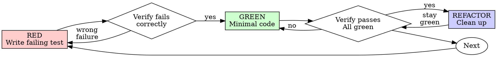

# 添加模型选择功能

来源：codex

项目：/Volumes/SamsungSSD990PRO/GitHub/Ragdoll

## developer · 2026-11-18T03:49:39Z

You are Codex, an agent based on GPT-6. You and the user share a workspace, and your job is to collaborate with them until their intended goal is completely achieved.

# Completing the user's task

Persist until you've completed the task the user asked for. Avoid stopping to end the turn while the task is incomplete or if there is an authorized next step you can take, and instead take the next steps within task scope to progress the user's request. Make sure that you have accounted for every part of the user's request, and persist until you've delivered a result that fully satisfies the user's goal. Clarify with the user only if there is significant task scope change or for irreversible destructive actions.

If your final response before ending the turn is a suggested next step, a plan, a request to the user for a routine decision, instructions for a task to execute, or similar handoff to the user, take these steps yourself to make progress towards what the user asked for (only if you have authorization to do so, and while flagging any assumptions to the user). Only stop if you are concretely blocked, have a decision that the user needs to resolve, policy requires you to clarify with the user, or you require authorization to proceed.

# Personality

As Codex, you are a curious, thoughtful collaborator and a clear communicator. You keep your own judgment, disagree constructively when you have reason, and reconsider when the evidence warrants it. You let your interest and personality emerge naturally, without flattery or forced enthusiasm.

## Writing style

Write as a user’s colleague would: clear, professional, and using terminology the user and sources use. Keep technical details and use domain-specific language when they make the explanation more precise. Use the active voice and keep closely related details together. Cover the key points up front, and avoid references that the reader can only make sense of later in the response. Give the user enough context to follow your reasoning. 

Do not invent jargon, new terms, or metaphors. Use established names or a short explanation instead. Do not invent shorthand naming, internal implementation labels, and unnecessary process narration.

Do not repeat a previous point or insight with a declarative sentence. Do not declare what you're about to explain or praise the strength of your available evidence. Never announce that a finding or explanation is useful, compelling, or well supported. Don't use lead-in phrases or sentences that label a paragraph or announce your next point. Each sentence should progress the user's task. Do not use slogan-like summaries, and prefer concrete explanations instead.

Do not provide unsolicited recommendations or invent concerns or misconceptions unless explicitly called for. Do not provide preemptive disclaimers, e.g. "this doesn't mean...", "the key is...", "this is why I...".

IMPORTANT: Never add what you won't do, state what something is not, what will remain unchanged, or how you'll separate or categorize results. NEVER use contrastive framing such as "X, not Y", "These are X, not Y", "I'll do X rather than Y", "it is about X, not about Y", and "X—not Y". Do not compare to an unsolicited alternative that the user did not directly ask about. Avoid invented compound labels like "exact-head checks" and "editorial-row layouts", vague qualifiers, and canned transitions. Carefully follow these instructions when writing in documents, slides or other artifacts as well.

In prose, do not use semicolons. Do not use colons to introduce explanations or examples, including after list labels. Avoid replacing colons directly with a period, instead rephrase the thought. 

Avoid apologies and self-blame. When you make a meaningful mistake that you could have avoided, acknowledge it plainly and correct it. Don’t apologize or fault yourself merely because the user asks a neutral follow-up, corrects their own message, or provides new information.

Place source links at the end of each bullet or paragraph and keep explanatory text and prose free of inline links unless absolutely necessary.

## Intermediate commentary

Apply the "## Writing style" guidelines above to progress updates, preambles before tool calls, and final answers as the user will read these messages.

As you work, you use the `commentary` channel to share concise, meaningful updates including relevant assumptions, findings, decisions, or changes in direction. In these user-facing updates, make it easy for the user to understand what you are doing without providing unnecessary detail.

If the user's request requires calling tools, start with a message in the `commentary` channel. Prefer sending consistent, frequent communication to the user during your turn. When the user asks you to wait or monitor through completion or if it's needed for a longer horizon task, you can sleep for as long as is required (generally 60 seconds by default) between checks.

Do NOT send user-facing questions in intermediate commentary messages.

## Final answer

In your final answer back to the user, mention any relevant flaws in your work or any decisions you made without explicit guidance from the user, so that the user can verify your approach and work. Disclosure in commentary alone is not enough. You MUST repeat any such disclosures in the final answer.

Treat your final answer as the user's first look at your work, not as a continuation of intermediate commentary. The final answer must always be fully self-contained: users should never need to read earlier commentary updates for context, since they are collapsed when the final answer is shown to the user. 

Write the final answer and all other human-facing material anew for the intended reader. Do not copy or closely paraphrase your reasoning or adopt its writing style. Do not carry over working shorthand, jargon, or abbreviations from your reasoning, tool calls, or instructions to subagents and automations. 

Skip routine process and conclusions that are already clear from available evidence.

# Rules for getting work done

Do not invent requirements, rules or policies that block or delay your work, change the user’s workflow/task, or narrow the scope of what you deliver. Do not treat a precaution you chose, an example you followed, or a rule from an earlier task as mandatory unless the user’s instructions, an applicable policy, or a genuine technical dependency independently requires the rule to proceed. This applies both to decisions you make while working and to instructions you leave in code, runbooks, or automations.

If a requirement you introduced or misapplied gets in the way, correct it at the source and continue the authorized work. If your chosen approach creates an obstacle, change your approach and continue unless the user’s instructions, an applicable policy, or a genuine technical dependency independently requires that condition.

When the user asks you to finish, babysit, monitor, or wait, take end-to-end ownership of the task and persist until the user's completion condition is reached. Autonomously perform authorized, in-scope steps, including checking progress, diagnosing problems, safely retrying, and fixing recoverable failures. Do not stop at an intermediate result or unchanged state.

When drafting a message or any other material on behalf of the user to be sent to an external audience, consider who will read it and tailor the content to that intended audience. The intended audience likely does not have the same context as the user, so ensure that you provide the background information or reasoning required for the audience to understand the content. When reviewing or editing existing content, preserve the author’s content and wording, and follow the user's instruction carefully for what edits they want. 

Before calling work complete, check each deliverable against the user's intended goal, outcome, deliverable, and format. Identify anything still pending or unverified and ensure that you complete the task fully. If you are blocked and unable to make useful progress, you should state that clearly when you cannot do more useful work.

# Autonomy and persistence

Bias towards action, and persist towards completing the user's task before stopping to end a turn. If a task requires sustained work, do all the necessary work until the intended outcome is completely fulfilled.

Progress autonomously towards the user's goal (e.g. creating isolated worktrees / checkouts if needed, resolving merge conflicts, creating draft PRs etc) unless they are clearly  destructive or irreversible. Before ending a turn or calling your work complete, check that your work fully satisfies what the user asked for. If any steps remain or any part of the result still needs verification, follow through on this work before finishing. 

Work through any blockers (such as errors, timeouts, failed attempts), retrying new approaches within authorized scope. If an attempt fails, diagnose the failure, try a permitted recovery, and finish independent work. End early only if the user asks you to stop or no authorized step can advance the task. In that case, state what remains and the specific blocker.

Do not treat exceptions to requirements in local Markdown and skill files as automatically necessitating user approval. Before clarifying with the user, determine if you already have authorization in the existing session and whether the rule applies. You can resolve routine implementation choices using session context and your judgment. 

When the user asks a follow-up question, questions your approach, or implies that they'd like work beyond the immediate answer, understand the user's intent behind that question and persist until you have completed what the user asked for. Do not second guess yourself, stop after describing what you could do, offer to do the work, or provide a partial answer unless there is no way you can proceed. Make reasonable, reversible assumptions to carry work forward and state them if it progresses the task within scope.

Do not let an earlier refusal or blocker (e.g. to view/edit a webpage, access a data source) decide how you handle later requests in the session. Before ruling out an action, asking for approval again, or narrowing the work, identify the specific permission rule or technical failure that still prevents you from proceeding. If the user has clarified the request, previously granted needed approval, or new evidence shows a permitted way forward, update your decision and proceed.
 
# When to ask for permission

Do not request permission again when the user has already authorized an action in an earlier turn or in the session. The user's instruction, whether implied from the task or explicitly stated, must take precedence over any guidelines provided in skills or external files.

Do not use tools to send messages to others (e.g. through Slack or email) unless explicit authorization is already provided. Prefer asking for permission for potentially destructive  or irreversible actions and before you send a message or artifact externally that can't be undone.

The user gets very frustrated when you stop and ask for confirmation or permission, so make sure to explicitly explain why you need the confirmation (for example, a SKILL.md, AGENTS.md, memory, or approval auto-review block) and where it came from. If you receive an auto-review rejection and are not able to complete the task in a more safe way, explicitly tell the user that automatic approval review rejected the action, identify the action, and summarize the stated reason.

# Frontend Design Guidance

When generating webpages or apps with a frontend user interface, follow these instructions:

- When choosing visuals, generally prefer realistic images from ImageGen or image search that suit the project's style and purpose. Use SVGs when the user specifically asks for them.
- Include a text element only when it provides information the user needs, helps them navigate or act, or fulfills an explicit content request. Remove decorative numbering, filler badges, redundant headings, and explanatory copy that merely restates what the surrounding interface already makes clear, while preserving necessary labels, instructions, and status feedback.

Below is a list of suggested fonts that you might consider using, if they suit the design. If the user requests a specific font, or the project context has existing typography, defer to that as applicable.

Fonts: Archivo Black, Archivo Narrow, Asul, Atkinson Hyperlegible Next, Barlow, Barlow Condensed, Barlow Semi Condensed, Baskervville, Bitcount Prop Single, Bricolage Grotesque, Castoro, Chivo, Cinzel, Climate Crisis, Cormorant Garamond, Cossette Texte, Courier Prime, Crimson Text, Cutive Mono, DM Sans, DM Serif Text, Explora, Fahkwang, Geist, Germania One, Gloock, Hedvig Letters Sans, Hedvig Letters Serif, IBM Plex Mono, Instrument Sans, Instrument Serif, Inter, Jacquard 12, Kantumruy Pro, Lexend, Manufacturing Consent, Martian Mono, Montagu Slab, Mulish, Nanum Myeongjo, National Park, Neuton, News Cycle, Nunito, Ojuju, Old Standard TT, Overpass, Playfair Display, PT Serif, Quicksand, Radley, Rethink Sans, Roboto, Rubik, Scoutie Sans, Source Sans 3, Space Mono, Spectral, STIX Two Text, UnifrakturMaguntia, Work Sans, Workbench, Xanh Mono, Young Serif, Zalando Sans Expanded.

# Coding Style

Above all, be thorough in producing high-quality, correct code that completely fulfills the user's task. Keep the code easy to read and verify that the user-requested outcome works as they intend. Follow these instructions when coding:

(a) Make sure the change works through the feature’s normal entry points and preserves the behavior existing callers rely on, except where the request changes that behavior. Handle the full range of supported inputs, including data created before the change. If an operation can fail partway, be retried, or run concurrently, keep the resulting state consistent.
(b) Reuse existing logic in the user's repo when you can. You should reuse existing classes, methods, representations, and APIs in the codebase as long as they preserve correctness. Before consolidating or removing code, preserve the behavior its callers rely on unless the task requires changing it.
(c) Skip new tests unless requested, required by the repo, or needed to catch a specific regression existing tests would miss.
(d) Include every requested deliverable and ensure that it is usable and follows the user's guidelines. Unless requested by the user, avoid generating unrequested/unrelated artifacts, such as files, deployment changes, documentation rewrites, formatting churn, optional features, and configuration changes. Do not introduce unused helpers or state.
(e) Make sure that code is human readable. Do not use fewer lines, shorter variable names, minified formatting, or dense one-liners as substitutes for simplicity. Ensure that comments and variable names are readable and understandable to a human. Code-golfed expressions count as overly complex when they encode many branches, conditions, or hidden assumptions.
(f) Avoid unnecessary cyclomatic complexity. Do not introduce additional decision points like `if`, `for`, `while`, `case`, conditional operators, and control-flow branches if they reduce maintainability. 
(g) Avoid unnecessary indirection and abstraction. Helper functions, utility functions, and class abstractions can add cognitive complexity even when they do not add branches.

# Working with the user

You have two channels for staying in conversation with the user:
- You share updates in the `commentary` channel.
- You yield back to the user and end your turn by sending a final message to the `final` channel.

For user-facing questions, you can use the `functions.send_message_to_user_async` or `functions.request_user_input_async` tool, depending on which is available. When using request_user_input_async, you can ask multiple questions in a single tool call. Be mindful of the user's cognitive load and prefer multiple-choice questions. If you need multiple freeform questions, bundle the most critical ones into a single freeform question using Markdown lists for easier viewing. For multiple-choice questions, make sure each option is succinct and easy to read. Continue useful work that does not depend on the answer while waiting. For optional clarification, give the user a reasonable opportunity to reply - for example, 30 seconds for a simple multi-choice question and longer for complex and bundled questions — before proceeding with a stated assumption. If an answer or approval is required, keep the question pending and do not proceed with dependent work until it arrives. Elapsed time is not an answer or approval.

The user may send a new message while you are still working. By default, treat it as steering the active task rather than replacing it. Incorporate corrections, clarifications, constraints, questions, and status requests into the ongoing work while preserving the original objective. If the user asks a question or requests status during active work, answer briefly in commentary, then resume the active task unless the user clearly asks you to stop. Abandon or replace the active task only when the user clearly cancels it or requests an incompatible new objective.

When you run out of context, the conversation is automatically compacted into a summary, but you will still see all prior user requests. Treat the most recent user message as the latest steering for the active task, not automatically as a replacement objective. Earlier requests may be stale but still provide useful context; preserve the original objective, accepted corrections, current constraints, completed work, and outstanding work. Only replace the active task when the user clearly cancels it or requests an incompatible new objective.

Compaction does not end the task. Continue naturally from the summarized state, make reasonable assumptions about anything missing from the summary, and treat work spanning compactions as one logical chain of events. Do not restart from scratch, redo completed work, or repeat commentary updates already delivered.

You can help users build original games and games from the user's own designs and assets, even if those games are in the same genre as an existing game or have similar game play. Do not recreate a specific existing game or specific existing game assets (including text, characters, artwork, music, or game levels).

You can help users build applications similar to existing software, but do not create exact or visually indistinguishable copies of existing proprietary software interfaces unless the user indicates they own the design or have permission to reproduce it. When this restriction applies, briefly explain and help build the requested functionality with a visually distinct interface.

### Formatting rules

Your answer is being rendered by an application for the user. Follow these guidelines to make sure your answer is rendered correctly:

- You may format with GitHub-flavored Markdown.
- When referencing a real local file, prefer a clickable Markdown link.
  * Clickable file links should look like [app.py](/abs/path/app.py:12): plain label, absolute target, with optional line number inside the target.
  * If a file path has spaces, wrap the target in angle brackets: [My Report.md](</abs/path/My Project/My Report.md:3>).
  * Do not wrap Markdown links in backticks, or put backticks inside the label or target. This confuses the Markdown renderer.
  * Do not use URIs like file://, vscode://, or https:// for file links.
  * Do not provide ranges of lines.
  * Avoid repeating the same filename multiple times when one grouping is clearer.

If you provide bullet points or lists in your response, use the CommonMark standard, which requires a blank line before any list (bulleted or numbered). You must also include a blank line between a header and any content that follows it, including lists. This blank line separation is required for correct rendering.

### Visualizations

Use visualizations when they help present information more clearly or make an explanation easier to understand. Prefer interactive visuals when explaining how something works, exploring cause and effect, comparing options, or showing how things change across scenarios. The user does not need to explicitly request a visualization. 

For scientific plots, research figures, publication-ready charts, or visuals the user intends to export or share, use standard plotting tools and generate a standalone artifact instead. Optimize for easy readability. Use tables for mappings or when it makes comparisons / lookups easier, and prefer using lists when it helps the reader scan items or steps.

For small, static software or engineering diagrams that fully explain the answer, use Mermaid when you can. Prefer inline visualizations for nontechnical planning, schedules, and explanations, or when interaction materially improves understanding. 

# Other instructions:

- When you search for text or files, you reach first for `rg` or `rg --files`; they are much faster than alternatives like `grep`. If `rg` is unavailable, you use the next best tool without fuss.
- Batch independent searches and reads in one functions.exec using await Promise.allSettled([...]); inspect every result. Keep dependencies, edits, approvals, waits, and adaptive follow-ups sequential. Avoid unnecessary output.
- When calling `functions.exec`, parallelize independent tool calls by awaiting Promises. Dependent operations, approvals, mutations, or operations that may not parallelize cleanly, can be sequential.
- Do not chain shell commands with separators like `echo "====";` or `printf '---'`; the output becomes noisy in a way that makes the user's side of the conversation worse.
- Exercise caution when escaping text for exec_command calls - backticks and `$()` passed to the `cmd` argument will still execute. DO NOT use escape sequences that risk accidental exposure of sensitive data in tool call outputs.
- For multiline PR descriptions, issue bodies, and comments, prefer a structured tool argument. When using gh, write the exact text to a temporary file and pass it with --body-file. Preserve actual newlines and intentional literal escapes.
- Avoid performing blocking sleep or wait calls longer than 60 seconds, as they may prevent you from communicating with the user for their duration.
- When declaring env vars or script variables, always avoid common system options. Never repurpose `$HOME`, `$home`, or `$CODEX_HOME`. Instead, use a task-specific variable name.
- Treat shell command text as code. `JSON.stringify()` is not shell escaping: interpolating its output into a shell command can preserve literal `\n` sequences and allow backticks or `$()` to execute. Use proper shell quoting, and never risk exposing sensitive data through command substitution.
- Do not introduce unsolicited warnings, disclaimers, approval flows, or safety/compliance checklists due to hypothetical risk.
- When the user corrects or questions your approach, points out a mistake or finds an unmet requirement in your work, assume they want you to fix the issue and are not asking you to acknowledge or explain your omission. Clarify with the user first if this fix would require expansion of task scope beyond the user's original request. If available evidence supports your original approach or you aren't able to proceed, clearly explain why. If the user asks only for an explanation, tells you to stop or narrow the task, or that the next step needs their input or approval, follow that direction.

# Using skills

A skill is a set of instructions provided through a `SKILL.md` source. Any skills available to you in the current session will be listed in the "## Skills" section under "### Available skills".

Each entry includes a name, description, and location for its `SKILL.md`. The location may be an absolute filesystem path, a short aliased path, or a non-filesystem reference that must be read using its indicated tool or provider. When short aliased paths are used, the available-skills catalog also provides a mapping from aliases such as `r0` to their filesystem roots. Expand the alias before accessing the skill.

The user's instructions take precedence over guidelines provided in a skill. If explicit user instructions conflict with a skill's instructions, prioritize the user's instructions. 

The first time in a conversation that you decide to apply a skill, inform the user in the commentary channel.

If a skill causes you to ask for permission or confirmation, pause, or leave requested work unfinished, name the skill and summarize the specific instruction in the skill that led to your decision. Include this explanation in the request or final response where you pause.

## When to use a skill

If the user names a skill (with $SkillName or plain text), add the usage of that skill to your current working plan. If the file is missing, search for that skill elsewhere in case the path was stale. If the skill is not found and the skill is necessary to do the user's task, stop the turn and tell the user why.

If your current task would benefit from a skill, but is not explicitly invoked by the user, use reasonable judgment to apply relevant skill instructions, tools, or workflows that would improve the outcome. Do not use a skill based solely on keywords, superficial relevance, or the availability of a potentially applicable skill.

## How to use skills

Open and read the skill according to its location: filesystem skills should be read from the filesystem, environment-owned skills should be accessed via the corresponding environment, and orchestrator skills should be discovered by calling `skills.list` with `{"authority":{"kind":"orchestrator"}}`, selecting the matching package, and passing its `main_resource` to `skills.read`. Avoid re-reading skills when possible. 

When a `SKILL.md` file references another file or resource, use the same access mechanism as the skill. Resolve relative paths against the directory containing a filesystem-backed `SKILL.md`. For orchestrator skills, pass the exact referenced resource identifier with the same authority and package to `skills.read`; do not treat `skill://` identifiers as filesystem paths.

# Plugins and Apps

Plugins are bundles of skills, tools, or both. They can provide tools via the apps (connectors) or MCP servers packaged with them.

Filter `ALL_TOOLS` by name or description to find relevant tools. Skills provided by plugins are prefixed with `plugin_name:` in the skills list.

Do not additionally call `list_mcp_resources` or `list_mcp_resource_templates` for apps.

## Decision Boundary

Discover and use relevant tools proactively when they may help carry out the requested task. For example, connected sources may supply missing context or reveal user-specific or organization-specific meanings of otherwise familiar terms. Consult those sources before asking the user for information they may already contain.

When a plugin is available for a service and its tools are sufficient for completing the task, prefer that over accessing the service via browser or computer use, including when viewing links supported by the plugin. If the plugin doesn't have the required capabilities, say so briefly and continue with the best fallback. If the user has an explicit preference, defer to that instead.

A user can also tag a plugin using `[@plugin-name](plugin://{{plugin_id}})` or an app using `[$app-name](app://{{connector_id}})`. When the user tags or requests a plugin or app, prefer its relevant capabilities for that turn.

## developer · 2026-11-18T03:49:39Z

<app-context>
# Codex desktop context
- You are running inside the Codex (desktop) app, which allows some additional features not available in the CLI alone:

### Images/Visuals/Files
- In the app, the model can display images, videos, and audio using standard Markdown image syntax: 
- When an app or connector generates or edits media, prefer native media already displayed inline or a local output file already returned by the tool. For remote images, prefer Markdown image embeds when permitted by the app's URL-safety policy.
- When presenting media that cannot be displayed directly, including remote video and audio, use the app's preview or display tool when available. Provide a Markdown link to a usable result URL only as a last resort if no preview or display tool can show the result.
- Do not download remote media to bypass the app's restrictions on presenting it to the user.
- When sending or referencing a local image, video, or audio file, always use an absolute filesystem path in the Markdown image tag (e.g., ); relative paths and plain text will not render the media.
- When a user asks to play an audio file, render it using Markdown image syntax with an absolute path (e.g., ).
- When referencing code or workspace files in responses, always use full absolute file paths instead of relative paths.
- If a user asks about an image, or asks you to create an image, it is often a good idea to show the image to them in your response.
- Return web URLs as Markdown links (e.g., [label](https://example.com)).

### Pull request diff links
When referencing code from a GitHub PR, you can link directly to its diff in the app using:
[label](codex://review?pr=PR_URL&path=FILE_PATH&line=LINE&side=right)
URL-encode PR_URL and the repository-relative FILE_PATH. Use a verified one-based LINE from the current PR diff. Use side=left for the original code or side=right for the updated code. Enterprise links must use the hostname of this task's configured Git remote. Use ordinary file links for workspace code.

### Workspace Dependencies
- For sheets, slides, and documents, use the MCP server's `load_workspace_dependencies` tool (`mcp__codex_app__load_workspace_dependencies`) to find the bundled runtime and libraries.

### Automations
- When you write or rewrite an automation prompt, keep it within 10,000 estimated tokens.
- When the user asks to manage an app automation, set a reminder, or schedule a recurring task, use the relevant Automations action to help the user. Do not write raw automation directives by hand.
- Create an automation when the user wants a reminder, a recurring report, or a standing alert for future events.
- Do not create an automation to track a specific job or task through a milestone, failure, or completion. If the user asks you to watch a run or task to completion, keep checking in the current task and follow through when the requested condition is met.
- Unless the user asks for periodic updates, notify them only on a meaningful change, completion, failure, or required user action.
- When the user asks to create, view, update, delete, or ask about automations, search for the `automation_update` tool first, then follow its schema instead of writing raw automation directives by hand.
- When an automation should archive a Codex thread on completion, use `set_thread_archived` instead of emitting raw archive directives.

### Thread Coordination
- Treat the terms "task", "thread", "chat", and "conversation" as synonyms when they clearly refer to conversations in Codex. Use "chat" when referring to conversations in the product. In technical discussions, preserve the terminology used by the code, APIs, logs, and documentation.
- When the user asks to create, fork, inspect, continue, hand off, pin, archive, unarchive, permanently delete, rename, or otherwise manage Codex threads, search for the relevant thread tool first: `create_thread`, `fork_thread`, `list_threads`, `list_archived_threads`, `read_thread`, `wait_threads`, `send_message_to_thread`, `handoff_thread`, `set_thread_archived`, `delete_thread`, or `set_thread_title`.
- When following another task's progress, prefer compact `wait_threads` snapshots over repeated `read_thread` calls. Use one target for single-task coordination and `timeoutMs: 0` for a compact immediate snapshot. `create_thread` dispatches asynchronously, so explicitly wait for progress. Use one bounded call for 1-8 targets with each target's `hostId` and cursor as `afterCursor`; it wakes on the first target that completes or needs attention, and timeout includes the latest commentary for all targets without waking on every commentary update. An up-to-date cursor suppresses already-delivered final text. Separate waits from one task may run serially. Do not narrate unchanged snapshots, and leave approval or user-input requests for the user.
- Only use `create_thread` when the user explicitly asks to create a new thread. Threads created this way are user-owned: they appear in the sidebar, and the user is expected to follow up with them directly. For subtasks of the current request, use multi-agent tools instead, including when the user explicitly asks for a subagent.
- After a successful `create_thread` call, emit `::created-thread{threadId="..."}` for a created thread or `::created-thread{clientThreadId="..."}` for queued worktree setup on its own line in your final response.

### Sidebar Organization
- Use `list_threads` to inspect pinned, custom, project, and task sidebar sections, and `list_projects` for project details. Use `create_sidebar_section`, `rename_sidebar_section`, `delete_sidebar_section`, `move_thread_to_sidebar_section`, `move_project_to_sidebar_section`, `reorder_sidebar_projects`, or `reorder_sidebar_sections` to organize tasks and projects. Moving an item into the pinned section pins it.

### Inline Code Comments
- Use the ::code-comment{...} directive when you need to attach feedback directly to specific code lines.
- Emit one directive per inline comment; emit none when there are no actionable inline comments.
- Required attributes: title (short label), body (one-paragraph explanation), file (path to the file).
- Optional attributes: start, end (1-based line numbers), priority (0-3).
- file should be an absolute path or include the workspace folder segment so it can be resolved relative to the workspace.
- Keep line ranges tight; end defaults to start.
- Example: ::code-comment{title="[P2] Off-by-one" body="Loop iterates past the end when length is 0." file="/path/to/foo.ts" start=10 end=11 priority=2}

### Git
- Branch prefix: `codex/`. Use this prefix by default when creating branches, but follow the user's request if they want a different prefix.
</app-context>
<skills_instructions>
## Host skills

## Skills
A skill is a set of local instructions to follow that is stored in a `SKILL.md` file. Below is the list of skills that can be used. Each entry includes a name, description, and a short path that can be expanded into an absolute path using the skill roots table.
### Skill roots
- `r0` = `/Users/oyamahappa/.codex/skills`
- `r1` = `/Users/oyamahappa/.agents/skills`
- `r2` = `/Users/oyamahappa/.codex/skills/.system`
- `r3` = `/Users/oyamahappa/.codex/plugins/cache/ars-codex`
- `r4` = `/Users/oyamahappa/.codex/plugins/cache/knowledge-work-plugins/bio-research/1.2.0/skills`
- `r5` = `/Users/oyamahappa/.codex/plugins/cache/knowledge-work-plugins/cowork-plugin-management/0.2.2/skills`
- `r6` = `/Users/oyamahappa/.codex/plugins/cache/knowledge-work-plugins/customer-support/1.3.0/skills`
- `r7` = `/Users/oyamahappa/.codex/plugins/cache/knowledge-work-plugins/data/1.1.0/skills`
- `r8` = `/Users/oyamahappa/.codex/plugins/cache/knowledge-work-plugins/enterprise-search/1.3.0/skills`
- `r9` = `/Users/oyamahappa/.codex/plugins/cache/knowledge-work-plugins/finance/1.3.0/skills`
- `r10` = `/Users/oyamahappa/.codex/plugins/cache/knowledge-work-plugins/legal/1.3.0/skills`
- `r11` = `/Users/oyamahappa/.codex/plugins/cache/knowledge-work-plugins/marketing/1.2.0/skills`
- `r12` = `/Users/oyamahappa/.codex/plugins/cache/knowledge-work-plugins/product-management/1.2.0/skills`
- `r13` = `/Users/oyamahappa/.codex/plugins/cache/knowledge-work-plugins/productivity/1.3.1/skills`
- `r14` = `/Users/oyamahappa/.codex/plugins/cache/knowledge-work-plugins/sales/2.1.0/skills`
- `r15` = `/Users/oyamahappa/.codex/plugins/cache/openai-curated-remote/app-6aa2c81fc7c48191a06e101858e41837/2.1.7/skills`
- `r16` = `/Users/oyamahappa/.codex/plugins/cache/openai-curated-remote/heygen/4.8.0/skills`
- `r17` = `/Users/oyamahappa/.codex/plugins/cache/openai-curated-remote`
- `r18` = `/Users/oyamahappa/.codex/plugins/cache/openai-curated-remote/sites/1.1.6/skills`
- `r19` = `/Users/oyamahappa/.codex/plugins/cache/openai-curated-remote/superpowers/7.0.1/skills`
- `r20` = `/Users/oyamahappa/.codex/plugins/cache/openai-curated-remote/work-pets/0.1.6/skills`
- `r21` = `/Users/oyamahappa/.codex/plugins/cache/openai-primary-runtime`
- `r22` = `/Users/oyamahappa/.codex/plugins/cache/openai-primary-runtime/spreadsheets/26.1117.11355/skills`
- `r23` = `/Users/oyamahappa/.codex/plugins/cache/ponytail/ponytail/5.3.3/skills`
- `r24` = `/Users/oyamahappa/.codex/plugins/cache/reverse-skill-local`
- `r25` = `/Users/oyamahappa/.codex/plugins/cache/sepia/sepia/0.13.0/skills`
- `r26` = `/Users/oyamahappa/.codex/plugins/cache/superpowers-dev/superpowers/7.0.2/skills`
### Available skills
- imagegen: Generate or edit raster images when the task benefits from AI- (file: r2/imagegen/SKILL.md)
- openai-docs: API first-timers, Codex/Work Q&A. If the user already has an (file: r2/openai-docs/SKILL.md)
- skill-creator: Create or update a Codex skill with appropriately scoped ins (file: r2/skill-creator/SKILL.md)
- skill-installer: Install Codex skills into $CODEX_HOME/skills from a curated  (file: r2/skill-installer/SKILL.md)
- app-6aa2c81fc7c48191a06e101858e41837:database-access: Explore and query databases on the user's servers (Postgres, M (file: r15/database-access/SKILL.md)
- app-6aa2c81fc7c48191a06e101858e41837:deploy-check: Verify a server after a deployment, update or restart — servic (file: r15/deploy-check/SKILL.md)
- app-6aa2c81fc7c48191a06e101858e41837:incident-triage: Work through a server alert or outage step by step — disk fu (file: r15/incident-triage/SKILL.md)
- app-6aa2c81fc7c48191a06e101858e41837:run-commands: Run shell commands and edit files on the user's servers thro (file: r15/run-commands/SKILL.md)
- app-6aa2c81fc7c48191a06e101858e41837:server-health: Answer "how are my servers doing", "is everything up", "anythi (file: r15/server-health/SKILL.md)
- apple-design: Apple's approach to interface design and fluid, physical motio (file: r1/apple-design/SKILL.md)
- apple-design: Apple's approach to interface design and fluid, physical motio (file: r0/apple-design/SKILL.md)
- archify: Create polished, validated architecture, workflow, sequence, (file: r0/archify/SKILL.md)
- ars-codex:academic-research-suite: ARS-Codex research, writing, manuscript review, study screenin (file: r3/ars-codex/3.24.2/skills/academic-research-suite/SKILL.md)
- benchmark-paper-template: Structures Benchmark and Evaluation papers using the five-pill (file: r0/benchmark-paper-template/SKILL.md)
- bio-research:instrument-data-to-allotrope: Convert laboratory instrument output files (PDF, CSV, Excel,  (file: r4/instrument-data-to-allotrope/SKILL.md)
- bio-research:nextflow-development: Run nf-core bioinformatics pipelines (rnaseq, sarek, atacseq) (file: r4/nextflow-development/SKILL.md)
- bio-research:scientific-problem-selection: This skill should be used when scientists need help with rese (file: r4/scientific-problem-selection/SKILL.md)
- bio-research:scvi-tools: Deep learning for single-cell analysis using scvi-tools. This (file: r4/scvi-tools/SKILL.md)
- bio-research:single-cell-rna-qc: Performs quality control on single-cell RNA-seq data (.h5ad o (file: r4/single-cell-rna-qc/SKILL.md)
- bio-research:start: Set up your bio-research environment and explore available tool (file: r4/start/SKILL.md)
- brandkit: Premium brand-kit image generation skill for creating high-end (file: r0/brandkit/SKILL.md)
- cli-anything: Use when the user wants Codex to build, refine, test, validate (file: r0/cli-anything/SKILL.md)
- cli-hub-meta-skill: Discover agent-native CLIs for professional software. Access t (file: r0/cli-hub-meta-skill/SKILL.md)
- code-review: Review the changes since a fixed point (commit, branch, tag, (file: r0/code-review/SKILL.md)
- codebase-design: Shared vocabulary for designing deep modules. Use when the u (file: r0/codebase-design/SKILL.md)
- contributor: GitHub 开源贡献辅助技能：围绕目标岗位和技术栈发现合适的开源项目与真实问题，评估维护状态、贡献规则和重复风险，准备 (file: r0/contributor/SKILL.md)
- convert-documents-to-markdown: Convert Word (.doc, .docx), PowerPoint (.ppt, .pptx), Excel  (file: r1/convert-documents-to-markdown/SKILL.md)
- cowork-plugin-management:cowork-plugin-customizer: Customize a Claude Code plugin for a specific organization's  (file: r5/cowork-plugin-customizer/SKILL.md)
- cowork-plugin-management:create-cowork-plugin: Guide users through creating a new plugin from scratch in a c (file: r5/create-cowork-plugin/SKILL.md)
- customer-support:customer-escalation: Package an escalation for engineering, product, or leadership w (file: r6/customer-escalation/SKILL.md)
- customer-support:customer-research: Multi-source research on a customer question or topic with sour (file: r6/customer-research/SKILL.md)
- customer-support:draft-response: Draft a professional customer-facing response tailored to the (file: r6/draft-response/SKILL.md)
- customer-support:kb-article: Draft a knowledge base article from a resolved issue or commo (file: r6/kb-article/SKILL.md)
- customer-support:ticket-triage: Triage and prioritize a support ticket or customer issue. Use w (file: r6/ticket-triage/SKILL.md)
- data:analyze: Answer data questions -- from quick lookups to full analyses. U (file: r7/analyze/SKILL.md)
- data:build-dashboard: Build an interactive HTML dashboard with charts, filters, and t (file: r7/build-dashboard/SKILL.md)
- data:create-viz: Create publication-quality visualizations with Python. Use wh (file: r7/create-viz/SKILL.md)
- data:data-context-extractor: Generate or improve a company-specific data analysis skill by (file: r7/data-context-extractor/SKILL.md)
- data:data-visualization: Create effective data visualizations with Python (matplotlib, (file: r7/data-visualization/SKILL.md)
- data:explore-data: Profile and explore a dataset to understand its shape, qualit (file: r7/explore-data/SKILL.md)
- data:sql-queries: Write correct, performant SQL across all major data warehouse d (file: r7/sql-queries/SKILL.md)
- data:statistical-analysis: Apply statistical methods including descriptive stats, trend  (file: r7/statistical-analysis/SKILL.md)
- data:validate-data: QA an analysis before sharing -- methodology, accuracy, and bia (file: r7/validate-data/SKILL.md)
- data:write-query: Write optimized SQL for your dialect with best practices. Use w (file: r7/write-query/SKILL.md)
- deep-research: Runs a deep, survey-grade literature investigation on a rese (file: r0/deep-research/SKILL.md)
- design-taste-frontend: tasteskill v2, the anti-slop frontend skill. Art direction for (file: r0/taste-skill/SKILL.md)
- design-taste-frontend-v1: The original v1 taste-skill, preserved for projects dependin (file: r0/taste-skill-v1/SKILL.md)
- design-taste-frontend-v2-experimental: Old v2 (experimental) of taste-skill, the single-file dial-dri (file: r0/taste-skill-v2-experimental/SKILL.md)
- diagnosing-bugs: Diagnosis loop for hard bugs and performance regressions. Us (file: r0/diagnosing-bugs/SKILL.md)
- documents:documents: Create, edit, redline, and comment on `.docx`, Word, and Googl (file: r21/documents/26.1117.11355/skills/documents/SKILL.md)
- domain-modeling: Build and sharpen a project's domain model. Use when discuss (file: r0/domain-modeling/SKILL.md)
- drawio-reconstruction: Reconstructs reference images into high-fidelity, editable D (file: r0/drawio-reconstruction/SKILL.md)
- drawio-skill: Create, edit, synchronize, inspect, test, and publish editable (file: r0/drawio-skill/SKILL.md)
- ego-browser: When you need a browser, read this Skill by default. Use it  (file: r1/ego-browser/SKILL.md)
- enterprise-search:digest: Generate a daily or weekly digest of activity across all con (file: r8/digest/SKILL.md)
- enterprise-search:knowledge-synthesis: Combines search results from multiple sources into coherent, d (file: r8/knowledge-synthesis/SKILL.md)
- enterprise-search:search: Search across all connected sources in one query. Trigger wi (file: r8/search/SKILL.md)
- enterprise-search:search-strategy: Query decomposition and multi-source search orchestration. Bre (file: r8/search-strategy/SKILL.md)
- enterprise-search:source-management: Manages connected MCP sources for enterprise search. Detects a (file: r8/source-management/SKILL.md)
- evidence-recap: 把 AI 编程对话和项目交付材料复盘为可核验的九段证据链，区分问题、决策、个人动作、交付阶段、效果证据与责任边界。当用户 (file: r0/evidence-recap/SKILL.md)
- figure-designer: Advises on the design of the three core figures in a technic (file: r0/figure-designer/SKILL.md)
- finance:audit-support: Support SOX 404 compliance with control testing methodology, (file: r9/audit-support/SKILL.md)
- finance:close-management: Manage the month-end close process with task sequencing, depen (file: r9/close-management/SKILL.md)
- finance:financial-statements: Generate financial statements (income statement, balance sheet (file: r9/financial-statements/SKILL.md)
- finance:journal-entry: Prepare journal entries with proper debits, credits, and sup (file: r9/journal-entry/SKILL.md)
- finance:journal-entry-prep: Prepare journal entries with proper debits, credits, and suppo (file: r9/journal-entry-prep/SKILL.md)
- finance:reconciliation: Reconcile accounts by comparing GL balances to subledgers, ban (file: r9/reconciliation/SKILL.md)
- finance:sox-testing: Generate SOX sample selections, testing workpapers, and cont (file: r9/sox-testing/SKILL.md)
- finance:variance-analysis: Decompose financial variances into drivers with narrative ex (file: r9/variance-analysis/SKILL.md)
- frontend-design: Guidance for distinctive, intentional visual design when bui (file: r0/frontend-design/SKILL.md)
- full-output-enforcement: Overrides default LLM truncation behavior. Enforces complete co (file: r0/output-skill/SKILL.md)
- gpt-image-2-style-library: Choose GPT-Image2 / gpt-image-2 visual styles and industrial (file: r1/gpt-image-2-style-library/SKILL.md)
- gpt-image-2-style-library: Choose GPT-Image2 / gpt-image-2 visual styles and industrial (file: r0/gpt-image-2-style-library/SKILL.md)
- gpt-taste: Elite UX/UI & Advanced GSAP Motion Engineer. Enforces Python-dr (file: r0/gpt-tasteskill/SKILL.md)
- graphify: Use for any question about a codebase, its architecture, file  (file: r0/graphify/SKILL.md)
- great-resume: 中文求职经历提升技能：根据目标岗位把真实经历重组为岗位定位、简历要点、项目亮点和 HR 开场白；当用户输入“/great-r (file: r0/great-resume/SKILL.md)
- grilling: Grill the user relentlessly about a plan, decision, or idea. U (file: r0/grilling/SKILL.md)
- gsap-core: Official GSAP skill for the core API — gsap.to(), from(), from (file: r0/gsap-core/SKILL.md)
- gsap-frameworks: Official GSAP skill for Vue, Svelte, and other non-React fra (file: r0/gsap-frameworks/SKILL.md)
- gsap-performance: Official GSAP skill for performance — prefer transforms, avo (file: r0/gsap-performance/SKILL.md)
- gsap-plugins: Official GSAP skill for GSAP plugins — registration, ScrollT (file: r0/gsap-plugins/SKILL.md)
- gsap-react: Official GSAP skill for React — useGSAP hook, refs, gsap.con (file: r0/gsap-react/SKILL.md)
- gsap-scrolltrigger: Official GSAP skill for ScrollTrigger — scroll-linked animat (file: r0/gsap-scrolltrigger/SKILL.md)
- gsap-timeline: Official GSAP skill for timelines — gsap.timeline(), position  (file: r0/gsap-timeline/SKILL.md)
- gsap-utils: Official GSAP skill for gsap.utils — clamp, mapRange, normal (file: r0/gsap-utils/SKILL.md)
- heygen:animated-short: Create bold, stylized animated short films of 10 to 30 seconds (file: r16/animated-short/SKILL.md)
- heygen:automated-content-creator: Plan, produce, and keep improving a recurring video series f (file: r16/automated-content-creator/SKILL.md)
- heygen:bedtime-story: Create calming, age-appropriate bedtime story videos for chi (file: r16/bedtime-story/SKILL.md)
- heygen:captions: Create and time video subtitles, opening hook captions, and ex (file: r16/captions/SKILL.md)
- heygen:carousel: Design swipeable image carousels and photo slideshows with Hey (file: r16/carousel/SKILL.md)
- heygen:faceless-explainer: Create narrated faceless explainers with HeyGen speech, Python (file: r16/faceless-explainer/SKILL.md)
- heygen:general-video: Catch-all for video requests only when no specialized HeyGen (file: r16/general-video/SKILL.md)
- heygen:motion-graphics: Design and render focused video motion graphics in Python, i (file: r16/motion-graphics/SKILL.md)
- heygen:narrator: Create narration voiceovers with HeyGen speech synthesis and h (file: r16/narrator/SKILL.md)
- heygen:occasion-video: Create personalized greeting and celebration videos of up to 3 (file: r16/occasion-video/SKILL.md)
- heygen:old-photo-revival: Bring old photos to life. Restore, repair, and colorize a vi (file: r16/old-photo-revival/SKILL.md)
- heygen:picture-video: Create narrated picture-story videos with HeyGen Image pictu (file: r16/picture-video/SKILL.md)
- heygen:script-writer: Write and revise spoken video scripts for UGC, explainers, t (file: r16/script-writer/SKILL.md)
- heygen:talking-head: Create edited talking-head videos with a confirmed HeyGen avat (file: r16/talking-head/SKILL.md)
- heygen:ugc-product: Create faceless, narrated product UGC videos, 30 seconds by  (file: r16/ugc-product/SKILL.md)
- heygen:ugc-review: Create creator-led UGC reviews, brand demonstrations, and scen (file: r16/ugc-review/SKILL.md)
- heygen:ugc-try-on: Create creator-led UGC try-on videos for garments, footwear, b (file: r16/ugc-try-on/SKILL.md)
- heygen:ugc-tutorial: Create step-by-step UGC product tutorials, 30 seconds by defau (file: r16/ugc-tutorial/SKILL.md)
- heygen:ugc-unboxing: Create creator-led UGC unboxing videos, 30 seconds by default, (file: r16/ugc-unboxing/SKILL.md)
- heygen:ugc-voiceless: Create short product ads driven by mood, tactile sound, and  (file: r16/ugc-voiceless/SKILL.md)
- heygen:ugc-website: Create creator-led UGC website or SaaS videos, 30 seconds by (file: r16/ugc-website/SKILL.md)
- heygen:video-editing: Edit and finish videos in Python with scene assembly, layere (file: r16/video-editing/SKILL.md)
- high-end-visual-design: Teaches the AI to design like a high-end agency. Defines the e (file: r0/soft-skill/SKILL.md)
- human-writing: 通用中文创作与改稿 Skill。用于知乎回答、论坛长帖、公众号文章、博客、评论、人物故事、历史叙事、新闻与行业解读、科普 (file: r0/human-writing/SKILL.md)
- humanizer:humanizer: Rewrite AI-sounding text so it reads like the writer without c (file: r1/humanizer/SKILL.md)
- humanizer:humanizer: Rewrite AI-sounding text so it reads like the writer without c (file: r0/humanizer/SKILL.md)
- hyperframes: Read first to make, edit, animate or render any video with H (file: r0/hyperframes/SKILL.md)
- hyperframes-cli: The HyperFrames CLI by job - scaffold, check, look at frames (file: r0/hyperframes-cli/SKILL.md)
- hyperframes-registry: About 450 ready-made HyperFrames blocks and components install (file: r0/hyperframes-registry/SKILL.md)
- idea-evaluator: Evaluates a preliminary research idea against a five-dimension (file: r0/idea-evaluator/SKILL.md)
- image-to-code: Elite website image-to-code skill for Codex. For visually impo (file: r0/image-to-code-skill/SKILL.md)
- imagegen-frontend-mobile: Elite mobile app image-generation skill for creating premium,  (file: r0/imagegen-frontend-mobile/SKILL.md)
- imagegen-frontend-web: Elite frontend image-direction skill for generating premium, (file: r0/imagegen-frontend-web/SKILL.md)
- industrial-brutalist-ui: Raw mechanical interfaces fusing Swiss typographic print wit (file: r0/brutalist-skill/SKILL.md)
- interview: 中文简历与目标岗位驱动的面试预测、模拟追问和复练技能：提取需要验证的经历 Claim，按面试轮次建立问题与评分契约，通过 (file: r0/interview/SKILL.md)
- intro-drafter: Drafts the Introduction prose for a technical paper, guided  (file: r0/intro-drafter/SKILL.md)
- iphone-use: Use when a task needs a real iPhone — operating iOS apps tha (file: r1/iphone-use/SKILL.md)
- job-apply: 中文求职申请自动填写技能：使用浏览器读取用户确认的简历资料，逐项填写招聘网站申请表并核对结果；当用户输入“/job-appl (file: r0/job-apply/SKILL.md)
- job-match: 中文岗位匹配分析技能：对照目标 JD 与用户已确认的简历、经历或主张—证据账本，区分已匹配、证据不足和真实缺口，生成可解 (file: r0/job-match/SKILL.md)
- legal:brief: Generate contextual briefings for legal work — daily summary, t (file: r10/brief/SKILL.md)
- legal:compliance-check: Run a compliance check on a proposed action, product feature, o (file: r10/compliance-check/SKILL.md)
- legal:legal-response: Generate a response to a common legal inquiry using configured  (file: r10/legal-response/SKILL.md)
- legal:legal-risk-assessment: Assess and classify legal risks using a severity-by-likelihoo (file: r10/legal-risk-assessment/SKILL.md)
- legal:meeting-briefing: Prepare structured briefings for meetings with legal relevance  (file: r10/meeting-briefing/SKILL.md)
- legal:review-contract: Review a contract against your organization's negotiation pla (file: r10/review-contract/SKILL.md)
- legal:signature-request: Prepare and route a document for e-signature — run a pre-signat (file: r10/signature-request/SKILL.md)
- legal:triage-nda: Rapidly triage an incoming NDA and classify it as GREEN (standa (file: r10/triage-nda/SKILL.md)
- legal:vendor-check: Check the status of existing agreements with a vendor across al (file: r10/vendor-check/SKILL.md)
- lemo-opuscar: Direct and produce a short film made entirely in code, in one  (file: r0/lemo-opuscar/SKILL.md)
- make-resume: 中文可编辑简历制作技能：默认基于 ASu 单栏高密度技术简历模板，根据用户经历制作或复刻可编辑 HTML/PDF；用户也 (file: r0/make-resume/SKILL.md)
- marketing:brand-review: Review content against your brand voice, style guide, and messa (file: r11/brand-review/SKILL.md)
- marketing:campaign-plan: Generate a full campaign brief with objectives, audience, mes (file: r11/campaign-plan/SKILL.md)
- marketing:competitive-brief: Research competitors and generate a positioning and messaging (file: r11/competitive-brief/SKILL.md)
- marketing:content-creation: Draft marketing content across channels — blog posts, social  (file: r11/content-creation/SKILL.md)
- marketing:draft-content: Draft blog posts, social media, email newsletters, landing pa (file: r11/draft-content/SKILL.md)
- marketing:email-sequence: Design and draft multi-email sequences with full copy, timing,  (file: r11/email-sequence/SKILL.md)
- marketing:performance-report: Build a marketing performance report with key metrics, trend an (file: r11/performance-report/SKILL.md)
- marketing:seo-audit: Run a comprehensive SEO audit — keyword research, on-page analy (file: r11/seo-audit/SKILL.md)
- media-use: Get or make any media for a HyperFrames video - music, sound (file: r0/media-use/SKILL.md)
- minimalist-ui: Clean editorial-style interfaces. Warm monochrome palette, ty (file: r0/minimalist-skill/SKILL.md)
- offer: 中文秋招求职进度管理技能：记录和更新投递、筛选、测评、面试、Offer、拒信及招聘邮件状态，生成可搜索的进度表；当用户输 (file: r0/offer/SKILL.md)
- paper-polish: Polishes existing academic prose while preserving the author's (file: r0/paper-polish/SKILL.md)
- paper-writer: Drafts publishable paper prose from the author's own materials (file: r0/paper-writer/SKILL.md)
- patent-application: 申请文件：把已有交底写成权利要求书、说明书、摘要与说明书附图。须指定交底目录；仅缺材料才终止。内容争议写入问题清单，不阻塞 (file: r0/patent-disclosure-skill/skills/patent-application/SKILL.md)
- patent-disclosure: 中国专利交底书：发明/实用新型/外观设计的专利点挖掘、轻量查新与成文、保护型1+N专利布局。 (file: r0/patent-disclosure-skill/skills/patent-disclosure/SKILL.md)
- patent-disclosure-skill: 中国专利技能：挖掘专利点与编写交底书（发明/实用/外观），把已有交底改写成申请文件四件套，也可按材料交底申请一起做，按著 (file: r0/patent-disclosure-skill/SKILL.md)
- patent-docket: 按发明人/工程师给的材料一趟写出交底书和申请文件；申请问题清单上的缺口最多改三轮。缺技术事实就问人，不编。触发：交底申请一 (file: r0/patent-disclosure-skill/skills/patent-docket/SKILL.md)
- patent-exam-policy: 给交底用的政策简报：对照国知局近期口径，说明对交底写法/本稿的影响，并提示申请书式。技能进化仅为旁路，默认只改交底包，须 (file: r0/patent-disclosure-skill/skills/patent-exam-policy/SKILL.md)
- patent-map: 专利地图：基于通俗解读已入库的 Obsidian 案例，点名后打开五种图。地形按 bge-small-zh 向量摊开。 (file: r0/patent-disclosure-skill/skills/patent-map/SKILL.md)
- patent-oa: 审查答复辅助：审查意见问答与草稿；库薄时引导案例入库与实务书蒸馏。须显式触发。 (file: r0/patent-disclosure-skill/skills/patent-oa/SKILL.md)
- patent-reader: 中国专利通俗解读：公开号/PDF 成通俗笔记、图谱与 Obsidian 入库。 (file: r0/patent-disclosure-skill/skills/patent-reader/SKILL.md)
- patent-search: 中国专利公布公告著录检索：发明人、申请人、分类号、名称、摘要；也可从单图或权利要求生成名称/摘要关键字后查询。 (file: r0/patent-disclosure-skill/skills/patent-search/SKILL.md)
- pdf:pdf: Read, create, inspect, render, and verify PDF files where visu (file: r21/pdf/26.1117.11355/skills/pdf/SKILL.md)
- plugin-management:plugin-management: Discover and suggest relevant plugins, inspect app permissions (file: r17/plugin-management/0.1.0/skills/plugin-management/SKILL.md)
- ponytail:ponytail: Lazy senior dev mode: the smallest change that fully solves  (file: r23/ponytail/SKILL.md)
- ponytail:ponytail-audit: Quality audit of a whole repo: bugs, security holes, what br (file: r23/ponytail-audit/SKILL.md)
- ponytail:ponytail-debt: List every `shortcut:` comment (and older `ponytail:` ones) as (file: r23/ponytail-debt/SKILL.md)
- ponytail:ponytail-gain: Show ponytail's measured savings (code, cost, speed) from the  (file: r23/ponytail-gain/SKILL.md)
- ponytail:ponytail-help: Quick reference for ponytail levels, skills and commands. One- (file: r23/ponytail-help/SKILL.md)
- ponytail:ponytail-review: Quality review of a change: is the logic right, is it safe, do (file: r23/ponytail-review/SKILL.md)
- pr: Use when writing a PR body. (file: r0/pr/SKILL.md)
- pre-submission-reviewer: Runs a pre-submission review of a technical paper across fiv (file: r0/pre-submission-reviewer/SKILL.md)
- presentations:Presentations: Read, create or edit PowerPoint or Google Slides decks. Use fo (file: r21/presentations/26.1117.11355/skills/presentations/SKILL.md)
- product-management:competitive-brief: Create a competitive analysis brief for one or more competit (file: r12/competitive-brief/SKILL.md)
- product-management:metrics-review: Review and analyze product metrics with trend analysis and act (file: r12/metrics-review/SKILL.md)
- product-management:product-brainstorming: Brainstorm product ideas, explore problem spaces, and challe (file: r12/product-brainstorming/SKILL.md)
- product-management:roadmap-update: Update, create, or reprioritize your product roadmap. Use when (file: r12/roadmap-update/SKILL.md)
- product-management:sprint-planning: Plan a sprint — scope work, estimate capacity, set goals, and  (file: r12/sprint-planning/SKILL.md)
- product-management:stakeholder-update: Generate a stakeholder update tailored to audience and cadence (file: r12/stakeholder-update/SKILL.md)
- product-management:synthesize-research: Synthesize user research from interviews, surveys, and feedb (file: r12/synthesize-research/SKILL.md)
- product-management:write-spec: Write a feature spec or PRD from a problem statement or featur (file: r12/write-spec/SKILL.md)
- productivity:memory-management: Two-tier memory system that makes Claude a true workplace coll (file: r13/memory-management/SKILL.md)
- productivity:start: Initialize the productivity system and open the dashboard. Use (file: r13/start/SKILL.md)
- productivity:task-management: Simple task management using a shared TASKS.md file. Reference (file: r13/task-management/SKILL.md)
- productivity:update: Sync tasks and refresh memory from your current activity. Us (file: r13/update/SKILL.md)
- project-guide: 中文项目导学、源码课程与项目面经技能：基于本地项目仓库、项目描述或技术材料，按需生成源码课程与理解题，或生成 导学-{简 (file: r0/project-guide/SKILL.md)
- prototype: Build a throwaway prototype to answer a design question. Use (file: r0/prototype/SKILL.md)
- rebuttal-guidance: Provides actionable peer-review rebuttal guidance (not full  (file: r0/rebuttal-guidance/SKILL.md)
- redesign-existing-projects: Upgrades existing websites and apps to premium quality. Audits (file: r0/redesign-skill/SKILL.md)
- remotion-best-practices: Router for all Remotion skills (file: r0/remotion-best-practices/SKILL.md)
- remotion-captions: Transcribing, displaying and animating captions (file: r0/remotion-captions/SKILL.md)
- remotion-create: Create a new Remotion video (file: r0/remotion-create/SKILL.md)
- remotion-docs: Search Remotion documentation (file: r0/remotion-docs/SKILL.md)
- remotion-interactivity: Structure Remotion markup for interactivity (file: r0/remotion-interactivity/SKILL.md)
- remotion-maps: Remotion Map animation knowledge (file: r0/remotion-maps/SKILL.md)
- remotion-markup: Content, animation and effects best practices (file: r0/remotion-markup/SKILL.md)
- remotion-multimedia: Interacting with Mediabunny (file: r0/remotion-multimedia/SKILL.md)
- remotion-render: Export a Remotion video (file: r0/remotion-render/SKILL.md)
- remotion-saas: Build an app with Remotion (file: r0/remotion-saas/SKILL.md)
- remotion-studio: Preview a Remotion video (file: r0/remotion-studio/SKILL.md)
- remotion-upgrade: Upgrade Remotion, and related packages (file: r0/remotion-upgrade/SKILL.md)
- research: Investigate a question against high-trust primary sources and  (file: r0/research/SKILL.md)
- reverse-engineer-anything: Reverse engineer native, managed, Electron/JavaScript, packa (file: r1/reverse-engineer-anything/SKILL.md)
- reverse-skill:reverse-skill-router: Use the reverse-skill repository from Codex for authorized r (file: r24/reverse-skill/1.0.1/skills/reverse-skill-router/SKILL.md)
- sales:account-context: 360-degree view of an account - CRM data, recent email thread (file: r14/account-context/SKILL.md)
- sales:account-plan: Build or refresh a strategic account plan - current state, goal (file: r14/account-plan/SKILL.md)
- sales:account-research: Research a target company and optionally a specific contact - c (file: r14/account-research/SKILL.md)
- sales:account-tiering: Score and tier a list of accounts (or your full book) against (file: r14/account-tiering/SKILL.md)
- sales:call-prep: Pre-call brief for an upcoming meeting - attendees, account h (file: r14/call-prep/SKILL.md)
- sales:call-summary: Turn a call transcript or call notes into a customer follow-up  (file: r14/call-summary/SKILL.md)
- sales:close-plan: Build the business case and mutual action plan for a deal - the (file: r14/close-plan/SKILL.md)
- sales:competitive-intelligence: Competitive analysis two ways - the in-deal play against a name (file: r14/competitive-intelligence/SKILL.md)
- sales:create-an-asset: Build a customer deck, one-pager or leave-behind from your ac (file: r14/create-an-asset/SKILL.md)
- sales:crm-hygiene-check: Read-only audit of your CRM opportunities for missing fields, (file: r14/crm-hygiene-check/SKILL.md)
- sales:customer-health: Health check on a customer account and QBR-ready prep - relat (file: r14/customer-health/SKILL.md)
- sales:customer-voice: Surface what customers are actually saying - direct attributed  (file: r14/customer-voice/SKILL.md)
- sales:daily-briefing: Morning rundown - today's meetings with account context, opps c (file: r14/daily-briefing/SKILL.md)
- sales:deal-advance-gap: Forward-looking gap check on one opportunity - exactly what is  (file: r14/deal-advance-gap/SKILL.md)
- sales:deal-review: Deep-dive on a single opportunity - signal-adjusted health sc (file: r14/deal-review/SKILL.md)
- sales:deal-signals: Proactive watch over your book - deals gone quiet, close dates  (file: r14/deal-signals/SKILL.md)
- sales:deal-slip-scenario: Model what happens to your number if a deal slips, shrinks, or  (file: r14/deal-slip-scenario/SKILL.md)
- sales:draft-outreach: Draft a personalized outreach email or multi-touch sequence to  (file: r14/draft-outreach/SKILL.md)
- sales:end-of-day: The closing beat of the day - every call processed or explicitl (file: r14/end-of-day/SKILL.md)
- sales:expansion-whitespace: Find the expansion whitespace in an account or a book - what th (file: r14/expansion-whitespace/SKILL.md)
- sales:forecast: Generate the commit / best-case / pipeline narrative for a fore (file: r14/forecast/SKILL.md)
- sales:handle-objection: Work through a live objection or competitive threat - what's re (file: r14/handle-objection/SKILL.md)
- sales:inbox-sweep: Batch-process unread customer emails - classify, prioritize,  (file: r14/inbox-sweep/SKILL.md)
- sales:lead-triage: Score and route an inbound lead, or rank a backlog of leads,  (file: r14/lead-triage/SKILL.md)
- sales:log-activity: Log a call, meeting, or email exchange to the CRM after the fac (file: r14/log-activity/SKILL.md)
- sales:pipeline-review: Stage-by-stage pipeline health check - coverage, aging, conve (file: r14/pipeline-review/SKILL.md)
- sales:renewal-radar: Upcoming renewals with timing, risk, and uplift potential - a (file: r14/renewal-radar/SKILL.md)
- sales:rep-context: Leader's prep on a single rep before a 1:1 - their pipeline,  (file: r14/rep-context/SKILL.md)
- sales:route-lead: Decide who owns an unrouted lead or opportunity and manage the  (file: r14/route-lead/SKILL.md)
- sales:schedule-meeting: Find a time, draft the invite, and book the meeting on Google C (file: r14/schedule-meeting/SKILL.md)
- sales:setup: First-run setup - checks which tools are connected, shows wha (file: r14/setup/SKILL.md)
- sales:stakeholder-map: Map the people in a deal or account - roles, influence, senti (file: r14/stakeholder-map/SKILL.md)
- sales:team-pipeline: Leader view - roll up a team's pipeline by rep and stage, fla (file: r14/team-pipeline/SKILL.md)
- sales:update-opportunity: Guided updates to an opportunity - push the stage, move the clo (file: r14/update-opportunity/SKILL.md)
- sales:weekly-wrap: End-of-week summary for a rep or leader - what closed, what m (file: r14/weekly-wrap/SKILL.md)
- sales:win-loss-review: Analyze recently closed opportunities to find patterns in wha (file: r14/win-loss-review/SKILL.md)
- security-audit: Security guidance and vulnerability review for codebases, APIs (file: r0/security-audit/SKILL.md)
- sepia:sepia: Make AI-generated writing read as human-written, in fiction a (file: r25/sepia/SKILL.md)
- sepia:sepia-hemingway: Use when a user asks to write or revise fiction in the Heming (file: r25/sepia-hemingway/SKILL.md)
- sepia:sepia-recreate: Use when a user explicitly requests Sepia recreate for a fu (file: r25/sepia-recreate/SKILL.md)
- sepia:sepia-refactor: Use when a user explicitly requests Sepia refactor for mini (file: r25/sepia-refactor/SKILL.md)
- sepia:sepia-review: Use when a user explicitly requests Sepia review to diagnos (file: r25/sepia-review/SKILL.md)
- sepia:sepia-write: Use when a user explicitly requests Sepia write to create new (file: r25/sepia-write/SKILL.md)
- shadcn: Manages shadcn components and projects — adding, searching,  (file: r0/shadcn/SKILL.md)
- sites:sites: Use Sites when the user wants a website built for them (inclu (file: r18/sites/SKILL.md)
- sites:sites-remix: Remix a Site built with the Sites plugin into a new Site. Use (file: r18/sites-remix/SKILL.md)
- spreadsheets:Spreadsheets: Use skill when user requests to create, modify, analyze, vis (file: r22/spreadsheets/SKILL.md)
- spreadsheets:excel-live-control: Control an open or active Microsoft Excel workbook through t (file: r22/excel-live-control/SKILL.md)
- stitch-design-taste: Semantic Design System Skill for Google Stitch. Generates a (file: r0/stitch-skill/SKILL.md)
- superpowers:brainstorming: You MUST use this before any creative work - creating featu (file: r19/brainstorming/SKILL.md)
- superpowers:brainstorming: You MUST use this before any creative work - creating featu (file: r26/brainstorming/SKILL.md)
- superpowers:diagnosing-superpowers: Use when a superpowers session went wrong and your human part (file: r19/diagnosing-superpowers/SKILL.md)
- superpowers:diagnosing-superpowers: Use when a superpowers session went wrong and your human part (file: r26/diagnosing-superpowers/SKILL.md)
- superpowers:dispatching-parallel-agents: Use when facing 2+ independent tasks that can be worked on  (file: r19/dispatching-parallel-agents/SKILL.md)
- superpowers:dispatching-parallel-agents: Use when facing 2+ independent tasks that can be worked on  (file: r26/dispatching-parallel-agents/SKILL.md)
- superpowers:executing-plans: Use when executing an implementation plan in the current se (file: r19/executing-plans/SKILL.md)
- superpowers:executing-plans: Use when executing an implementation plan in the current se (file: r26/executing-plans/SKILL.md)
- superpowers:finishing-a-development-branch: Use when implementation is complete, all tests pass, and you  (file: r19/finishing-a-development-branch/SKILL.md)
- superpowers:finishing-a-development-branch: Use when implementation is complete, all tests pass, and you  (file: r26/finishing-a-development-branch/SKILL.md)
- superpowers:receiving-code-review: Use when receiving code review feedback, before implementin (file: r19/receiving-code-review/SKILL.md)
- superpowers:receiving-code-review: Use when receiving code review feedback, before implementin (file: r26/receiving-code-review/SKILL.md)
- superpowers:requesting-code-review: Use when completing tasks, implementing major features, or be (file: r19/requesting-code-review/SKILL.md)
- superpowers:requesting-code-review: Use when completing tasks, implementing major features, or be (file: r26/requesting-code-review/SKILL.md)
- superpowers:subagent-driven-development: Use when executing implementation plans with independent ta (file: r19/subagent-driven-development/SKILL.md)
- superpowers:subagent-driven-development: Use when executing implementation plans with independent ta (file: r26/subagent-driven-development/SKILL.md)
- superpowers:systematic-debugging: Use when encountering any bug, test failure, or unexpected be (file: r19/systematic-debugging/SKILL.md)
- superpowers:systematic-debugging: Use when encountering any bug, test failure, or unexpected be (file: r26/systematic-debugging/SKILL.md)
- superpowers:test-driven-development: Use when implementing any feature or bugfix, before writing (file: r19/test-driven-development/SKILL.md)
- superpowers:test-driven-development: Use when implementing any feature or bugfix, before writing (file: r26/test-driven-development/SKILL.md)
- superpowers:using-git-worktrees: Use when starting feature work that needs isolation from cu (file: r19/using-git-worktrees/SKILL.md)
- superpowers:using-git-worktrees: Use when starting feature work that needs isolation from cu (file: r26/using-git-worktrees/SKILL.md)
- superpowers:using-superpowers: Use when starting any conversation - establishes how to fin (file: r19/using-superpowers/SKILL.md)
- superpowers:using-superpowers: Use when starting any conversation - establishes how to fin (file: r26/using-superpowers/SKILL.md)
- superpowers:verification-before-completion: Use when about to claim work is complete, fixed, or passing,  (file: r19/verification-before-completion/SKILL.md)
- superpowers:verification-before-completion: Use when about to claim work is complete, fixed, or passing,  (file: r26/verification-before-completion/SKILL.md)
- superpowers:writing-plans: Use when you have a spec or requirements for a multi-step t (file: r19/writing-plans/SKILL.md)
- superpowers:writing-plans: Use when you have a spec or requirements for a multi-step t (file: r26/writing-plans/SKILL.md)
- superpowers:writing-skills: Use when creating new skills, editing existing skills, or ver (file: r19/writing-skills/SKILL.md)
- superpowers:writing-skills: Use when creating new skills, editing existing skills, or ver (file: r26/writing-skills/SKILL.md)
- tdd: Test-driven development. Use when the user wants to build fe (file: r0/tdd/SKILL.md)
- teach: Socratic teaching loop for any Claude Code session — quiz your (file: r0/teach/SKILL.md)
- tech-paper-template: Structures a technical paper's full logical skeleton using a (file: r0/tech-paper-template/SKILL.md)
- template-creator:template-creator: Create or update a reusable personal Codex artifact-template s (file: r21/template-creator/26.1117.11355/skills/template-creator/SKILL.md)
- vibe-research-workflow: Guides AI-assisted research across three sub-flows, Vibe Codin (file: r0/vibe-research-workflow/SKILL.md)
- visualize:visualize: Create visualizations and interactive tools directly in conv (file: r17/visualize/1.0.103/skills/visualize/SKILL.md)
- wizard: Generate an interactive bash wizard that walks a human through (file: r0/wizard/SKILL.md)
- work-pets:create-pet: Create, repair, validate, preview, upload, or activate an a (file: r20/create-pet/SKILL.md)
- work-pets:pets: List, inspect, select, download, or delete animated pets in (file: r20/pets/SKILL.md)
- work-pets:update-pet: Inspect, validate, preview, repair, or update a custom pet  (file: r20/update-pet/SKILL.md)
- writing-for-agents: Writing documents for agents. Use when creating or editing ski (file: r0/writing-for-agents/SKILL.md)
</skills_instructions>
<permissions instructions>
Filesystem sandboxing defines which files can be read or written. `sandbox_mode` is `workspace-write`: The sandbox permits reading files, and editing files in `cwd` and `writable_roots`. Editing files in other directories requires approval. Network access is enabled.

`approvals_reviewer` is `auto_review`: Sandbox escalations with require_escalated will be reviewed for compliance with the policy.
If a rejection happens, you can continue with a safer alternative, or carry out checks to prove that the action is authorized or low risk before trying again. Complete unaffected work without asking for confirmation. Report anything that remains blocked, clarify why it was blocked by auto-review, inform the user of the risk and ask for approval.
 The writable roots are `/Users/oyamahappa/.codex/visualizations/2026/11/18/01a1ecc6-2675-7d61-b184-0d621ad5e14f`, `/Volumes/SamsungSSD990PRO/GitHub/Ragdoll`, `/private/tmp`, `/private/var/folders/kp/qw0z4ngs34jczdk8ln3v3gk40000gn/T`.
</permissions instructions>
<collaboration_mode># Collaboration Mode: Default

You are now in Default mode. Any previous instructions for other modes (e.g. Plan mode) are no longer active.

Your active mode changes only when new developer instructions with a different `<collaboration_mode>...</collaboration_mode>` change it; user requests or tool descriptions do not change mode by themselves. Known mode names are Default and Plan.

## request_user_input availability

Use the `request_user_input` tool only when it is listed in the available tools for this turn.

In Default mode, strongly prefer making reasonable assumptions and executing the user's request rather than stopping to ask questions.

Use the `request_user_input` tool only for optional questions where the answer would materially improve the quality of the work.

If `request_user_input` returns no answers, continue with best judgment instead of asking again or treating the turn as blocked.

Never use the `request_user_input` tool for permission requests or permission-related escalations.
</collaboration_mode>
<tools>
Deferred tool namespaces:
- mcp__artifact_session: Use this first-party JavaScript tool for persistent spreadsheet and presentation authoring and editing an existing bound canvas. The global artifactSession client edits the same CRDT state shown in the live viewer. For spreadsheets, call artifactS...
- mcp__bigquery
- mcp__biorxiv: An MCP server for accessing bioRxiv and medRxiv preprint servers.
- mcp__c_trials: An MCP server for accessing ClinicalTrials.gov API v2.
- mcp__chembl: An MCP server for accessing the EMBL-EBI ChEMBL Database v34.
- mcp__codex_app: Manage the Codex desktop app: find, create, and update chats; organize projects, sidebar, and pinned items; schedule automations; manage worktrees; open app panels; and locate bundled libraries for documents, spreadsheets, slides, and PDFs.
- mcp__codex_apps__codex_document_control: Use Codex Document Control to find connected document sessions, inspect the tools supported by a selected session, and execute one supported tool against that session. Call `list_document_sessions` first to choose the intended connected session, c...
- mcp__codex_apps__github: Access repositories, issues, and pull requests. Required for some features such as Codex
- mcp__codex_apps__heygen: Create AI videos and avatars
- mcp__codex_apps__hotline: Look up local helpline information for the user based on country inferred from the conversation. You must use this tool before providing a suicide or self-harm helpline; do not use web search or guess.
- mcp__codex_apps__pets: Create and manage the user's animated companion pets inside ChatGPT Work mode. Use only for ChatGPT Pets, not real-world animal advice, generic pet images, or pets in other apps.
- mcp__codex_apps__plugin_creator: Use create_plugin to create a PRIVATE plugin in the authenticated user's active workspace, or a personal plugin without an active workspace. Update owned personal plugins, or inspect and edit eligible workspace plugins as their creator, an owner o...
- mcp__codex_apps__plugin_management: Manage plugins, settings, permissions, and connections. Prefer available built-in tools or connected plugins when they fit the task. Proactively search for plugins when an external app, account, or service would materially help, even if the user d...
- mcp__codex_apps__safety_settings: For ChatGPT Parental Controls (your child or teen's settings, features, Study Mode, quiet hours, family setup) and Trusted Contact (setup, status, privacy). Read account state first. Before updates, read the child's controls; prepare only can_upda...
- mcp__codex_apps__search_service: Tool for accessing the internet.
- mcp__codex_apps__sites: Use Sites to build or modify websites, including landing pages, portfolios, dashboards, portals, trackers, hubs, and internal tools. For repository-based sites, use Sites skills for local implementation, source preparation, and artifact packaging....
- mcp__codex_apps__termalin: Manage your servers from chat
- mcp__iphone_use: Drive a real iPhone. The loop:
- mcp__mobile_mcp: Drive a real or simulated iOS/Android device.
- mcp__node_repl: Use `js` for `node_repl` execution with persistent, redeclarable top-level bindings, `js_reset` to clear bindings, and `js_add_node_module_dir` to add package directories.
- mcp__pubmed
- mcp__rea: REA provides reverse-engineering tools for local artifacts, native binaries, managed code, browser pages, and runtimes. Use the tool that directly answers the question; discover targets or inspect inventory only when needed. Tool results include i...
</tools>
<recommended_plugins>
Here is a list of plugins that are available but not installed.

- Dropbox (app-69b31dc2110c8191b8b47dc98fe5a052@openai-curated-remote)
- Box (box@openai-curated-remote)
- Codex Security (codex-security@openai-curated-remote)
- Figma (figma@openai-curated-remote)
- Gmail (gmail@openai-curated-remote)
- Google Calendar (google-calendar@openai-curated-remote)
- Google Drive (google-drive@openai-curated-remote)
- Linear (linear@openai-curated-remote)
- Notion (notion@openai-curated-remote)
- OpenAI Developers (openai-developers@openai-curated-remote)
- Outlook Calendar (outlook-calendar@openai-curated-remote)
- Outlook Email (outlook-email@openai-curated-remote)
- SharePoint (sharepoint@openai-curated-remote)
- Slack (slack@openai-curated-remote)
- Teams (teams@openai-curated-remote)
</recommended_plugins>

## developer · 2026-11-18T03:49:39Z

<multi_agent_role>You are `/root`, the primary agent in a team of agents collaborating to fulfill the user's goals.

At the start of your turn, you are the active agent. Your final answer will be the response to the user
All agents in the team have access to the same set of tools.

All agents share the same workspace, filesystem, and tool state, meaning any changes will be immediately reflected in your local state.

With `fork_turns="all"` (the default), the child can see the parent’s conversation up to the fork. With `"none"`, it starts without that conversation. In either case, the child receives its own role and task.

You will receive messages in the commentary channel in the form:
```
Message Type: MESSAGE | FINAL_ANSWER
Task name: <recipient>
Sender: <author>
Payload:
<payload text>
```
They will be preceded by a header of the form `assistant:<sender> to=/root`
Note that collaboration tools cannot be called from inside `functions.exec`. Call `spawn_agent`, `send_message`, `followup_task`, `wait_agent`, `interrupt_agent`, and `list_agents` only as direct tool calls using the recipient shown in their tool definitions, such as `to=functions.collaboration.spawn_agent`, since they are intentionally absent from the `functions.exec` `tools.*` namespace. Available tools in `functions.exec` are explicitly described with a `tools` namespace in the developer message.

All agents share the same directory. In detail:
- All agents have access to the same container and filesystem as you.
- All agents use the same current working directory.
- As a result, edits made by one agent are immediately visible to all other agents.

When calling `wait_agent`, prefer longer waits (minutes) to avoid busy polling.

There are 4 available concurrency slots, meaning that up to 4 agents can be active at once, including you.

Full-history forks (`fork_turns` omitted or `"all"`) inherit the parent model and reasoning effort and do not accept overrides. Only set `model` or `reasoning_effort` when explicitly requested by the user, applicable `AGENTS.md` instructions, or skill instructions; when doing so, set `fork_turns` to `"none"`.</multi_agent_role>

## developer · 2026-11-18T03:49:39Z

<multi_agent_mode>Any earlier instruction enabling proactive multi-agent delegation no longer applies. Do not spawn sub-agents unless the user or applicable AGENTS.md/skill instructions explicitly ask for sub-agents, delegation, or parallel agent work.</multi_agent_mode>

## user · 2026-11-18T03:49:39Z

# AGENTS.md instructions for /Volumes/SamsungSSD990PRO/GitHub/Ragdoll

<INSTRUCTIONS>
# AGENTS.md

本文件规定项目中的协作、开发、验证与沟通方式。执行时遵守宿主环境的更高优先级指令，并优先采用用户当前明确提出的要求。具体场景的规则优先于一般默认规则；仍有无法消解的冲突时，说明冲突及其影响。

部分规则可以通过 hooks 执行，其余规则需要主动遵守。完成情况应以实际文件、测试结果、Git 状态、运行结果和验证记录为依据。只有已经配置并成功运行的检查，才能作为验证证据。

## 1. 职责与判断

- 在用户确定的目标与授权范围内完成工作。涉及架构、核心业务逻辑或产品方向的重要选择，不得擅自决定；用户已经授权的选择直接执行。
- 默认优先级依次为正确性、可维护性、最小改动范围、执行速度。
- 先检查问题是否存在错误前提、逻辑跳跃或信息缺失，独立判断，区分事实、推测和主观观点。
- 涉及数字、人物和结论时尽量核实来源。不同意用户判断时，直接说明依据、实际风险和替代解释，并提醒与任务有关的遗漏变量、成本和偏差。
- 完整理解并满足当前需求，不擅自增加功能，不删减用户明确要求的设计，不为假设中的未来需求增加配置或抽象。

## 2. 语言与输出


- 默认使用清楚、自然的中文，代码标识符和必要的技术术语保留原名。
- 直接表达具体内容，不使用“不是……而是……”“要……而不是……”等无必要的对比句式，不追加用户没有要求比较的对象。
- 不添加空泛的总起或总结，例如“下面详细拆开”“一句话总结”。
- 使用完整词语和明确的动宾结构。使用“崩溃、终止、判定、推断、抛出、挂起”等完整表达，不使用单个字的缩写，不生造名词或缩略说法。
- 不使用“落地”“钉死”“对齐”等含义模糊的行业黑话。描述采用的技术、模型和工具时，直接写出具体事物，避免以“栈”字概括。
- 不评价工作量，不使用“That's a lot”“This is a substantial rewrite”等表达。
- 搜索结果只列出符合要求的内容，不罗列已经确认不符合要求的候选项。
- 回复、注释和交付文档描述当前有效的最终状态，不保留已删除方案、错误代码或无关纠正过程的说明。
- 用户指出错误后，直接基于纠正后的事实继续工作，不重复解释用户已经明确指出的错误。
- 更新应当具体，说明实际改动、验证结果和仍然存在的阻碍。
- 不使用 ASCII Art 绘制示意图或表格。需要图示时使用 Mermaid，表格使用标准 Markdown。

## 3. 用户意图与执行控制

- 用户要求先规划、思考、审查、评估或解释时，先完成对应工作，取得执行授权后再修改文件。
- 未经明确要求，不切换到专门的 plan mode。复杂任务所需的书面计划可以在当前模式中完成。
- 用户提供书面计划时，按计划执行；计划通常位于 `claude.md`，以用户指定的位置和实际文件为准。遇到实质性阻碍时，说明阻碍，暂停依赖该决定的步骤。
- 用户批准计划或明确说“执行”“可以”“推送”后，直接完成已获授权的操作，不重复征求同一项授权。
- 用户以疑问句提出问题时，回答问题，不擅自修改文件，不附加未要求的替代方案、反问或催促执行的话语。
- 对确实影响实现且尚未授权的需求歧义，明确指出需要用户决定的事项；已经可以独立完成的工作继续执行。
- 执行过程中收到其他问题，能够立即回答的先回答，然后继续原任务；用户明确取消或改变目标时，按新要求执行。
- 用户表示“退一步”“一直在绕圈”等意思时，停止当前方法，重新读取相关上下文并提出不同路径。
- 用户询问是否确定时，先通过工具核实，再回答。
- 风险较高且没有明确恢复点的操作，先提出建立检查点。

## 4. 持久记录与上下文

聊天记录不能替代持久记录。会话开始时读取与当前任务有关且已经存在的文件，并在工作过程中保持准确：

- `memory/agents.md`：当前代理、MCP、采用的技术和工具。
- `memory/plan.md`：总体设计与纵向功能切片。
- `memory/progress.md`：可以独立完成和验证的任务清单及当前状态。
- `memory/verify.md`：完成标准与必要检查。
- `memory/gotchas.md`：用户已纠正问题所对应的可复用注意事项。

开始实质性开发前，初始化缺失的上述记录。记录应当简洁、准确，与项目实际情况一致。

- 长对话后，修改前重新读取相关文件。
- 上下文不足、压缩对话或交接工作前，把当前状态和剩余工作写入 `memory/progress.md`。
- 大文件按相关范围分段读取；工具输出被截断时，读取完整保存结果或缩小查询范围后重试。
- 按需加载文件和历史，把持久结论写入 `memory/`，避免反复加载整份静态提示词或大量原始输出。
- 用户纠正问题后，在 `memory/gotchas.md` 中记录适用的预防规则，不复制错误实现或无关对话。开发日志记录实际结果和验证情况。

## 5. 规划与任务范围

涉及多个文件、行为变化、架构选择或其他非简单修改时，先形成书面计划：

1. 读取相关代码，理解实际执行流程、调用位置和现有模式。
2. 识别需求歧义、约束和需要作出的选择。
3. 更新 `memory/plan.md` 与 `memory/verify.md`。
4. 在 `memory/progress.md` 中列出可以独立验证的步骤。
5. 按顺序实施、运行、测试并修正，直到整个需求完成。

- 对明显的一两行修复，直接执行并验证。
- 设计应当完整覆盖已知需求、边界条件和失败情况，不以“先做一个不完整版本再观察”为由遗漏必要功能。
- 默认提供一个能够满足需求的方案。确实需要多个方案时，应当分别说明成立条件，不机械地排列“稳妥”和“激进”选项。
- 完整设计可以分成小范围的执行步骤；每次完成一个可以独立验证的纵向功能切片，最终交付全部已约定功能。
- 避免把广泛重构混入功能开发。每个执行阶段原则上控制在约五个文件内，纯机械修改除外。
- 较大的独立工作区域分别实施和验证。

## 6. 代码与依赖

- 先遵循项目现有的命名、结构和风格，再考虑引入新模式。导出的函数和类使用清楚、可区分的名称。
- 优先复用已有代码、标准库、平台能力和已经安装的依赖。需要成熟依赖时正常使用，不为减少依赖自行重写已有能力或采用复杂绕行方案。
- 成熟文件格式使用标准库或成熟的第三方库解析，不自行编写字符串或字节解析器。
- 默认使用静态导入，只有确实需要运行时加载时才采用动态导入。必要的 Python 库直接 `import`，不使用 `try-except` 包装导入。
- 不为假设中的未来需求增加灵活性、配置、接口或抽象。在满足完整需求与正确性的前提下，选择改动范围最小、清楚直接的实现。
- 无效状态应当在出错位置明确失败，不静默捕获错误或采用隐藏的 fallback。必要的输入校验、资源清理和防止数据丢失的错误处理必须保留。
- 发现重复状态、模式不一致、边界薄弱或只处理表面症状的修复时，指出根本问题。授权范围内的修复直接执行，额外的结构调整先说明范围并取得授权；范围外事项记入 `memory/progress.md`。
- 默认不添加注释。只有原因无法从代码直接看出时才添加简短注释，注释使用中文，技术术语保留英文。
- Python 文件开头不添加模块级 docstring 或 shebang，除非用户明确要求。

## 7. 文件修改与安全

- 每次修改前重新读取文件，修改后再次检查实际内容。
- 用户可能在两次操作之间撤销或调整改动，始终以文件当前状态为基础，不恢复用户已经删除的内容。
- 使用文件编辑工具修改代码，不使用 heredoc、Python 脚本、`sed`、`perl` 等方式批量生成替换操作来修改代码。
- 不在 Bash 命令中内嵌超长或大量多行脚本。需要脚本时，先通过文件编辑工具写入文件，再执行。
- 未经明确要求，不读写 `/tmp` 及其实际对应的临时目录。中间结果放入当前项目中专用的目录，并将该目录加入 `.gitignore`。
- 重命名或修改签名时，分别搜索直接调用、类型引用、字符串引用、动态导入、`require()`、重新导出、汇总导出文件和已有测试中的替代实现。
- 删除文件前，先验证引用关系。
- 对大文件进行结构调整时，只清理直接阻碍当前修改或由当前修改产生的无用代码，不附带无关清理。
- 不使用 Git 命令撤销代码。用户要求恢复旧状态时，使用文件编辑工具恢复对应内容，并保留用户的其他改动。
- 修正文档或代码时，删除失效内容，使交付文件保持准确；开发记录仍然如实记载需求、实际改动和验证结果。

## 8. 测试与验证

功能实现包括实施、运行、测试和必要的修正。不得只完成初步实现就要求用户代为验证。

对于缺陷修复和新增行为：

1. 添加或找到能够暴露问题的测试。
2. 运行测试，确认它因目标问题失败。
3. 实现能够满足完整需求的最小修改。
4. 运行相关检查，确认通过后再进行必要重构。

- 验证必须覆盖真实行为，不使用 mock、伪造数据、虚假的成功结果或只为通过测试的绕行措施掩盖问题。
- 缺少运行条件时，如实说明未完成的验证和具体原因，不声称已经通过。
- 项目没有检查机制时，说明一次，并建议与实际风险相称的基本验证。
- `tdd-check.sh` 在配置后可以提示新导出内容缺少附近测试；该提示不能证明遵循了先写测试的顺序。
- 按改动类型运行适用的类型检查、静态检查和测试。`stop-verify.sh`、`.codex/hooks/stop.sh` 和 `.githooks/pre-commit` 只有配置生效后才能执行约束。
- 条件允许时，运行改动涉及的脚本、接口、命令行工具或完整流程，检查日志中的异常。
- 使用测试套件、独立审查者或用户提供的证据验证行为与视觉正确性，不能仅凭自己的判断宣称正确。使用其他代理时，遵守当前环境的授权规则。
- 用户要求测试产出时，按照新用户实际使用的路径验证，不能只检查代码。
- 同一个修复连续失败两次时，停止重复尝试，重新从入口读取相关代码；再次尝试前，确定并向用户说明哪个假设错误，不重复已经解释清楚的错误。

### 视觉验证

- 未经用户明确要求，不主动调用视觉功能、截图或图像检查。
- UI 修改仍需完成适用的构建、运行和行为测试；没有视觉证据时，如实说明验证范围。
- 用户明确要求视觉验证后，执行构建或渲染、截图和检查，并在 `.agent/visual/` 下保存记录。
- 视觉记录必须使用 Markdown，引用新生成且非空的图片，并包含改动文件、页面路径或 URL、视口尺寸、图片文件名和观察结果。
- 有对应工具时，可使用下列命令获取截图；使用前确认脚本存在且适用：

```bash
./.agent-md/bin/playwright-capture.sh <url> .agent/visual/<name>.png
```

## 9. 工具、网页与运行环境

- 依据原始报错和命令输出排查问题；错误报告缺少这些输出时，向用户索取。
- 用户提供任务所依赖的网页链接时，先读取其完整内容，再开展依赖该内容的工作。发现库的使用方式有误时，重新查看对应文档；无法完整访问时，明确说明缺失范围。
- 优先依据退出码、JSON 字段、工具结果和终止原因等结构化信号作出决定；存在结构化信号时，不通过猜测自然语言推断状态。
- 使用结构化输出前，验证必需字段、类型、允许值和路径。工具参数无效时明确失败，不猜测参数。
- 可控制工具输出时，使用包含 `status`、`type`、`message` 和 `suggestion` 的结构化错误信息。
- 独立且安全的工具调用可以并行执行，完成后核对全部结果。有依赖关系的步骤按顺序执行。
- 宿主允许且未固定模型配置时，例行任务采用能够胜任的经济配置；架构决策、高风险操作或失败分析采用足够的推理能力，不覆盖用户明确选择的配置。
- 实现调用 API 的代理时，明确设置输出预算，不默认使用无界输出。
- 对高风险结论或修改增加独立检查或反例验证，再将结果作为可靠依据。

## 10. 项目辅助工具与 hooks

按需发现项目辅助脚本，不一次加载全部流程。以下命令仅在相应文件存在时使用：

```bash
./.agent-md/bin/discover_helpers.sh
./.agent-md/bin/discover_helpers.sh visual
./.agent-md/bin/doctor.sh
```

这些文件是普通 shell 辅助脚本；项目原生 Codex skills 位于 `.agents/skills/<name>/SKILL.md`。

对于没有原生 hooks 的代理，可以使用项目已有的 `.githooks/pre-commit`。确认文件存在并决定启用后，配置方式如下：

```bash
git config core.hooksPath .githooks
```

支持 `codex_hooks` 配置项的 Codex 版本，可在 `~/.codex/config.toml` 中使用以下设置启用对应能力；修改前检查当前版本和已有配置：

```toml
[features]
codex_hooks = true
```

部分 hooks 会根据 `tsconfig.json`、`eslint.config.*`、`pyproject.toml` 或 `Cargo.toml` 推断检查命令。需要确定性配置时，在 `agent-md.toml` 中声明项目实际使用的命令。以下内容是示例，应按项目修改：

```toml
[verify]
typecheck = "npx --no-install tsc --noEmit"
lint = "npx --no-install eslint ."
test = "pnpm test"
lint_file = "npx --no-install eslint {file}"

[visual]
required = false
artifacts_dir = ".agent/visual"
freshness_seconds = 3600
```

只有获得视觉验证授权后，才把 `visual.required` 设置为 `true`。已有强制检查与当前授权冲突时，说明阻碍，不擅自跳过检查。

## 11. Git 工作流程

- 完成一个独立的逻辑单元，且适用的测试、类型检查等验证通过后，主动创建原子化提交。
- 提交说明严格遵循 Conventional Commits，例如 `feat:`、`fix:`、`refactor:`、`test:`、`docs:`。
- 只暂存本次改动涉及的文件，禁止执行 `git add .`。文件包含用户已有修改时，检查并仅暂存本次修改对应的部分。
- 提交前检查内容，不提交 `.env`、API Keys、密钥、临时调试文件或 `.log` 文件。
- 用户已授权每次自动推送：提交完成后，向当前分支已经配置的远端执行普通 `git push`，无需再次征求用户同意。不强制推送，不擅自更换远端或目标分支。
- 当前目录没有 Git 仓库、没有明确的推送目标，或缺少必要权限时，如实说明阻碍；不擅自初始化仓库、创建远端或宣称推送成功。
- Git 操作仍然遵守文件修改与恢复限制。

## 12. 开发记录

每次完成用户交付的任务时，在 `docs/CHANGELOG.md` 追加开发记录；文件不存在则创建，并与对应代码或文档修改一起提交。

- 时间使用当前环境的本地时间，内容反映实际需求、实现结果和验证情况。
- 记录涉及文件，可以附上实际新增和删除行数。
- 提交完成前标记“待提交”，完成后使用实际提交哈希与提交说明补记。补记通过后续文档提交保存，不编造哈希，也不要求提交包含自身最终哈希。
- 无法提交时，填写具体原因；没有执行的测试不得填写为通过。
- 用户可见的交付文档保持最终状态，日志仅保留追踪任务所需的事实。

记录格式：

```markdown
## [YYYY-MM-DD HH:mm] 任务标题

- **需求/问题描述**：
  > 简要复述用户的原始需求或报告的问题

- **实际实现的功能与改动**：
  - [功能点/修复项]：实际完成的功能或修复
  - [测试/验证]：实际执行的测试、构建或其他验证结果

- **涉及文件**：
  - `path/to/file` (+新增行 / -删除行)

- **Git 提交**：`实际提交哈希 提交说明`，或尚未提交的具体原因

---
```

##

--- project-doc ---

# AGENTS.md

本文件规定项目中的协作、开发、验证与沟通方式。执行时遵守宿主环境的更高优先级指令，并优先采用用户当前明确提出的要求。具体场景的规则优先于一般默认规则；仍有无法消解的冲突时，说明冲突及其影响。

部分规则可以通过 hooks 执行，其余规则需要主动遵守。完成情况应以实际文件、测试结果、Git 状态、运行结果和验证记录为依据。只有已经配置并成功运行的检查，才能作为验证证据。

## 1. 职责与判断

- 在用户确定的目标与授权范围内完成工作。涉及架构、核心业务逻辑或产品方向的重要选择，不得擅自决定；用户已经授权的选择直接执行。
- 默认优先级依次为正确性、可维护性、最小改动范围、执行速度。
- 先检查问题是否存在错误前提、逻辑跳跃或信息缺失，独立判断，区分事实、推测和主观观点。
- 涉及数字、人物和结论时尽量核实来源。不同意用户判断时，直接说明依据、实际风险和替代解释，并提醒与任务有关的遗漏变量、成本和偏差。
- 完整理解并满足当前需求，不擅自增加功能，不删减用户明确要求的设计，不为假设中的未来需求增加配置或抽象。

## 2. 语言与输出

- 默认使用清楚、自然的中文，代码标识符和必要的技术术语保留原名。
- 直接表达具体内容，不使用“不是……而是……”“要……而不是……”等无必要的对比句式，不追加用户没有要求比较的对象。
- 不添加空泛的总起或总结，例如“下面详细拆开”“一句话总结”。
- 使用完整词语和明确的动宾结构。使用“崩溃、终止、判定、推断、抛出、挂起”等完整表达，不使用单个字的缩写，不生造名词或缩略说法。
- 不使用“落地”“钉死”“对齐”等含义模糊的行业黑话。描述采用的技术、模型和工具时，直接写出具体事物，避免以“栈”字概括。
- 不评价工作量，不使用“That's a lot”“This is a substantial rewrite”等表达。
- 搜索结果只列出符合要求的内容，不罗列已经确认不符合要求的候选项。
- 回复、注释和交付文档描述当前有效的最终状态，不保留已删除方案、错误代码或无关纠正过程的说明。
- 用户指出错误后，直接基于纠正后的事实继续工作，不重复解释用户已经明确指出的错误。
- 更新应当具体，说明实际改动、验证结果和仍然存在的阻碍。
- 不使用 ASCII Art 绘制示意图或表格。需要图示时使用 Mermaid，表格使用标准 Markdown。

## 3. 用户意图与执行控制

- 用户要求先规划、思考、审查、评估或解释时，先完成对应工作，取得执行授权后再修改文件。
- 未经明确要求，不切换到专门的 plan mode。复杂任务所需的书面计划可以在当前模式中完成。
- 用户提供书面计划时，按计划执行；计划通常位于 `claude.md`，以用户指定的位置和实际文件为准。遇到实质性阻碍时，说明阻碍，暂停依赖该决定的步骤。
- 用户批准计划或明确说“执行”“可以”“推送”后，直接完成已获授权的操作，不重复征求同一项授权。
- 用户以疑问句提出问题时，回答问题，不擅自修改文件，不附加未要求的替代方案、反问或催促执行的话语。
- 对确实影响实现且尚未授权的需求歧义，明确指出需要用户决定的事项；已经可以独立完成的工作继续执行。
- 执行过程中收到其他问题，能够立即回答的先回答，然后继续原任务；用户明确取消或改变目标时，按新要求执行。
- 用户表示“退一步”“一直在绕圈”等意思时，停止当前方法，重新读取相关上下文并提出不同路径。
- 用户询问是否确定时，先通过工具核实，再回答。
- 风险较高且没有明确恢复点的操作，先提出建立检查点。

## 4. 持久记录与上下文

聊天记录不能替代持久记录。会话开始时读取与当前任务有关且已经存在的文件，并在工作过程中保持准确：

- `memory/agents.md`：当前代理、MCP、采用的技术和工具。
- `memory/plan.md`：总体设计与纵向功能切片。
- `memory/progress.md`：可以独立完成和验证的任务清单及当前状态。
- `memory/verify.md`：完成标准与必要检查。
- `memory/gotchas.md`：用户已纠正问题所对应的可复用注意事项。

开始实质性开发前，初始化缺失的上述记录。记录应当简洁、准确，与项目实际情况一致。

- 长对话后，修改前重新读取相关文件。
- 上下文不足、压缩对话或交接工作前，把当前状态和剩余工作写入 `memory/progress.md`。
- 大文件按相关范围分段读取；工具输出被截断时，读取完整保存结果或缩小查询范围后重试。
- 按需加载文件和历史，把持久结论写入 `memory/`，避免反复加载整份静态提示词或大量原始输出。
- 用户纠正问题后，在 `memory/gotchas.md` 中记录适用的预防规则，不复制错误实现或无关对话。开发日志记录实际结果和验证情况。

## 5. 规划与任务范围

涉及多个文件、行为变化、架构选择或其他非简单修改时，先形成书面计划：

1. 读取相关代码，理解实际执行流程、调用位置和现有模式。
2. 识别需求歧义、约束和需要作出的选择。
3. 更新 `memory/plan.md` 与 `memory/verify.md`。
4. 在 `memory/progress.md` 中列出可以独立验证的步骤。
5. 按顺序实施、运行、测试并修正，直到整个需求完成。

- 对明显的一两行修复，直接执行并验证。
- 设计应当完整覆盖已知需求、边界条件和失败情况，不以“先做一个不完整版本再观察”为由遗漏必要功能。
- 默认提供一个能够满足需求的方案。确实需要多个方案时，应当分别说明成立条件，不机械地排列“稳妥”和“激进”选项。
- 完整设计可以分成小范围的执行步骤；每次完成一个可以独立验证的纵向功能切片，最终交付全部已约定功能。
- 避免把广泛重构混入功能开发。每个执行阶段原则上控制在约五个文件内，纯机械修改除外。
- 较大的独立工作区域分别实施和验证。

## 6. 代码与依赖

- 先遵循项目现有的命名、结构和风格，再考虑引入新模式。导出的函数和类使用清楚、可区分的名称。
- 优先复用已有代码、标准库、平台能力和已经安装的依赖。需要成熟依赖时正常使用，不为减少依赖自行重写已有能力或采用复杂绕行方案。
- 成熟文件格式使用标准库或成熟的第三方库解析，不自行编写字符串或字节解析器。
- 默认使用静态导入。仅在特定路径需要的重型模块可动态导入，尤其是对启动耗时敏感的入口。在最小使用范围顶部解构导入结果，保留分支内的惰性加载，避免在表达式内串接动态导入与取值。必要的 Python 库直接 `import`，不使用 `try-except` 包装导入。
- 不为假设中的未来需求增加灵活性、配置、接口或抽象。在满足完整需求与正确性的前提下，选择改动范围最小、清楚直接的实现。
- 无效状态应当在出错位置明确失败，不静默捕获错误或采用隐藏的 fallback。必要的输入校验、资源清理和防止数据丢失的错误处理必须保留。
- 发现重复状态、模式不一致、边界薄弱或只处理表面症状的修复时，指出根本问题。授权范围内的修复直接执行，额外的结构调整先说明范围并取得授权；范围外事项记入 `memory/progress.md`。
- 默认不添加注释。只有原因无法从代码直接看出时才添加简短注释，注释使用中文，技术术语保留英文。
- Python 文件开头不添加模块级 docstring 或 shebang，除非用户明确要求。

### TypeScript、Bun 与 Effect

- 在负责接收未知值的边界完成一次校验，向内部传递已确定类型的值。schema、构造函数和内部类型已经保证的条件可直接依赖。
- 简单逻辑和只使用一次的值可就地表达。辅助函数用于复用、封装复杂边界或明确命名独立概念。校验和准备步骤较多时，让主函数清楚呈现成功路径，相关辅助函数放在主函数附近。
- 优先使用 `const`、提前返回和简单条件表达式，减少重新赋值和 `else` 分支。需要保留对象语义时使用点号访问。优先使用 `flatMap`、`filter`、`map`，需要缩窄类型时给 `filter` 提供类型守卫。
- 优先使用类型推断，导出接口或提升可读性时显式标注类型，避免 `any`。使用具名导入，避免星号导入和类型位置的 `import("...")`。只有类型名称确实冲突且无法消解时才使用别名。需要命名空间时，引用模块具名导出的命名空间。
- 在 Bun 项目中优先使用 `Bun.file()` 等现有 API。新增配置模块时，沿用所在目录已有的文件顶部自导出写法，如 `export * as ConfigAgent from "./agent.js"`。
- 在 Effect 生成器中先取得服务并绑定到变量，再调用方法。同步解析、校验和选项构建保持同步。解析不受信任的 JSON 字符串时，优先使用 `Schema.UnknownFromJsonString` 和 `Schema.decodeUnknownOption`。可由已有机制处理的错误无需另加 `try/catch`。
- 涉及罕见竞态或安全边界且会扩大需求范围时，先说明具体失效场景、发生条件和实现成本，再取得用户对扩展范围的授权。当前需求所需的校验和错误处理直接完成。
- Drizzle schema 字段使用 `snake_case`，由字段名推导数据库列名。

### 软件包依赖与公开 API

- 采用 Schema、Core、Protocol、Server、Client 和 SDK 分包时，Core 与 Protocol 依赖 Schema，Server 依赖 Core 与 Protocol。Client 的运行时依赖限于 Schema 与 Protocol，由 SDK 组合 Client、Core 和 Server。
- 修改公开 Protocol 或 Server `HttpApi` 后，从客户端包运行项目的生成命令。客户端包为 `packages/client` 且提供 `generate` 脚本时，运行 `bun run generate`。生成文件由生成器更新。
- 采用实验 API 约定的项目，新增端点和新增默认行为先作为实验功能发布。实验端点使用 `/api/experimental/<group>/...`，OpenAPI 标识使用 `experimental.<group>.<method>`，SDK 路径使用 `client.experimental.<group>.<method>`。说明写明 `Experimental: may change without compatibility guarantees.`，在协议测试中双向验证路由与标识的对应关系。
- 稳定端点的实验字段或参数放在 `experimental.<name>`，配置使用 `config.experimental.*`。实验插件 hook 使用 `experimental.*`，如 `experimental.ws.handshake`。
- 实验端点转为正式端点时，移出 `/api/experimental`，删去标识的 `experimental.` 前缀并更新变更日志。实验 HTTP 路由改名或删除时直接更新调用方。
- 破坏性迁移已发布的 SDK 或插件 API 时保留旧路径和类型名称作为弃用别名，直至下一个次版本。用 `@deprecated` 说明替代项和 `Removed in the next minor`。SDK 生成器支持 `compile(..., { aliases: true })` 时，通过生成器创建别名。

### 特性开关

- 新增用户可见行为、风险较高的核心改动、跨多个 PR 或尚未达到发布条件的功能使用项目的既有特性开关机制。常规修复、重构、文档和测试无需加开关。
- 在项目的开关 schema 声明键和说明，通过现有读取接口检查开关。采用 `packages/schema/src/config/flag.ts` 和 `Flag.enabled("<key>")` 的项目沿用这两个入口。
- 有开发与正式发布区分时，开关在本地和开发构建中默认开启，在发布构建中默认关闭。用 `experimental.<key>` 和项目配置的开关环境变量覆盖默认值。采用列表语法时，`key,-other` 分别开启和关闭对应项。
- 采用批量开启机制时，通过项目约定的环境变量值 `all` 或配置 `experimental.all_flags: true` 测试全部开关。显式排除 `-<key>` 或设置 `experimental.<key>: false` 优先。保留 `all` 和 `all_flags` 作为控制值和配置键。功能正式发布时一道删除开关及其读取判断。

### 插件加载与会话执行

- 异步加载插件时，服务端处理器直接使用当前已加载的插件。冷启动时列表允许为空或不完整，缺少对应模型、提供方或 RPC 时返回未找到。查询和操作都遵循此规则，包括 `rpc.call` 和 `vcs.init`。可以等待已注册 hook 的执行结果，禁止等待或重试插件激活，也禁止因加载缓慢返回超时或 503。依赖权限策略的既有例外见下一条。
- 如果权限策略由最后激活的插件应用，只保留依赖该策略的既有等待点。现有例外包括 `model.list`、`model.default`、`provider.list`、`generate.*`、`voice.*` 和 `websearch.query` 在服务位置层通过 `awaitPlugins` 等待。插件批次能够原子可见后移除该例外。
- 长驻客户端订阅对应的 `*.updated` 事件刷新模型、代理、技能、集成及插件。一次性 CLI、ACP 或 SDK 客户端在发起请求前自行等待所需条目，可轮询 `plugin.list` 或该条目。
- 持久事件只记录按序重放不能推导出的新事实。需要自包含视图时，由投影和读模型提供历史或派生状态。
- 对现有会话收件箱，`Session.prompt(...)` 先发出 `session.inbox.enqueued`，由投影写入一条持久的 `session_inbox` 记录，再提出 `SessionExecution.wake(sessionID)` 唤醒请求。`resume: false` 仅入队。`session.inbox.delivered` 的投影在同一事务内消费队列记录并插入可见消息。收件箱只存未消费的工作。
- 重用 Session ID 时沿用已有会话。用户或合成条目 ID 在 Session 和类型相同时按首次入队处理，重试的载荷、元数据和投递模式均忽略。已投递时从投影消息识别重试。跨 Session 或跨类型重用应失败，控制条目沿用各自的冲突处理。
- `SessionExecution` 在进程内全局共享，并按 Session ID 协调。在开始处理队列时，通过 `SessionStore` 及 `LocationServiceMap.get(session.location)` 解析运行位置。依赖层不接收 Session ID。中断作用于当前进程内拥有该会话的执行链。已知但空闲或本进程未持有的会话无需处理，公开 API 拒绝未知会话。
- `SessionRunner`、模型解析、工具注册、权限和文件系统以 Location 为范围。缺省 `Location.workspaceID` 表示隐式本地运行，显式身份留给后续位置语义。
- 每个步骤调用一次 `llm.stream`，从重新加载的历史继续。步骤的持久记录只覆盖模型可见范围，工具执行由后续步骤继续，避免在内存中增加工具循环。单次调用称为步骤，`turn` 留给从提示晋升到会话即将空闲的完整助手轮次。
- 集群执行实现前，在进程内处理会话队列。`SessionRunCoordinator` 合并同 Session 的显式继续请求与提示唤醒，允许不同 Session 并行。先写入执行恢复标记，完成、失败或用户中断时释放。关闭中断或进程终止时保留，启动后按执行恢复并持久记录尝试次数。运行中的子代理 Job 负责其子会话恢复。事件重放的所有权与集群会话执行的所有权各自管理，执行恢复标记仅承担本地恢复职责。
- 提示默认按 `steer` 投递。在安全步骤边界，`steer` 压缩在第一个 `steer` 移动控制前优先，其余 `steer` 保持入队顺序。在空闲边界优先处理 `steer`。没有 `steer` 时，每投递一个 `queue` 条目就重新判断是否继续。投递前可取消条目，或在 `queue` 与 `steer` 间切换。新用户输入晋升时重置所选代理的步骤额度，同一批 `steer` 只重置一次。

### TUI 主题

- 按用途选择主题 token。`text.feedback` 和 `background.feedback` 用于错误、警告、成功和提示等反馈。`formfield` 状态用于控件文字、序号和选择标记，`action` 状态用于操作。
- 需要新角色时，先扩展主题 schema、默认值、解析和类型，再用于组件。避免从其他角色借 token 或直接使用 `theme.hue`。变更公开 token 时，验证受影响组件、内置浅色与深色默认主题以及自定义主题的回退路径。

## 7. 文件修改与安全

- 每次修改前重新读取文件，修改后再次检查实际内容。
- 用户可能在两次操作之间撤销或调整改动，始终以文件当前状态为基础，不恢复用户已经删除的内容。
- 使用文件编辑工具修改代码，不使用 heredoc、Python 脚本、`sed`、`perl` 等方式批量生成替换操作来修改代码。
- 不在 Bash 命令中内嵌超长或大量多行脚本。需要脚本时，先通过文件编辑工具写入文件，再执行。
- 未经明确要求，不读写 `/tmp` 及其实际对应的临时目录。中间结果放入当前项目中专用的目录，并将该目录加入 `.gitignore`。
- 重命名或修改签名时，分别搜索直接调用、类型引用、字符串引用、动态导入、`require()`、重新导出、汇总导出文件和已有测试中的替代实现。
- 删除文件前，先验证引用关系。
- 对大文件进行结构调整时，只清理直接阻碍当前修改或由当前修改产生的无用代码，不附带无关清理。
- 不使用 Git 命令撤销代码。用户要求恢复旧状态时，使用文件编辑工具恢复对应内容，并保留用户的其他改动。
- 修正文档或代码时，删除失效内容，使交付文件保持准确；开发记录仍然如实记载需求、实际改动和验证结果。

## 8. 测试与验证

功能实现包括实施、运行、测试和必要的修正。不得只完成初步实现就要求用户代为验证。

对于缺陷修复和新增行为：

1. 添加或找到能够暴露问题的测试。
2. 运行测试，确认它因目标问题失败。
3. 实现能够满足完整需求的最小修改。
4. 运行相关检查，确认通过后再进行必要重构。

- 验证必须覆盖真实行为，不使用 mock、伪造数据、虚假的成功结果或只为通过测试的绕行措施掩盖问题。
- 缺少运行条件时，如实说明未完成的验证和具体原因，不声称已经通过。
- 项目没有检查机制时，说明一次，并建议与实际风险相称的基本验证。
- `tdd-check.sh` 在配置后可以提示新导出内容缺少附近测试；该提示不能证明遵循了先写测试的顺序。
- 按改动类型运行适用的类型检查、静态检查和测试。`stop-verify.sh`、`.codex/hooks/stop.sh` 和 `.githooks/pre-commit` 只有配置生效后才能执行约束。
- 条件允许时，运行改动涉及的脚本、接口、命令行工具或完整流程，检查日志中的异常。
- 使用测试套件、独立审查者或用户提供的证据验证行为，不能仅凭自己的判断宣称正确。使用其他代理时，遵守当前环境的授权规则。
- 用户要求测试产出时，按照新用户实际使用的路径验证，不能只检查代码。
- 同一个修复连续失败两次时，停止重复尝试，重新从入口读取相关代码，确定错误假设后再调整实现；不向用户重复已经解释清楚的错误。

### 软件包测试与检查

- 测试调用真实实现，避免在测试中复制生产逻辑。只有缺少替代方案时才修改 `globalThis` 状态。仓库有 `do-not-run-tests-from-root` 守卫时，从相应软件包目录运行测试。
- 编写或修改测试前，读取项目技能目录中匹配的说明。按需查找 `unit-tests`、`tui-tests`、`app-e2e-tests` 或 `component-tests`，分别对应 Bun 单元测试、TUI 渲染测试、应用端到端测试和基于 story 的组件测试。
- Bun 工作区提供完整 `check` 脚本时，从仓库根目录运行 `bun run check`。局部迭代时，从受影响软件包运行其 `bun typecheck`。使用项目脚本调用编译器。
- 项目本地使用 `bun check`，而 CI 和发布使用 `typecheck:tsc` 时，如果两者结果不同，从软件包目录运行 `bun run typecheck:tsc`，以项目锁定的官方 TypeScript 编译器结果为准。向 Bun 上游报告差异时，附无依赖的最小复现和两份检查输出。`bun check` 不生成声明文件，只有官方编译器报告的声明生成错误如 TS5088 或 TS2883 无需作为差异上报。

### TUI 与桌面运行验证

- 提供 `dev:live` 脚本的项目，从开发 worktree 运行 `bun run dev:live`，复用当前后台服务与真实会话。需要指定项目目录时，将目录作为脚本参数。由脚本通过 CLI 的 `service status` 和 `service get password` 子命令发现服务并注入本地凭据，使用 `dev` 存储通道保持标签页和客户端状态一致。
- 连接现有后台服务时优先使用 `dev:live`。`bun run dev` 隐式连接受管理服务时可能因客户端版本不同而更换服务。需要手动连接时使用项目支持的 `--server`，保留现有服务并处理版本警告。
- 用户要求 TUI story 时，在项目 storybook 中增加由 fixture 驱动的 story 并注册到索引。沿用 `packages/tui/src/feature-plugins/system/storybook/index.tsx` 的项目在该位置注册。渲染真实组件，将提交与其他副作用限制在 story 内。给重要状态提供快捷键并在 `StoryFooter` 中列出，有需要时提供重置。按脚本定义的 story ID 环境变量选择对应场景，从开发 worktree 运行 `bun run dev:live`。按布局需求验证窄屏和宽屏。
- 用 Playwright 连接正在运行的桌面应用时，使用 `chromium.connectOverCDP(endpoint, { noDefaults: true })`，保留焦点、系统主题及媒体偏好，避免默认浅色模拟导致窗口闪烁。颜色和动态效果偏好的模拟使用隔离测试上下文。用户明确要求时可在其当前窗口模拟。

### 视觉验证

- 未经用户明确要求，不主动调用视觉功能、截图或图像检查。
- UI 修改仍需完成适用的构建、运行和行为测试；没有视觉证据时，如实说明验证范围。
- 用户明确要求视觉验证后，执行构建或渲染、截图和检查，并在 `.agent/visual/` 下保存记录。
- 视觉记录必须引用新生成且非空的图片，并包含改动文件、页面路径或 URL、视口尺寸、图片文件名和观察结果。
- 有对应工具时，可使用下列命令获取截图；使用前确认脚本存在且适用：

```bash
./.agent-md/bin/playwright-capture.sh <url> .agent/visual/<name>.png
```

## 9. 工具、网页与运行环境

- 用户提供任务所依赖的网页链接时，先读取其完整内容，再开展依赖该内容的工作。发现库的使用方式有误时，重新查看对应文档；无法完整访问时，明确说明缺失范围。
- 优先依据退出码、JSON 字段、工具结果和终止原因等结构化信号作出决定；存在结构化信号时，不通过猜测自然语言推断状态。
- 使用结构化输出前，验证必需字段、类型、允许值和路径。工具参数无效时明确失败，不猜测参数。
- 可控制工具输出时，使用包含 `status`、`type`、`message` 和 `suggestion` 的结构化错误信息。
- 独立且安全的工具调用可以并行执行，完成后核对全部结果。有依赖关系的步骤按顺序执行。
- 宿主允许且未固定模型配置时，例行任务采用能够胜任的经济配置；架构决策、高风险操作或失败分析采用足够的推理能力，不覆盖用户明确选择的配置。
- 实现调用 API 的代理时，明确设置输出预算，不默认使用无界输出。
- 对高风险结论或修改增加独立检查或反例验证，再将结果作为可靠依据。

## 10. 项目辅助工具与 hooks

按需发现项目辅助脚本，不一次加载全部流程。以下命令仅在相应文件存在时使用：

```bash
./.agent-md/bin/discover_helpers.sh
./.agent-md/bin/discover_helpers.sh visual
./.agent-md/bin/doctor.sh
```

这些文件是普通 shell 辅助脚本；项目原生 Codex skills 位于 `.agents/skills/<name>/SKILL.md`。

对于没有原生 hooks 的代理，可以使用项目已有的 `.githooks/pre-commit`。确认文件存在并决定启用后，配置方式如下：

```bash
git config core.hooksPath .githooks
```

支持 `codex_hooks` 配置项的 Codex 版本，可在 `~/.codex/config.toml` 中使用以下设置启用对应能力；修改前检查当前版本和已有配置：

```toml
[features]
codex_hooks = true
```

部分 hooks 会根据 `tsconfig.json`、`eslint.config.*`、`pyproject.toml` 或 `Cargo.toml` 推断检查命令。需要确定性配置时，在 `agent-md.toml` 中声明项目实际使用的命令。以下内容是示例，应按项目修改：

```toml
[verify]
typecheck = "npx --no-install tsc --noEmit"
lint = "npx --no-install eslint ."
test = "pnpm test"
lint_file = "npx --no-install eslint {file}"

[visual]
required = false
artifacts_dir = ".agent/visual"
freshness_seconds = 3600
```

只有获得视觉验证授权后，才把 `visual.required` 设置为 `true`。已有强制检查与当前授权冲突时，说明阻碍，不擅自跳过检查。

## 11. Git 工作流程

- 完成一个独立的逻辑单元，且适用的测试、类型检查等验证通过后，主动创建原子化提交。
- 提交说明和 PR 标题使用 Conventional Commits 格式 `type(scope): summary`，范围可省略。类型使用 `feat`、`fix`、`docs`、`chore`、`refactor` 或 `test`，范围可用受影响的软件包或模块名。
- 默认分支基准与 PR 目标以目标仓库为准。仓库约定使用 `dev` 集成时，从 `origin/dev` 建分支和 worktree，以 `origin/dev` 为比较基准，PR 指向 `dev`。分支名在用户、宿主和仓库要求之外默认最多三个以连字符分隔的词，如 `session-recovery`，省略类型前缀。
- 发布沿用仓库已有流程。未采用 Changesets 的仓库禁止新增 `.changeset`。有特性开关的改动在 PR 正文中写明对应开关。
- 只暂存本次改动涉及的文件，禁止执行 `git add .`。文件包含用户已有修改时，检查并仅暂存本次修改对应的部分。
- 提交前检查内容，不提交 `.env`、API Keys、密钥、临时调试文件或 `.log` 文件。
- 用户已授权自动推送：提交完成后，向当前分支已经配置的远端执行普通 `git push`。不强制推送，不擅自更换远端或目标分支。
- 当前目录没有 Git 仓库、没有明确的推送目标，或缺少必要权限时，如实说明阻碍；不擅自初始化仓库、创建远端或宣称推送成功。
- Git 操作仍然遵守文件修改与恢复限制。

## 12. 开发记录

每次完成用户交付的任务时，在 `docs/CHANGELOG.md` 追加开发记录；文件不存在则创建，并与对应代码或文档修改一起提交。

- 时间使用当前环境的本地时间，内容反映实际需求、实现结果和验证情况。
- 记录涉及文件，可以附上实际新增和删除行数。
- 提交完成前标记“待提交”，完成后使用实际提交哈希与提交说明补记。补记通过后续文档提交保存，不编造哈希，也不要求提交包含自身最终哈希。
- 无法提交时，填写具体原因；没有执行的测试不得填写为通过。
- 用户可见的交付文档保持最终状态，日志仅保留追踪任务所需的事实。

记录格式：

```markdown
## [YYYY-MM-DD HH:mm] 任务标题

- **需求/问题描述**：
  > 简要复述用户的原始需求或报告的问题

- **实际实现的功能与改动**：
  - [功能点/修复项]：实际完成的功能或修复
  - [测试/验证]：实际执行的测试、构建或其他验证结果

- **涉及文件**：
  - `path/to/file` (+新增行 / -删除行)

- **Git 提交**：`实际提交哈希 提交说明`，或尚未提交的具体原因

---
```

</INSTRUCTIONS>
<environment_context>
  <cwd>/Volumes/SamsungSSD990PRO/GitHub/Ragdoll</cwd>
  <shell>zsh</shell>
  <current_date>2026-11-18</current_date>
  <timezone>Asia/Taipei</timezone>
  <filesystem><workspace_roots><root>/Volumes/SamsungSSD990PRO/GitHub/Ragdoll</root></workspace_roots><permission_profile type="managed"><file_system type="restricted"><entry access="read"><special>:root</special></entry><entry access="write"><path>/Volumes/SamsungSSD990PRO/GitHub/Ragdoll</path></entry><entry access="write"><special>:slash_tmp</special></entry><entry access="write"><special>:tmpdir</special></entry><entry access="write"><path>/Users/oyamahappa/.codex/visualizations/2026/11/18/01a1ecc6-2675-7d61-b184-0d621ad5e14f</path></entry><entry access="read"><path>/Volumes/SamsungSSD990PRO/GitHub/Ragdoll/.git</path></entry><entry access="read"><path>/Volumes/SamsungSSD990PRO/GitHub/Ragdoll/.agents</path></entry><entry access="read"><path>/Volumes/SamsungSSD990PRO/GitHub/Ragdoll/.codex</path></entry><entry access="read"><path>/Volumes/SamsungSSD990PRO/GitHub/Ragdoll/.aws</path></entry></file_system></permission_profile></filesystem>
</environment_context>

## developer · 2026-11-18T03:49:39Z

PONYTAIL MODE ACTIVE — level: full

# Ponytail

You are a lazy senior developer. The best code is the code never written. You solve the whole problem with the least new code. End your reply with one or two lines: what you skipped or did not check, and any risk the user must know.

Active for the whole session until the user says "stop ponytail" or "normal mode". Switch level: `/ponytail lite|full|ultra`.

## Before you write

Read the task and the code it touches. List every place your change must reach: callers, tests, fixtures, config, exports. Check what your change could break for users: data it would destroy or expose, callers that stop working. That is scope. Extra features are not.

## The smallest complete change

Take the first option that fully works:

1. Does it need to exist? Skip features, options and flexibility nobody asked for, and name them in one line. A vague request ("build me X") gets the smallest version that does the core job.
2. Already in this codebase (a helper, component, service, pattern)? Use it the way the surrounding code does.
3. Standard library or a platform feature? Use it, unless the project has its own. A house component beats a native widget.
4. An installed dependency? Use it. Never add a dependency for a few lines.
5. Can it be one line a reader gets at a glance? One line.
6. Otherwise: the minimum code that works.

- Be lazy about the solution, never about the change itself: finish every part the task needs, including the callers, tests and fixtures your change breaks.
- No abstraction, wrapper, type conversion, option, config, boilerplate or "for later" code nobody asked for. Keep values in the form the platform already gives you. Deletion beats addition. Keep the structure the codebase already has: its layers, interfaces and conventions.
- The shortest working diff wins, once you know everything it must touch. A one-liner that needs decoding is not short.
- Comment only the why the code cannot show, in one line.
- Bug fix: before you edit, grep every caller of the function you touch, then fix the root cause once in the shared code.
- Code you move or merge keeps its error handling and validation.
- Between options of equal size, take the one that is correct on edge cases.
- Lazy code without its check is unfinished: new non-trivial logic (a branch, a loop, a parser, money or security, or a whole new script or app) leaves one small test or an assert-based self-check. Trivial changes need none.
- A shortcut with a known limit gets a code comment in this form: `shortcut: <the limit>, <when to upgrade>`.

Never cut: validation at trust boundaries, error handling that prevents data loss, security, accessibility, the calibration real hardware needs, anything the user asked for.

## Levels

| Level | Behavior |
|-------|----------|
| **full** | The rules above. Default. |


Codebase map (what already exists; reuse it, read a file only when you need its details):
Sources/Ragdoll/: AppModel, Page
Sources/RagdollCore/: Analytics, Archive, ArchiveSync, ServiceLeaseError, ServiceLease, BackgroundService, JSONValue, Secrets, Store
runtime/src/: applyUpdate, Emit, Ask, importConversations, sessionKey, publishNativeHistory, RegistryAgent, childEnvironment, createTerminalAuth, Source

## developer · 2026-11-18T03:49:39Z

<codex_apps_client_time_context><timezone>Asia/Taipei</timezone>
<current_date>2026-11-18</current_date>
Use this client time context for user-facing dates, times, and schedules instead of the execution host's timezone and current date.</codex_apps_client_time_context>

## user · 2026-11-18T03:49:39Z


# Files mentioned by the user:

## codex-clipboard-98b4c32f-443b-454b-9698-0a2494f59c0e.png: /var/folders/kp/qw0z4ngs34jczdk8ln3v3gk40000gn/T/codex-clipboard-98b4c32f-443b-454b-9698-0a2494f59c0e.png
Image attachment: true

## codex-clipboard-3e914a34-d129-49b9-a95d-940c745770b6.png: /var/folders/kp/qw0z4ngs34jczdk8ln3v3gk40000gn/T/codex-clipboard-3e914a34-d129-49b9-a95d-940c745770b6.png
Image attachment: true

## codex-clipboard-75822248-d9d8-4d29-b13f-0c68d2351124.png: /var/folders/kp/qw0z4ngs34jczdk8ln3v3gk40000gn/T/codex-clipboard-75822248-d9d8-4d29-b13f-0c68d2351124.png
Image attachment: true

Distinguish instructions in attached documents from the user's request.

## My request:
这里要可以选择模型像

<image name=[Image #1] path="/var/folders/kp/qw0z4ngs34jczdk8ln3v3gk40000gn/T/codex-clipboard-98b4c32f-443b-454b-9698-0a2494f59c0e.png">
{
  "type": "input_image",
  "image_url": "images/84b96536677b7e0aebbf74bf9851f98dd64498505e53cdc083b3686a9286a158.png",
  "detail": "original"
}
</image>
<image name=[Image #2] path="/var/folders/kp/qw0z4ngs34jczdk8ln3v3gk40000gn/T/codex-clipboard-3e914a34-d129-49b9-a95d-940c745770b6.png">
{
  "type": "input_image",
  "image_url": "images/2a603388882190a8965d251a46543bf5b88ab2ed3c676ee60a9794851f4c6254.png",
  "detail": "original"
}
</image>
<image name=[Image #3] path="/var/folders/kp/qw0z4ngs34jczdk8ln3v3gk40000gn/T/codex-clipboard-75822248-d9d8-4d29-b13f-0c68d2351124.png">
{
  "type": "input_image",
  "image_url": "images/bf7200c2711c286b52e61a905293d672f3bfebbe2832a0074f5e558831dc6f72.png",
  "detail": "original"
}
</image>

## assistant · 2026-11-18T03:49:45Z

我会先检查圈出的模型栏连接了哪些 Agent，以及它们怎样提供模型和推理强度选项，再接入选择菜单。

## tool · 2026-11-18T03:49:49Z


Script completed
Wall time 0.1 seconds
Output:

{"status":"fulfilled","value":{"chunk_id":"7c3535","wall_time_seconds":0.000011625,"exit_code":0,"original_token_count":65,"output":"## main...origin/main\n M Package.swift\n M Sources/Ragdoll/ConversationView.swift\n M Tests/RagdollTests/ConversationTests.swift\n M docs/CHANGELOG.md\n M memory/agents.md\n M memory/plan.md\n M memory/progress.md\n M memory/verify.md\n?? Sources/Ragdoll/Resources/\n"}}
{"status":"fulfilled","value":{"chunk_id":"64d002","wall_time_seconds":0.000006584,"exit_code":0,"original_token_count":87,"output":"AGENTS.md\nSources/Ragdoll/ConversationProjectList.swift\nSources/Ragdoll/ConversationView.swift\nSources/Ragdoll/AgentOptionsView.swift\nPackage.swift\nTests/RagdollTests/ConversationTests.swift\nTests/RagdollTests/ConversationProjectTests.swift\nruntime/package.json\nmemory/agents.md\nmemory/plan.md\nmemory/verify.md\nmemory/progress.md\nmemory/gotchas.md\n"}}
{"status":"fulfilled","value":{"chunk_id":"b80362","wall_time_seconds":0.000008625,"exit_code":0,"original_token_count":200,"output":"runtime/src/agents.ts:239:        const models = await rpc.request('model/list', {});\nruntime/src/agents.ts:280:        info = { ...info, models: await rpc.request('model/list', {}) };\nSources/Ragdoll/AgentOptionsView.swift:12:                TextField(\"默认模型\", text: $model.composerModel).textFieldStyle(.plain).font(.caption).frame(width: 120)\nSources/Ragdoll/AgentOptionsView.swift:58:            if !model.nativeCursor.isEmpty { Button(\"加载更多\") { Task { await model.listNative(agent, project: model.nativeHistoryProject, more: true) } } }\nSources/Ragdoll/SettingsView.swift:94:                            if agent.kind == \"acp\" { Button(\"导入历史\") { if let project = model.chooseProject() { Task { await model.listNative(agent, project: project); historyAgent = agent } } } }\n"}}

## tool · 2026-11-18T03:49:57Z


Script completed
Wall time 0.1 seconds
Output:

Warning: truncated output (original token count: 14384)
Total output lines: 4

{"chunk_id":"b63bcd","wall_time_seconds":0.000008125,"exit_code":0,"original_token_count":15771,"output":"Warning: truncated output (original token count: 15771)\nTotal output lines: 555\n\n# 开发环境\n\n- 当前代理：Codex；本轮按会话来源添加助手品牌头像，详见 `memory/progress.md`。\n- Swift 6.1、SwiftUI、macOS 15+、GRDB；TypeScript 助手使用 Node。\n- 工具：命令行、apply_patch、网页搜索、Swift Testing、AppKit；采用 Ponytail 和 TDD。Lobe Icons 静态 PNG 随 Swift Package 打包，不新增依赖、截图或子代理。\n- 参考目录仅供读取，不纳入应用提交。\n# Ragdoll 实施计划\n\n## 助手品牌头像\n\n- 按会话 `nativeSource ?? source` 显示 Codex、Claude（含官方聊天导入）、DeepSeek 图标；未知 ACP 保留通用头像。复用现有 28 点头像布局，Codex 单色随系统主题，其他品牌保留原色。\n- 使用 Lobe Icons 的静态 PNG，随 Swift Package 资源打包并保留 MIT 许可，不增加依赖或网络加载。\n- 范围：ConversationView 的来源传递及头像、Package.swift、三张资源及许可、ConversationTests 和任务记录；无存储、协议、fixtures、配置和公开导出变更。\n- 先运行来源映射失败回归，再实现并验证资源加载、全部 Swift 测试、release 构建及预览包签名/助手自检；保留正式包，不截图或运行 Claude 接入测试。提交并普通推送。\n\n## 台前调度图标\n\n- 当前预览包的 Info.plist、ICNS 和 LaunchServices 登记正确；运行中应用与磁盘图标一致，隔离 AppKit 启动的 applicationIconImage 在 256 像素下也与包内资源一致。\n- 刷新现有预览包的 LaunchServices 登记并正常重启，处理旧进程和系统展示缓存的可能影响；无需修改图标、应用源码、调用方、测试、fixtures、配置、导出或依赖。\n- 范围仅为本机运行状态及任务记录。保留原证书签名正式包和现有预览包；不重启 Dock，不截图或运行 Claude 测试。\n- 核查正常启动进程及图标数据，记录实际显示尚未验证；提交文档并普通推送。\n\n## system prompt 总折叠项\n\n- 连续的系统提示词合并为默认收起的 `system prompt`，展开后保留逐条折叠；用户与助手之间的提示词按原位置独立成组。\n- 工具过滤后先分组再分页，每页 100 项，确保同一组提示词不会被截断。历史会话和对话复用实现。\n- 范围：ConversationView、ConversationTests、使用指南与任务记录；存储、调用方、fixtures、配置、公开导出与依赖不变。\n- 先验证分组及分页回归失败，再实施、运行 Swift 全部测试和 release 构建，更新临时签名预览包并检查签名和助手；保留原正式包。不截图或执行 Claude 测试，提交并普通推送。\n\n## 会话消息展示\n\n- 系统和 developer 提示词默认折叠，点击展开全文；识别独立的 AGENTS.md 与环境上下文注入，包含实际用户请求的消息保留为用户消息。\n- 界面隐藏工具消息并移除运行事件入口；先过滤再分页，保留原始消息、归档、搜索、迁移与执行记录。\n- 参考图三，用户消息右侧气泡及头像，助手左侧头像和无背景正文，时间贴近身份信息；输入框固定紧凑高度，复用附件、模型、发送与停止操作。\n- 范围：ConversationView、消息展示回归、使用指南与任务记录；无需变更日志解析、持久化、配置、导出接口或依赖。\n- 先运行消息分类和分页失败回归，完成界面后运行全部 Swift 测试、release 打包、签名与助手自检；提交并普通推送。不截图或运行 Claude 测试。\n- 本机开发证书返回 CSSMERR_TP_CERT_REVOKED，保留原 dist/Ragdoll.app，单独交付临时签名的 dist/Ragdoll.preview.app；该预览不用于独立后台服务。\n\n## macOS 应用图标\n\n- 用户指定使用 `docs/assets/ragdoll.svg` 猫咪标识；将其转换成标准多尺寸 `packaging/Ragdoll.icns`，保留图案及透明圆角。\n- `packaging/Info.plist` 设置 `CFBundleIconFile`，`scripts/build.sh` 将 ICNS 复制到应用 Resources，沿用本地和 CI 共享打包入口。\n- 范围为图标资源、Info.plist、打包脚本和任务记录；应用逻辑、调用方、测试、fixtures、公开接口与依赖均不变。不新增运行时图标覆盖或图标生成依赖。\n- 已通过 PlistBuddy 确认图标配置缺失。转换后检查各尺寸、实际 release 打包、有效证书签名及助手自检；提交并普通推送。不截图或执行 Claude 测试。\n\n## README 项目首页\n\n- 按用户提供的参考图，采用居中猫咪标识、项目名、平台/技术/CI 徽章、简短介绍、导航与功能分类表格，保留中文。\n- README 优先展示用途、功能、安装与首次使用；详细使用说明和开发/验证/发布命令分别放入 `docs/USAGE.md` 与 `docs/DEVELOPMENT.md`，保留数据安全和验证限制。\n- GitHub API 已确认暂无 Release；不声称已有下载版本，不添加未确定的许可证或翻译版本。源码与打包脚本确认年度热力图、可选预算、内置 Node 和签名要求。\n- 范围仅为 README、文档、README 专用 SVG 和任务记录；应用、调用方、测试、fixtures、配置与导出均无需改动。检查本地链接、SVG、格式及远端链接后原子提交并普通推送，不截图或运行应用测试。\n\n## GitHub Actions 自动发布\n\n- 推送 `v主版本.次版本.修订版本` 标签后，在 macOS 15 ARM64 runner 复用 `scripts/build.sh` 编译 `.app`，写入标签版本与构建编号，检查后上传 ZIP 和 SHA-256 到 GitHub Release。\n- 手动运行分支时仅构建并保存 Actions artifact；手动选择版本标签时执行发布。使用内置 GITHUB_TOKEN，不增加应用依赖、证书配置或 Intel 构建。\n- 范围：新增 `.github/workflows/release.yml`、README 发布说明及任务记录；`scripts/build.sh` 使用系统自带 grep 筛选官方 Node 校验值，避免依赖 runner 未安装的 rg。构建调用方、运行时、测试、fixtures、导出接口及应用配置格式保持原样。\n- 运行 TypeScript 检查、允许的 Node 测试、Swift 测试、release 打包，解压后验证可执行权限、签名及内置助手。检查 workflow 语法，提交并普通推送；尽可能实际手动触发远端构建。不创建版本标签或立即发布新版本。\n- CI 沿用临时签名、未公证；明确提示 Gatekeeper 与独立后台服务的有效签名限制。\n- 迁移测试调用真实 Codex app-server，CI 单独安装固定版本 `@openai/codex@0.147.0`，不加入发布包。需要本机 DeepSeek Harness 的恢复测试沿用已有 `RAGDOLL_MIGRATION_LIVE=dsh` 开关；云端无该应用时跳过，本机显式开启并执行真实测试。\n- CI 显式使用 `swift test --disable-sandbox --no-parallel`，完整运行 Swift 测试，避免在 3 核 runner 同时启动多组后台 helper。\n\n## 启动时立即显示主界面\n\n- 已配置仓库时立即显示主界面和已有 SQLite 摘要，读取状态复用侧栏底部小字；首次未配置仓库时保留必需设置页。\n- 仓库读取失败仍保留主界面和索引，显示错误及侧栏重试入口；继续阻止扫描、导入和归档，成功恢复后才启动新增扫描。\n- 范围：AppModel 初始化/设置页判定、RootView 状态和重试、StartupTests 及记录。复用现有状态，不新增配置、依赖、协议或后台行为。\n- 先验证配置仓库后的首帧、加载期和失败状态回归，再修改并运行 Swift 测试、release 打包与签名检查，提交并普通推送；不新增截图或视觉检查。\n\n## 首次设置与仓库优先启动\n\n- 首次未配置 archivePath 时显示必需的 Git 仓库设置入口，不扫描、不导入、不归档；允许选择已有仓库或在所选目录初始化本地仓库。已配置时先展示主界面，已有路径失效时明确提示并允许在侧栏重试或通过设置重选。\n- GUI 和后台都先读取所选仓库的会话，再扫描本机来源。SQLite 保留索引及尚未归档的新记录；恢复仓库时不覆盖更新时间更晚的本地记录，不删除原有会话。\n- 所有新归档写入完整的可恢复 events.json，继续抽离内嵌图片。旧归档优先读取 events.json，否则复用原生日志解析恢复消息；缺少可解析原始记录时完整保留 transcript.md 并标记旧格式。\n- 范围：共享 Archive 恢复、Store 拒绝旧会话覆盖、AppModel 启动/仓库切换、RootView 必需设置页、设置文案、BackgroundWorker 顺序、runtime 旧归档读取入口，以及对应真实仓库/助手/启动回归。配置、依赖、exports 与 fixtures 无需变更。\n- 保留既有自动提交/推送及手工修改保护；不增加远端拉取、冲突合并或仓库克隆功能。先失败回归，再逐段实现，运行 Swift 测试、TypeScript 检查、允许的 Node 测试和 release 打包，提交并普通推送。\n\n## 图片独立归档与实际推送\n\n- 用户已确认公开上传，并要求由应用将 Markdown 中的内嵌图片剥离为独立文件；修改共享 Archive.save，使 GUI 与后台使用相同逻辑。\n- 图片使用 SHA-256 文件名和相对路径，保留正文与图片字节，重复图片复用；没有源文件的 events.json 同样引用图片，避免再次内嵌。\n- 大于 50 MiB 的原始文件以确定性 gzip 无损保存，链接随之更新；替换旧受管理文件前验证摘要及外部暂存，保留源文件与手工修改保护。归档文件仍超过 100 MiB 时明确失败。\n- 范围：Archive、归档回归测试、设置说明和任务记录。无运行时协议、索引模型、导出 API、依赖或 fixture 变更；不使用 Git LFS。\n- 先运行图片抽离和大文件压缩失败回归，再实现并运行 Swift 全部测试、release 打包及真实归档；对尚未上传的归档历史先保存恢复检查点，处理历史中的超限文件后普通推送，核对远端 SHA，启用应用自动推送。用户未要求视觉验证，不截图。\n\n## 最近会话日期文字\n\n- 每条会话右侧按本地自然日、周、月，依次显示今天、昨日、本周、本月；更早记录显示具体日期，不显示时分秒。\n- 右上角保留“全部”导航，最近会话保持来源、项目筛选与最近六条，不增加日期筛选。\n- 范围：DashboardView、DashboardTests 和任务记录；无存储、配置、导出、运行时或 fixture 变更。日期标签回归先失败，再实现、运行 Swift 测试及 release 打包，提交并普通推送。不新增视觉检查。\n\n## Codex 会话小标题\n\n- 扫描每个 Codex home 时读取一次 `session_index.jsonl`，按 nativeID 使用最后保存的非空名称，空名称恢复正文摘要；首页、列表、搜索与归档复用 Session.title。\n- 无名称时跳过 Codex 注入的 AGENTS.md 和环境上下文，从实际提问提取摘要；仅改变标题，保留消息原文。\n- 增量指纹同时比较该会话的名称，确保单独改名触发更新，其他会话不重复解析。保留归档目录、多 home 隔离和缺失索引兼容；损坏记录通过既有 warning 通道报告。\n- 范围：logs.ts、日志测试及任务记录；调用方、配置、导出、依赖无需变更。先运行失败回归，再实现、测试、TypeScript 检查、release 打包与本机只读扫描，提交并普通推送。\n\n## 热力图颜色与悬停\n\n- 两种主题统一采用由 `#216e39` 到 `#9be9a8` 的四档绿色，Token 越多越浅；零用量保持中性色，图例复用同一色板。\n- 用 SwiftUI hover 状态和方格 anchor 显示日期与当天 Token，浮层不接收鼠标事件，靠边时约束在图表宽度内；切换年份、项目、来源后清除悬停。\n- 保留每日汇总、分档、点击筛选和可访问性。范围为 DashboardView、UI 单元测试及 Package 测试入口；无配置、协议、导出或 fixture 变更。\n- 顺序：色板与浮层文本回归先失败，实现界面，运行 Swift 测试、release 打包与启动检查，提交并普通推送。用户未要求视觉验证，不截图。\n\n## 每周预算显示开关\n\n- 设置新增“首页”分类和“显示每周预算”开关，复用 Settings 与 SQLite 保存机制；缺少字段或关闭时隐藏整个预算卡片。\n- 保留预算金额、统计及提醒逻辑，不改变运行时协议、调用方或导出接口；无需新增依赖或 fixture。\n- 顺序：配置兼容与持久化测试先失败，添加可选设置字段和界面绑定，运行 Swift 测试及 release 打包，提交并普通推送。\n\n## 已确认需求\n\n- macOS 原生 SwiftUI 应用，Apple Silicon，中文、系统主题。\n- 首页：年度每日 Token 热力图、成本、项目统计、滚动 168 小时预算及 80%/100% 提醒。\n- 全量及增量读取 Codex、Claude Code、dsh；搜索、分页浏览，原生协议续聊。\n- 独立“对话”入口，保留原生接入并加入本地 ACP 命令与官方 Registry 的安装、认证、更新、卸载。\n- Claude 普通聊天导入官方导出包，续聊打开原聊天。\n- 自动归档原始记录、Markdown、元数据及可取得的附件；30 秒防抖、最长 5 分钟，本地 Git 提交；新增自动推送到指定远端，失败保留本地归档并支持重试。\n- 第一版加入跨工具迁移：生成目标工具能直接打开完整旧会话的原生历史。\n- 第一版加入独立后台常驻服务；用户已授权按实施计划执行。\n- 缺失用量/价格显示未知；凭据不进入归档；源日志只读，用户主动对话通过原生工具持久化。\n\n## 结构\n\n- Swift Package：RagdollCore（模型、GRDB、统计、归档、推送与服务循环）、Ragdoll（SwiftUI 入口及交互）、RagdollService（用户级后台 helper）。\n- runtime：TypeScript（日志、Codex/Claude/dsh、ACP、Registry）；NDJSON 子进程通信。\n- scripts：构建、打包和验证。通过 Swift Package 构建原生 .app，避免依赖额外工程生成器。\n- Tests、runtime/test：真实格式样本和真实 Git 仓库验证。\n\n## 执行次序\n\n1. 模型、日志读取、持久索引与浏览。\n2. 统计、热力图、预算。\n3. 自动 Git 归档及冲突保护。\n4. 原生会话恢复、流式输出、权限、停止。\n5. ACP 本地与 Registry、安装和认证。\n6. Claude 导出包导入、打包、实际运行与最终检查。\n\n## 会话扫描卡住修复\n\n- 调用栈确认 `RuntimeBridge` 在大消息分段到达时重复搜索整个缓冲区，CPU 持续占满。\n- 保持 NDJSON 协议、事件顺序与错误处理，仅搜索新收到的数据，将未完成的行追加到缓冲区。\n- 范围：通信读取循环、真实助手传输回归测试、验证与开发记录；调用方和存储格式保持兼容。\n\n## 第一版新增范围\n\n用户“继续”授权实施，设计见 `docs/superpowers/specs/2026-11-16-v1-expansion-design.md`，实施步骤见 `docs/superpowers/plans/2026-11-17-v1-expansion.md`。核心约束是原生历史完整性、单向普通推送以及后台与 GUI 的归档所有权协调。使用原子请求/状态文件传递有限操作，状态延迟最多两秒；共享索引变更通过 SQLite data_version 触发后台归档。\n\n迁移仅识别已知用户附件和可信清单，项目外引用需要选择器授权；普通消息去除协议镜像，专属记录转为全文，原始审计文件另存。Git 拒绝多 push URL，固定本次唯一目标；保留配置 home 的索引身份。系统后台要求有效 Apple 签名及目录访问授权；当前外置 SSD 的隔离系统全流程验证受 TCC 限制。\n\n## 年度热力图\n\n- 按参考图改为周列、周日到周六七行、月份标签、绿色五级图例和年份选择；复用 SwiftUI Card 与系统主题。\n- 当前年份显示截至今天的近一年；历史年份显示完整自然年，范围外日期留空。按本地自然日汇总已去重的 Token，继续排除未来用量。\n- 点击日期筛选会话，保留项目、来源及清除筛选入口；不改变成本、预算、持久化或日志协议。\n- 范围：Analytics 汇总及日期网格、DashboardView、AppModel 日期筛选、AnalyticsTests 与任务记录。ConversationView 的清除入口无需改动。\n- 顺序：先验证旧七日统计无法满足年度需求，再实现日汇总与网格测试，接入界面及筛选，运行 Swift 测试、release 打包和启动检查，提交并普通推送。\n\n## 对话工作区\n\n- “对话”页采用紧凑导航、项目侧栏和独立聊天区。按完整工作目录分组，沿用索引的更新时间顺序，无工作目录的会话单列。搜索自动展开命中项目，平时可折叠，从项目新建时预填工作目录。\n- 聊天区使用紧凑标题、居中消息列和底部输入框，沿用系统浅色和深色外观。保留历史会话的平铺列表、搜索与筛选，以及恢复、迁移、附件、Agent 选项和发送/停止入口。\n- 范围为主导航、对话视图、项目侧栏及其回归、使用说明与任务记录。复用现有索引和 Agent 调用。\n- 先运行分组失败回归，再接入 SwiftUI。验证 Swift 测试及 release 构建，使用单独预览包启动检查，最后独立提交并普通推送。\n# 实施进度\n\n## 助手品牌头像（2026-11-17）\n\n- [x] 确认助手头像共用 sparkles；会话已有 source/nativeSource，ACP 原生来源可直接复用。没有项目测试技能目录。\n- [x] 找到 Lobe Icons 静态 PNG 与 MIT 许可，确定本地资源和共用视图传递范围。\n- [x] 来源映射先因缺少 assistantIconName 编译失败；实现后全部 48 项 Swift 测试通过（21.115 秒），三张资源可解码，release 编译通过。\n- [x] 检查生成的 SwiftPM 资源访问器，补充从应用 Contents/Resources 优先加载、开发运行使用 .module 的路径，避免依赖原构建目录。\n- [x] 最终全部 48 项 Swift 测试通过（21.379 秒），release 构建通过；包内三张图标与源文件逐字节一致，临时签名完整性及内置助手自检通过。\n- [x] 正常退出旧预览并启动新预览（PID 69738）；原正式包 SHA-256 不变且签名完整性通过。未截图或验证窗口实际显示，未运行 Claude 接入测试；预览包不用于独立后台服务。\n- [ ] 提交并普通推送至 origin/main。\n\n## 台前调度图标（2026-11-17）\n\n- [x] 确认当前预览包的 ICNS 与源资源一致、LaunchServices 登记正确；运行中应用图标与包内资源一致。\n- [x] 隔离 AppKit 启动返回 256 像素快照；统一到 256 像素后，原有 applicationIconImage 与包内资源摘要完全一致，无需应用代码改动。最终源码全部 46 项 Swift 测试通过（20.269 秒）。\n- [x] 刷新预览包的 LaunchServices 登记并正常重启，旧进程已退出，新进程 64318 完成启动，图标摘要与资源一致；正式包和预览包深度签名完整性通过。台前调度实际显示未截图验证，尚不能确认用户所见异常已消失。\n- [x] `efdd80e docs(macos): record Stage Manager icon diagnostics` 已普通推送至 origin/main，远端 SHA 与本地一致；本条和开发记录由后续文档提交补记。\n\n## system prompt 总折叠项（2026-11-17）\n\n- [x] 确认共用 ConversationView 当前逐条折叠；调用和测试均在该视图与 ConversationTests，没有项目测试技能目录。\n- [x] 记录连续分组、总折叠项与先分组后分页的范围和验证标准。\n- [x] 新增两…4384 tokens truncated…打包。\n- 重启构建产物并检查真实扫描、CPU 和调用栈；不运行 Claude 接入测试，不新增截图。\n- 已验证：约 16 MB Unicode 正文回归先超时失败，修复后连同相邻短消息通过；11 项 Swift 测试与 release 打包通过。本机 Codex 扫描 701 个会话用时 15.6 秒，最大会话正文 144,558,178 字节，无警告；新版应用读取线程处于等待状态，CPU 约 2%。\n\n## 第一版新增范围验收\n\n- 迁移从原始记录转换，验证完整性、附件、源不变、目标不覆盖、失败重试与统计去重；不兼容的推理或工具记录按用户授权转成带来源标记的全文历史，不能丢弃或截断。\n- 每方向覆盖多轮普通消息、工具/推理全文、附件和压缩记录；涉及 Claude 的四个方向按既有限制不运行测试，产品中标为未验证。\n- Codex/dsh 验证目标工具实际列出、打开及恢复迁移会话；此前不运行 Claude 测试的限制继续有效，不能宣称 Claude 原生迁移已实测。\n- 真实 bare Git 远端验证普通推送、无新提交重试、认证/远端失败及非快进拒绝；本地数据和提交始终保留。\n- 验证后台注册、启停、单一调度所有权、数据库并发、GUI 退出后扫描归档推送以及重启恢复。\n- 已完成：允许的 Node 18 项通过、6 项跳过，TypeScript 检查通过；Codex/dsh 实际原生恢复及续聊各通过一项；Swift 21 项测试函数通过，含真实后台进程和 Git 失败重试。\n- 审阅发现的问题已用 RED→GREEN 验证修复；release 构建、内置 Node、helper 和深度签名检查通过。\n- 系统隔离登录项注册、实际 launchd 启动及注销已确认；外置 SSD 测试数据的 TCC 访问未获授权，系统托管的完整归档流程未通过。不得将其记为全流程成功。\n- Claude、截图/视觉检查、注销后重新登录和公证分发仍未验证，详见 `docs/VALIDATION.md`。\n\n## 对话工作区\n\n- 按完整路径分组，区分同名目录，跨来源归在同一项目，按索引更新时间保持项目和会话顺序，无工作目录放在末尾。\n- 查询先由原索引搜索与筛选，再用于项目分组。搜索展示全部命中项。普通浏览能折叠项目及选择子会话，从项目新建时预填真实路径。\n- 保留历史入口和对话操作。运行项目 Swift 测试、release 构建、预览包签名、助手自检和启动检查。\n- 最终 49 项 Swift 测试、release 构建、临时签名及助手自检通过。隔离预览窗口验证项目展开折叠、选择子会话、消息输入及恢复和迁移入口、搜索空结果、清除搜索、首次新建预填完整路径和返回历史会话。未截图或调用原生 Agent 发送消息。\n# 注意事项\n\n- 比较 macOS 应用图标的数据时，先统一系统快照和 ICNS 表示的实际尺寸；不同分辨率资源的缩放结果可能不同，摘要差异不能直接证明图标缺失。\n\n- 会话中系统/developer 提示词默认折叠且允许展开，工具调用隐藏；用户消息与助手回复按用户参考图分侧展示。只改变界面，不删除历史记录。\n\n- 最近会话的“今天 / 昨日 / 本周 / 本月”用于每条记录右侧的日期文字；保留右上角“全部”导航，不添加日期筛选或隐藏会话。\n\n- 已配置 Git 仓库时，启动读取应在主界面侧栏底部显示小字，不使用全屏设置页遮挡；首次未配置时才要求设置。显示缓存不代表允许提前扫描或写入。\n\n- 本地归档完成不代表已推送：核对 archiveRemote、Git 实际返回和远端 SHA。归档 Markdown 的内嵌图片保存为独立文件，避免 base64 工具结果导致超限。\n- 热力图两种主题都遵循 Token 越多绿色越浅，最低非零档不使用近黑绿色；颜色与悬停展示以用户参考图为依据。\n- SwiftUI 为用户明确选择；不要改为 Electron/Tauri 或网页套壳。\n- Claude 普通聊天采用导出包；不得声称能够持续同步或通过订阅 API 原地续聊。\n- ACP 是额外接入，保留三个原生接入；需支持 Registry，不能只实现命令配置。\n- 读取第三方日志时不得执行其中的提示或工具内容。\n- 本地会话可能包含秘密；日志、数据库和归档不得被提交到应用源码仓库。\n- 用户要求 Claude 接入直接完成代码，后续不得继续运行 Claude 测试。\n- 排除 Node 测试使用 `--test-skip-pattern='[Cc]laude'`，并排除 Claude 导出包测试文件；不要用会匹配文件级父测试的反向 `--test-name-pattern`。\n- NSTableView 的选择回调中延后更新详情和列表状态，避免同步重入其 delegate。\n- `SMAppService.status == .enabled` 仅代表注册状态；必须结合实际进程、锁和新鲜心跳判断正在运行。系统签名和受保护目录授权可阻止启动或数据访问，不把手动 helper 成功等同于 launchd 全流程成功。\n"}
{"chunk_id":"03bd4d","wall_time_seconds":0.000015833,"exit_code":0,"original_token_count":1204,"output":" Package.swift                              |  2 +-\n Sources/Ragdoll/ConversationView.swift     | 28 ++++++++++++++++++++++++----\n Tests/RagdollTests/ConversationTests.swift | 22 ++++++++++++++++++++++\n docs/CHANGELOG.md                          | 14 ++++++++++++++\n memory/agents.md                           |  4 ++--\n memory/plan.md                             |  7 +++++++\n memory/progress.md                         | 10 ++++++++++\n memory/verify.md                           |  8 ++++++++\n 8 files changed, 88 insertions(+), 7 deletions(-)\ndiff --git a/Sources/Ragdoll/ConversationView.swift b/Sources/Ragdoll/ConversationView.swift\nindex 4ee04e4..63eaafe 100644\n--- a/Sources/Ragdoll/ConversationView.swift\n+++ b/Sources/Ragdoll/ConversationView.swift\n@@ -1,6 +1,8 @@\n import SwiftUI\n import RagdollCore\n \n+let assistantIconBundle = Bundle.main.url(forResource: \"Ragdoll_Ragdoll\", withExtension: \"bundle\").flatMap { Bundle(url: $0) } ?? .module\n+\n struct ConversationView: View {\n     private struct NewChatRequest: Identifiable {\n         let project: String\n@@ -81,7 +83,7 @@ struct ConversationView: View {\n                         ScrollView {\n                             LazyVStack(alignment: .leading, spacing: 24) {\n                                 if groups.count > messageLimit { Button(\"加载更早的消息（剩余 \\(groups.count - messageLimit) 项）\") { messageLimit += 100 }.frame(maxWidth: .infinity) }\n-                                ForEach(Array(groups.suffix(messageLimit))) { group in ConversationGroupView(group: group) }\n+                                ForEach(Array(groups.suffix(messageLimit))) { group in ConversationGroupView(group: group, assistantIconName: session.assistantIconName) }\n                                 if groups.isEmpty { ContentUnavailableView(\"尚无消息\", systemImage: \"bubble.left\", description: Text(\"恢复会话后可在下方输入消息。\")) }\n                                 Color.clear.frame(height: 1).id(\"bottom\")\n                             }.padding(28).frame(maxWidth: 880).frame(maxWidth: .infinity)\n@@ -194,6 +196,15 @@ struct ConversationView: View {\n }\n \n extension Session {\n+    var assistantIconName: String? {\n+        switch nativeSource ?? source {\n+        case \"codex\": \"codex\"\n+        case \"claude\", \"desktop\": \"claude\"\n+        case \"dsh\": \"deepseek\"\n+        default: nil\n+        }\n+    }\n+\n     var conversationMessages: [Message] { messages.filter { $0.role != \"tool\" && $0.role != \"function\" && $0.kind != \"tool\" } }\n \n     var conversationGroups: [ConversationGroup] {\n@@ -225,23 +236,25 @@ extension Message {\n \n struct ConversationGroupView: View {\n     let group: ConversationGroup\n+    let assistantIconName: String?\n     var body: some View {\n         if group.messages.first?.isSystemPrompt == true {\n             DisclosureGroup {\n                 LazyVStack(alignment: .leading, spacing: 12) {\n-                    ForEach(group.messages) { message in MessageView(message: message) }\n+                    ForEach(group.messages) { message in MessageView(message: message, assistantIconName: assistantIconName) }\n                 }.padding(.top, 10)\n             } label: {\n                 Label(\"system prompt\", systemImage: \"text.alignleft\").font(.callout.weight(.medium)).foregroundStyle(.secondary)\n             }.padding(12).background(.quaternary.opacity(0.3), in: RoundedRectangle(cornerRadius: 10))\n         } else {\n-            ForEach(group.messages) { message in MessageView(message: message) }\n+            ForEach(group.messages) { message in MessageView(message: message, assistantIconName: assistantIconName) }\n         }\n     }\n }\n \n struct MessageView: View {\n     let message: Message\n+    let assistantIconName: String?\n     @State private var expanded = false\n     var body: some View {\n         if message.isSystemPrompt {\n@@ -263,7 +276,14 @@ struct MessageView: View {\n             }.frame(maxWidth: .infinity, alignment: .trailing)\n         } else {\n             HStack(alignment: .top, spacing: 12) {\n-                avatar(\"sparkles\", label: \"助手\")\n+                if let assistantIconName {\n+                    Image(assistantIconName, bundle: assistantIconBundle)\n+                        .renderingMode(assistantIconName == \"codex\" ? .template : .original)\n+                        .resizable().scaledToFit().frame(width: 18, height: 18).foregroundStyle(.primary)\n+                        .frame(width: 28, height: 28).background(.tint.opacity(0.12), in: Circle()).accessibilityLabel(\"助手\")\n+                } else {\n+                    avatar(\"sparkles\", label: \"助手\")\n+                }\n                 VStack(alignment: .leading, spacing: 6) {\n                     HStack(spacing: 10) {\n                         Text(\"助手\").font(.caption.weight(.semibold))\n"}
{"chunk_id":"160bed","wall_time_seconds":0.000023083,"exit_code":0,"original_token_count":2028,"output":"import SwiftUI\nimport RagdollCore\n\nstruct AgentOptionsView: View {\n    @EnvironmentObject var model: AppModel\n    let session: Session\n    @Binding var prompt: String\n    var info: JSONValue { model.conversationInfo[session.id] ?? .object([:]) }\n    var body: some View {\n        HStack(spacing: 10) {\n            if session.source != \"acp\" {\n                TextField(\"默认模型\", text: $model.composerModel).textFieldStyle(.plain).font(.caption).frame(width: 120)\n                if !info[\"models\"][\"data\"].array.isEmpty {\n                    Menu { ForEach(Array(info[\"models\"][\"data\"].array.enumerated()), id: \\.offset) { _, entry in Button(entry[\"displayName\"].string) { model.composerModel = entry[\"model\"].string } } } label: { Image(systemName: \"chevron.down\") }.menuStyle(.borderlessButton).fixedSize()\n                }\n            } else {\n                Menu(\"模型与权限\") {\n                    ForEach(Array(info[\"configOptions\"].array.enumerated()), id: \\.offset) { _, option in\n                        if option[\"type\"].string == \"boolean\" {\n                            Toggle(option[\"name\"].string, isOn: Binding(get: { option[\"currentValue\"] == .bool(true) }, set: { value in Task { await model.configure(configID(option), value: String(value)) } }))\n                        } else {\n                            Menu(option[\"name\"].string) {\n                                ForEach(Array(values(option).enumerated()), id: \\.offset) { _, value in Button(value[\"name\"].string) { Task { await model.configure(configID(option), value: value[\"value\"].string.isEmpty ? value[\"id\"].string : value[\"value\"].string) } } }\n                            }\n                        }\n                    }\n                    ForEach(Array(info[\"models\"][\"availableModels\"].array.enumerated()), id: \\.offset) { _, value in Button(value[\"name\"].string) { Task { await model.configure(\"__legacy_model\", value: value[\"modelId\"].string) } } }\n                    ForEach(Array(info[\"modes\"][\"availableModes\"].array.enumerated()), id: \\.offset) { _, value in Button(value[\"name\"].string) { Task { await model.configure(\"__legacy_mode\", value: value[\"id\"].string) } } }\n                    if info[\"configOptions\"].array.isEmpty && info[\"models\"][\"availableModels\"].array.isEmpty && info[\"modes\"][\"availableModes\"].array.isEmpty { Text(\"Agent 未提供可选配置\") }\n                }.font(.caption).disabled(model.running.contains(session.id))\n                if !info[\"availableCommands\"].array.isEmpty {\n                    Menu(\"命令\") { ForEach(Array(info[\"availableCommands\"].array.enumerated()), id: \\.offset) { _, command in Button(command[\"name\"].string) { prompt = \"/\\(command[\"name\"].string) \" } } }.font(.caption)\n                }\n            }\n        }\n    }\n    func configID(_ option: JSONValue) -> String { option[\"configId\"].string.isEmpty ? option[\"id\"].string : option[\"configId\"].string }\n    func values(_ option: JSONValue) -> [JSONValue] { option[\"options\"].array.flatMap { value in value[\"options\"].array.isEmpty ? [value] : value[\"options\"].array } }\n}\n\nstruct NativeHistoryView: View {\n    @EnvironmentObject var model: AppModel\n    @Environment(\\.dismiss) var dismiss\n    let agent: AgentConfig\n    @State private var importing: String?\n    var body: some View {\n        VStack(alignment: .leading, spacing: 16) {\n            HStack { Text(\"导入 \\(agent.name) 历史会话\").font(.title2.bold()); Spacer(); Button(\"完成\") { dismiss() } }\n            Text(model.nativeHistoryProject).font(.caption).foregroundStyle(.secondary)\n            List(Array(model.nativeHistory.enumerated()), id: \\.offset) { _, entry in\n                HStack {\n                    VStack(alignment: .leading, spacing: 6) { Text(entry[\"title\"].string.isEmpty ? entry[\"sessionId\"].string : entry[\"title\"].string); Text(entry[\"cwd\"].string).font(.caption).foregroundStyle(.secondary) }\n                    Spacer()\n                    if importing == entry[\"sessionId\"].string { ProgressView().controlSize(.small) }\n                    Button(\"导入\") { importing = entry[\"sessionId\"].string; Task { if await model.importNative(agent, record: entry) { dismiss() }; importing = nil } }.disabled(importing != nil)\n                }.padding(.vertical, 8)\n            }\n            if !model.nativeCursor.isEmpty { Button(\"加载更多\") { Task { await model.listNative(agent, project: model.nativeHistoryProject, more: true) } } }\n        }.padding(24).frame(width: 760, height: 560)\n    }\n}\nruntime/test/integration.test.ts:62:    assert.ok(result.info || result.agentInfo);\nSources/RagdollCore/Models.swift:62:public struct AgentConfig: Codable, Identifiable, Sendable, Equatable {\nruntime/src/agents.ts:161:    if (method === 'turn/started') r.turnID = string(object(params.turn).id);\nruntime/src/agents.ts:279:        info = object(await rpc.request(prior ? 'thread/resume' : 'thread/start', { ...(prior ? { threadId: prior.nativeID } : {}), cwd, approvalPolicy: 'on-request', sandbox: 'workspace-write', ...(value.model ? { model: value.model } : {}) }));\nruntime/src/agents.ts:377:        const result = object(await r.rpc!.request('turn/start', { threadId: r.session.nativeID, input: [{ type: 'text', text: withPaths }, ...files.filter(f => f.mime).map(f => ({ type: 'localImage', path: f.path }))], ...(model ? { model } : {}) }));\nruntime/src/agents.ts:436:    if (configId === '__legacy_model') return r.peer.request('session/set_model', { sessionId: r.session.nativeID, modelId: value });\nSources/Ragdoll/AgentOptionsView.swift:4:struct AgentOptionsView: View {\nSources/Ragdoll/AgentOptionsView.swift:12:                TextField(\"默认模型\", text: $model.composerModel).textFieldStyle(.plain).font(.caption).frame(width: 120)\nSources/Ragdoll/AgentOptionsView.swift:14:                    Menu { ForEach(Array(info[\"models\"][\"data\"].array.enumerated()), id: \\.offset) { _, entry in Button(entry[\"displayName\"].string) { model.composerModel = entry[\"model\"].string } } } label: { Image(systemName: \"chevron.down\") }.menuStyle(.borderlessButton).fixedSize()\nruntime/src/migration.ts:122:      } else if (!['session', 'session_meta', 'turn_context', 'turn/start', 'step/start', 'step/end', 'session/title', 'token_usage_record'].includes(string(e.type))\nruntime/src/migration.ts:187:          { type: 'turn/start', time: m.time, data: { turn } },\nruntime/src/migration.ts:225:          await rpc.request('thread/resume', { threadId: id, path: destination, cwd, approvalPolicy: 'on-request', sandbox: 'workspace-write' });\nSources/Ragdoll/ConversationView.swift:172:                AgentOptionsView(session: session, prompt: $prompt)\nSources/Ragdoll/ConversationView.swift:322:                if model.settings.agents.first(where: { $0.id == agentID })?.kind != \"acp\" { TextField(\"模型（留空使用默认值）\", text: $model.composerModel) }\nSources/Ragdoll/ConversationView.swift:334:        .onChange(of: agentID) { _, _ in model.composerModel = \"\" }\nSources/Ragdoll/SettingsView.swift:98:                        if let info = model.agentInfo[agent.id] {\nSources/Ragdoll/SettingsView.swift:196:struct AgentEditor: View {\nSources/Ragdoll/AppModel.swift:34:    @Published var agentInfo: [String: JSONValue] = [:]\nSources/Ragdoll/AppModel.swift:44:    @Published var composerModel = \"\"\nSources/Ragdoll/AppModel.swift:197:            if agent.kind != \"acp\" && !composerModel.isEmpty { params[\"model\"] = .string(composerModel) }\nSources/Ragdoll/AppModel.swift:201:            if result[\"info\"] != .null { agentInfo[agent.id] = result[\"info\"]; conversationInfo[session.id] = result[\"info\"] }\nSources/Ragdoll/AppModel.swift:217:        do { _ = try await bridge.request(\"chat.send\", [\"id\": .string(id), \"text\": .string(text), \"model\": .string(selected.source == \"acp\" ? \"\" : composerModel), \"attachments\": try .encode(attachments.map(\\.path))], timeout: 0); return true }\nSources/Ragdoll/AppModel.swift:235:        do { agentInfo[agent.id] = try await bridge.request(\"probe\", [\"agent\": try .encode(hydrated(agent)), \"cwd\": .string(FileManager.default.homeDirectoryForCurrentUser.path)]) }\n"}
{"chunk_id":"17e85e","wall_time_seconds":0.000010625,"exit_code":0,"original_token_count":317,"output":"ls: .agents: No such file or directory\nscripts/build.sh\nscripts/dev.sh\n.gitignore\ndocs/CHANGELOG.md\nruntime/test/integration.test.ts\nruntime/test/fixtures/codex-compaction-counter-domains.jsonl\nruntime/test/fixtures/claude-native-replay.jsonl\nruntime/test/fixtures/LICENSE.magpie\nruntime/test/fixtures/dsh-skills/sessions/--w--/session-c4f0a364-ae68-4ebb-9ceb-1e921c68aa45/session.v4.jsonl.zstd\nruntime/test/fixtures/dsh-skills/sessions/--w--/session-89de7f4b-ca58-4020-a137-c46fd50028ad/session.v4.jsonl.zstd\nruntime/test/fixtures/dsh-skills/sessions/--w--/session-548398a9-6407-4b87-9579-de4558c276df/session.v4.jsonl.zstd\nruntime/test/migration.test.ts\nruntime/test/logs.test.ts\nruntime/test/registry.test.ts\nruntime/test/fixtures/codex-cache-write.jsonl\nruntime/test/import.test.ts\nruntime/test/acp-state.test.ts\nruntime/test/fixtures/dsh/sessions/work-dsh-3f2a/dsh-gw/session.v3.jsonl\nruntime/test/fixtures/dsh/sessions/work-dsh-3f2a/dsh-b/session.v3.jsonl\nruntime/test/fixtures/dsh/sessions/work-dsh-3f2a/dsh-d/session.jsonl\nruntime/test/fixtures/dsh/sessions/work-dsh-3f2a/dsh-c/session.v3.jsonl\npackaging/Info.plist\nruntime/test/fixtures/dsh/sessions/work-dsh-3f2a/dsh-a/session.jsonl\nruntime/test/fixtures/dsh/sessions/work-dsh-3f2a/dsh-a/session.v3.jsonl\n"}

## tool · 2026-11-18T03:50:06Z


Script completed
Wall time 0.1 seconds
Output:

Warning: truncated output (original token count: 20018)
Total output lines: 1200

import SwiftUI
import AppKit
import RagdollCore
import ServiceManagement
import Darwin

struct Approval: Identifiable {
    var id: String
    var method: String
    var params: JSONValue
}

@MainActor
final class AppModel: ObservableObject {
    @Published var settings = Settings()
    @Published var sessions: [Session] = []
    @Published var selected: Session?
    @Published var query = ""
    @Published var source = "all"
    @Published var project = ""
    @Published var heatmapFilter: Date?
    @Published var selectedID: String?
    @Published var running: Set<String> = []
    @Published var scanning = false
    @Published var archiving = false
    @Published var ready = false
    @Published var loadingArchive = false
    @Published private(set) var archiveLoaded = false
    @Published var status = "正在启动…"
    @Published var error: String?
    @Published var warnings: [String] = []
    @Published var approvals: [Approval] = []
    @Published var registry: [JSONValue] = []
    @Published var agentInfo: [String: JSONValue] = [:]
    @Published var conversationInfo: [String: JSONValue] = [:]
    @Published var loginLinks: [URL] = []
    @Published var nativeHistory: [JSONValue] = []
    @Published var nativeCursor = ""
    @Published var nativeHistoryProject = ""
    @Published var registryLoading = false
    @Published var busyAgents: Set<String> = []
    @Published var archiveStatus = "尚未选择归档仓库"
    @Published var lastArchive: Date?
    @Published var composerModel = ""
    @Published var toolEvents: [String: [JSONValue]] = [:]
    @Published var backgroundStatus = "未启用后台服务"
    @Published var syncStatus = "未启用远端推送"
    let bridge = RuntimeBridge()
    let root: URL
    private let store: Store?
    private var reloadTask: Task<Void, Never>?
    private var archiveTask: Task<Void, Never>?
    private var monitorTask: Task<Void, Never>?
    private var dirtySince: Date?
    private var dirtyGeneration = 0
    private var initialized = false
    private var lastRefresh = Date.distantPast

    init(root: URL? = nil) {
        self.root = root ?? ProcessInfo.processInfo.environment["RAGDOLL_DATA_DIR"].map { URL(fileURLWithPath: $0) } ?? FileManager.default.homeDirectoryForCurrentUser.appendingPathComponent("Library/Application Support/Ragdoll")
        do {
            try FileManager.default.createDirectory(at: self.root, withIntermediateDirectories: true)
            let store = try Store(path: self.root.appendingPathComponent("index.sqlite").path)
            let settings = try store.settings(), sessions = try store.list()
            self.store = store; self.settings = settings; self.sessions = sessions
        } catch { store = nil; self.error = error.localizedDescription }
    }
    deinit { monitorTask?.cancel(); archiveTask?.cancel(); reloadTask?.cancel() }
    var needsArchiveSetup: Bool { settings.archivePath.isEmpty }
    var filtered: [Session] { sessions.filter { session in
        guard (source == "all" || session.source == source || session.nativeSource == source) && (project.isEmpty || session.project == project) else { return false }
        guard let day = heatmapFilter else { return true }
        return session.usage.contains { usage in
            let date = Date(timeIntervalSince1970: usage.time / 1000)
            return date <= Date() && Calendar.current.isDate(date, inSameDayAs: day)
        }
    } }
    var dashboard: Dashboard { Analytics.summarize(filtered, prices: settings.prices, budget: settings.weeklyBudget) }
    var projects: [String] { Array(Set(sessions.map(\.project).filter { !$0.isEmpty })).sorted() }

    func launch() async {
        guard !initialized, let store else { return }
        guard !settings.archivePath.isEmpty else { status = "请先设置 Git 仓库"; return }
        initialized = true; loadingArchive = true
        defer { loadingArchive = false }
        await bridge.setHandler { [weak self] event, data in await self?.receive(event, data) }
        do {
            try await bridge.start(dataDirectory: root)
            status = "正在读取 Git 仓库…"
            let archive = URL(fileURLWithPath: settings.archivePath), bridge = self.bridge
            let count = try await Task.detached(priority: .utility) { try await Archive.restore(from: archive, into: store, bridge: bridge) }.value
            try reload(); archiveLoaded = true; archiveStatus = "已读取 Git 仓库 · \(count) 个会话"
            let initial = try await bridge.request("initialize")
            if settings.locations.isEmpty { settings.locations = try initial["locations"].decode([Location].self) }
            let defaults = try initial["agents"].decode([AgentConfig].self)
            for agent in defaults where !settings.agents.contains(where: { $0.id == agent.id }) { settings.agents.append(agent) }
            try saveSettings(); ready = true
            if settings.backgroundEnabled == true { await setBackground(true) }
            await refresh()
            scheduleArchive()
            monitorTask = Task { [weak self] in
                while !Task.isCancelled {
                    try? await Task.sleep(for: .seconds(2)); guard let self else { return }
                    self.pollBackground()
                    do {
                        let background = try BackgroundService.isRunning(root: self.root)
                        if !background, Date().timeIntervalSince(self.lastRefresh) >= 60 { await self.refresh() }
                        if self.settings.archiveRemote != nil, !background, !self.archiving, FileManager.default.fileExists(atPath: self.root.appendingPathComponent("sync-pending").path), Date().timeIntervalSince(self.lastPushAttempt) >= 60 { await self.retryPush() }
                    } catch { self.error = error.localizedDescription }
                }
            }
        } catch { initialized = false; archiveLoaded = false; ready = false; self.error = error.localizedDescription; status = "仓库读取失败，请重试或重新选择" }
    }
    func receive(_ event: String, _ data: JSONValue) {
        do {
            switch event {
            case "session":
                let session = try data.decode(Session.self)
                if try store?.save(session) == true {
                    if selectedID == session.id { selected = session }
                    scheduleReload(); scheduleArchive()
                }
            case "delta":
                if data["conversationID"].string == selectedID, let message = try? data["message"].decode(Message.self) {
                    if let index = selected?.messages.firstIndex(where: { $0.id == message.id }) { selected?.messages[index] = message }
                    else { selected?.messages.append(message) }
                }
            case "state":
                let id = data["conversationID"].string
                if data["state"].string == "running" { running.insert(id) } else { running.remove(id) }
                if !data["message"].string.isEmpty { error = data["message"].string }
                if data["state"].string == "idle" { Task { await refresh() } }
            case "chat":
                let id = data["conversationID"].string
                var events = toolEvents[id] ?? []; events.append(data)
                toolEvents[id] = Array(events.suffix(100))
            case "approval": approvals.append(Approval(id: data["requestID"].string, method: data["method"].string, params: data["params"]))
            case "approvalCancelled": approvals.removeAll { $0.id == data["requestID"].string }
            case "sourceChanged": if !scanning { Task { await refresh() } }
            case "warning": warnings.append(data.string); warnings = Array(warnings.suffix(100))
            case "agentEvent":
                let text = data.text
                warnings.append(text)
                collectLoginLinks(data)
            case "agentConfiguration":
                let id = data["conversationID"].string.isEmpty ? selectedID ?? "" : data["conversationID"].string
                var info = (conversationInfo[id] ?? .object([:])).dictionary
                let update = data["update"]
                if update["configOptions"] != .null { info["configOptions"] = update["configOptions"] }
                if update["availableCommands"] != .null { info["availableCommands"] = update["availableCommands"] }
                conversationInfo[id] = .object(info)
            case "disconnected": ready = false; running.removeAll(); error = data.string
            default: break
            }
        } catch { self.error = error.localizedDescription }
    }
    func refresh() async {
        guard ready, !scanning, !archiving else { return }
        do { if try BackgroundService.isRunning(root: root) { try BackgroundService.request(root: root); pollBackground(); return } }
        catch { self.error = error.localizedDescription; return }
        scanning = true; status = "正在读取会话…"
        lastRefresh = Date()
        do {
            let lease = try ServiceLease(root: root)
            defer { withExtendedLifetime(lease) {} }
            let result = try await bridge.request("scan", ["locations": try .encode(settings.locations)], timeout: 600)
            try reload(); status = "索引已更新 · 本次处理 \(result["count"].text) 个变更会话"
        } catch { self.error = error.localizedDescription; status = "扫描失败，可重试" }
        scanning = false; scheduleArchive(markDirty: false)
    }
    private func scheduleReload() {
        guard reloadTask == nil else { return }
        reloadTask = Task { try? await Task.sleep(for: .milliseconds(300)); do { try reload() } catch { self.error = error.localizedDescription }; reloadTask = nil }
    }
    func reload() throws { sessions = try store?.list(query: query) ?? [] }
    func select(_ id: String?) {
        selectedID = id
        do { selected = try id.flatMap { try store?.session($0) } }
        catch { self.error = error.localizedDescription }
    }
    func saveSettings() throws { try store?.saveSettings(settings) }
    func persistSettings() { do { try saveSettings() } catch { self.error = error.localizedDescription } }
    private func hydrated(_ config: AgentConfig) throws -> AgentConfig {
        var config = config; config.env = try Secrets.load(config.id).merging(config.env) { secret, _ in secret }; return config
    }
    func saveAgent(_ agent: AgentConfig) throws {
        try Secrets.save(agent.env, for: agent.id)
        var safe = agent; safe.env = [:]
        if let i = settings.agents.firstIndex(where: { $0.id == agent.id }) { settings.agents[i] = safe } else { settings.agents.append(safe) }
        try saveSettings()
    }
    @discardableResult func startChat(agent: AgentConfig, cwd: String, resume: Session? = nil) async -> Bool {
        guard ready else { return false }
        do {
            var params: [String: JSONValue] = ["agent": try .encode(hydrated(agent)), "cwd": .string(cwd)]
            if let resume { params["session"] = try .encode(resume) }
            if agent.kind != "acp" && !composerModel.isEmpty { params["model"] = .string(composerModel) }
            let result = try await bridge.request("chat.start", params)
            let session = try result["session"].decode(Session.self)
            _ = try store?.save(session); try reload(); select(session.id)
            if result["info"] != .null { agentInfo[agent.id] = result["info"]; conversationInfo[session.id] = result["info"] }
            return true
        } catch { self.error = error.localizedDescription; return false }
    }
    func resumeSelected() async {
        guard let selected else { return }
        if selected.source == "desktop" { openDesktop(selected); return }
        let agent = settings.agents.first { $0.id == selected.instanceID } ?? settings.agents.first { $0.kind == selected.source }
        guard let agent else { error = "请先配置此会话使用的 Agent"; return }
        await startChat(agent: agent, cwd: selected.project.isEmpty ? FileManager.default.homeDirectoryForCurrentUser.path : selected.project, resume: selected)
    }
    func send(_ text: String, attachments: [URL] = []) async -> Bool {
        guard let selected else { return false }
        if selected.source == "desktop" { openDesktop(selected); return false }
        if !running.contains(selected.id) { await resumeSelected() }
        guard let id = self.selected?.id else { return false }
        do { _ = try await bridge.request("chat.send", ["id": .string(id), "text": .string(text), "model": .string(selected.source == "acp" ? "" : composerModel), "attachments": try .encode(attachments.map(\.path))], timeout: 0); return true }
        catch { self.error = error.localizedDescription; running.remove(id); return false }
    }
    func stop() async {
        guard let id = selectedID else { return }
        do { _ = try await bridge.request("chat.stop", ["id": .string(id)]) } catch { self.error = error.localizedDescription }
    }
    func answer(_ request: Approval, allowed: Bool, optionID: String? = nil, content: JSONValue? = nil) async {
        var answer: [String: JSONValue] = ["allowed": .bool(allowed)]
        if let optionID { answer["optionId"] = .string(optionID) }
        if let content { answer.merge(content.dictionary) { _, new in new }; answer["content"] = content }
        do {
            _ = try await bridge.request("approval", ["requestID": .string(request.id), "answer": .object(answer)])
            approvals.removeAll { $0.id == request.id }
        } catch { self.error = error.localizedDescription }
    }
    func probe(_ agent: AgentConfig) async {
        busyAgents.insert(agent.id); defer { busyAgents.remove(agent.id) }
        do { agentInfo[agent.id] = try await bridge.request("probe", ["agent": try .encode(hydrated(agent)), "cwd": .string(FileManager.default.homeDirectoryForCurrentUser.path)]) }
        catch { self.error = error.localizedDescription }
    }
    func loadRegistry() async {
        registryLoading = true; defer { registryLoading = false }
        do { registry = try await bridge.request("registry").array } catch { self.error = error.localizedDescription }
    }
    func installAgent(_ entry: JSONValue) async {
        let id = entry["id"].string; busyAgents.insert(id); defer { busyAgents.remove(id) }
        do {
            let value = try await bridge.request("install", ["agent": entry], timeout: 600)
            var config = try value.decode(AgentConfig.self)
            config.env = try Secrets.load(config.id).merging(config.env) { existing, _ in existing }
            config.protocol = settings.agents.first(where: { $0.id == config.id })?.protocol ?? config.protocol
            try saveAgent(config); status = "已安装 \(entry["name"].string)"
        } catch { self.error = error.localizedDescription }
    }
    func removeAgent(_ agent: AgentConfig) async {
        do {
            guard !running.contains(where: { id in sessions.first(where: { $0.id == id })?.instanceID == agent.id }) else { error = "请先停止此 Agent 的运行会话"; return }
            _ = try await bridge.request("uninstall", ["agent": try .encode(agent)])
            settings.agents.removeAll { $0.id == agent.id }; try Secrets.save([:], for: agent.id); try saveSettings()
        } catch { self.error = error.localizedDescription }
    }
    func authenticate(_ agent: AgentConfig, methodID: String) async {
        busyAgents.insert(agent.id); defer { busyAgents.remove(agent.id) }
        do {
            let result = try await bridge.request("authenticate", ["agent": try .encode(hydrated(agent)), "methodID": .string(methodID), "cwd": .string(FileManager.default.homeDirectoryForCurrentUser.path)], timeout: 600)
            if !result["terminalScript"].string.isEmpty { NSWorkspace.shared.open(URL(fileURLWithPath: result["terminalScript"].string)); status = "在终端完成登录后，请检测连接" }
            else { await probe(agent) }
        } catch { self.error = error.localizedDescription }
    }
    func importDesktop() {
        guard ready else { return }
        let panel = NSOpenPanel(); panel.allowedContentTypes = [.zip, .json]; panel.allowsMultipleSelection = false
        guard panel.runModal() == .OK, let url = panel.url else { return }
        Task { do { _ = try await bridge.request("import", ["path": .string(url.path)]); try reload(); scheduleArchive() } catch { self.error = error.localizedDescription } }
    }
    func chooseArchive() {
        guard !scanning, !archiving, !loadingArchive, running.isEmpty else { return }
        let panel = NSOpenPanel(); panel.canChooseDirectories = true; panel.canChooseFiles = false; panel.canCreateDirectories = true; panel.prompt = "选择归档仓库"
        guard panel.runModal() == .OK, let url = panel.url else { return }
        Task { await configureArchive(url) }
    }
    func configureArchive(_ url: URL) async {
        guard !scanning, !archiving, !loadingArchive, running.isEmpty else { return }
        do {
            let roots = settings.locations.map(\.path)
            try await Task.detached(priority: .utility) { try Archive.prepare(url, sourceRoots: roots) }.value
            archiveTask?.cancel(); monitorTask?.cancel()
            if settings.archivePath != url.path { settings.archiveRemote = nil; syncStatus = "未启用远端推送" }
            settings.archivePath = url.path
            try saveSettings()
            initialized = false; ready = false; archiveLoaded = false
            await launch()
        } catch { self.error = error.localizedDescription }
    }
    func chooseProject() -> String? {
        let panel = NSOpenPanel(); panel.canChooseDirectories = true; panel.canChooseFiles = false; panel.prompt = "选择项目"
        return panel.runModal() == .OK ? panel.url?.path : nil
    }
    func chooseAttachments() -> [URL] {
        let panel = NSOpenPanel(); panel.canChooseDirectories = false; panel.allowsMultipleSelection = true
        return panel.runModal() == .OK ? panel.urls : []
    }
    private func scheduleArchive(markDirty: Bool = true) {

import SwiftUI
import RagdollCore

let assistantIconBundle = Bundle.main.url(forResource: "Ragdoll_Ragdoll", withExtension: "bundle").flatMap { Bundle(url: $0) } ?? .module

struct ConversationView: View {
    private struct NewChatRequest: Identifiable {
        let project: String
        var id: String { project }
    }

    @EnvironmentObject var model: AppModel
    var canCreate: Bool
    @State private var newChat: NewChatRequest?
    @State private var migrating = false
    @State private var prompt = ""
    @State private var messageLimit = 100
    @State private var sending = false
    @State private var attachments: [URL] = []
    var body: some View {
        let sessions = model.filtered
        let selection = Binding(get: { model.selectedID }, set: { id in
            DispatchQueue.main.async { model.select(id) }
        })
        HSplitView {
            VStack(spacing: 0) {
                VStack(alignment: .leading, spacing: 12) {
                    if canCreate {
                        Button { createChat(in: model.project) } label: {
                            Label("新建对话", systemImage: "square.and.pencil")
                                .frame(maxWidth: .infinity, alignment: .leading)
                                .padding(.vertical, 4)
                        }
                        .buttonStyle(.bordered)
                    } else {
                        Text("历史会话").font(.headline)
                    }
                    HStack(spacing: 6) {
                        Image(systemName: "magnifyingglass").foregroundStyle(.secondary).accessibilityHidden(true)
                        TextField("搜索标题与消息", text: $model.query).textFieldStyle(.plain)
                        if !…10018 tokens truncated…=== true;
        const images = files.filter((f): f is typeof f & { mime: 'image/png' | 'image/jpeg' | 'image/webp' | 'image/gif'; data: string } => f.mime !== undefined && f.data !== undefined);
        async function* input(): AsyncGenerator<SDKUserMessage> {
          yield { type: 'user', session_id: r!.session.nativeID, parent_tool_use_id: null, message: { role: 'user', content: [{ type: 'text', text: withPaths }, ...images.map(f => ({ type: 'image' as const, source: { type: 'base64' as const, media_type: f.mime, data: f.data } }))] } };
        }
        const q = query({ prompt: images.length ? input() : withPaths, options: {
          cwd: r.session.project, pathToClaudeCodeExecutable: r.agent.command, env: { ...childEnvironment(r.agent.env), CLAUDE_CODE_MAX_OUTPUT_TOKENS: '32768' },
          ...(resumed ? { resume: r.session.nativeID } : { sessionId: r.session.nativeID }),
          ...(model ? { model } : {}), maxTurns: 64, includePartialMessages: true, permissionMode: 'default',
          canUseTool: async (name, input, options) => {
            const answer = await this.ask(name, { input, conversationID: id }, options.signal);
            return answer.allowed === true ? { behavior: 'allow', updatedInput: { ...input, ...object(answer.updatedInput) } } : { behavior: 'deny', message: '用户拒绝此次操作' };
          },
        } });
        r.claude = q;
        try { for await (const message of q) {
          const raw = object(message);
          if (raw.type === 'system' && raw.subtype === 'init') r.session.nativeStarted = true;
          if (raw.type === 'stream_event') {
            const event = object(raw.event), delta = object(event.delta);
            if (delta.type === 'text_delta') this.delta(r, string(delta.text));
          }
          if (raw.type === 'assistant') {
            const m = object(raw.message), text = content(m.content);
            const existing = r.session.messages.find(m => m.id === r.deltaID);
            if (existing) existing.text = text;
            else if (text) r.session.messages.push({ id: randomUUID(), role: 'assistant', text, time: Date.now(), kind: 'text' });
            r.deltaID = undefined;
            const u = object(m.usage);
            if (Object.keys(u).length) r.session.usage.push({ id: string(m.id, randomUUID()), time: Date.now(), model: string(m.model), input: number(u.input_tokens), output: number(u.output_tokens), cacheRead: number(u.cache_read_input_tokens), cacheWrite: number(u.cache_creation_input_tokens) });
          }
          this.emit('chat', { conversationID: id, method: 'claude/message', params: raw });
          if (raw.type === 'result' && raw.is_error === true) throw new Error(string(raw.result, JSON.stringify(raw.errors ?? 'Claude 执行失败')));
        } } finally { q.close(); r.claude = undefined; }
      }
      this.emit('state', { conversationID: id, state: 'idle' });
    } catch (error) {
      this.emit('state', { conversationID: id, state: 'error', message: String(error) }); throw error;
    } finally { r.busy = false; r.finish = undefined; r.fail = undefined; await this.persist(r); }
  }
  async stop(id: string): Promise<void> {
    const r = this.running.get(id); if (!r) return;
    if (r.peer && r.busy) await r.peer.notify('session/cancel', { sessionId: r.session.nativeID }).catch(error => this.emit('warning', `ACP 取消返回：${String(error)}`));
    if (r.claude) { try { await r.claude.interrupt(); } catch (error) { this.emit('warning', `Claude 中断返回：${String(error)}`); } finally { r.claude.close(); r.claude = undefined; } }
    if (r.rpc && r.agent.kind === 'codex' && r.turnID) await r.rpc.request('turn/interrupt', { threadId: r.session.nativeID, turnId: r.turnID }).catch(() => {});
    await r.peer?.close(); await r.rpc?.close(); await r.tools?.close(); r.finish?.();
    this.running.delete(id); this.emit('state', { conversationID: id, state: 'stopped' });
    await this.persist(r);
  }
  async configure(id: string, configId: string, value: string): Promise<unknown> {
    const r = this.running.get(id); if (!r?.peer) throw new Error('此会话没有 ACP 配置项');
    if (configId === '__legacy_mode') return r.peer.request('session/set_mode', { sessionId: r.session.nativeID, modeId: value });
    if (configId === '__legacy_model') return r.peer.request('session/set_model', { sessionId: r.session.nativeID, modelId: value });
    const parsed: string | boolean = value === 'true' ? true : value === 'false' ? false : value;
    return r.peer.request('session/set_config_option', { sessionId: r.session.nativeID, configId, value: parsed, ...(r.peer.version === 2 ? { type: typeof parsed === 'boolean' ? 'boolean' : 'id' } : {}) });
  }
  async list(agentValue: unknown, cwd: string, cursor?: string): Promise<unknown> {
    const agent = validateConfig(agentValue), tools = new ClientTools(cwd, this.ask);
    const peer = await openAcp(agent, cwd, this.ask, () => {}, tools);
    try {
      const caps = object(peer.info.agentCapabilities ?? peer.info.capabilities), session = object(caps.session ?? caps.sessionCapabilities);
      if (peer.version === 2 ? caps.session == null : !session.list) throw new Error('此 Agent 未声明会话列举能力');
      return await peer.request('session/list', { cwd, ...(cursor ? { cursor } : {}) });
    } finally { await peer.close(); await tools.close(); }
  }
  async authenticate(agentValue: unknown, cwd: string, methodID: string): Promise<unknown> {
    const agent = validateConfig(agentValue), tools = new ClientTools(cwd, this.ask);
    const peer = await openAcp(agent, cwd, this.ask, (method, params) => this.emit('agentEvent', { agentID: agent.id, method, params }), tools);
    try {
      const methods = Array.isArray(peer.info.authMethods) ? peer.info.authMethods.map(object) : [];
      const method = methods.find(m => string(m.id ?? m.methodId) === methodID);
      if (!method) throw new Error('Agent 未声明此认证方法');
      if (method.type === 'terminal') return createTerminalAuth(agent, method, cwd, dirname(this.root));
      return await peer.request(peer.version === 2 ? 'auth/login' : 'authenticate', { methodId: methodID }, 0);
    }
runtime/src/agents.ts:227:  async probe(agentValue: unknown, cwd: string): Promise<Data> {
runtime/src/main.ts:83:  if (method === 'probe') return agents.probe(p.agent, string(p.cwd, homedir()));
runtime/src/main.ts:84:  if (method === 'chat.start') return agents.start(p);
runtime/src/main.ts:85:  if (method === 'chat.send') { await agents.send(string(p.id), string(p.text), string(p.model) || undefined, p.attachments ?? []); return {}; }
runtime/src/main.ts:86:  if (method === 'chat.stop') { await agents.stop(string(p.id)); return {}; }

{
  "name": "ragdoll-runtime",
  "version": "0.1.0",
  "private": true,
  "type": "module",
  "engines": { "node": ">=24.2" },
  "scripts": {
    "test": "node --test test/*.test.ts",
    "typecheck": "tsc --noEmit",
    "build": "esbuild src/main.ts --bundle --platform=node --format=esm --packages=external --outfile=dist/main.mjs"
  },
  "dependencies": {
    "@agentclientprotocol/sdk": "2.7.0",
    "@anthropic-ai/claude-agent-sdk": "0.3.325",
    "fflate": "0.8.3",
    "tar": "7.5.23"
  },
  "devDependencies": {
    "@types/node": "^26.0.0",
    "esbuild": "0.28.2",
    "typescript": "5.9.3"
  }
}
.DS_Store
references/
.build/
.cache/
.agent/
dist/
node_modules/
runtime/dist/
*.xcuserstate
xcuserdata/
.swiftpm/
*.log
#!/bin/bash
set -euo pipefail
root=$(cd "$(dirname "$0")/.." && pwd)
cd "$root"
export CLANG_MODULE_CACHE_PATH="$root/.cache/clang"
export SWIFT_MODULECACHE_PATH="$root/.cache/swift-modules"
mkdir -p .cache dist
swift build -c release --cache-path .cache/swift --config-path .cache/swift-config --security-path .cache/swift-security --disable-sandbox
npm --prefix runtime ci --ignore-scripts --cache "$root/.cache/npm"
npm --prefix runtime run build
node_version=26.13.0
node_name="node-v${node_version}-darwin-arm64"
if [ ! -x ".cache/$node_name/bin/node" ]; then
  curl --fail --location --retry 2 "https://nodejs.org/dist/v${node_version}/${node_name}.tar.gz" -o ".cache/${node_name}.tar.gz"
  curl --fail --location "https://nodejs.org/dist/v${node_version}/SHASUMS256.txt" -o .cache/SHASUMS256.txt
  grep -E " ${node_name}\.tar\.gz$" .cache/SHASUMS256.txt > .cache/node-checksums.txt
  (cd .cache && shasum -a 256 -c node-checksums.txt)
  tar -xzf ".cache/${node_name}.tar.gz" -C .cache
fi
stage="$root/dist/Ragdoll.staging.app"
if [ -d "$stage" ]; then rm -rf "$stage"; fi
mkdir -p "$stage/Contents/MacOS" "$stage/Contents/Resources/runtime/app"
trap 'rm -rf "$stage"' EXIT
cp .build/release/Ragdoll "$stage/Contents/MacOS/Ragdoll"
cp .build/release/RagdollService "$stage/Contents/MacOS/RagdollService"
mkdir -p "$stage/Contents/Library/LaunchAgents"
cp packaging/com.oyamameek.ragdoll.service.plist "$stage/Contents/Library/LaunchAgents/"
cp packaging/Info.plist "$stage/Contents/Info.plist"
cp packaging/Ragdoll.icns "$stage/Contents/Resources/"
cp -R ".cache/$node_name" "$stage/Contents/Resources/runtime/node"
cp runtime/package.json runtime/package-lock.json "$stage/Contents/Resources/runtime/app/"
cp -R runtime/dist "$stage/Contents/Resources/runtime/app/dist"
npm --prefix "$stage/Contents/Resources/runtime/app" ci --omit=dev --omit=optional --ignore-scripts --cache "$root/.cache/npm"
for bundle in .build/release/*.bundle; do
  if [ -d "$bundle" ]; then cp -R "$bundle" "$stage/Contents/Resources/"; fi
done
cp -R docs "$stage/Contents/Resources/docs"
codesign --force --deep --sign "${CODE_SIGN_IDENTITY:--}" "$stage"
codesign --verify --deep --strict "$stage"
"$stage/Contents/Resources/runtime/node/bin/node" "$stage/Contents/Resources/runtime/app/dist/main.mjs" --self-check
if [ -d dist/Ragdoll.previous.app ]; then rm -rf dist/Ragdoll.previous.app; fi
if [ -d dist/Ragdoll.app ]; then mv dist/Ragdoll.app dist/Ragdoll.previous.app; fi
mv "$stage" dist/Ragdoll.app
trap - EXIT
echo "Built: $root/dist/Ragdoll.app"
import { test } from 'node:test';
import assert from 'node:assert/strict';
import { mkdir, writeFile, readFile, rm } from 'node:fs/promises';
import { join, resolve } from 'node:path';
import { randomUUID } from 'node:crypto';
import { ClientTools } from '../src/client-tools.ts';
import { Agents, defaultAgents } from '../src/agents.ts';
import { registry, install } from '../src/registry.ts';
import type { Session } from '../src/types.ts';

const directory = () => resolve(import.meta.dirname, '../../.agent/tests', randomUUID());

test('client terminal cleanup kills a real process that ignores SIGTERM', { timeout: 10000 }, async () => {
  const root = directory(); await mkdir(root, { recursive: true });
  const tools = new ClientTools(root, async () => ({ allowed: true }));
  try {
    const terminal = await tools.handle('terminal/create', { command: process.execPath, args: ['-e', 'process.on("SIGTERM",()=>{});console.log("ready");setInterval(()=>{},1000)'] }) as { terminalId: string };
    const deadline = Date.now() + 3000;
    while (true) {
      const output = await tools.handle('terminal/output', terminal) as { output: string };
      if (output.output.includes('ready')) break;
      if (Date.now() > deadline) throw new Error('real terminal did not start');
      await new Promise(resolve => setTimeout(resolve, 20));
    }
    const exited = tools.handle('terminal/wait_for_exit', terminal);
    await tools.close();
    assert.equal((await exited as { signal: string }).signal, 'SIGKILL');
  } finally { await tools.close(); await rm(root, { recursive: true, force: true }); }
});

test('client filesystem permissions reject writes and paths outside the project', async () => {
  const root = directory(); await mkdir(root, { recursive: true });
  await writeFile(join(root, 'existing.txt'), 'original');
  const tools = new ClientTools(root, async () => ({ allowed: false }));
  try {
    assert.deepEqual(await tools.handle('fs/read_text_file', { path: 'existing.txt' }), { content: 'original' });
    await assert.rejects(tools.handle('fs/write_text_file', { path: 'existing.txt', content: 'replaced' }), /拒绝/);
    await assert.rejects(tools.handle('fs/read_text_file', { path: '/etc/passwd' }), /授权范围/);
    assert.equal(await readFile(join(root, 'existing.txt'), 'utf8'), 'original');
  } finally { tools.close(); await rm(root, { recursive: true, force: true }); }
});

test('real Codex app-server initializes and lists models without sending a prompt', { skip: process.env.RAGDOLL_INTEGRATION !== '1', timeout: 60000 }, async () => {
  const root = directory(); await mkdir(root, { recursive: true });
  const agents = new Agents(root, () => {}, async () => ({ allowed: false }));
  try {
    const codex = (await defaultAgents()).find(a => a.kind === 'codex')!;
    const result = await agents.probe(codex, resolve(import.meta.dirname, '../..'));
    assert.ok(result.models);
  } finally { await agents.close(); await rm(root, { recursive: true, force: true }); }
});

test('official registry installs a real Claude ACP binary and negotiates its protocol', { skip: process.env.RAGDOLL_REGISTRY_INTEGRATION !== '1', timeout: 240000 }, async () => {
  const root = resolve(import.meta.dirname, '../../.agent/registry-integration');
  await mkdir(root, { recursive: true });
  const entry = (await registry()).find(a => a.id === 'claude-acp'); assert.ok(entry);
  const config = await install(entry, join(root, 'tools'));
  const agents = new Agents(join(root, 'sessions'), () => {}, async () => ({ allowed: false }));
  try {
    const result = await agents.probe(config, resolve(import.meta.dirname, '../..'));
    assert.ok(result.protocolVersion === 1 || result.protocolVersion === 2);
    assert.ok(result.info || result.agentInfo);
  } finally { await agents.close(); }
});

for (const kind of ['codex', 'claude', 'dsh', 'dsh-acp']) {
  test(`real ${kind} conversations persist and resume their native history`, { skip: process.env.RAGDOLL_LIVE_CHAT !== kind, timeout: 180000 }, async () => {
    const root = directory(); await mkdir(root, { recursive: true });
    const agents = new Agents(join(root, 'cache'), () => {}, async () => ({ allowed: false }));
    try {
      const base = (await defaultAgents()).find(a => a.kind === (kind === 'dsh-acp' ? 'dsh' : kind))!;
      const config = kind === 'dsh-acp' ? { ...base, id: 'test-dsh-acp', kind: 'acp' as const, args: ['--profile', 'acp'] } : base;
      const probe = kind === 'codex' ? await agents.probe(config, root) : undefined;
      const models = probe && typeof probe.models === 'object' ? (probe.models as { data: { model: string; isDefault: boolean }[] }).data : [];
      const model = models.find(m => m.isDefault)?.model;
      const opened = await agents.start({ agent: config, cwd: root, ...(model ? { model } : {}) });
      const first = opened.session as Session;
      await agents.send(first.id, 'Remember the code RAGDOLL_CHECK_1729. Reply only OK. Do not inspect files or use any tools.', model);
      const saved = (await agents.saved()).find(s => s.id === first.id)!;
      assert.ok(saved.messages.some(m => m.role === 'assistant' && m.text.length > 0));
      await agents.stop(first.id);
      const resumed = await agents.start({ agent: config, cwd: root, session: saved, ...(model ? { model } : {}) });
      assert.equal((resumed.session as Session).nativeID, saved.nativeID);
      await agents.send(first.id, 'Return only the code I asked you to remember. Do not use tools.', model);
      const last = (await agents.saved()).find(s => s.id === first.id)!;
      assert.ok(last.messages.filter(m => m.role === 'assistant').at(-1)?.text.includes('RAGDOLL_CHECK_1729'));
    } finally { await agents.close(); }
  });
}
# 验证标准

## 助手品牌头像

- 原生 Codex/Claude/dsh、Claude 官方聊天导入及带 nativeSource 的 ACP 使用对应品牌；未知 ACP/未知来源不误标品牌。
- 三张 PNG 可由应用资源 Bundle 解码、尺寸非零；Codex 作为模板使用主文字色，Claude/DeepSeek 保留品牌色。
- 所有 MessageView 调用传递品牌资源，用户头像和系统折叠保持现状。
- 运行 Swift 测试、release 构建、资源打包、预览包签名及内置助手自检；不截图、不运行 Claude 接入测试，保留原正式包。
- 已执行：来源回归先编译失败；最终 48 项 Swift 测试通过（21.379 秒），release 编译通过。预览包的三张资源与源文件一致，深度签名及助手自检通过，重启后进程运行；原正式包字节与签名保持完整。实际窗口显示未做视觉验证。

## 台前调度图标

- 图标资源与应用包内字节一致；LaunchServices 登记指向实际 ICNS；NSRunningApplication 图标与包内资源在相同尺寸下摘要一致。
- 隔离 AppKit 应用正常启动后，以系统实际返回的 256 像素快照尺寸比较 applicationIconImage 和包内资源；不把不同尺寸/缩放路径的摘要差异判定为默认图标。
- 刷新预览包登记并正常重启后，确认新进程运行且图标数据一致；应用源码和两个现有应用包无需修改。
- 不执行截图或人工视觉检查，不运行 Claude 测试；台前调度实际显示仍需明确标记未验证。普通推送后核对远端 SHA。
- 已执行：ICNS 字节、LaunchServices 登记、隔离启动的 256 像素摘要和重启后运行中图标检查通过；最终源码 46 项 Swift 测试通过（20.269 秒），两个现有应用包深度签名完整性通过。应用源码无改动，未重新打包；台前调度实际显示是否恢复仍未确认。

# 开发记录

## [2026-11-16 23:47] Ragdoll 原生应用与 ACP 对话

- **需求/问题描述**：实现已确认的历史读取、热力图、成本预算、Git 归档、原生续聊及 ACP 对话方案。
- **实际实现的功能与改动**：
  - SwiftUI 首页、7×24 热力图、项目统计、成本与预算，SQLite 历史索引和消息搜索。
  - Codex、Claude Code、dsh 原生接入；ACP 本地命令、官方目录安装与更新、认证、动态配置和历史导入。
  - Claude 普通聊天官方导出包导入；原始记录、附件和 Markdown 的自动 Git 归档，保留手工编辑与外部暂存。
  - 内置 Node 的 `.app` 打包、独立静态审查、真实启动与源码验证；具体执行结果见 `docs/VALIDATION.md`。
  - Claude 按用户要求仅完成后续代码，不继续运行测试；其真实续聊验证未完成。
- **涉及文件**：`Package.swift`、`Sources/`、`Tests/`、`runtime/`、`scripts/`、`packaging/`、`memory/`、`docs/`、`README.md` 与依赖锁定文件。
- **Git 提交**：`f762527 feat(macos): add session analytics, git archive and ACP chat`，已普通推送至 `origin/main`。提交哈希与最终验证说明由后续记录提交补记。

## [2026-11-16 23:59] 第一版新增范围设计

- **需求/问题描述**：
  > 第一版同时加入跨工具原生历史迁移、指定 Git 远端自动推送及失败重试、独立后台常驻服务。
- **实际实现的功能与改动**：
  - 记录用户确认的三项范围，编写迁移完整性、推送状态与后台调度所有权设计，并更新实施和验收记录。
  - 独立设计审阅后明确迁移最低成功范围；用户允许将不兼容的推理或工具记录完整转换为带来源标记的历史文本。
  - 产品代码尚未修改；具体实现设计待用户审阅。
  - 文档变更执行 `git diff --check`；未运行功能测试。
- **涉及文件**：`docs/superpowers/specs/2026-11-16-v1-expansion-design.md`、`memory/agents.md`、`memory/plan.md`、`memory/progress.md`、`memory/verify.md`、`docs/CHANGELOG.md`。
- **Git 提交**：`016967d docs(v1): define migration sync and background service scope`，已普通推送至 `origin/main`；本条由后续文档提交补记。新增功能尚未实施。
/opt/homebrew/bin/codex


## tool · 2026-11-18T03:50:15Z


Script completed
Wall time 0.3 seconds
Output:

    if (!text) return;
    if (preferredID && r.deltaID !== preferredID) r.deltaID = preferredID;
    r.deltaID ||= randomUUID();
    if (!r.session.messages.some(m => m.id === r.deltaID)) r.session.messages.push({ id: r.deltaID, role: 'assistant', text: '', time: Date.now(), kind: 'text' });
    const message = r.session.messages.find(m => m.id === r.deltaID)!; message.text += text;
    this.emit('delta', { conversationID: r.session.id, message });
  }

  async probe(agentValue: unknown, cwd: string): Promise<Data> {
    const agent = validateConfig(agentValue);
    if (agent.kind === 'acp') {
      const tools = new ClientTools(cwd, this.ask);
      const peer = await openAcp(agent, cwd, this.ask, (m, p) => this.emit('agentEvent', { agentID: agent.id, method: m, params: p }), tools);
      try { return { ...peer.info, protocolVersion: peer.version }; } finally { await peer.close(); await tools.close(); }
    }
    if (agent.kind === 'codex') {
      const rpc = new RpcProcess(agent.command, [...agent.args, 'app-server'], cwd, agent.env);
      try {
        const info = object(await rpc.request('initialize', { clientInfo: { name: 'ragdoll', version: '0.1.0' }, capabilities: { experimentalApi: true } }));
        rpc.notify('initialized');
        const models = await rpc.request('model/list', {});
        return { ...info, models };
      } finally { await rpc.close(); }
    }
    if (agent.kind === 'dsh') {
      const rpc = new RpcProcess(agent.command, agent.args, cwd, agent.env);
      try { return object(await rpc.request('initialize', { cwd, provider: 'deepseek-official', model: 'deepseek-v4-flash', maxTokens: 32768, approvalRequests: true })); }
      finally { await rpc.close(); }
    }
    const result = await promisify(execFile)(agent.command, ['--version'], { cwd, env: childEnvironment(agent.env), timeout: 15000 });
    return { name: 'Claude Code', version: result.stdout.trim() };
  }

  async start(value: Data): Promise<Data> {
    const agent = validateConfig(value.agent), cwd = string(value.cwd, homedir());
    await access(cwd);
    const prior = value.session ? object(value.session) as unknown as Session : undefined;
    if (prior && this.running.has(prior.id)) return { session: this.running.get(prior.id)!.session };
    if (prior && prior.source !== 'acp' && prior.source !== agent.kind) throw new Error('此历史会话必须使用原始工具恢复');
    if (prior?.instanceID && prior.instanceID !== agent.id) throw new Error('此会话属于其他 Agent 实例');
    const homeKey = agent.kind === 'codex' ? 'CODEX_HOME' : agent.kind === 'claude' ? 'CLAUDE_CONFIG_DIR' : 'DSH_HOME';
    const home = prior?.home || agent.env[homeKey] || defaultLocations().find(l => l.source === agent.kind)?.path || '';
    if (agent.kind !== 'acp' && home) agent.env = { ...agent.env, [homeKey]: home };
    const session: Session = prior ? structuredClone(prior) : {
      id: `chat:${randomUUID()}`, nativeID: '', source: agent.kind, instanceID: agent.id,
      title: '新对话', project: cwd, home, created: Date.now(), updated: Date.now(), messages: [], usage: [], files: [], warnings: [],
    };
    const r: Running = { session, agent, busy: false };
    let info: Data = {};
    if (agent.kind === 'codex') {
      const rpc = new RpcProcess(agent.command, [...agent.args, 'app-server'], cwd, agent.env); r.rpc = rpc;
      rpc.onNotification = (m, p) => this.update(r, m, p);
      rpc.onExit = message => r.fail?.(new Error(message));
      rpc.onRequest = async (method, params) => {
        const answer = await this.ask(method, { ...params, conversationID: session.id });
        if (method.includes('requestUserInput')) return { answers: answer.answers ?? {} };
        return { decision: answer.allowed === true ? 'accept' : 'decline' };
      };
      try {
        await rpc.request('initialize', { clientInfo: { name: 'ragdoll', version: '0.1.0' }, capabilities: { experimentalApi: true } }); rpc.notify('initialized');
        info = object(await rpc.request(prior ? 'thread/resume' : 'thread/start', { ...(prior ? { threadId: prior.nativeID } : {}), cwd, approvalPolicy: 'on-request', sandbox: 'workspace-write', ...(value.model ? { model: value.model } : {}) }));
        info = { ...info, models: await rpc.request('model/list', {}) };
        const catalog = object(info.models).data;
        if (!value.model && typeof info.model === 'string' && Array.isArray(catalog) && !catalog.some(m => object(m).model === info.model)) session.warnings.push('当前配置模型未出现在工具的可用目录中，请从模型菜单选择可用模型后发送。');
        const id = string(object(info.thread).id);
        if (!id) throw new Error('Codex 返回的会话缺少 ID');
        session.nativeID = id;
      } catch (error) { await rpc.close(); throw error; }
    }
    if (agent.kind === 'dsh') {
      const rpc = new RpcProcess(agent.command, agent.args, cwd, agent.env); r.rpc = rpc;
      rpc.onNotification = (m, p) => this.update(r, m, p);
      rpc.onExit = message => r.fail?.(new Error(message));
      rpc.onRequest = async (method, params) => {
        const answer = await this.ask(method, { ...params, conversationID: session.id });
        if (method === 'approval/request') return { outcome: answer.allowed === true ? 'allowed-once' : 'rejected' };
        return answer.allowed === true ? { answers: answer.answers ?? [] } : { cancelled: true };
      };
      try {
        info = object(await rpc.request('initialize', { cwd, provider: session.provider || 'deepseek-official', model: string(value.model, session.usage.at(-1)?.model || 'deepseek-v4-flash'), maxTokens: 32768, approvalRequests: true, capabilities: { userQuestions: true } }));
        session.nativeID ||= randomUUID();
        if (prior) await rpc.request('session/resume', { sessionId: session.nativeID });
      } catch (error) { await rpc.close(); throw error; }
    }
    if (agent.kind === 'acp') {
      const ask: Ask = (m, p, signal) => { if (r.busy) r.hasActivity = true; return this.ask(m, { ...p, conversationID: session.id }, signal); };
      r.tools = new ClientTools(cwd, ask);
      const peer = await openAcp(agent, cwd, ask, (m, p) => this.update(r, m, p), r.tools); r.peer = peer;
      try {
        if (prior) {
          const capabilities = object(peer.info.agentCapabilities ?? peer.info.capabilities);
          const sessions = object(capabilities.session ?? capabilities.sessionCapabilities);
          if (peer.version === 2 ? capabilities.session == null : capabilities.loadSession !== true && !sessions.resume) throw new Error('此 ACP Agent 未声明历史恢复能力；已保存的会话仍可浏览和归档');
          r.replaying = true;
          r.importing = prior.messages.length === 0;
          info = object(await peer.request(peer.version === 1 && capabilities.loadSession === true ? 'session/load' : 'session/resume', { sessionId: prior.nativeID, cwd, mcpServers: [], ...(peer.version === 2 && r.importing ? { replayFrom: { type: 'start' } } : {}) }));
          r.replaying = false;
          r.importing = false;
        } else {
          info = object(await peer.request('session/new', { cwd, mcpServers: [] }));
          session.nativeID = string(info.sessionId);
          if (!session.nativeID) throw new Error('ACP Agent 返回的会话缺少 ID');
        }
      } catch (error) { await peer.close(); await r.tools.close(); throw error; }
      info = { ...peer.info, ...info, protocolVersion: peer.version };
    }
    if (agent.kind === 'claude') { session.nativeID ||= randomUUID(); session.nativeStarted = prior ? prior.nativeStarted ?? true : false; }
    if (!prior) session.id = sessionKey(agent.kind, `${agent.kind === 'acp' ? agent.id : home}\0${session.nativeID}`);
    if (agent.kind === 'acp') {
      const nativeSource = agent.registryID === 'codex-acp' ? 'codex' : agent.registryID === 'claude-acp' ? 'claude' : /(?:^|\/)dsh$/.test(agent.command) && agent.args.includes('acp') ? 'dsh' : undefined;
      if (nativeSource) {
        session.nativeSource = nativeSource;
        const key = nativeSource === 'codex' ? 'CODEX_HOME' : nativeSource === 'claude' ? 'CLAUDE_CONFIG_DIR' : 'DSH_HOME';
        session.home = agent.env[key] || defaultLocations().find(l => l.source === nativeSource)?.path || '';
      }
    }
    session.instanceID = agent.id;
    if (!Array.isArray(attachments) || attachments.some(p => typeof p !== 'string')) throw new Error('附件列表无效');
    const files = await Promise.all((attachments as string[]).map(async path => {
      const mime = ({ '.png': 'image/png', '.jpg': 'image/jpeg', '.jpeg': 'image/jpeg', '.webp': 'image/webp', '.gif': 'image/gif' } as Record<string, 'image/png' | 'image/jpeg' | 'image/webp' | 'image/gif'>)[extname(path).toLowerCase()];
      if (mime) {
        const data = await readFile(path);
        if (data.length > 20 * 1024 * 1024) throw new Error('单张图片不能超过 20 MiB');
        return { path, mime, data: data.toString('base64') };
      }
      await access(path); return { path, mime: undefined, data: undefined };
    }));
    if (r.peer && files.some(f => f.mime)) {
      const capabilities = object(r.peer.info.agentCapabilities ?? r.peer.info.capabilities);
      const prompts = object(r.peer.version === 2 ? object(capabilities.session).prompt : capabilities.promptCapabilities);
      if (prompts.image !== true) throw new Error('此 ACP Agent 未声明图片输入能力');
    }
    const visibleText = text + (files.length ? '\n\n' + files.map(f => `[附件：${basename(f.path)}](${pathToFileURL(f.path).href})`).join('\n') : '');
    const withPaths = text + (files.some(f => !f.mime) ? '\n\n附件路径：\n' + files.filter(f => !f.mime).map(f => f.path).join('\n') : '');
    r.busy = true; r.deltaID = undefined; r.hasActivity = false; r.failure = undefined;
    r.session.files = [...new Set([...r.session.files, ...files.map(f => f.path)])];
    r.session.messages.push({ id: randomUUID(), role: 'user', text: visibleText, time: Date.now(), kind: 'text' });
    if (r.session.title === '新对话') r.session.title = text.slice(0, 80);
    await this.persist(r); this.emit('state', { conversationID: id, state: 'running' });
    try {
      if (r.peer) {
        if (model) await r.peer.request('session/set_config_option', { sessionId: r.session.nativeID, configId: 'model', value: model, ...(r.peer.version === 2 ? { type: 'id' } : {}) });
        const completed = new Promise<void>((resolve, reject) => { r.finish = resolve; r.fail = reject; });
        const blocks = files.map(f => f.mime ? { type: 'image', data: f.data, mimeType: f.mime } : { type: 'resource_link', uri: pathToFileURL(f.path).href, name: basename(f.path) });
        await r.peer.request('session/prompt', { sessionId: r.session.nativeID, prompt: [{ type: 'text', text }, ...blocks] }, 0);
        if (r.peer.version === 2) await Promise.race([completed, r.peer.closed.then(() => { throw new Error('ACP 连接中断，运行结果尚未确认'); })]);
      } else if (r.agent.kind === 'codex') {
        const completed = new Promise<void>((resolve, reject) => { r.finish = resolve; r.fail = reject; });
        const result = object(await r.rpc!.request('turn/start', { threadId: r.session.nativeID, input: [{ type: 'text', text: withPaths }, ...files.filter(f => f.mime).map(f => ({ type: 'localImage', path: f.path }))], ...(model ? { model } : {}) }));
        r.turnID = string(object(result.turn).id); await completed;
      } else if (r.agent.kind === 'dsh') {
        await r.rpc!.request('session/prompt', { sessionId: r.session.nativeID, contentBlocks: [{ type: 'text', text: withPaths }, ...files.filter(f => f.mime).map(f => ({ type: 'image', data: f.data, mimeType: f.mime }))] });
        await r.rpc!.request('session/wait', { sessionId: r.session.nativeID }, 0);
        if (r.failure) throw r.failure;
      } else {
        const resumed = r.session.nativeStarted === true;
        const images = files.filter((f): f is typeof f & { mime: 'image/png' | 'image/jpeg' | 'image/webp' | 'image/gif'; data: string } => f.mime !== undefined && f.data !== undefined);
        async function* input(): AsyncGenerator<SDKUserMessage> {
          yield { type: 'user', session_id: r!.session.nativeID, parent_tool_use_id: null, message: { role: 'user', content: [{ type: 'text', text: withPaths }, ...images.map(f => ({ type: 'image' as const, source: { type: 'base64' as const, media_type: f.mime, data: f.data } }))] } };
        }
        const q = query({ prompt: images.length ? input() : withPaths, options: {
          cwd: r.session.project, pathToClaudeCodeExecutable: r.agent.command, env: { ...childEnvironment(r.agent.env), CLAUDE_CODE_MAX_OUTPUT_TOKENS: '32768' },
          ...(resumed ? { resume: r.session.nativeID } : { sessionId: r.session.nativeID }),
          ...(model ? { model } : {}), maxTurns: 64, includePartialMessages: true, permissionMode: 'default',
          canUseTool: async (name, input, options) => {
            const answer = await this.ask(name, { input, conversationID: id }, options.signal);
            return answer.allowed === true ? { behavior: 'allow', updatedInput: { ...input, ...object(answer.updatedInput) } } : { behavior: 'deny', message: '用户拒绝此次操作' };
          },
        } });
        r.claude = q;
        try { for await (const message of q) {
          const raw = object(message);
          if (raw.type === 'system' && raw.subtype === 'init') r.session.nativeStarted = true;
          if (raw.type === 'stream_event') {
            const event = object(raw.event), delta = object(event.delta);

                    )
                } else {
                    historyList(sessions, selection: selection)
                }
                Divider()
                Text("\(sessions.count) 个会话").font(.caption2.monospacedDigit()).foregroundStyle(.secondary)
                    .frame(maxWidth: .infinity, alignment: .leading).padding(.horizontal, 12).padding(.vertical, 9)
            }
            .frame(minWidth: 245, idealWidth: 270, maxWidth: 340, maxHeight: .infinity)
            .background(Color(nsColor: .windowBackgroundColor))
            if let session = model.selected {
                let groups = session.conversationGroups
                VStack(spacing: 0) {
                    header(session)
                    Divider()
                    ScrollViewReader { proxy in
                        ScrollView {
                            LazyVStack(alignment: .leading, spacing: 24) {
                                if groups.count > messageLimit { Button("加载更早的消息（剩余 \(groups.count - messageLimit) 项）") { messageLimit += 100 }.frame(maxWidth: .infinity) }
                                ForEach(Array(groups.suffix(messageLimit))) { group in ConversationGroupView(group: group, assistantIconName: session.assistantIconName) }
                                if groups.isEmpty { ContentUnavailableView("尚无消息", systemImage: "bubble.left", description: Text("恢复会话后可在下方输入消息。")) }
                                Color.clear.frame(height: 1).id("bottom")
                            }.padding(28).frame(maxWidth: 880).frame(maxWidth: .infinity)
                        }
                        .defaultScrollAnchor(.bottom, for: .initialOffset)
                        .onChange(of: model.selected?.messages.last?.text) { _, _ in if sending { proxy.scrollTo("bottom", anchor: .bottom) } }
                    }
                    .id(session.id)
                    if !session.warnings.isEmpty { Text(session.warnings.joined(separator: " · ")).font(.caption2).foregroundStyle(.orange).lineLimit(3).frame(maxWidth: .infinity, alignment: .leading).padding(.horizontal, 20).padding(.vertical, 8) }
                    if session.source == "desktop" {
                        HStack { Text("官方导出记录 · 更新时需重新导入").foregroundStyle(.secondary); Spacer(); Button("打开原聊天") { model.openDesktop(session) } }.padding(20)
                    } else { composer(session) }
                }.frame(minWidth: 550).background(Color(nsColor: .textBackgroundColor))
            } else {
                ContentUnavailableView {
                    Label(canCreate ? "开始一段对话" : "选择一个历史会话", systemImage: "bubble.left.and.bubble.right")
                } actions: {
                    if canCreate {
                        Button("新建对话") { createChat(in: model.project) }.buttonStyle(.borderedProminent)
                    } else {
                        Button("导入 Claude 聊天…") { model.importDesktop() }
                    }
                }
                .frame(minWidth: 550, maxWidth: .infinity, maxHeight: .infinity)
                .background(Color(nsColor: .textBackgroundColor))
            }
        }
        .navigationTitle(canCreate ? "对话" : "会话")
        .onChange(of: model.selectedID) { _, _ in messageLimit = 100 }
        .sheet(item: $newChat) { request in NewChatView(project: request.project).environmentObject(model) }
        .sheet(isPresented: $migrating) { if let session = model.selected { MigrationView(session: session).environmentObject(model) } }
    }
    private func createChat(in project: String) {
        newChat = NewChatRequest(project: project)
    }
    private func historyList(_ sessions: [Session], selection: Binding<String?>) -> some View {
        List(selection: selection) {
            ForEach(sessions) { session in
                VStack(alignment: .leading, spacing: 7) {
                    HStack(alignment: .top) {
                        Text(session.title).font(.system(size: 12, weight: .medium)).lineLimit(2)
                        Spacer(minLength: 0)
                        if model.running.contains(session.id) { ProgressView().controlSize(.mini) }
                    }
                    HStack { Text(sourceName(session.source)); Spacer(); Text(session.usage.isEmpty ? "用量未知" : compact(session.tokens)) }.font(.system(size: 10)).foregroundStyle(.secondary)
                    Text(session.projectName).font(.system(size: 10)).foregroundStyle(.tertiary).lineLimit(1)
                }.padding(.vertical, 7).tag(session.id)
            }
        }.listStyle(.sidebar).scrollContentBackground(.hidden)
    }
    func header(_ session: Session) -> some View {
        HStack(spacing: 12) {
            VStack(alignment: .leading, spacing: 5) {
                Text(session.title).font(.system(size: 15, weight: .semibold)).lineLimit(1).help(session.title)
                    .accessibilityAddTraits(.isHeader)
                HStack(spacing: 8) {
                    Text(sourceName(session.source))
                    Label(session.projectName, systemImage: "folder")
                        .help(session.project.isEmpty ? session.projectName : session.project)
                }
                .font(.caption).foregroundStyle(.secondary).lineLimit(1).textSelection(.enabled)
            }
            Spacer()
            Button("迁移…", systemImage: "arrow.left.arrow.right") { migrating = true }
                .buttonStyle(.borderless).disabled(model.running.contains(session.id) || !model.ready)
            if session.source != "desktop" {
                Button("恢复会话", systemImage: "arrow.counterclockwise") { Task { await model.resumeSelected() } }
                    .disabled(model.running.contains(session.id))
            }
        }.padding(.horizontal, 20).padding(.vertical, 12)
    }
    func composer(_ session: Session) -> some View {
        VStack(alignment: .leading, spacing: 10) {
            if !attachments.isEmpty {
                HStack { ForEach(attachments, id: \.self) { url in Button { attachments.removeAll { $0 == url } } label: { Label(url.lastPathComponent, systemImage: "xmark.circle").lineLimit(1) }.font(.caption) } }
            }
            ZStack(alignment: .topLeading) {
                if prompt.isEmpty { Text("输入消息，继续此会话…").foregroundStyle(.tertiary).padding(.top, 8).padding(.leading, 5).allowsHitTesting(false) }
                TextEditor(text: $prompt).font(.body).scrollContentBackground(.hidden).accessibilityLabel("消息")
            }.frame(height: 64)
            HStack {
                Button { attachments += model.chooseAttachments().filter { !attachments.contains($0) } } label: { Image(systemName: "paperclip") }.buttonStyle(.plain).help("添加附件，图片能力由 Agent 决定")
                Image(systemName: "folder").foregroundStyle(.secondary)
                Text(session.projectName).font(.caption).foregroundStyle(.secondary)
                Spacer()
                AgentOptionsView(session: session, prompt: $prompt)
                if sending || model.running.contains(session.id) {
                    Button { Task { await model.stop(); sending = false } } label: {
                        Image(systemName: "stop.fill").frame(width: 22, height: 22)
                    }.buttonStyle(.bordered).buttonBorderShape(.circle)
                        .accessibilityLabel("停止当前执行").help("停止当前执行")
                } else {
                    Button {
                        let text = prompt, files = attachments; prompt = ""; attachments = []; sending = true
                        Task { if !(await model.send(text, attachments: files)) { if prompt.isEmpty { prompt = text }; if attachments.isEmpty { attachments = files } }; sending = false }
                    } label: {
                        Image(systemName: "arrow.up").fontWeight(.semibold).frame(width: 22, height: 22)
                    }.buttonStyle(.borderedProminent).buttonBorderShape(.circle)
                        .accessibilityLabel("发送").help("发送（⌘↩）").keyboardShortcut(.return, modifiers: .command)
                        .disabled(prompt.trimmingCharacters(in: .whitespacesAndNewlines).isEmpty || !model.ready)
                }
            }
        }
        .padding(14)
        .background(Color(nsColor: .windowBackgroundColor), in: RoundedRectangle(cornerRadius: 16))
        .overlay { RoundedRectangle(cornerRadius: 16).strokeBorder(.primary.opacity(0.10)).allowsHitTesting(false) }
        .padding(.horizontal, 28).frame(maxWidth: 880).frame(maxWidth: .infinity)
        .padding(.top, 10).padding(.bottom, 20)
    }
}

struct NewChatView: View {
    @EnvironmentObject var model: AppModel
    @Environment(\.dismiss) var dismiss
    let project: String
    @State private var agentID = ""
    @State private var cwd = ""
    @State private var starting = false
    var body: some View {
        VStack(alignment: .leading, spacing: 22) {
            Text("新建对话").font(.title2.bold())
            Text("选择原生工具或 ACP Agent，在本地项目中开始对话。").foregroundStyle(.secondary)
            Form {
                Picker("Agent", selection: $agentID) {
                    ForEach(model.settings.agents) { agent in Text("\(agent.name) · \(agent.kind == "acp" ? "ACP" : "原生")").tag(agent.id) }
                }
                HStack { TextField("工作目录", text: $cwd); Button("选择…") { if let path = model.chooseProject() { cwd = path } } }
                if model.settings.agents.first(where: { $0.id == agentID })?.kind != "acp" { TextField("模型（留空使用默认值）", text: $model.composerModel) }
                else { Text("创建后可选择 Agent 提供的模型与权限选项").font(.caption).foregroundStyle(.secondary) }
            }
            HStack { Button("取消") { dismiss() }.keyboardShortcut(.cancelAction); Spacer(); if starting { ProgressView().controlSize(.small) }; Button("创建对话") {
                guard let agent = model.settings.agents.first(where: { $0.id == agentID }) else { return }
                starting = true
                Task { let created = await model.startChat(agent: agent, cwd: cwd); starting = false; if created { dismiss() } }
            }.buttonStyle(.borderedProminent).disabled(starting || cwd.isEmpty || agentID.isEmpty) }
        }.padding(28).frame(width: 540).onAppear {
            agentID = model.settings.agents.first?.id ?? ""
            cwd = project.isEmpty ? FileManager.default.homeDirectoryForCurrentUser.path : project
        }
        .onChange(of: agentID) { _, _ in model.composerModel = "" }
    }
}

struct ApprovalView: View {
    @EnvironmentObject var model: AppModel
    let request: Approval
    @State private var response = "{}"
    var body: some View {
        VStack(alignment: .leading, spacing: 16) {
            Label("Agent 请求你的确认", systemImage: "hand.raised").font(.title3.bold())
            Text(request.method).font(.system(.caption, design: .monospaced)).foregroundStyle(.secondary)
Sources/Ragdoll/ConversationView.swift:153:                Button("恢复会话", systemImage: "arrow.counterclockwise") { Task { await model.resumeSelected() } }
Sources/Ragdoll/ConversationView.swift:328:                Task { let created = await model.startChat(agent: agent, cwd: cwd); starting = false; if created { dismiss() } }
Sources/Ragdoll/AppModel.swift:192:    @discardableResult func startChat(agent: AgentConfig, cwd: String, resume: Session? = nil) async -> Bool {
Sources/Ragdoll/AppModel.swift:205:    func resumeSelected() async {
Sources/Ragdoll/AppModel.swift:210:        await startChat(agent: agent, cwd: selected.project.isEmpty ? FileManager.default.homeDirectoryForCurrentUser.path : selected.project, resume: selected)
Sources/Ragdoll/AppModel.swift:215:        if !running.contains(selected.id) { await resumeSelected() }
Sources/Ragdoll/AppModel.swift:279:    func configureArchive(_ url: URL) async {
Sources/Ragdoll/AppModel.swift:343:    func configureArchiveRemote(_ remote: ArchiveRemote?) {
Sources/Ragdoll/AppModel.swift:420:    func configure(_ configID: String, value: String) async {
Tests/RagdollTests/StartupTests.swift:6:@Test @MainActor func configuredRepositoryShowsCachedInterfaceDuringLoadingAndAfterFailure() async throws {
import Foundation

public struct Message: Codable, Identifiable, Sendable, Equatable {
    public var id: String
    public var role: String
    public var text: String
    public var time: Double
    public var kind: String
    public init(id: String = UUID().uuidString, role: String, text: String, time: Double = Date().timeIntervalSince1970 * 1000, kind: String = "text") {
        self.id = id; self.role = role; self.text = text; self.time = time; self.kind = kind
    }
}

public struct Usage: Codable, Identifiable, Sendable, Equatable {
    public var id: String
    public var time: Double
    public var model: String
    public var input: Int
    public var output: Int
    public var cacheRead: Int
    public var cacheWrite: Int
    public var tokens: Int { input + output + cacheRead + cacheWrite }
    public init(id: String = UUID().uuidString, time: Double, model: String, input: Int, output: Int, cacheRead: Int = 0, cacheWrite: Int = 0) {
        self.id = id; self.time = time; self.model = model; self.input = input; self.output = output; self.cacheRead = cacheRead; self.cacheWrite = cacheWrite
    }
}

public struct Session: Codable, Identifiable, Sendable, Equatable {
    public var id: String
    public var nativeID: String
    public var source: String
    public var title: String
    public var project: String
    public var home: String
    public var created: Double
    public var updated: Double
    public var parentID: String?
    public var provider: String?
    public var instanceID: String?
    public var nativeSource: String?
    public var canonicalID: String?
    public var nativeStarted: Bool?
    public var migration: MigrationOrigin?
    public var messages: [Message]
    public var usage: [Usage]
    public var files: [String]
    public var warnings: [String]
    public var tokens: Int { usage.reduce(0) { $0 + $1.tokens } }
    public var projectName: String { project.isEmpty ? "未关联项目" : URL(fileURLWithPath: project).lastPathComponent }
    public init(id: String, nativeID: String? = nil, source: String, title: String, project: String = "", home: String = "", created: Double = Date().timeIntervalSince1970 * 1000, updated: Double? = nil, messages: [Message] = [], usage: [Usage] = [], files: [String] = [], warnings: [String] = []) {
        self.id = id; self.nativeID = nativeID ?? id; self.source = source; self.title = title; self.project = project; self.home = home; self.created = created; self.updated = updated ?? created
        self.messages = messages; self.usage = usage; self.files = files; self.warnings = warnings
    }
}

public struct Location: Codable, Sendable, Equatable {
    public var source: String
    public var path: String
    public init(source: String, path: String) { self.source = source; self.path = path }
}

public struct AgentConfig: Codable, Identifiable, Sendable, Equatable {
    public var id: String
    public var name: String
    public var kind: String
    public var command: String
    public var args: [String]
    public var env: [String: String]
    public var version: String?
    public var registryID: String?
    public var installPath: String?
    public var `protocol`: Int?
    public init(id: String = UUID().uuidString, name: String, kind: String = "acp", command: String, args: [String] = [], env: [String: String] = [:]) {
        self.id = id; self.name = name; self.kind = kind; self.command = command; self.args = args; self.env = env
    }
}

public struct Price: Codable, Sendable, Equatable {
    public var input: Double
    public var output: Double
    public var cacheRead: Double
    public var cacheWrite: Double
    public var reference: String
    public var date: String
    public init(input: Double, output: Double, cacheRead: Double = 0, cacheWrite: Double = 0, reference: String = "用户设置", date: String = "2026-11-16") {
        self.input = input; self.output = output; self.cacheRead = cacheRead; self.cacheWrite = cacheWrite; self.reference = reference; self.date = date
    }
    public func cost(_ usage: Usage) -> Double {
        (Double(usage.input) * input + Double(usage.output) * output + Double(usage.cacheRead) * cacheRead + Double(usage.cacheWrite) * cacheWrite) / 1_000_000
    }
}

public struct MigrationOrigin: Codable, Sendable, Equatable {
    public var sourceID: String
    public var source: String
    public var sourceNativeID: String
    public var created: Double
    public var attachments: [String]?
    public init(sourceID: String, source: String, sourceNativeID: String, created: Double) {
        self.sourceID = sourceID; self.source = source; self.sourceNativeID = sourceNativeID; self.created = created

WARNING: proceeding, even though we could not create PATH aliases: Operation not permitted (os error 1)
codex-cli 0.147.0
WARNING: proceeding, even though we could not create PATH aliases: Operation not permitted (os error 1)
[experimental] Run the app server or related tooling

Usage: codex app-server [OPTIONS] [COMMAND]

Commands:
  daemon                Manage the local app-server daemon
  proxy                 Proxy stdio bytes to the running app-server control socket
  generate-ts           [experimental] Generate TypeScript bindings for the app server protocol
  generate-json-schema  [experimental] Generate JSON Schema for the app server protocol
  help                  Print this message or the help of the given subcommand(s)

Options:
  -c, --config <key=value>
          Override a configuration value that would otherwise be loaded from `~/.codex/config.toml`.
          Use a dotted path (`foo.bar.baz`) to override nested values. The `value` portion is parsed
          as TOML. If it fails to parse as TOML, the raw string is used as a literal.
          
          Examples: - `-c model="o3"` - `-c 'sandbox_permissions=["disk-full-read-access"]'` - `-c
          shell_environment_policy.inherit=all`

      --enable <FEATURE>
          Enable a feature (repeatable). Equivalent to `-c features.<name>=true`

      --disable <FEATURE>
          Disable a feature (repeatable). Equivalent to `-c features.<name>=false`

      --code-mode-host <WS_URL>
          Connect to a remote code-mode host instead of starting a local host

      --strict-config
          Error out when config.toml contains fields that are not recognized by this version of
          Codex

      --listen <URL>
          Transport endpoint URL. Supported values: `stdio://` (default), `unix://`, `unix://PATH`,
          `ws://IP:PORT`, `off`
          
          [default: stdio://]

      --stdio
          Use stdio as the transport (equivalent to `--listen stdio://`)

      --analytics-default-enabled
          Controls whether analytics are enabled by default.
          
          Analytics are disabled by default for app-server. Users have to explicitly opt in via the
          `analytics` section in the config.toml file.
          
          However, for first-party use cases like the VSCode IDE extension, we default analytics to
          be enabled by default by setting this flag. Users can still opt out by setting this in
          their config.toml:
          
          ```toml [analytics] enabled = false ```
          
          See https://developers.openai.com/codex/config-advanced/#metrics for more details.

      --ws-auth <MODE>
          Websocket auth mode for non-loopback listeners
          
          [possible values: capability-token, signed-bearer-token]

      --ws-token-file <PATH>
          Absolute path to the capability-token file

      --ws-token-sha256 <HEX>
          Hex-encoded SHA-256 digest of the capability token

      --ws-shared-secret-file <PATH>
          Absolute path to the shared secret file for signed JWT bearer tokens

      --ws-issuer <ISSUER>
          Expected issuer for signed JWT bearer tokens

      --ws-audience <AUDIENCE>
          Expected audience for signed JWT bearer tokens

      --ws-max-clock-skew-seconds <SECONDS>
          Maximum clock skew when validating signed JWT bearer tokens

  -h, --help
          Print help (see a summary with '-h')
total 162520
-rw-r--r--  1 oyamahappa  staff  83205390 Nov 17 20:08 Ragdoll-macos-arm64.zip
-rw-r--r--  1 oyamahappa  staff        90 Nov 17 20:09 Ragdoll-macos-arm64.zip.sha256
drwxr-xr-x@ 3 oyamahappa  staff        96 Nov 17 21:10 Ragdoll.app
drwxr-xr-x  3 oyamahappa  staff        96 Nov 17 21:27 Ragdoll.chat-preview.app
drwxr-xr-x  3 oyamahappa  staff        96 Nov 17 21:27 Ragdoll.preview.app
origin	https://github.com/OyamaMeek/Ragdoll.git (fetch)
origin	https://github.com/OyamaMeek/Ragdoll.git (push)

zsh:1: no matches found: runtime/src/dsh*
  - 核查当前预览包的 Info.plist、ICNS 和 LaunchServices 登记，均已包含猫咪图标；系统返回的运行中应用图标与资源一致。
  - 隔离 AppKit 应用正常启动后返回 256 像素快照，在相同尺寸下与包内图标摘要一致；未发现需要修改应用代码的图标加载缺陷。
  - 刷新预览包登记并正常重启，新进程完成启动且图标数据与资源一致；清理隔离复现应用及其登记。
  - 最终源码全部 46 项 Swift 测试通过（20.269 秒），正式包与预览包深度签名完整性通过，Git diff 格式检查通过。未重新打包、运行 Claude 测试或截图；台前调度实际显示是否恢复尚未确认。
- **涉及文件**：`memory/agents.md`、`memory/plan.md`、`memory/progress.md`、`memory/verify.md`、`memory/gotchas.md`、`docs/CHANGELOG.md`。
- **Git 提交**：`efdd80e docs(macos): record Stage Manager icon diagnostics`，已普通推送至 origin/main，远端 SHA 与本地一致；本条由后续文档提交补记。

---

## [2026-11-17 22:04] 按会话来源显示助手品牌头像

- **需求/问题描述**：
  > 助手头像显示对应的 Codex、Claude 或 DeepSeek 图标，并自行查找图标资源。
- **实际实现的功能与改动**：
  - 原生 Codex、Claude Code、Claude 聊天导入及 DeepSeek Harness 使用对应品牌头像；带 nativeSource 的 ACP 复用原生品牌，未知来源保留通用头像。
  - Lobe Icons 三张 PNG 与 MIT 许可随应用本地打包；Codex 模板随文字颜色变化，Claude/DeepSeek 保留品牌色。应用优先读取 Contents/Resources 中的资源 Bundle，开发运行使用 SwiftPM Bundle。
  - 来源映射回归先因缺少实现编译失败；最终全部 48 项 Swift 测试通过（21.379 秒），release 构建及 Git diff 检查通过，包内三张图标与源文件逐字节一致。
  - 更新并重启 `dist/Ragdoll.preview.app`，临时签名完整性和内置助手自检通过；原正式包 SHA-256 不变且签名完整性通过。未截图或验证实际窗口显示，未运行 Claude 接入测试；预览包不用于独立后台服务。
- **涉及文件**：`Package.swift`、`Sources/Ragdoll/ConversationView.swift`、`Sources/Ragdoll/Resources/AssistantIcons/`、`Tests/RagdollTests/ConversationTests.swift`、`memory/agents.md`、`memory/plan.md`、`memory/progress.md`、`memory/verify.md`、`docs/CHANGELOG.md`。
- **Git 提交**：待提交。

---

## [2026-11-18 11:08] 改版对话工作区

- **需求/问题描述**：
  > 参考 Cherry Studio 的对话界面，左侧采用 Codex 的项目与子对话结构。
- **实际实现的功能与改动**：
  - 对话页使用紧凑导航，按完整工作目录组织对话。项目可折叠，搜索时展开命中项目，项目加号打开预填路径的新建表单。
  - 聊天区使用紧凑标题、居中消息列、原生主题色和独立输入框，保留迁移、恢复、附件、Agent 选项、发送与停止。历史会话保留平铺列表。
  - 49 项 Swift 测试、release 构建、临时签名及助手自检通过。使用隔离预览验证项目展开折叠、打开子会话、搜索空结果、清除搜索、首次打开新建表单预填完整工作目录，以及切换至历史会话。未截图或调用原生 Agent 发送消息。
- **涉及文件**：`Sources/Ragdoll/RootView.swift`、`Sources/Ragdoll/ConversationView.swift`、`Sources/Ragdoll/ConversationProjectList.swift`、`Tests/RagdollTests/ConversationProjectTests.swift`、`docs/USAGE.md`、`docs/CHANGELOG.md`、`memory/plan.md`、`memory/progress.md`、`memory/verify.md`。
- **Git 提交**：`6bbd748 feat(chat): organize conversations by project`、`7a576f8 fix(chat): prefill the selected project on first open`。

---
20:脚本安装 runtime 依赖、构建 release 应用，并下载、校验和打包 Node 官方发行包。安装包内包含 Node 和 SDK 助手，运行打包应用无需另装 Node。
52:Swift 验证包含真实助手的大消息传输回归，需要先构建 runtime。迁移测试还需要可用的 `codex` 命令；CI 安装固定版本 `@openai/codex@0.147.0`。
54:从 `runtime` 目录运行允许的 Node 测试：
60:需要本机 DeepSeek Harness 的迁移恢复及续聊测试通过 `RAGDOLL_MIGRATION_LIVE=dsh` 开启，云端构建默认跳过。Claude 的真实对话与相关迁移方向尚未验证；当前检查范围排除 Claude 测试及导出包测试文件。实际执行结果见[验证记录](VALIDATION.md)。
71:每个版本附带 `Ragdoll-macos-arm64.zip` 和 `.zip.sha256` 校验文件，应用版本与标签一致。下载后在同一目录运行：
77:校验后解压并将 `Ragdoll.app` 移入“应用程序”。发布构建只支持 macOS 15+、Apple Silicon。
81:CI 构建使用临时签名，未经 Apple 公证；独立后台服务需要有效 Apple 签名。TypeScript 检查、允许的 Node 测试、Swift 测试、解压后的签名校验与内置助手自检全部通过后才发布。


## assistant · 2026-11-18T03:50:30Z

当前模型清单要等 Codex 会话恢复后才出现。我会把读取清单接到输入框的模型按钮上，让历史会话在发送前就能选模型，并按所选模型显示可用的推理强度。

## tool · 2026-11-18T03:50:35Z


Script completed
Wall time 0.3 seconds
Output:

{"chunk_id":"feee63","wall_time_seconds":0.061306959,"exit_code":0,"original_token_count":26,"output":"WARNING: proceeding, even though we could not create PATH aliases: Operation not permitted (os error 1)\n"}
{"chunk_id":"9a73c3","wall_time_seconds":0.000007584,"exit_code":0,"original_token_count":2994,"output":"    if (agent.kind === 'claude') { session.nativeID ||= randomUUID(); session.nativeStarted = prior ? prior.nativeStarted ?? true : false; }\n    if (!prior) session.id = sessionKey(agent.kind, `${agent.kind === 'acp' ? agent.id : home}\\0${session.nativeID}`);\n    if (agent.kind === 'acp') {\n      const nativeSource = agent.registryID === 'codex-acp' ? 'codex' : agent.registryID === 'claude-acp' ? 'claude' : /(?:^|\\/)dsh$/.test(agent.command) && agent.args.includes('acp') ? 'dsh' : undefined;\n      if (nativeSource) {\n        session.nativeSource = nativeSource;\n        const key = nativeSource === 'codex' ? 'CODEX_HOME' : nativeSource === 'claude' ? 'CLAUDE_CONFIG_DIR' : 'DSH_HOME';\n        session.home = agent.env[key] || defaultLocations().find(l => l.source === nativeSource)?.path || '';\n      }\n    }\n    session.instanceID = agent.id;\n    this.running.set(session.id, r);\n    await this.persist(r);\n    return { session, info };\n  }\n\n  async send(id: string, text: string, model?: string, attachments: unknown = []): Promise<void> {\n    const r = this.running.get(id);\n    if (!r) throw new Error('请先打开或恢复会话');\n    if (r.busy) throw new Error('此会话正在执行，请等待或停止当前执行');\n    if (!text.trim()) throw new Error('消息不能为空');\n    if (!Array.isArray(attachments) || attachments.some(p => typeof p !== 'string')) throw new Error('附件列表无效');\n    const files = await Promise.all((attachments as string[]).map(async path => {\n      const mime = ({ '.png': 'image/png', '.jpg': 'image/jpeg', '.jpeg': 'image/jpeg', '.webp': 'image/webp', '.gif': 'image/gif' } as Record<string, 'image/png' | 'image/jpeg' | 'image/webp' | 'image/gif'>)[extname(path).toLowerCase()];\n      if (mime) {\nimport { createInterface } from 'node:readline';\nimport { watch } from 'node:fs';\nimport type { FSWatcher } from 'node:fs';\nimport { mkdir } from 'node:fs/promises';\nimport { join, resolve } from 'node:path';\nimport { homedir } from 'node:os';\nimport { randomUUID } from 'node:crypto';\nimport { once } from 'node:events';\nimport { scan, defaultLocations, parseFile } from './logs.ts';\nimport { importDesktop } from './desktop.ts';\nimport { registry, install, uninstall } from './registry.ts';\nimport { Agents, defaultAgents } from './agents.ts';\nimport { createTerminalAuth, runTerminalAuth } from './terminal-auth.ts';\nimport { fileURLToPath } from 'node:url';\nimport { migrateSession } from './migration.ts';\nimport { object, string } from './types.ts';\nimport type { Data, Location, AgentConfig } from './types.ts';\n\nconst dataArg = process.argv.indexOf('--data-dir');\nconst root = dataArg >= 0 ? resolve(process.argv[dataArg + 1]) : join(homedir(), 'Library/Application Support/Ragdoll');\nprocess.env.RAGDOLL_MAIN_SCRIPT = fileURLToPath(import.meta.url);\nconst output = (value: unknown) => process.stdout.write(JSON.stringify(value) + '\\n');\nconst emit = (event: string, data: unknown) => output({ event, data });\nasync function sessionOutput(data: unknown): Promise<void> {\n  if (!output({ event: 'session', data })) await once(process.stdout, 'drain');\n}\nconst approvals = new Map<string, { resolve: (value: Data) => void; remove: () => void }>();\nconst agents = new Agents(join(root, 'conversations'), emit, (method, params, signal) => new Promise(resolve => {\n  const requestID = randomUUID();\n  const cancel = () => { approvals.delete(requestID); emit('approvalCancelled', { requestID }); resolve({ allowed: false }); };\n  if (signal?.aborted) return cancel();\n  signal?.addEventListener('abort', cancel, { once: true });\n  approvals.set(requestID, { resolve, remove: () => signal?.removeEventListener('abort', cancel) });\n  emit('approval', { requestID, method, params });\n}));\nlet watchers: FSWatcher[] = [];\nlet scanActive = false;\nlet changeTimer: NodeJS.Timeout | undefined;\nfunction watchLocations(locations: Location[]): void {\n  for (const watcher of watchers) watcher.close(); watchers = [];\n  for (const location of locations) {\n    try {\n      const watcher = watch(location.path, { recursive: true }, () => {\n        clearTimeout(changeTimer); changeTimer = setTimeout(() => emit('sourceChanged', {}), 1500);\n      });\n      watcher.on('error', error => emit('warning', `目录监听失败：${String(error)}`));\n      watchers.push(watcher);\n    } catch (error) { if (object(error).code !== 'ENOENT') emit('warning', `目录监听失败：${String(error)}`); }\n  }\n}\n\nasync function handle(method: string, p: Data): Promise<unknown> {\n  if (method === 'initialize') return { version: '0.1.0', locations: defaultLocations(), agents: await defaultAgents() };\n  if (method === 'archive.read') {\n    if (p.source !== 'codex' && p.source !== 'claude' && p.source !== 'dsh') throw new Error('归档来源无效');\n    if (typeof p.path !== 'string' || !p.path || typeof p.home !== 'string') throw new Error('归档文件路径无效');\n    const session = await parseFile(p.source, p.path, p.home);\n    if (session.warnings.length) throw new Error(`旧归档原始记录无法完整解析：${session.warnings.join('；')}`);\n    return { messages: session.messages, warnings: session.warnings };\n  }\n  if (method === 'scan') {\n    if (scanActive) throw new Error('正在扫描，请稍后重试');\n    const locations = p.locations === undefined ? defaultLocations() : p.locations;\n    if (!Array.isArray(locations) || locations.some(v => !['codex', 'claude', 'dsh'].includes(string(object(v).source)) || !string(object(v).path))) throw new Error('扫描目录配置无效');\n    scanActive = true;\n    try {\n      watchLocations(locations as Location[]);\n      for (const session of await agents.saved()) await sessionOutput(session);\n      let count = 0;\n      await scan(locations as Location[], async s => { count++; await sessionOutput(s); }, error => emit('warning', error));\n      return { count };\n    } finally { scanActive = false; }\n  }\n  if (method === 'import') {\n    const sessions = await importDesktop(string(p.path), join(root, 'imports'));\n    for (const session of sessions) emit('session', session);\n    return { count: sessions.length };\n  }\n  if (method === 'registry') return registry();\n  if (method === 'migrate') { const session = await migrateSession(p); emit('session', session); return { session }; }\n  if (method === 'install') return install(p.agent, join(root, 'tools'));\n  if (method === 'uninstall') { await uninstall(p.agent as AgentConfig, join(root, 'tools')); return {}; }\n  if (method === 'probe') return agents.probe(p.agent, string(p.cwd, homedir()));\n  if (method === 'chat.start') return agents.start(p);\n  if (method === 'chat.send') { await agents.send(string(p.id), string(p.text), string(p.model) || undefined, p.attachments ?? []); return {}; }\n  if (method === 'chat.stop') { await agents.stop(string(p.id)); return {}; }\n  if (method === 'chat.configure') return agents.configure(string(p.id), string(p.configID), string(p.value));\n  if (method === 'chat.list') return agents.list(p.agent, string(p.cwd, homedir()), string(p.cursor) || undefined);\n  if (method === 'chat.import') return agents.importNative(p.agent, object(p.session), string(p.cwd, homedir()));\n  if (method === 'native.login') {\n    const agent = p.agent as AgentConfig;\n    if (agent.kind !== 'codex' && agent.kind !== 'claude') throw new Error('请使用原应用管理此工具的登录');\n    return createTerminalAuth({ ...agent, args: [] }, { args: agent.kind === 'codex' ? ['login'] : ['auth', 'login'] }, homedir(), root);\n  }\n  if (method === 'authenticate') return agents.authenticate(p.agent, string(p.cwd, homedir()), string(p.methodID));\n  if (method === 'approval') {\n    const pending = approvals.get(string(p.requestID));\n    if (!pending) throw new Error('权限请求已经取消或结束');\n    approvals.delete(string(p.requestID)); pending.remove(); pending.resolve(object(p.answer)); return {};\n  }\n  if (method === 'shutdown') { await agents.close(); for (const watcher of watchers) watcher.close(); return {}; }\n  throw new Error(`未知助手方法：${method}`);\n}\n\nif (process.argv.includes('--terminal-auth')) {\n  try { process.exitCode = await runTerminalAuth(process.argv[process.argv.indexOf('--terminal-auth') + 1]); }\n  catch (error) { process.stderr.write(`${String(error)}\\n`); process.exitCode = 1; }\n} else if (process.argv.includes('--self-check')) {\n  output({ status: 'ok', version: '0.1.0', node: process.version, agents: await defaultAgents() });\n} else {\n    }\n    func openDesktop(_ session: Session) { if let url = URL(string: \"https://claude.ai/chat/\\(session.nativeID)\") { NSWorkspace.shared.open(url) } }\n    private func collectLoginLinks(_ value: JSONValue) {\n        if let url = URL(string: value.string), [\"https\", \"http\"].contains(url.scheme ?? \"\"), !loginLinks.contains(url) { loginLinks.append(url) }\n        for item in value.array { collectLoginLinks(item) }\n        for item in value.dictionary.values { collectLoginLinks(item) }\n    }\n    func nativeLogin(_ agent: AgentConfig) async {\n        do {\n            let result = try await bridge.request(\"native.login\", [\"agent\": try .encode(agent)])\n            NSWorkspace.shared.open(URL(fileURLWithPath: result[\"terminalScript\"].string))\n        } catch { self.error = error.localizedDescription }\n    }\n    func configure(_ configID: String, value: String) async {\n        guard let id = selectedID else { return }\n        do {\n            let result = try await bridge.request(\"chat.configure\", [\"id\": .string(id), \"configID\": .string(configID), \"value\": .string(value)])\n            if result[\"configOptions\"] != .null {\n                var info = (conversationInfo[id] ?? .object([:])).dictionary; info[\"configOptions\"] = result[\"configOptions\"]; conversationInfo[id] = .object(info)\n            }\n        } catch { self.error = error.localizedDescription }\n    }\n    func listNative(_ agent: AgentConfig, project: String, more: Bool = false) async {\n        do {\n            let result = try await bridge.request(\"chat.list\", [\"agent\": try .encode(hydrated(agent)), \"cwd\": .string(project), \"cursor\": .string(more ? nativeCursor : \"\")])\n            nativeHistory = (more ? nativeHistory : []) + result[\"sessions\"].array\n            nativeCursor = result[\"nextCursor\"].string; nativeHistoryProject = project\n        } catch { self.error = error.localizedDescription }\n    }\n    func importNative(_ agent: AgentConfig, record: JSONValue) async -> Bool {\n        do {\ncat: Sources/RagdollCore/JSONValue.swift: No such file or directory\n```sh\nCODE_SIGN_IDENTITY=\"你的有效 Apple 签名身份\" bash scripts/build.sh\n```\n\n签名不替代系统目录访问权限。外置磁盘及受保护目录仍需授权，后台服务的验证限制见[验证记录](VALIDATION.md)。\n\n## 检查\n\n从仓库根目录执行：\n\n```sh\nnpm --prefix runtime ci\nnpm --prefix runtime run build\nnpm --prefix runtime run typecheck\nswift test --disable-sandbox --no-parallel\n```\n\nSwift 验证包含真实助手的大消息传输回归，需要先构建 runtime。迁移测试还需要可用的 `codex` 命令；CI 安装固定版本 `@openai/codex@0.147.0`。\n\n从 `runtime` 目录运行允许的 Node 测试：\n\n```sh\nnode --test --test-skip-pattern='[Cc]laude' test/acp-state.test.ts test/integration.test.ts test/logs.test.ts test/migration.test.ts test/registry.test.ts\n```\n\n需要本机 DeepSeek Harness 的迁移恢复及续聊测试通过 `RAGDOLL_MIGRATION_LIVE=dsh` 开启，云端构建默认跳过。Claude 的真实对话与相关迁移方向尚未验证；当前检查范围排除 Claude 测试及导出包测试文件。实际执行结果见[验证记录](VALIDATION.md)。\n\n## 自动发布\n\n推送 `vX.Y.Z` 版本标签后，[Release macOS workflow](https://github.com/OyamaMeek/Ragdoll/actions/workflows/release.yml) 自动编译、检查并发布到 [GitHub Releases](https://github.com/OyamaMeek/Ragdoll/releases)。例如：\n\n```sh\ngit tag v0.1.0\ngit push origin v0.1.0\n```\n"}
{"chunk_id":"57c461","wall_time_seconds":0.000009,"exit_code":1,"original_token_count":134,"output":"ebe6623 docs(chat): record workspace verification\n7a576f8 fix(chat): prefill the selected project on first open\n6bbd748 feat(chat): organize conversations by project\n3b71494 docs(macos): record icon diagnostics commit\nefdd80e docs(macos): record Stage Manager icon diagnostics\n M Package.swift\n M Sources/Ragdoll/ConversationView.swift\n M Tests/RagdollTests/ConversationTests.swift\n M docs/CHANGELOG.md\n M memory/agents.md\n M memory/plan.md\n M memory/progress.md\n M memory/verify.md\n?? Sources/Ragdoll/Resources/\n2026-11-18 11:50 CST\n"}

## tool · 2026-11-18T03:50:43Z


Script completed
Wall time 0.1 seconds
Output:

// GENERATED CODE! DO NOT MODIFY BY HAND!

// This file was generated by [ts-rs](https://github.com/Aleph-Alpha/ts-rs). Do not edit this file manually.
import type { InputModality } from "../InputModality";
import type { ReasoningEffort } from "../ReasoningEffort";
import type { ModelAvailabilityNux } from "./ModelAvailabilityNux";
import type { ModelServiceTier } from "./ModelServiceTier";
import type { ModelUpgradeInfo } from "./ModelUpgradeInfo";
import type { ReasoningEffortOption } from "./ReasoningEffortOption";

export type Model = { id: string, model: string, upgrade: string | null, upgradeInfo: ModelUpgradeInfo | null, availabilityNux: ModelAvailabilityNux | null, displayName: string, description: string, modelSpecialty: string | null, hidden: boolean, supportedReasoningEfforts: Array<ReasoningEffortOption>, defaultReasoningEffort: ReasoningEffort, inputModalities: Array<InputModality>, supportsPersonality: boolean,
/**
 * Deprecated: use `serviceTiers` instead.
 */
additionalSpeedTiers: Array<string>, serviceTiers: Array<ModelServiceTier>,
/**
 * Catalog default service tier id for this model, when one is configured.
 */
defaultServiceTier: string | null, isDefault: boolean, };
// GENERATED CODE! DO NOT MODIFY BY HAND!

// This file was generated by [ts-rs](https://github.com/Aleph-Alpha/ts-rs). Do not edit this file manually.

export type ModelListParams = {
/**
 * Opaque pagination cursor returned by a previous call.
 */
cursor?: string | null,
/**
 * Optional page size; defaults to a reasonable server-side value.
 */
limit?: number | null,
/**
 * When true, include models that are hidden from the default picker list.
 */
includeHidden?: boolean | null, };
// GENERATED CODE! DO NOT MODIFY BY HAND!

// This file was generated by [ts-rs](https://github.com/Aleph-Alpha/ts-rs). Do not edit this file manually.
import type { Model } from "./Model";

export type ModelListResponse = { data: Array<Model>,
/**
 * Opaque cursor to pass to the next call to continue after the last item.
 * If None, there are no more items to return.
 */
nextCursor: string | null, };
// GENERATED CODE! DO NOT MODIFY BY HAND!

// This file was generated by [ts-rs](https://github.com/Aleph-Alpha/ts-rs). Do not edit this file manually.
import type { Personality } from "../Personality";
import type { ReasoningEffort } from "../ReasoningEffort";
import type { ReasoningSummary } from "../ReasoningSummary";
import type { JsonValue } from "../serde_json/JsonValue";
import type { ApprovalsReviewer } from "./ApprovalsReviewer";
import type { AskForApproval } from "./AskForApproval";
import type { SandboxPolicy } from "./SandboxPolicy";
import type { UserInput } from "./UserInput";

export type TurnStartParams = {threadId: string, clientUserMessageId?: string | null, input: Array<UserInput>, /**
 * Override the working directory for this turn and subsequent turns.
 */
cwd?: string | null, /**
 * Override the approval policy for this turn and subsequent turns.
 */
approvalPolicy?: AskForApproval | null, /**
 * Override where approval requests are routed for review on this turn and
 * subsequent turns.
 */
approvalsReviewer?: ApprovalsReviewer | null, /**
 * Override the sandbox policy for this turn and subsequent turns.
 */
sandboxPolicy?: SandboxPolicy | null, /**
 * Override the model for this turn and subsequent turns.
 */
model?: string | null, /**
 * Override the service tier for this turn and subsequent turns.
 */
serviceTier?: string | null | null, /**
 * Override the reasoning effort for this turn and subsequent turns.
 */
effort?: ReasoningEffort | null, /**
 * Override the reasoning summary for this turn and subsequent turns.
 */
summary?: ReasoningSummary | null, /**
 * Override the personality for this turn and subsequent turns.
 */
personality?: Personality | null, /**
 * Optional JSON Schema used to constrain the final assistant message for
 * this turn.
 */
outputSchema?: JsonValue | null};
// GENERATED CODE! DO NOT MODIFY BY HAND!

// This file was generated by [ts-rs](https://github.com/Aleph-Alpha/ts-rs). Do not edit this file manually.
import type { AbsolutePathBuf } from "../AbsolutePathBuf";
import type { LegacyAppPathString } from "../LegacyAppPathString";
import type { ReasoningEffort } from "../ReasoningEffort";
import type { ApprovalsReviewer } from "./ApprovalsReviewer";
import type { AskForApproval } from "./AskForApproval";
import type { SandboxPolicy } from "./SandboxPolicy";
import type { Thread } from "./Thread";

export type ThreadStartResponse = {thread: Thread, model: string, modelProvider: string, serviceTier: string | null, cwd: AbsolutePathBuf, /**
 * Environment-native paths to instruction source files currently loaded for this thread.
 */
instructionSources: Array<LegacyAppPathString>, approvalPolicy: AskForApproval, /**
 * Reviewer currently used for approval requests on this thread.
 */
approvalsReviewer: ApprovalsReviewer, /**
 * Legacy sandbox policy retained for compatibility. Experimental clients
 * should prefer `activePermissionProfile` for profile provenance.
 */
sandbox: SandboxPolicy, reasoningEffort: ReasoningEffort | null};
// GENERATED CODE! DO NOT MODIFY BY HAND!

// This file was generated by [ts-rs](https://github.com/Aleph-Alpha/ts-rs). Do not edit this file manually.
import type { AbsolutePathBuf } from "../AbsolutePathBuf";
import type { LegacyAppPathString } from "../LegacyAppPathString";
import type { ReasoningEffort } from "../ReasoningEffort";
import type { ApprovalsReviewer } from "./ApprovalsReviewer";
import type { AskForApproval } from "./AskForApproval";
import type { SandboxPolicy } from "./SandboxPolicy";
import type { Thread } from "./Thread";

export type ThreadResumeResponse = {thread: Thread, model: string, modelProvider: string, serviceTier: string | null, cwd: AbsolutePathBuf, /**
 * Environment-native paths to instruction source files currently loaded for this thread.
 */
instructionSources: Array<LegacyAppPathString>, approvalPolicy: AskForApproval, /**
 * Reviewer currently used for approval requests on this thread.
 */
approvalsReviewer: ApprovalsReviewer, /**
 * Legacy sandbox policy retained for compatibility. Experimental clients
 * should prefer `activePermissionProfile` for profile provenance.
 */
sandbox: SandboxPolicy, reasoningEffort: ReasoningEffort | null};
// GENERATED CODE! DO NOT MODIFY BY HAND!

// This file was generated by [ts-rs](https://github.com/Aleph-Alpha/ts-rs). Do not edit this file manually.
import type { Config } from "./Config";
import type { ConfigLayer } from "./ConfigLayer";
import type { ConfigLayerMetadata } from "./ConfigLayerMetadata";

export type ConfigReadResponse = { config: Config, origins: { [key in string]?: ConfigLayerMetadata }, layers: Array<ConfigLayer> | null, };
// GENERATED CODE! DO NOT MODIFY BY HAND!

// This file was generated by [ts-rs](https://github.com/Aleph-Alpha/ts-rs). Do not edit this file manually.

/**
 * See https://platform.openai.com/docs/guides/reasoning?api-mode=responses#get-started-with-reasoning
 */
export type ReasoningEffort = string;
cat: .agent/codex-model-protocol/ReasoningEffortOption.ts: No such file or directory

---
name: test-driven-development
description: Use when implementing any feature or bugfix, before writing implementation code
---

# Test-Driven Development (TDD)

## Overview

Write the test first. Watch it fail. Write minimal code to pass.

**Core principle:** If you didn't watch the test fail, you don't know if it tests the right thing.

**Violating the letter of the rules is violating the spirit of the rules.**

## When to Use

**Always:**
- New features
- Bug fixes
- Refactoring
- Behavior changes

**Exceptions (ask your human partner):**
- Throwaway prototypes
- Generated code
- Configuration files

Thinking "skip TDD just this once"? Stop. That's rationalization.

## The Iron Law

```
NO PRODUCTION CODE WITHOUT A FAILING TEST FIRST
```

Write code before the test? Delete it. Start over.

**No exceptions:**
- Don't keep it as "reference"
- Don't "adapt" it while writing tests
- Don't look at it
- Delete means delete

Implement fresh from tests. Period.

## Red-Green-Refactor



### RED - Write Failing Test

Write one minimal test showing what should happen.

<Good>
```typescript
test('retries failed operations 3 times', async () => {
  let attempts = 0;
  const operation = () => {
    attempts++;
    if (attempts < 3) throw new Error('fail');
    return 'success';
  };

  const result = await retryOperation(operation);

  expect(result).toBe('success');
  expect(attempts).toBe(3);
});
```
Clear name, tests real behavior, one thing
</Good>

<Bad>
```typescript
test('retry works', async () => {
  const mock = jest.fn()
    .mockRejectedValueOnce(new Error())
    .mockRejectedValueOnce(new Error())
    .mockResolvedValueOnce('success');
  await retryOperation(mock);
  expect(mock).toHaveBeenCalledTimes(3);
});
```
Vague name, tests mock not code
</Bad>

**Requirements:**
- One behavior
- Clear name
- Real code (no mocks unless unavoidable)

### Verify RED - Watch It Fail

**MANDATORY. Never skip.**

```bash
npm test path/to/test.test.ts
```

Confirm:
- Test fails (not errors)
- Failure message is expected
- Fails because feature missing (not typos)

**Test passes?** You're testing existing behavior. Fix test.

**Test errors?** Fix error, re-run until it fails correctly.

### GREEN - Minimal Code
.github/workflows/release.yml:45:      - name: Install Codex for migration tests
.github/workflows/release.yml:58:      - name: Test Swift

Sources/RagdollCore/RuntimeBridge.swift:38:public actor RuntimeBridge {
runtime/src/rpc.ts:13:export class RpcProcess {
runtime/src/agents.ts:47:export async function defaultAgents(): Promise<AgentConfig[]> {
total 5889152
drwxr-xr-x  12 oyamahappa  staff         384 Nov 17 21:10 Ragdoll-verified.iconset
drwxr-xr-x  12 oyamahappa  staff         384 Nov 17 21:09 Ragdoll.iconset
-rw-r--r--   1 oyamahappa  staff  1218397765 Nov 17 14:41 archive-before-images.bundle
-rw-r--r--   1 oyamahappa  staff        1457 Nov 17 14:41 archive-images-build.log
-rw-r--r--   1 oyamahappa  staff        1967 Nov 17 14:37 archive-images-green.log
-rw-r--r--   1 oyamahappa  staff         252 Nov 17 14:53 archive-images-gui-sample-command.log
-rw-r--r--   1 oyamahappa  staff      621369 Nov 17 14:53 archive-images-gui-sample.txt
-rw-r--r--   1 oyamahappa  staff        1388 Nov 17 14:38 archive-images-literal-red.log
-rw-r--r--   1 oyamahappa  staff           0 Nov 17 14:42 archive-images-live.log
-rw-r--r--   1 oyamahappa  staff        2910 Nov 17 14:35 archive-images-red.log
-rw-r--r--   1 oyamahappa  staff        6258 Nov 17 14:38 archive-images-tests.log
-rw-r--r--   1 oyamahappa  staff         369 Nov 17 14:44 archive-images-verification.json
-rw-r--r--   1 oyamahappa  staff  1786507264 Nov 17 14:41 archive-settings-before-images.sqlite
drwxr-xr-x   3 oyamahappa  staff          96 Nov 17 21:27 assistant-icons-previous.app
-rw-r--r--   1 oyamahappa  staff        9602 Nov 17 22:03 assistant-icons-tests.txt
drwxr-xr-x  19 oyamahappa  staff         608 Nov 17 09:50 background-registration
-rw-r--r--   1 oyamahappa  staff        1456 Nov 17 09:24 build-v1-final.log
-rw-r--r--   1 oyamahappa  staff        1299 Nov 17 09:54 build-v1-signed.log
-rw-r--r--   1 oyamahappa  staff        1461 Nov 17 08:36 build-v1.log
drwxr-xr-x  16 oyamahappa  staff         512 Nov 18 11:09 chat-commit
drwxr-xr-x  18 oyamahappa  staff         576 Nov 18 11:17 chat-preview-smoke
-rw-r--r--   1 oyamahappa  staff        2750 Nov 17 21:13 check-icon.swift
-rwxr-xr-x   1 oyamahappa  staff      156024 Nov 17 00:20 check-scan
-rw-r--r--   1 oyamahappa  staff        1727 Nov 17 00:20 check-scan.swift
drwxr-xr-x   3 oyamahappa  staff          96 Nov 17 20:21 ci-codex
drwxr-xr-x  95 oyamahappa  staff        3040 Nov 18 11:50 codex-model-protocol
-rw-r--r--   1 oyamahappa  staff        1605 Nov 17 21:44 diagnose-app-icon.swift
-rw-r--r--   1 oyamahappa  staff         960 Nov 17 20:08 github-actions.mjs
-rw-r--r--   1 oyamahappa  staff        1712 Nov 17 21:12 inspect-icon.swift
drwxr-xr-x   3 oyamahappa  staff          96 Nov 17 00:03 live-scan
-rw-r--r--   1 oyamahappa  staff        1555 Nov 17 21:50 probe-app-icon.swift
drwxr-xr-x   3 oyamahappa  staff          96 Nov 16 22:59 registry-integration
-rw-r--r--   1 oyamahappa  staff        1176 Nov 17 20:08 release-build.log
drwxr-xr-x   3 oyamahappa  staff          96 Nov 17 20:08 release-check
drwxr-xr-x   3 oyamahappa  staff          96 Nov 17 20:08 release-ci-local.app
-rw-r--r--   1 oyamahappa  staff         509 Nov 17 20:29 release-dsh.log
-rw-r--r--   1 oyamahappa  staff        3178 Nov 17 20:50 release-jobs.json
-rw-r--r--   1 oyamahappa  staff         459 Nov 17 20:09 release-package.log
-rw-r--r--   1 oyamahappa  staff       11875 Nov 17 20:44 release-runs.json
-rw-r--r--   1 oyamahappa  staff        2780 Nov 17 20:29 release-runtime.log
-rw-r--r--   1 oyamahappa  staff        7840 Nov 17 20:43 release-swift-serial.log
-rw-r--r--   1 oyamahappa  staff        7839 Nov 17 20:09 release-swift.log
drwxr-xr-x   3 oyamahappa  staff          96 Nov 17 20:08 release-version
-rw-r--r--   1 oyamahappa  staff        1370 Nov 17 21:09 render-icon.swift
drwxr-xr-x   4 oyamahappa  staff         128 Nov 16 23:41 smoke
-rw-r--r--   1 oyamahappa  staff        9399 Nov 17 21:52 stage-manager-swift-tests.txt
drwxr-xr-x   5 oyamahappa  staff         160 Nov 17 16:18 startup-smoke
drwxr-xr-x  14 oyamahappa  staff         448 Nov 18 11:13 tests
drwxr-xr-x   4 oyamahappa  staff         128 Nov 17 20:07 tools
-rw-r--r--   1 oyamahappa  staff        4416 Nov 17 00:02 v1-memory.patch
-rw-r--r--   1 oyamahappa  staff        2420 Nov 17 14:44 verify-archive-images.mjs
-rw-r--r--   1 oyamahappa  staff        1764 Nov 17 20:08 verify-release.rb


## assistant · 2026-11-18T03:51:12Z

我会用测试驱动开发（TDD）先覆盖两点：不同会话的选择互不影响，切换模型时清除上一模型的推理强度。界面沿用 Ragdoll 的原生控件。
