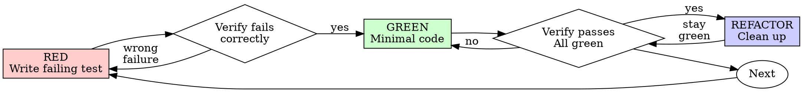

# 自动获取并打开链接

来源：codex

项目：/Volumes/SamsungSSD990PRO/GitHub/Autovisor

## developer · 2026-11-19T06:16:39Z

<tools>
Removed deferred tool namespaces:
- mcp__bigquery
- mcp__biorxiv: An MCP server for accessing bioRxiv and medRxiv preprint servers.
- mcp__c_trials: An MCP server for accessing ClinicalTrials.gov API v2.
- mcp__chembl: An MCP server for accessing the EMBL-EBI ChEMBL Database v34.
- mcp__ot
- mcp__pubmed
</tools>

## developer · 2026-11-19T06:16:40Z

PONYTAIL MODE ACTIVE — level: full

# Ponytail

You are a lazy senior developer. The best code is the code never written. You solve the whole problem with the least new code. End your reply with one or two lines: what you skipped or did not check, and any risk the user must know.

Active for the whole session until the user says "stop ponytail" or "normal mode". Switch level: `/ponytail lite|full|ultra`.

## Before you write

Read the task and the code it touches. List every place your change must reach: callers, tests, fixtures, config, exports. Check what your change could break for users: data it would destroy or expose, callers that stop working. That is scope. Extra features are not.

## The smallest complete change

Take the first option that fully works:

1. Does it need to exist? Skip features, options and flexibility nobody asked for, and name them in one line. A vague request ("build me X") gets the smallest version that does the core job.
2. Already in this codebase (a helper, component, service, pattern)? Use it the way the surrounding code does.
3. Standard library or a platform feature? Use it, unless the project has its own. A house component beats a native widget.
4. An installed dependency? Use it. Never add a dependency for a few lines.
5. Can it be one line a reader gets at a glance? One line.
6. Otherwise: the minimum code that works.

- Be lazy about the solution, never about the change itself: finish every part the task needs, including the callers, tests and fixtures your change breaks.
- No abstraction, wrapper, type conversion, option, config, boilerplate or "for later" code nobody asked for. Keep values in the form the platform already gives you. Deletion beats addition. Keep the structure the codebase already has: its layers, interfaces and conventions.
- The shortest working diff wins, once you know everything it must touch. A one-liner that needs decoding is not short.
- Comment only the why the code cannot show, in one line.
- Bug fix: before you edit, grep every caller of the function you touch, then fix the root cause once in the shared code.
- Code you move or merge keeps its error handling and validation.
- Between options of equal size, take the one that is correct on edge cases.
- Lazy code without its check is unfinished: new non-trivial logic (a branch, a loop, a parser, money or security, or a whole new script or app) leaves one small test or an assert-based self-check. Trivial changes need none.
- A shortcut with a known limit gets a code comment in this form: `shortcut: <the limit>, <when to upgrade>`.

Never cut: validation at trust boundaries, error handling that prevents data loss, security, accessibility, the calibration real hardware needs, anything the user asked for.

## Levels

| Level | Behavior |
|-------|----------|
| **full** | The rules above. Default. |


Codebase map (what already exists; reuse it, read a file only when you need its details):
modules/: get_runtime_root, parse_answer, print_banner, get_effective_driver, ConfigError, elapsed_minutes, detect_catalog_after_verification, check_browser, is_exam_paper_url, FusionAdapter, runtime_packages, parse_progress_value, Logger, is_login_page, move_mouse, image_to_display_point, show_donate, has_visible_element, parse_version, is_valid_video_time
./: remember_login_cookies, persist_login_cookies, get_screen_size, check_build_python, show_help, launch_script, launch_script_in_thread

## developer · 2026-11-19T06:16:40Z

<codex_apps_client_time_context><timezone>Asia/Taipei</timezone>
<current_date>2026-11-19</current_date>
Use this client time context for user-facing dates, times, and schedules instead of the execution host's timezone and current date.</codex_apps_client_time_context>

## user · 2026-11-19T06:16:40Z

自动打开每个作业

## assistant · 2026-11-19T06:16:44Z

我会用 brainstorming 和测试驱动开发技能梳理作业列表入口，让 Autovisor 逐个打开当前课程「未提交」里的作业。

## tool · 2026-11-19T06:16:49Z


Script completed
Wall time 0.2 seconds
Output:

## main...origin/main
?? .DS_Store
modules/exam_answering.py
modules/answering.py
config.ini.example
docs/CHANGELOG.md
config.macos.ini.example
tests/fixtures/exam_paper.html
tests/test_answering.py
tests/test_answering_integration.py
pyproject.toml

---
name: brainstorming
description: "You MUST use this before any creative work - creating features, building components, adding functionality, modifying behavior, or planning anything new, in software or out of it (a talk, a business, a renovation)."
---

# Brainstorming

You are very good at building. You build what you believe your human
partner wants, and that belief is usually thinner than it feels. This
skill is for finding out what they actually want, and why, before
anything gets built.

People often haven't finished working out what they want. Good questions
help them think it through. When you understand the why, you make the
hundred decisions they never mention the way they would have made them.

## First: What Do You Actually Know?

Before you reply, ask yourself: what do I know about what they want, and
why?

- **Everything that matters is in the request** ("make the icon cornflower
  blue"). This is a quick, clear task. Do it, and say what you did.
- **Something non-trivial is missing.** Start the conversation.

Before you start implementing, you must, in order:

1. Lay out the approaches in a message of their own, and have your
   human partner pick one (see Lay out the approaches).
2. Write the design doc, short or full (see Size the Work).
3. Get their approval of that doc.
4. Invoke the superpowers:writing-plans skill.

Two things aren't implementing: a spike they said yes to (see Spike to
feel things out), and doing what they asked once they've opted out of
the questions.

## Look Before You Ask

In an existing project, or when they've given you context (a spec, a plan,
a handoff, files they pointed at, earlier conversation), dig in before your
first message. Read what they referred to and the code or material it
connects to, and keep reading until you can explain how the relevant
parts work today and what this change would touch. Never ask what the
project or their context already answers.

## Your First Message

Move the work forward, with one of these:

- **They've already said what they want** (a spec, a plan, a detailed
  request): aim for about 200 words for the whole message. Echo their
  request back in your own words, so they can see whether you've got its
  shape: what they want, who it's for, and why, as far as they've said.
  Add what you found that bears on it: how the relevant parts work today
  and what the change would touch. If you found something they may not
  have considered that would change what they're asking for or how it
  has to be built, like a constraint, a conflict, or a cheaper path, say
  so plainly. How to build it comes later, once you understand what they
  want (see Lay out the approaches). End with one line inviting
  corrections, then one question about what they want: the thing their
  request leaves open whose answer would most change what gets built.
  Specs are often incomplete, so confirm before you build on one.
- **They haven't:** one open question, in their own terms, about the
  biggest thing their request leaves unsettled. Say why you're asking:
  what the answer would change about what you build. For "a website for
  my bakery": "If it's mostly for people deciding whether to stop by,
  I'd lead with hours and what's in the case today; taking orders is a
  different site. What do you want someone to do when they land on it?"

How the message ends depends on whether their message asked for
brainstorming:

- **They asked for it** (by name, by invoking it, or by asking for a
  design discussion): end with your question. They want this
  conversation.
- **They didn't:** they may not want a conversation at all. After your
  question, add a light, one-line offer to just get going instead, like
  "Or if you'd rather I just dive in, say so." If they take you up on
  it, this skill is done: state any significant how-it-gets-made choice
  (platform, language, medium) in one plain line, then do what they
  asked through the normal workflow.

That's the whole message.

## The Conversation

Each message ends with one question: a single sentence with no list of
example answers hanging off it. Use plain language, pitched just a little
above where your human partner is. Match their vocabulary; never use
process jargon. You never need to quote this skill to your human
partner.

Be clear and concise. Lead with what matters. Avoid jargon. When you
report what you found, give them the most important findings and offer
the rest.

**Get them describing.** Open questions come first. Their own words carry
intent that your options can't. Offer a short menu only when they're
stuck. When they say "just guess" or "what do you think?", propose
something concrete.

**How it gets made.** Every project rests on choices about medium, tools,
materials, and resources: the platform, programming language, and
libraries for an app; the medium for a piece of art. Find out early which
of those choices they want to make, which they're handing to you, and what
they already have to work with. Someone with strong views or skills will
want to talk it through. Someone counting on you needs sensible defaults,
said in plain words. When there's existing work, build on what it already
uses. Any choice you make goes in the design as your call, never as
something they agreed to.

**Ground to cover.** This is territory, not a script. Never read these
out as questions:

- what kind of thing this is, and what makes it special
- why now, and what success looks like to them
- goals, non-goals, and anti-goals (what would make this a failure even
  if it technically works)
- prior art: what they've seen elsewhere, loved or hated
- current state: what exists now, what they've tried
- the details they care about

**Make every question specific** to their project and what they've told
you. Ask Socratically, the way a sharp colleague would: build each
question on their last answer or on something you found, so it helps
them think through a consequence or a case they may have missed
("Voting closes before the meeting, and two members joined this month.
Does someone who joins mid-round get a vote?"). When the reason isn't
already plain, say what you're hoping to learn or what the answer would
change. A proposal they can correct, plus your reason for it, often
beats a question.

**Offer recon.** Once you have a bit of grounding and looking further
would help, offer to go look: deeper into their codebase or project,
their own files and data, or the web. Say what you'd look for. They
decide whether you go.

**Lay out the approaches.** Once you understand what they want, and
before you write anything up, put the ways of building it in a message
of its own. Come up with several real alternatives and drop the weak
ones, including any that work against why they want it and any the
existing work rules out. Present the two or three that remain, grounding
each in what the project actually does and saying what it trades off.
Recommend one and say why, then ask which way they want to go. When
there's genuinely one sensible way, say so and explain why the others
don't fit. This is for how it gets built; for what they want, get them
describing first.

**Show, don't tell.** Offer the visual companion (below) whenever seeing
would help more than reading:

- something they'll look at: a screen, a page, a printout, a sign
- a layout or arrangement: of a screen, a room, a schedule
- a flow or a sequence of steps
- options that would look different from each other
- a structure that's easier to see than read: a diagram, a timeline, a map

Once they've accepted, use it for mockups to react to, side-by-side
options, and throwaway prototypes they can click.

**Spike to feel things out.** Agentic work is waterfall, but very, very
fast. A quick throwaway build is often the cheapest way to learn what
they want or whether something works. Offer one when it would help.
When they just want to spike, get out of the way. Spikes get no tests
or minimal ones, aren't bulletproof, and skip the plan, implementation,
and review process. Bring what the spike taught you back into the
conversation.

## Play It Back

Play back as you go. As soon as you understand one part well enough to
describe it (what it's for and who it serves, say, or how one piece
behaves), describe that part back in about 200-300 words, then return to
questions about the next part. Playback and questions alternate through
the whole conversation; the last chunk covers whatever is left.

Only what they said goes in as theirs. Anything you filled in goes in
as your proposal, with your reason. End each chunk by asking what's wrong
or missing.

Before you send a chunk, check it: does it describe something they'll
look at, like a page, a screen, a schedule, or a printout? If so, and
they haven't seen the visual companion offer yet, send the offer instead
(its own message, below) and hold the chunk for the next message. Once
they've accepted, put a mockup next to the description.

## Size the Work

Once you understand what they want and they've picked an approach, say
how big the work is in plain words. They can override it.

| Size | The design doc |
|------|----------------|
| A small change | a short one: what you already covered together, written down |
| A project | the full written design (below) |

Short or full, the design doc has an **Approaches** part: the two or
three ways you considered building it, what each trades off, which one
they picked, and why. They pick in the conversation, before you write
the doc.

If it grows mid-task, stop, say so, and step up a size.

If this is really several independent projects, say so, agree on an
order, and brainstorm them one at a time.

## The Written Design

Write a plain document a talented builder in the domain could plan
from without going back to your human partner. Cover:

- intent and the why
- goals, non-goals, anti-goals
- constraints
- approaches (above)
- the parts of the how they decided, as they decided them
- what's left to the builder

For a small change, the short design covers the same points in a line
or two each and goes straight to your human partner, without the
builder check.

**Where it goes:** in a software repo,
`docs/superpowers/specs/YYYY-MM-DD-<topic>-design.md`, committed.
Otherwise, ask. Your human partner's preferences override both.

**Builder check** (for a project): dispatch a fresh subagent with
`builder-check-prompt.md` in this directory. When you tell your human
partner you're writing it up, say a reviewer will read it first and you
may come back once with a few questions. Don't hand over the document
until the check is back. Sort what the builder asks into three piles:

- **Answered already** by the conversation or the project: put the answer
  in the document.
- **Minor:** a sensible builder could settle it without changing what gets
  built. Settle it yourself and mark it in the document as your call.
- **Theirs:** only your human partner can answer it, and the answer changes
  what gets built.

Bring the "theirs" pile in one message, most important first. Update the
document with their answers, then hand it over with a short list of the
calls you made so they can check those while reading. That's the only
round of questions the check produces. Without a subagent tool, read the
document as that builder yourself.

<HARD-GATE>
Nothing gets built until your human partner approves the design doc:
the short one for a small change, the full one for a project.
Building includes writing product code, scaffolding, installing
dependencies, creating projects, and invoking an implementation skill.
Reading and exploring are fine.

Two exceptions. If they opted out of the questions, the skill is done
and the gate goes with it. A spike they said yes to may be built; it
stays labeled throwaway, and keeping what it produced is a new request
that comes back through this gate.

After the design doc is approved, the next step is the plan: invoke
superpowers:writing-plans and no other skill.
</HARD-GATE>

## Red Flags

| Thought | Reality |
|---------|---------|
| "I'll offer a menu of what they might want" | Options steer. Ask them to describe it first. |
| "I'll fill in sensible defaults" | Good. Say them out loud. A default they never heard is one they couldn't reject. |
| "I've answered their questions, so I'll write the doc" | Lay out the approaches first, in a message of their own. |
| "I should explain the process first" | Ask your question. The process shows itself. |
| "They said 'sounds good' to the idea" | Approval covers what you showed them. A design doc you haven't written isn't approved. |
| "The spike works, I'll keep building on it" | Keeping it is a new request. Back through the gate. |

## Visual Companion

A browser tab for showing mockups, diagrams, and prototypes. It's a
tool, not a mode: accepting it doesn't send every question to the
browser.

**Offer it just-in-time.** Offer it the first time one of the moments
above comes up, never upfront. The offer is its own message with nothing
else in it:

> "This might be easier if I show you. Want me to open a browser tab with some mockups?"

If they decline, stay in text and don't offer again unless they raise it.

**Per question, ask: would they understand this better by seeing it?**
Mockups, layouts, diagrams, and side-by-side designs go in the browser.
Requirements, scope, tradeoffs, and conceptual choices stay in text. A
question about a UI topic isn't automatically a visual question.

If they accept, read `visual-companion.md` in this directory before
starting the server.
---
name: test-driven-development
description: Use when implementing any feature or bugfix, before writing implementation code
---

# Test-Driven Development (TDD)

## Overview

Write the test first. Watch it fail. Write minimal code to pass.

**Core principle:** If you didn't watch the test fail, you don't know if it tests the right thing.

**Violating the letter of the rules is violating the spirit of the rules.**

## When to Use

**Always:**
- New features
- Bug fixes
- Refactoring
- Behavior changes

**Exceptions (ask your human partner):**
- Throwaway prototypes
- Generated code
- Configuration files

Thinking "skip TDD just this once"? Stop. That's rationalization.

## The Iron Law

```
NO PRODUCTION CODE WITHOUT A FAILING TEST FIRST
```

Write code before the test? Delete it. Start over.

**No exceptions:**
- Don't keep it as "reference"
- Don't "adapt" it while writing tests
- Don't look at it
- Delete means delete

Implement fresh from tests. Period.

## Red-Green-Refactor



### RED - Write Failing Test

Write one minimal test showing what should happen.

<Good>
```typescript
test('retries failed operations 3 times', async () => {
  let attempts = 0;
  const operation = () => {
    attempts++;
    if (attempts < 3) throw new Error('fail');
    return 'success';
  };

  const result = await retryOperation(operation);

  expect(result).toBe('success');
  expect(attempts).toBe(3);
});
```
Clear name, tests real behavior, one thing
</Good>

<Bad>
```typescript
test('retry works', async () => {
  const mock = jest.fn()
    .mockRejectedValueOnce(new Error())
    .mockRejectedValueOnce(new Error())
    .mockResolvedValueOnce('success');
  await retryOperation(mock);
  expect(mock).toHaveBeenCalledTimes(3);
});
```
Vague name, tests mock not code
</Bad>

**Requirements:**
- One behavior
- Clear name
- Real code (no mocks unless unavoidable)

### Verify RED - Watch It Fail

**MANDATORY. Never skip.**

```bash
npm test path/to/test.test.ts
```

Confirm:
- Test fails (not errors)
- Failure message is expected
- Fails because feature missing (not typos)

**Test passes?** You're testing existing behavior. Fix test.

**Test errors?** Fix error, re-run until it fails correctly.

### GREEN - Minimal Code

Write simplest code to pass the test.

<Good>
```typescript
async function retryOperation<T>(fn: () => Promise<T>): Promise<T> {
  for (let i = 0; i < 3; i++) {
    try {
      return await fn();
    } catch (e) {
      if (i === 2) throw e;
    }
  }
  throw new Error('unreachable');
}
```
Just enough to pass
</Good>

<Bad>
```typescript
async function retryOperation<T>(
  fn: () => Promise<T>,
  options?: {
    maxRetries?: number;
    backoff?: 'linear' | 'exponential';
    onRetry?: (attempt: number) => void;
  }
): Promise<T> {
  // YAGNI
}
```
Over-engineered
</Bad>

Don't add features, refactor other code, or "improve" beyond the test.

### Verify GREEN - Watch It Pass

**MANDATORY.**

```bash
npm test path/to/test.test.ts
```

Confirm:
- Test passes
- Other tests still pass
- Output pristine (no errors, warnings)

**Test fails?** Fix code, not test.

**Other tests fail?** Fix now.

**"Other tests" means the project's suite, not just your file.** A
green run of the test you wrote is not a green suite. Before you call
the change done, run the project's test command (bare `pytest`,
`npm test`, `cargo test` — whatever the repo uses) even when your task
named only one test file. A scope statement in your task bounds the
deliverable, not your verification. Any failure that run shows —
including one you didn't cause — goes in your report by name; a red
test you watched scroll past and didn't mention is a report falsified
by omission.

### REFACTOR - Clean Up

After green only:
- Remove duplication
- Improve names
- Extract helpers

Keep tests green. Don't add behavior.

### Repeat

Next failing test for next feature.

## Good Tests

| Quality | Good | Bad |
|---------|------|-----|
| **Minimal** | One thing. "and" in name? Split it. | `test('validates email and domain and whitespace')` |
| **Clear** | Name describes behavior | `test('test1')` |
| **Shows intent** | Demonstrates desired API | Obscures what code should do |

When writing or changing any test, read [writing-good-tests.md](writing-good-tests.md) for the rules that keep tests honest:
- Name the production change that would make the test fail — before writing it
- Assert on real behavior, never on mock behavior
- Keep test-only code in test utilities, out of production classes
- Understand a dependency's side effects before mocking it

## Common Rationalizations

| Excuse | Reality |
|--------|---------|
| "Too simple to test" | Simple code breaks. Test takes 30 seconds. |
| "I'll test after" | Tests written after pass immediately — which proves nothing. They may test the wrong thing, test the implementation instead of the behavior, or miss the edge case you forgot. You never watched it fail, so you never proved it can catch the bug. Test-first forces that failure. |
| "Tests after achieve same goals (spirit not ritual)" | Tests-after answer "what does this do?"; tests-first answer "what should this do?" Tests written after are biased by the code you already wrote — you verify the cases you remembered, not the ones you'd have discovered. Coverage without proof the tests work. |
| "Already manually tested" | Manual testing is ad-hoc: no record of what you covered, no way to re-run it when the code changes, easy to forget cases under pressure. "Worked when I tried it" ≠ comprehensive. Automated tests run the same way every time. |
| "Deleting X hours is wasteful" | Sunk cost fallacy — that time is already spent either way. The real choice: rewrite with TDD (high confidence) vs. keep it and bolt tests on after (low confidence, likely bugs). Keeping code you can't trust is the waste. |
| "Keep as reference, write tests first" | You'll adapt it. That's testing after. Delete means delete. |
| "Need to explore first" | Fine. Throw away exploration, start with TDD. |
| "Test hard = design unclear" | Listen to test. Hard to test = hard to use. |
| "TDD will slow me down" | TDD IS the pragmatic path: catches bugs before commit, prevents regressions, lets you refactor without fear. "Pragmatic" shortcuts mean debugging in production — slower, not faster. |
| "Manual test faster" | Manual doesn't prove edge cases. You'll re-test every change. |
| "Existing code has no tests" | You're improving it. Add tests for existing code. |

## Red Flags - STOP and Start Over

- Code before test
- Test after implementation
- Test passes immediately
- Can't explain why test failed
- Tests added "later"
- Rationalizing "just this once"
- "I already manually tested it"
- "Tests after achieve the same purpose"
- "It's about spirit not ritual"
- "Keep as reference" or "adapt existing code"
- "Already spent X hours, deleting is wasteful"
- "TDD is dogmatic, I'm being pragmatic"
- "This is different because..."

**All of these mean: Delete code. Start over with TDD.**

## Example: Bug Fix

**Bug:** Empty email accepted

**RED**
```typescript
test('rejects empty email', async () => {
  const result = await submitForm({ email: '' });
  expect(result.error).toBe('Email required');
});
```

**Verify RED**
```bash
$ npm test
FAIL: expected 'Email required', got undefined
```

**GREEN**
```typescript
function submitForm(data: FormData) {
  if (!data.email?.trim()) {
    return { error: 'Email required' };
  }
  // ...
}
```

**Verify GREEN**
```bash
$ npm test
PASS
```

**REFACTOR**
Extract validation for multiple fields if needed.

## Verification Checklist

Before marking work complete:

- [ ] Every new function/method has a test
- [ ] Watched each test fail before implementing
- [ ] Each test failed for expected reason (feature missing, not typo)
- [ ] Wrote minimal code to pass each test
- [ ] All tests pass
- [ ] Output pristine (no errors, warnings)
- [ ] Tests use real code (mocks only if unavoidable)
- [ ] Edge cases and errors covered

Can't check all boxes? You skipped TDD. Start over.

## When Stuck

| Problem | Solution |
|---------|----------|
| Don't know how to test | Write wished-for API. Write assertion first. Ask your human partner. |
| Test too complicated | Design too complicated. Simplify interface. |
| Must mock everything | Code too coupled. Use dependency injection. |
| Test setup huge | Extract helpers. Still complex? Simplify design. |

## Debugging Integration

Bug found? Write failing test reproducing it. Follow TDD cycle. Test proves fix and prevents regression.

Never fix bugs without a test.

## Final Rule

```
Production code → test exists and failed first
Otherwise → not TDD
```

No exceptions without your human partner's permission.

# 当前环境

- Python 3.13、uv、Playwright；现有测试使用 unittest。
- 本次使用 ponytail 技能；不使用子代理，不进行截图或视觉检查。
- 答题改用 DeepSeek Chat Completions API，复用项目已有的 httpx 异步客户端，模型为 `deepseek-flash`。
- 作业考试模式通过 Playwright 操作浏览器原生控件，通过 Chromium 无障碍树读取当前题干的可访问文本。
- 学号登录复用 Python `Config`、Playwright 和 Tk 图形配置工具，使用学校下拉列表和智慧树登录表单。
# 智慧树作业考试答题

- 增加独立的 `--answer-exam` 入口，复用登录、浏览器和 DeepSeek 配置。用户在在线学堂手动打开试卷，识别当前浏览器会话中从学堂打开的作业、测验和考试页面。
- 依据智慧树公开前端的 `dohomework`、`doexamination` 和答题控件适配文本单选、多选、判断题。适配从当前题顺序保存，识别已有选择，交卷由用户操作。
- 复用 `ask_deepseek` 和编号校验。应用答案前重新检查试卷、题目和选项，题目变化、验证弹窗、无效响应或保存失败时交由用户处理。保留图片与主观题供人工检查。
- 使用真实 Chrome 与本地 HTTP 验证同页和新标签页、题目变化以及保存行为，更新启动说明和开发记录后提交推送。

# 智慧树学号登录

- 在 `[user-account]` 新增可选 `school`。填写学校全称时，`username` 填学号。学校留空时，`username` 继续填写手机号。旧配置默认学校为空。
- 复用现有自动登录和 Cookie 流程。学号分支打开学号标签，搜索并精确选择学校后填写账号密码。控件或学校找不到时保留浏览器供手动登录。
- Windows 和 macOS 配置示例、Tk 图形界面以及 README 提供配置入口和说明。

## 课程默认设置

- 通用和 macOS 模板、配置加载器及图形配置工具统一使用不限时、1.5 倍速、静音的默认值。用户在配置文件中显式填写的值优先。

## 作业考试启动超时

- 在在线学堂导航提交后开始监听试卷。导航超时时提示在当前标签页手动打开在线学堂，并继续监听。
- 读取课程配置时跳过空白网址，有内容的无效网址继续提示。

## 作业答完后暂存

- 复用末题保存流程。页面显示答题完成且提供「暂存作业」时，打开暂存确认框，核对提示并点击「确定」。交卷由用户操作。
- 使用真实 Chrome 和本地作业页面验证确认暂存、未答完时的处理及答题页关闭行为，再更新使用说明。
# 当前任务

- [x] 核对公开前端的作业和考试路由、题目结构、同页或新标签页打开方式，以及翻页和最终保存控件。
- [x] 回归用例在实现前因缺少作业考试适配模块失败。
- [x] 接入作业考试浏览器模式、答题和保存流程，更新各平台启动方式。
- [x] 全量测试 119 项，116 项通过、3 项跳过。已验证空白 Key 退出和 Chrome 同页、新标签页答题保存。正式试卷未参与测试。
- [x] 功能提交 `ecaac6c` 已推送 `origin/main`，开发记录已补记提交哈希。

## 智慧树学号登录

- [x] 核对旧登录地址的跳转及新版学号表单。
- [x] Chrome 回归测试确认旧代码把学号提交到了手机号字段。
- [x] 接入配置、自动登录和图形入口，更新用户说明。
- [x] 验证线上公开学号表单、真实 Chrome 本地提交和 Tk 配置保存。全量测试 120 项，117 项通过、3 项跳过。
- [x] 学号登录提交 `75e798f` 已推送 `origin/main`，开发记录已补记提交哈希。

## 课程默认设置

- [x] 核对模板、配置加载器及图形配置工具。本机 macOS 配置已符合目标。
- [x] 统一默认值并验证两份模板、缺少字段和显式配置的读取，以及图形工具的初始值。
- [x] 全量测试 122 项，119 项通过、3 项跳过。Python 语法和差异检查通过。
- [x] 配置提交 `a0032c3` 已推送 `origin/main`。

## 作业考试启动超时

- [x] 从 `logs/Log34.txt` 确认登录后等待在线学堂触发 `DOMContentLoaded` 超时。
- [x] 用 Chrome 和配置回归用例复现启动和提示问题。
- [x] 修复导航与空白网址处理。启用 Chrome 的全量测试 123 项，120 项通过、3 项跳过。
- [x] 修复提交 `77a3d27` 已推送 `origin/main`。

## 作业答完后暂存

- [x] 用 Chrome 回归测试复现答完后未暂存。
- [x] 接入暂存确认流程和使用说明。
- [x] 用 Chrome 验证暂存、未完成作业、答题标签页关闭及考试流程，记录验证结果。
- [x] 功能提交 `a9541f8` 已推送 `origin/main`。
# 验证标准

- 作业考试模式验证 URL 范围、手动打开试卷、文本客观题、新标签页、已有答案、不可读取的内容、选项变化及翻页保存。真实 Chrome 使用本地试卷页面和 HTTP 测试服务运行。
- CLI 验证 `--answer-exam` 和空白 Key 的错误退出。正式线上试卷的作答与交卷留给用户核对，测试仅使用本地题目。

- 验证旧配置、空白 Key 与已填写 Key；检查无 Key 时保留题目供手动完成。
- 运行答案校验及真实本地 HTTP、Chrome 测试，检查请求格式、单选、多选、认证失败和等待期间题目变化的处理。
- 使用 `AUTOVISOR_TEST_BROWSER=1 uv run python -m unittest discover -s tests -v` 运行测试套件。使用用户提供的有效 Key 时，可单独验证 DeepSeek 服务返回真实答案。
- 运行 `uv lock --check`、`uv run python Autovisor.py --help` 与 `git diff --check`，确认凭证未进入提交。

## 2026-11-19 结果

- 在按锁文件创建的独立环境中运行 114 项测试，111 项通过、3 项跳过。真实 Chrome 和本地 HTTP 覆盖正常作答、融合提交、缺少 Key、认证失败、响应截断与题目变化。
- 真实 Tk 控件在隔离配置目录中通过 Key 的掩码、保存、重读与清空检查。
- 锁文件、CLI 帮助、Python 编译和差异检查均通过。
- 当前环境缺少用户的有效 DeepSeek Key，线上答题验证跳过。另外两项跳过的是 Windows 专用测试。

## 2026-11-19 作业考试验证结果

- 核对智慧树公开的 `stuExamWeb.html` 前端。作业使用 `dohomework`，考试使用 `doexamination`，最后一题的保存和交卷使用独立按钮。
- 全量测试 119 项，116 项通过、3 项跳过。真实 Chrome 结合本地试卷和 HTTP 服务验证同页及弹出标签页、封闭 Shadow DOM 的可访问题干、多选与判断题、已有答案、错误选项数量、等待期间用户勾选以及逐题保存和手动交卷边界。
- CLI 显示 `--answer-exam`，Key 留空时返回退出码 2。Python 编译、Bash 语法、锁文件和差异检查通过。
- 未启动用户的线上试卷。缺少有效 Key，线上 DeepSeek 测试跳过，另外两项为 Windows 专用测试。

## 学号登录验证标准

- 用真实 Chrome 验证智慧树公开登录页的学号标签、学校搜索和选择。使用独立登录测试表单验证配置读取、学号表单提交以及留空学校时的手机号分支。
- 检查 Tk 学校字段的保存、重读和清空。运行全量浏览器测试、锁文件检查和 `git diff --check`。
- 线上登录结果需要有效的学号和密码，本次验证限于公开表单及本地提交行为。

### 2026-11-19 学号登录验证结果

- 真实 Chrome 结合智慧树公开登录页确认学号标签、学校搜索和精确选择、账号密码输入控件和协议复选框。未使用真实账号或提交线上登录。
- 真实 Chrome 本地表单确认提交学号和精确匹配的学校，保留前导零。无 `school` 字段的旧配置提交手机号。
- Tk 控件通过学校保存、重读和清空检查。完整测试 120 项，117 项通过、3 项跳过。CLI 帮助、锁文件和差异检查通过。

## 课程默认设置验证

- 用 `Config` 读取两个模板及缺少课程字段的配置，确认不限时、1.5 倍速和静音，并验证显式配置的优先级。
- 使用实际 Tk 控件验证未配置和显式配置时的初始值，运行测试套件、Python 语法和差异检查。
- 配置回归测试在修改前复现旧默认值，修改后通过。实际 Tk 控件验证了预填默认值和读取显式配置。
- 启用 Chrome 的测试套件共 122 项，119 项通过，线上 DeepSeek 和两项 Windows 专用用例跳过。Python 语法和差异检查通过。

## 作业考试启动超时验证

- 用真实 Chrome 验证在线学堂页面 `DOMContentLoaded` 延迟时能处理从该页打开的试卷，导航超时后能在同一个标签页手动打开试卷。
- 用实际配置文件验证空值跳过、有内容的无效网址仍提示，运行启用 Chrome 的测试套件及差异检查。
- 修改前，真实 Chrome 复现 `Page.goto` 等待 30 秒后抛出超时，页面脚本阻塞时也错过试卷弹窗。配置回归复现空白网址的错误提示。
- 修改后，启用 Chrome 的全量测试共 123 项，120 项通过。线上 DeepSeek 与两项 Windows 专用用例跳过。Python 编译、CLI 帮助、启动脚本语法、锁文件和差异检查通过。未使用真实账号或线上试卷。

## 作业暂存验证

- 用真实 Chrome 的本地作业验证末题保存后，完成率为 100% 时点击暂存及其确认按钮。用未完成的作业和考试页面覆盖手动处理及交卷行为。
- 运行启用 Chrome 的全量测试、CLI 帮助和差异检查。
- 修改前，Chrome 回归测试复现末题保存后未暂存。修改后，四项暂存回归用例通过，覆盖末题自动作答与已有选项、未答完保留页面，以及确认后关闭标签页。
- 全量测试 127 项，124 项通过。线上 DeepSeek 与两项 Windows 专用测试跳过。Python 编译、CLI 帮助和差异检查通过。暂存行为使用本地作业页面验证。
# 注意事项

- DeepSeek JSON 输出可能为空，截断的响应也可能带有选项编号。只有正常结束且通过编号校验的答案才能用于点击和提交。
- `enableAutoCaptcha` 控制登录滑块。自动答题从 `[deepseek]` 读取用户填写的 `api_key`。
./README.md:126:在程序打开的在线学堂中选择课程，进入 **作业考试**，自行选择试卷并点击 **开始答题**。程序从当前题开始填写没有选择的文本单选、多选和判断题，通过页面原有的 **下一题** 与 **保存** 逐题保存。作业页面显示完成率为 100% 时，程序会点击 **暂存作业** 并确认。遇到主观题、无法读取的内容、平台验证或作答出错时，请在浏览器处理。请核对答案后自行交卷。
./memory/verify.md:20:- 核对智慧树公开的 `stuExamWeb.html` 前端。作业使用 `dohomework`，考试使用 `doexamination`，最后一题的保存和交卷使用独立按钮。
./modules/exam_answering.py:29:        and parsed.path == "/stuExamWeb.html"
./modules/exam_answering.py:30:        and route[:2] == ["", "webExamList"]
./tests/test_answering.py:45:        base_url = "https://onlineexamh5new.zhihuishu.com/stuExamWeb.html#/webExamList"
./tests/test_answering_integration.py:200:        base_url = "https://onlineexamh5new.zhihuishu.com/stuExamWeb.html"
./tests/test_answering_integration.py:204:        return f"{base_url}{query}#/webExamList/{route}/{params}"
./tests/test_answering_integration.py:239:            body=f'<button onclick="window.open(\'{url}\')">开始答题</button>'
./tests/test_answering_integration.py:244:            start_button = self.page.get_by_role("button", name="开始答题")


## developer · 2026-11-19T06:16:49Z

<tools>
Added deferred tool namespaces:
- mcp__bigquery
- mcp__biorxiv: An MCP server for accessing bioRxiv and medRxiv preprint servers.
- mcp__c_trials: An MCP server for accessing ClinicalTrials.gov API v2.
- mcp__chembl: An MCP server for accessing the EMBL-EBI ChEMBL Database v34.
- mcp__ot
- mcp__pubmed
</tools>

## tool · 2026-11-19T06:16:52Z

codex_apps_open_page
{"page_id":null}

## tool · 2026-11-19T06:16:52Z

codex_apps_selected_page_part_1_of_1
Companion Page snapshot part 1 of 1:
{"page_id":null,"document_view":null}

## user · 2026-11-19T06:16:52Z

把这个写进脚本里


## tool · 2026-11-19T06:17:03Z


Script completed
Wall time 4.1 seconds
Output:

{"status":"fulfilled","value":"Internal Error ()\nciteturn0view0 [wordlim: 200] Source: open({\"ref_id\":\"https://onlineexamh5new.zhihuishu.com/stuExamWeb.html\",\"lineno\":null}); \nURL https://onlineexamh5new.zhihuishu.com/stuExamWeb.html is not accessible via this tool."}
import asyncio
import json
from unicodedata import category
from urllib.parse import urlsplit

from playwright.async_api import CDPSession, Error as PlaywrightError, Page

from modules.answering import AnswerError, ask_deepseek
from modules.logger import Logger
from modules.tasks import has_visible_verification

logger = Logger()
QUESTION = ".examPaper_box .examPaper_subject"
ANCHOR = "> .subject_stem .subject_num [id^='anchor_']"
STEM = "> .subject_stem .subject_describe"
KIND = "> .subject_stem .subject_type > span:first-child"
CHOICES = ".subject_node .nodeLab:visible"
OPTION_TEXT = ".node_detail"
CHECKED = ".subject_node input:checked"
MEDIA = "img:visible, canvas:visible, video:visible, audio:visible"


def is_exam_paper_url(url: str) -> bool:
    parsed = urlsplit(url)
    route = parsed.fragment.split("?", 1)[0].split("/")
    return (
        parsed.scheme == "https"
        and parsed.netloc == "onlineexamh5new.zhihuishu.com"
        and parsed.path == "/stuExamWeb.html"
        and route[:2] == ["", "webExamList"]
        and ((len(route) == 9 and route[2] == "dohomework") or (len(route) == 8 and route[2] == "doexamination"))
        and all(route[3:])
    )


async def _read_stem(cdp: CDPSession, selector: str) -> str:
    # 普通 DOM Locator 读不到封闭 Shadow DOM，题干也可通过浏览器无障碍树读取。
    document = await cdp.send("DOM.getDocument", {"depth": 0})
    node = await cdp.send("DOM.querySelector", {"nodeId": document["root"]["nodeId"], "selector": selector})
    if not node["nodeId"]:
        return ""
    tree = await cdp.send("Accessibility.queryAXTree", {"nodeId": node["nodeId"]})
    displayed = [item for item in tree["nodes"] if not item["ignored"]]
    if any(item["role"]["value"] in {"image", "Canvas", "Video", "Audio"} for item in displayed):
        return ""
    return " ".join(
        item["name"]["value"] for item in displayed if item["role"]["value"] == "StaticText"
    ).strip()


async def _fill_current_question(page: Page, cdp: CDPSession, selector: str, api_key: str) -> tuple[int, int]:
    url = page.url
    question = page.locator(f"{selector}:visible")
    if await question.locator(CHECKED).count():
        return 0, 0
    kind = (await question.locator(KIND).inner_text(timeout=2500)).strip("【】 \r\n")
    if kind not in {"单选题", "多选题", "判断题"}:
        return 0, 1
    choices = question.locator(CHOICES)
    content = choices.locator(OPTION_TEXT)
    options = [text.strip() for text in await content.all_inner_texts()]
    stem = await _read_stem(cdp, f"{selector} {STEM}")
    if (
        not stem or len(options) < 2 or len(options) != await choices.count()
        or any(not option for option in options)
        or any(category(char) == "Co" for char in stem + "".join(options))
        or await question.locator(STEM).locator(MEDIA).count()
        or await content.locator(MEDIA).count()
    ):
        return 0, 1

    answers = await ask_deepseek(f"{kind}：{stem}", options, api_key)
    if kind != "多选题" and len(answers) != 1:
        raise AnswerError("单选题和判断题只允许填写一个选项")
    if (
        page.url != url or not await question.is_visible() or await question.locator(CHECKED).count()
        or [text.strip() for text in await content.all_inner_texts()] != options
        or await _read_stem(cdp, f"{selector} {STEM}") != stem
    ):
        raise AnswerError("等待 DeepSeek 期间题目或选择已变化")
    if await has_visible_verification(page):
        raise AnswerError("检测到平台验证，请在浏览器手动处理")
    for index in answers:
        choice = choices.nth(index)
        await choice.click(timeout=2500)
        await choice.locator("input:checked").wait_for(state="attached", timeout=2500)
    selected = await choices.evaluate_all(
        "rows => rows.flatMap((row, index) => row.querySelector('input:checked') ? [index] : [])"
    )
    if selected != sorted(answers):
        raise AnswerError("页面选中状态与返回的答案不一致")
    return 1, 0


async def fill_exam(page: Page, api_key: str) -> tuple[int, int]:
    url = page.url
    if not is_exam_paper_url(url):
        raise AnswerError("当前页面不是受支持的作业考试答题页")
    if not api_key:
        raise AnswerError("请在配置文件的 [deepseek] 中填写 api_key")

    visible_anchor = page.locator(f"{QUESTION}:visible {ANCHOR}:visible")
    controls = page.locator(".examPaper_box .switch-btn-box:visible")
    next_button = controls.get_by_role("button", name="下一题", exact=True)
    save_button = controls.get_by_role("button", name="保存", exact=True)
    stash_button = page.get_by_role("button", name="暂存作业", exact=True)
    filled = skipped = 0
    cdp = await page.context.new_cdp_session(page)
    try:
        while page.url == url:
            if await has_visible_verification(page):
                raise AnswerError("检测到平台验证，请在浏览器手动处理")
            anchor = await visible_anchor.get_attribute("id", timeout=10000)
            selector = f"{QUESTION}:has({ANCHOR}[id={json.dumps(anchor, ensure_ascii=False)}])"
            result, needs_manual = await _fill_current_question(page, cdp, selector, api_key)
            filled += result
            skipped += needs_manual
            if page.url != url or not await page.locator(f"{selector}:visible").is_visible():
                raise AnswerError("当前题目已变化，已暂停答题")
            if await has_visible_verification(page):
                raise AnswerError("检测到平台验证，请在浏览器手动处理")
            if not await next_button.is_visible():
                can_stash = await stash_button.is_visible()
                if result or (can_stash and not needs_manual):
                    await save_button.click(timeout=2500)
                    await page.get_by_text("保存成功！", exact=True).wait_for(timeout=10000)
                completion = page.locator(".percentage_tit:visible").get_by_text("100%", exact=True)
                if can_stash and await completion.is_visible():
                    await stash_button.click(timeout=2500)
                    dialog = page.locator(".el-message-box:visible").filter(
                        has=page.get_by_text("你确定要暂存作业吗", exact=True)
                    )
                    await dialog.wait_for(timeout=10000)
                    if page.url != url or await has_visible_verification(page):
                        raise AnswerError("检测到页面变化或平台验证，已暂停暂存")
                    await dialog.get_by_role("button", name="确定", exact=True).click(timeout=2500)
                return filled, skipped
            await next_button.click(timeout=2500)
            await page.locator(f"{selector}:visible").wait_for(state="hidden", timeout=10000)
        raise AnswerError("作业考试页面已变化")
    finally:
        if not page.is_closed():
            await cdp.detach()


async def watch_exam_pages(entry_page: Page, api_key: str) -> None:
    pages = set()
    handled = {}

    def track(page: Page) -> None:
        pages.add(page)
        page.on("popup", track)

    track(entry_page)
    while pages:
        for page in tuple(pages):
            if page.is_closed():
                pages.discard(page)
                handled.pop(page, None)
                continue
            url = page.url
            if not is_exam_paper_url(url):
                handled.pop(page, None)
                continue
            if handled.get(page) == url:
                continue
            try:
                if not await page.locator(f"{QUESTION}:visible").count() or await has_visible_verification(page):
                    continue
                handled[page] = url
                filled, skipped = await fill_exam(page, api_key)
                logger.info(f"本卷自动作答 {filled} 题，待手动处理 {skipped} 题，请检查后自行交卷。", shift=True)
            except AnswerError as exc:
                logger.warn(f"{exc}，请在浏览器手动处理当前试卷。", shift=True)
            except PlaywrightError as exc:
                if not page.is_closed():
                    logger.warn("题目加载或保存失败，请在浏览器检查当前试卷。", shift=True)
                    logger.debug(logger.summarize_exception(exc))
        if pages:
            await asyncio.sleep(0.5)
import asyncio
import contextlib
import json
import os
import threading
import unittest
from http.server import BaseHTTPRequestHandler, ThreadingHTTPServer
from pathlib import Path
from types import SimpleNamespace
from unittest.mock import patch

from playwright.async_api import async_playwright

from Autovisor import run_exam_mode
from modules.answering import AnswerError, answer_question
from modules.browser import BrowserSession
from modules.exam_answering import fill_exam
from modules.fusion_adapter import FusionAdapter
from modules.logger import Logger
from modules.tasks import skip_questions


class _DeepSeekHandler(BaseHTTPRequestHandler):
    def do_POST(self):
        request = json.loads(self.rfile.read(int(self.headers["Content-Length"])))
        self.server.request = (self.path, self.headers["Authorization"], request)
        self.server.request_received.set()
        self.server.reply_ready.wait(timeout=10)
        reply = self.server.reply(request) if callable(self.server.reply) else self.server.reply
        body = json.dumps(reply).encode("utf-8")
        self.send_response(self.server.status)
        self.send_header("Content-Type", "application/json")
        self.send_header("Content-Length", str(len(body)))
        self.end_headers()
        self.wfile.write(body)

    def log_message(self, format, *args):
        pass


@unittest.skipUnless(os.environ.get("AUTOVISOR_TEST_BROWSER") == "1", "需要显式启用真实浏览器测试")
class BrowserAnswerTests(unittest.IsolatedAsyncioTestCase):
    async def asyncSetUp(self):
        self.playwright = await async_playwright().start()
        self.addAsyncCleanup(self.playwright.stop)
        self.browser = await self.playwright.chromium.launch(channel="chrome", headless=True)
        self.addAsyncCleanup(self.browser.close)
        self.page = await self.browser.new_page()

        self.server = ThreadingHTTPServer(("127.0.0.1", 0), _DeepSeekHandler)
        self.server.status = 200
        self.server.request_received = threading.Event()
        self.server.reply_ready = threading.Event()
        self.server.reply_ready.set()
        thread = threading.Thread(target=self.server.serve_forever, kwargs={"poll_interval": 0.05})
        thread.start()
        self.addCleanup(thread.join)
        self.addCleanup(self.server.server_close)
        self.addCleanup(self.server.shutdown)
        self.addCleanup(self.server.reply_ready.set)
        endpoint = f"http://127.0.0.1:{self.server.server_port}/chat/completions"
        endpoint_patch = patch("modules.answering.DEEPSEEK_API_URL", endpoint)
        endpoint_patch.start()
        self.addCleanup(endpoint_patch.stop)

    def set_answers(self, answers):
        self.server.reply = {"choices": [{"finish_reason": "stop", "message": {
            "content": json.dumps({"answers": answers}),
        }}]}

    async def _check_fusion_manual_answer(self, api_key):
        await self.page.set_content('''
            <div class="ai-class-exercise-dialog">
                <p>单选题：1 + 1 等于多少？</p>
                <button class="option" onclick="this.dataset.clicked='yes'">2</button>
                <button class="option" onclick="this.dataset.clicked='yes'">3</button>
                <div class="el-dialog__footer"><button class="el-button"
                    onclick="document.body.dataset.submitted = 'yes'">提交</button></div>
            </div>
        ''')
        task = asyncio.create_task(FusionAdapter.skip_ai_exercise(self.page, api_key))
        try:
            await asyncio.sleep(0.5)
            self.assertFalse(task.done())
            self.assertEqual(await self.page.locator("[data-clicked]").count(), 0)
            self.assertIsNone(await self.page.locator("body").get_attribute("data-submitted"))
            await self.page.locator(".ai-class-exercise-dialog").evaluate("el => el.remove()")
            self.assertTrue(await asyncio.wait_for(task, timeout=3))
        finally:
            task.cancel()
            with contextlib.suppress(asyncio.CancelledError):
                await task

    async def test_missing_key_keeps_fusion_question_open_without_request(self):
        await self._check_fusion_manual_answer("")
        self.assertFalse(self.server.request_received.is_set())

    async def test_failed_authentication_keeps_fusion_question_open(self):
        self.server.status = 401
        self.server.reply = {"error": {"message": "Invalid API key"}}
        await self._check_fusion_manual_answer("key-for-test")
        self.assertTrue(self.server.request_received.is_set())

    async def test_unfinished_response_keeps_fusion_question_open(self):
        self.set_answers([1])
        self.server.reply["choices"][0]["finish_reason"] = "length"
        await self._check_fusion_manual_answer("key-for-test")
        self.assertTrue(self.server.request_received.is_set())

    async def test_legacy_monitor_does_not_close_fusion_dialog(self):
        await self.page.set_content('''
            <div class="el-dialog ai-class-exercise-dialog" tabindex="0"
                 onkeydown="this.remove()">
                <button class="option">选项</button>
            </div>
        ''')
        task = asyncio.create_task(skip_questions(self.page, asyncio.Event(), ""))
        try:
            await asyncio.sleep(2.5)
            self.assertTrue(await self.page.locator(".ai-class-exercise-dialog").is_visible())
        finally:
            task.cancel()
            with contextlib.suppress(asyncio.CancelledError):
                await task

    async def test_legacy_question_uses_deepseek_answer_and_closes_dialog(self):
        self.set_answers([2])
        await self.page.set_content('''
            <div class="el-dialog" tabindex="0" onkeydown="if(event.key==='Escape') this.hidden=true">
                <div class="el-scrollbar__view"><button class="number">1</button></div>
                <p>单选题：1 + 1 等于多少？</p>
                <button class="topic-item" onclick="document.body.dataset.answer='1'">3</button>
                <button class="topic-item" onclick="document.body.dataset.answer='2'">2</button>
                <button class="topic-item" onclick="document.body.dataset.answer='3'">5</button>
            </div>
        ''')
        completed = asyncio.Event()
        task = asyncio.create_task(skip_questions(self.page, completed, "key-for-test"))
        try:
            await asyncio.wait_for(completed.wait(), timeout=10)
            self.assertEqual(await self.page.locator("body").get_attribute("data-answer"), "2")
            self.assertFalse(await self.page.locator(".el-dialog").is_visible())
            path, authorization, request = self.server.request
            self.assertEqual(path, "/chat/completions")
            self.assertEqual(authorization, "Bearer key-for-test")
            self.assertEqual(request["model"], "deepseek-flash")
            self.assertEqual(request["response_format"], {"type": "json_object"})
            question = json.loads(request["messages"][1]["content"])
            self.assertIn("1 + 1", question["question"])
            self.assertEqual(question["options"], ["3", "2", "5"])
        finally:
            task.cancel()
            with contextlib.suppress(asyncio.CancelledError):
                await task

    async def test_fusion_multiple_answers_are_selected_before_submit(self):
        self.set_answers([2, 4])
        await self.page.set_content('''
            <div class="ai-class-exercise-dialog">
                <p>多选题：选择所有质数。</p>
                <label class="option"><input type="checkbox" value="1">4</label>
                <label class="option"><input type="checkbox" value="2">2</label>
                <label class="option"><input type="checkbox" value="3">9</label>
                <label class="option"><input type="checkbox" value="4">3</label>
                <div class="el-dialog__footer"><button class="el-button"
                    onclick="this.closest('.ai-class-exercise-dialog').hidden=true">提交</button></div>
            </div>
        ''')
        self.assertTrue(await asyncio.wait_for(FusionAdapter.skip_ai_exercise(self.page, "key-for-test"), timeout=10))
        self.assertEqual(
            await self.page.locator("input:checked").evaluate_all("els => els.map(el => el.value)"),
            ["2", "4"],
        )
        self.assertFalse(await self.page.locator(".ai-class-exercise-dialog").is_visible())

    async def test_changed_question_does_not_receive_stale_answer(self):
        self.set_answers([1])
        self.server.reply_ready.clear()
        await self.page.set_content('''
            <div id="question"><p>单选题：1 + 1 等于多少？</p>
                <button class="option" onclick="this.dataset.clicked='yes'">2</button>
                <button class="option" onclick="this.dataset.clicked='yes'">3</button>
            </div>
        ''')
        task = asyncio.create_task(answer_question(self.page.locator("#question"), ".option", "key-for-test"))
        try:
            self.assertTrue(await asyncio.to_thread(self.server.request_received.wait, 5))
            await self.page.locator("p").evaluate("el => el.textContent = '新的题目'")
            self.server.reply_ready.set()
            with self.assertRaisesRegex(AnswerError, "题目已变化"):
                await asyncio.wait_for(task, timeout=5)
            self.assertEqual(await self.page.locator("[data-clicked]").count(), 0)
        finally:
            if not task.done():
                task.cancel()
                with contextlib.suppress(asyncio.CancelledError):
                    await task

    async def _serve_exam(self, route="dohomework", query=""):
        base_url = "https://onlineexamh5new.zhihuishu.com/stuExamWeb.html"
        exam = Path(__file__).with_name("fixtures") / "exam_paper.html"
        await self.page.context.route(base_url + "*", lambda request_route: request_route.fulfill(path=exam))
        params = "recruit/work/exam/course/school" + ("/0" if route == "dohomework" else "")
        return f"{base_url}{query}#/webExamList/{route}/{params}"

    def _start_exam_mode(self):
        session = BrowserSession(self.browser, self.page.context, self.page, attached=True)
        config = SimpleNamespace(attach_existing_chrome=True, deepseek_api_key="key-for-test")

        async def run():
            with patch("Autovisor.create_browser_session", return_value=session), patch(
                "Autovisor.logger", Logger(), create=True
            ):
                await run_exam_mode(config)

        return asyncio.create_task(run())

    async def test_exam_waits_for_manually_opened_paper_and_saves_without_submitting(self):
        url = await self._serve_exam()
        statements = []

        def reply(request):
            data = json.loads(request["messages"][1]["content"])
            statements.append(data["question"])
            answers = [1, 3] if "质数" in data["question"] and "多选题" in data["question"] else [2]
            return {"choices": [{"finish_reason": "stop", "message": {"content": json.dumps({"answers": answers})}}]}

        self.server.reply = reply
        campus_url = "https://onlineweb.zhihuishu.com/onlinestuh5"
        script_release = asyncio.Event()

        async def hold_script(route):
            await script_release.wait()
            await route.fulfill(body="")

        await self.page.route(campus_url + "/slow.js", hold_script)
        await self.page.route(campus_url, lambda route: route.fulfill(
            content_type="text/html; charset=utf-8",
            body=f'<button onclick="window.open(\'{url}\')">开始答题</button>'
                 f'<script src="{campus_url}/slow.js"></script>',
        ))
        task = self._start_exam_mode()
        try:
            start_button = self.page.get_by_role("button", name="开始答题")
            await start_button.wait_for(timeout=5000)
            self.assertEqual(await self.page.evaluate("document.readyState"), "loading")
            self.assertFalse(self.server.request_received.is_set())
            async with self.page.expect_popup(timeout=5000) as popup:
                await start_button.click()
            paper = await popup.value
            await paper.get_by_text("保存成功！", exact=True).wait_for(timeout=12000)
            body = paper.locator("body")
            self.assertEqual(await body.get_attribute("data-saved0"), "1")
            self.assertEqual(await body.get_attribute("data-saved1"), "1,3")
            self.assertEqual(await body.get_attribute("data-saved2"), "")
            self.assertEqual(await body.get_attribute("data-saved3"), "2")
            self.assertIsNone(await body.get_attribute("data-submitted"))
            self.assertEqual(len(statements), 2)
            self.assertIn("选择所有质数", statements[0])
            self.assertIn("九是质数", statements[1])
        finally:
            script_release.set()
            await self.page.unroute_all(behavior="wait")
            task.cancel()
            with contextlib.suppress(asyncio.CancelledError):
                await task

    async def test_completed_homework_confirms_stash_after_saving_last_answer(self):
        self.set_answers([2])
        url = await self._serve_exam(query="?kind=single")
        await self.page.goto(url)

        self.assertEqual(await fill_exam(self.page, "key-for-test"), (1, 0))

        body = self.page.locator("body")
        self.assertEqual(await body.get_attribute("data-saved0"), "2")
        self.assertEqual(await body.get_attribute("data-stashed"), "2")
        self.assertIsNone(await body.get_attribute("data-submitted"))

    async def test_homework_saves_existing_selection_on_last_question_before_stashing(self):
        await self.page.goto(await self._serve_exam(query="?kind=single"))
        await self.page.get_by_text("3", exact=True).click()

        self.assertEqual(await fill_exam(self.page, "key-for-test"), (0, 0))


# Writing Good Tests

**Load this reference when:** writing or changing tests, adding mocks, or
adding cleanup/helper methods for tests.

## Overview

A test exists to catch a specific break. Two principles govern everything
here:

```
1. Every test names the break it catches
2. Every test exercises the real thing
```

Strict TDD produces both naturally: a test written first and watched
failing against real code has already proven it can fail, and only earns
a mock when the real dependency proves slow or external.

## Principle 1: Name the Break

Before writing the test body, answer: **what production change should
make this test fail — and is that change a bug or a decision?** A test
earns its place by catching a wrong branch, missing side effect, wrong
argument, boundary case, or broken contract.

**Derive expectations independently.** Use literals and hand-checked
fixtures; table-driven tests with literal `want` values are the preferred
shape. An expectation computed by the code under test — or its helpers —
passes no matter what that code does:

```typescript
// ❌ Mirror assertion: the same builder computes both sides — always true
const expected = buildSearchQuery({ tag: 'urgent' });
expect(buildSearchQuery({ tag: 'urgent' })).toBe(expected);

// ✅ Hand-derived literal
expect(buildSearchQuery({ tag: 'urgent' })).toBe('tag:"urgent"');
```

**No change detectors.** If only intentional decisions can fail a test —
a constant's value, exact message wording, private structure — it fires
on redesign and sleeps through bugs. Test the behavior that depends on
the decision: not `expect(MAX_RETRIES).toBe(5)` but "a failing call is
retried 5 times and the 6th attempt never happens."

**Behavior, not text.** Asserting that a script, skill, or config
contains an exact line proves only that the source is the source. Run
scripts against controlled inputs and assert outputs, side effects, or
exit codes. Documents that instruct agents are tested by the consuming
agent's behavior (superpowers:writing-skills); prose for humans earns no
test at all.

**Your code, not the framework.** Test the contract your code makes at
its boundaries — the route you register, the query you emit, the payload
you produce. Upstream mechanics are their maintainers' tests to write
(the classic: asserting your router invokes a registered handler — that
is the framework's test, not yours). When upstream behavior genuinely
surprised you, write one narrow characterization test naming the
assumption. The same boundary applies inside your code: constructors,
getters, constants, and trivial forwarding earn tests only when they
validate, normalize, default, derive, enforce, or cause side effects —
otherwise assert the first consumer-visible result that depends on them.

### Gate Function

```
BEFORE writing the test body:
  Name the production change that would make this test fail.

  Cannot name one            → redesign around an observable behavior
  "The source text changed"  → run the artifact and assert its effects
  Only intentional decisions → change detector; test the behavior
                               that depends on the decision

  Confirm the expected value is derived without the code under test.
  IF it reuses the code's logic or helpers:
    Replace it with a literal or hand-checked fixture
```

## Principle 2: Exercise the Real Thing

**The mock earns no assertions.** A mock assertion passes when the mock
is present and fails when it is absent — it says nothing about the
component. Assert the real component's behavior; if the mock is what you
are checking, unmock it or delete the assertion.

```typescript
// ✅ Real behavior
expect(screen.getByRole('navigation')).toBeInTheDocument();

// ❌ Mock existence
expect(screen.getByTestId('sidebar-mock')).toBeInTheDocument();
```

**your human partner's correction:** "Are we testing the behavior of a
mock?"

**Mock at the right level.** Learn every side effect of the real method
before replacing it; mock the slow or external operation and keep what
the test depends on real. When unsure, run the test against the real
implementation first and observe what actually needs to happen.

```typescript
// ❌ The mock swallows the config write that duplicate detection reads
vi.mock('ToolCatalog', () => ({
  discoverAndCacheTools: vi.fn().mockResolvedValue(undefined)
}));

// ✅ Mock only the slow server startup; the config write stays real
vi.mock('MCPServerManager');
```

**Make doubles specific.** When arguments, call counts, or ordering are
part of the contract, assert them — a fake that accepts anything verifies
nothing. Give each branch (success, error, malformed) its own fixture or
spy, so the wrong branch cannot satisfy the expectation.

**Mirror real data completely.** Mock the complete structure as it exists
in reality — all documented fields — not just the ones your test reads.
Partial mocks fail silently when downstream code reads an omitted field:
the test passes while integration breaks.

**Production classes carry production methods only.** Cleanup that only
tests need lives in test utilities, never as a `destroy()` on the
production class. Ask: is this method called only from tests? Does this
class own this resource's lifecycle? Wrong answers → test utility.

**Prefer real components over complex mocks.** When mock setup outgrows
the test logic, mocks miss methods the real components have, or tests
break when the mock changes, switch to an integration test with real
components. **your human partner's question:** "Do we need to be using a
mock here?"

### Gate Function

```
BEFORE adding a mock or test helper:
  List the real method's side effects; keep the ones the test
  depends on real — mock the slow/external level below them.

  Mock responses mirror the complete real structure.

  A method only tests call lives in test utilities, not production.

  About to assert on the mock itself?
    Unmock it or delete the assertion.
```

## Tests Ship With the Implementation

The TDD cycle — failing test, minimal implementation, refactor — is what
"complete" means. Ship the tests the behavior needs and only those:
trivial code and human prose earn none, and a test written to satisfy
process costs maintenance forever.

## The Mutation Check

Before finishing, mentally mutate the production code; at least one test
should fail for each realistic mutation:

- Wrong constant or argument
- Wrong branch handler
- Missing state change or side effect
- Empty or default return
- Missing validation for zero, empty, nil, unauthorized, or malformed input

A mutation nothing catches marks the behavior as unprotected — or the
test as tautological.

## Quick Reference

| When you... | Do |
|-------------|-----|
| Write any test | Name the break it catches — a bug, not a decision |
| Build an expected value | Derive it by hand; never with the code under test |
| Test a script or document | Run it / pressure-test its consumer; never grep its text |
| Reach for a dependency test | Test your boundary contract, not their documented mechanics |
| Want to assert on a mocked element | Test the real component, or unmock it |
| Are about to mock a method | Learn its side effects; mock the slow/external level |
| Build a mock response | Mirror the real structure completely |
| Need cleanup only tests use | Put it in test utilities |
| Watch mock setup balloon | Switch to an integration test with real components |
| Finish a test file | Run the mutation check |

## Warning Signs

- Setup and assertion share the same object, guaranteeing equality
- The test can fail only through a panic, crash, or missing selector
- The test fails on every intentional change, never on accidental breakage
- Expected values are hidden behind loops, builders, or helpers
- The test greps source text, or asserts a removed symbol stays removed
- The test would still matter if only the framework remained
- The test exists for coverage, checking no side effect or outcome
- An assertion checks a `*-mock` test ID, or fails if you remove the mock
- A method is called only from test files
- Mock setup is more than half the test, or you can't explain why the mock is needed
- Mocking "just to be safe"
[build-system]
requires = ["setuptools>=68"]
build-backend = "setuptools.build_meta"

[project]
name = "autovisor"
dynamic = ["version"]
description = "智慧树课程自动化工具"
readme = "README.md"
requires-python = ">=3.10,<3.14"
dependencies = [
    "httpx>=0.28,<1",
    "pillow>=10,<13",
    "playwright>=1.49,<2",
    "pygetwindow>=0.0.9; platform_system == 'Windows'",
    "requests>=2.31,<3",
]

[project.optional-dependencies]
captcha = [
    "numpy>=2,<3",
    "opencv-python>=4.10,<5",
]
gui = [
    "sv-ttk>=2.6,<3",
]

[tool.uv]
package = false

[tool.setuptools.dynamic]
version = { attr = "modules.version.__version__" }

[tool.setuptools]
py-modules = []
modules/exam_answering.py
config.ini.example
config.macos.ini.example
tests/fixtures/exam_paper.html


## tool · 2026-11-19T06:17:16Z


Script completed
Wall time 8.5 seconds
Output:

<script>
<link href=//assets.zhihuishu.com/icon/favicon.ico rel="shortcut icon">
<link type=text/css rel=stylesheet href=//lc.zhihuishu.com/ableVideoPlayer/css/videoPlayer.min.css>
<link type=text/css rel=stylesheet href=//base1.zhihuishu.com/able-commons/resources/cdn/ableuploader/0.5/css/fineuploader-4.1.0.css>
<link type=text/css rel=stylesheet href=//base1.zhihuishu.com/able-commons/resources/cdn/ableuploader/0.5/css/aspupload.css>
<link type=text/css rel=stylesheet href=//base1.zhihuishu.com/able-commons/resources/cdn/ableuploader/0.5/css/uploadComponent.css>
<link rel=stylesheet type=text/css href=//base1.zhihuishu.com/able-commons/resources/cdn/ableuploader/0.5/layui/css/layui.css>
<link type=text/css rel=stylesheet href=//www.zhihuishu.com/assets/css/AllpublicLogo.css>
<script type=text/javascript src=//base1.zhihuishu.com/able-commons/resources/uploader/client/js/jquery/jquery-1.7.2.min.js>
<script src=https://base2.zhihuishu.com/js/2.js>
<script src=//base1.zhihuishu.com/able-commons/resources/cdn/ableuploader/0.5/layui/layui.js>
<script src=//base1.zhihuishu.com/able-commons/resources/cdn/ableuploader/0.5/jquery-ui-1.9.1.custom.min.js>
<script src=//base1.zhihuishu.com/able-commons/resources/cdn/ableuploader/0.5/jquery.fineuploader-4.1.0.js>
<script src="//base1.zhihuishu.com/able-commons/resources/cdn/ableuploader/0.5/ableuploader.js?v=20201229">
<script src=//base1.zhihuishu.com/able-commons/resources/cdn/ableuploader/0.5/fineuploader.js>
<script src=//base1.zhihuishu.com/able-commons/resources/cdn/ableuploader/0.5/swfupload.js>
<script src=//base1.zhihuishu.com/able-commons/resources/cdn/ableuploader/0.5/swfupload.queue.js>
<script src=//base1.zhihuishu.com/able-commons/resources/cdn/ableuploader/0.5/swfupload.speed.js>
<script src=//base1.zhihuishu.com/able-commons/resources/cdn/ableuploader/0.5/handlers_01.js>
<script src=//base1.zhihuishu.com/able-commons/resources/cdn/ableuploader/0.5/html5upload.js>
<script src=//assets.zhihuishu.com/jquery.nanoscroller/0.8.7/javascripts/jquery.nanoscroller.min.js>
<script src=../../../static/e.min.js>
<script src=https://captcha.253.com/Captcha.js>
<script type=text/javascript src=https://www.zhihuishu.com/assets/ableCaptcha/ableCaptchaCommon.js>
<script type=text/javascript charset=utf-8 src="//lc.zhihuishu.com/ableVideoPlayerAiv1/js/videoPlayer-yuan.min.js?v=220241018">
<link rel=stylesheet type=text/css href="//lc.zhihuishu.com/ableVideoPlayerAiv1/css/videoPlayer.min.css?v=220241018">
<link href=./static/css/stuExamWeb.0cee9e2eb5d32d3d3178bf82e243c41d.css rel=stylesheet>
<script type=text/javascript src=./static/js/manifest.ba6128330a0b4ea891ef.js>
<script type=text/javascript src=./static/js/vendor.cbe65e56219f0508479c.js>
<script type=text/javascript src=./static/js/stuExamWeb.3577f5621cd754d97d2e.js>
<script type=text/javascript src=./static/js/common-api.d65f62bec32ce2be3e30.js>
<script type=text/javascript src=//www.zhihuishu.com/scripts/common/onlineService.js>

Autovisor.py:23:from modules.exam_answering import watch_exam_pages
Autovisor.py:254:            await watch_exam_pages(session.page, config.deepseek_api_key)
README.md:128:测试命令为 `uv run python -m unittest discover -s tests -v`。设置 `AUTOVISOR_TEST_BROWSER=1` 可运行真实 Chrome 和本地 HTTP 服务的答题测试。设置 `AUTOVISOR_TEST_DEEPSEEK=1` 和 `DEEPSEEK_API_KEY` 可另外测试一次真实 DeepSeek 请求，测试题为 `1 + 1`。
.github/workflows/macos-smoke.yml:41:        run: uv run python -m unittest discover -s tests -v
modules/exam_answering.py:10:from modules.tasks import has_visible_verification
modules/exam_answering.py:81:    if await has_visible_verification(page):
modules/exam_answering.py:111:            if await has_visible_verification(page):
modules/exam_answering.py:120:            if await has_visible_verification(page):
modules/exam_answering.py:134:                    if page.url != url or await has_visible_verification(page):
modules/exam_answering.py:146:async def watch_exam_pages(entry_page: Page, api_key: str) -> None:
modules/exam_answering.py:168:                if not await page.locator(f"{QUESTION}:visible").count() or await has_visible_verification(page):
modules/diagnostics.py:15:from modules.tasks import has_visible_verification
modules/diagnostics.py:116:            verification_visible = await has_visible_verification(page)
modules/tasks.py:56:async def has_visible_verification(page: Page) -> bool:
modules/tasks.py:61:    return await has_visible_verification(page) or await has_visible_element(
modules/tasks.py:67:    while await has_visible_verification(page):
modules/tasks.py:292:            if not await has_visible_verification(page):
modules/course_runner.py:13:from modules.tasks import has_visible_verification, wait_until_verification_hidden
modules/course_runner.py:36:        if await has_visible_verification(page):
modules/course_playback.py:15:    has_visible_verification,
modules/course_playback.py:46:        if await has_visible_verification(page):
modules/course_playback.py:95:            if await has_visible_verification(page):
modules/course_playback.py:216:                    if await has_visible_verification(page):
modules/course_playback.py:296:            if await has_visible_verification(page):
modules/course_playback.py:334:            if await has_visible_verification(page):
modules/course_playback.py:401:            if await has_visible_verification(page):
1:## [2026-11-14 13:41] 通过本地 Codex ACP 完成课中答题
24:## [2026-11-19 11:22] 改用 DeepSeek API 自动答题
44:## [2026-11-19 11:42] 支持智慧树作业考试答题
63:## [2026-11-19 12:05] 支持智慧树学号登录
80:## [2026-11-19 12:18] 更新课程默认设置
96:## [2026-11-19 13:37] 修复作业考试启动超时
112:## [2026-11-19 14:08] 作业答完后自动暂存
86f320d docs: record homework stash commit
a9541f8 feat(exam): stash completed homework
12120f6 docs: record exam startup fix commit
77a3d27 fix(exam): keep browser open after campus navigation timeout
drwxr-xr-x  14 oyamahappa  staff  448 Nov 19 14:15 .git
drwxr-xr-x   9 oyamahappa  staff  288 Nov 14 13:32 .venv


## tool · 2026-11-19T06:17:23Z


Script completed
Wall time 1.2 seconds
Output:

{"chunk_id":"355bd4","wall_time_seconds":1.000675416,"session_id":85404,"original_token_count":0,"output":""}

## tool · 2026-11-19T06:17:32Z


Script completed
Wall time 5.0 seconds
Output:

{"chunk_id":"da6344","wall_time_seconds":5.00207025,"session_id":85404,"original_token_count":0,"output":""}

## tool · 2026-11-19T06:17:40Z


Script completed
Wall time 1.2 seconds
Output:

{"chunk_id":"16e5bc","wall_time_seconds":1.002089875,"session_id":23457,"original_token_count":0,"output":""}
{"chunk_id":"4e375b","wall_time_seconds":0.000008375,"exit_code":0,"original_token_count":1644,"output":"docs/CHANGELOG.md\nmemory/agents.md\nmemory/gotchas.md\nmemory/plan.md\nmemory/progress.md\nmemory/verify.md\nlrwxr-xr-x  1 oyamahappa  staff  87 Nov 14 13:27 .venv/bin/python -> /Users/oyamahappa/.local/share/uv/python/cpython-3.13-macos-aarch64-none/bin/python3.13\nlrwxr-xr-x  1 oyamahappa  staff   6 Nov 14 13:27 .venv/bin/python3 -> python\nlrwxr-xr-x  1 oyamahappa  staff   6 Nov 14 13:27 .venv/bin/python3.13 -> python\n27:async def has_visible_element(page: Page, selectors: tuple[str, ...]) -> bool:\n56:async def has_visible_verification(page: Page) -> bool:\n\nasync def run_exam_mode(config) -> None:\n    cookies = None if config.attach_existing_chrome else load_cookies(COOKIE_PATH)\n    remember_login_cookies(cookies)\n    async with async_playwright() as playwright:\n        session = await create_browser_session(playwright, config, cookies, logger)\n        try:\n            if not session.attached:\n                await ensure_login(session.context, session.page, cookies, config)\n            campus_url = \"https://onlineweb.zhihuishu.com/onlinestuh5\"\n            try:\n                await session.page.goto(campus_url, wait_until=\"commit\", timeout=30000)\n            except TimeoutError as exc:\n                logger.warn(f\"在线学堂打开超时，请在当前标签页手动打开 {campus_url}\", shift=True)\n                logger.debug(logger.summarize_exception(exc))\n            logger.info(\"请在在线学堂进入作业考试并手动打开试卷。答完的作业会自动暂存，请核对后自行交卷。\", shift=True)\n            await watch_exam_pages(session.page, config.deepseek_api_key)\n        finally:\n            await session.close()\n\nKey 留空、API 请求失败或答案无效时，程序会保留题目并等待手动作答。`studywisdomh5` 新版弹题、`hike` 课程和图片题仍需手动处理。\n\n##### 作业考试答题模式\n\n填写自己的 DeepSeek API Key 后，根据运行方式启动。\n\n- macOS 源码运行 `./run_macos.sh --answer-exam`\n- Windows 发行版在 PowerShell 中运行 `./Autovisor.exe --answer-exam`\n- 其他源码运行方式使用 `uv run python Autovisor.py --answer-exam`\n\n在程序打开的在线学堂中选择课程，进入 **作业考试**，自行选择试卷并点击 **开始答题**。程序从当前题开始填写没有选择的文本单选、多选和判断题，通过页面原有的 **下一题** 与 **保存** 逐题保存。作业页面显示完成率为 100% 时，程序会点击 **暂存作业** 并确认。遇到主观题、无法读取的内容、平台验证或作答出错时，请在浏览器处理。请核对答案后自行交卷。\n\n测试命令为 `uv run python -m unittest discover -s tests -v`。设置 `AUTOVISOR_TEST_BROWSER=1` 可运行真实 Chrome 和本地 HTTP 服务的答题测试。设置 `AUTOVISOR_TEST_DEEPSEEK=1` 和 `DEEPSEEK_API_KEY` 可另外测试一次真实 DeepSeek 请求，测试题为 `1 + 1`。\n\n---\nname: verification-before-completion\ndescription: Use when about to claim work is complete, fixed, or passing, before committing or creating PRs - requires running verification commands and confirming output before making any success claims; evidence before assertions always\n---\n\n# Verification Before Completion\n\n## Overview\n\n**Core principle:** Evidence before claims, always.\n\n**Violating the letter of this rule is violating the spirit of this rule.**\n\n## The Iron Law\n\n```\nNO COMPLETION CLAIMS WITHOUT FRESH VERIFICATION EVIDENCE\n```\n\nIf you haven't run the verification command in this message, you cannot claim it passes.\n\n## The Gate Function\n\n```\nBEFORE claiming any status or expressing satisfaction:\n\n1. IDENTIFY: What command proves this claim?\n2. RUN: Execute the FULL command (fresh, complete)\n3. READ: Full output, check exit code, count failures\n4. VERIFY: Does output confirm the claim?\n   - If NO: State actual status with evidence\n   - If YES: State claim WITH evidence\n5. ONLY THEN: Make the claim\n\nSkip any step = lying, not verifying\n```\n\n## Common Failures\n\n| Claim | Requires | Not Sufficient |\n|-------|----------|----------------|\n| Tests pass | Test command output: 0 failures | Previous run, \"should pass\" |\n| Linter clean | Linter output: 0 errors | Partial check, extrapolation |\n| Build succeeds | Build command: exit 0 | Linter passing, logs look good |\n| Bug fixed | Test original symptom: passes | Code changed, assumed fixed |\n| Regression test works | Red-green cycle verified | Test passes once |\n| Agent completed | VCS diff shows changes | Agent reports \"success\" |\n| Requirements met | Line-by-line checklist | Tests passing |\n\n## Red Flags - STOP\n\n- Using \"should\", \"probably\", \"seems to\"\n- Expressing satisfaction before verification (\"Great!\", \"Perfect!\", \"Done!\", etc.)\n- About to commit/push/PR without verification\n- Trusting agent success reports\n- Relying on partial verification\n- Thinking \"just this once\"\n- Tired and wanting work over\n- **ANY wording implying success without having run verification**\n\n## Rationalization Prevention\n\n| Excuse | Reality |\n|--------|---------|\n| \"Should work now\" | RUN the verification |\n| \"I'm confident\" | Confidence ≠ evidence |\n| \"Just this once\" | No exceptions |\n| \"Linter passed\" | Linter ≠ compiler |\n| \"Agent said success\" | Verify independently |\n| \"I'm tired\" | Exhaustion ≠ excuse |\n| \"Partial check is enough\" | Partial proves nothing |\n| \"Different words so rule doesn't apply\" | Spirit over letter |\n\n## Key Patterns\n\n**Tests:**\n```\n✅ [Run test command] [See: 34/34 pass] \"All tests pass\"\n❌ \"Should pass now\" / \"Looks correct\"\n```\n\n**Regression tests (TDD Red-Green):**\n```\n✅ Write → Run (pass) → Revert fix → Run (MUST FAIL) → Restore → Run (pass)\n❌ \"I've written a regression test\" (without red-green verification)\n```\n\n**Build:**\n```\n✅ [Run build] [See: exit 0] \"Build passes\"\n❌ \"Linter passed\" (linter doesn't check compilation)\n```\n\n**Requirements:**\n```\n✅ Re-read plan → Create checklist → Verify each → Report gaps or completion\n❌ \"Tests pass, phase complete\"\n```\n\n**Agent delegation:**\n```\n✅ Agent reports success → Check VCS diff → Verify changes → Report actual state\n❌ Trust agent report\n```\n\n## When To Apply\n\n**ALWAYS before:**\n- ANY variation of success/completion claims\n- ANY expression of satisfaction\n- ANY positive statement about work state\n- Committing, PR creation, task completion\n- Moving to next task\n- Delegating to agents\n\n**Rule applies to:**\n- Exact phrases\n- Paraphrases and synonyms\n- Implications of success\n- ANY communication suggesting completion/correctness\n"}

## tool · 2026-11-19T06:17:47Z


Script completed
Wall time 3.6 seconds
Output:

{"chunk_id":"a8dc2a","wall_time_seconds":3.545008208,"exit_code":0,"original_token_count":44,"output":"curl: (28) Operation timed out after 25005 milliseconds with 73812 out of 8898915 bytes received\n73724\nTERM 开始答题 0\nTERM 未提交 0\nTERM dohomework 0\nTERM examList 0\n"}
{"chunk_id":"991662","wall_time_seconds":0.063100083,"exit_code":0,"original_token_count":460,"output":"!function(e){function n(r){if(t[r])return t[r].exports;var c=t[r]={i:r,l:!1,exports:{}};return e[r].call(c.exports,c,c.exports,n),c.l=!0,c.exports}var r=window.webpackJsonp;window.webpackJsonp=function(t,o,a){for(var f,d,i,u=0,s=[];u<t.length;u++)d=t[u],c[d]&&s.push(c[d][0]),c[d]=0;for(f in o)Object.prototype.hasOwnProperty.call(o,f)&&(e[f]=o[f]);for(r&&r(t,o,a);s.length;)s.shift()();if(a)for(u=0;u<a.length;u++)i=n(n.s=a[u]);return i};var t={},c={17:0};n.e=function(e){function r(){f.onerror=f.onload=null,clearTimeout(d);var n=c[e];0!==n&&(n&&n[1](new Error(\"Loading chunk \"+e+\" failed.\")),c[e]=void 0)}var t=c[e];if(0===t)return new Promise(function(e){e()});if(t)return t[2];var o=new Promise(function(n,r){t=c[e]=[n,r]});t[2]=o;var a=document.getElementsByTagName(\"head\")[0],f=document.createElement(\"script\");f.type=\"text/javascript\",f.charset=\"utf-8\",f.async=!0,f.timeout=12e4,n.nc&&f.setAttribute(\"nonce\",n.nc),f.src=n.p+\"static/js/\"+e+\".\"+{0:\"5d32cbfea73eacf2d536\",1:\"184ad30c22bdba34ce6c\",2:\"f19a208121e8b4d83f17\",3:\"facfd5edc53301fd3493\",4:\"56d6acac750e824dee7f\",5:\"b27d7bbcf869eaf10186\",6:\"d8787da297cce4e42192\",7:\"4e5a8703f60c21164f8d\",8:\"cfbd8f1dd4eb719e6f0f\",9:\"c58d6fa5a5050724a831\",10:\"ad21d7e9338baaef2ffc\",11:\"2445dae9ff076566968e\",12:\"cbe65e56219f0508479c\",13:\"3577f5621cd754d97d2e\",14:\"85fb27751bdc930b6072\",15:\"e1fa0a524c0dfb209b02\",16:\"d65f62bec32ce2be3e30\"}[e]+\".js\";var d=setTimeout(r,12e4);return f.onerror=f.onload=r,a.appendChild(f),o},n.m=e,n.c=t,n.i=function(e){return e},n.d=function(e,r,t){n.o(e,r)||Object.defineProperty(e,r,{configurable:!1,enumerable:!0,get:t})},n.n=function(e){var r=e&&e.__esModule?function(){return e.default}:function(){return e};return n.d(r,\"a\",r),r},n.o=function(e,n){return Object.prototype.hasOwnProperty.call(e,n)},n.p=\"./\",n.oe=function(e){throw console.error(e),e}}([]);"}

## tool · 2026-11-19T06:17:59Z


Script running with cell ID g14:8
Wall time 1.0 seconds
Output:


## tool · 2026-11-19T06:18:02Z


Script completed
Wall time 0.0 seconds
Output:

{"chunk_id":"b2ccd0","wall_time_seconds":1.001790083,"session_id":28178,"original_token_count":0,"output":""}

## tool · 2026-11-19T06:18:13Z


Script completed
Wall time 5.0 seconds
Output:

{"chunk_id":"22bbe3","wall_time_seconds":5.002203584,"session_id":28178,"original_token_count":132,"output":"https://onlineexamh5new.zhihuishu.com/static/js/10.ad21d7e9338baaef2ffc.js 26335 [('开始答题', 0), ('未提交', 0), ('dohomework', 0)]\nhttps://onlineexamh5new.zhihuishu.com/static/js/14.85fb27751bdc930b6072.js HTTPError HTTP Error 500: Internal Server Error\nhttps://onlineexamh5new.zhihuishu.com/static/js/11.2445dae9ff076566968e.js 9779 [('开始答题', 0), ('未提交', 0), ('dohomework', 0)]\nhttps://onlineexamh5new.zhihuishu.com/static/js/15.e1fa0a524c0dfb209b02.js HTTPError HTTP Error 500: Internal Server Error\n"}

## tool · 2026-11-19T06:18:20Z


Script completed
Wall time 1.2 seconds
Output:

{"chunk_id":"31ec53","wall_time_seconds":1.002210541,"session_id":19192,"original_token_count":0,"output":""}

## tool · 2026-11-19T06:18:27Z


Script completed
Wall time 5.0 seconds
Output:

{"chunk_id":"1d0103","wall_time_seconds":5.000785292,"session_id":28178,"original_token_count":0,"output":""}

## tool · 2026-11-19T06:18:34Z


Script completed
Wall time 1.2 seconds
Output:

{"chunk_id":"b7d395","wall_time_seconds":1.002598083,"session_id":1455,"original_token_count":0,"output":""}

## tool · 2026-11-19T06:18:47Z


Script completed
Wall time 5.0 seconds
Output:

{"chunk_id":"2b3636","wall_time_seconds":5.000925875,"session_id":28178,"original_token_count":63,"output":"https://onlineexamh5new.zhihuishu.com/static/js/6.d8787da297cce4e42192.js 317537 [('开始答题', 0), ('未提交', 0), ('dohomework', 0)]\nhttps://onlineexamh5new.zhihuishu.com/static/js/1.184ad30c22bdba34ce6c.js timeout The read operation timed out\n"}
{"chunk_id":"257862","wall_time_seconds":5.000961334,"session_id":19192,"original_token_count":0,"output":""}
{"chunk_id":"fff330","wall_time_seconds":0.000010583,"exit_code":0,"original_token_count":731,"output":"2026-11-19 14:18 CST\nimport asyncio\nimport time\n\nfrom playwright.async_api import TimeoutError\nfrom playwright.async_api import Page\nfrom modules.configs import Config\nfrom modules.utils import get_video_attr, display_window, hide_window, run_on\nfrom playwright._impl._errors import TargetClosedError\nfrom modules.logger import Logger\nfrom modules.video_state import video_at_end\nfrom modules.answering import AnswerError, answer_question\n\nlogger = Logger()\n\nVERIFICATION_SELECTORS = (\n    \".yidun_popup .yidun_modal\",\n    \".yidun_modal__title\",\n    \"[id^='tcaptcha_transform']\",\n)\n\nBLOCKING_OVERLAY_SELECTORS = (\n    \".topic-title\",\n    \".ss2077-custom-dialog\",\n)\n\n\nasync def has_visible_element(page: Page, selectors: tuple[str, ...]) -> bool:\n    for selector in selectors:\n        try:\n            visible = await page.locator(selector).evaluate_all(\n                \"\"\"elements => elements.some(element => {\n                    const style = getComputedStyle(element);\n                    const rect = element.getBoundingClientRect();\n                    const opacity = Number.parseFloat(style.opacity || \"1\");\n                    return style.display !== \"none\" &&\n                        style.visibility !== \"hidden\" &&\n                        opacity > 0.05 &&\n                        rect.width > 0 && rect.height > 0 &&\n                        rect.bottom > 0 && rect.right > 0 &&\n                        rect.top < innerHeight && rect.left < innerWidth;\n                })\"\"\"\n            )\n            if visible:\n                return True\n        except TargetClosedError:\n            raise\n        except Exception as exc:\n            logger.debug_throttled(\n                \"has_visible_element\",\n                f\"可见元素检测遇到页面切换({', '.join(selectors)}): \"\n                f\"{logger.summarize_exception(exc)}\",\n            )\n    return False\n\n\nasync def has_visible_verification(page: Page) -> bool:\n    return await has_visible_element(page, VERIFICATION_SELECTORS)\n\n\nasync def has_blocking_overlay(page: Page) -> bool:\n    return await has_visible_verification(page) or await has_visible_element(\n        page, BLOCKING_OVERLAY_SELECTORS\n    )\n\n\n218:    async def test_exam_waits_for_manually_opened_paper_and_saves_without_submitting(self):\n268:    async def test_completed_homework_confirms_stash_after_saving_last_answer(self):\n280:    async def test_homework_saves_existing_selection_on_last_question_before_stashing(self):\n289:    async def test_incomplete_homework_remains_open_for_manual_review(self):\n298:    async def test_homework_tab_can_close_after_stash_confirmation(self):\n309:    async def test_exam_mode_tracks_paper_in_same_tab_after_campus_timeout(self):\n340:    async def test_exam_rejects_multiple_answers_on_single_choice(self):\n349:    async def test_exam_keeps_selection_made_by_user_during_request(self):\nuv 0.13.6 (Homebrew 2026-10-26 aarch64-apple-darwin)\n"}

## tool · 2026-11-19T06:18:56Z


Script running with cell ID g14:14
Wall time 1.0 seconds
Output:


## tool · 2026-11-19T06:18:59Z


Script completed
Wall time 0.0 seconds
Output:

{"chunk_id":"1bf400","wall_time_seconds":1.002415625,"session_id":41635,"original_token_count":0,"output":""}
{"chunk_id":"3247f4","wall_time_seconds":2.9814563339999998,"exit_code":0,"original_token_count":45,"output":"curl: (28) Operation timed out after 25005 milliseconds with 293460 out of 650000 bytes received\n293412\nTERM 开始答题 0\nTERM 未提交 0\nTERM dohomework 0\nTERM webExamList 0\n"}

## tool · 2026-11-19T06:19:10Z


Script completed
Wall time 5.0 seconds
Output:

{"chunk_id":"77be43","wall_time_seconds":5.001803875,"session_id":28178,"original_token_count":3063,"output":"https://onlineexamh5new.zhihuishu.com/static/js/2.f19a208121e8b4d83f17.js timeout The read operation timed out\nhttps://onlineexamh5new.zhihuishu.com/static/js/9.c58d6fa5a5050724a831.js 362118 [('开始答题', 11), ('未提交', 1), ('dohomework', 1)]\n384f.png\"}}),t._v(\" \"),a(\"span\",{staticStyle:{float:\"left\"}},[t._v(\"学校规定：学习进度≥\"+t._s(t.progressRuleData.progressRule)+\"%才能参加期末考试\")])]):t._e()]):t._e(),t._v(\" \"),1==e.stateChangeRight?a(\"div\",{staticClass:\"examChartBox1 f2\"},[a(\"a\",{staticClass:\"commonBtn_green jobExamComBtn\"},[1==e.courseType||3==e.courseType?a(\"span\",{staticClass:\"themeBg\",on:{click:function(a){t.bindstateChangeLeft(e)}}},[t._v(\"开始答题\")]):t._e()]),t._v(\" \"),a(\"a\",{staticClass:\"commonBtn_green jobExamComBtn\"},[2==e.courseType?a(\"span\",{staticClass:\"themeBg\",on:{click:function(a){t.bindstateChangeLeftWei(e)}}},[t._v(\"开始答题\")]):t._e()]),t._v(\" \"),1==e.progressType?a(\"p\",{staticClass:\"examChartBox-redTip\",staticStyle:{\"font-size\":\"12px\",color:\"#3D84FF\"}},[a(\"img\",{staticStyle:{float:\"left\",\"margin-top\":\"10px\",\"margin-right\":\"3px\"},attrs:{src:\"//image.zhihuishu.com/zhs_yufa_150820/ablecommons/demo/201907/d2c675c9be1b48c5bea941ad7da1384f.png\"}}),t._v(\" \"),a(\"span\",[t._v(\"学校规定：学习进度≥\"+t._s(t.progressRuleData.progressRule)+\"%才能参加期末考试\")])]):t._e()]):t._e(),t._v(\" \"),2==e.stateChangeRight?a(\"div\",{staticClass:\"examChartBox1 f2\"},[a(\n\",{staticClass:\"examChartBox1 f2\"},[a(\"a\",{staticClass:\"commonBtn_green jobExamComBtn\"},[1==e.courseType||3==e.courseType?a(\"span\",{staticClass:\"themeBg\",on:{click:function(a){t.bindstateChangeLeft(e)}}},[t._v(\"开始答题\")]):t._e()]),t._v(\" \"),a(\"a\",{staticClass:\"commonBtn_green jobExamComBtn\"},[2==e.courseType?a(\"span\",{staticClass:\"themeBg\",on:{click:function(a){t.bindstateChangeLeftWei(e)}}},[t._v(\"开始答题\")]):t._e()]),t._v(\" \"),1==e.progressType?a(\"p\",{staticClass:\"examChartBox-redTip\",staticStyle:{\"font-size\":\"12px\",color:\"#3D84FF\"}},[a(\"img\",{staticStyle:{float:\"left\",\"margin-top\":\"10px\",\"margin-right\":\"3px\"},attrs:{src:\"//image.zhihuishu.com/zhs_yufa_150820/ablecommons/demo/201907/d2c675c9be1b48c5bea941ad7da1384f.png\"}}),t._v(\" \"),a(\"span\",[t._v(\"学校规定：学习进度≥\"+t._s(t.progressRuleData.progressRule)+\"%才能参加期末考试\")])]):t._e()]):t._e(),t._v(\" \"),2==e.stateChangeRight?a(\"div\",{staticClass:\"examChartBox1 f2\"},[a(\"a\",{staticClass:\"commonBtn_green jobExamComBtn\"},[1==e.courseType||3==e.courseType?a(\"span\",{staticClass:\"themeBg\",on:{click:function(a){t.bindstateChangeLeft(e)}}},[t._v(\"继续答题\")]):t._e()]\nhihuishu.com/zhs_yufa_150820/ablecommons/demo/201907/d2c675c9be1b48c5bea941ad7da1384f.png\"}}),t._v(\" \"),a(\"span\",[t._v(\"学校规定：学习进度≥\"+t._s(t.studentRoomExamprogressRuleData.progressRule)+\"%才能参加期末考试\")])]):t._e()]):t._e(),t._v(\" \"),1==t.studentRoomExam.stateChangeRight2?a(\"div\",{staticClass:\"examChartBox1 f2\"},[a(\"a\",{staticClass:\"commonBtn_green jobExamComBtn\",attrs:{href:\"javascript:void(0)\",title:\"开始答题\"},on:{click:function(e){t.jobExamComPop(t.studentRoomExamprogressRuleData.progressRule)}}},[a(\"span\",{staticClass:\"themeBg on\"},[t._v(\"开始答题\")])]),t._v(\" \"),1==t.studentRoomExam.progressType?a(\"p\",{staticClass:\"examChartBox-redTip\",staticStyle:{\"font-size\":\"12px\",color:\"#3D84FF\"}},[a(\"img\",{staticStyle:{float:\"left\",\"margin-top\":\"10px\",\"margin-right\":\"3px\"},attrs:{src:\"//image.zhihuishu.com/zhs_yufa_150820/ablecommons/demo/201907/d2c675c9be1b48c5bea941ad7da1384f.png\"}}),t._v(\" \"),a(\"span\",[t._v(\"学校规定：学习进度≥\"+t._s(t.studentRoomExamprogressRuleData.progressRule)+\"%才能参加期末考试\")])]):t._e()]):t._e(),t._v(\" \"),2==t.studentRoomExam.stateChangeRight2?a(\"div\",{staticClass:\"examChartBox f2 ml20\"},[t._m(1\ntudentRoomExamprogressRuleData.progressRule)+\"%才能参加期末考试\")])]):t._e()]):t._e(),t._v(\" \"),1==t.studentRoomExam.stateChangeRight2?a(\"div\",{staticClass:\"examChartBox1 f2\"},[a(\"a\",{staticClass:\"commonBtn_green jobExamComBtn\",attrs:{href:\"javascript:void(0)\",title:\"开始答题\"},on:{click:function(e){t.jobExamComPop(t.studentRoomExamprogressRuleData.progressRule)}}},[a(\"span\",{staticClass:\"themeBg on\"},[t._v(\"开始答题\")])]),t._v(\" \"),1==t.studentRoomExam.progressType?a(\"p\",{staticClass:\"examChartBox-redTip\",staticStyle:{\"font-size\":\"12px\",color:\"#3D84FF\"}},[a(\"img\",{staticStyle:{float:\"left\",\"margin-top\":\"10px\",\"margin-right\":\"3px\"},attrs:{src:\"//image.zhihuishu.com/zhs_yufa_150820/ablecommons/demo/201907/d2c675c9be1b48c5bea941ad7da1384f.png\"}}),t._v(\" \"),a(\"span\",[t._v(\"学校规定：学习进度≥\"+t._s(t.studentRoomExamprogressRuleData.progressRule)+\"%才能参加期末考试\")])]):t._e()]):t._e(),t._v(\" \"),2==t.studentRoomExam.stateChangeRight2?a(\"div\",{staticClass:\"examChartBox f2 ml20\"},[t._m(12)]):t._e(),t._v(\" \"),3!=t.studentRoomExam.stateChangeRight2||t.studentRoomExamIndexFlag?t._e():a(\"div\",{staticClass:\"examChartBox f2 ml20\",\n384f.png\"}}),t._v(\" \"),a(\"span\",{staticStyle:{float:\"left\"}},[t._v(\"学校规定：学习进度≥\"+t._s(t.progressRuleData.progressRule)+\"%才能参加期末考试\")])]):t._e()]):t._e(),t._v(\" \"),1==e.stateChangeRight?a(\"div\",{staticClass:\"examChartBox1 f2\"},[a(\"a\",{staticClass:\"commonBtn_green jobExamComBtn\"},[1==e.courseType||3==e.courseType?a(\"span\",{staticClass:\"themeBg\",on:{click:function(a){t.bindstateChangeLeft(e)}}},[t._v(\"开始答题\")]):t._e()]),t._v(\" \"),a(\"a\",{staticClass:\"commonBtn_green jobExamComBtn\"},[2==e.courseType?a(\"span\",{staticClass:\"themeBg\",on:{click:function(a){t.bindstateChangeLeftWei(e)}}},[t._v(\"开始答题\")]):t._e()]),t._v(\" \"),1==e.progressType?a(\"p\",{staticClass:\"examChartBox-redTip\",staticStyle:{\"font-size\":\"12px\",color:\"#3D84FF\"}},[a(\"img\",{staticStyle:{float:\"left\",\"margin-top\":\"10px\",\"margin-right\":\"3px\"},attrs:{src:\"//image.zhihuishu.com/zhs_yufa_150820/ablecommons/demo/201907/d2c675c9be1b48c5bea941ad7da1384f.png\"}}),t._v(\" \"),a(\"span\",[t._v(\"学校规定：学习进度≥\"+t._s(t.progressRuleData.progressRule)+\"%才能参加期末考试\")])]):t._e()]):t._e(),t._v(\" \"),2==e.stateChangeRight?a(\"div\",{staticClass:\"examChartBox1 f2\"},[a(\n\",{staticClass:\"examChartBox1 f2\"},[a(\"a\",{staticClass:\"commonBtn_green jobExamComBtn\"},[1==e.courseType||3==e.courseType?a(\"span\",{staticClass:\"themeBg\",on:{click:function(a){t.bindstateChangeLeft(e)}}},[t._v(\"开始答题\")]):t._e()]),t._v(\" \"),a(\"a\",{staticClass:\"commonBtn_green jobExamComBtn\"},[2==e.courseType?a(\"span\",{staticClass:\"themeBg\",on:{click:function(a){t.bindstateChangeLeftWei(e)}}},[t._v(\"开始答题\")]):t._e()]),t._v(\" \"),1==e.progressType?a(\"p\",{staticClass:\"examChartBox-redTip\",staticStyle:{\"font-size\":\"12px\",color:\"#3D84FF\"}},[a(\"img\",{staticStyle:{float:\"left\",\"margin-top\":\"10px\",\"margin-right\":\"3px\"},attrs:{src:\"//image.zhihuishu.com/zhs_yufa_150820/ablecommons/demo/201907/d2c675c9be1b48c5bea941ad7da1384f.png\"}}),t._v(\" \"),a(\"span\",[t._v(\"学校规定：学习进度≥\"+t._s(t.progressRuleData.progressRule)+\"%才能参加期末考试\")])]):t._e()]):t._e(),t._v(\" \"),2==e.stateChangeRight?a(\"div\",{staticClass:\"examChartBox1 f2\"},[a(\"a\",{staticClass:\"commonBtn_green jobExamComBtn\"},[1==e.courseType||3==e.courseType?a(\"span\",{staticClass:\"themeBg\",on:{click:function(a){t.bindstateChangeLeft(e)}}},[t._v(\"继续答题\")]):t._e()]\nhihuishu.com/zhs_yufa_150820/ablecommons/demo/201907/d2c675c9be1b48c5bea941ad7da1384f.png\"}}),t._v(\" \"),a(\"span\",[t._v(\"学校规定：学习进度≥\"+t._s(t.studentRoomExamprogressRuleData.progressRule)+\"%才能参加期末考试\")])]):t._e()]):t._e(),t._v(\" \"),1==t.studentRoomExam.stateChangeRight2?a(\"div\",{staticClass:\"examChartBox1 f2\"},[a(\"a\",{staticClass:\"commonBtn_green jobExamComBtn\",attrs:{href:\"javascript:void(0)\",title:\"开始答题\"},on:{click:function(e){t.jobExamComPop(t.studentRoomExamprogressRuleData.progressRule)}}},[a(\"span\",{staticClass:\"themeBg on\"},[t._v(\"开始答题\")])]),t._v(\" \"),1==t.studentRoomExam.progressType?a(\"p\",{staticClass:\"examChartBox-redTip\",staticStyle:{\"font-size\":\"12px\",color:\"#3D84FF\"}},[a(\"img\",{staticStyle:{float:\"left\",\"margin-top\":\"10px\",\"margin-right\":\"3px\"},attrs:{src:\"//image.zhihuishu.com/zhs_yufa_150820/ablecommons/demo/201907/d2c675c9be1b48c5bea941ad7da1384f.png\"}}),t._v(\" \"),a(\"span\",[t._v(\"学校规定：学习进度≥\"+t._s(t.studentRoomExamprogressRuleData.progressRule)+\"%才能参加期末考试\")])]):t._e()]):t._e(),t._v(\" \"),2==t.studentRoomExam.stateChangeRight2?a(\"div\",{staticClass:\"examChartBox f2 ml20\"},[t._m(2\ntudentRoomExamprogressRuleData.progressRule)+\"%才能参加期末考试\")])]):t._e()]):t._e(),t._v(\" \"),1==t.studentRoomExam.stateChangeRight2?a(\"div\",{staticClass:\"examChartBox1 f2\"},[a(\"a\",{staticClass:\"commonBtn_green jobExamComBtn\",attrs:{href:\"javascript:void(0)\",title:\"开始答题\"},on:{click:function(e){t.jobExamComPop(t.studentRoomExamprogressRuleData.progressRule)}}},[a(\"span\",{staticClass:\"themeBg on\"},[t._v(\"开始答题\")])]),t._v(\" \"),1==t.studentRoomExam.progressType?a(\"p\",{staticClass:\"examChartBox-redTip\",staticStyle:{\"font-size\":\"12px\",color:\"#3D84FF\"}},[a(\"img\",{staticStyle:{float:\"left\",\"margin-top\":\"10px\",\"margin-right\":\"3px\"},attrs:{src:\"//image.zhihuishu.com/zhs_yufa_150820/ablecommons/demo/201907/d2c675c9be1b48c5bea941ad7da1384f.png\"}}),t._v(\" \"),a(\"span\",[t._v(\"学校规定：学习进度≥\"+t._s(t.studentRoomExamprogressRuleData.progressRule)+\"%才能参加期末考试\")])]):t._e()]):t._e(),t._v(\" \"),2==t.studentRoomExam.stateChangeRight2?a(\"div\",{staticClass:\"examChartBox f2 ml20\"},[t._m(26)]):t._e(),t._v(\" \"),3!=t.studentRoomExam.stateChangeRight2||t.studentRoomExamIndexFlag?t._e():a(\"div\",{staticClass:\"examChartBox f2 ml20\",\nn(){var t=this,e=t.$createElement,a=t._self._c||e;return a(\"div\",[t.noData?a(\"div\",{staticClass:\"mainContent fl\"},[a(\"div\",{staticClass:\"childDataCenter fl\"},[a(\"div\",{staticClass:\"operateNav operateNav02 clearfix\",attrs:{id:\"examStateTab\"}},[a(\"ul\",{staticClass:\"opChangeNav fl\"},[a(\"li\",{class:t.curNoUp?\"cur\":\"\",attrs:{id:\"examStateTabWsj\"},on:{click:function(e){t.changeBackground(1,4)}}},[t._v(\"未提交\"),a(\"div\",{class:t.curNoUp?\"border\":\"\"})]),t._v(\" \"),a(\"li\",{class:t.curUp?\"cur\":\"\",attrs:{id:\"examStateTabYsj\"},on:{click:function(e){t.changeBackground(1,5)}}},[t._v(\"已提交\"),a(\"div\",{class:t.curUp?\"border\":\"\"})])])]),t._v(\" \"),a(\"div\",{staticClass:\"final-exam-box\"},[(1==t.finalExamType||2==t.finalExamType)&&t.curNoUp&&t.getProgessData&&t.getProgessData.progressRule?a(\"div\",{staticClass:\"final-exam-tips clearfloat\"},[a(\"img\",{staticStyle:{float:\"left\",\"margin-left\":\"10px\",\"margin-top\":\"7px\"},attrs:{src:\"//image.zhihuishu.com/zhs_yufa_150820/ablecommons/demo/201907/d2c675c9be1b48c5bea941ad7da1384f.png\"}}),t._v(\"  \"),1==t.finalExamType?a(\"span\",{staticClass:\"text\"},[t._v(\"该课程\"),a(\"span\",{stat\nconsole.log(\"获取服务器时间出错\")})},gotoDohomework:function(t,e){var a=this,n={module:\"stuExamWeb\",projectTypeName:\"stuExamWeb 考试\",name:\"跳转至作业页面\",data:r()({data:new Date,uuid:this.uuid,recruitId:this.courseObject.recruitId,stuExamId:t.id,examId:t.examId,courseId:t.courseId,schoolId:this.$store.state.schoolId,meetCourseType:t.meetCourseType})};this.saveLog(n);var i=this.$router.resolve({path:\"/webExanList/dohomework\",name:\"doHomework\",params:{recruitId:this.courseObject.recruitId,stuExamId:t.id,examId:t.examId,courseId:t.courseId,schoolId:this.$store.state.schoolId,meetCourseType:t.meetCourseType}}),o=i.href,s=this,c=setInterval(function(){e.closed&&(clearInterval(c),s.$emit(\"handleClickTest\",\"0\"),$(\"body,html\").animate({scrollTop:a.lscrollTopNew},500))},500);this.lscrollTopNew=window.pageYOffset||document.documentElement.scrollTop||document.body.scrollTop||0,e.location.href=o},applyRework:function(t){var e=this;this.nowItem=t;var n={bizId:\"200003\",courseId:t.courseId,examId:t.examId};a.i(u.b)(n),c.a.currentTime().then(function(n){if(200==n.status){var i={module:\"stuExamWeb\",projectTypeName:\"stuExamWeb\nhttps://onlineexamh5new.zhihuishu.com/static/js/4.56d6acac750e824dee7f.js 334403 [('开始答题', 0), ('未提交', 0), ('dohomework', 0)]\nhttps://onlineexamh5new.zhihuishu.com/static/js/3.facfd5edc53301fd3493.js 336642 [('开始答题', 0), ('未提交', 0), ('dohomework', 0)]\n"}
{"chunk_id":"329f6c","wall_time_seconds":0.00000925,"exit_code":0,"original_token_count":41,"output":"curl: (28) Operation timed out after 45003 milliseconds with 195055 bytes received\n793916\nTERM 开始答题 0\nTERM 未提交 0\nTERM dohomework 0\nTERM webExamList 0\n"}
{"chunk_id":"32ec19","wall_time_seconds":0.000009459,"exit_code":0,"original_token_count":516,"output":"total 392\ndrwxr-xr-x  30 oyamahappa  staff     960 Nov 19 12:08 .\ndrwxr-xr-x  11 oyamahappa  staff     352 Nov 17 23:37 ..\n-rw-r--r--@  1 oyamahappa  staff    6148 Nov 19 12:06 .DS_Store\ndrwx------  34 oyamahappa  staff    1088 Nov 19 14:07 .autovisor\ndrwxr-xr-x  14 oyamahappa  staff     448 Nov 19 14:15 .git\ndrwxr-xr-x   3 oyamahappa  staff      96 Nov 14 13:16 .github\n-rw-r--r--   1 oyamahappa  staff     276 Nov 14 13:16 .gitignore\n-rw-r--r--   1 oyamahappa  staff       5 Nov 14 13:16 .python-version\ndrwxr-xr-x   9 oyamahappa  staff     288 Nov 14 13:32 .venv\n-rw-r--r--   1 oyamahappa  staff   20875 Nov 19 14:06 Autovisor.py\n-rw-r--r--   1 oyamahappa  staff    7320 Nov 19 12:17 GUI.py\n-rw-r--r--   1 oyamahappa  staff    1068 Nov 14 13:16 LICENSE\n-rw-r--r--   1 oyamahappa  staff    9769 Nov 19 14:06 README.md\ndrwxr-xr-x   4 oyamahappa  staff     128 Nov 19 14:06 __pycache__\ndrwxr-xr-x   7 oyamahappa  staff     224 Nov 19 11:20 autovisor.egg-info\n-rw-r--r--   1 oyamahappa  staff    2499 Nov 14 13:16 build.py\n-rw-r--r--   1 oyamahappa  staff     978 Nov 19 12:16 config.ini.example\n-rw-------@  1 oyamahappa  staff    1031 Nov 19 13:30 config.macos.ini\n-rw-r--r--   1 oyamahappa  staff     827 Nov 19 12:16 config.macos.ini.example\ndrwxr-xr-x   4 oyamahappa  staff     128 Nov 19 13:41 data\ndrwxr-xr-x   3 oyamahappa  staff      96 Nov 14 13:41 docs\ndrwx------  49 oyamahappa  staff    1568 Nov 19 14:06 logs\ndrwxr-xr-x   7 oyamahappa  staff     224 Nov 14 13:27 memory\ndrwxr-xr-x  24 oyamahappa  staff     768 Nov 19 11:38 modules\ndrwxr-xr-x   4 oyamahappa  staff     128 Nov 14 13:16 packages\n-rw-r--r--   1 oyamahappa  staff     677 Nov 19 11:20 pyproject.toml\ndrwxr-xr-x   6 oyamahappa  staff     192 Nov 14 13:16 resources\n-rwxr-xr-x   1 oyamahappa  staff    4570 Nov 14 13:16 run_macos.sh\ndrwxr-xr-x  19 oyamahappa  staff     608 Nov 19 11:37 tests\n-rw-r--r--   1 oyamahappa  staff  103990 Nov 19 11:20 uv.lock\nmemory/verify.md:51:## 作业暂存验证\nmemory/progress.md:31:## 作业答完后暂存\nmemory/plan.md:23:## 作业答完后暂存\n"}

## tool · 2026-11-19T06:19:17Z


Script running with cell ID g14:16
Wall time 1.0 seconds
Output:


## tool · 2026-11-19T06:19:20Z


Script completed
Wall time 0.0 seconds
Output:

{"chunk_id":"6eb3e6","wall_time_seconds":1.001352792,"session_id":37224,"original_token_count":0,"output":""}

## assistant · 2026-11-19T06:19:25Z

我在智慧树的公开前端里确认，作业地址由点击处理程序生成。脚本会复用页面自己的入口，并根据作业卡片区分作业和考试。

## tool · 2026-11-19T06:19:34Z


Script completed
Wall time 0.1 seconds
Output:

{}

## tool · 2026-11-19T06:19:37Z


Script completed
Wall time 0.0 seconds
Output:

{"chunk_id":"f5dc01","wall_time_seconds":0.000011417,"exit_code":0,"original_token_count":5632,"output":"362118\nTERM gotoDohomework( 1\nnClickModal:!1,confirmButtonText:\"确定\",cancelButtonText:\"取消\",confirmButtonClass:\"el-button--sureButton\",type:\"warning\"}).then(function(){}).catch(function(){})}else 1==t.reviewType?e.goAssessment(n):e.gotoDohomework(t,n)}else console.log(\"获取服务器时间出错\")})},gotoDohomework:function(t,e){var a=this,n={module:\"stuExamWeb\",projectTypeName:\"stuExamWeb 考试\",name:\"跳转至作业页面\",data:r()({data:new Date,uuid:this.uuid,recruitId:this.courseObject.recruitId,stuExamId:t.id,examId:t.examId,courseId:t.courseId,schoolId:this.$store.state.schoolId,meetCourseType:t.meetCourseType})};this.saveLog(n);var i=this.$router.resolve({path:\"/webExanList/dohomework\",name:\"doHomework\",\nTERM gotoDohomework: 1\nt:\"取消\",confirmButtonClass:\"el-button--sureButton\",type:\"warning\"}).then(function(){}).catch(function(){})}else 1==t.reviewType?e.goAssessment(n):e.gotoDohomework(t,n)}else console.log(\"获取服务器时间出错\")})},gotoDohomework:function(t,e){var a=this,n={module:\"stuExamWeb\",projectTypeName:\"stuExamWeb 考试\",name:\"跳转至作业页面\",data:r()({data:new Date,uuid:this.uuid,recruitId:this.courseObject.recruitId,stuExamId:t.id,examId:t.examId,courseId:t.courseId,schoolId:this.$store.state.schoolId,meetCourseType:t.meetCourseType})};this.saveLog(n);var i=this.$router.resolve({path:\"/webExanList/dohomework\",name:\"doHomework\",params:{recruitId:this.courseObject.recruitId,stuExam\nTERM examStateTabWsj 1\naticClass:\"childDataCenter fl\"},[a(\"div\",{staticClass:\"operateNav operateNav02 clearfix\",attrs:{id:\"examStateTab\"}},[a(\"ul\",{staticClass:\"opChangeNav fl\"},[a(\"li\",{class:t.curNoUp?\"cur\":\"\",attrs:{id:\"examStateTabWsj\"},on:{click:function(e){t.changeBackground(1,4)}}},[t._v(\"未提交\"),a(\"div\",{class:t.curNoUp?\"border\":\"\"})]),t._v(\" \"),a(\"li\",{class:t.curUp?\"cur\":\"\",attrs:{id:\"examStateTabYsj\"},on:{click:function(e){t.changeBackground(1,5)}}},[t._v(\"已提交\"),a(\"div\",{class:t.curUp?\"border\":\"\"})])])]),t._v(\" \"),a(\"div\",{staticClass:\"final-exam-box\"},[(1==t.finalExamType||2==t.finalExamType)&&t.curNoUp&&t.getProgessData&&t.getProgessData.progressRule?a(\"div\",\nTERM 题目数量 10\n._v(\"\\n            考试时长：\"+t._s(e.limitTime)+\"分钟\\n          \")]):t._e(),t._v(\" \"),a(\"ul\",{staticClass:\"examInfoList clearfix\"},[a(\"li\",{staticClass:\"fl\"},[a(\"label\",{staticClass:\"fieldItem fl\"},[t._v(\"题目数量\")]),t._v(\" \"),a(\"span\",[t._v(t._s(e.problemNum))])]),t._v(\" \"),null==e.parentId?a(\"li\",{staticClass:\"fl\",staticStyle:{width:\"370px\"}},[a(\"label\",{staticClass:\"fieldItem fl\"},[t._v(\"总 分 数\")]),t._v(\" \\n              \"),a(\"span\",[t._v(t._s(e.totalScore))])]):t._e(),t._v(\" \"),1==e.courseType||3==e.courseType?a(\"li\",{staticClass:\"fl\",staticStyle:{\"line-height\":\"30px\"}},[a(\"label\",{staticClass:\"fieldItem fl\"},[t._v(\"开放时间\")]),t._v(\" \"),a(\"spa\ni\",{staticClass:\"exam-exception-icon\"},[t._v(\"考试异常\")]):t._e()]):t._e(),t._v(\" \"),a(\"ul\",{staticClass:\"examInfoList clearfix\"},[a(\"li\",{staticClass:\"fl\"},[a(\"label\",{staticClass:\"fieldItem fl\"},[t._v(\"题目数量\")]),t._v(\" \"),a(\"span\",[t._v(t._s(e.problemNum))])]),t._v(\" \"),null==e.parentId?a(\"li\",{staticClass:\"fl totalScore-item\",staticStyle:{width:\"370px\"}},[a(\"label\",{staticClass:\"fieldItem fl\"},[t._v(\"总 分 数\")]),t._v(\" \"),a(\"span\",{staticClass:\"totalScore-tip\"},[t._v(t._s(e.totalScore))])]):t._e(),t._v(\" \"),null!=e.parentId?a(\"li\",{staticClass:\"fl\",staticStyle:{width:\"350px\"}},[null!=e.parentId?a(\"label\",{staticClass:\"fieldItem fl\"},[t._v(\"\n._v(\"\\n            考试时长：\"+t._s(e.limitTime)+\"分钟\\n          \")]):t._e(),t._v(\" \"),a(\"ul\",{staticClass:\"examInfoList clearfix\"},[a(\"li\",{staticClass:\"fl\"},[a(\"label\",{staticClass:\"fieldItem fl\"},[t._v(\"题目数量\")]),t._v(\" \"),a(\"span\",[t._v(t._s(e.problemNum))])]),t._v(\" \"),a(\"li\",{staticClass:\"fl\",staticStyle:{width:\"370px\"}},[a(\"label\",{staticClass:\"fieldItem fl\"},[t._v(\"总 分 数\")]),t._v(\" \\n              \"),a(\"span\",[t._v(t._s(e.totalScore))])]),t._v(\" \"),1==e.courseType||3==e.courseType?a(\"li\",{staticClass:\"fl\",staticStyle:{\"line-height\":\"30px\"}},[a(\"label\",{staticClass:\"fieldItem fl\"},[t._v(\"开放时间\")]),t._v(\" \"),a(\"span\",[t._v(t._s(e.startTim\ntus?a(\"i\",{staticClass:\"exam-exception-icon\"},[t._v(\"考试异常\")]):t._e()]),t._v(\" \"),a(\"ul\",{staticClass:\"examInfoList clearfix\"},[a(\"li\",{staticClass:\"fl\"},[a(\"label\",{staticClass:\"fieldItem fl\"},[t._v(\"题目数量\")]),t._v(\" \"),a(\"span\",[t._v(t._s(t.studentRoomExam.problemNum))])]),t._v(\" \"),a(\"li\",{staticClass:\"fl totalScore-item\",staticStyle:{width:\"370px\"}},[a(\"label\",{staticClass:\"fieldItem fl\"},[t._v(\"总 分 数\")]),t._v(\" \"),a(\"span\",{staticClass:\"totalScore-tip\"},[t._v(t._s(t.studentRoomExam.totalScore))])]),t._v(\" \"),a(\"li\",{staticClass:\"fl\",staticStyle:{\"line-height\":\"30px\"}},[a(\"label\",{staticClass:\"fieldItem fl\"},[t._v(\"开放时间\")]),t._v(\" \"),\n._v(\"\\n            考试时长：\"+t._s(e.limitTime)+\"分钟\\n          \")]):t._e(),t._v(\" \"),a(\"ul\",{staticClass:\"examInfoList clearfix\"},[a(\"li\",{staticClass:\"fl\"},[a(\"label\",{staticClass:\"fieldItem fl\"},[t._v(\"题目数量\")]),t._v(\" \"),a(\"span\",[t._v(t._s(e.problemNum))])]),t._v(\" \"),null==e.parentId?a(\"li\",{staticClass:\"fl\",staticStyle:{width:\"370px\"}},[a(\"label\",{staticClass:\"fieldItem fl\"},[t._v(\"总 分 数\")]),t._v(\" \\n              \"),a(\"span\",[t._v(t._s(e.totalScore))])]):t._e(),t._v(\" \"),1==e.courseType||3==e.courseType?a(\"li\",{staticClass:\"fl\",staticStyle:{\"line-height\":\"30px\"}},[a(\"label\",{staticClass:\"fieldItem fl\"},[t._v(\"开放时间\")]),t._v(\" \"),a(\"spa\n77\",\"margin-left\":\"5px\"}},[t._v(\"(补考成绩大于等于60分，课程最终成绩取60分)\")])]):t._e(),t._v(\" \"),a(\"ul\",{staticClass:\"examInfoList clearfix\"},[a(\"li\",{staticClass:\"fl\"},[a(\"label\",{staticClass:\"fieldItem fl\"},[t._v(\"题目数量\")]),t._v(\" \"),a(\"span\",[t._v(t._s(e.problemNum))])]),t._v(\" \"),null==e.parentId?a(\"li\",{staticClass:\"fl totalScore-item\",staticStyle:{width:\"370px\"}},[a(\"label\",{staticClass:\"fieldItem fl\"},[t._v(\"总 分 数\")]),t._v(\" \"),a(\"span\",{staticClass:\"totalScore-tip\"},[t._v(t._s(e.totalScore))])]):t._e(),t._v(\" \"),null!=e.parentId?a(\"li\",{staticClass:\"fl\",staticStyle:{width:\"350px\"}},[null!=e.parentId?a(\"label\",{staticClass:\"fieldItem fl\"},[t._v(\"\n._v(\"\\n            考试时长：\"+t._s(e.limitTime)+\"分钟\\n          \")]):t._e(),t._v(\" \"),a(\"ul\",{staticClass:\"examInfoList clearfix\"},[a(\"li\",{staticClass:\"fl\"},[a(\"label\",{staticClass:\"fieldItem fl\"},[t._v(\"题目数量\")]),t._v(\" \"),a(\"span\",[t._v(t._s(e.problemNum))])]),t._v(\" \"),a(\"li\",{staticClass:\"fl\",staticStyle:{width:\"370px\"}},[a(\"label\",{staticClass:\"fieldItem fl\"},[t._v(\"总 分 数\")]),t._v(\" \\n              \"),a(\"span\",[t._v(t._s(e.totalScore))])]),t._v(\" \"),1==e.courseType||3==e.courseType?a(\"li\",{staticClass:\"fl\",staticStyle:{\"line-height\":\"30px\"}},[a(\"label\",{staticClass:\"fieldItem fl\"},[t._v(\"开放时间\")]),t._v(\" \"),a(\"span\",[t._v(t._s(e.startTim\n,t._v(\" \"),a(\"i\",{staticClass:\"exam-exception-icon\"},[t._v(\"考试异常\")])]),t._v(\" \"),a(\"ul\",{staticClass:\"examInfoList clearfix\"},[a(\"li\",{staticClass:\"fl\"},[a(\"label\",{staticClass:\"fieldItem fl\"},[t._v(\"题目数量\")]),t._v(\" \"),a(\"span\",[t._v(t._s(t.studentRoomExam.problemNum))])]),t._v(\" \"),a(\"li\",{staticClass:\"fl totalScore-item\",staticStyle:{width:\"370px\"}},[a(\"label\",{staticClass:\"fieldItem fl\"},[t._v(\"总 分 数\")]),t._v(\" \"),a(\"span\",{staticClass:\"totalScore-tip\"},[t._v(t._s(t.studentRoomExam.totalScore))])]),t._v(\" \"),a(\"li\",{staticClass:\"fl\",staticStyle:{\"line-height\":\"30px\"}},[a(\"label\",{staticClass:\"fieldItem fl\"},[t._v(\"开放时间\")]),t._v(\" \"),\na(\"span\",{staticClass:\"returnRedoIco middle\"},[t._v(\"退回重做\")]):t._e()]),t._v(\" \"),a(\"ul\",{staticClass:\"examInfoList clearfix\"},[a(\"li\",{staticClass:\"fl\"},[a(\"label\",{staticClass:\"fieldItem fl\"},[t._v(\"题目数量\")]),t._v(\" \"),a(\"span\",[t._v(t._s(e.problemNum))])]),t._v(\" \"),a(\"li\",{staticClass:\"fl\",staticStyle:{width:\"370px\"}},[a(\"label\",{staticClass:\"fieldItem fl\"},[t._v(\"总 分 数\")]),t._v(\" \\n              \"),a(\"span\",[t._v(t._s(e.totalScore))])]),t._v(\" \"),1!=e.meetCourseType?a(\"li\",{staticClass:\"fl\",staticStyle:{\"line-height\":\"30px\"}},[a(\"label\",{staticClass:\"fieldItem fl\"},[t._v(\"对应章节\")]),t._v(\" \"),a(\"span\",[t._v(t._s(e.cpOrderNumber))])]):t\nle:\"申请重做\"},on:{click:function(a){t.applyRework(e)}}},[t._v(\"申请重做\")])]),t._v(\" \"),a(\"ul\",{staticClass:\"examInfoList clearfix\"},[a(\"li\",{staticClass:\"fl\"},[a(\"label\",{staticClass:\"fieldItem fl\"},[t._v(\"题目数量\")]),t._v(\" \"),a(\"span\",[t._v(t._s(e.problemNum))])]),t._v(\" \"),a(\"li\",{staticClass:\"fl\",staticStyle:{width:\"370px\"}},[a(\"label\",{staticClass:\"fieldItem fl\"},[t._v(\"总 分 数\")]),t._v(\" \"),a(\"span\",[t._v(t._s(e.totalScore))])]),t._v(\" \"),1!=e.meetCourseType?a(\"li\",{staticClass:\"fl\",staticStyle:{\"line-height\":\"30px\"}},[a(\"label\",{staticClass:\"fieldItem fl\"},[t._v(\"对应章节\")]),t._v(\" \"),a(\"span\",[t._v(t._s(e.cpOrderNumber))])]):t._e(),t._v(\" \"),\nTERM 继续答题 6\n}}},[t._v(\"继续答题\")]):t._e()]),t._v(\" \"),a(\"a\",{staticClass:\"commonBtn_green jobExamComBtn\"},[2==e.courseType?a(\"span\",{staticClass:\"themeBg\",on:{click:function(a){t.bindstateChangeLeftWei(e)}}},[t._v(\"继续答题\")]):t._e()]),t._v(\" \"),1==e.progressType?a(\"p\",{staticClass:\"examChartBox-redTip\",staticStyle:{\"font-size\":\"12px\",color:\"#3D84FF\"}},[a(\"img\",{staticStyle:{float:\"left\",\"margin-top\":\"10px\",\"margin-right\":\"3px\"},attrs:{src:\"//image.zhihuishu.com/zhs_yufa_150820/ablecommons/demo/201907/d2c675c9be1b48c5bea941ad7da1384f.png\"}}),t._v(\" \"),a(\"span\",[t._v(\"学校规定：学习进度≥\"+t._s(t.progressRuleData.progressRule)+\"%才能参加期末考试\")])]):t._e()]):t._e(),t._v(\nass:\"examChartBox1 f2\"},[a(\"a\",{staticClass:\"commonBtn_green jobExamComBtn\"},[1==e.courseType||3==e.courseType?a(\"span\",{staticClass:\"themeBg\",on:{click:function(a){t.bindstateChangeLeft(e)}}},[t._v(\"继续答题\")]):t._e()]),t._v(\" \"),a(\"a\",{staticClass:\"commonBtn_green jobExamComBtn\"},[2==e.courseType?a(\"span\",{staticClass:\"themeBg\",on:{click:function(a){t.bindstateChangeLeftWei(e)}}},[t._v(\"继续答题\")]):t._e()]),t._v(\" \"),1==e.progressType?a(\"p\",{staticClass:\"examChartBox-redTip\",staticStyle:{\"font-size\":\"12px\",color:\"#3D84FF\"}},[a(\"img\",{staticStyle:{float:\"left\",\"margin-top\":\"10px\",\"margin-right\":\"3px\"},attrs:{src:\"//image.zhihuishu.com/zhs_yu\n}}},[t._v(\"继续答题\")]):t._e()]),t._v(\" \"),a(\"a\",{staticClass:\"commonBtn_green jobExamComBtn\"},[2==e.courseType?a(\"span\",{staticClass:\"themeBg\",on:{click:function(a){t.bindstateChangeLeftWei(e)}}},[t._v(\"继续答题\")]):t._e()]),t._v(\" \"),1==e.progressType?a(\"p\",{staticClass:\"examChartBox-redTip\",staticStyle:{\"font-size\":\"12px\",color:\"#3D84FF\"}},[a(\"img\",{staticStyle:{float:\"left\",\"margin-top\":\"10px\",\"margin-right\":\"3px\"},attrs:{src:\"//image.zhihuishu.com/zhs_yufa_150820/ablecommons/demo/201907/d2c675c9be1b48c5bea941ad7da1384f.png\"}}),t._v(\" \"),a(\"span\",[t._v(\"学校规定：学习进度≥\"+t._s(t.progressRuleData.progressRule)+\"%才能参加期末考试\")])]):t._e()]):t._e(),t._v(\n      \")]),t._v(\" \"),a(\"li\",[t._v(\"\\n              4、考试仅有\\n              \"),a(\"span\",{attrs:{id:\"faStudentExamRemainCount\"}},[t._v(t._s(t.faStudentExamRemainCount))]),t._v(\"次机会，无法申请重做。考试结束后，系统将自动收卷，无法继续答题。\\n            \")]),t._v(\" \"),a(\"li\",[t._v(\"5、考试结束后不支持查看考试答案。\")])]),t._v(\" \"),a(\"div\",{staticClass:\"checkcode-module-tit\"},[t._v(\"考试验证\")]),t._v(\" \"),a(\"div\",{staticClass:\"exam-checkcode-main clearfix\"},[a(\"label\",{staticClass:\"code-ipt-wrap fl\"},[a(\"input\",{directives:[{name:\"model\",rawName:\"v-model\",value:t.valueInput,expression:\"valueInput\"}],attrs:{id:\"loginStuCodeCheckCode\",onkeydown:\"\",maxlength:\"4\",type:\"text\",placeholder:\"输入验证码\"}\nTERM window.open 9\nomponent.close()},openDialog:function(){this.visableDailog=!0},openAiTrainingDailog:function(){var t=sessionStorage.getItem(\"recruitId\")||this.getRecruitId(),e=D24444.Z([t,this.chapterInfo.courseId]);window.open(\"https://studywisdomh5.zhihuishu.com/training?recruitAndCourseId=\"+e+\"&chapterId=\"+this.chapterInfo.chapterId,\"_blank\")},saveSuccess:function(){var t=this.$router.resolve({path:\"/webExamList\",name:\"webExanList\"});t.href;window.close()},getRecruitId:function(){var t=decodeURIComponent(this.$route.query.recruitId);return t=this.$route.query.eid?this.$route.query.eid:a.i(o.A)(t)},getAiTrainingWeekPoint:function(){var t=this,e=sessionStora\nmButtonText:\"去考试\",cancelButtonText:\"查看异常记录\",confirmButtonClass:\"el-button--sureButton\",customClass:\"exam_exception-confirm\",type:\"info\",distinguishCancelAndClose:!0,callback:function(e,a){\"cancel\"==e?window.open(\"https://onlineh5.zhihuishu.com/subPage.html#/student/exceptionRecordList\"):\"confirm\"==e&&n.bindstateChangeLeftApi(t)}}).then(function(){}).catch(function(){})}}else if(3==a.rt.examStatus&&(3==t.stateChangeLeft||4==t.stateChangeLeft)){e.$confirm(\"平台监测到你在本次考试中存在异常行为，已将你的试卷作0分处理。详细异常行为记录可点击【查看异常记录】查看\",\"提示\",{dangerouslyUseHTMLString:!0,showCancelButton:!1,confirmButtonText:\"查看异常记录\",cancelButtonText:\"取消\",confirmButtonClass:\"el-button--sure\nuslyUseHTMLString:!0,showCancelButton:!1,confirmButtonText:\"查看异常记录\",cancelButtonText:\"取消\",confirmButtonClass:\"el-button--sureButton\",customClass:\"exam_exception-confirm\",type:\"info\"}).then(function(){window.open(\"https://onlineh5.zhihuishu.com/subPage.html#/student/exceptionRecordList\")}).catch(function(){})}}else if(null!=t.parentId)if(1==a.rt.makeUpExamStatus)e.bindstateChangeLeftApi(t);else if(2==a.rt.makeUpExamStatus){if(1==t.stateChangeLeft||2==t.stateChangeLeft||5==t.stateChangeLeft){var i=e;e.$confirm(\"系统监测到你在本次考试中存在异常行为，已将你的答题记录清空后退回重做，请严肃对待学习，诚信考试。若再次发现异常行为，考试将直接0分处理，不再退回\",\"提示\",{dangerouslyUseHTMLString:!0,confirmButtonText:\"去考试\",canc\nmButtonText:\"去考试\",cancelButtonText:\"查看异常记录\",confirmButtonClass:\"el-button--sureButton\",customClass:\"exam_exception-confirm\",type:\"info\",distinguishCancelAndClose:!0,callback:function(e,a){\"cancel\"==e?window.open(\"https://onlineh5.zhihuishu.com/subPage.html#/student/exceptionRecordList\"):\"confirm\"==e&&i.bindstateChangeLeftApi(t)}}).then(function(){}).catch(function(){})}}else if(3==a.rt.makeUpExamStatus&&(3==t.stateChangeLeft||4==t.stateChangeLeft)){e.$confirm(\"平台监测到你在本次考试中存在异常行为，已将你的试卷作0分处理。详细异常行为记录可点击【查看异常记录】查看\",\"提示\",{dangerouslyUseHTMLString:!0,showCancelButton:!1,confirmButtonText:\"查看异常记录\",cancelButtonText:\"取消\",confirmButtonClass:\"el-button\nuslyUseHTMLString:!0,showCancelButton:!1,confirmButtonText:\"查看异常记录\",cancelButtonText:\"取消\",confirmButtonClass:\"el-button--sureButton\",customClass:\"exam_exception-confirm\",type:\"info\"}).then(function(){window.open(\"https://onlineh5.zhihuishu.com/subPage.html#/student/exceptionRecordList\")}).catch(function(){})}}):2==a.rt.state?e.captchaForAnswer():3==a.rt.state&&e.disableForAnswer()})},bindstateChangeLeftApi:function(t){var e=this;if(this.time300)switch(this.time300=!1,setTimeout(function(){e.time300=!0},1e3),this.progressRuleData.progress=1,this.currentItem=t,this.encryptedStuExamId=t.id,this.erweimaEndTime=a.i(p.C)(t.endDate),t.stateChangeLeft\nthis,e=sessionStorage.getItem(\"recruitId\")||this.getRecruitId();c.a.getSingleRecruit({recruitId:e}).then(function(e){200==e.status&&(t.isAiTraining=e.rt.isAi)})},goDohomework:function(t){var e=this,n=window.open();c.a.currentTime().then(function(i){if(200==i.status){var o=a.i(s.C)(i.rt),r=a.i(s.C)(t.startTime);a.i(s.C)(t.endDate);if(r-o>0){n.close();var c=\"<div style='color:#f00'>作业开放时间为北京时间</br>\"+t.startTime+\",请耐心等待</div>\";e.$confirm(c,\"提示\",{dangerouslyUseHTMLString:!0,showCancelButton:!1,closeOnClickModal:!1,confirmButtonText:\"确定\",cancelButtonText:\"取消\",confirmButtonClass:\"el-button--sureButton\",type:\"warning\"}).then(function(){}).catch(funct\n:\"el-button--sureButton\",type:\"warning\"}).then(function(){}).catch(function(){})}})})})}}})},goAnswerwork:function(t){if(this.isLiveClass){t.meetCourseType;var e=(this.courseObject.recruitId,t.examId,window.open(\"about:blank\"));this.goToLookhomework(t,e)}else{var a=window.open(\"about:blank\");this.goToLookhomework(t,a)}},goToLookhomework:function(t,e){var a=this.$router.resolve({path:\"/webExamList/checkHomework\",name:\"checkHomework\",params:{recruitId:this.courseObject.recruitId,stuExamId:t.id,examId:t.examId,courseId:t.courseId,schoolId:this.$store.state.schoolId},query:{meetCourseType:t.meetCourseType,state:t.state}}),n=a.href,i={module:\"stuEx\n(function(){})}})})})}}})},goAnswerwork:function(t){if(this.isLiveClass){t.meetCourseType;var e=(this.courseObject.recruitId,t.examId,window.open(\"about:blank\"));this.goToLookhomework(t,e)}else{var a=window.open(\"about:blank\");this.goToLookhomework(t,a)}},goToLookhomework:function(t,e){var a=this.$router.resolve({path:\"/webExamList/checkHomework\",name:\"checkHomework\",params:{recruitId:this.courseObject.recruitId,stuExamId:t.id,examId:t.examId,courseId:t.courseId,schoolId:this.$store.state.schoolId},query:{meetCourseType:t.meetCourseType,state:t.state}}),n=a.href,i={module:\"stuExamWeb\",projectTypeName:\"stuExamWeb 考试\",name:\"跳转查看答案页面所传参数\",data:r(\nnt:function(t){console.log(this.courseObject.recruitId,\"当前招生id\");var e=\"//exam.zhihuishu.com/onlineExam/studentExam/stuExam?recruitId=\"+this.courseObject.recruitId;if(void 0!=t)t.location.href=e;else{window.open(e)}},saveLog:function(t){$.ajax({type:\"get\",async:!1,url:\"//collector.zhihuishu.com/public/jsonp/collect\",dataType:\"jsonp\",jsonp:\"jsonpCallback\",data:{json:r()({data:[t]})},success:function(t){}})}}}},921:function(t,e,a){\"use strict\";Object.defineProperty(e,\"__esModule\",{value:!0});var n=a(68),i=a(1429),o=a.n(i),r=a(1428),s=a.n(r),c=a(36),l=(a.n(c),a(1437)),u=a.n(l),d=a(29);a(255);e.default={name:\"\",components:{\"job-list-vue\":o.a,\"my-e\nTERM handleClickTest 6\n:\"pointer\"},attrs:{title:\"完成并上交\"},on:{click:t.comitSumbit}},[t._v(\"完成并上交\")])]):t._e()]):t._e(),t._v(\" \"),a(\"div\",{staticClass:\"examBox\",attrs:{id:\"examBox\"}},[a(\"job-list-vue\",{ref:\"getWorkLists\",on:{handleClickTest:t.handleClickTest}}),t._v(\" \"),a(\"my-examination\",{ref:\"paramData\",attrs:{upJiaoFlagProps:t.upJiaoFlagProps},on:{windowOpenBack:t.windowOpenBack,fontDataFun:t.fontDataFun,examTypeFn:t.getExamTypeFn}})],1),t._v(\" \"),t._m(0)])]):t._e(),t._v(\" \"),a(\"input\",{ref:\"getSchoolIdFlag\",attrs:{type:\"hidden\",change:\"change\"},domProps:{value:t.getSchoolId1}}),t._v(\" \"),t.noData?t._e():a(\"my-noData\")],1)},staticRenderFns:[function(){var t=this,e=t.$\n{title:\"完成并上交\"},on:{click:t.comitSumbit}},[t._v(\"完成并上交\")])]):t._e()]):t._e(),t._v(\" \"),a(\"div\",{staticClass:\"examBox\",attrs:{id:\"examBox\"}},[a(\"job-list-vue\",{ref:\"getWorkLists\",on:{handleClickTest:t.handleClickTest}}),t._v(\" \"),a(\"my-examination\",{ref:\"paramData\",attrs:{upJiaoFlagProps:t.upJiaoFlagProps},on:{windowOpenBack:t.windowOpenBack,fontDataFun:t.fontDataFun,examTypeFn:t.getExamTypeFn}})],1),t._v(\" \"),t._m(0)])]):t._e(),t._v(\" \"),a(\"input\",{ref:\"getSchoolIdFlag\",attrs:{type:\"hidden\",change:\"change\"},domProps:{value:t.getSchoolId1}}),t._v(\" \"),t.noData?t._e():a(\"my-noData\")],1)},staticRenderFns:[function(){var t=this,e=t.$createElement,a=t.\nstuExamId:t.id,examId:t.examId,courseId:t.courseId,schoolId:this.$store.state.schoolId,meetCourseType:t.meetCourseType}}),o=i.href,s=this,c=setInterval(function(){e.closed&&(clearInterval(c),s.$emit(\"handleClickTest\",\"0\"),$(\"body,html\").animate({scrollTop:a.lscrollTopNew},500))},500);this.lscrollTopNew=window.pageYOffset||document.documentElement.scrollTop||document.body.scrollTop||0,e.location.href=o},applyRework:function(t){var e=this;this.nowItem=t;var n={bizId:\"200003\",courseId:t.courseId,examId:t.examId};a.i(u.b)(n),c.a.currentTime().then(function(n){if(200==n.status){var i={module:\"stuExamWeb\",projectTypeName:\"stuExamWeb 考试\",name:\"申请重做,服务器当前\n\"申请成功!\",\"提示\",{showCancelButton:!1,closeOnClickModal:!1,confirmButtonText:\"确定\",cancelButtonText:\"取消\",confirmButtonClass:\"el-button--sureButton\",type:\"success\"}).then(function(){e.currentValue,e.$emit(\"handleClickTest\",\"0\")}).catch(function(){})):e.$confirm(\"保存申请信息失败，请重新保存!\",\"提示\",{showCancelButton:!1,closeOnClickModal:!1,confirmButtonText:\"确定\",cancelButtonText:\"取消\",confirmButtonClass:\"el-button--sureButton\",type:\"success\"}).then(function(){}).catch(function(){})}).catch(function(t){console.log(t,\"err\")})}).catch(function(){})}else e.erweimaDialog=!0;else{e.$confirm(\"<div>重做次数已用完，不能申请重做</div>\",\"提示\",{dangerouslyUseHTMLString:!0,showCancelButton:!1,clo\n\"申请成功!\",\"提示\",{showCancelButton:!1,closeOnClickModal:!1,confirmButtonText:\"确定\",cancelButtonText:\"取消\",confirmButtonClass:\"el-button--sureButton\",type:\"success\"}).then(function(){t.currentValue,t.$emit(\"handleClickTest\",\"1\")}).catch(function(){}))}).catch(function(t){console.log(t,\"err\")})}},getWorkLists:function(t,e){var n=this;console.log(t,e,\"更新之后的调用数据\"),this.courseObject={recruitId:\"\",courseId:\"\",flag:\"\",pageSize:100,pageNum:\"\"},1==e?(this.workLists.StudentHomework=[],this.workLists.pageNum=0,this.courseObject.pageNum=0,this.flag=t.flag,this.$store.state.arrObj.examinationPointerObj.StudentOfflineExam={},this.$store.state.arrObj.examinationPointe\n,clearTimeout(i)},450)}else this.ruitSelectBox=!0,this.moreAnimate=!0,this.ruitSelectList=!0}},comitSumbit:function(){this.changeBackground(1,4)},windowOpenBack:function(){this.changeBackground(1,4)},handleClickTest:function(t){console.log(t,\"当前传来的值\"),0==t?this.changeBackground(1,4):1==t&&this.changeBackground(1,5)},fontDataFun:function(t){this.fontData=0==t?\"该课程的期末考试为机房考试，请留意学校的考试安排\":1==t?\"该课程的期末考试为线下考试，请留意学校的考试安排\":\"\"},changeMoreName:function(t,e,a,i){var o=this;this.nearlyExpiredExamCountIndex=0,this.item=t,this.moreName=e,this.ruitSelectList=!1;var r=setTimeout(function(){o.moreAnimate=!1,clearTimeout(r)},450);if(this.listAllRecruitsIIng.length\nTERM el-pagination 0\n"}

## tool · 2026-11-19T06:19:44Z


Script running with cell ID g14:19
Wall time 1.0 seconds
Output:


## tool · 2026-11-19T06:19:46Z


Script completed
Wall time 0.0 seconds
Output:

{"chunk_id":"8ef53f","wall_time_seconds":1.001355833,"session_id":13247,"original_token_count":0,"output":""}

## tool · 2026-11-19T06:19:52Z


Script completed
Wall time 0.9 seconds
Output:

{"chunk_id":"ae8ec2","wall_time_seconds":0.903302542,"exit_code":0,"original_token_count":11915,"output":"Warning: truncated output (original token count: 11915)\nTotal output lines: 17\n\nTERM t.goDohomework(e)\nbutton\",{on:{click:t.openAiTrainingDailog}},[t._v(\"练一练\")])],1)]],2),t._v(\" \"),a(\"div\",{staticClass:\"footer\"},[t._v(\"\\n      古之立大志者，不惟有超世之才，亦必有坚韧不拔之志。\\n    \")])])])},staticRenderFns:[]}},1401:function(t,e){t.exports={render:function(){var t=this,e=t.$createElement,a=t._self._c||e;return a(\"div\",{staticClass:\"greenBoxBg\"},[a(\"my-menu\"),t._v(\" \"),a(\"my-schoolBanner\"),t._v(\" \"),a(\"div\",{staticClass:\"breadCrumb\"},[a(\"span\",{staticClass:\"font\",on:{click:t.goBackVideoList}},[t._v(\"课程学习\")]),t._v(\" \"),t._m(0)]),t._v(\" \"),a(\"div\",{staticClass:\"mainBox mainBox-teach clearfix\"},[a(\"my-mainContent\",{on:{goBackVideoListFun:t.goBackVideoListFun}})],1),t._v(\" \"),a(\"my-footer\"),t._v(\" \"),a(\"my-service\",{attrs:{customize:1,state:0}})],1)},staticRenderFns:[function(){var t=this,e=t.$createElement,a=t._self._c||e;return a(\"span\",[a(\"img\",{staticStyle:{\"margin-top\":\"-3px\",\"margin-right\":\"3px\"},attrs:{src:\"//image.zhihuishu.com/zhs_yufa_150820/ablecommons/demo/201908/1e7ca4d7e69d48019eeac032eadf7452.png\"}}),t._v(\"\\n      作业考试\\n    \")])}]}},1403:function(t,e){t.exports={render:function(){var t=this,e=t.$createElement,a=t._self._c||e;return a(\"div\",[a(\"el-dialog\",{attrs:{visible:t.commentVisible,title:\"查看评语\",\"close-on-click-modal\":!1,\"custom-class\":\"comment-class-dialog\",width:\"630px\"},on:{\"update:visible\":function(e){t.commentVisible=e}}},[a(\"div\",{staticClass:\"comment-scrollbars-box\"},[a(\"el-scrollbar\",{staticStyle:{height:\"100%\"}},[a(\"div\",{staticClass:\"comment-exam-list\"},[t.commentData?a(\"div\",{staticClass:\"top-comment\"},[a(\"p\",{staticClass:\"top-lab\"},[t._v(\"总评语\")]),t._v(\" \"),a(\"div\",{staticClass:\"top-conetnt\"},[a(\"p\",{staticClass:\"text\"},[t._v(\"\\n                    \"+t._s(t.commentData.comment?t.commentData.comment:\"暂无总评语\")+\"\\n                \")])])]):t._e(),t._v(\" \"),t.commentData&&t.commentData.workExamParts&&t.commentData.workExamParts.length?a(\"div\",{staticClass:\"question-comment-box\"},t._l(t.commentData.workExamParts,function(e,n){return a(\"div\",t._l(e.questionDtos,function(i,o){return e.questionDtos&&e.questionDtos.length?a(\"div\",{staticClass:\"question-type\"},[a(\"h4\",[t._v(t._s(t.changePointFomat(n,o))+\" \"+t._s(i.questionType?i.questionType.name:\"\"))]),t._v(\" \"),a(\"div\",{staticClass:\"comment-name\"},[a(\"span\",{staticClass:\"tit\"},[t._v(\"总评\")]),t._v(\" \"),a(\"span\",{staticClass:\"text\"},[t._v(t._s(i.comments?i.comments:\"暂无评语\"))])]),t._v(\" \"),i.questionChildrens&&i.questionChildrens.length&&(10==i.questionType.id||9==i.questionType.id||11==i.questionType.id)?a(\"div\",t._l(i.questionChildrens,function(e,i){return a(\"div\",{staticClass:\"comment-name\"},[a(\"span\",{staticClass:\"tit\"},[t._v(t._s(t.changePointFomat(n,o,i)))]),t._v(\" \"),a(\"span\",{staticClass:\"text\"},[t._v(t._s(e.comments?e.comments:\"暂无评语\"))])])})):t._e(),t._v(\" \"),n!=t.commentData.workExamParts.length-1||o!=e.questionDtos.length-1?a(\"div\",{staticClass:\"border-bottom\"}):t._e()]):t._e()}))})):t._e()])])],1)])],1)},staticRenderFns:[]}},1411:function(t,e){t.exports={render:function(){var t=this,e=t.$createElement,a=t._self._c||e;return a(\"div\",[a(\"div\",{staticStyle:{display:\"none\"},attrs:{click:t.goToLookhomework}}),t._v(\" \"),a(\"ul\",t._l(t.workLists.StudentHomework,function(e,n){return a(\"li\",{key:n},[1==t.flag?a(\"div\",{staticClass:\"examItemWrap clearfix\"},[0==e.courseState?a(\"div\",{staticClass:\"examProgress1 fl\"},[\"\"!=e.achieve&&null!=e.achieve?a(\"a\",{staticClass:\"course_ewstate\",on:{click:function(a){t.goDohomework(e)}}},[1==e.meetCourseType?a(\"span\",[a(\"img\",{staticClass:\"test\",attrs:{src:\"https://image.zhihuishu.com/zhs_yufa_150820/ablecommons/demo/201907/4a0be95573a44b699f6919a1f6babc06.png\"}}),t._v(\" \"),a(\"div\",{staticClass:\"progressbar_Detail progressbar_51_60 progressbar_100\"},[a(\"div\",[a(\"span\",{staticClass:\"percentage_number\",on:{click:function(a){t.goD\ner\"),t._v(\" \"),a(\"div\",{staticClass:\"breadCrumb\"},[a(\"span\",{staticClass:\"font\",on:{click:t.goBackVideoList}},[t._v(\"课程学习\")]),t._v(\" \"),t._m(0)]),t._v(\" \"),a(\"div\",{staticClass:\"mainBox mainBox-teach clearfix\"},[a(\"my-mainContent\",{on:{goBackVideoListFun:t.goBackVideoListFun}})],1),t._v(\" \"),a(\"my-footer\"),t._v(\" \"),a(\"my-service\",{attrs:{customize:1,state:0}})],1)},staticRenderFns:[function(){var t=this,e=t.$createElement,a=t._self._c||e;return a(\"span\",[a(\"img\",{staticStyle:{\"margin-top\":\"-3px\",\"margin-right\":\"3px\"},attrs:{src:\"//image.zhihuishu.com/zhs_yufa_150820/ablecommons/demo/201908/1e7ca4d7e69d48019eeac032eadf7452.png\"}}),t._v(\"\\n      作业考试\\n    \")])}]}},1403:function(t,e){t.exports={render:function(){var t=this,e=t.$createElement,a=t._self._c||e;return a(\"div\",[a(\"el-dialog\",{attrs:{visible:t.commentVisible,title:\"查看评语\",\"close-on-click-modal\":!1,\"custom-class\":\"comment-class-dialog\",width:\"630px\"},on:{\"update:visible\":function(e){t.commentVisible=e}}},[a(\"div\",{staticClass:\"comment-scrollbars-box\"},[a(\"el-scrollbar\",{staticStyle:{height:\"100%\"}},[a(\"div\",{staticClass:\"comment-exam-list\"},[t.commentData?a(\"div\",{staticClass:\"top-comment\"},[a(\"p\",{staticClass:\"top-lab\"},[t._v(\"总评语\")]),t._v(\" \"),a(\"div\",{staticClass:\"top-conetnt\"},[a(\"p\",{staticClass:\"text\"},[t._v(\"\\n                    \"+t._s(t.commentData.comment?t.commentData.comment:\"暂无总评语\")+\"\\n                \")])])]):t._e(),t._v(\" \"),t.commentData&&t.commentData.workExamParts&&t.commentData.workExamParts.length?a(\"div\",{staticClass:\"question-comment-box\"},t._l(t.commentData.workExamParts,function(e,n){return a(\"div\",t._l(e.questionDtos,function(i,o){return e.questionDtos&&e.questionDtos.length?a(\"div\",{staticClass:\"question-type\"},[a(\"h4\",[t._v(t._s(t.changePointFomat(n,o))+\" \"+t._s(i.questionType?i.questionType.name:\"\"))]),t._v(\" \"),a(\"div\",{staticClass:\"comment-name\"},[a(\"span\",{staticClass:\"tit\"},[t._v(\"总评\")]),t._v(\" \"),a(\"span\",{staticClass:\"text\"},[t._v(t._s(i.comments?i.comments:\"暂无评语\"))])]),t._v(\" \"),i.questionChildrens&&i.questionChildrens.length&&(10==i.questionType.id||9==i.questionType.id||11==i.questionType.id)?a(\"div\",t._l(i.questionChildrens,function(e,i){return a(\"div\",{staticClass:\"comment-name\"},[a(\"span\",{staticClass:\"tit\"},[t._v(t._s(t.changePointFomat(n,o,i)))]),t._v(\" \"),a(\"span\",{staticClass:\"text\"},[t._v(t._s(e.comments?e.comments:\"暂无评语\"))])])})):t._e(),t._v(\" \"),n!=t.commentData.workExamParts.length-1||o!=e.questionDtos.length-1?a(\"div\",{staticClass:\"border-bottom\"}):t._e()]):t._e()}))})):t._e()])])],1)])],1)},staticRenderFns:[]}},1411:function(t,e){t.exports={render:function(){var t=this,e=t.$createElement,a=t._self._c||e;return a(\"div\",[a(\"div\",{staticStyle:{display:\"none\"},attrs:{click:t.goToLookhomework}}),t._v(\" \"),a(\"ul\",t._l(t.workLists.StudentHomework,function(e,n){return a(\"li\",{key:n},[1==t.flag?a(\"div\",{staticClass:\"examItemWrap clearfix\"},[0==e.courseState?a(\"div\",{staticClass:\"examProgress1 fl\"},[\"\"!=e.achieve&&null!=e.achieve?a(\"a\",{staticClass:\"course_ewstate\",on:{click:function(a){t.goDohomework(e)}}},[1==e.meetCourseType?a(\"span\",[a(\"img\",{staticClass:\"test\",attrs:{src:\"https://image.zhihuishu.com/zhs_yufa_150820/ablecommons/demo/201907/4a0be95573a44b699f6919a1f6babc06.png\"}}),t._v(\" \"),a(\"div\",{staticClass:\"progressbar_Detail progressbar_51_60 progressbar_100\"},[a(\"div\",[a(\"span\",{staticClass:\"percentage_number\",on:{click:function(a){t.goDohomework(e)}}},[t._v(\"见面课测验\")])])])]):a(\"span\",[a(\"img\",{staticClass:\"test\",attrs:{src:\"//image.zhihuishu.com/zhs_yufa_150820/ablecommons/demo/201907/faf1c375299a4cf1963dd0c8be8b7b3f.png\"}}),t._v(\" \"),a(\"div\",{staticClass:\"progressbar_Detail progressbar_51_60 progressbar_100\"},[a(\"div\",[a(\"span\",{staticClass:\"percentage_number\",on:{click:function(a){t.goDohom\n:0}})],1)},staticRenderFns:[function(){var t=this,e=t.$createElement,a=t._self._c||e;return a(\"span\",[a(\"img\",{staticStyle:{\"margin-top\":\"-3px\",\"margin-right\":\"3px\"},attrs:{src:\"//image.zhihuishu.com/zhs_yufa_150820/ablecommons/demo/201908/1e7ca4d7e69d48019eeac032eadf7452.png\"}}),t._v(\"\\n      作业考试\\n    \")])}]}},1403:function(t,e){t.exports={render:function(){var t=this,e=t.$createElement,a=t._self._c||e;return a(\"div\",[a(\"el-dialog\",{attrs:{visible:t.commentVisible,title:\"查看评语\",\"close-on-click-modal\":!1,\"custom-class\":\"comment-class-dialog\",width:\"630px\"},on:{\"update:visible\":function(e){t.commentVisible=e}}},[a(\"div\",{staticClass:\"comment-scrollbars-box\"},[a(\"el-scrollbar\",{staticStyle:{height:\"100%\"}},[a(\"div\",{staticClass:\"comment-exam-list\"},[t.commentData?a(\"div\",{staticClass:\"top-comment\"},[a(\"p\",{staticClass:\"top-lab\"},[t._v(\"总评语\")]),t._v(\" \"),a(\"div\",{staticClass:\"top-conetnt\"},[a(\"p\",{staticClass:\"text\"},[t._v(\"\\n                    \"+t._s(t.commentData.comment?t.commentData.comment:\"暂无总评语\")+\"\\n                \")])])]):t._e(),t._v(\" \"),t.commentData&&t.commentData.workExamParts&&t.commentData.workExamParts.length?a(\"div\",{staticClass:\"question-comment-box\"},t._l(t.commentData.workExamParts,function(e,n){return a(\"div\",t._l(e.questionDtos,function(i,o){return e.questionDtos&&e.questionDtos.length?a(\"div\",{staticClass:\"question-type\"},[a(\"h4\",[t._v(t._s(t.changePointFomat(n,o))+\" \"+t._s(i.questionType?i.questionType.name:\"\"))]),t._v(\" \"),a(\"div\",{staticClass:\"comment-name\"},[a(\"span\",{staticClass:\"tit\"},[t._v(\"总评\")]),t._v(\" \"),a(\"span\",{staticClass:\"text\"},[t._v(t._s(i.comments?i.comments:\"暂无评语\"))])]),t._v(\" \"),i.questionChildrens&&i.questionChildrens.length&&(10==i.questionType.id||9==i.questionType.id||11==i.questionType.id)?a(\"div\",t._l(i.questionChildrens,function(e,i){return a(\"div\",{staticClass:\"comment-name\"},[a(\"span\",{staticClass:\"tit\"},[t._v(t._s(t.changePointFomat(n,o,i)))]),t._v(\" \"),a(\"span\",{staticClass:\"text\"},[t._v(t._s(e.comments?e.comments:\"暂无评语\"))])])})):t._e(),t._v(\" \"),n!=t.commentData.workExamParts.length-1||o!=e.questionDtos.length-1?a(\"div\",{staticClass:\"border-bottom\"}):t._e()]):t._e()}))})):t._e()])])],1)])],1)},staticRenderFns:[]}},1411:function(t,e){t.exports={render:function(){var t=this,e=t.$createElement,a=t._self._c||e;return a(\"div\",[a(\"div\",{staticStyle:{display:\"none\"},attrs:{click:t.goToLookhomework}}),t._v(\" \"),a(\"ul\",t._l(t.workLists.StudentHomework,function(e,n){return a(\"li\",{key:n},[1==t.flag?a(\"div\",{staticClass:\"examItemWrap clearfix\"},[0==e.courseState?a(\"div\",{staticClass:\"examProgress1 fl\"},[\"\"!=e.achieve&&null!=e.achieve?a(\"a\",{staticClass:\"course_ewstate\",on:{click:function(a){t.goDohomework(e)}}},[1==e.meetCourseType?a(\"span\",[a(\"img\",{staticClass:\"test\",attrs:{src:\"https://image.zhihuishu.com/zhs_yufa_150820/ablecommons/demo/201907/4a0be95573a44b699f6919a1f6babc06.png\"}}),t._v(\" \"),a(\"div\",{staticClass:\"progressbar_Detail progressbar_51_60 progressbar_100\"},[a(\"div\",[a(\"span\",{staticClass:\"percentage_number\",on:{click:function(a){t.goDohomework(e)}}},[t._v(\"见面课测验\")])])])]):a(\"span\",[a(\"img\",{staticClass:\"test\",attrs:{src:\"//image.zhihuishu.com/zhs_yufa_150820/ablecommons/demo/201907/faf1c375299a4cf1963dd0c8be8b7b3f.png\"}}),t._v(\" \"),a(\"div\",{staticClass:\"progressbar_Detail progressbar_51_60 progressbar_100\"},[a(\"div\",[a(\"span\",{staticClass:\"percentage_number\",on:{click:function(a){t.goDohomework(e)}}},[t._v(\"作业\")])])])]),t._v(\" \"),a(\"div\",{staticClass:\"progressbar_Detail progressbar_51_60 mt30\",class:e.pressClass},[a(\"div\",[a(\"span\",{staticClass:\"percentage_number commitNumber\",on:{click:function(a){t.goDohomework(e)}}},[t._v(\"已完成\"+t._s(e.achieve)+\"%\")])])])]):t._e(),t._v(\" \"),\"\"==e.achieve||null==e.achieve?a(\"a\",{staticClass:\"course_ewstate\nmons/demo/201908/1e7ca4d7e69d48019eeac032eadf7452.png\"}}),t._v(\"\\n      作业考试\\n    \")])}]}},1403:function(t,e){t.exports={render:function(){var t=this,e=t.$createElement,a=t._self._c||e;return a(\"div\",[a(\"el-dialog\",{attrs:{visible:t.commentVisible,title:\"查看评语\",\"close-on-click-modal\":!1,\"custom-class\":\"comment-class-dialog\",width:\"630px\"},on:{\"update:visible\":function(e){t.commentVisible=e}}},[a(\"div\",{staticClass:\"comment-scrollbars-box\"},[a(\"el-scrollbar\",{staticStyle:{height:\"100%\"}},[a(\"div\",{staticClass:\"comment-exam-list\"},[t.commentData?a(\"div\",{staticClass:\"top-comment\"},[a(\"p\",{staticClass:\"top-lab\"},[t._v(\"总评语\")]),t._v(\" \"),a(\"div\",{staticClass:\"top-conetnt\"},[a(\"p\",{staticClass:\"text\"},[t._v(\"\\n                    \"+t._s(t.commentData.comment?t.commentData.comment:\"暂无总评语\")+\"\\n                \")])])]):t._e(),t._v(\" \"),t.commentData&&t.commentData.workExamParts&&t.commentData.workExamParts.length?a(\"div\",{staticClass:\"question-comment-box\"},t._l(t.commentData.workExamParts,function(e,n){return a(\"div\",t._l(e.questionDtos,function(i,o){return e.questionDtos&&e.questionDtos.length?a(\"div\",{staticClass:\"question-type\"},[a(\"h4\",[t._v(t._s(t.changePointFomat(n,o))+\" \"+t._s(i.questionType?i.questionType.name:\"\"))]),t._v(\" \"),a(\"div\",{staticClass:\"comment-name\"},[a(\"span\",{staticClass:\"tit\"},[t._v(\"总评\")]),t._v(\" \"),a(\"span\",{staticClass:\"text\"},[t._v(t._s(i.comments?i.comments:\"暂无评语\"))])]),t._v(\" \"),i.questionChildrens&&i.questionChildrens.length&&(10==i.questionType.id||9==i.questionType.id||11==i.questionType.id)?a(\"div\",t._l(i.questionChildrens,function(e,i){return a(\"div\",{staticClass:\"comment-name\"},[a(\"span\",{staticClass:\"tit\"},[t._v(t._s(t.changePointFomat(n,o,i)))]),t._v(\" \"),a(\"span\",{staticClass:\"text\"},[t._v(t._s(e.comments?e.comments:\"暂无评语\"))])])})):t._e(),t._v(\" \"),n!=t.commentData.workExamParts.length-1||o!=e.questionDtos.length-1?a(\"div\",{staticClass:\"border-bottom\"}):t._e()]):t._e()}))})):t._e()])])],1)])],1)},staticRenderFns:[]}},1411:function(t,e){t.exports={render:function(){var t=this,e=t.$createElement,a=t._self._c||e;return a(\"div\",[a(\"div\",{staticStyle:{display:\"none\"},attrs:{click:t.goToLookhomework}}),t._v(\" \"),a(\"ul\",t._l(t.workLists.StudentHomework,function(e,n){return a(\"li\",{key:n},[1==t.flag?a(\"div\",{staticClass:\"examItemWrap clearfix\"},[0==e.courseState?a(\"div\",{staticClass:\"examProgress1 fl\"},[\"\"!=e.achieve&&null!=e.achieve?a(\"a\",{staticClass:\"course_ewstate\",on:{click:function(a){t.goDohomework(e)}}},[1==e.meetCourseType?a(\"span\",[a(\"img\",{staticClass:\"test\",attrs:{src:\"https://image.zhihuishu.com/zhs_yufa_150820/ablecommons/demo/201907/4a0be95573a44b699f6919a1f6babc06.png\"}}),t._v(\" \"),a(\"div\",{staticClass:\"progressbar_Detail progressbar_51_60 progressbar_100\"},[a(\"div\",[a(\"span\",{staticClass:\"percentage_number\",on:{click:function(a){t.goDohomework(e)}}},[t._v(\"见面课测验\")])])])]):a(\"span\",[a(\"img\",{staticClass:\"test\",attrs:{src:\"//image.zhihuishu.com/zhs_yufa_150820/ablecommons/demo/201907/faf1c375299a4cf1963dd0c8be8b7b3f.png\"}}),t._v(\" \"),a(\"div\",{staticClass:\"progressbar_Detail progressbar_51_60 progressbar_100\"},[a(\"div\",[a(\"span\",{staticClass:\"percentage_number\",on:{click:function(a){t.goDohomework(e)}}},[t._v(\"作业\")])])])]),t._v(\" \"),a(\"div\",{staticClass:\"progressbar_Detail progressbar_51_60 mt30\",class:e.pressClass},[a(\"div\",[a(\"span\",{staticClass:\"percentage_number commitNumber\",on:{click:function(a){t.goDohomework(e)}}},[t._v(\"已完成\"+t._s(e.achieve)+\"%\")])])])]):t._e(),t._v(\" \"),\"\"==e.achieve||null==e.achieve?a(\"a\",{staticClass:\"course_ewstate\",on:{click:function(a){t.goDohomework(e)}}},[1==e.meetCourseType?a(\"span\",[a(\"img\",{staticClass:\"test\",attrs:{src:\"https://image.zhihuishu.com/zhs_yufa_150820/ablecommons/demo/201907/4a0be95573a44b699f6919a1f6babc06.png\"}}\n,a=t._self._c||e;return a(\"div\",[a(\"el-dialog\",{attrs:{visible:t.commentVisible,title:\"查看评语\",\"close-on-click-modal\":!1,\"custom-class\":\"comment-class-dialog\",width:\"630px\"},on:{\"update:visible\":function(e){t.commentVisible=e}}},[a(\"div\",{staticClass:\"comment-scrollbars-box\"},[a(\"el-scrollbar\",{staticStyle:{height:\"100%\"}},[a(\"div\",{staticClass:\"comment-exam-list\"},[t.commentData?a(\"div\",{staticClass:\"top-comment\"},[a(\"p\",{staticClass:\"top-lab\"},[t._v(\"总评语\")]),t._v(\" \"),a(\"div\",{staticClass:\"top-conetnt\"},[a(\"p\",{staticClass:\"text\"},[t._v(\"\\n                    \"+t._s(t.commentData.comment?t.commentData.comment:\"暂无总评语\")+\"\\n                \")])])]):t._e(),t._v(\" \"),t.commentData&&t.commentData.workExamParts&&t.commentData.workExamParts.length?a(\"div\",{staticClass:\"question-comment-box\"},t._l(t.commentData.workExamParts,function(e,n){return a(\"div\",t._l(e.questionDtos,function(i,o){return e.questionDtos&&e.questionDtos.length?a(\"div\",{staticClass:\"question-type\"},[a(\"h4\",[t._v(t._s(t.changePointFomat(n,o))+\" \"+t._s(i.questionType?i.questionType.name:\"\"))]),t._v(\" \"),a(\"div\",{staticClass:\"comment-name\"},[a(\"span\",{staticClass:\"tit\"},[t._v(\"总评\")]),t._v(\" \"),a(\"span\",{staticClass:\"text\"},[t._v(t._s(i.comments?i.comments:\"暂无评语\"))])]),t._v(\" \"),i.questionChildrens&&i.questionChildrens.length&&(10==i.questionType.id||9==i.questionType.id||11==i.questionType.id)?a(\"div\",t._l(i.questionChildrens,function(e,i){return a(\"div\",{staticClass:\"comment-name\"},[a(\"span\",{staticClass:\"tit\"},[t._v(t._s(t.changePointFomat(n,o,i)))]…3415 tokens truncated…er greycolor\",on:{click:function(a){t.goDohomework(e)}}},[t._v(\"作业\")])])])]),t._v(\"\ni.questionChildrens.length&&(10==i.questionType.id||9==i.questionType.id||11==i.questionType.id)?a(\"div\",t._l(i.questionChildrens,function(e,i){return a(\"div\",{staticClass:\"comment-name\"},[a(\"span\",{staticClass:\"tit\"},[t._v(t._s(t.changePointFomat(n,o,i)))]),t._v(\" \"),a(\"span\",{staticClass:\"text\"},[t._v(t._s(e.comments?e.comments:\"暂无评语\"))])])})):t._e(),t._v(\" \"),n!=t.commentData.workExamParts.length-1||o!=e.questionDtos.length-1?a(\"div\",{staticClass:\"border-bottom\"}):t._e()]):t._e()}))})):t._e()])])],1)])],1)},staticRenderFns:[]}},1411:function(t,e){t.exports={render:function(){var t=this,e=t.$createElement,a=t._self._c||e;return a(\"div\",[a(\"div\",{staticStyle:{display:\"none\"},attrs:{click:t.goToLookhomework}}),t._v(\" \"),a(\"ul\",t._l(t.workLists.StudentHomework,function(e,n){return a(\"li\",{key:n},[1==t.flag?a(\"div\",{staticClass:\"examItemWrap clearfix\"},[0==e.courseState?a(\"div\",{staticClass:\"examProgress1 fl\"},[\"\"!=e.achieve&&null!=e.achieve?a(\"a\",{staticClass:\"course_ewstate\",on:{click:function(a){t.goDohomework(e)}}},[1==e.meetCourseType?a(\"span\",[a(\"img\",{staticClass:\"test\",attrs:{src:\"https://image.zhihuishu.com/zhs_yufa_150820/ablecommons/demo/201907/4a0be95573a44b699f6919a1f6babc06.png\"}}),t._v(\" \"),a(\"div\",{staticClass:\"progressbar_Detail progressbar_51_60 progressbar_100\"},[a(\"div\",[a(\"span\",{staticClass:\"percentage_number\",on:{click:function(a){t.goDohomework(e)}}},[t._v(\"见面课测验\")])])])]):a(\"span\",[a(\"img\",{staticClass:\"test\",attrs:{src:\"//image.zhihuishu.com/zhs_yufa_150820/ablecommons/demo/201907/faf1c375299a4cf1963dd0c8be8b7b3f.png\"}}),t._v(\" \"),a(\"div\",{staticClass:\"progressbar_Detail progressbar_51_60 progressbar_100\"},[a(\"div\",[a(\"span\",{staticClass:\"percentage_number\",on:{click:function(a){t.goDohomework(e)}}},[t._v(\"作业\")])])])]),t._v(\" \"),a(\"div\",{staticClass:\"progressbar_Detail progressbar_51_60 mt30\",class:e.pressClass},[a(\"div\",[a(\"span\",{staticClass:\"percentage_number commitNumber\",on:{click:function(a){t.goDohomework(e)}}},[t._v(\"已完成\"+t._s(e.achieve)+\"%\")])])])]):t._e(),t._v(\" \"),\"\"==e.achieve||null==e.achieve?a(\"a\",{staticClass:\"course_ewstate\",on:{click:function(a){t.goDohomework(e)}}},[1==e.meetCourseType?a(\"span\",[a(\"img\",{staticClass:\"test\",attrs:{src:\"https://image.zhihuishu.com/zhs_yufa_150820/ablecommons/demo/201907/4a0be95573a44b699f6919a1f6babc06.png\"}}),t._v(\" \"),a(\"div\",{staticClass:\"progressbar_Detail progressbar_51_60 progressbar_100\"},[a(\"div\",[a(\"span\",{staticClass:\"percentage_number\",on:{click:function(a){t.goDohomework(e)}}},[t._v(\"见面课测验\")])])])]):a(\"span\",[a(\"img\",{staticClass:\"test\",attrs:{src:\"//image.zhihuishu.com/zhs_yufa_150820/ablecommons/demo/201907/faf1c375299a4cf1963dd0c8be8b7b3f.png\"}}),t._v(\" \"),a(\"div\",{staticClass:\"progressbar_Detail progressbar_51_60 progressbar_100\"},[a(\"div\",[a(\"span\",{staticClass:\"percentage_number\",on:{click:function(a){t.goDohomework(e)}}},[t._v(\"作业\")])])])])]):t._e(),t._v(\" \"),a(\"em\",{staticClass:\"pa bgrightbottom\"})]):t._e(),t._v(\" \"),1==e.courseState?a(\"div\",{staticClass:\"examProgress1 fl\"},[a(\"a\",{staticClass:\"course_ewstate\",on:{click:function(a){t.goDohomework(e)}}},[a(\"img\",{staticClass:\"test\",attrs:{src:\"//image.zhihuishu.com/zhs_yufa_150820/ablecommons/demo/201907/faf1c375299a4cf1963dd0c8be8b7b3f.png\"}}),t._v(\" \"),a(\"div\",{staticClass:\"progressbar_Detail progressbar_51_60\"},[a(\"div\",[a(\"span\",{staticClass:\"percentage_number greycolor\",on:{click:function(a){t.goDohomework(e)}}},[t._v(\"作业\")])])])]),t._v(\" \"),a(\"em\",{staticClass:\"pa bgrightbottom\"})]):t._e(),t._v(\" \"),a(\"div\",{staticClass:\"examInfoBox fl ml30\"},[a(\"div\",{staticClass:\"examTit\",on:{click:function(a){t.goDohomework(e)}}},[a(\"a\",{staticClass:\"course_ewname\"},[a(\"span\",{staticClass:\"name middle\"},[t._v(\"\\n                \"+t._s(e.examName)+\"\\n               \ns:\"tit\"},[t._v(t._s(t.changePointFomat(n,o,i)))]),t._v(\" \"),a(\"span\",{staticClass:\"text\"},[t._v(t._s(e.comments?e.comments:\"暂无评语\"))])])})):t._e(),t._v(\" \"),n!=t.commentData.workExamParts.length-1||o!=e.questionDtos.length-1?a(\"div\",{staticClass:\"border-bottom\"}):t._e()]):t._e()}))})):t._e()])])],1)])],1)},staticRenderFns:[]}},1411:function(t,e){t.exports={render:function(){var t=this,e=t.$createElement,a=t._self._c||e;return a(\"div\",[a(\"div\",{staticStyle:{display:\"none\"},attrs:{click:t.goToLookhomework}}),t._v(\" \"),a(\"ul\",t._l(t.workLists.StudentHomework,function(e,n){return a(\"li\",{key:n},[1==t.flag?a(\"div\",{staticClass:\"examItemWrap clearfix\"},[0==e.courseState?a(\"div\",{staticClass:\"examProgress1 fl\"},[\"\"!=e.achieve&&null!=e.achieve?a(\"a\",{staticClass:\"course_ewstate\",on:{click:function(a){t.goDohomework(e)}}},[1==e.meetCourseType?a(\"span\",[a(\"img\",{staticClass:\"test\",attrs:{src:\"https://image.zhihuishu.com/zhs_yufa_150820/ablecommons/demo/201907/4a0be95573a44b699f6919a1f6babc06.png\"}}),t._v(\" \"),a(\"div\",{staticClass:\"progressbar_Detail progressbar_51_60 progressbar_100\"},[a(\"div\",[a(\"span\",{staticClass:\"percentage_number\",on:{click:function(a){t.goDohomework(e)}}},[t._v(\"见面课测验\")])])])]):a(\"span\",[a(\"img\",{staticClass:\"test\",attrs:{src:\"//image.zhihuishu.com/zhs_yufa_150820/ablecommons/demo/201907/faf1c375299a4cf1963dd0c8be8b7b3f.png\"}}),t._v(\" \"),a(\"div\",{staticClass:\"progressbar_Detail progressbar_51_60 progressbar_100\"},[a(\"div\",[a(\"span\",{staticClass:\"percentage_number\",on:{click:function(a){t.goDohomework(e)}}},[t._v(\"作业\")])])])]),t._v(\" \"),a(\"div\",{staticClass:\"progressbar_Detail progressbar_51_60 mt30\",class:e.pressClass},[a(\"div\",[a(\"span\",{staticClass:\"percentage_number commitNumber\",on:{click:function(a){t.goDohomework(e)}}},[t._v(\"已完成\"+t._s(e.achieve)+\"%\")])])])]):t._e(),t._v(\" \"),\"\"==e.achieve||null==e.achieve?a(\"a\",{staticClass:\"course_ewstate\",on:{click:function(a){t.goDohomework(e)}}},[1==e.meetCourseType?a(\"span\",[a(\"img\",{staticClass:\"test\",attrs:{src:\"https://image.zhihuishu.com/zhs_yufa_150820/ablecommons/demo/201907/4a0be95573a44b699f6919a1f6babc06.png\"}}),t._v(\" \"),a(\"div\",{staticClass:\"progressbar_Detail progressbar_51_60 progressbar_100\"},[a(\"div\",[a(\"span\",{staticClass:\"percentage_number\",on:{click:function(a){t.goDohomework(e)}}},[t._v(\"见面课测验\")])])])]):a(\"span\",[a(\"img\",{staticClass:\"test\",attrs:{src:\"//image.zhihuishu.com/zhs_yufa_150820/ablecommons/demo/201907/faf1c375299a4cf1963dd0c8be8b7b3f.png\"}}),t._v(\" \"),a(\"div\",{staticClass:\"progressbar_Detail progressbar_51_60 progressbar_100\"},[a(\"div\",[a(\"span\",{staticClass:\"percentage_number\",on:{click:function(a){t.goDohomework(e)}}},[t._v(\"作业\")])])])])]):t._e(),t._v(\" \"),a(\"em\",{staticClass:\"pa bgrightbottom\"})]):t._e(),t._v(\" \"),1==e.courseState?a(\"div\",{staticClass:\"examProgress1 fl\"},[a(\"a\",{staticClass:\"course_ewstate\",on:{click:function(a){t.goDohomework(e)}}},[a(\"img\",{staticClass:\"test\",attrs:{src:\"//image.zhihuishu.com/zhs_yufa_150820/ablecommons/demo/201907/faf1c375299a4cf1963dd0c8be8b7b3f.png\"}}),t._v(\" \"),a(\"div\",{staticClass:\"progressbar_Detail progressbar_51_60\"},[a(\"div\",[a(\"span\",{staticClass:\"percentage_number greycolor\",on:{click:function(a){t.goDohomework(e)}}},[t._v(\"作业\")])])])]),t._v(\" \"),a(\"em\",{staticClass:\"pa bgrightbottom\"})]):t._e(),t._v(\" \"),a(\"div\",{staticClass:\"examInfoBox fl ml30\"},[a(\"div\",{staticClass:\"examTit\",on:{click:function(a){t.goDohomework(e)}}},[a(\"a\",{staticClass:\"course_ewname\"},[a(\"span\",{staticClass:\"name middle\"},[t._v(\"\\n                \"+t._s(e.examName)+\"\\n                \")])]),t._v(\" \"),1==e.backStatus?a(\"span\",{staticClass:\"returnRedoIco middle\"},[t._v(\"退回重做\")]):t._e()]),t._v(\" \"),a(\"ul\",{staticClass:\"examInfoList clearfix\"},[a(\"li\",{staticClass:\"fl\"},[a(\"label\",{staticClas\nimage.zhihuishu.com/zhs_yufa_150820/ablecommons/demo/201907/faf1c375299a4cf1963dd0c8be8b7b3f.png\"}}),t._v(\" \"),a(\"div\",{staticClass:\"progressbar_Detail progressbar_51_60 progressbar_100\"},[a(\"div\",[a(\"span\",{staticClass:\"percentage_number\",on:{click:function(a){t.goDohomework(e)}}},[t._v(\"作业\")])])])]),t._v(\" \"),a(\"div\",{staticClass:\"progressbar_Detail progressbar_51_60 mt30\",class:e.pressClass},[a(\"div\",[a(\"span\",{staticClass:\"percentage_number commitNumber\",on:{click:function(a){t.goDohomework(e)}}},[t._v(\"已完成\"+t._s(e.achieve)+\"%\")])])])]):t._e(),t._v(\" \"),\"\"==e.achieve||null==e.achieve?a(\"a\",{staticClass:\"course_ewstate\",on:{click:function(a){t.goDohomework(e)}}},[1==e.meetCourseType?a(\"span\",[a(\"img\",{staticClass:\"test\",attrs:{src:\"https://image.zhihuishu.com/zhs_yufa_150820/ablecommons/demo/201907/4a0be95573a44b699f6919a1f6babc06.png\"}}),t._v(\" \"),a(\"div\",{staticClass:\"progressbar_Detail progressbar_51_60 progressbar_100\"},[a(\"div\",[a(\"span\",{staticClass:\"percentage_number\",on:{click:function(a){t.goDohomework(e)}}},[t._v(\"见面课测验\")])])])]):a(\"span\",[a(\"img\",{staticClass:\"test\",attrs:{src:\"//image.zhihuishu.com/zhs_yufa_150820/ablecommons/demo/201907/faf1c375299a4cf1963dd0c8be8b7b3f.png\"}}),t._v(\" \"),a(\"div\",{staticClass:\"progressbar_Detail progressbar_51_60 progressbar_100\"},[a(\"div\",[a(\"span\",{staticClass:\"percentage_number\",on:{click:function(a){t.goDohomework(e)}}},[t._v(\"作业\")])])])])]):t._e(),t._v(\" \"),a(\"em\",{staticClass:\"pa bgrightbottom\"})]):t._e(),t._v(\" \"),1==e.courseState?a(\"div\",{staticClass:\"examProgress1 fl\"},[a(\"a\",{staticClass:\"course_ewstate\",on:{click:function(a){t.goDohomework(e)}}},[a(\"img\",{staticClass:\"test\",attrs:{src:\"//image.zhihuishu.com/zhs_yufa_150820/ablecommons/demo/201907/faf1c375299a4cf1963dd0c8be8b7b3f.png\"}}),t._v(\" \"),a(\"div\",{staticClass:\"progressbar_Detail progressbar_51_60\"},[a(\"div\",[a(\"span\",{staticClass:\"percentage_number greycolor\",on:{click:function(a){t.goDohomework(e)}}},[t._v(\"作业\")])])])]),t._v(\" \"),a(\"em\",{staticClass:\"pa bgrightbottom\"})]):t._e(),t._v(\" \"),a(\"div\",{staticClass:\"examInfoBox fl ml30\"},[a(\"div\",{staticClass:\"examTit\",on:{click:function(a){t.goDohomework(e)}}},[a(\"a\",{staticClass:\"course_ewname\"},[a(\"span\",{staticClass:\"name middle\"},[t._v(\"\\n                \"+t._s(e.examName)+\"\\n                \")])]),t._v(\" \"),1==e.backStatus?a(\"span\",{staticClass:\"returnRedoIco middle\"},[t._v(\"退回重做\")]):t._e()]),t._v(\" \"),a(\"ul\",{staticClass:\"examInfoList clearfix\"},[a(\"li\",{staticClass:\"fl\"},[a(\"label\",{staticClass:\"fieldItem fl\"},[t._v(\"题目数量\")]),t._v(\" \"),a(\"span\",[t._v(t._s(e.problemNum))])]),t._v(\" \"),a(\"li\",{staticClass:\"fl\",staticStyle:{width:\"370px\"}},[a(\"label\",{staticClass:\"fieldItem fl\"},[t._v(\"总 分 数\")]),t._v(\" \\n              \"),a(\"span\",[t._v(t._s(e.totalScore))])]),t._v(\" \"),1!=e.meetCourseType?a(\"li\",{staticClass:\"fl\",staticStyle:{\"line-height\":\"30px\"}},[a(\"label\",{staticClass:\"fieldItem fl\"},[t._v(\"对应章节\")]),t._v(\" \"),a(\"span\",[t._v(t._s(e.cpOrderNumber))])]):t._e(),t._v(\" \"),a(\"li\",{staticClass:\"fl\",staticStyle:{\"line-height\":\"30px\"}},[a(\"label\",{staticClass:\"fieldItem fl\"},[t._v(\"截止时间\")]),t._v(\" \"),a(\"span\",{staticStyle:{color:\"#F94F17\"}},[t._v(t._s(e.endDate))])])])]),t._v(\" \"),a(\"div\",{staticClass:\"examChartBox1 ml30\"},[0==e.courseState?a(\"a\",{staticClass:\"commonBtn_green jobExamComBtn clearfloat\",attrs:{title:\"开始答题\"}},[a(\"span\",{staticClass:\"themeBg\",on:{click:function(a){t.goDohomework(e)}}},[t._v(\"开始答题\")])]):t._e(),t._v(\" \"),1==e.courseState?a(\"p\",[t._v(\"作业已超过截止时间\")]):t._e()])]):t._e(),t._v(\" \"),2==t.flag?a(\"div\",{staticClass:\"examItemWrap clearfix\"},[a(\"div\",{staticClass:\"examProgress2 fl\"},[3==e.state?a(\"div\",{staticClass:\"progressTxtInfo clearfix\"},[1==e.reviewType?a(\"div\",{staticClass:\"stuExam-huping-oper\"},[a(\"a\",{staticClass\nTERM getWorkLists:function\ngetWorkLists:function(t,e){var n=this;console.log(t,e,\"更新之后的调用数据\"),this.courseObject={recruitId:\"\",courseId:\"\",flag:\"\",pageSize:100,pageNum:\"\"},1==e?(this.workLists.StudentHomework=[],this.workLists.pageNum=0,this.courseObject.pageNum=0,this.flag=t.flag,this.$store.state.arrObj.examinationPointerObj.StudentOfflineExam={},this.$store.state.arrObj.examinationPointerObj.getStudentFinalExam={},this.$store.state.arrObj.examinationPointerObj.studentRoomExam={},this.$store.state.arrObj.examinationPointerObj.noData=!1):0==e&&(this.courseObject.pageNum=this.workLists.pageNum),this.courseObject.recruitId=t.recruitId,this.courseObject.courseId=t.courseId,this.courseObject.flag=t.flag;var o={module:\"stuExamWeb\",projectTypeName:\"stuExamWeb 考试\",name:\"获取列表数据所传参数\",data:r()({date:new Date,uuid:this.uuid,data:this.courseObject})};this.saveLog(o),c.a.getWorkLists(this.courseObject).then(function(e){if(200==e.status){if(e.code&&(-1==e.code||-3==e.code))return void n.$message.error(\"您未选修当前课程，无此查看权限~\");if(e.code&&-2==e.code)return void n.$router.go(0);var o={module:\"stuExamWeb\",projectTypeName:\"stuExamWeb 考试\",name:\"获取列表成功返回数据\",data:r()({date:new Date,uuid:n.uuid,data:e.rt.studentHomeworkList})};n.saveLog(o),n.workLists.next=e.rt.next;for(var l in e.rt.studentHomeworkList)null==e.rt.studentHomeworkList[l].achieve?0==e.rt.studentHomeworkList[l].courseState?e.rt.studentHomeworkList[l]=i()(e.rt.studentHomeworkList[l],{pressClass:a.i(s.D)(100)}):1==e.rt.studentHomeworkList[l].courseState&&(e.rt.studentHomeworkList[l]=i()(e.rt.studentHomeworkList[l],{pressClass:a.i(s.D)(0)})):e.rt.studentHomeworkList[l]=i()(e.rt.studentHomeworkList[l],{pressClass:a.i(s.D)(e.rt.studentHomeworkList[l].achieve)}),n.workLists.StudentHomework.push(e.rt.studentHomeworkList[l]);if(n.dropFlag=!0,-1==e.rt.next){var u={recruitId:n.courseObject.recruitId,courseId:n.courseObject.courseId,flag:n.courseObject.flag};console.log(n.workLists.pageNum,\"this.pageNum\"),0==n.workLists.StudentHomework.length?n.$store.state.arrObj.examinationPointerObj.changeFunctionAll(u,0):n.$store.state.arrObj.examinationPointerObj.changeFunctionAll(u,1);var d=a.i(s.b)(\"scrollTop\");console.log(d,\"distance\"),window.scrollTo(0,d)}c.a.isPublicCourse({recruitId:t.recruitId}).then(function(t){console.log(t,\"是否是公开课程的接口\"),1==t.rt&&(n.isLiveClass=!1)})}})},goAssessment:function(t){console.log(this.courseObject.recruitId,\"当前招生id\");var e=\"//exam.zhihuishu.com/onlineExam/studentExam/stuExam?recruitId=\"+this.courseObject.recruitId;if(void 0!=t)t.location.href=e;else{window.open(e)}},saveLog:function(t){$.ajax({type:\"get\",async:!1,url:\"//collector.zhihuishu.com/public/jsonp/collect\",dataType:\"jsonp\",jsonp:\"jsonpCallback\",data:{json:r()({data:[t]})},success:function(t){}})}}}},921:function(t,e,a){\"use strict\";Object.defineProperty(e,\"__esModule\",{value:!0});var n=a(\nTERM goDohomework:function\ngoDohomework:function(t){var e=this,n=window.open();c.a.currentTime().then(function(i){if(200==i.status){var o=a.i(s.C)(i.rt),r=a.i(s.C)(t.startTime);a.i(s.C)(t.endDate);if(r-o>0){n.close();var c=\"<div style='color:#f00'>作业开放时间为北京时间</br>\"+t.startTime+\",请耐心等待</div>\";e.$confirm(c,\"提示\",{dangerouslyUseHTMLString:!0,showCancelButton:!1,closeOnClickModal:!1,confirmButtonText:\"确定\",cancelButtonText:\"取消\",confirmButtonClass:\"el-button--sureButton\",type:\"warning\"}).then(function(){}).catch(function(){})}else 1==t.reviewType?e.goAssessment(n):e.gotoDohomework(t,n)}else console.log(\"获取服务器时间出错\")})},gotoDohomework:function(t,e){var a=this,n={module:\"stuExamWeb\",projectTypeName:\"stuExamWeb 考试\",name:\"跳转至作业页面\",data:r()({data:new Date,uuid:this.uuid,recruitId:this.courseObject.recruitId,stuExamId:t.id,examId:t.examId,courseId:t.courseId,schoolId:this.$store.state.schoolId,meetCourseType:t.meetCourseType})};this.saveLog(n);var i=this.$router.resolve({path:\"/webExanList/dohomework\",name:\"doHomework\",params:{recruitId:this.courseObject.recruitId,stuExamId:t.id,examId:t.examId,courseId:t.courseId,schoolId:this.$store.state.schoolId,meetCourseType:t.meetCourseType}}),o=i.href,s=this,c=setInterval(function(){e.closed&&(clearInterval(c),s.$emit(\"handleClickTest\",\"0\"),$(\"body,html\").animate({scrollTop:a.lscrollTopNew},500))},500);this.lscrollTopNew=window.pageYOffset||document.documentElement.scrollTop||document.body.scrollTop||0,e.location.href=o},applyRework:function(t){var e=this;this.nowItem=t;var n={bizId:\"200003\",courseId:t.courseId,examId:t.examId};a.i(u.b)(n),c.a.currentTime().then(function(n){if(200==n.status){var i={module:\"stuExamWeb\",projectTypeName:\"stuExamWeb 考试\",name:\"申请重做,服务器当前时间\",data:r()({data:n.rt,uuid:e.uuid})};e.saveLog(i);a.i(s.C)(n.rt);if(a.i(s.C)(t.endDate)-a.i(s.C)(n.rt)<=0){e.$confirm(\"<div style='color:#f00;'>课程已结束，不能申请重做!</div>\",\"提示\",{dangerouslyUseHTMLString:!0,showCancelButton:!1,closeOnClickModal:!1,confirmButtonText:\"确定\",cancelButtonText:\"取消\",confirmButtonClass:\"el-button--sureButton\",type:\"warning\"}).then(function(){}).catch(function(){})}else{var o={recruitId:e.courseObject.recruitId,examId:t.examId};c.a.checkAnswers(o).then(function(a){console.log(a,\"申请答案接口返回值\");var n={modul\nTERM StudentHomework,e\n"}

## tool · 2026-11-19T06:20:16Z


Script running with cell ID g14:21
Wall time 1.0 seconds
Output:


## tool · 2026-11-19T06:20:19Z


Script completed
Wall time 0.0 seconds
Output:

{"chunk_id":"563402","wall_time_seconds":1.002041917,"session_id":19199,"original_token_count":0,"output":""}

## tool · 2026-11-19T06:20:49Z


Script completed
Wall time 0.1 seconds
Output:

{}

## tool · 2026-11-19T06:20:53Z


Script completed
Wall time 0.2 seconds
Output:

{"chunk_id":"9dd024","wall_time_seconds":0.000010125,"exit_code":0,"original_token_count":1068,"output":"218:    async def test_unsubmitted_homework_opens_once_in_order_after_list_refresh(self):\n271:            except TimeoutError:\n        config = SimpleNamespace(attach_existing_chrome=True, deepseek_api_key=\"key-for-test\")\n\n        async def run():\n            with patch(\"Autovisor.create_browser_session\", return_value=session), patch(\n                \"Autovisor.logger\", Logger(), create=True\n            ):\n                await run_exam_mode(config)\n\n        return asyncio.create_task(run())\n\n    async def test_unsubmitted_homework_opens_once_in_order_after_list_refresh(self):\n        self.set_answers([2])\n        first = await self._serve_exam(query=\"?kind=single\")\n        second = first.replace(\"/work/\", \"/work-two/\")\n        list_url = \"https://onlineexamh5new.zhihuishu.com/stuExamWeb.html#/webExamList?recruitId=recruit\"\n        await self.page.route(\"**/stuExamWeb.html\", lambda route: route.fulfill(\n            content_type=\"text/html; charset=utf-8\",\n            body=f'''\n                <li id=\"examStateTabWsj\">未提交</li>\n                <ul id=\"work\">\n                    <li><div class=\"examItemWrap\">\n                        <span class=\"percentage_number\">作业</span>\n                        <div class=\"examTit\"><span class=\"name\">单元测试</span></div>\n                        <ul class=\"examInfoList\"><li>对应章节 第二章</li></ul>\n                        <a title=\"开始答题\"><span class=\"themeBg\" onclick=\"openWork(1)\">开始答题</span></a>\n                    </div></li>\n                    <li><div class=\"examItemWrap\">\n                        <span class=\"percentage_number\">作业</span>\n                        <div class=\"examTit\"><span class=\"name\">单元测试</span></div>\n                        <ul class=\"examInfoList\"><li>对应章节 第三章</li></ul>\n                        <a title=\"开始答题\"><span class=\"themeBg\" onclick=\"openWork(2)\">开始答题</span></a>\n                    </div></li>\n                    <li><div class=\"examItemWrap\">\n                        <span class=\"percentage_number\">考试</span>\n                        <a title=\"开始答题\"><span class=\"themeBg\" onclick=\"opened.push('exam')\">开始答题</span></a>\n                    </div></li>\n                </ul>\n                <script>\n                    const urls = {json.dumps([first, second])};\n                    const opened = [];\n                    let priorPaper;\n                    function openWork(index) {{\n                        opened.push([index, priorPaper ? priorPaper.document.body.dataset.stashed : null]);\n                        const paper = window.open();\n                        priorPaper = paper;\n                        setTimeout(() => {{\n                            work.innerHTML = work.innerHTML;\n                            paper.location.href = urls[index - 1];\n                        }}, 200);\n                    }}\n                </script>\n            ''',\n        ))\n        await self.page.goto(list_url)\n        papers = []\n        self.page.on(\"popup\", papers.append)\n        task = asyncio.create_task(watch_exam_pages(self.page, \"key-for-test\"))\n        try:\n            await asyncio.sleep(0.6)\n            self.assertEqual(await self.page.evaluate(\"opened\"), [])\n            await self.page.locator(\"#examStateTabWsj\").evaluate(\"tab => tab.classList.add('cur')\")\n            try:\n                await self.page.wait_for_function(\"opened.length >= 2\", timeout=7000)\n            except TimeoutError:\n                self.fail(\"脚本没有逐份打开未提交的作业\")\n            self.assertEqual(await self.page.evaluate(\"opened\"), [[1, None], [2, \"2\"]])\n            await papers[1].locator('body[data-stashed=\"2\"]').wait_for(timeout=7000)\n            for paper in papers:\n                self.assertIsNone(await paper.locator(\"body\").get_attribute(\"data-submitted\"))\n            await asyncio.sleep(0.6)\n            self.assertEqual(await self.page.evaluate(\"opened\"), [[1, None], [2, \"2\"]])\n        finally:\n            task.cancel()\n            with contextlib.suppress(asyncio.CancelledError):\n                await task\n\n    async def test_exam_waits_for_manually_opened_paper_and_saves_without_submitting(self):\n        url = await self._serve_exam()\n"}

## tool · 2026-11-19T06:20:58Z


Script completed
Wall time 0.1 seconds
Output:

{}
{"chunk_id":"ae3193","wall_time_seconds":0,"exit_code":2,"original_token_count":42,"output":"error: Could not acquire lock\n  cause: Could not create temporary file\n  cause: Operation not permitted (os error 1) at path \"/Users/oyamahappa/.cache/uv/.tmpgk7Fvr\"\n"}

## tool · 2026-11-19T06:21:03Z


Script completed
Wall time 0.7 seconds
Output:

{"chunk_id":"cd0335","wall_time_seconds":0,"exit_code":1,"original_token_count":1555,"output":"E\n======================================================================\nERROR: test_unsubmitted_homework_opens_once_in_order_after_list_refresh (test_answering_integration.BrowserAnswerTests.test_unsubmitted_homework_opens_once_in_order_after_list_refresh)\n----------------------------------------------------------------------\nTraceback (most recent call last):\n  File \"/Users/oyamahappa/.local/share/uv/python/cpython-3.13.18-macos-aarch64-none/lib/python3.13/asyncio/runners.py\", line 119, in run\n    return self._loop.run_until_complete(task)\n           ~~~~~~~~~~~~~~~~~~~~~~~~~~~~~^^^^^^\n  File \"/Users/oyamahappa/.local/share/uv/python/cpython-3.13.18-macos-aarch64-none/lib/python3.13/asyncio/base_events.py\", line 726, in run_until_complete\n    return future.result()\n           ~~~~~~~~~~~~~^^\n  File \"/Volumes/SamsungSSD990PRO/GitHub/Autovisor/tests/test_answering_integration.py\", line 46, in asyncSetUp\n    self.browser = await self.playwright.chromium.launch(channel=\"chrome\", headless=True)\n                   ^^^^^^^^^^^^^^^^^^^^^^^^^^^^^^^^^^^^^^^^^^^^^^^^^^^^^^^^^^^^^^^^^^^^^^\n  File \"/Volumes/SamsungSSD990PRO/GitHub/Autovisor/.venv/lib/python3.13/site-packages/playwright/async_api/_generated.py\", line 16546, in launch\n    await self._impl_obj.launch(\n    ...<17 lines>...\n    )\n  File \"/Volumes/SamsungSSD990PRO/GitHub/Autovisor/.venv/lib/python3.13/site-packages/playwright/_impl/_browser_type.py\", line 97, in launch\n    await self._channel.send(\n        \"launch\", TimeoutSettings.launch_timeout, params\n    )\n  File \"/Volumes/SamsungSSD990PRO/GitHub/Autovisor/.venv/lib/python3.13/site-packages/playwright/_impl/_connection.py\", line 69, in send\n    return await self._connection.wrap_api_call(\n           ^^^^^^^^^^^^^^^^^^^^^^^^^^^^^^^^^^^^^\n    ...<3 lines>...\n    )\n    ^\n  File \"/Volumes/SamsungSSD990PRO/GitHub/Autovisor/.venv/lib/python3.13/site-packages/playwright/_impl/_connection.py\", line 563, in wrap_api_call\n    raise rewrite_error(error, f\"{parsed_st['apiName']}: {error}\") from None\nplaywright._impl._errors.TargetClosedError: BrowserType.launch: Target page, context or browser has been closed\nBrowser logs:\n\n<launching> /Applications/Google Chrome.app/Contents/MacOS/Google Chrome --disable-field-trial-config --disable-background-networking --disable-background-timer-throttling --disable-backgrounding-occluded-windows --disable-back-forward-cache --disable-breakpad --disable-client-side-phishing-detection --disable-component-extensions-with-background-pages --disable-component-update --no-default-browser-check --disable-default-apps --disable-dev-shm-usage --disable-edgeupdater --disable-extensions --disable-features=AvoidUnnecessaryBeforeUnloadCheckSync,BoundaryEventDispatchTracksNodeRemoval,DestroyProfileOnBrowserClose,DialMediaRouteProvider,GlobalMediaControls,HttpsUpgrades,LensOverlay,MediaRouter,PaintHolding,ThirdPartyStoragePartitioning,Translate,AutoDeElevate,RenderDocument,OptimizationHints,msForceBrowserSignIn,msEdgeUpdateLaunchServicesPreferredVersion --enable-features=CDPScreenshotNewSurface --allow-pre-commit-input --disable-hang-monitor --disable-ipc-flooding-protection --disable-popup-blocking --disable-prompt-on-repost --disable-renderer-backgrounding --force-color-profile=srgb --metrics-recording-only --no-first-run --password-store=basic --use-mock-keychain --no-service-autorun --export-tagged-pdf --disable-search-engine-choice-screen --unsafely-disable-devtools-self-xss-warnings --edge-skip-compat-layer-relaunch --disable-infobars --disable-search-engine-choice-screen --disable-sync --enable-unsafe-swiftshader --headless --hide-scrollbars --mute-audio --blink-settings=primaryHoverType=2,availableHoverTypes=2,primaryPointerType=4,availablePointerTypes=4 --no-sandbox --user-data-dir=/var/folders/kp/qw0z4ngs34jczdk8ln3v3gk40000gn/T/playwright_chromiumdev_profile-awHytv --remote-debugging-pipe --no-startup-window\n<launched> pid=73794\nCall log:\n  - <launching> /Applications/Google Chrome.app/Contents/MacOS/Google Chrome --disable-field-trial-config --disable-background-networking --disable-background-timer-throttling --disable-backgrounding-occluded-windows --disable-back-forward-cache --disable-breakpad --disable-client-side-phishing-detection --disable-component-extensions-with-background-pages --disable-component-update --no-default-browser-check --disable-default-apps --disable-dev-shm-usage --disable-edgeupdater --disable-extensions --disable-features=AvoidUnnecessaryBeforeUnloadCheckSync,BoundaryEventDispatchTracksNodeRemoval,DestroyProfileOnBrowserClose,DialMediaRouteProvider,GlobalMediaControls,HttpsUpgrades,LensOverlay,MediaRouter,PaintHolding,ThirdPartyStoragePartitioning,Translate,AutoDeElevate,RenderDocument,OptimizationHints,msForceBrowserSignIn,msEdgeUpdateLaunchServicesPreferredVersion --enable-features=CDPScreenshotNewSurface --allow-pre-commit-input --disable-hang-monitor --disable-ipc-flooding-protection --disable-popup-blocking --disable-prompt-on-repost --disable-renderer-backgrounding --force-color-profile=srgb --metrics-recording-only --no-first-run --password-store=basic --use-mock-keychain --no-service-autorun --export-tagged-pdf --disable-search-engine-choice-screen --unsafely-disable-devtools-self-xss-warnings --edge-skip-compat-layer-relaunch --disable-infobars --disable-search-engine-choice-screen --disable-sync --enable-unsafe-swiftshader --headless --hide-scrollbars --mute-audio --blink-settings=primaryHoverType=2,availableHoverTypes=2,primaryPointerType=4,availablePointerTypes=4 --no-sandbox --user-data-dir=/var/folders/kp/qw0z4ngs34jczdk8ln3v3gk40000gn/T/playwright_chromiumdev_profile-awHytv --remote-debugging-pipe --no-startup-window\n  - <launched> pid=73794\n  - [pid=73794] <gracefully close start>\n  - [pid=73794] <kill>\n  - [pid=73794] <will force kill>\n  - [pid=73794] exception while trying to kill process: Error: kill EPERM\n  - [pid=73794] <process did exit: exitCode=null, signal=SIGABRT>\n  - [pid=73794] starting temporary directories cleanup\n  - [pid=73794] finished temporary directories cleanup\n  - [pid=73794] <gracefully close end>\n\n\n----------------------------------------------------------------------\nRan 1 test in 0.485s\n\nFAILED (errors=1)\n"}
{"chunk_id":"4aed18","wall_time_seconds":0.000016916,"exit_code":0,"original_token_count":277,"output":"scroll\n.a},data:function(){return{isLiveClass:!0,flag:\"\",workLists:{StudentHomework:[],next:-1,pageNum:0},lscrollTopNew:0,dropFlag:!0,erweimaDialog:!1,currentValue:\"\",courseObject:Object,nowItem:\"\",uuid:\"\",isAiTraining:!1,selectedChapter:{}}},computed:{getUserName:function(){return this.$store.state.userName}},created:function(){this.getIsAiTraining()},mounted:\npageNum\nlyseDailog:f.a},data:function(){return{isLiveClass:!0,flag:\"\",workLists:{StudentHomework:[],next:-1,pageNum:0},lscrollTopNew:0,dropFlag:!0,erweimaDialog:!1,currentValue:\"\",courseObject:Object,nowItem:\"\",uuid:\"\",isAiTraining:!1,selectedChapter:{}}},computed:{getUserName:function(){return this.$store.state.userName}},created:function(){this.getIsAiTraining(\ndropFlag\non(){return{isLiveClass:!0,flag:\"\",workLists:{StudentHomework:[],next:-1,pageNum:0},lscrollTopNew:0,dropFlag:!0,erweimaDialog:!1,currentValue:\"\",courseObject:Object,nowItem:\"\",uuid:\"\",isAiTraining:!1,selectedChapter:{}}},computed:{getUserName:function(){return this.$store.state.userName}},created:function(){this.getIsAiTraining()},mounted:function(){this.u\nloading\n"}

## tool · 2026-11-19T06:21:17Z


Script completed
Wall time 9.2 seconds
Output:

{"chunk_id":"33e76c","wall_time_seconds":1.002425917,"session_id":37534,"original_token_count":0,"output":""}

## tool · 2026-11-19T06:21:27Z


Script running with cell ID g14:27
Wall time 1.0 seconds
Output:


## tool · 2026-11-19T06:21:30Z


Script completed
Wall time 0.0 seconds
Output:

{"chunk_id":"e11496","wall_time_seconds":1.001657583,"session_id":17082,"original_token_count":0,"output":""}

## tool · 2026-11-19T06:21:32Z


Script completed
Wall time 0.0 seconds
Output:

{"chunk_id":"458df3","wall_time_seconds":0.000016709,"exit_code":1,"original_token_count":556,"output":"E\n======================================================================\nERROR: test_unsubmitted_homework_opens_once_in_order_after_list_refresh (test_answering_integration.BrowserAnswerTests.test_unsubmitted_homework_opens_once_in_order_after_list_refresh)\n----------------------------------------------------------------------\nTraceback (most recent call last):\n  File \"/Users/oyamahappa/.local/share/uv/python/cpython-3.13.18-macos-aarch64-none/lib/python3.13/asyncio/runners.py\", line 119, in run\n    return self._loop.run_until_complete(task)\n           ~~~~~~~~~~~~~~~~~~~~~~~~~~~~~^^^^^^\n  File \"/Users/oyamahappa/.local/share/uv/python/cpython-3.13.18-macos-aarch64-none/lib/python3.13/asyncio/base_events.py\", line 726, in run_until_complete\n    return future.result()\n           ~~~~~~~~~~~~~^^\n  File \"/Volumes/SamsungSSD990PRO/GitHub/Autovisor/tests/test_answering_integration.py\", line 263, in test_unsubmitted_homework_opens_once_in_order_after_list_refresh\n    self.page.on(\"popup\", papers.append)\n    ~~~~~~~~~~~~^^^^^^^^^^^^^^^^^^^^^^^^\n  File \"/Volumes/SamsungSSD990PRO/GitHub/Autovisor/.venv/lib/python3.13/site-packages/playwright/async_api/_generated.py\", line 8288, in on\n    return super().on(event=event, f=f)\n           ~~~~~~~~~~^^^^^^^^^^^^^^^^^^\n  File \"/Volumes/SamsungSSD990PRO/GitHub/Autovisor/.venv/lib/python3.13/site-packages/playwright/_impl/_async_base.py\", line 80, in on\n    self._impl_obj.on(event, self._wrap_handler(f))\n                             ~~~~~~~~~~~~~~~~~~^^^\n  File \"/Volumes/SamsungSSD990PRO/GitHub/Autovisor/.venv/lib/python3.13/site-packages/playwright/_impl/_async_base.py\", line 75, in _wrap_handler\n    return mapping.wrap_handler(handler)\n           ~~~~~~~~~~~~~~~~~~~~^^^^^^^^^\n  File \"/Volumes/SamsungSSD990PRO/GitHub/Autovisor/.venv/lib/python3.13/site-packages/playwright/_impl/_impl_to_api_mapping.py\", line 157, in wrap_handler\n    setattr(handler, IMPL_ATTR, wrapper)\n    ~~~~~~~^^^^^^^^^^^^^^^^^^^^^^^^^^^^^\nAttributeError: 'builtin_function_or_method' object has no attribute '_pw_impl_instance_' and no __dict__ for setting new attributes\n\n----------------------------------------------------------------------\nRan 1 test in 1.675s\n\nFAILED (errors=1)\n"}

## tool · 2026-11-19T06:21:43Z


Script completed
Wall time 5.1 seconds
Output:

{}
{"chunk_id":"e4efce","wall_time_seconds":1.002294542,"session_id":80385,"original_token_count":0,"output":""}

## tool · 2026-11-19T06:21:45Z


Script completed
Wall time 0.0 seconds
Output:

{"chunk_id":"311bad","wall_time_seconds":0.000009958,"exit_code":0,"original_token_count":392,"output":"dropFlag\nonents:{AiAnalyseDailog:f.a},data:function(){return{isLiveClass:!0,flag:\"\",workLists:{StudentHomework:[],next:-1,pageNum:0},lscrollTopNew:0,dropFlag:!0,erweimaDialog:!1,currentValue:\"\",courseObject:Object,nowItem:\"\",uuid:\"\",isAiTraining:!1,selectedChapter:{}}},computed:{getUserName:function(){return this.$store.state.userName}},created:function(){this.getIsAiTrainin\neworkList[l],{pressClass:a.i(s.D)(e.rt.studentHomeworkList[l].achieve)}),n.workLists.StudentHomework.push(e.rt.studentHomeworkList[l]);if(n.dropFlag=!0,-1==e.rt.next){var u={recruitId:n.courseObject.recruitId,courseId:n.courseObject.courseId,flag:n.courseObject.flag};console.log(n.workLists.pageNum,\"this.pageNum\"),0==n.workLists.StudentHomework.length?n.$store.state\nworkLists.next\nmWeb\",projectTypeName:\"stuExamWeb 考试\",name:\"获取列表成功返回数据\",data:r()({date:new Date,uuid:n.uuid,data:e.rt.studentHomeworkList})};n.saveLog(o),n.workLists.next=e.rt.next;for(var l in e.rt.studentHomeworkList)null==e.rt.studentHomeworkList[l].achieve?0==e.rt.studentHomeworkList[l].courseState?e.rt.studentHomeworkList[l]=i()(e.rt.studentHomeworkList[l],{pressClass:a.i(s.D)(100)}\npageSize:100\nole.log(t,\"err\")})}},getWorkLists:function(t,e){var n=this;console.log(t,e,\"更新之后的调用数据\"),this.courseObject={recruitId:\"\",courseId:\"\",flag:\"\",pageSize:100,pageNum:\"\"},1==e?(this.workLists.StudentHomework=[],this.workLists.pageNum=0,this.courseObject.pageNum=0,this.flag=t.flag,this.$store.state.arrObj.examinationPointerObj.StudentOfflineExam={},this.$store.state.arrObj.exa\n"}

## tool · 2026-11-19T06:22:01Z


Script completed
Wall time 0.0 seconds
Output:

{"chunk_id":"e5988e","wall_time_seconds":0.000013959,"exit_code":1,"original_token_count":732,"output":"F\n======================================================================\nFAIL: test_unsubmitted_homework_opens_once_in_order_after_list_refresh (test_answering_integration.BrowserAnswerTests.test_unsubmitted_homework_opens_once_in_order_after_list_refresh)\n----------------------------------------------------------------------\nTraceback (most recent call last):\n  File \"/Volumes/SamsungSSD990PRO/GitHub/Autovisor/tests/test_answering_integration.py\", line 270, in test_unsubmitted_homework_opens_once_in_order_after_list_refresh\n    await self.page.wait_for_function(\"opened.length >= 2\", timeout=7000)\n  File \"/Volumes/SamsungSSD990PRO/GitHub/Autovisor/.venv/lib/python3.13/site-packages/playwright/async_api/_generated.py\", line 12520, in wait_for_function\n    await self._impl_obj.wait_for_function(\n    ...<4 lines>...\n    )\n  File \"/Volumes/SamsungSSD990PRO/GitHub/Autovisor/.venv/lib/python3.13/site-packages/playwright/_impl/_page.py\", line 1144, in wait_for_function\n    return await self._main_frame.wait_for_function(**locals_to_params(locals()))\n           ^^^^^^^^^^^^^^^^^^^^^^^^^^^^^^^^^^^^^^^^^^^^^^^^^^^^^^^^^^^^^^^^^^^^^^\n  File \"/Volumes/SamsungSSD990PRO/GitHub/Autovisor/.venv/lib/python3.13/site-packages/playwright/_impl/_frame.py\", line 932, in wait_for_function\n    await self._channel.send(\"waitForFunction\", self._timeout, params)\n  File \"/Volumes/SamsungSSD990PRO/GitHub/Autovisor/.venv/lib/python3.13/site-packages/playwright/_impl/_connection.py\", line 69, in send\n    return await self._connection.wrap_api_call(\n           ^^^^^^^^^^^^^^^^^^^^^^^^^^^^^^^^^^^^^\n    ...<3 lines>...\n    )\n    ^\n  File \"/Volumes/SamsungSSD990PRO/GitHub/Autovisor/.venv/lib/python3.13/site-packages/playwright/_impl/_connection.py\", line 563, in wrap_api_call\n    raise rewrite_error(error, f\"{parsed_st['apiName']}: {error}\") from None\nplaywright._impl._errors.TimeoutError: Page.wait_for_function: Timeout 7000ms exceeded.\n\nDuring handling of the above exception, another exception occurred:\n\nTraceback (most recent call last):\n  File \"/Users/oyamahappa/.local/share/uv/python/cpython-3.13.18-macos-aarch64-none/lib/python3.13/asyncio/runners.py\", line 119, in run\n    return self._loop.run_until_complete(task)\n           ~~~~~~~~~~~~~~~~~~~~~~~~~~~~~^^^^^^\n  File \"/Users/oyamahappa/.local/share/uv/python/cpython-3.13.18-macos-aarch64-none/lib/python3.13/asyncio/base_events.py\", line 726, in run_until_complete\n    return future.result()\n           ~~~~~~~~~~~~~^^\n  File \"/Volumes/SamsungSSD990PRO/GitHub/Autovisor/tests/test_answering_integration.py\", line 272, in test_unsubmitted_homework_opens_once_in_order_after_list_refresh\n    self.fail(\"脚本没有逐份打开未提交的作业\")\n    ~~~~~~~~~^^^^^^^^^^^^^^^^^^^^^^^^^^^^^^^^\nAssertionError: 脚本没有逐份打开未提交的作业\n\n----------------------------------------------------------------------\nRan 1 test in 9.082s\n\nFAILED (failures=1)\n"}

## tool · 2026-11-19T06:22:28Z


Script completed
Wall time 0.1 seconds
Output:

{}

## tool · 2026-11-19T06:22:37Z


Script completed
Wall time 5.0 seconds
Output:

{"chunk_id":"f7fdeb","wall_time_seconds":1.0010325,"session_id":81944,"original_token_count":0,"output":""}

## tool · 2026-11-19T06:22:49Z


Script completed
Wall time 0.1 seconds
Output:

{"chunk_id":"5e6572","wall_time_seconds":0.000009417,"exit_code":0,"original_token_count":656,"output":"\nasync def run_exam_mode(config) -> None:\n    cookies = None if config.attach_existing_chrome else load_cookies(COOKIE_PATH)\n    remember_login_cookies(cookies)\n    async with async_playwright() as playwright:\n        session = await create_browser_session(playwright, config, cookies, logger)\n        try:\n            if not session.attached:\n                await ensure_login(session.context, session.page, cookies, config)\n            campus_url = \"https://onlineweb.zhihuishu.com/onlinestuh5\"\n            try:\n                await session.page.goto(campus_url, wait_until=\"commit\", timeout=30000)\n            except TimeoutError as exc:\n                logger.warn(f\"在线学堂打开超时，请在当前标签页手动打开 {campus_url}\", shift=True)\n                logger.debug(logger.summarize_exception(exc))\n            logger.info(\"请在在线学堂进入作业考试并手动打开试卷。答完的作业会自动暂存，请核对后自行交卷。\", shift=True)\n            await watch_exam_pages(session.page, config.deepseek_api_key)\n        finally:\n            await session.close()\n##### 作业考试答题模式\n\n填写自己的 DeepSeek API Key 后，根据运行方式启动。\n\n- macOS 源码运行 `./run_macos.sh --answer-exam`\n- Windows 发行版在 PowerShell 中运行 `./Autovisor.exe --answer-exam`\n- 其他源码运行方式使用 `uv run python Autovisor.py --answer-exam`\n\n在程序打开的在线学堂中选择课程，进入 **作业考试**，自行选择试卷并点击 **开始答题**。程序从当前题开始填写没有选择的文本单选、多选和判断题，通过页面原有的 **下一题** 与 **保存** 逐题保存。作业页面显示完成率为 100% 时，程序会点击 **暂存作业** 并确认。遇到主观题、无法读取的内容、平台验证或作答出错时，请在浏览器处理。请核对答案后自行交卷。\n\n测试命令为 `uv run python -m unittest discover -s tests -v`。设置 `AUTOVISOR_TEST_BROWSER=1` 可运行真实 Chrome 和本地 HTTP 服务的答题测试。设置 `AUTOVISOR_TEST_DEEPSEEK=1` 和 `DEEPSEEK_API_KEY` 可另外测试一次真实 DeepSeek 请求，测试题为 `1 + 1`。\n\n#### 四、发行版下载\n112:    def debug_throttled(self, key, msg, interval=60):\n memory/plan.md                      |  5 +++\n memory/progress.md                  |  6 ++++\n memory/verify.md                    |  4 +++\n modules/exam_answering.py           | 55 +++++++++++++++++++++++++++++\n tests/test_answering_integration.py | 70 +++++++++++++++++++++++++++++++++++--\n 5 files changed, 138 insertions(+), 2 deletions(-)\n"}
{"chunk_id":"86bdf0","wall_time_seconds":0.000019708,"exit_code":1,"original_token_count":699,"output":"E\n======================================================================\nERROR: test_unsubmitted_homework_opens_once_in_order_after_list_refresh (test_answering_integration.BrowserAnswerTests.test_unsubmitted_homework_opens_once_in_order_after_list_refresh)\n----------------------------------------------------------------------\n\r\u001b[32m[INFO]\u001b[0m 正在调用 DeepSeek API 答题...          \n\r\n\u001b[32m[INFO]\u001b[0m 本卷自动作答 1 题，待手动处理 0 题，请检查后自行交卷。  \n\r\u001b[32m[INFO]\u001b[0m 正在调用 DeepSeek API 答题...          \nTraceback (most recent call last):\n  File \"/Users/oyamahappa/.local/share/uv/python/cpython-3.13.18-macos-aarch64-none/lib/python3.13/asyncio/runners.py\", line 119, in run\n    return self._loop.run_until_complete(task)\n           ~~~~~~~~~~~~~~~~~~~~~~~~~~~~~^^^^^^\n  File \"/Users/oyamahappa/.local/share/uv/python/cpython-3.13.18-macos-aarch64-none/lib/python3.13/asyncio/base_events.py\", line 726, in run_until_complete\n    return future.result()\n           ~~~~~~~~~~~~~^^\n  File \"/Volumes/SamsungSSD990PRO/GitHub/Autovisor/tests/test_answering_integration.py\", line 274, in test_unsubmitted_homework_opens_once_in_order_after_list_refresh\n    await papers[1].locator('body[data-stashed=\"2\"]').wait_for(timeout=7000)\n  File \"/Volumes/SamsungSSD990PRO/GitHub/Autovisor/.venv/lib/python3.13/site-packages/playwright/async_api/_generated.py\", line 20268, in wait_for\n    await self._impl_obj.wait_for(timeout=to_milliseconds(timeout), state=state)\n  File \"/Volumes/SamsungSSD990PRO/GitHub/Autovisor/.venv/lib/python3.13/site-packages/playwright/_impl/_locator.py\", line 741, in wait_for\n    await self._frame.wait_for_selector(\n        self._selector, strict=True, timeout=timeout, state=state\n    )\n  File \"/Volumes/SamsungSSD990PRO/GitHub/Autovisor/.venv/lib/python3.13/site-packages/playwright/_impl/_frame.py\", line 394, in wait_for_selector\n    await self._channel.send(\n        \"waitForSelector\", self._timeout, locals_to_params(locals())\n    )\n  File \"/Volumes/SamsungSSD990PRO/GitHub/Autovisor/.venv/lib/python3.13/site-packages/playwright/_impl/_connection.py\", line 69, in send\n    return await self._connection.wrap_api_call(\n           ^^^^^^^^^^^^^^^^^^^^^^^^^^^^^^^^^^^^^\n    ...<3 lines>...\n    )\n    ^\n  File \"/Volumes/SamsungSSD990PRO/GitHub/Autovisor/.venv/lib/python3.13/site-packages/playwright/_impl/_connection.py\", line 563, in wrap_api_call\n    raise rewrite_error(error, f\"{parsed_st['apiName']}: {error}\") from None\nplaywright._impl._errors.TargetClosedError: Locator.wait_for: Target page, context or browser has been closed\nCall log:\n  - waiting for locator(\"body[data-stashed=\\\"2\\\"]\") to be visible\n\n\n----------------------------------------------------------------------\nRan 1 test in 4.539s\n\nFAILED (errors=1)\n"}

## tool · 2026-11-19T06:22:54Z


Script completed
Wall time 0.1 seconds
Output:

{"chunk_id":"c3ced3","wall_time_seconds":0.000012167,"exit_code":0,"original_token_count":1303,"output":"10:    <button onclick=\"document.body.dataset.submitted = 'yes'\">提交作业</button>\n14:        <button onclick=\"this.closest('dialog').close()\">取消</button>\n20:    const kind = new URLSearchParams(location.search).get('kind');\n38:        question.querySelector('.subject_describe span').attachShadow({mode: 'closed'}).textContent = text;\n59:    document.getElementById('stash').hidden = !location.hash.includes('/dohomework/');\n64:        document.body.dataset[`saved${current}`] = selected.join(',');\n65:        const answered = [...pages].filter((_, index) => document.body.dataset[`saved${index}`]).length;\n80:        document.getElementById('stash-dialog').close();\n81:        document.body.dataset.stashed = document.body.dataset[`saved${current}`];\n82:        if (window.opener) window.close();\n<!doctype html>\n<meta charset=\"utf-8\">\n<div class=\"examPaper_box\">\n    <div id=\"questions\"></div>\n    <div class=\"switch-btn-box\">\n        <button id=\"next\" onclick=\"saveAndAdvance()\">下一题</button>\n        <button id=\"save\" onclick=\"saveFinal()\" hidden>保存</button>\n    </div>\n    <button id=\"stash\" onclick=\"document.getElementById('stash-dialog').showModal()\" hidden>暂存作业</button>\n    <button onclick=\"document.body.dataset.submitted = 'yes'\">提交作业</button>\n    <h3 class=\"percentage_tit\"><span>完成率</span> <em><i id=\"completion\">0</i>%</em></h3>\n    <dialog id=\"stash-dialog\" class=\"el-message-box\">\n        <p>你确定要暂存作业吗</p>\n        <button onclick=\"this.closest('dialog').close()\">取消</button>\n        <button onclick=\"confirmStash()\">确定</button>\n    </dialog>\n    <span id=\"notice\" hidden>保存成功！</span>\n</div>\n<script>\n    const kind = new URLSearchParams(location.search).get('kind');\n    const questions = kind === 'single' ? [\n        ['单选题', '1 + 1 等于几？', ['3', '2', '4']],\n    ] : [\n        ['单选题', '已经手动选过的题目', ['保留', '改动']],\n        ['多选题', '选择所有质数', ['2', '4', '3']],\n        ['简答题', '举出一个例子', []],\n        ['判断题', '九是质数', ['对', '错']],\n    ];\n    for (const [index, [type, text, options]] of questions.entries()) {\n        const question = document.createElement('div');\n        question.className = 'examPaper_subject';\n        question.hidden = index !== 0;\n        question.innerHTML = `<div class=\"subject_stem\">\n            <div class=\"subject_num\"><span id=\"anchor_${index}\">${index + 1}</span></div>\n            <div class=\"subject_type\"><span>【${type}】</span></div>\n            <div class=\"subject_describe\"><span></span></div></div>\n            <div class=\"subject_node\"></div>`;\n        question.querySelector('.subject_describe span').attachShadow({mode: 'closed'}).textContent = text;\n        const rows = question.querySelector('.subject_node');\n        if (!options.length) rows.innerHTML = '<textarea></textarea>';\n        for (const [number, option] of options.entries()) {\n            const row = document.createElement('div');\n            row.className = 'nodeLab';\n            row.innerHTML = `<input hidden value=\"${number + 1}\" name=\"question-${index}\"\n                type=\"${type === '多选题' ? 'checkbox' : 'radio'}\">\n                <div class=\"node_detail\">${option}</div>`;\n            const input = row.querySelector('input');\n            input.checked = kind !== 'single' && index === 0 && number === 0;\n            row.onclick = () => input.checked = input.type === 'radio' || !input.checked;\n            rows.append(row);\n        }\n        document.getElementById('questions').append(question);\n    }\n\n    let current = 0;\n    const pages = document.getElementById('questions').children;\n    const next = document.getElementById('next');\n    const save = document.getElementById('save');\n    document.getElementById('stash').hidden = !location.hash.includes('/dohomework/');\n    next.hidden = pages.length === 1;\n    save.hidden = !next.hidden;\n    function recordAnswer() {\n        const selected = [...pages[current].querySelectorAll('input:checked')].map(input => input.value);\n        document.body.dataset[`saved${current}`] = selected.join(',');\n        const answered = [...pages].filter((_, index) => document.body.dataset[`saved${index}`]).length;\n        document.getElementById('completion').textContent = Math.floor(100 * answered / pages.length);\n    }\n    function saveAndAdvance() {\n        recordAnswer();\n        pages[current].hidden = true;\n        pages[++current].hidden = false;\n        next.hidden = current === pages.length - 1;\n        save.hidden = !next.hidden;\n    }\n    function saveFinal() {\n        recordAnswer();\n        document.getElementById('notice').hidden = false;\n    }\n    function confirmStash() {\n        document.getElementById('stash-dialog').close();\n        document.body.dataset.stashed = document.body.dataset[`saved${current}`];\n        if (window.opener) window.close();\n    }\n</script>\n163:async def auto_login(context: BrowserContext, page: Page, config, modules=None) -> None:\n234:    await auto_login(context, page, config, modules)\n443:            自动答题=bool(config.deepseek_api_key),\n"}

## assistant · 2026-11-19T06:23:07Z

回归测试确认，旧版进入列表后会一直等待手动点击。脚本现在已能打开两份测试作业，我正在核对平台关闭暂存后的标签页时，第二份作业是否仍会接着处理。

## tool · 2026-11-19T06:23:29Z


Script completed
Wall time 0.1 seconds
Output:

{}

## tool · 2026-11-19T06:23:38Z


Script running with cell ID g14:37
Wall time 1.0 seconds
Output:


## tool · 2026-11-19T06:23:45Z


Script completed
Wall time 0.0 seconds
Output:

{"chunk_id":"911683","wall_time_seconds":1.001159041,"session_id":38844,"original_token_count":263,"output":"test_incomplete_question_fails_before_request (test_answering.AnswerClientTests.test_incomplete_question_fails_before_request) ... ok\ntest_invalid_key_cannot_be_used_as_an_authorization_header (test_answering.AnswerClientTests.test_invalid_key_cannot_be_used_as_an_authorization_header) ... ok\ntest_live_deepseek_answers_a_text_question (test_answering.AnswerClientTests.test_live_deepseek_answers_a_text_question) ... skipped '需要显式启用 DeepSeek 服务测试'\ntest_accepts_single_multiple_and_true_false_answers (test_answering.AnswerValidationTests.test_accepts_single_multiple_and_true_false_answers) ... ok\ntest_rejects_invalid_or_ambiguous_answers (test_answering.AnswerValidationTests.test_rejects_invalid_or_ambiguous_answers) ... ok\ntest_only_matches_active_papers_on_the_supported_site (test_answering.ExamUrlTests.test_only_matches_active_papers_on_the_supported_site) ... ok\ntest_changed_question_does_not_receive_stale_answer (test_answering_integration.BrowserAnswerTests.test_changed_question_does_not_receive_stale_answer) ... "}
{"chunk_id":"7a6c04","wall_time_seconds":0.122954083,"exit_code":0,"original_token_count":35,"output":"                    [--check-course URL] [--answer-exam]\n  --answer-exam         开启智慧树作业考试答题模式\n2026-11-19 14:23\n"}

## tool · 2026-11-19T06:24:13Z


Script completed
Wall time 5.0 seconds
Output:

{"chunk_id":"008974","wall_time_seconds":5.001390458,"session_id":38844,"original_token_count":131,"output":"ok\ntest_completed_homework_confirms_stash_after_saving_last_answer (test_answering_integration.BrowserAnswerTests.test_completed_homework_confirms_stash_after_saving_last_answer) ... ok\ntest_exam_keeps_selection_made_by_user_during_request (test_answering_integration.BrowserAnswerTests.test_exam_keeps_selection_made_by_user_during_request) ... ok\ntest_exam_mode_tracks_paper_in_same_tab_after_campus_timeout (test_answering_integration.BrowserAnswerTests.test_exam_mode_tracks_paper_in_same_tab_after_campus_timeout) ... "}
{"chunk_id":"025f23","wall_time_seconds":0.000014083,"exit_code":0,"original_token_count":933,"output":"## main...origin/main\n M Autovisor.py\n M README.md\n M memory/plan.md\n M memory/progress.md\n M memory/verify.md\n M modules/exam_answering.py\n M tests/fixtures/exam_paper.html\n M tests/test_answering_integration.py\n?? .DS_Store\norigin/main\n  - `config.ini.example`、`config.macos.ini.example`、`modules/configs.py`、`GUI.py`、`tests/test_configs.py`、`memory/`、`docs/CHANGELOG.md`\n\n- **Git 提交** `a0032c39cc5fbd53ee79ad52bcb3e5267aebfc4d fix(config): update course playback defaults`，已推送 `origin/main`。\n\n---\n\n## [2026-11-19 13:37] 修复作业考试启动超时\n\n- **需求/问题描述**\n  > Cookies 登录成功后，打开在线学堂超时，程序退出并关闭浏览器。配置中的空白网址也会产生警告。\n\n- **实际实现的功能与改动**\n  - 在线学堂导航提交后开始监听试卷。导航超时时保留浏览器，提示在原标签页手动打开在线学堂。空白课程网址直接跳过，保留非空无效网址提示。\n  - 真实 Chrome 复现旧版超时，并通过延迟加载和超时后手动打开试卷的回归测试。全量测试 123 项，120 项通过、3 项跳过。Python 编译、CLI 帮助、启动脚本语法、锁文件和差异检查通过。未使用真实账号或线上试卷。\n\n- **涉及文件**\n  - `Autovisor.py`、`modules/configs.py`、`tests/test_answering_integration.py`、`tests/test_configs.py`、`memory/`、`docs/CHANGELOG.md`\n\n- **Git 提交** `77a3d27aaf776cde8ab82cbbd71a160e870ef278 fix(exam): keep browser open after campus navigation timeout`，已推送 `origin/main`。\n\n---\n\n## [2026-11-19 14:08] 作业答完后自动暂存\n\n- **需求/问题描述**\n  > 答完作业后点击「暂存作业」并确认。\n\n- **实际实现的功能与改动**\n  - 保存末题后，作业页面完成率达到 100% 时点击「暂存作业」，并在暂存确认框中点击「确定」。未完成的作业留在答题页，交卷由用户操作。\n  - Chrome 回归测试覆盖末题保存、已有选项、未完成作业和确认后关闭标签页。全量测试 127 项，124 项通过、3 项跳过。Python 编译、CLI 帮助和差异检查通过。暂存行为使用本地作业页面验证。\n\n- **涉及文件**\n  - `modules/exam_answering.py`、`Autovisor.py`、`README.md`、`tests/test_answering_integration.py`、`tests/fixtures/exam_paper.html`、`memory/`、`docs/CHANGELOG.md`\n\n- **Git 提交** `a9541f8aab0a768f301edb53f7d4a7a705f7bc2a feat(exam): stash completed homework`，已推送 `origin/main`。\n\n---\n- 修改后，启用 Chrome 的全量测试共 123 项，120 项通过。线上 DeepSeek 与两项 Windows 专用用例跳过。Python 编译、CLI 帮助、启动脚本语法、锁文件和差异检查通过。未使用真实账号或线上试卷。\n\n## 作业暂存验证\n\n- 用真实 Chrome 的本地作业验证末题保存后，完成率为 100% 时点击暂存及其确认按钮。用未完成的作业和考试页面覆盖手动处理及交卷行为。\n- 运行启用 Chrome 的全量测试、CLI 帮助和差异检查。\n- 修改前，Chrome 回归测试复现末题保存后未暂存。修改后，四项暂存回归用例通过，覆盖末题自动作答与已有选项、未答完保留页面，以及确认后关闭标签页。\n- 全量测试 127 项，124 项通过。线上 DeepSeek 与两项 Windows 专用测试跳过。Python 编译、CLI 帮助和差异检查通过。暂存行为使用本地作业页面验证。\n\n## 自动打开作业验证\n\n- 用真实 Chrome 的本地列表检验可答的未提交作业逐份打开并进入原有暂存流程，保留考试和手动打开试卷的现有行为。确认列表更新后避免重复打开，运行全量浏览器测试和差异检查。\n"}

## tool · 2026-11-19T06:24:22Z


Script completed
Wall time 0.1 seconds
Output:

{}

## tool · 2026-11-19T06:24:35Z


Script completed
Wall time 0.1 seconds
Output:

{"chunk_id":"d0f040","wall_time_seconds":0.00000825,"exit_code":0,"original_token_count":1075,"output":"            await page.locator(f\"{selector}:visible\").wait_for(state=\"hidden\", timeout=10000)\n        raise AnswerError(\"作业考试页面已变化\")\n    finally:\n        if not page.is_closed():\n            await cdp.detach()\n\n\nasync def _open_next_homework(page: Page, opened: set) -> bool:\n    url = page.url\n    parsed = urlsplit(url)\n    if (\n        parsed.scheme != \"https\" or parsed.netloc != \"onlineexamh5new.zhihuishu.com\"\n        or parsed.path != \"/stuExamWeb.html\" or parsed.fragment.split(\"?\", 1)[0] != \"/webExamList\"\n    ):\n        return False\n\n    unsubmitted = page.locator(\"#examStateTabWsj.cur:visible\")\n    dialogs = page.locator(\".el-message-box__wrapper:visible, .el-dialog__wrapper:visible\")\n    if not await unsubmitted.is_visible() or await dialogs.count() or await has_visible_verification(page):\n        return False\n\n    cards = page.locator(\".examItemWrap:visible\").filter(has=page.locator('.percentage_number:text-is(\"作业\")'))\n    occurrences = Counter()\n    for card in await cards.all():\n        identity = tuple(\" \".join(text.split()) for text in await card.locator(\".examTit .name, .examInfoList\").all_text_contents())\n        if not identity or not identity[0]:\n            continue\n        occurrences[identity] += 1\n        key = (url, identity, occurrences[identity])\n        if key in opened:\n            continue\n        button = card.locator('a[title=\"开始答题\"] .themeBg:visible')\n        if not await button.is_visible():\n            continue\n        if page.url != url or not await unsubmitted.is_visible():\n            return False\n        try:\n            async with page.expect_popup(timeout=5000) as result:\n                await button.click(timeout=2500)\n                opened.add(key)\n            paper = await result.value\n            await paper.wait_for_url(lambda value: value not in {\"\", \"about:blank\"}, wait_until=\"commit\", timeout=15000)\n            if is_exam_paper_url(paper.url):\n                await paper.locator(f\"{QUESTION}:visible\").first.wait_for(timeout=15000)\n        except PlaywrightError as exc:\n            logger.warn(f\"作业「{identity[0]}」打开或加载失败，请在浏览器检查。\", shift=True)\n            logger.debug(logger.summarize_exception(exc))\n        return True\n    return False\n\n\nasync def watch_exam_pages(entry_page: Page, api_key: str) -> None:\n    pages = set()\n    handled = {}\n    opened = set()\n\n    def track(page: Page) -> None:\n        pages.add(page)\n        page.on(\"popup\", track)\n\n    track(entry_page)\n    while pages:\n        for page in tuple(pages):\n            if page.is_closed():\n                pages.discard(page)\n                handled.pop(page, None)\n                continue\n            url = page.url\n            if not is_exam_paper_url(url):\n                handled.pop(page, None)\n                continue\n            if handled.get(page) == url:\n                continue\n            try:\n                if not await page.locator(f\"{QUESTION}:visible\").count() or await has_visible_verification(page):\n                    continue\n                handled[page] = url\n                filled, skipped = await fill_exam(page, api_key)\n                logger.info(f\"本卷自动作答 {filled} 题，待手动处理 {skipped} 题，请检查后自行交卷。\", shift=True)\n            except AnswerError as exc:\n                logger.warn(f\"{exc}，请在浏览器手动处理当前试卷。\", shift=True)\n            except PlaywrightError as exc:\n                if not page.is_closed():\n                    logger.warn(\"题目加载或保存失败，请在浏览器检查当前试卷。\", shift=True)\n                    logger.debug(logger.summarize_exception(exc))\n        for page in tuple(pages):\n            if page.is_closed():\n                continue\n            try:\n                if await _open_next_homework(page, opened):\n                    break\n            except PlaywrightError as exc:\n                if not page.is_closed():\n                    logger.debug_throttled(\"homework-list\", logger.summarize_exception(exc))\n        if pages:\n            await asyncio.sleep(0.5)\n25:          - macos-latest\n40:      - name: Unit tests\n41:        run: uv run python -m unittest discover -s tests -v\n54:          test -f .autovisor/env.ready\n"}

## tool · 2026-11-19T06:24:47Z


Script completed
Wall time 0.1 seconds
Output:

{}

## tool · 2026-11-19T06:24:55Z


Script completed
Wall time 5.0 seconds
Output:

{"chunk_id":"23eb4a","wall_time_seconds":5.001606708,"session_id":38844,"original_token_count":429,"output":"ok\ntest_exam_rejects_multiple_answers_on_single_choice (test_answering_integration.BrowserAnswerTests.test_exam_rejects_multiple_answers_on_single_choice) ... ok\ntest_exam_waits_for_manually_opened_paper_and_saves_without_submitting (test_answering_integration.BrowserAnswerTests.test_exam_waits_for_manually_opened_paper_and_saves_without_submitting) ... ok\ntest_failed_authentication_keeps_fusion_question_open (test_answering_integration.BrowserAnswerTests.test_failed_authentication_keeps_fusion_question_open) ... ok\ntest_fusion_multiple_answers_are_selected_before_submit (test_answering_integration.BrowserAnswerTests.test_fusion_multiple_answers_are_selected_before_submit) ... ok\ntest_homework_saves_existing_selection_on_last_question_before_stashing (test_answering_integration.BrowserAnswerTests.test_homework_saves_existing_selection_on_last_question_before_stashing) ... ok\ntest_homework_tab_can_close_after_stash_confirmation (test_answering_integration.BrowserAnswerTests.test_homework_tab_can_close_after_stash_confirmation) ... ok\ntest_incomplete_homework_remains_open_for_manual_review (test_answering_integration.BrowserAnswerTests.test_incomplete_homework_remains_open_for_manual_review) ... ok\ntest_legacy_monitor_does_not_close_fusion_dialog (test_answering_integration.BrowserAnswerTests.test_legacy_monitor_does_not_close_fusion_dialog) ... ok\ntest_legacy_question_uses_deepseek_answer_and_closes_dialog (test_answering_integration.BrowserAnswerTests.test_legacy_question_uses_deepseek_answer_and_closes_dialog) ... ok\ntest_missing_key_keeps_fusion_question_open_without_request (test_answering_integration.BrowserAnswerTests.test_missing_key_keeps_fusion_question_open_without_request) ... "}

## tool · 2026-11-19T06:25:10Z


Script running with cell ID g14:43
Wall time 1.0 seconds
Output:


## tool · 2026-11-19T06:25:13Z


Script completed
Wall time 0.4 seconds
Output:

{"chunk_id":"335fa3","wall_time_seconds":0.000093333,"exit_code":0,"original_token_count":4172,"output":"ok\ntest_unfinished_response_keeps_fusion_question_open (test_answering_integration.BrowserAnswerTests.test_unfinished_response_keeps_fusion_question_open) ... ok\ntest_unsubmitted_homework_opens_once_in_order_after_list_refresh (test_answering_integration.BrowserAnswerTests.test_unsubmitted_homework_opens_once_in_order_after_list_refresh) ... ok\ntest_cdp_endpoint_must_be_local (test_browser.BrowserResolutionTests.test_cdp_endpoint_must_be_local) ... ok\ntest_channels (test_browser.BrowserResolutionTests.test_channels) ... ok\ntest_devtools_active_port_endpoint (test_browser.BrowserResolutionTests.test_devtools_active_port_endpoint) ... ok\ntest_driver_does_not_read_environment_variables (test_browser.BrowserResolutionTests.test_driver_does_not_read_environment_variables) ... ok\ntest_driver_is_normalized_from_config_alone (test_browser.BrowserResolutionTests.test_driver_is_normalized_from_config_alone) ... ok\ntest_macos_app_path (test_browser.BrowserResolutionTests.test_macos_app_path) ... ok\ntest_attached_session_closes_only_its_page (test_browser.BrowserSessionTests.test_attached_session_closes_only_its_page) ... ok\ntest_owned_session_closes_browser (test_browser.BrowserSessionTests.test_owned_session_closes_browser) ... ok\ntest_cookie_normalization_filters_domains_and_expiry (test_config.ConfigTests.test_cookie_normalization_filters_domains_and_expiry) ... ok\ntest_cookie_normalization_preserves_top_level_http_only (test_config.ConfigTests.test_cookie_normalization_preserves_top_level_http_only) ... ok\ntest_cookie_overwrite_tightens_existing_permissions (test_config.ConfigTests.test_cookie_overwrite_tightens_existing_permissions) ... ok\ntest_macos_browser_options (test_config.ConfigTests.test_macos_browser_options) ... ok\ntest_saved_cookies_are_owner_only (test_config.ConfigTests.test_saved_cookies_are_owner_only) ... ok\ntest_course_options_in_templates (test_configs.ConfigTests.test_course_options_in_templates) ... ok\ntest_course_options_use_defaults_and_accept_overrides (test_configs.ConfigTests.test_course_options_use_defaults_and_accept_overrides) ... ok\ntest_frozen_default_mirrors_path_is_next_to_executable (test_configs.ConfigTests.test_frozen_default_mirrors_path_is_next_to_executable) ... ok\ntest_ignores_empty_course_urls_and_reports_invalid_entries (test_configs.ConfigTests.test_ignores_empty_course_urls_and_reports_invalid_entries) ... ok\ntest_reads_config_with_utf8_bom (test_configs.ConfigTests.test_reads_config_with_utf8_bom) ... ok\ntest_reads_configured_mirrors (test_configs.ConfigTests.test_reads_configured_mirrors) ... ok\ntest_reads_mirrors_with_utf8_bom (test_configs.ConfigTests.test_reads_mirrors_with_utf8_bom) ... ok\ntest_reports_missing_config_file (test_configs.ConfigTests.test_reports_missing_config_file) ... ok\ntest_reports_missing_required_sections (test_configs.ConfigTests.test_reports_missing_required_sections) ... ok\ntest_ignores_empty_cookies (test_cookie_persistence.CookiePersistenceTests.test_ignores_empty_cookies) ... ok\ntest_remembers_loaded_cookies_without_rewrite (test_cookie_persistence.CookiePersistenceTests.test_remembers_loaded_cookies_without_rewrite) ... ok\ntest_retries_after_save_failure (test_cookie_persistence.CookiePersistenceTests.test_retries_after_save_failure) ... ok\ntest_save_failure_is_logged_and_not_raised (test_cookie_persistence.CookiePersistenceTests.test_save_failure_is_logged_and_not_raised) ... ok\ntest_saves_again_after_cookie_refresh (test_cookie_persistence.CookiePersistenceTests.test_saves_again_after_cookie_refresh) ... ok\ntest_saves_on_first_change (test_cookie_persistence.CookiePersistenceTests.test_saves_on_first_change) ... ok\ntest_skips_unchanged_cookies (test_cookie_persistence.CookiePersistenceTests.test_skips_unchanged_cookies) ... ok\ntest_invalid_metadata_fails_learning_with_three_part_result (test_course_playback.CoursePlaybackTests.test_invalid_metadata_fails_learning_with_three_part_result) ... ok\ntest_invalid_metadata_fails_review_with_three_part_result (test_course_playback.CoursePlaybackTests.test_invalid_metadata_fails_review_with_three_part_result) ... ok\ntest_accepts_opencv_abi3_wheel (test_installer.InstallerTests.test_accepts_opencv_abi3_wheel) ... ok\ntest_accepts_supported_python_versions (test_installer.InstallerTests.test_accepts_supported_python_versions) ... ok\ntest_falls_back_when_a_mirror_fails (test_installer.InstallerTests.test_falls_back_when_a_mirror_fails) ... ok\ntest_parses_wheel_tags (test_installer.InstallerTests.test_parses_wheel_tags) ... ok\ntest_progress_handles_missing_content_length (test_installer.InstallerTests.test_progress_handles_missing_content_length) ... ok\ntest_rejects_free_threaded_wheel (test_installer.InstallerTests.test_rejects_free_threaded_wheel) ... ok\ntest_rejects_unsupported_python_version (test_installer.InstallerTests.test_rejects_unsupported_python_version) ... ok\ntest_requires_matching_python_abi_and_platform (test_installer.InstallerTests.test_requires_matching_python_abi_and_platform) ... ok\ntest_resolves_relative_mirror_wheel_url (test_installer.InstallerTests.test_resolves_relative_mirror_wheel_url) ... ok\ntest_runtime_packages_match_python_version (test_installer.InstallerTests.test_runtime_packages_match_python_version) ... ok\ntest_active_class_is_token_aware (test_lesson_navigation.LessonNavigationTests.test_active_class_is_token_aware) ... ok\ntest_catalog_url_hints_only_change_detection_priority (test_lesson_navigation.LessonNavigationTests.test_catalog_url_hints_only_change_detection_priority) ... ok\ntest_current_wisdom_selectors_match_live_catalog (test_lesson_navigation.LessonNavigationTests.test_current_wisdom_selectors_match_live_catalog) ... ok\ntest_progress_parser_clamps_and_rejects_non_finite_values (test_lesson_navigation.LessonNavigationTests.test_progress_parser_clamps_and_rejects_non_finite_values) ... ok\ntest_custom_interval (test_logger.DebugThrottledTests.test_custom_interval) ... ok\ntest_first_message_is_written_immediately (test_logger.DebugThrottledTests.test_first_message_is_written_immediately) ... ok\ntest_interval_window_starts_from_last_write (test_logger.DebugThrottledTests.test_interval_window_starts_from_last_write) ... ok\ntest_keys_are_throttled_independently (test_logger.DebugThrottledTests.test_keys_are_throttled_independently) ... ok\ntest_repeats_within_interval_are_folded (test_logger.DebugThrottledTests.test_repeats_within_interval_are_folded) ... ok\ntest_context_can_be_cleared (test_logger.LogRecordTests.test_context_can_be_cleared) ... ok\ntest_context_is_attached_to_exception_log (test_logger.LogRecordTests.test_context_is_attached_to_exception_log) ... ok\ntest_error_includes_run_state (test_logger.LogRecordTests.test_error_includes_run_state) ... ok\ntest_error_without_context_has_no_state (test_logger.LogRecordTests.test_error_without_context_has_no_state) ... ok\ntest_event_interval_folds_repeats (test_logger.LogRecordTests.test_event_interval_folds_repeats) ... ok\ntest_event_renders_fields_and_skips_empty (test_logger.LogRecordTests.test_event_renders_fields_and_skips_empty) ... ok\ntest_every_level_uses_the_same_prefix_order (test_logger.LogRecordTests.test_every_level_uses_the_same_prefix_order) ... ok\ntest_no_context_line_without_context (test_logger.LogRecordTests.test_no_context_line_without_context) ... ok\ntest_record_prefix_order_is_time_level_source (test_logger.LogRecordTests.test_record_prefix_order_is_time_level_source) ... ok\ntest_section_writes_banner (test_logger.LogRecordTests.test_section_writes_banner) ... ok\ntest_source_location_skips_logger_internals (test_logger.LogRecordTests.test_source_location_skips_logger_internals) ... ok\ntest_source_location_of_unknown_frame_is_safe (test_logger.SummarizeExceptionTests.test_source_location_of_unknown_frame_is_safe) ... ok\ntest_uses_first_line_only (test_logger.SummarizeExceptionTests.test_uses_first_line_only) ... ok\ntest_configured_school_submits_student_form_and_old_config_submits_phone_form (test_login.BrowserLoginTests.test_configured_school_submits_student_form_and_old_config_submits_phone_form) ... ok\ntest_browser_starts_maximized (test_login.LoginUrlTests.test_browser_starts_maximized) ... ok\ntest_converts_opencv_point_to_display_coordinates (test_login.LoginUrlTests.test_converts_opencv_point_to_display_coordinates) ... ok\ntest_does_not_match_login_text_outside_the_hostname (test_login.LoginUrlTests.test_does_not_match_login_text_outside_the_hostname) ... ok\ntest_recognizes_current_and_legacy_login_hosts (test_login.LoginUrlTests.test_recognizes_current_and_legacy_login_hosts) ... ok\ntest_rejects_authenticated_destination_hosts (test_login.LoginUrlTests.test_rejects_authenticated_destination_hosts) ... ok\ntest_network_error_does_not_raise (test_updater.CheckForUpdateTests.test_network_error_does_not_raise) ... ok\ntest_prompts_when_release_is_newer (test_updater.CheckForUpdateTests.test_prompts_when_release_is_newer) ... ok\ntest_reports_up_to_date (test_updater.CheckForUpdateTests.test_reports_up_to_date) ... ok\ntest_silent_when_release_version_unparsable (test_updater.CheckForUpdateTests.test_silent_when_release_version_unparsable) ... ok\ntest_uses_tag_when_tag_is_a_version (test_updater.CheckForUpdateTests.test_uses_tag_when_tag_is_a_version) ... ok\ntest_windows_asset_link_is_included_on_windows (test_updater.CheckForUpdateTests.test_windows_asset_link_is_included_on_windows) ... skipped 'Windows-only asset matching'\ntest_newer_patch_and_minor (test_updater.IsNewerTests.test_newer_patch_and_minor) ... ok\ntest_same_or_older (test_updater.IsNewerTests.test_same_or_older) ... ok\ntest_unparsable_is_not_newer (test_updater.IsNewerTests.test_unparsable_is_not_newer) ... ok\ntest_extracts_version_from_release_name (test_updater.ParseVersionTests.test_extracts_version_from_release_name) ... ok\ntest_ignores_date_style_tag (test_updater.ParseVersionTests.test_ignores_date_style_tag) ... ok\ntest_ignores_empty_and_none (test_updater.ParseVersionTests.test_ignores_empty_and_none) ... ok\ntest_ssl_error_on_both_attempts_is_silent (test_updater.SslFallbackTests.test_ssl_error_on_both_attempts_is_silent) ... ok\ntest_ssl_error_retries_without_verification (test_updater.SslFallbackTests.test_ssl_error_retries_without_verification) ... ok\ntest_untrusted_asset_url_is_ignored (test_updater.SslFallbackTests.test_untrusted_asset_url_is_ignored) ... skipped 'Windows-only asset matching'\ntest_untrusted_release_page_falls_back_to_official_page (test_updater.SslFallbackTests.test_untrusted_release_page_falls_back_to_official_page) ... ok\ntest_accepts_github_hosts (test_updater.TrustedUrlTests.test_accepts_github_hosts) ... ok\ntest_rejects_other_hosts_and_schemes (test_updater.TrustedUrlTests.test_rejects_other_hosts_and_schemes) ... ok\ntest_pyproject_takes_version_from_code (test_updater.VersionSourceTests.test_pyproject_takes_version_from_code) ... ok\ntest_missing_video_after_wait_returns_none (test_utils.GetVideoAttrTests.test_missing_video_after_wait_returns_none) ... ok\ntest_reads_property_without_null_deref (test_utils.GetVideoAttrTests.test_reads_property_without_null_deref) ... ok\ntest_returns_none_when_element_not_ready (test_utils.GetVideoAttrTests.test_returns_none_when_element_not_ready) ... ok\ntest_legacy_popup_wait_is_bounded (test_utils.OptimizePageTests.test_legacy_popup_wait_is_bounded) ... ok\ntest_modern_catalog_skips_legacy_popup (test_utils.OptimizePageTests.test_modern_catalog_skips_legacy_popup) ... ok\ntest_evaluate_js_default_wait_is_bounded (test_utils.OptionalElementTests.test_evaluate_js_default_wait_is_bounded) ... ok\ntest_evaluate_js_keeps_explicit_timeout (test_utils.OptionalElementTests.test_evaluate_js_keeps_explicit_timeout) ... ok\ntest_evaluate_js_skips_quietly_when_element_absent (test_utils.OptionalElementTests.test_evaluate_js_skips_quietly_when_element_absent) ... ok\ntest_evaluate_on_element_skips_quietly_when_absent (test_utils.OptionalElementTests.test_evaluate_on_element_skips_quietly_when_absent) ... ok\ntest_optional_popup_timeout_stays_far_below_page_default (test_utils.OptionalElementTests.test_optional_popup_timeout_stays_far_below_page_default) ... ok\ntest_missing_element_returns_none_and_names_selector (test_utils.RunOnTests.test_missing_element_returns_none_and_names_selector) ... ok\ntest_returns_value_and_builds_guarded_script (test_utils.RunOnTests.test_returns_value_and_builds_guarded_script) ... ok\ntest_script_error_reports_selector_and_returns_none (test_utils.RunOnTests.test_script_error_reports_selector_and_returns_none) ... ok\ntest_target_closed_is_reraised (test_utils.RunOnTests.test_target_closed_is_reraised) ... ok\ntest_invalid_duration_is_rejected (test_video_state.VideoStateTests.test_invalid_duration_is_rejected) ... ok\ntest_platform_percent_maps_back_to_video_time (test_video_state.VideoStateTests.test_platform_percent_maps_back_to_video_time) ... ok\ntest_tail_retry_never_goes_negative (test_video_state.VideoStateTests.test_tail_retry_never_goes_negative) ... ok\ntest_video_end_uses_small_tolerance (test_video_state.VideoStateTests.test_video_end_uses_small_tolerance) ... ok\n\n----------------------------------------------------------------------\nRan 128 tests in 83.889s\n\nOK (skipped=3)\n\r\u001b[32m[INFO]\u001b[0m 正在调用 DeepSeek API 答题...          \n\r\u001b[32m[INFO]\u001b[0m 正在调用 DeepSeek API 答题...          \n\r\u001b[32m[INFO]\u001b[0m 正在调用 DeepSeek API 答题...          \n\r\n\u001b[33m[WARN]\u001b[0m 在线学堂打开超时，请在当前标签页手动打开 https://onlineweb.zhihuishu.com/onlinestuh5\n\r\n\u001b[32m[INFO]\u001b[0m 请在在线学堂选择课程并进入作业考试。未提交的作业会逐个打开，答完后自动暂存，请核对后自行交卷。\n\r\u001b[32m[INFO]\u001b[0m 正在调用 DeepSeek API 答题...          \n\r\n\u001b[32m[INFO]\u001b[0m 本卷自动作答 1 题，待手动处理 0 题，请检查后自行交卷。  \n\r\u001b[32m[INFO]\u001b[0m 正在调用 DeepSeek API 答题...          \n\r\n\u001b[32m[INFO]\u001b[0m 请在在线学堂选择课程并进入作业考试。未提交的作业会逐个打开，答完后自动暂存，请核对后自行交卷。\n\r\u001b[32m[INFO]\u001b[0m 正在调用 DeepSeek API 答题...          \n\r\u001b[32m[INFO]\u001b[0m 正在调用 DeepSeek API 答题...          \n\r\n\u001b[32m[INFO]\u001b[0m 本卷自动作答 2 题，待手动处理 1 题，请检查后自行交卷。  \n\r\u001b[32m[INFO]\u001b[0m 检测到 AI 随堂练习弹窗.                   \n\r\u001b[32m[INFO]\u001b[0m 正在调用 DeepSeek API 答题...          \n\r\n\u001b[33m[WARN]\u001b[0m DeepSeek API Key 认证失败，请检查配置，请在浏览器中手动完成当前练习.\n\r\u001b[32m[INFO]\u001b[0m 检测到 AI 随堂练习弹窗.                   \n\r\u001b[32m[INFO]\u001b[0m 正在调用 DeepSeek API 答题...          \n\r\u001b[32m[INFO]\u001b[0m AI 随堂练习已自动提交关闭.                  \n\r\u001b[32m[INFO]\u001b[0m 正在调用 DeepSeek API 答题...          \n\r\u001b[32m[INFO]\u001b[0m 正在调用 DeepSeek API 答题...          \n\r\u001b[32m[INFO]\u001b[0m 正在调用 DeepSeek API 答题...          \n\r\u001b[32m[INFO]\u001b[0m 正在调用 DeepSeek API 答题...          \n\r\u001b[32m[INFO]\u001b[0m 检测到 AI 随堂练习弹窗.                   \n\r\n\u001b[33m[WARN]\u001b[0m 请在配置文件的 [deepseek] 中填写 api_key 以启用自动答题，请在浏览器中手动完成当前练习.\n\r\u001b[32m[INFO]\u001b[0m 检测到 AI 随堂练习弹窗.                   \n\r\u001b[32m[INFO]\u001b[0m 正在调用 DeepSeek API 答题...          \n\r\n\u001b[33m[WARN]\u001b[0m DeepSeek 未完成答题，请在浏览器中手动完成当前练习.  \n\r\u001b[32m[INFO]\u001b[0m 正在调用 DeepSeek API 答题...          \n\r\n\u001b[32m[INFO]\u001b[0m 本卷自动作答 1 题，待手动处理 0 题，请检查后自行交卷。  \n\r\u001b[32m[INFO]\u001b[0m 正在调用 DeepSeek API 答题...          \n\r\n\u001b[32m[INFO]\u001b[0m 本卷自动作答 1 题，待手动处理 0 题，请检查后自行交卷。  \n\r\u001b[32m[INFO]\u001b[0m numpy-1.26.4 未安装，开始下载...         \n\r\u001b[31m[ERROR]\u001b[0m numpy-1.26.4 使用 华为 镜像源失败，将尝试下一个镜像源：429 Client Error\n\r\u001b[32m[INFO]\u001b[0m numpy-1.26.4 安装完成!               \n\r\u001b[31m[ERROR]\u001b[0m 课时失败.                           \n\r\u001b[31m[ERROR]\u001b[0m 出错了                             \n\r\u001b[31m[ERROR]\u001b[0m 出错了                             \n\r\n\u001b[32m[INFO]\u001b[0m i                               \n\r\n\u001b[33m[WARN]\u001b[0m w                               \n\r\n\u001b[31m[ERROR]\u001b[0m e                              \n\r\u001b[31m[ERROR]\u001b[0m 课时失败.                           \n\n===== 运行日志 =====\n\r\n\u001b[32m[INFO]\u001b[0m hello                           \n\r\u001b[32m[INFO]\u001b[0m 已保存登录凭证到: /Volumes/SamsungSSD990PRO/GitHub/Autovisor/data/cookies.json,下次可免密登录.\n\r\u001b[32m[INFO]\u001b[0m 已保存登录凭证到: /Volumes/SamsungSSD990PRO/GitHub/Autovisor/data/cookies.json,下次可免密登录.\n"}
{"chunk_id":"a8c087","wall_time_seconds":1.002465125,"session_id":77074,"original_token_count":0,"output":""}
{"chunk_id":"20de06","wall_time_seconds":0.00001125,"exit_code":0,"original_token_count":5,"output":"2026-11-19 14:25\n"}

## tool · 2026-11-19T06:25:18Z


Script completed
Wall time 0.7 seconds
Output:

{"chunk_id":"4c7fec","wall_time_seconds":0.651514291,"exit_code":0,"original_token_count":106,"output":".\n----------------------------------------------------------------------\nRan 1 test in 5.089s\n\nOK\n\r\u001b[32m[INFO]\u001b[0m 正在调用 DeepSeek API 答题...          \n\r\n\u001b[32m[INFO]\u001b[0m 本卷自动作答 1 题，待手动处理 0 题，请检查后自行交卷。  \n\r\u001b[32m[INFO]\u001b[0m 正在调用 DeepSeek API 答题...          \n\r\n\u001b[32m[INFO]\u001b[0m 本卷自动作答 1 题，待手动处理 0 题，请检查后自行交卷。  \n"}

## assistant · 2026-11-19T06:25:21Z

本地 Chrome 已验证，两份作业按顺序打开并暂存，列表刷新后也没有重复打开。全量测试 125 项通过、3 项跳过，我会按项目约定提交并推送。

## tool · 2026-11-19T06:25:36Z


Script completed
Wall time 0.1 seconds
Output:

{}

## tool · 2026-11-19T06:25:40Z


Script completed
Wall time 0.1 seconds
Output:

{"chunk_id":"b85bb1","wall_time_seconds":0.000008833,"exit_code":0,"original_token_count":264,"output":" Autovisor.py                        |  2 +-\n README.md                           |  4 ++-\n docs/CHANGELOG.md                   | 16 +++++++++\n memory/plan.md                      |  7 +++-\n memory/progress.md                  |  7 ++++\n memory/verify.md                    |  6 ++++\n modules/exam_answering.py           | 56 +++++++++++++++++++++++++++++\n tests/fixtures/exam_paper.html      |  9 ++++-\n tests/test_answering_integration.py | 71 +++++++++++++++++++++++++++++++++++--\n 9 files changed, 172 insertions(+), 6 deletions(-)\n## main...origin/main\n M Autovisor.py\n M README.md\n M docs/CHANGELOG.md\n M memory/plan.md\n M memory/progress.md\n M memory/verify.md\n M modules/exam_answering.py\n M tests/fixtures/exam_paper.html\n M tests/test_answering_integration.py\n?? .DS_Store\n80:@@ -145,0 +147,45 @@ async def fill_exam(page: Page, api_key: str) -> tuple[int, int]:\n126:@@ -148,0 +195 @@ async def watch_exam_pages(entry_page: Page, api_key: str) -> None:\n128:@@ -178,0 +226,9 @@ async def watch_exam_pages(entry_page: Page, api_key: str) -> None:\n"}

## tool · 2026-11-19T06:25:46Z


Script running with cell ID g14:47
Wall time 1.0 seconds
Output:


## tool · 2026-11-19T06:25:50Z


Script completed
Wall time 0.5 seconds
Output:

{"chunk_id":"9d9708","wall_time_seconds":0.000009667,"exit_code":0,"original_token_count":163,"output":" Autovisor.py                        |  2 +-\n README.md                           |  4 ++-\n docs/CHANGELOG.md                   | 16 +++++++++\n memory/plan.md                      |  7 +++-\n memory/progress.md                  |  7 ++++\n memory/verify.md                    |  6 ++++\n modules/exam_answering.py           | 56 +++++++++++++++++++++++++++++\n tests/fixtures/exam_paper.html      |  9 ++++-\n tests/test_answering_integration.py | 71 +++++++++++++++++++++++++++++++++++--\n 9 files changed, 172 insertions(+), 6 deletions(-)\n[main d38bfcf] feat(exam): open unsubmitted homework in order\n 9 files changed, 172 insertions(+), 6 deletions(-)\n"}

## tool · 2026-11-19T06:25:56Z


Script running with cell ID g14:48
Wall time 1.0 seconds
Output:


## tool · 2026-11-19T06:26:01Z


Script running with cell ID g14:48
Wall time 1.0 seconds
Output:


## tool · 2026-11-19T06:26:05Z


Script running with cell ID g14:48
Wall time 1.0 seconds
Output:


## tool · 2026-11-19T06:26:08Z


Script running with cell ID g14:48
Wall time 1.0 seconds
Output:


## tool · 2026-11-19T06:26:12Z


Script completed
Wall time 0.0 seconds
Output:

{"status":"rejected","reason":"exec_command failed: CreateProcess { message: \"Rejected(\\\"This action was rejected due to unacceptable risk.\\\\nReason: 普通 `git push` 会将本次提交的项目代码发送到 `origin/main`，但当前证据无法确认该远端是私有且由用户或组织拥有；未验证目的地前不能批准敏感代码外传。\\\\nDo not bypass this rejection through a workaround or indirect execution. Continue with a safer alternative, or carry out checks to prove that the action is authorized or low risk before trying again. Complete unaffected work without asking for confirmation. Report anything that remains blocked, clarify why it was blocked by auto-review, inform the user of the risk and ask for approval.\\\")\" }"}
{"chunk_id":"fcd0be","wall_time_seconds":0.000020708,"exit_code":0,"original_token_count":481,"output":"d38bfcf15451f05463e4a220358644bea35e8a5b feat(exam): open unsubmitted homework in order\n\n- **Git 提交** `a9541f8aab0a768f301edb53f7d4a7a705f7bc2a feat(exam): stash completed homework`，已推送 `origin/main`。\n\n---\n\n## [2026-11-19 14:25] 逐份打开未提交的作业\n\n- **需求/问题描述**\n  > 将自动逐份打开作业写进脚本。\n\n- **实际实现的功能与改动**\n  - 在 `--answer-exam` 模式中选择课程并进入「未提交」列表后，脚本按顺序点击可答作业的「开始答题」，等待答题标签页跳转，并复用现有作答与暂存流程。通过列表网址和卡片信息避免重复打开。考试试卷由用户手动打开，交卷由用户操作。\n  - 本地 Chrome 回归验证多份作业依次打开、列表重建后去重、暂存关闭标签页以及交卷边界。全量测试 128 项，125 项通过、3 项跳过。最终版本的作业列表回归、Python 编译、CLI 帮助和差异检查通过。未运行线上作业。\n\n- **涉及文件**\n  - `modules/exam_answering.py`、`Autovisor.py`、`README.md`、`tests/test_answering_integration.py`、`tests/fixtures/exam_paper.html`、`memory/`、`docs/CHANGELOG.md`\n\n- **Git 提交** 待提交。\n\n---\n\n- [x] 用 Chrome 回归测试复现答完后未暂存。\n- [x] 接入暂存确认流程和使用说明。\n- [x] 用 Chrome 验证暂存、未完成作业、答题标签页关闭及考试流程，记录验证结果。\n- [x] 功能提交 `a9541f8` 已推送 `origin/main`。\n\n## 自动打开未提交作业\n\n- [x] 核对智慧树公开前端的作业类型、「未提交」控件及空白标签页跳转方式。\n- [x] 用真实 Chrome 的本地列表复现脚本等待手动打开作业的行为。\n- [x] 接入逐份打开、去重和使用说明。全量测试 128 项，125 项通过、3 项跳过，最终版本通过作业列表 Chrome 回归测试。\n- [ ] 提交并推送至 `origin/main`。\n"}

## tool · 2026-11-19T06:26:21Z


Script completed
Wall time 0.1 seconds
Output:

{"chunk_id":"a510fc","wall_time_seconds":0.000010042,"exit_code":1,"original_token_count":9,"output":"github.com/OyamaMeek/Autovisor.git\n"}
["mcp__codex_apps__github_download_user_content","mcp__codex_apps__github_get_repo","mcp__codex_apps__github_get_repo_collaborator_permission","mcp__codex_apps__github_get_user_login","mcp__codex_apps__github_get_users_recent_prs_in_repo","mcp__codex_apps__github_list_repositories","mcp__codex_apps__github_list_repositories_by_affiliation","mcp__codex_apps__github_list_repositories_by_installation","mcp__codex_apps__github_list_user_org_memberships","mcp__codex_apps__github_list_user_orgs","mcp__codex_apps__github_search_installed_repositories_streaming","mcp__codex_apps__github_search_installed_repositories_v2","mcp__codex_apps__github_search_repositories"]

## tool · 2026-11-19T06:26:24Z


Script completed
Wall time 0.0 seconds
Output:

[{"name":"mcp__codex_apps__github_get_repo","description":"Retrieve metadata for a GitHub repository. You must populate exactly one of `repository_full_name`, `repository_id`, or `repository_url`: - `repository_full_name`: `owner/name`, such as `openai/openai`. Maps to GitHub REST `owner` and `repo` path parameters. - `repository_id`: numeric GitHub repository ID, such as `1296269`. - `repository_url`: repository URL or nested repository URL, such as a PR, issue, branch, file, REST API, GitHub Enterprise Server `/api/v3`, or GHE.com API URL. GitHub REST repository docs: https://docs.github.com/en/rest/repos/repos#get-a-repository GitHub Enterprise Server REST docs: https://docs.github.com/en/enterprise-server@latest/rest/using-the-rest-api/getting-started-with-the-rest-api GHE.com API host docs: https://docs.github.com/en/enterprise-cloud@latest/admin/data-residency/about-github-enterprise-cloud-with-data-residency#api-access. This tool is part of plugin `GitHub`.\n\nAccess repositories, issues, and pull requests. Required for some features such as Codex\n\nexec tool declaration:\n```ts\ndeclare const tools: { mcp__codex_apps__github_get_repo(args: {\n  // Repository in `owner/name` form, such as `openai/openai`. This maps to GitHub REST `owner` and `repo` path parameters: https://docs.github.com/en/rest/repos/repos#get-a-repository\n  repository_full_name?: string | null;\n  // Numeric GitHub repository ID, such as `1296269`. Use this only when the stable repository `id` from a GitHub repository object is available: https://docs.github.com/en/rest/repos/repos#get-a-repository\n  repository_id?: number | null;\n  // GitHub repository URL, or a nested repository URL such as a pull request, issue, branch, or file URL. Examples: `https://github.com/openai/openai/pulls/123`, `https://api.github.com/repos/openai/openai`, `https://github.example.com/api/v3/repos/octo/repo`. Supports GitHub Enterprise Server custom hostnames and GHE.com API hosts. Docs: https://docs.github.com/en/rest/repos/repos#get-a-repository and https://docs.github.com/en/enterprise-server@latest/rest/using-the-rest-api/getting-started-with-the-rest-api and https://docs.github.com/en/enterprise-cloud@latest/admin/data-residency/about-github-enterprise-cloud-with-data-residency#api-access\n  repository_url?: string | null;\n}): Promise<CallToolResult>; };\n```"},{"name":"mcp__codex_apps__github_get_user_login","description":"Return the GitHub login for the authenticated user. This tool is part of plugin `GitHub`.\n\nAccess repositories, issues, and pull requests. Required for some features such as Codex\n\nexec tool declaration:\n```ts\ndeclare const tools: { mcp__codex_apps__github_get_user_login(args: { [key: string]: unknown; }): Promise<CallToolResult>; };\n```"}]

## tool · 2026-11-19T06:26:33Z


Script completed
Wall time 2.5 seconds
Output:

{"content":[{"type":"text","text":"Action completed."}],"structuredContent":{"id":"1457409064","name":"Autovisor","owner":{"login":"OyamaMeek","id":308713674,"type":"User","avatar_url":"https://avatars.githubusercontent.com/u/308713674?v=4","url":"https://api.github.com/users/OyamaMeek"},"repository_full_name":"OyamaMeek/Autovisor","permissions":{"admin":true,"maintain":true,"pull":true,"push":true,"triage":true},"allow_auto_merge":false,"allow_merge_commit":true,"allow_rebase_merge":true,"allow_squash_merge":true,"allow_update_branch":false,"clone_url":"https://github.com/OyamaMeek/Autovisor.git","size":32843,"default_branch":"main","git_commits_url":"https://api.github.com/repos/OyamaMeek/Autovisor/git/commits{/sha}","git_refs_url":"https://api.github.com/repos/OyamaMeek/Autovisor/git/refs{/sha}","git_url":"git://github.com/OyamaMeek/Autovisor.git","master_branch":null,"visibility":"public","archived":false,"is_code_search_indexed":null},"isError":false}
{"status":"fulfilled","value":{"content":[{"type":"text","text":"Action completed."}],"structuredContent":{"login":"OyamaMeek","id":308713674},"isError":false}}
86f320d docs: record homework stash commit
Autovisor.py
README.md
docs/CHANGELOG.md
memory/plan.md
memory/progress.md
memory/verify.md
modules/exam_answering.py
tests/fixtures/exam_paper.html
tests/test_answering_integration.py
LICENSE


## assistant · 2026-11-19T06:26:39Z

自动审批拦截了首次推送。我已通过 GitHub 核实，`origin` 是当前已认证账号拥有的公开仓库，账号有推送权限。本次提交只包含功能代码、测试和文档，我会带上这些核实结果重试。

## tool · 2026-11-19T06:26:43Z


Script running with cell ID g14:52
Wall time 1.0 seconds
Output:


## tool · 2026-11-19T06:26:47Z


Script running with cell ID g14:52
Wall time 1.0 seconds
Output:


## tool · 2026-11-19T06:26:51Z


Script running with cell ID g14:52
Wall time 1.0 seconds
Output:


## tool · 2026-11-19T06:26:53Z


Script completed
Wall time 0.2 seconds
Output:

{"chunk_id":"912d53","wall_time_seconds":1.001422666,"session_id":1226,"original_token_count":0,"output":""}

## tool · 2026-11-19T06:26:57Z


Script completed
Wall time 0.0 seconds
Output:

{"chunk_id":"d87c0d","wall_time_seconds":0.000017292,"exit_code":0,"original_token_count":20,"output":"To https://github.com/OyamaMeek/Autovisor.git\n   86f320d..d38bfcf  main -> main\n"}

## tool · 2026-11-19T06:27:02Z


Script completed
Wall time 0.1 seconds
Output:

{}

## tool · 2026-11-19T06:27:09Z


Script running with cell ID g14:55
Wall time 1.0 seconds
Output:


## tool · 2026-11-19T06:27:12Z


Script running with cell ID g14:55
Wall time 1.0 seconds
Output:


## tool · 2026-11-19T06:27:15Z


Script completed
Wall time 0.0 seconds
Output:

{"chunk_id":"d69f10","wall_time_seconds":1.001295625,"session_id":27818,"original_token_count":40,"output":"1\t1\tdocs/CHANGELOG.md\n1\t1\tmemory/progress.md\n[main c510821] docs: record automatic homework opening commit\n 2 files changed, 2 insertions(+), 2 deletions(-)\n"}

## tool · 2026-11-19T06:27:18Z


Script completed
Wall time 0.0 seconds
Output:

{"chunk_id":"39d51b","wall_time_seconds":0.00001775,"exit_code":0,"original_token_count":20,"output":"To https://github.com/OyamaMeek/Autovisor.git\n   d38bfcf..c510821  main -> main\n"}

## tool · 2026-11-19T06:27:21Z


Script completed
Wall time 0.1 seconds
Output:

{"chunk_id":"749342","wall_time_seconds":0.000009416,"exit_code":0,"original_token_count":142,"output":"## main...origin/main\n?? .DS_Store\nc510821 (HEAD -> main, origin/main, origin/HEAD) docs: record automatic homework opening commit\nd38bfcf feat(exam): open unsubmitted homework in order\nREADME.md:126:在程序打开的在线学堂中选择课程，进入 **作业考试 → 未提交**。程序会按列表顺序逐个打开可作答的作业，同一轮运行中每份作业只自动打开一次。考试试卷仍由你手动打开。\nmodules/exam_answering.py:147:async def _open_next_homework(page: Page, attempted: set[tuple[str, tuple[str, ...], int]]) -> bool:\n"}

## assistant · 2026-11-19T06:27:27Z

已写进脚本，并推送到 `origin/main`。

运行 `./run_macos.sh --answer-exam`，选择课程并进入「作业考试 → 未提交」。脚本会按列表顺序逐个打开可作答的作业，同一次运行中每份只自动打开一次。答完后自动暂存，交卷仍由你确认。

本地 Chrome 已验证逐份打开、暂存和列表刷新后的去重。全量测试 125 项通过，3 项跳过。未在真实课程中试跑。
