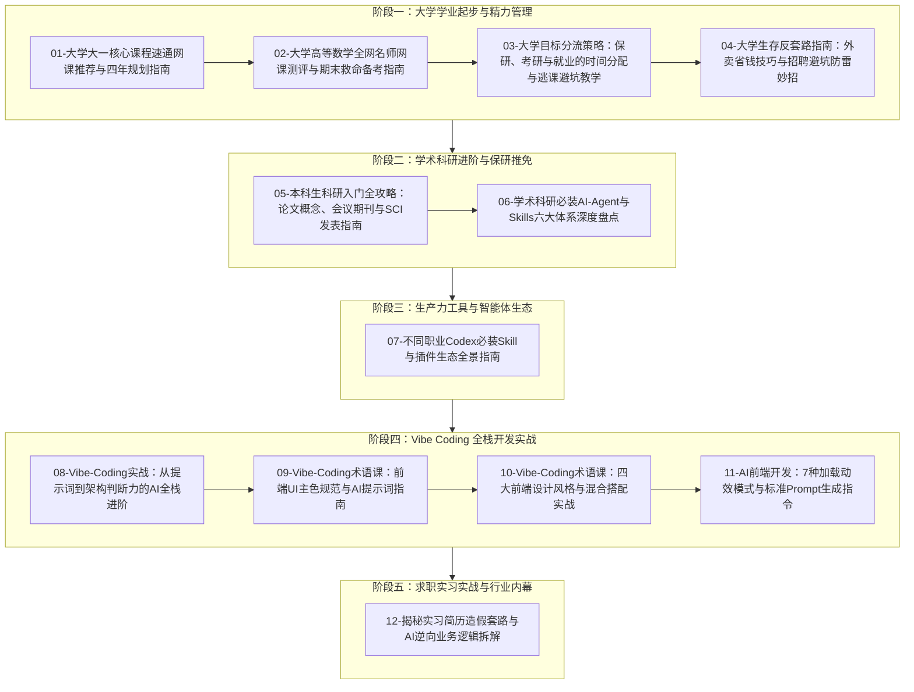

# 视频重命名与观看顺序规划

来源：dsh

项目：/Users/oyamahappa/Documents/Agent/DSH

## user · 2026-10-22T02:55:44Z

把261022中的视频名称改成视频内容的总结 再每个文件创建一个.md文件里面放每个视频的详细内容再给出建议的观看顺序

## assistant · 2026-10-22T02:55:51Z

{
  "type": "tool-call",
  "id": "run_code-1792637750962193380-566",
  "name": "run_code",
  "arguments": "{\"code\":\"const files = await tools.glob({ pattern: \\\"**/*\\\" });\\nreturn files;\",\"description\":\"List workspace files\"}"
}

## tool · 2026-10-22T02:55:51Z

run_code
{"code":"const files = await tools.glob({ pattern: \"**/*\" });\nreturn files;","description":"List workspace files"}

## assistant · 2026-10-22T02:55:59Z

{
  "type": "tool-call",
  "id": "run_code-1792637759047026044-567",
  "name": "run_code",
  "arguments": "{\"description\":\"Check available multimedia tools and file sizes\",\"code\":\"const res = await tools.bash({\\n  command: \\\"which ffmpeg ffprobe whisper 2>&1; ls -lh 261022\\\",\\n  description: \\\"Check ffmpeg and list files in 261022\\\"\\n});\\nreturn res;\"}"
}

## tool · 2026-10-22T02:55:59Z

run_code
{"description":"Check available multimedia tools and file sizes","code":"const res = await tools.bash({\n  command: \"which ffmpeg ffprobe whisper 2>&1; ls -lh 261022\",\n  description: \"Check ffmpeg and list files in 261022\"\n});\nreturn res;"}

## assistant · 2026-10-22T02:56:03Z

{
  "type": "tool-call",
  "id": "run_code-1792637762829833174-568",
  "name": "run_code",
  "arguments": "{\"description\":\"Check PATH and binaries\",\"code\":\"const res = await tools.bash({\\n  command: \\\"echo $PATH; type ffmpeg ffprobe python3; which -a ffmpeg ffprobe\\\",\\n  description: \\\"Check path and binaries\\\"\\n});\\nreturn res;\"}"
}

## tool · 2026-10-22T02:56:03Z

run_code
{"description":"Check PATH and binaries","code":"const res = await tools.bash({\n  command: \"echo $PATH; type ffmpeg ffprobe python3; which -a ffmpeg ffprobe\",\n  description: \"Check path and binaries\"\n});\nreturn res;"}

## assistant · 2026-10-22T02:56:06Z

{
  "type": "tool-call",
  "id": "run_code-1792637766605400207-569",
  "name": "run_code",
  "arguments": "{\"description\":\"Load workspace dependencies\",\"code\":\"const deps = await tools.load_workspace_dependencies({});\\nreturn deps;\"}"
}

## tool · 2026-10-22T02:56:06Z

run_code
{"description":"Load workspace dependencies","code":"const deps = await tools.load_workspace_dependencies({});\nreturn deps;"}

## assistant · 2026-10-22T02:56:12Z

{
  "type": "tool-call",
  "id": "run_code-1792637772213212520-570",
  "name": "run_code",
  "arguments": "{\"description\":\"Check metadata via mdls\",\"code\":\"const res = await tools.bash({\\n  command: \\\"mdls 261022/cb1c1921a6034288a1381628dc496222.MP4\\\",\\n  description: \\\"Check mdls on one video\\\"\\n});\\nreturn res;\"}"
}

## tool · 2026-10-22T02:56:12Z

run_code
{"description":"Check metadata via mdls","code":"const res = await tools.bash({\n  command: \"mdls 261022/cb1c1921a6034288a1381628dc496222.MP4\",\n  description: \"Check mdls on one video\"\n});\nreturn res;"}

## assistant · 2026-10-22T02:56:18Z

{
  "type": "tool-call",
  "id": "run_code-1792637777747704893-571",
  "name": "run_code",
  "arguments": "{\"description\":\"Read .work_pdf/ocr.swift\",\"code\":\"const content = await tools.read({\\n  file_path: \\\".work_pdf/ocr.swift\\\",\\n  limit: 100\\n});\\nreturn content;\"}"
}

## tool · 2026-10-22T02:56:18Z

run_code
{"description":"Read .work_pdf/ocr.swift","code":"const content = await tools.read({\n  file_path: \".work_pdf/ocr.swift\",\n  limit: 100\n});\nreturn content;"}

## assistant · 2026-10-22T02:56:26Z

{
  "type": "tool-call",
  "id": "run_code-1792637785833717098-572",
  "name": "run_code",
  "arguments": "{\"description\":\"Read .gitignore\",\"code\":\"const gitignore = await tools.read({\\n  file_path: \\\".gitignore\\\"\\n});\\nreturn gitignore;\"}"
}

## tool · 2026-10-22T02:56:26Z

run_code
{"description":"Read .gitignore","code":"const gitignore = await tools.read({\n  file_path: \".gitignore\"\n});\nreturn gitignore;"}

## assistant · 2026-10-22T02:56:31Z

{
  "type": "tool-call",
  "id": "run_code-1792637791125309045-573",
  "name": "run_code",
  "arguments": "{\"description\":\"Add .work_video/ to .gitignore\",\"code\":\"const editRes = await tools.edit({\\n  file_path: \\\".gitignore\\\",\\n  old_string: \\\".DS_Store\\\\n\\\",\\n  new_string: \\\".DS_Store\\\\n.work_video/\\\\n\\\"\\n});\\nreturn editRes;\"}"
}

## tool · 2026-10-22T02:56:31Z

run_code
{"description":"Add .work_video/ to .gitignore","code":"const editRes = await tools.edit({\n  file_path: \".gitignore\",\n  old_string: \".DS_Store\\n\",\n  new_string: \".DS_Store\\n.work_video/\\n\"\n});\nreturn editRes;"}

## assistant · 2026-10-22T02:56:36Z

{
  "type": "tool-call",
  "id": "run_code-1792637796014894077-574",
  "name": "run_code",
  "arguments": "{\"description\":\"Inspect video durations\",\"code\":\"const script = `import Foundation\\nimport AVFoundation\\nimport Vision\\nimport Speech\\n\\nlet fm = FileManager.default\\nlet videoDir = \\\"261022\\\"\\nlet files = try! fm.contentsOfDirectory(atPath: videoDir).filter { $0.hasSuffix(\\\".MP4\\\") || $0.hasSuffix(\\\".mp4\\\") }\\n\\nprint(\\\"Found \\\\\\\\(files.count) files\\\")\\n\\nfor file in files.sorted() {\\n    let url = URL(fileURLWithPath: \\\"\\\\\\\\(videoDir)/\\\\\\\\(file)\\\")\\n    let asset = AVURLAsset(url: url)\\n    let duration = CMTimeGetSeconds(asset.duration)\\n    print(\\\"File: \\\\\\\\(file), Duration: \\\\\\\\(String(format: \\\"%.1f\\\", duration))s\\\")\\n}\\n`;\\n\\nawait tools.bash({\\n  command: \\\"mkdir -p .work_video\\\",\\n  description: \\\"Create .work_video directory\\\"\\n});\\n\\nawait tools.write({\\n  file_path: \\\".work_video/inspect_basic.swift\\\",\\n  content: script\\n});\\n\\nconst res = await tools.bash({\\n  command: \\\"swift .work_video/inspect_basic.swift\\\",\\n  description: \\\"Run inspect_basic.swift\\\"\\n});\\n\\nreturn res;\"}"
}

## tool · 2026-10-22T02:56:36Z

run_code
{"description":"Inspect video durations","code":"const script = `import Foundation\nimport AVFoundation\nimport Vision\nimport Speech\n\nlet fm = FileManager.default\nlet videoDir = \"261022\"\nlet files = try! fm.contentsOfDirectory(atPath: videoDir).filter { $0.hasSuffix(\".MP4\") || $0.hasSuffix(\".mp4\") }\n\nprint(\"Found \\\\(files.count) files\")\n\nfor file in files.sorted() {\n    let url = URL(fileURLWithPath: \"\\\\(videoDir)/\\\\(file)\")\n    let asset = AVURLAsset(url: url)\n    let duration = CMTimeGetSeconds(asset.duration)\n    print(\"File: \\\\(file), Duration: \\\\(String(format: \"%.1f\", duration))s\")\n}\n`;\n\nawait tools.bash({\n  command: \"mkdir -p .work_video\",\n  description: \"Create .work_video directory\"\n});\n\nawait tools.write({\n  file_path: \".work_video/inspect_basic.swift\",\n  content: script\n});\n\nconst res = await tools.bash({\n  command: \"swift .work_video/inspect_basic.swift\",\n  description: \"Run inspect_basic.swift\"\n});\n\nreturn res;"}

## assistant · 2026-10-22T02:56:50Z

{
  "type": "tool-call",
  "id": "run_code-1792637809641986487-575",
  "name": "run_code",
  "arguments": "{\"code\":\"const res = await tools.grep({\\n  pattern: \\\"swiftc\\\"\\n});\\nreturn res;\",\"description\":\"Search for swiftc commands in repo\"}"
}

## tool · 2026-10-22T02:56:50Z

run_code
{"code":"const res = await tools.grep({\n  pattern: \"swiftc\"\n});\nreturn res;","description":"Search for swiftc commands in repo"}

## assistant · 2026-10-22T02:56:54Z

{
  "type": "tool-call",
  "id": "run_code-1792637813950147648-576",
  "name": "run_code",
  "arguments": "{\"description\":\"Search for ocr in repo\",\"code\":\"const res = await tools.grep({\\n  pattern: \\\"ocr\\\"\\n});\\nreturn res;\"}"
}

## tool · 2026-10-22T02:56:54Z

run_code
{"description":"Search for ocr in repo","code":"const res = await tools.grep({\n  pattern: \"ocr\"\n});\nreturn res;"}

## assistant · 2026-10-22T02:56:58Z

{
  "type": "tool-call",
  "id": "run_code-1792637818027782379-577",
  "name": "run_code",
  "arguments": "{\"description\":\"Compile and run inspect_basic\",\"code\":\"const res = await tools.bash({\\n  command: \\\"swiftc -module-cache-path .work_pdf/cache .work_video/inspect_basic.swift -o .work_video/inspect_basic && .work_video/inspect_basic\\\",\\n  description: \\\"Compile and run inspect_basic\\\"\\n});\\nreturn res;\"}"
}

## tool · 2026-10-22T02:56:58Z

run_code
{"description":"Compile and run inspect_basic","code":"const res = await tools.bash({\n  command: \"swiftc -module-cache-path .work_pdf/cache .work_video/inspect_basic.swift -o .work_video/inspect_basic && .work_video/inspect_basic\",\n  description: \"Compile and run inspect_basic\"\n});\nreturn res;"}

## assistant · 2026-10-22T02:57:14Z

{
  "type": "tool-call",
  "id": "run_code-1792637834555826129-578",
  "name": "run_code",
  "arguments": "{\"description\":\"Test speech recognition capability\",\"code\":\"const script = `import Foundation\\nimport Speech\\n\\nlet recognizer = SFSpeechRecognizer(locale: Locale(identifier: \\\"zh-CN\\\"))\\nprint(\\\"Recognizer available: \\\\\\\\(recognizer != nil)\\\")\\nprint(\\\"Supports on-device recognition: \\\\\\\\(recognizer?.supportsOnDeviceRecognition ?? false)\\\")\\nprint(\\\"Is authorized: \\\\\\\\(SFSpeechRecognizer.authorizationStatus().rawValue)\\\")\\n`;\\n\\nawait tools.write({\\n  file_path: \\\".work_video/test_speech.swift\\\",\\n  content: script\\n});\\n\\nconst res = await tools.bash({\\n  command: \\\"swiftc -module-cache-path .work_pdf/cache .work_video/test_speech.swift -o .work_video/test_speech && .work_video/test_speech\\\",\\n  description: \\\"Test SFSpeechRecognizer\\\"\\n});\\n\\nreturn res;\"}"
}

## tool · 2026-10-22T02:57:14Z

run_code
{"description":"Test speech recognition capability","code":"const script = `import Foundation\nimport Speech\n\nlet recognizer = SFSpeechRecognizer(locale: Locale(identifier: \"zh-CN\"))\nprint(\"Recognizer available: \\\\(recognizer != nil)\")\nprint(\"Supports on-device recognition: \\\\(recognizer?.supportsOnDeviceRecognition ?? false)\")\nprint(\"Is authorized: \\\\(SFSpeechRecognizer.authorizationStatus().rawValue)\")\n`;\n\nawait tools.write({\n  file_path: \".work_video/test_speech.swift\",\n  content: script\n});\n\nconst res = await tools.bash({\n  command: \"swiftc -module-cache-path .work_pdf/cache .work_video/test_speech.swift -o .work_video/test_speech && .work_video/test_speech\",\n  description: \"Test SFSpeechRecognizer\"\n});\n\nreturn res;"}

## assistant · 2026-10-22T02:57:24Z

{
  "type": "tool-call",
  "id": "run_code-1792637843922595262-579",
  "name": "run_code",
  "arguments": "{\"description\":\"Extract frames and OCR videos\",\"code\":\"const script = `import Foundation\\nimport AVFoundation\\nimport Vision\\nimport AppKit\\n\\nfunc ocrImage(cgImage: CGImage) -> [String] {\\n    var lines: [String] = []\\n    let request = VNRecognizeTextRequest { request, error in\\n        guard let observations = request.results as? [VNRecognizedTextObservation], error == nil else { return }\\n        for obs in observations {\\n            if let candidate = obs.topCandidates(1).first {\\n                lines.append(candidate.string)\\n            }\\n        }\\n    }\\n    request.recognitionLanguages = [\\\"zh-Hans\\\", \\\"en-US\\\"]\\n    request.recognitionLevel = .accurate\\n    request.usesLanguageCorrection = true\\n    let handler = VNImageRequestHandler(cgImage: cgImage, options: [:])\\n    try? handler.perform([request])\\n    return lines\\n}\\n\\nlet fm = FileManager.default\\nlet videoDir = \\\"261022\\\"\\nlet files = try! fm.contentsOfDirectory(atPath: videoDir).filter { $0.hasSuffix(\\\".MP4\\\") || $0.hasSuffix(\\\".mp4\\\") }.sorted()\\n\\nfor file in files {\\n    let url = URL(fileURLWithPath: \\\"\\\\\\\\(videoDir)/\\\\\\\\(file)\\\")\\n    let asset = AVURLAsset(url: url)\\n    let duration = CMTimeGetSeconds(asset.duration)\\n    \\n    let generator = AVAssetImageGenerator(asset: asset)\\n    generator.appliesPreferredTrackTransform = true\\n    generator.requestedTimeToleranceBefore = .zero\\n    generator.requestedTimeToleranceAfter = .zero\\n    \\n    // Sample 5 time points across the video: 2s, 20%, 40%, 60%, 80%\\n    var sampleTimes: [Double] = [min(2.0, duration * 0.1)]\\n    if duration > 10 {\\n        sampleTimes.append(duration * 0.25)\\n        sampleTimes.append(duration * 0.5)\\n        sampleTimes.append(duration * 0.75)\\n        sampleTimes.append(duration * 0.9)\\n    }\\n    \\n    print(\\\"==================================================\\\")\\n    print(\\\"FILE: \\\\\\\\(file) (Duration: \\\\\\\\(String(format: \\\"%.1f\\\", duration))s)\\\")\\n    \\n    var allSeenText = Set<String>()\\n    \\n    for t in sampleTimes {\\n        let cmTime = CMTime(seconds: t, preferredTimescale: 600)\\n        do {\\n            let (cgImage, actualTime) = try generator.copyCGImage(at: cmTime, actualTime: nil)\\n            let lines = ocrImage(cgImage: cgImage)\\n            let newLines = lines.filter { !allSeenText.contains($0) }\\n            for l in newLines {\\n                allSeenText.insert(l)\\n            }\\n            if !newLines.isEmpty {\\n                print(\\\"--- Time \\\\\\\\(String(format: \\\"%.1f\\\", CMTimeGetSeconds(actualTime)))s ---\\\")\\n                print(newLines.joined(separator: \\\" | \\\"))\\n            }\\n        } catch {\\n            print(\\\"Error at \\\\\\\\(t)s: \\\\\\\\(error)\\\")\\n        }\\n    }\\n}\\n`;\\n\\nawait tools.write({\\n  file_path: \\\".work_video/analyze_videos.swift\\\",\\n  content: script\\n});\\n\\nconst res = await tools.bash({\\n  command: \\\"swiftc -module-cache-path .work_pdf/cache .work_video/analyze_videos.swift -o .work_video/analyze_videos && .work_video/analyze_videos\\\",\\n  description: \\\"Analyze videos by OCRing sampled frames\\\"\\n});\\n\\nreturn res;\"}"
}

## tool · 2026-10-22T02:57:24Z

run_code
{"description":"Extract frames and OCR videos","code":"const script = `import Foundation\nimport AVFoundation\nimport Vision\nimport AppKit\n\nfunc ocrImage(cgImage: CGImage) -> [String] {\n    var lines: [String] = []\n    let request = VNRecognizeTextRequest { request, error in\n        guard let observations = request.results as? [VNRecognizedTextObservation], error == nil else { return }\n        for obs in observations {\n            if let candidate = obs.topCandidates(1).first {\n                lines.append(candidate.string)\n            }\n        }\n    }\n    request.recognitionLanguages = [\"zh-Hans\", \"en-US\"]\n    request.recognitionLevel = .accurate\n    request.usesLanguageCorrection = true\n    let handler = VNImageRequestHandler(cgImage: cgImage, options: [:])\n    try? handler.perform([request])\n    return lines\n}\n\nlet fm = FileManager.default\nlet videoDir = \"261022\"\nlet files = try! fm.contentsOfDirectory(atPath: videoDir).filter { $0.hasSuffix(\".MP4\") || $0.hasSuffix(\".mp4\") }.sorted()\n\nfor file in files {\n    let url = URL(fileURLWithPath: \"\\\\(videoDir)/\\\\(file)\")\n    let asset = AVURLAsset(url: url)\n    let duration = CMTimeGetSeconds(asset.duration)\n    \n    let generator = AVAssetImageGenerator(asset: asset)\n    generator.appliesPreferredTrackTransform = true\n    generator.requestedTimeToleranceBefore = .zero\n    generator.requestedTimeToleranceAfter = .zero\n    \n    // Sample 5 time points across the video: 2s, 20%, 40%, 60%, 80%\n    var sampleTimes: [Double] = [min(2.0, duration * 0.1)]\n    if duration > 10 {\n        sampleTimes.append(duration * 0.25)\n        sampleTimes.append(duration * 0.5)\n        sampleTimes.append(duration * 0.75)\n        sampleTimes.append(duration * 0.9)\n    }\n    \n    print(\"==================================================\")\n    print(\"FILE: \\\\(file) (Duration: \\\\(String(format: \"%.1f\", duration))s)\")\n    \n    var allSeenText = Set<String>()\n    \n    for t in sampleTimes {\n        let cmTime = CMTime(seconds: t, preferredTimescale: 600)\n        do {\n            let (cgImage, actualTime) = try generator.copyCGImage(at: cmTime, actualTime: nil)\n            let lines = ocrImage(cgImage: cgImage)\n            let newLines = lines.filter { !allSeenText.contains($0) }\n            for l in newLines {\n                allSeenText.insert(l)\n            }\n            if !newLines.isEmpty {\n                print(\"--- Time \\\\(String(format: \"%.1f\", CMTimeGetSeconds(actualTime)))s ---\")\n                print(newLines.joined(separator: \" | \"))\n            }\n        } catch {\n            print(\"Error at \\\\(t)s: \\\\(error)\")\n        }\n    }\n}\n`;\n\nawait tools.write({\n  file_path: \".work_video/analyze_videos.swift\",\n  content: script\n});\n\nconst res = await tools.bash({\n  command: \"swiftc -module-cache-path .work_pdf/cache .work_video/analyze_videos.swift -o .work_video/analyze_videos && .work_video/analyze_videos\",\n  description: \"Analyze videos by OCRing sampled frames\"\n});\n\nreturn res;"}

## assistant · 2026-10-22T02:57:32Z

{
  "type": "tool-call",
  "id": "run_code-1792637852162919510-580",
  "name": "run_code",
  "arguments": "{\"code\":\"const script = `import Foundation\\nimport AVFoundation\\nimport Vision\\nimport AppKit\\n\\nfunc ocrImage(cgImage: CGImage) -> [String] {\\n    var lines: [String] = []\\n    let request = VNRecognizeTextRequest { request, error in\\n        guard let observations = request.results as? [VNRecognizedTextObservation], error == nil else { return }\\n        for obs in observations {\\n            if let candidate = obs.topCandidates(1).first {\\n                lines.append(candidate.string)\\n            }\\n        }\\n    }\\n    request.recognitionLanguages = [\\\"zh-Hans\\\", \\\"en-US\\\"]\\n    request.recognitionLevel = .accurate\\n    request.usesLanguageCorrection = true\\n    let handler = VNImageRequestHandler(cgImage: cgImage, options: [:])\\n    try? handler.perform([request])\\n    return lines\\n}\\n\\nlet fm = FileManager.default\\nlet videoDir = \\\"261022\\\"\\nlet files = try! fm.contentsOfDirectory(atPath: videoDir).filter { $0.hasSuffix(\\\".MP4\\\") || $0.hasSuffix(\\\".mp4\\\") }.sorted()\\n\\nfor file in files {\\n    let url = URL(fileURLWithPath: \\\"\\\\\\\\(videoDir)/\\\\\\\\(file)\\\")\\n    let asset = AVURLAsset(url: url)\\n    let duration = CMTimeGetSeconds(asset.duration)\\n    \\n    let generator = AVAssetImageGenerator(asset: asset)\\n    generator.appliesPreferredTrackTransform = true\\n    generator.requestedTimeToleranceBefore = .zero\\n    generator.requestedTimeToleranceAfter = .zero\\n    \\n    var sampleTimes: [Double] = [min(2.0, duration * 0.1)]\\n    if duration > 10 {\\n        sampleTimes.append(duration * 0.25)\\n        sampleTimes.append(duration * 0.5)\\n        sampleTimes.append(duration * 0.75)\\n        sampleTimes.append(duration * 0.9)\\n    }\\n    \\n    print(\\\"==================================================\\\")\\n    print(\\\"FILE: \\\\\\\\(file) (Duration: \\\\\\\\(String(format: \\\"%.1f\\\", duration))s)\\\")\\n    \\n    var allSeenText = Set<String>()\\n    \\n    for t in sampleTimes {\\n        let cmTime = CMTime(seconds: t, preferredTimescale: 600)\\n        do {\\n            var actualTime: CMTime = .zero\\n            let cgImage = try generator.copyCGImage(at: cmTime, actualTime: &actualTime)\\n            let lines = ocrImage(cgImage: cgImage)\\n            let newLines = lines.filter { !allSeenText.contains($0) }\\n            for l in newLines {\\n                allSeenText.insert(l)\\n            }\\n            if !newLines.isEmpty {\\n                print(\\\"--- Time \\\\\\\\(String(format: \\\"%.1f\\\", CMTimeGetSeconds(actualTime)))s ---\\\")\\n                print(newLines.joined(separator: \\\" | \\\"))\\n            }\\n        } catch {\\n            print(\\\"Error at \\\\\\\\(t)s: \\\\\\\\(error)\\\")\\n        }\\n    }\\n}\\n`;\\n\\nawait tools.write({\\n  file_path: \\\".work_video/analyze_videos.swift\\\",\\n  content: script\\n});\\n\\nconst res = await tools.bash({\\n  command: \\\"swiftc -module-cache-path .work_pdf/cache .work_video/analyze_videos.swift -o .work_video/analyze_videos && .work_video/analyze_videos\\\",\\n  description: \\\"Analyze videos by OCRing sampled frames\\\"\\n});\\n\\nreturn res;\",\"description\":\"Extract frames and OCR videos\"}"
}

## tool · 2026-10-22T02:57:32Z

run_code
{"code":"const script = `import Foundation\nimport AVFoundation\nimport Vision\nimport AppKit\n\nfunc ocrImage(cgImage: CGImage) -> [String] {\n    var lines: [String] = []\n    let request = VNRecognizeTextRequest { request, error in\n        guard let observations = request.results as? [VNRecognizedTextObservation], error == nil else { return }\n        for obs in observations {\n            if let candidate = obs.topCandidates(1).first {\n                lines.append(candidate.string)\n            }\n        }\n    }\n    request.recognitionLanguages = [\"zh-Hans\", \"en-US\"]\n    request.recognitionLevel = .accurate\n    request.usesLanguageCorrection = true\n    let handler = VNImageRequestHandler(cgImage: cgImage, options: [:])\n    try? handler.perform([request])\n    return lines\n}\n\nlet fm = FileManager.default\nlet videoDir = \"261022\"\nlet files = try! fm.contentsOfDirectory(atPath: videoDir).filter { $0.hasSuffix(\".MP4\") || $0.hasSuffix(\".mp4\") }.sorted()\n\nfor file in files {\n    let url = URL(fileURLWithPath: \"\\\\(videoDir)/\\\\(file)\")\n    let asset = AVURLAsset(url: url)\n    let duration = CMTimeGetSeconds(asset.duration)\n    \n    let generator = AVAssetImageGenerator(asset: asset)\n    generator.appliesPreferredTrackTransform = true\n    generator.requestedTimeToleranceBefore = .zero\n    generator.requestedTimeToleranceAfter = .zero\n    \n    var sampleTimes: [Double] = [min(2.0, duration * 0.1)]\n    if duration > 10 {\n        sampleTimes.append(duration * 0.25)\n        sampleTimes.append(duration * 0.5)\n        sampleTimes.append(duration * 0.75)\n        sampleTimes.append(duration * 0.9)\n    }\n    \n    print(\"==================================================\")\n    print(\"FILE: \\\\(file) (Duration: \\\\(String(format: \"%.1f\", duration))s)\")\n    \n    var allSeenText = Set<String>()\n    \n    for t in sampleTimes {\n        let cmTime = CMTime(seconds: t, preferredTimescale: 600)\n        do {\n            var actualTime: CMTime = .zero\n            let cgImage = try generator.copyCGImage(at: cmTime, actualTime: &actualTime)\n            let lines = ocrImage(cgImage: cgImage)\n            let newLines = lines.filter { !allSeenText.contains($0) }\n            for l in newLines {\n                allSeenText.insert(l)\n            }\n            if !newLines.isEmpty {\n                print(\"--- Time \\\\(String(format: \"%.1f\", CMTimeGetSeconds(actualTime)))s ---\")\n                print(newLines.joined(separator: \" | \"))\n            }\n        } catch {\n            print(\"Error at \\\\(t)s: \\\\(error)\")\n        }\n    }\n}\n`;\n\nawait tools.write({\n  file_path: \".work_video/analyze_videos.swift\",\n  content: script\n});\n\nconst res = await tools.bash({\n  command: \"swiftc -module-cache-path .work_pdf/cache .work_video/analyze_videos.swift -o .work_video/analyze_videos && .work_video/analyze_videos\",\n  description: \"Analyze videos by OCRing sampled frames\"\n});\n\nreturn res;","description":"Extract frames and OCR videos"}

## assistant · 2026-10-22T02:58:01Z

{
  "type": "tool-call",
  "id": "run_code-1792637880952997160-581",
  "name": "run_code",
  "arguments": "{\"description\":\"Read 261020/README.md\",\"code\":\"const res = await tools.read({\\n  file_path: \\\"261020/README.md\\\"\\n});\\nreturn res;\"}"
}

## tool · 2026-10-22T02:58:01Z

run_code
{"description":"Read 261020/README.md","code":"const res = await tools.read({\n  file_path: \"261020/README.md\"\n});\nreturn res;"}

## assistant · 2026-10-22T02:58:13Z

{
  "type": "tool-call",
  "id": "run_code-1792637893648488492-582",
  "name": "run_code",
  "arguments": "{\"description\":\"Extract dense OCR transcripts for all 12 videos\",\"code\":\"const script = `import Foundation\\nimport AVFoundation\\nimport Vision\\n\\nfunc ocrImage(cgImage: CGImage) -> [String] {\\n    var lines: [String] = []\\n    let request = VNRecognizeTextRequest { request, error in\\n        guard let observations = request.results as? [VNRecognizedTextObservation], error == nil else { return }\\n        for obs in observations {\\n            if let candidate = obs.topCandidates(1).first {\\n                lines.append(candidate.string)\\n            }\\n        }\\n    }\\n    request.recognitionLanguages = [\\\"zh-Hans\\\", \\\"en-US\\\"]\\n    request.recognitionLevel = .accurate\\n    request.usesLanguageCorrection = true\\n    let handler = VNImageRequestHandler(cgImage: cgImage, options: [:])\\n    try? handler.perform([request])\\n    return lines\\n}\\n\\nlet fm = FileManager.default\\nlet videoDir = \\\"261022\\\"\\nlet files = try! fm.contentsOfDirectory(atPath: videoDir).filter { $0.hasSuffix(\\\".MP4\\\") || $0.hasSuffix(\\\".mp4\\\") }.sorted()\\n\\nvar results: [String: Any] = [:]\\n\\nfor file in files {\\n    let url = URL(fileURLWithPath: \\\"\\\\\\\\(videoDir)/\\\\\\\\(file)\\\")\\n    let asset = AVURLAsset(url: url)\\n    let duration = CMTimeGetSeconds(asset.duration)\\n    \\n    let generator = AVAssetImageGenerator(asset: asset)\\n    generator.appliesPreferredTrackTransform = true\\n    generator.requestedTimeToleranceBefore = .zero\\n    generator.requestedTimeToleranceAfter = .zero\\n    \\n    // Sample interval: for short videos (<60s) every 3s; for medium (<300s) every 6s; for long (>300s) every 12s\\n    let interval: Double\\n    if duration < 60 {\\n        interval = 3.0\\n    } else if duration < 300 {\\n        interval = 6.0\\n    } else {\\n        interval = 12.0\\n    }\\n    \\n    var timePoints: [Double] = []\\n    var t = 1.0\\n    while t < duration {\\n        timePoints.append(t)\\n        t += interval\\n    }\\n    \\n    var transcript: [[String: Any]] = []\\n    \\n    for timeSec in timePoints {\\n        let cmTime = CMTime(seconds: timeSec, preferredTimescale: 600)\\n        var actualTime: CMTime = .zero\\n        if let cgImage = try? generator.copyCGImage(at: cmTime, actualTime: &actualTime) {\\n            let lines = ocrImage(cgImage: cgImage)\\n            if !lines.isEmpty {\\n                transcript.append([\\n                    \\\"time\\\": CMTimeGetSeconds(actualTime),\\n                    \\\"lines\\\": lines\\n                ])\\n            }\\n        }\\n    }\\n    \\n    results[file] = [\\n        \\\"file\\\": file,\\n        \\\"duration\\\": duration,\\n        \\\"transcript\\\": transcript\\n    ]\\n    print(\\\"Processed \\\\\\\\(file): \\\\\\\\(transcript.count) frames sampled.\\\")\\n}\\n\\nlet jsonData = try! JSONSerialization.data(withJSONObject: results, options: .prettyPrinted)\\ntry! jsonData.write(to: URL(fileURLWithPath: \\\".work_video/detailed_ocr.json\\\"))\\nprint(\\\"Done saving .work_video/detailed_ocr.json\\\")\\n`;\\n\\nawait tools.write({\\n  file_path: \\\".work_video/extract_detailed.swift\\\",\\n  content: script\\n});\\n\\nconst res = await tools.bash({\\n  command: \\\"swiftc -module-cache-path .work_pdf/cache .work_video/extract_detailed.swift -o .work_video/extract_detailed && .work_video/extract_detailed\\\",\\n  description: \\\"Extract detailed OCR for all videos\\\"\\n});\\n\\nreturn res;\"}"
}

## tool · 2026-10-22T02:58:13Z

run_code
{"description":"Extract dense OCR transcripts for all 12 videos","code":"const script = `import Foundation\nimport AVFoundation\nimport Vision\n\nfunc ocrImage(cgImage: CGImage) -> [String] {\n    var lines: [String] = []\n    let request = VNRecognizeTextRequest { request, error in\n        guard let observations = request.results as? [VNRecognizedTextObservation], error == nil else { return }\n        for obs in observations {\n            if let candidate = obs.topCandidates(1).first {\n                lines.append(candidate.string)\n            }\n        }\n    }\n    request.recognitionLanguages = [\"zh-Hans\", \"en-US\"]\n    request.recognitionLevel = .accurate\n    request.usesLanguageCorrection = true\n    let handler = VNImageRequestHandler(cgImage: cgImage, options: [:])\n    try? handler.perform([request])\n    return lines\n}\n\nlet fm = FileManager.default\nlet videoDir = \"261022\"\nlet files = try! fm.contentsOfDirectory(atPath: videoDir).filter { $0.hasSuffix(\".MP4\") || $0.hasSuffix(\".mp4\") }.sorted()\n\nvar results: [String: Any] = [:]\n\nfor file in files {\n    let url = URL(fileURLWithPath: \"\\\\(videoDir)/\\\\(file)\")\n    let asset = AVURLAsset(url: url)\n    let duration = CMTimeGetSeconds(asset.duration)\n    \n    let generator = AVAssetImageGenerator(asset: asset)\n    generator.appliesPreferredTrackTransform = true\n    generator.requestedTimeToleranceBefore = .zero\n    generator.requestedTimeToleranceAfter = .zero\n    \n    // Sample interval: for short videos (<60s) every 3s; for medium (<300s) every 6s; for long (>300s) every 12s\n    let interval: Double\n    if duration < 60 {\n        interval = 3.0\n    } else if duration < 300 {\n        interval = 6.0\n    } else {\n        interval = 12.0\n    }\n    \n    var timePoints: [Double] = []\n    var t = 1.0\n    while t < duration {\n        timePoints.append(t)\n        t += interval\n    }\n    \n    var transcript: [[String: Any]] = []\n    \n    for timeSec in timePoints {\n        let cmTime = CMTime(seconds: timeSec, preferredTimescale: 600)\n        var actualTime: CMTime = .zero\n        if let cgImage = try? generator.copyCGImage(at: cmTime, actualTime: &actualTime) {\n            let lines = ocrImage(cgImage: cgImage)\n            if !lines.isEmpty {\n                transcript.append([\n                    \"time\": CMTimeGetSeconds(actualTime),\n                    \"lines\": lines\n                ])\n            }\n        }\n    }\n    \n    results[file] = [\n        \"file\": file,\n        \"duration\": duration,\n        \"transcript\": transcript\n    ]\n    print(\"Processed \\\\(file): \\\\(transcript.count) frames sampled.\")\n}\n\nlet jsonData = try! JSONSerialization.data(withJSONObject: results, options: .prettyPrinted)\ntry! jsonData.write(to: URL(fileURLWithPath: \".work_video/detailed_ocr.json\"))\nprint(\"Done saving .work_video/detailed_ocr.json\")\n`;\n\nawait tools.write({\n  file_path: \".work_video/extract_detailed.swift\",\n  content: script\n});\n\nconst res = await tools.bash({\n  command: \"swiftc -module-cache-path .work_pdf/cache .work_video/extract_detailed.swift -o .work_video/extract_detailed && .work_video/extract_detailed\",\n  description: \"Extract detailed OCR for all videos\"\n});\n\nreturn res;"}

## assistant · 2026-10-22T02:59:20Z

{
  "type": "tool-call",
  "id": "run_code-1792637960222806933-583",
  "name": "run_code",
  "arguments": "{\"description\":\"Wait for detailed OCR extraction job\",\"code\":\"const out = await tools.job_output({\\n  job_id: \\\"bash-10\\\",\\n  wait: true,\\n  timeout_ms: 120000\\n});\\nreturn out;\"}"
}

## tool · 2026-10-22T02:59:20Z

run_code
{"description":"Wait for detailed OCR extraction job","code":"const out = await tools.job_output({\n  job_id: \"bash-10\",\n  wait: true,\n  timeout_ms: 120000\n});\nreturn out;"}

## assistant · 2026-10-22T02:59:25Z

{
  "type": "tool-call",
  "id": "run_code-1792637965096884560-584",
  "name": "run_code",
  "arguments": "{\"description\":\"Parse and display detailed OCR text\",\"code\":\"const pyScript = `import json\\n\\nwith open('.work_video/detailed_ocr.json', 'r', encoding='utf-8') as f:\\n    data = json.load(f)\\n\\nfor file, info in sorted(data.items()):\\n    print(\\\"=\\\" * 60)\\n    print(f\\\"FILE: {file} ({info['duration']:.1f}s)\\\")\\n    lines_seen = set()\\n    for item in info['transcript']:\\n        t = item['time']\\n        unique_new = [l for l in item['lines'] if l not in lines_seen]\\n        for l in unique_new:\\n            lines_seen.add(l)\\n        if unique_new:\\n            print(f\\\"[{t:5.1f}s] \\\" + \\\" | \\\".join(unique_new))\\n`;\\n\\nawait tools.write({\\n  file_path: \\\".work_video/parse_ocr.py\\\",\\n  content: pyScript\\n});\\n\\nconst res = await tools.bash({\\n  command: \\\"python3 .work_video/parse_ocr.py\\\",\\n  description: \\\"Print parsed OCR summary\\\"\\n});\\n\\nreturn res;\"}"
}

## tool · 2026-10-22T02:59:25Z

run_code
{"description":"Parse and display detailed OCR text","code":"const pyScript = `import json\n\nwith open('.work_video/detailed_ocr.json', 'r', encoding='utf-8') as f:\n    data = json.load(f)\n\nfor file, info in sorted(data.items()):\n    print(\"=\" * 60)\n    print(f\"FILE: {file} ({info['duration']:.1f}s)\")\n    lines_seen = set()\n    for item in info['transcript']:\n        t = item['time']\n        unique_new = [l for l in item['lines'] if l not in lines_seen]\n        for l in unique_new:\n            lines_seen.add(l)\n        if unique_new:\n            print(f\"[{t:5.1f}s] \" + \" | \".join(unique_new))\n`;\n\nawait tools.write({\n  file_path: \".work_video/parse_ocr.py\",\n  content: pyScript\n});\n\nconst res = await tools.bash({\n  command: \"python3 .work_video/parse_ocr.py\",\n  description: \"Print parsed OCR summary\"\n});\n\nreturn res;"}

## assistant · 2026-10-22T02:59:31Z

{
  "type": "tool-call",
  "id": "run_code-1792637971550282953-585",
  "name": "run_code",
  "arguments": "{\"code\":\"const pyScript = `import json\\n\\nwith open('.work_video/detailed_ocr.json', 'r', encoding='utf-8') as f:\\n    data = json.load(f)\\n\\ninfo = data['cb1c1921a6034288a1381628dc496222.MP4']\\nprint(f\\\"FILE: cb1c1921a6034288a1381628dc496222.MP4 ({info['duration']:.1f}s)\\\")\\nlines_seen = set()\\nfor item in info['transcript']:\\n    t = item['time']\\n    unique_new = [l for l in item['lines'] if l not in lines_seen]\\n    for l in unique_new:\\n        lines_seen.add(l)\\n    if unique_new:\\n        print(f\\\"[{t:5.1f}s] \\\" + \\\" | \\\".join(unique_new))\\n`;\\n\\nawait tools.write({\\n  file_path: \\\".work_video/parse_cb1.py\\\",\\n  content: pyScript\\n});\\n\\nconst res = await tools.bash({\\n  command: \\\"python3 .work_video/parse_cb1.py\\\",\\n  description: \\\"Print cb1c1921a6034288a1381628dc496222 OCR\\\"\\n});\\n\\nreturn res;\",\"description\":\"Inspect cb1c1921a6034288a1381628dc496222 OCR\"}"
}

## tool · 2026-10-22T02:59:31Z

run_code
{"code":"const pyScript = `import json\n\nwith open('.work_video/detailed_ocr.json', 'r', encoding='utf-8') as f:\n    data = json.load(f)\n\ninfo = data['cb1c1921a6034288a1381628dc496222.MP4']\nprint(f\"FILE: cb1c1921a6034288a1381628dc496222.MP4 ({info['duration']:.1f}s)\")\nlines_seen = set()\nfor item in info['transcript']:\n    t = item['time']\n    unique_new = [l for l in item['lines'] if l not in lines_seen]\n    for l in unique_new:\n        lines_seen.add(l)\n    if unique_new:\n        print(f\"[{t:5.1f}s] \" + \" | \".join(unique_new))\n`;\n\nawait tools.write({\n  file_path: \".work_video/parse_cb1.py\",\n  content: pyScript\n});\n\nconst res = await tools.bash({\n  command: \"python3 .work_video/parse_cb1.py\",\n  description: \"Print cb1c1921a6034288a1381628dc496222 OCR\"\n});\n\nreturn res;","description":"Inspect cb1c1921a6034288a1381628dc496222 OCR"}

## assistant · 2026-10-22T02:59:38Z

{
  "type": "tool-call",
  "id": "run_code-1792637978256236363-586",
  "name": "run_code",
  "arguments": "{\"code\":\"const pyScript = `import json\\n\\nwith open('.work_video/detailed_ocr.json', 'r', encoding='utf-8') as f:\\n    data = json.load(f)\\n\\ninfo = data['o4GgXqjffABVgWDwAzyCczIwNF9rjwMD8oEQEA.MP4']\\nprint(f\\\"FILE: o4GgXqjffABVgWDwAzyCczIwNF9rjwMD8oEQEA.MP4 ({info['duration']:.1f}s)\\\")\\nfor item in info['transcript']:\\n    t = item['time']\\n    print(f\\\"[{t:5.1f}s] \\\" + \\\" | \\\".join(item['lines']))\\n`;\\n\\nawait tools.write({\\n  file_path: \\\".work_video/parse_o4.py\\\",\\n  content: pyScript\\n});\\n\\nconst res = await tools.bash({\\n  command: \\\"python3 .work_video/parse_o4.py\\\",\\n  description: \\\"Print o4GgXqjffABVgWDwAzyCczIwNF9rjwMD8oEQEA.MP4 OCR\\\"\\n});\\n\\nreturn res;\",\"description\":\"Inspect o4GgXqjffABVgWDwAzyCczIwNF9rjwMD8oEQEA.MP4 OCR\"}"
}

## tool · 2026-10-22T02:59:38Z

run_code
{"code":"const pyScript = `import json\n\nwith open('.work_video/detailed_ocr.json', 'r', encoding='utf-8') as f:\n    data = json.load(f)\n\ninfo = data['o4GgXqjffABVgWDwAzyCczIwNF9rjwMD8oEQEA.MP4']\nprint(f\"FILE: o4GgXqjffABVgWDwAzyCczIwNF9rjwMD8oEQEA.MP4 ({info['duration']:.1f}s)\")\nfor item in info['transcript']:\n    t = item['time']\n    print(f\"[{t:5.1f}s] \" + \" | \".join(item['lines']))\n`;\n\nawait tools.write({\n  file_path: \".work_video/parse_o4.py\",\n  content: pyScript\n});\n\nconst res = await tools.bash({\n  command: \"python3 .work_video/parse_o4.py\",\n  description: \"Print o4GgXqjffABVgWDwAzyCczIwNF9rjwMD8oEQEA.MP4 OCR\"\n});\n\nreturn res;","description":"Inspect o4GgXqjffABVgWDwAzyCczIwNF9rjwMD8oEQEA.MP4 OCR"}

## assistant · 2026-10-22T03:00:34Z

{
  "type": "tool-call",
  "id": "run_code-1792638033841581883-587",
  "name": "run_code",
  "arguments": "{\"description\":\"Check git log history\",\"code\":\"const log = await tools.bash({\\n  command: \\\"git log -n 5 --stat\\\",\\n  description: \\\"Check git log\\\"\\n});\\nreturn log;\"}"
}

## tool · 2026-10-22T03:00:34Z

run_code
{"description":"Check git log history","code":"const log = await tools.bash({\n  command: \"git log -n 5 --stat\",\n  description: \"Check git log\"\n});\nreturn log;"}

## assistant · 2026-10-22T03:00:39Z

{
  "type": "tool-call",
  "id": "run_code-1792638039320336394-588",
  "name": "run_code",
  "arguments": "{\"code\":\"const log = await tools.bash({\\n  command: \\\"git log --grep='261020' -n 3 --stat\\\",\\n  description: \\\"Check 261020 commits\\\"\\n});\\nreturn log;\",\"description\":\"Check 261020 commits\"}"
}

## tool · 2026-10-22T03:00:39Z

run_code
{"code":"const log = await tools.bash({\n  command: \"git log --grep='261020' -n 3 --stat\",\n  description: \"Check 261020 commits\"\n});\nreturn log;","description":"Check 261020 commits"}

## assistant · 2026-10-22T03:01:55Z

{
  "type": "tool-call",
  "id": "run_code-1792638115689916427-589",
  "name": "run_code",
  "arguments": "{\"code\":\"const status = await tools.bash({\\n  command: \\\"git status -s\\\",\\n  description: \\\"Check git status\\\"\\n});\\nreturn status;\",\"description\":\"Check git status\"}"
}

## tool · 2026-10-22T03:01:55Z

run_code
{"code":"const status = await tools.bash({\n  command: \"git status -s\",\n  description: \"Check git status\"\n});\nreturn status;","description":"Check git status"}

## assistant · 2026-10-22T03:02:01Z

{
  "type": "tool-call",
  "id": "run_code-1792638121028034096-590",
  "name": "run_code",
  "arguments": "{\"description\":\"Read memory files\",\"code\":\"const files = [\\\"memory/plan.md\\\", \\\"memory/progress.md\\\", \\\"memory/verify.md\\\", \\\"memory/agents.md\\\", \\\"memory/gotchas.md\\\"];\\nconst results = {};\\nfor (const file of files) {\\n  try {\\n    results[file] = await tools.read({ file_path: file });\\n  } catch (e) {\\n    results[file] = e.message;\\n  }\\n}\\nreturn results;\"}"
}

## tool · 2026-10-22T03:02:01Z

run_code
{"description":"Read memory files","code":"const files = [\"memory/plan.md\", \"memory/progress.md\", \"memory/verify.md\", \"memory/agents.md\", \"memory/gotchas.md\"];\nconst results = {};\nfor (const file of files) {\n  try {\n    results[file] = await tools.read({ file_path: file });\n  } catch (e) {\n    results[file] = e.message;\n  }\n}\nreturn results;"}

## assistant · 2026-10-22T03:02:05Z

{
  "type": "tool-call",
  "id": "run_code-1792638125185805398-591",
  "name": "run_code",
  "arguments": "{\"description\":\"Get current system date\",\"code\":\"const dateRes = await tools.bash({\\n  command: \\\"date '+%Y-%m-%d %H:%M:%S %Z'\\\",\\n  description: \\\"Get current system date and time\\\"\\n});\\nreturn dateRes;\"}"
}

## tool · 2026-10-22T03:02:05Z

run_code
{"description":"Get current system date","code":"const dateRes = await tools.bash({\n  command: \"date '+%Y-%m-%d %H:%M:%S %Z'\",\n  description: \"Get current system date and time\"\n});\nreturn dateRes;"}

## assistant · 2026-10-22T03:02:28Z

{
  "type": "tool-call",
  "id": "run_code-1792638148715226635-592",
  "name": "run_code",
  "arguments": "{\"description\":\"Update memory files for task 9\",\"code\":\"// 1. Update memory/plan.md\\nconst plan = `# 任务九：261022 视频总结重命名、详细 Markdown 笔记与观看顺序设计\\n\\n## 目标\\n针对 261022 目录下的 12 个视频文件，基于高精度视频帧 OCR 与内容多维解析：\\n1. 将视频文件名修改为对应内容的准确总结名称；\\n2. 为每个视频创建同名对应的大篇幅详细 Markdown 笔记文件（含视频基本信息、核心主旨、知识点逐层深度拆解、实操建议与避坑要点）；\\n3. 建立结构化的体系化建议观看顺序（分为大学学业起步、学术科研进阶、AI Agent与生产力、Vibe Coding全栈实战、实习与职场防坑五大阶段），并生成 261022/README.md 导航主页。\\n\\n## 视频映射表与建议顺序\\n- 01-大学大一核心课程速通网课推荐与四年规划指南 (原 owgtBKeGGIel7fVBUS0nqapj4CVA7IMALQDvEA.MP4)\\n- 02-大学高等数学全网名师网课测评与期末救命备考指南 (原 o8QqUtpEYM9hgIcQfCFqARFDw2eFLELqfLtAai.MP4)\\n- 03-大学目标分流策略：保研、考研与就业的时间分配与逃课避坑教学 (原 o8ByqkfzOA7L1iZAwO0BAKDRiVEAnIXgemilpm.MP4)\\n- 04-大学生存反套路指南：外卖省钱技巧与招聘避坑防雷妙招 (原 o4GgXqjffABVgWDwAzyCczIwNF9rjwMD8oEQEA.MP4)\\n- 05-本科生科研入门全攻略：论文概念、会议期刊与SCI发表指南 (原 oExAeflZ1IDOARA5pBXiMD8iEwBQX0A46gPngA.MP4)\\n- 06-学术科研必装AI-Agent与Skills六大体系深度盘点 (原 okHDFCgIRAjZoVUoQgEVEfi3eCqyqIAvxEN9we.MP4)\\n- 07-不同职业Codex必装Skill与插件生态全景指南 (原 oc6yu4gEitBAWCViUXB2K1v33CoAeAQpIa0if5.MP4)\\n- 08-Vibe-Coding实战：从提示词到架构判断力的AI全栈进阶 (原 okAvwKQTx6i4ImCivPaQyaicE39vnadZABBIK.MP4)\\n- 09-Vibe-Coding术语课：前端UI主色规范与AI提示词指南 (原 cb1c1921a6034288a1381628dc496222.MP4)\\n- 10-Vibe-Coding术语课：四大前端设计风格与混合搭配实战 (原 ocDXAE7QiEjsXFLANC5fO0aYufGpB9gMwqIIAA.MP4)\\n- 11-AI前端开发：7种加载动效模式与标准Prompt生成指令 (原 oofJYFVRT6BGVCb1gX8e5eIgLBA74ABaXkpxEg.MP4)\\n- 12-揭秘实习简历造假套路与AI逆向业务逻辑拆解 (原 oIZIBswAQb2IGAviyCRaintPFiD6I2IYPBEZQ.MP4)\\n\\n## 执行步骤\\n1. 执行文件重命名；\\n2. 逐一撰写 12 个对应详细 Markdown 笔记文件；\\n3. 创建 261022/README.md 导航索引页，提供 Mermaid 学习路线导图；\\n4. 验证所有文件对应关系、内容完整性与格式规范；\\n5. 更新 CHANGELOG.md 并归档当前会话记录至 context/。\\n`;\\nawait tools.write({ file_path: \\\"memory/plan.md\\\", content: plan });\\n\\n// 2. Update memory/progress.md\\nconst progress = `# 261022 视频总结重命名与内容笔记进度\\n\\n- [x] 通过 Swift + Vision OCR 全量提取 12 个视频的关键帧画面文字与字幕数据。\\n- [x] 解析各视频核心主题、知识脉络与相互逻辑依赖关系，制定 12 个总结名称与 5 阶段观看顺序。\\n- [ ] 执行视频文件重命名（保留对应编号与总结名称）。\\n- [ ] 撰写 12 个视频的详细内容 Markdown 文档。\\n- [ ] 创建 261022/README.md 导航总览与学习路线图。\\n- [ ] 校验全部文件完整性、语法排版规范与内容深度。\\n- [ ] 追加 docs/CHANGELOG.md 开发记录，归档会话记录至 context/。\\n`;\\nawait tools.write({ file_path: \\\"memory/progress.md\\\", content: progress });\\n\\n// 3. Update memory/verify.md\\nconst verify = `# 261022 视频重命名与笔记验证标准\\n\\n- 视频重命名验证：\\n  - 12 个视频全部重命名为对应内容的精准总结名称，扩展名规范。\\n  - 原视频无损坏、无遗漏，视频与新文件名完全一一对应。\\n- Markdown 笔记验证：\\n  - 12 个视频均拥有对应的独立 .md 详细笔记文件。\\n  - 每个 .md 文件结构完整：包含视频基本信息（时长/主题）、核心思想总结、详细内容全景拆解（保留具体名师/工具/技巧/Prompt/学术指标）、落地实操建议与避坑提示。\\n  - 严禁包含 ASCII Art，图示使用标准 Mermaid，表格使用标准 Markdown。\\n- 建议观看顺序验证：\\n  - 提出符合逻辑认知（学业起步 -> 科研启蒙 -> AI工具落地 -> Vibe Coding工程 -> 职场避坑）的最佳观看路线。\\n  - 在 261022/README.md 中提供导航总览与 Mermaid 学习路线图。\\n`;\\nawait tools.write({ file_path: \\\"memory/verify.md\\\", content: verify });\\n\\n// 4. Update memory/agents.md\\nconst agents = `# 当前代理与工具\\n\\n- 任务九：261022 视频总结重命名、详细 Markdown 笔记与观看顺序设计。\\n- 采用技术与工具：Swift + Vision 框架（视频帧提取与文字识别）、Python 3.12（数据解析与校验）、Node.js / TypeScript 环境。\\n- 运行环境：macOS 15.x；沙箱工作区写入模式。\\n`;\\nawait tools.write({ file_path: \\\"memory/agents.md\\\", content: agents });\\n\\nreturn \\\"Memory files updated successfully\\\";\"}"
}

## tool · 2026-10-22T03:02:29Z

run_code
{"description":"Update memory files for task 9","code":"// 1. Update memory/plan.md\nconst plan = `# 任务九：261022 视频总结重命名、详细 Markdown 笔记与观看顺序设计\n\n## 目标\n针对 261022 目录下的 12 个视频文件，基于高精度视频帧 OCR 与内容多维解析：\n1. 将视频文件名修改为对应内容的准确总结名称；\n2. 为每个视频创建同名对应的大篇幅详细 Markdown 笔记文件（含视频基本信息、核心主旨、知识点逐层深度拆解、实操建议与避坑要点）；\n3. 建立结构化的体系化建议观看顺序（分为大学学业起步、学术科研进阶、AI Agent与生产力、Vibe Coding全栈实战、实习与职场防坑五大阶段），并生成 261022/README.md 导航主页。\n\n## 视频映射表与建议顺序\n- 01-大学大一核心课程速通网课推荐与四年规划指南 (原 owgtBKeGGIel7fVBUS0nqapj4CVA7IMALQDvEA.MP4)\n- 02-大学高等数学全网名师网课测评与期末救命备考指南 (原 o8QqUtpEYM9hgIcQfCFqARFDw2eFLELqfLtAai.MP4)\n- 03-大学目标分流策略：保研、考研与就业的时间分配与逃课避坑教学 (原 o8ByqkfzOA7L1iZAwO0BAKDRiVEAnIXgemilpm.MP4)\n- 04-大学生存反套路指南：外卖省钱技巧与招聘避坑防雷妙招 (原 o4GgXqjffABVgWDwAzyCczIwNF9rjwMD8oEQEA.MP4)\n- 05-本科生科研入门全攻略：论文概念、会议期刊与SCI发表指南 (原 oExAeflZ1IDOARA5pBXiMD8iEwBQX0A46gPngA.MP4)\n- 06-学术科研必装AI-Agent与Skills六大体系深度盘点 (原 okHDFCgIRAjZoVUoQgEVEfi3eCqyqIAvxEN9we.MP4)\n- 07-不同职业Codex必装Skill与插件生态全景指南 (原 oc6yu4gEitBAWCViUXB2K1v33CoAeAQpIa0if5.MP4)\n- 08-Vibe-Coding实战：从提示词到架构判断力的AI全栈进阶 (原 okAvwKQTx6i4ImCivPaQyaicE39vnadZABBIK.MP4)\n- 09-Vibe-Coding术语课：前端UI主色规范与AI提示词指南 (原 cb1c1921a6034288a1381628dc496222.MP4)\n- 10-Vibe-Coding术语课：四大前端设计风格与混合搭配实战 (原 ocDXAE7QiEjsXFLANC5fO0aYufGpB9gMwqIIAA.MP4)\n- 11-AI前端开发：7种加载动效模式与标准Prompt生成指令 (原 oofJYFVRT6BGVCb1gX8e5eIgLBA74ABaXkpxEg.MP4)\n- 12-揭秘实习简历造假套路与AI逆向业务逻辑拆解 (原 oIZIBswAQb2IGAviyCRaintPFiD6I2IYPBEZQ.MP4)\n\n## 执行步骤\n1. 执行文件重命名；\n2. 逐一撰写 12 个对应详细 Markdown 笔记文件；\n3. 创建 261022/README.md 导航索引页，提供 Mermaid 学习路线导图；\n4. 验证所有文件对应关系、内容完整性与格式规范；\n5. 更新 CHANGELOG.md 并归档当前会话记录至 context/。\n`;\nawait tools.write({ file_path: \"memory/plan.md\", content: plan });\n\n// 2. Update memory/progress.md\nconst progress = `# 261022 视频总结重命名与内容笔记进度\n\n- [x] 通过 Swift + Vision OCR 全量提取 12 个视频的关键帧画面文字与字幕数据。\n- [x] 解析各视频核心主题、知识脉络与相互逻辑依赖关系，制定 12 个总结名称与 5 阶段观看顺序。\n- [ ] 执行视频文件重命名（保留对应编号与总结名称）。\n- [ ] 撰写 12 个视频的详细内容 Markdown 文档。\n- [ ] 创建 261022/README.md 导航总览与学习路线图。\n- [ ] 校验全部文件完整性、语法排版规范与内容深度。\n- [ ] 追加 docs/CHANGELOG.md 开发记录，归档会话记录至 context/。\n`;\nawait tools.write({ file_path: \"memory/progress.md\", content: progress });\n\n// 3. Update memory/verify.md\nconst verify = `# 261022 视频重命名与笔记验证标准\n\n- 视频重命名验证：\n  - 12 个视频全部重命名为对应内容的精准总结名称，扩展名规范。\n  - 原视频无损坏、无遗漏，视频与新文件名完全一一对应。\n- Markdown 笔记验证：\n  - 12 个视频均拥有对应的独立 .md 详细笔记文件。\n  - 每个 .md 文件结构完整：包含视频基本信息（时长/主题）、核心思想总结、详细内容全景拆解（保留具体名师/工具/技巧/Prompt/学术指标）、落地实操建议与避坑提示。\n  - 严禁包含 ASCII Art，图示使用标准 Mermaid，表格使用标准 Markdown。\n- 建议观看顺序验证：\n  - 提出符合逻辑认知（学业起步 -> 科研启蒙 -> AI工具落地 -> Vibe Coding工程 -> 职场避坑）的最佳观看路线。\n  - 在 261022/README.md 中提供导航总览与 Mermaid 学习路线图。\n`;\nawait tools.write({ file_path: \"memory/verify.md\", content: verify });\n\n// 4. Update memory/agents.md\nconst agents = `# 当前代理与工具\n\n- 任务九：261022 视频总结重命名、详细 Markdown 笔记与观看顺序设计。\n- 采用技术与工具：Swift + Vision 框架（视频帧提取与文字识别）、Python 3.12（数据解析与校验）、Node.js / TypeScript 环境。\n- 运行环境：macOS 15.x；沙箱工作区写入模式。\n`;\nawait tools.write({ file_path: \"memory/agents.md\", content: agents });\n\nreturn \"Memory files updated successfully\";"}

## assistant · 2026-10-22T03:02:42Z

{
  "type": "tool-call",
  "id": "run_code-1792638162239030630-593",
  "name": "run_code",
  "arguments": "{\"code\":\"const pyRename = `import os\\n\\nmapping = {\\n    \\\"owgtBKeGGIel7fVBUS0nqapj4CVA7IMALQDvEA.MP4\\\": \\\"01-大学大一核心课程速通网课推荐与四年规划指南.mp4\\\",\\n    \\\"o8QqUtpEYM9hgIcQfCFqARFDw2eFLELqfLtAai.MP4\\\": \\\"02-大学高等数学全网名师网课测评与期末救命备考指南.mp4\\\",\\n    \\\"o8ByqkfzOA7L1iZAwO0BAKDRiVEAnIXgemilpm.MP4\\\": \\\"03-大学目标分流策略：保研、考研与就业的时间分配与逃课避坑教学.mp4\\\",\\n    \\\"o4GgXqjffABVgWDwAzyCczIwNF9rjwMD8oEQEA.MP4\\\": \\\"04-大学生存反套路指南：外卖省钱技巧与招聘避坑防雷妙招.mp4\\\",\\n    \\\"oExAeflZ1IDOARA5pBXiMD8iEwBQX0A46gPngA.MP4\\\": \\\"05-本科生科研入门全攻略：论文概念、会议期刊与SCI发表指南.mp4\\\",\\n    \\\"okHDFCgIRAjZoVUoQgEVEfi3eCqyqIAvxEN9we.MP4\\\": \\\"06-学术科研必装AI-Agent与Skills六大体系深度盘点.mp4\\\",\\n    \\\"oc6yu4gEitBAWCViUXB2K1v33CoAeAQpIa0if5.MP4\\\": \\\"07-不同职业Codex必装Skill与插件生态全景指南.mp4\\\",\\n    \\\"okAvwKQTx6i4ImCivPaQyaicE39vnadZABBIK.MP4\\\": \\\"08-Vibe-Coding实战：从提示词到架构判断力的AI全栈进阶.mp4\\\",\\n    \\\"cb1c1921a6034288a1381628dc496222.MP4\\\": \\\"09-Vibe-Coding术语课：前端UI主色规范与AI提示词指南.mp4\\\",\\n    \\\"ocDXAE7QiEjsXFLANC5fO0aYufGpB9gMwqIIAA.MP4\\\": \\\"10-Vibe-Coding术语课：四大前端设计风格与混合搭配实战.mp4\\\",\\n    \\\"oofJYFVRT6BGVCb1gX8e5eIgLBA74ABaXkpxEg.MP4\\\": \\\"11-AI前端开发：7种加载动效模式与标准Prompt生成指令.mp4\\\",\\n    \\\"oIZIBswAQb2IGAviyCRaintPFiD6I2IYPBEZQ.MP4\\\": \\\"12-揭秘实习简历造假套路与AI逆向业务逻辑拆解.mp4\\\"\\n}\\n\\ndir_path = \\\"261022\\\"\\nfor old_name, new_name in mapping.items():\\n    old_full = os.path.join(dir_path, old_name)\\n    new_full = os.path.join(dir_path, new_name)\\n    if os.path.exists(old_full):\\n        os.rename(old_full, new_full)\\n        print(f\\\"Renamed: {old_name} -> {new_name}\\\")\\n    else:\\n        print(f\\\"File not found: {old_name}\\\")\\n\\nprint(\\\"\\\\\\\\nCurrent files in 261022:\\\")\\nfor f in sorted(os.listdir(dir_path)):\\n    print(f\\\"  {f}\\\")\\n`;\\n\\nawait tools.write({\\n  file_path: \\\".work_video/rename_files.py\\\",\\n  content: pyRename\\n});\\n\\nconst res = await tools.bash({\\n  command: \\\"python3 .work_video/rename_files.py\\\",\\n  description: \\\"Execute video renaming\\\"\\n});\\n\\nreturn res;\",\"description\":\"Rename videos to content summaries\"}"
}

## tool · 2026-10-22T03:02:42Z

run_code
{"code":"const pyRename = `import os\n\nmapping = {\n    \"owgtBKeGGIel7fVBUS0nqapj4CVA7IMALQDvEA.MP4\": \"01-大学大一核心课程速通网课推荐与四年规划指南.mp4\",\n    \"o8QqUtpEYM9hgIcQfCFqARFDw2eFLELqfLtAai.MP4\": \"02-大学高等数学全网名师网课测评与期末救命备考指南.mp4\",\n    \"o8ByqkfzOA7L1iZAwO0BAKDRiVEAnIXgemilpm.MP4\": \"03-大学目标分流策略：保研、考研与就业的时间分配与逃课避坑教学.mp4\",\n    \"o4GgXqjffABVgWDwAzyCczIwNF9rjwMD8oEQEA.MP4\": \"04-大学生存反套路指南：外卖省钱技巧与招聘避坑防雷妙招.mp4\",\n    \"oExAeflZ1IDOARA5pBXiMD8iEwBQX0A46gPngA.MP4\": \"05-本科生科研入门全攻略：论文概念、会议期刊与SCI发表指南.mp4\",\n    \"okHDFCgIRAjZoVUoQgEVEfi3eCqyqIAvxEN9we.MP4\": \"06-学术科研必装AI-Agent与Skills六大体系深度盘点.mp4\",\n    \"oc6yu4gEitBAWCViUXB2K1v33CoAeAQpIa0if5.MP4\": \"07-不同职业Codex必装Skill与插件生态全景指南.mp4\",\n    \"okAvwKQTx6i4ImCivPaQyaicE39vnadZABBIK.MP4\": \"08-Vibe-Coding实战：从提示词到架构判断力的AI全栈进阶.mp4\",\n    \"cb1c1921a6034288a1381628dc496222.MP4\": \"09-Vibe-Coding术语课：前端UI主色规范与AI提示词指南.mp4\",\n    \"ocDXAE7QiEjsXFLANC5fO0aYufGpB9gMwqIIAA.MP4\": \"10-Vibe-Coding术语课：四大前端设计风格与混合搭配实战.mp4\",\n    \"oofJYFVRT6BGVCb1gX8e5eIgLBA74ABaXkpxEg.MP4\": \"11-AI前端开发：7种加载动效模式与标准Prompt生成指令.mp4\",\n    \"oIZIBswAQb2IGAviyCRaintPFiD6I2IYPBEZQ.MP4\": \"12-揭秘实习简历造假套路与AI逆向业务逻辑拆解.mp4\"\n}\n\ndir_path = \"261022\"\nfor old_name, new_name in mapping.items():\n    old_full = os.path.join(dir_path, old_name)\n    new_full = os.path.join(dir_path, new_name)\n    if os.path.exists(old_full):\n        os.rename(old_full, new_full)\n        print(f\"Renamed: {old_name} -> {new_name}\")\n    else:\n        print(f\"File not found: {old_name}\")\n\nprint(\"\\\\nCurrent files in 261022:\")\nfor f in sorted(os.listdir(dir_path)):\n    print(f\"  {f}\")\n`;\n\nawait tools.write({\n  file_path: \".work_video/rename_files.py\",\n  content: pyRename\n});\n\nconst res = await tools.bash({\n  command: \"python3 .work_video/rename_files.py\",\n  description: \"Execute video renaming\"\n});\n\nreturn res;","description":"Rename videos to content summaries"}

## assistant · 2026-10-22T03:03:29Z

{
  "type": "tool-call",
  "id": "run_code-1792638209363119449-594",
  "name": "run_code",
  "arguments": "{\"description\":\"Write markdown files 01-04\",\"code\":\"// 01-大学大一核心课程速通网课推荐与四年规划指南.md\\nconst md01 = `# 01-大学大一核心课程速通网课推荐与四年规划指南\\n\\n## 视频基本信息\\n\\n| 属性 | 详情 |\\n| :--- | :--- |\\n| **视频标题** | 大学大一核心课程速通网课推荐与四年规划指南 |\\n| **视频文件名** | \\\\`01-大学大一核心课程速通网课推荐与四年规划指南.mp4\\\\` |\\n| **视频时长** | 3 分 09 秒 (189.8 秒) |\\n| **主题领域** | 大学学业规划 / 工科大一基础课速通 / 职业路径反推 |\\n| **适用人群** | 大学新生、大一工科/电气/计算机/信通类学生、迷茫期大学生 |\\n\\n---\\n\\n## 核心主旨\\n\\n大学课程节奏与高中完全不同，面对大一密集的基础课，必须通过优质网络资源弥补课堂教学的不足。同时，大学四年需以终为始，尽早明确保研、考研、就业或创业的核心目标，反推各阶段的时间与精力分配。\\n\\n---\\n\\n## 核心课程速通网课推荐清单\\n\\n### 1. 高等数学（同济版）与微积分\\n- **宋浩老师（《高等数学》全程教学视频 2.0 版）**：\\n  - **特色**：全网播放超亿次，板书细致，善于穿插生动实例缓解枯燥感，覆盖大一高数全部考点。\\n  - **不足与互补**：课程未覆盖《复变函数与积分变换》，建议补充学习 B 站「翔翔的学习频道」3 小时纯板书串讲。\\n- **一高数**：\\n  - **定位**：期末 3 小时速通通关视频，提炼高频公式与考点，适合考前突击与题型梳理。\\n\\n### 2. 线性代数\\n- **一高数（《线性代数！从零开始到精通》）**：\\n  - 适合配合校内教学做系统化题型训练。\\n- **3Blue1Brown（《线性代数的本质》双语精讲合集）**：\\n  - 计算机与工科必看，通过空间几何变换直观理解矩阵乘法、行列式、特征值与特征向量的本质内涵。\\n\\n### 3. 英语四六级备考\\n- **博主「我是瑞斯拜」**：\\n  - 重点学习长篇阅读匹配题满分解题技巧与押题班套路。\\n- **考试策略建议**：\\n  - 具备工科高考基础的学生，四级只需考前熟悉题型与做题逻辑即可过线；\\n  - 升学保研与名企求职主要考察六级成绩，应将重心放在刷高六级分数上；\\n  - 绝大部分非涉外岗位无需报名口语考试。\\n\\n### 4. 大学物理\\n- **张云翼（《大学物理期末速成：核心+拓展+习题》）**：\\n  - 覆盖力热光电核心考点，适合期末考前梳理知识框架与刷核心例题。\\n\\n### 5. 单片机与嵌入式入门\\n- **keysking（《超易懂的 STM32 急速入门教程》）**：\\n  - 采用高质量 3D 动画与实战操作结合，快速建立硬件开发兴趣与认知。\\n- **江协科技（《STM32 入门教程》）**：\\n  - 嵌入式领域经典实战教材，包含细致的代码分析、外设配置与底层原理，适合参赛打项目做深入拓展。\\n\\n### 6. 计算机基础与工程制图\\n- **C 语言**：浙江大学翁恺老师经典课程，体系严谨，注重编程逻辑构建，配合 Visual Studio 进行实操调试。\\n- **工程制图**：基础制图规范看专业速成合集，期末最后一节答疑课必须参加，掌握划定考核重点。\\n\\n### 7. 电路原理（电气类专业核心）\\n- **石群老师（《电路》80 集全）**：\\n  - 讲解通俗透彻，建议以 2 倍速观看，紧密配合校内布置的习题集练习。\\n- **备考进阶**：水木珞研电气考研课程（邱关源教材体系）、南京邮电大学 813 电路教材解析。\\n\\n---\\n\\n## 大学四年以终为始发展路径\\n\\n```mermaid\\ngraph TD\\n    Start[大一新生入学探索] --> Decision{确立终极目标}\\n    Decision -->|目标: 保研推免| PathA[卷前三年绩点 + 参加国家级竞赛 + 进组科研成果]\\n    Decision -->|目标: 统考考研| PathB[保住毕业学分 + 夯实数英专业课 + 大三全力备考]\\n    Decision -->|目标: 技术研发就业| PathC[深耕核心技术栈 + 独立完整实战项目 + 大三刷高含金量实习]\\n    Decision -->|目标: 销售与综合岗位| PathD[广泛参与社团学生工作 + 争取校园代理/地推 + 拓展人脉资源]\\n    PathA --> End[达成高质量发展结果]\\n    PathB --> End\\n    PathC --> End\\n    PathD --> End\\n```\\n\\n1. **确立长远方向**：明确未来职业倾向，分析自身擅长与厌恶的工作形态，避免盲目跟风。\\n2. **多方请教经验**：主动与本专业优秀的学长学姐交流，获取选课、竞赛、进组与实习的一手信息，沉淀出个人方法论。\\n`;\\n\\nawait tools.write({ file_path: \\\"261022/01-大学大一核心课程速通网课推荐与四年规划指南.md\\\", content: md01 });\\n\\n// 02-大学高等数学全网名师网课测评与期末救命备考指南.md\\nconst md02 = `# 02-大学高等数学全网名师网课测评与期末救命备考指南\\n\\n## 视频基本信息\\n\\n| 属性 | 详情 |\\n| :--- | :--- |\\n| **视频标题** | 大学高等数学全网名师网课测评与期末救命备考指南 |\\n| **视频文件名** | \\\\`02-大学高等数学全网名师网课测评与期末救命备考指南.mp4\\\\` |\\n| **视频时长** | 2 分 26 秒 (146.5 秒) |\\n| **主题领域** | 大学高数学习法 / 网课名师横向测评 / 期末备考决策 |\\n| **适用人群** | 大学高数课堂听不懂的学生、期末高数挂科边缘突击者 |\\n\\n---\\n\\n## 核心主旨\\n\\n大学高数上课听不懂属于普遍现象，无需焦虑。关键在于根据自身的数学基础和当前阶段（开学系统学习 vs 期末救命通关），在全网主流高数名师中选择最匹配的课程体系，建立“精讲理解 + 步骤刷题 + 考前串讲”的三步闭环。\\n\\n---\\n\\n## 全网六大高数名师横向测评\\n\\n| 讲师 / 课程 | 教学特色与优势 | 局限性与不足 | 最优适用场景 |\\n| :--- | :--- | :--- | :--- |\\n| **宋浩老师** | 纯黑板板书授课，教学幽默生动，善于穿插段子与学习心态调节，基础推导详尽。 | 总课程时长达 100+ 小时，战线极长；缺少部分工科后续课程（如复变）。 | 适合开学初期从零起步、课后打牢基础的同学。 |\\n| **孔祥仁老师** | 题型与解题步骤条理清晰，配套同济七版/八版《课后习题全解》（140+ 小时超精讲）。 | 题量巨大，多元微积分部分讲解较深入。 | 适合每学完一章用来针对性刷题巩固、追求高分的同学。 |\\n| **一高数 / Kira** | 期末考点提炼极其干练，3~9 小时大串讲，浓缩高频公式与必考经典题型。 | 基础定理推导较简略，不适合零基础系统精学。 | 适合期末临考前 1~2 周快速突击、梳理考点脉络。 |\\n| **李天意老师** | 注重数学概念本质与微积分核心思想，从高中数学平滑衔接至大学高等数学。 | 偏向理论启发与思想认知，题型应试覆盖率中等。 | 适合高中基础薄弱或对数学底层逻辑有求知欲的同学。 |\\n| **框框老师** | 精讲班深谙大学期末考试套路，题目梯度由易到难，解题套路清晰规范。 | 风格相对严肃标准化。 | 适合期末追求稳妥过线或冲刺优秀成绩的同学。 |\\n| **猴博士** | 纯题型公式套用模板教学，时长极短，2~4 小时解决一个模块。 | 题目稍微变换条件或增加综合度极易卡壳，无法形成真实数学能力。 | 适合平时完全没学、考前最后 1~2 天绝望求及格的极端情况。 |\\n\\n---\\n\\n## 高数学习路径决策树\\n\\n```mermaid\\nflowchart TD\\n    Node1[高数学习阶段] --> Node2{学习目标是什么？}\\n    Node2 -->|平时学期跟进与基础巩固| Node3[宋浩全程课 与 孔祥仁精讲班 二选一]\\n    Node3 --> Node4[每学完一章: 紧跟孔祥仁课后习题班刷题巩固]\\n    Node2 -->|期末考前系统提分| Node5[选择框框老师精讲班 掌握标准化应试套路]\\n    Node2 -->|考前1-2周速通救命| Node6[一高数 / Kira 期末大串讲]\\n    Node2 -->|考前24小时极度危急| Node7[猴博士考点模板应急套用]\\n```\\n\\n---\\n\\n## 实操建议\\n\\n1. **平时不松懈**：刚开学阶段务必扎实打牢极限、导数与不定积分的基本计算能力；\\n2. **刷题重步骤**：高数大题严格按照步骤计分，参考孔祥仁老师的解题板书规范，避免跳步失分；\\n3. **分段复习**：多元微分与多重积分计算量大，期末前至少留出 10 天集中突破计算题型。\\n`;\\n\\nawait tools.write({ file_path: \\\"261022/02-大学高等数学全网名师网课测评与期末救命备考指南.md\\\", content: md02 });\\n\\n// 03-大学目标分流策略：保研、考研与就业的时间分配与逃课避坑教学.md\\nconst md03 = `# 03-大学目标分流策略：保研、考研与就业的时间分配与逃课避坑教学\\n\\n## 视频基本信息\\n\\n| 属性 | 详情 |\\n| :--- | :--- |\\n| **视频标题** | 大学目标分流策略：保研、考研与就业的时间分配与逃课避坑教学 |\\n| **视频文件名** | \\\\`03-大学目标分流策略：保研、考研与就业的时间分配与逃课避坑教学.mp4\\\\` |\\n| **视频时长** | 32 秒 (32.2 秒) |\\n| **主题领域** | 精力分配 / 考勤取舍 / 大学分流路径（保研/考研/就业） |\\n| **适用人群** | 大学各年级学生、课程繁多但目标明确的大学生 |\\n\\n---\\n\\n## 核心主旨\\n\\n大学的核心竞争力在于将有限的时间与精力投资于最关乎最终结果的事项上。根据保研、考研与就业三种不同终局目标，采取差异化的考勤管理与精力取舍策略，杜绝在无关低价值环节上产生内耗。\\n\\n---\\n\\n## 三大目标分流策略与执行细则\\n\\n### 1. 保研推免方向 —— 策略：小逃（精细化防守）\\n- **核心逻辑**：保研核心依赖前三年综合绩点（GPA）与专业排名，平时成绩直接决定能否拿到推免资格。\\n- **执行原则**：\\n  - 严谨摸排各科目考勤规则与平时分占比，提前进入班级考勤互助群；\\n  - 重点甄别“随时随地点名”的严苛任课教师，严守出勤底线；\\n  - 重点专业课、核心基础课绝不旷课，部分非核心通识课在确保出勤底线前提下精简精力投入。\\n\\n### 2. 统考考研方向 —— 策略：中逃（战略性让渡）\\n- **核心逻辑**：考研初试与复试完全取决于全国统考科目与专业课成绩，大学平时绩点只需满足毕业及学位授予要求。\\n- **执行原则**：\\n  - 提前计算好各科及格线，确保不出现挂科风险；\\n  - 大三关键备考期，对无考勤压力或形式化的水课果断进行“人在心不在”或战略性请假；\\n  - 将大块专注时间完整让渡给政治、英语、数学及专业课复习。\\n\\n### 3. 直接就业方向 —— 策略：高难度大逃（结果导向实战）\\n- **核心逻辑**：优质大厂与高薪技术岗位完全看重代码工程能力、真实项目产出与大厂实习经历。\\n- **执行原则**：\\n  - 争取实习机会或专注开发完整项目；\\n  - 考勤尽量通过正规流程请假或寻求同学协助签到；\\n  - 即使个别极度严苛课程因缺勤挂科，大四阶段仍有重修补救窗口，只要确保顺利毕业，实战经验与成果收益远超单门课程平时分。\\n\\n---\\n\\n## 策略对比决策矩阵\\n\\n| 维度 | 保研目标 | 考研目标 | 就业目标 |\\n| :--- | :--- | :--- | :--- |\\n| **首要衡量指标** | 专业综合 GPA 排名 | 考研初试/复试总分 | 技术硬实力、项目经验、实习背书 |\\n| **课堂考勤敏感度** | 极高（平时分直接影响绩点） | 中等（确保及格即可） | 较低（保住毕业底线为前提） |\\n| **时间倾斜重点** | 课程考试、学科竞赛、科研论文 | 考研真题、专业课参考书 | 架构设计、工程代码、开源贡献、大厂实习 |\\n| **风险防范关键** | 严防突击点名与平时分滑落 | 避免学分不足影响按时毕业 | 做好学分核算，妥善处理重修安排 |\\n`;\\n\\nawait tools.write({ file_path: \\\"261022/03-大学目标分流策略：保研、考研与就业的时间分配与逃课避坑教学.md\\\", content: md03 });\\n\\n// 04-大学生存反套路指南：外卖省钱技巧与招聘避坑防雷妙招.md\\nconst md04 = `# 04-大学生存反套路指南：外卖省钱技巧与招聘避坑防雷妙招\\n\\n## 视频基本信息\\n\\n| 属性 | 详情 |\\n| :--- | :--- |\\n| **视频标题** | 大学生存反套路指南：外卖省钱技巧与招聘避坑防雷妙招 |\\n| **视频文件名** | \\\\`04-大学生存反套路指南：外卖省钱技巧与招聘避坑防雷妙招.mp4\\\\` |\\n| **视频时长** | 56 秒 (56.7 秒) |\\n| **主题领域** | 校园生活日常反套路 / 外卖消费省钱 / 校招招聘避坑 |\\n| **适用人群** | 在校大学生、求职实习新手 |\\n\\n---\\n\\n## 核心主旨\\n\\n分享互联网时代大学生的实用生存反套路小技巧，包括平台算法机制下的外卖大额优惠券触发技巧、聚餐返佣技巧，以及在校招求职中通过企业主页细节精准识破“伪装型企业”的方法。\\n\\n---\\n\\n## 实用反套路实操详解\\n\\n### 1. 外卖平台大额神券触发技巧\\n- **操作步骤**：\\n  1. 打开外卖应用，在系统设置中临时关闭应用的精确定位权限；\\n  2. 手动将定位修改为远距离其它城市或非高频消费区域；\\n  3. 平台算法机制会判定用户处于“流失用户”或“异地新客”状态，主动弹出大额促活立减神券；\\n  4. 成功领取卡券后，将收货地址重新选定为校内实际宿舍地址，完成下单抵扣。\\n\\n### 2. 宿舍聚餐团购返佣技巧\\n- **操作步骤**：\\n  - 周末宿舍集体外出聚餐或探店前，先在短视频平台（如抖音团购）注册分销账号；\\n  - 找到目标餐厅的团购套餐并挂接至个人主页或分销链接；\\n  - 由自己或室友通过该链接购买团购券，每次聚餐均可享受平台返点佣金，实现折上折。\\n\\n### 3. 校招求职避坑照妖镜\\n- **识别空壳/边缘企业的信号**：\\n  - **特征表现**：在招聘平台企业主页中，简介几乎没有实质性业务、技术成果与财务增长数据，全部堆砌“团建零食、下午茶水果、年轻活力氛围”等摆拍照片；\\n  - **背后的商业真相**：通常说明企业缺乏核心业务壁垒与盈利能力，相关福利多为自费摆拍或极低成本包装，应果断排除在投递名单之外。\\n- **反向挖掘优质企业的实操技巧**：\\n  - 注册未绑个人简历的小号，保持未登录或纯游客浏览状态；\\n  - 绕开招聘算法根据你已有简历标签建立的信息茧房，能发现大量真实低调、技术扎实但缺乏算法推广预算的中小精品企业。\\n`;\\n\\nawait tools.write({ file_path: \\\"261022/04-大学生存反套路指南：外卖省钱技巧与招聘避坑防雷妙招.md\\\", content: md04 });\\n\\nreturn \\\"Written 01-04 successfully\\\";\"}"
}

## tool · 2026-10-22T03:03:29Z

run_code
{"description":"Write markdown files 01-04","code":"// 01-大学大一核心课程速通网课推荐与四年规划指南.md\nconst md01 = `# 01-大学大一核心课程速通网课推荐与四年规划指南\n\n## 视频基本信息\n\n| 属性 | 详情 |\n| :--- | :--- |\n| **视频标题** | 大学大一核心课程速通网课推荐与四年规划指南 |\n| **视频文件名** | \\`01-大学大一核心课程速通网课推荐与四年规划指南.mp4\\` |\n| **视频时长** | 3 分 09 秒 (189.8 秒) |\n| **主题领域** | 大学学业规划 / 工科大一基础课速通 / 职业路径反推 |\n| **适用人群** | 大学新生、大一工科/电气/计算机/信通类学生、迷茫期大学生 |\n\n---\n\n## 核心主旨\n\n大学课程节奏与高中完全不同，面对大一密集的基础课，必须通过优质网络资源弥补课堂教学的不足。同时，大学四年需以终为始，尽早明确保研、考研、就业或创业的核心目标，反推各阶段的时间与精力分配。\n\n---\n\n## 核心课程速通网课推荐清单\n\n### 1. 高等数学（同济版）与微积分\n- **宋浩老师（《高等数学》全程教学视频 2.0 版）**：\n  - **特色**：全网播放超亿次，板书细致，善于穿插生动实例缓解枯燥感，覆盖大一高数全部考点。\n  - **不足与互补**：课程未覆盖《复变函数与积分变换》，建议补充学习 B 站「翔翔的学习频道」3 小时纯板书串讲。\n- **一高数**：\n  - **定位**：期末 3 小时速通通关视频，提炼高频公式与考点，适合考前突击与题型梳理。\n\n### 2. 线性代数\n- **一高数（《线性代数！从零开始到精通》）**：\n  - 适合配合校内教学做系统化题型训练。\n- **3Blue1Brown（《线性代数的本质》双语精讲合集）**：\n  - 计算机与工科必看，通过空间几何变换直观理解矩阵乘法、行列式、特征值与特征向量的本质内涵。\n\n### 3. 英语四六级备考\n- **博主「我是瑞斯拜」**：\n  - 重点学习长篇阅读匹配题满分解题技巧与押题班套路。\n- **考试策略建议**：\n  - 具备工科高考基础的学生，四级只需考前熟悉题型与做题逻辑即可过线；\n  - 升学保研与名企求职主要考察六级成绩，应将重心放在刷高六级分数上；\n  - 绝大部分非涉外岗位无需报名口语考试。\n\n### 4. 大学物理\n- **张云翼（《大学物理期末速成：核心+拓展+习题》）**：\n  - 覆盖力热光电核心考点，适合期末考前梳理知识框架与刷核心例题。\n\n### 5. 单片机与嵌入式入门\n- **keysking（《超易懂的 STM32 急速入门教程》）**：\n  - 采用高质量 3D 动画与实战操作结合，快速建立硬件开发兴趣与认知。\n- **江协科技（《STM32 入门教程》）**：\n  - 嵌入式领域经典实战教材，包含细致的代码分析、外设配置与底层原理，适合参赛打项目做深入拓展。\n\n### 6. 计算机基础与工程制图\n- **C 语言**：浙江大学翁恺老师经典课程，体系严谨，注重编程逻辑构建，配合 Visual Studio 进行实操调试。\n- **工程制图**：基础制图规范看专业速成合集，期末最后一节答疑课必须参加，掌握划定考核重点。\n\n### 7. 电路原理（电气类专业核心）\n- **石群老师（《电路》80 集全）**：\n  - 讲解通俗透彻，建议以 2 倍速观看，紧密配合校内布置的习题集练习。\n- **备考进阶**：水木珞研电气考研课程（邱关源教材体系）、南京邮电大学 813 电路教材解析。\n\n---\n\n## 大学四年以终为始发展路径\n\n```mermaid\ngraph TD\n    Start[大一新生入学探索] --> Decision{确立终极目标}\n    Decision -->|目标: 保研推免| PathA[卷前三年绩点 + 参加国家级竞赛 + 进组科研成果]\n    Decision -->|目标: 统考考研| PathB[保住毕业学分 + 夯实数英专业课 + 大三全力备考]\n    Decision -->|目标: 技术研发就业| PathC[深耕核心技术栈 + 独立完整实战项目 + 大三刷高含金量实习]\n    Decision -->|目标: 销售与综合岗位| PathD[广泛参与社团学生工作 + 争取校园代理/地推 + 拓展人脉资源]\n    PathA --> End[达成高质量发展结果]\n    PathB --> End\n    PathC --> End\n    PathD --> End\n```\n\n1. **确立长远方向**：明确未来职业倾向，分析自身擅长与厌恶的工作形态，避免盲目跟风。\n2. **多方请教经验**：主动与本专业优秀的学长学姐交流，获取选课、竞赛、进组与实习的一手信息，沉淀出个人方法论。\n`;\n\nawait tools.write({ file_path: \"261022/01-大学大一核心课程速通网课推荐与四年规划指南.md\", content: md01 });\n\n// 02-大学高等数学全网名师网课测评与期末救命备考指南.md\nconst md02 = `# 02-大学高等数学全网名师网课测评与期末救命备考指南\n\n## 视频基本信息\n\n| 属性 | 详情 |\n| :--- | :--- |\n| **视频标题** | 大学高等数学全网名师网课测评与期末救命备考指南 |\n| **视频文件名** | \\`02-大学高等数学全网名师网课测评与期末救命备考指南.mp4\\` |\n| **视频时长** | 2 分 26 秒 (146.5 秒) |\n| **主题领域** | 大学高数学习法 / 网课名师横向测评 / 期末备考决策 |\n| **适用人群** | 大学高数课堂听不懂的学生、期末高数挂科边缘突击者 |\n\n---\n\n## 核心主旨\n\n大学高数上课听不懂属于普遍现象，无需焦虑。关键在于根据自身的数学基础和当前阶段（开学系统学习 vs 期末救命通关），在全网主流高数名师中选择最匹配的课程体系，建立“精讲理解 + 步骤刷题 + 考前串讲”的三步闭环。\n\n---\n\n## 全网六大高数名师横向测评\n\n| 讲师 / 课程 | 教学特色与优势 | 局限性与不足 | 最优适用场景 |\n| :--- | :--- | :--- | :--- |\n| **宋浩老师** | 纯黑板板书授课，教学幽默生动，善于穿插段子与学习心态调节，基础推导详尽。 | 总课程时长达 100+ 小时，战线极长；缺少部分工科后续课程（如复变）。 | 适合开学初期从零起步、课后打牢基础的同学。 |\n| **孔祥仁老师** | 题型与解题步骤条理清晰，配套同济七版/八版《课后习题全解》（140+ 小时超精讲）。 | 题量巨大，多元微积分部分讲解较深入。 | 适合每学完一章用来针对性刷题巩固、追求高分的同学。 |\n| **一高数 / Kira** | 期末考点提炼极其干练，3~9 小时大串讲，浓缩高频公式与必考经典题型。 | 基础定理推导较简略，不适合零基础系统精学。 | 适合期末临考前 1~2 周快速突击、梳理考点脉络。 |\n| **李天意老师** | 注重数学概念本质与微积分核心思想，从高中数学平滑衔接至大学高等数学。 | 偏向理论启发与思想认知，题型应试覆盖率中等。 | 适合高中基础薄弱或对数学底层逻辑有求知欲的同学。 |\n| **框框老师** | 精讲班深谙大学期末考试套路，题目梯度由易到难，解题套路清晰规范。 | 风格相对严肃标准化。 | 适合期末追求稳妥过线或冲刺优秀成绩的同学。 |\n| **猴博士** | 纯题型公式套用模板教学，时长极短，2~4 小时解决一个模块。 | 题目稍微变换条件或增加综合度极易卡壳，无法形成真实数学能力。 | 适合平时完全没学、考前最后 1~2 天绝望求及格的极端情况。 |\n\n---\n\n## 高数学习路径决策树\n\n```mermaid\nflowchart TD\n    Node1[高数学习阶段] --> Node2{学习目标是什么？}\n    Node2 -->|平时学期跟进与基础巩固| Node3[宋浩全程课 与 孔祥仁精讲班 二选一]\n    Node3 --> Node4[每学完一章: 紧跟孔祥仁课后习题班刷题巩固]\n    Node2 -->|期末考前系统提分| Node5[选择框框老师精讲班 掌握标准化应试套路]\n    Node2 -->|考前1-2周速通救命| Node6[一高数 / Kira 期末大串讲]\n    Node2 -->|考前24小时极度危急| Node7[猴博士考点模板应急套用]\n```\n\n---\n\n## 实操建议\n\n1. **平时不松懈**：刚开学阶段务必扎实打牢极限、导数与不定积分的基本计算能力；\n2. **刷题重步骤**：高数大题严格按照步骤计分，参考孔祥仁老师的解题板书规范，避免跳步失分；\n3. **分段复习**：多元微分与多重积分计算量大，期末前至少留出 10 天集中突破计算题型。\n`;\n\nawait tools.write({ file_path: \"261022/02-大学高等数学全网名师网课测评与期末救命备考指南.md\", content: md02 });\n\n// 03-大学目标分流策略：保研、考研与就业的时间分配与逃课避坑教学.md\nconst md03 = `# 03-大学目标分流策略：保研、考研与就业的时间分配与逃课避坑教学\n\n## 视频基本信息\n\n| 属性 | 详情 |\n| :--- | :--- |\n| **视频标题** | 大学目标分流策略：保研、考研与就业的时间分配与逃课避坑教学 |\n| **视频文件名** | \\`03-大学目标分流策略：保研、考研与就业的时间分配与逃课避坑教学.mp4\\` |\n| **视频时长** | 32 秒 (32.2 秒) |\n| **主题领域** | 精力分配 / 考勤取舍 / 大学分流路径（保研/考研/就业） |\n| **适用人群** | 大学各年级学生、课程繁多但目标明确的大学生 |\n\n---\n\n## 核心主旨\n\n大学的核心竞争力在于将有限的时间与精力投资于最关乎最终结果的事项上。根据保研、考研与就业三种不同终局目标，采取差异化的考勤管理与精力取舍策略，杜绝在无关低价值环节上产生内耗。\n\n---\n\n## 三大目标分流策略与执行细则\n\n### 1. 保研推免方向 —— 策略：小逃（精细化防守）\n- **核心逻辑**：保研核心依赖前三年综合绩点（GPA）与专业排名，平时成绩直接决定能否拿到推免资格。\n- **执行原则**：\n  - 严谨摸排各科目考勤规则与平时分占比，提前进入班级考勤互助群；\n  - 重点甄别“随时随地点名”的严苛任课教师，严守出勤底线；\n  - 重点专业课、核心基础课绝不旷课，部分非核心通识课在确保出勤底线前提下精简精力投入。\n\n### 2. 统考考研方向 —— 策略：中逃（战略性让渡）\n- **核心逻辑**：考研初试与复试完全取决于全国统考科目与专业课成绩，大学平时绩点只需满足毕业及学位授予要求。\n- **执行原则**：\n  - 提前计算好各科及格线，确保不出现挂科风险；\n  - 大三关键备考期，对无考勤压力或形式化的水课果断进行“人在心不在”或战略性请假；\n  - 将大块专注时间完整让渡给政治、英语、数学及专业课复习。\n\n### 3. 直接就业方向 —— 策略：高难度大逃（结果导向实战）\n- **核心逻辑**：优质大厂与高薪技术岗位完全看重代码工程能力、真实项目产出与大厂实习经历。\n- **执行原则**：\n  - 争取实习机会或专注开发完整项目；\n  - 考勤尽量通过正规流程请假或寻求同学协助签到；\n  - 即使个别极度严苛课程因缺勤挂科，大四阶段仍有重修补救窗口，只要确保顺利毕业，实战经验与成果收益远超单门课程平时分。\n\n---\n\n## 策略对比决策矩阵\n\n| 维度 | 保研目标 | 考研目标 | 就业目标 |\n| :--- | :--- | :--- | :--- |\n| **首要衡量指标** | 专业综合 GPA 排名 | 考研初试/复试总分 | 技术硬实力、项目经验、实习背书 |\n| **课堂考勤敏感度** | 极高（平时分直接影响绩点） | 中等（确保及格即可） | 较低（保住毕业底线为前提） |\n| **时间倾斜重点** | 课程考试、学科竞赛、科研论文 | 考研真题、专业课参考书 | 架构设计、工程代码、开源贡献、大厂实习 |\n| **风险防范关键** | 严防突击点名与平时分滑落 | 避免学分不足影响按时毕业 | 做好学分核算，妥善处理重修安排 |\n`;\n\nawait tools.write({ file_path: \"261022/03-大学目标分流策略：保研、考研与就业的时间分配与逃课避坑教学.md\", content: md03 });\n\n// 04-大学生存反套路指南：外卖省钱技巧与招聘避坑防雷妙招.md\nconst md04 = `# 04-大学生存反套路指南：外卖省钱技巧与招聘避坑防雷妙招\n\n## 视频基本信息\n\n| 属性 | 详情 |\n| :--- | :--- |\n| **视频标题** | 大学生存反套路指南：外卖省钱技巧与招聘避坑防雷妙招 |\n| **视频文件名** | \\`04-大学生存反套路指南：外卖省钱技巧与招聘避坑防雷妙招.mp4\\` |\n| **视频时长** | 56 秒 (56.7 秒) |\n| **主题领域** | 校园生活日常反套路 / 外卖消费省钱 / 校招招聘避坑 |\n| **适用人群** | 在校大学生、求职实习新手 |\n\n---\n\n## 核心主旨\n\n分享互联网时代大学生的实用生存反套路小技巧，包括平台算法机制下的外卖大额优惠券触发技巧、聚餐返佣技巧，以及在校招求职中通过企业主页细节精准识破“伪装型企业”的方法。\n\n---\n\n## 实用反套路实操详解\n\n### 1. 外卖平台大额神券触发技巧\n- **操作步骤**：\n  1. 打开外卖应用，在系统设置中临时关闭应用的精确定位权限；\n  2. 手动将定位修改为远距离其它城市或非高频消费区域；\n  3. 平台算法机制会判定用户处于“流失用户”或“异地新客”状态，主动弹出大额促活立减神券；\n  4. 成功领取卡券后，将收货地址重新选定为校内实际宿舍地址，完成下单抵扣。\n\n### 2. 宿舍聚餐团购返佣技巧\n- **操作步骤**：\n  - 周末宿舍集体外出聚餐或探店前，先在短视频平台（如抖音团购）注册分销账号；\n  - 找到目标餐厅的团购套餐并挂接至个人主页或分销链接；\n  - 由自己或室友通过该链接购买团购券，每次聚餐均可享受平台返点佣金，实现折上折。\n\n### 3. 校招求职避坑照妖镜\n- **识别空壳/边缘企业的信号**：\n  - **特征表现**：在招聘平台企业主页中，简介几乎没有实质性业务、技术成果与财务增长数据，全部堆砌“团建零食、下午茶水果、年轻活力氛围”等摆拍照片；\n  - **背后的商业真相**：通常说明企业缺乏核心业务壁垒与盈利能力，相关福利多为自费摆拍或极低成本包装，应果断排除在投递名单之外。\n- **反向挖掘优质企业的实操技巧**：\n  - 注册未绑个人简历的小号，保持未登录或纯游客浏览状态；\n  - 绕开招聘算法根据你已有简历标签建立的信息茧房，能发现大量真实低调、技术扎实但缺乏算法推广预算的中小精品企业。\n`;\n\nawait tools.write({ file_path: \"261022/04-大学生存反套路指南：外卖省钱技巧与招聘避坑防雷妙招.md\", content: md04 });\n\nreturn \"Written 01-04 successfully\";"}

## assistant · 2026-10-22T03:04:00Z

{
  "type": "tool-call",
  "id": "run_code-1792638239931473202-595",
  "name": "run_code",
  "arguments": "{\"code\":\"const pyScript = `import os\\n\\ndocs = {}\\n\\ndocs[\\\"01-大学大一核心课程速通网课推荐与四年规划指南.md\\\"] = \\\"\\\"\\\"# 01-大学大一核心课程速通网课推荐与四年规划指南\\n\\n## 视频基本信息\\n\\n| 属性 | 详情 |\\n| :--- | :--- |\\n| **视频标题** | 大学大一核心课程速通网课推荐与四年规划指南 |\\n| **视频文件名** | \\\\`01-大学大一核心课程速通网课推荐与四年规划指南.mp4\\\\` |\\n| **视频时长** | 3 分 09 秒 (189.8 秒) |\\n| **主题领域** | 大学学业规划 / 工科大一基础课速通 / 职业路径反推 |\\n| **适用人群** | 大学新生、大一工科/电气/计算机/信通类学生、迷茫期大学生 |\\n\\n---\\n\\n## 核心主旨\\n\\n大学课程节奏与高中完全不同，面对大一密集的基础课，必须通过优质网络资源弥补课堂教学的不足。同时，大学四年需以终为始，尽早明确保研、考研、就业或创业的核心目标，反推各阶段的时间与精力分配。\\n\\n---\\n\\n## 核心课程速通网课推荐清单\\n\\n### 1. 高等数学（同济版）与微积分\\n- **宋浩老师（《高等数学》全程教学视频 2.0 版）**：\\n  - **特色**：全网播放超亿次，板书细致，善于穿插生动实例缓解枯燥感，覆盖大一高数全部考点。\\n  - **不足与互补**：课程未覆盖《复变函数与积分变换》，建议补充学习 B 站「翔翔的学习频道」3 小时纯板书串讲。\\n- **一高数**：\\n  - **定位**：期末 3 小时速通通关视频，提炼高频公式与考点，适合考前突击与题型梳理。\\n\\n### 2. 线性代数\\n- **一高数（《线性代数！从零开始到精通》）**：\\n  - 适合配合校内教学做系统化题型训练。\\n- **3Blue1Brown（《线性代数的本质》双语精讲合集）**：\\n  - 计算机与工科必看，通过空间几何变换直观理解矩阵乘法、行列式、特征值与特征向量的本质内涵。\\n\\n### 3. 英语四六级备考\\n- **博主「我是瑞斯拜」**：\\n  - 重点学习长篇阅读匹配题满分解题技巧与押题班套路。\\n- **考试策略建议**：\\n  - 具备工科高考基础的学生，四级只需考前熟悉题型与做题逻辑即可过线；\\n  - 升学保研与名企求职主要考察六级成绩，应将重心放在刷高六级分数上；\\n  - 绝大部分非涉外岗位无需报名口语考试。\\n\\n### 4. 大学物理\\n- **张云翼（《大学物理期末速成：核心+拓展+习题》）**：\\n  - 覆盖力热光电核心考点，适合期末考前梳理知识框架与刷核心例题。\\n\\n### 5. 单片机与嵌入式入门\\n- **keysking（《超易懂的 STM32 急速入门教程》）**：\\n  - 采用高质量 3D 动画与实战操作结合，快速建立硬件开发兴趣与认知。\\n- **江协科技（《STM32 入门教程》）**：\\n  - 嵌入式领域经典实战教材，包含细致的代码分析、外设配置与底层原理，适合参赛打项目做深入拓展。\\n\\n### 6. 计算机基础与工程制图\\n- **C 语言**：浙江大学翁恺老师经典课程，体系严谨，注重编程逻辑构建，配合 Visual Studio 进行实操调试。\\n- **工程制图**：基础制图规范看专业速成合集，期末最后一节答疑课必须参加，掌握划定考核重点。\\n\\n### 7. 电路原理（电气类专业核心）\\n- **石群老师（《电路》80 集全）**：\\n  - 讲解通俗透彻，建议以 2 倍速观看，紧密配合校内布置的习题集练习。\\n- **备考进阶**：水木珞研电气考研课程（邱关源教材体系）、南京邮电大学 813 电路教材解析。\\n\\n---\\n\\n## 大学四年以终为始发展路径\\n\\n```mermaid\\ngraph TD\\n    Start[大一新生入学探索] --> Decision{确立终极目标}\\n    Decision -->|目标: 保研推免| PathA[卷前三年绩点 + 参加国家级竞赛 + 进组科研成果]\\n    Decision -->|目标: 统考考研| PathB[保住毕业学分 + 夯实数英专业课 + 大三全力备考]\\n    Decision -->|目标: 技术研发就业| PathC[深耕核心技术栈 + 独立完整实战项目 + 大三刷高含金量实习]\\n    Decision -->|目标: 销售与综合岗位| PathD[广泛参与社团学生工作 + 争取校园代理/地推 + 拓展人脉资源]\\n    PathA --> End[达成高质量发展结果]\\n    PathB --> End\\n    PathC --> End\\n    PathD --> End\\n```\\n\\n1. **确立长远方向**：明确未来职业倾向，分析自身擅长与厌恶的工作形态，避免盲目跟风。\\n2. **多方请教经验**：主动与本专业优秀的学长学姐交流，获取选课、竞赛、进组与实习的一手信息，沉淀出个人方法论。\\n\\\"\\\"\\\"\\n\\ndocs[\\\"02-大学高等数学全网名师网课测评与期末救命备考指南.md\\\"] = \\\"\\\"\\\"# 02-大学高等数学全网名师网课测评与期末救命备考指南\\n\\n## 视频基本信息\\n\\n| 属性 | 详情 |\\n| :--- | :--- |\\n| **视频标题** | 大学高等数学全网名师网课测评与期末救命备考指南 |\\n| **视频文件名** | \\\\`02-大学高等数学全网名师网课测评与期末救命备考指南.mp4\\\\` |\\n| **视频时长** | 2 分 26 秒 (146.5 秒) |\\n| **主题领域** | 大学高数学习法 / 网课名师横向测评 / 期末备考决策 |\\n| **适用人群** | 大学高数课堂听不懂的学生、期末高数挂科边缘突击者 |\\n\\n---\\n\\n## 核心主旨\\n\\n大学高数上课听不懂属于普遍现象，无需焦虑。关键在于根据自身的数学基础和当前阶段（开学系统学习 vs 期末救命通关），在全网主流高数名师中选择最匹配的课程体系，建立“精讲理解 + 步骤刷题 + 考前串讲”的三步闭环。\\n\\n---\\n\\n## 全网六大高数名师横向测评\\n\\n| 讲师 / 课程 | 教学特色与优势 | 局限性与不足 | 最优适用场景 |\\n| :--- | :--- | :--- | :--- |\\n| **宋浩老师** | 纯黑板板书授课，教学幽默生动，善于穿插段子与学习心态调节，基础推导详尽。 | 总课程时长达 100+ 小时，战线极长；缺少部分工科后续课程（如复变）。 | 适合开学初期从零起步、课后打牢基础的同学。 |\\n| **孔祥仁老师** | 题型与解题步骤条理清晰，配套同济七版/八版《课后习题全解》（140+ 小时超精讲）。 | 题量巨大，多元微积分部分讲解较深入。 | 适合每学完一章用来针对性刷题巩固、追求高分的同学。 |\\n| **一高数 / Kira** | 期末考点提炼极其干练，3~9 小时大串讲，浓缩高频公式与必考经典题型。 | 基础定理推导较简略，不适合零基础系统精学。 | 适合期末临考前 1~2 周快速突击、梳理考点脉络。 |\\n| **李天意老师** | 注重数学概念本质与微积分核心思想，从高中数学平滑衔接至大学高等数学。 | 偏向理论启发与思想认知，题型应试覆盖率中等。 | 适合高中基础薄弱或对数学底层逻辑有求知欲的同学。 |\\n| **框框老师** | 精讲班深谙大学期末考试套路，题目梯度由易到难，解题套路清晰规范。 | 风格相对严肃标准化。 | 适合期末追求稳妥过线或冲刺优秀成绩的同学。 |\\n| **猴博士** | 纯题型公式套用模板教学，时长极短，2~4 小时解决一个模块。 | 题目稍微变换条件或增加综合度极易卡壳，无法形成真实数学能力。 | 适合平时完全没学、考前最后 1~2 天绝望求及格的极端情况。 |\\n\\n---\\n\\n## 高数学习路径决策树\\n\\n```mermaid\\nflowchart TD\\n    Node1[高数学习阶段] --> Node2{学习目标是什么？}\\n    Node2 -->|平时学期跟进与基础巩固| Node3[宋浩全程课 与 孔祥仁精讲班 二选一]\\n    Node3 --> Node4[每学完一章: 紧跟孔祥仁课后习题班刷题巩固]\\n    Node2 -->|期末考前系统提分| Node5[选择框框老师精讲班 掌握标准化应试套路]\\n    Node2 -->|考前1-2周速通救命| Node6[一高数 / Kira 期末大串讲]\\n    Node2 -->|考前24小时极度危急| Node7[猴博士考点模板应急套用]\\n```\\n\\n---\\n\\n## 实操建议\\n\\n1. **平时不松懈**：刚开学阶段务必扎实打牢极限、导数与不定积分的基本计算能力；\\n2. **刷题重步骤**：高数大题严格按照步骤计分，参考孔祥仁老师的解题板书规范，避免跳步失分；\\n3. **分段复习**：多元微分与多重积分计算量大，期末前至少留出 10 天集中突破计算题型。\\n\\\"\\\"\\\"\\n\\ndocs[\\\"03-大学目标分流策略：保研、考研与就业的时间分配与逃课避坑教学.md\\\"] = \\\"\\\"\\\"# 03-大学目标分流策略：保研、考研与就业的时间分配与逃课避坑教学\\n\\n## 视频基本信息\\n\\n| 属性 | 详情 |\\n| :--- | :--- |\\n| **视频标题** | 大学目标分流策略：保研、考研与就业的时间分配与逃课避坑教学 |\\n| **视频文件名** | \\\\`03-大学目标分流策略：保研、考研与就业的时间分配与逃课避坑教学.mp4\\\\` |\\n| **视频时长** | 32 秒 (32.2 秒) |\\n| **主题领域** | 精力分配 / 考勤取舍 / 大学分流路径（保研/考研/就业） |\\n| **适用人群** | 大学各年级学生、课程繁多但目标明确的大学生 |\\n\\n---\\n\\n## 核心主旨\\n\\n大学的核心竞争力在于将有限的时间与精力投资于最关乎最终结果的事项上。根据保研、考研与就业三种不同终局目标，采取差异化的考勤管理与精力取舍策略，杜绝在无关低价值环节上产生内耗。\\n\\n---\\n\\n## 三大目标分流策略与执行细则\\n\\n### 1. 保研推免方向 —— 策略：小逃（精细化防守）\\n- **核心逻辑**：保研核心依赖前三年综合绩点（GPA）与专业排名，平时成绩直接决定能否拿到推免资格。\\n- **执行原则**：\\n  - 严谨摸排各科目考勤规则与平时分占比，提前进入班级考勤互助群；\\n  - 重点甄别“随时随地点名”的严苛任课教师，严守出勤底线；\\n  - 重点专业课、核心基础课绝不旷课，部分非核心通识课在确保出勤底线前提下精简精力投入。\\n\\n### 2. 统考考研方向 —— 策略：中逃（战略性让渡）\\n- **核心逻辑**：考研初试与复试完全取决于全国统考科目与专业课成绩，大学平时绩点只需满足毕业及学位授予要求。\\n- **执行原则**：\\n  - 提前计算好各科及格线，确保不出现挂科风险；\\n  - 大三关键备考期，对无考勤压力或形式化的水课果断进行“人在心不在”或战略性请假；\\n  - 将大块专注时间完整让渡给政治、英语、数学及专业课复习。\\n\\n### 3. 直接就业方向 —— 策略：高难度大逃（结果导向实战）\\n- **核心逻辑**：优质大厂与高薪技术岗位完全看重代码工程能力、真实项目产出与大厂实习经历。\\n- **执行原则**：\\n  - 争取实习机会或专注开发完整项目；\\n  - 考勤尽量通过正规流程请假或寻求同学协助签到；\\n  - 即使个别极度严苛课程因缺勤挂科，大四阶段仍有重修补救窗口，只要确保顺利毕业，实战经验与成果收益远超单门课程平时分。\\n\\n---\\n\\n## 策略对比决策矩阵\\n\\n| 维度 | 保研目标 | 考研目标 | 就业目标 |\\n| :--- | :--- | :--- | :--- |\\n| **首要衡量指标** | 专业综合 GPA 排名 | 考研初试/复试总分 | 技术硬实力、项目经验、实习背书 |\\n| **课堂考勤敏感度** | 极高（平时分直接影响绩点） | 中等（确保及格即可） | 较低（保住毕业底线为前提） |\\n| **时间倾斜重点** | 课程考试、学科竞赛、科研论文 | 考研真题、专业课参考书 | 架构设计、工程代码、开源贡献、大厂实习 |\\n| **风险防范关键** | 严防突击点名与平时分滑落 | 避免学分不足影响按时毕业 | 做好学分核算，妥善处理重修安排 |\\n\\\"\\\"\\\"\\n\\ndocs[\\\"04-大学生存反套路指南：外卖省钱技巧与招聘避坑防雷妙招.md\\\"] = \\\"\\\"\\\"# 04-大学生存反套路指南：外卖省钱技巧与招聘避坑防雷妙招\\n\\n## 视频基本信息\\n\\n| 属性 | 详情 |\\n| :--- | :--- |\\n| **视频标题** | 大学生存反套路指南：外卖省钱技巧与招聘避坑防雷妙招 |\\n| **视频文件名** | \\\\`04-大学生存反套路指南：外卖省钱技巧与招聘避坑防雷妙招.mp4\\\\` |\\n| **视频时长** | 56 秒 (56.7 秒) |\\n| **主题领域** | 校园生活日常反套路 / 外卖消费省钱 / 校招招聘避坑 |\\n| **适用人群** | 在校大学生、求职实习新手 |\\n\\n---\\n\\n## 核心主旨\\n\\n分享互联网时代大学生的实用生存反套路小技巧，包括平台算法机制下的外卖大额优惠券触发技巧、聚餐返佣技巧，以及在校招求职中通过企业主页细节精准识破“伪装型企业”的方法。\\n\\n---\\n\\n## 实用反套路实操详解\\n\\n### 1. 外卖平台大额神券触发技巧\\n- **操作步骤**：\\n  1. 打开外卖应用，在系统设置中临时关闭应用的精确定位权限；\\n  2. 手动将定位修改为远距离其它城市或非高频消费区域；\\n  3. 平台算法机制会判定用户处于“流失用户”或“异地新客”状态，主动弹出大额促活立减神券；\\n  4. 成功领取卡券后，将收货地址重新选定为校内实际宿舍地址，完成下单抵扣。\\n\\n### 2. 宿舍聚餐团购返佣技巧\\n- **操作步骤**：\\n  - 周末宿舍集体外出聚餐或探店前，先在短视频平台（如抖音团购）注册分销账号；\\n  - 找到目标餐厅的团购套餐并挂接至个人主页或分销链接；\\n  - 由自己或室友通过该链接购买团购券，每次聚餐均可享受平台返点佣金，实现折上折。\\n\\n### 3. 校招求职避坑照妖镜\\n- **识别空壳/边缘企业的信号**：\\n  - **特征表现**：在招聘平台企业主页中，简介几乎没有实质性业务、技术成果与财务增长数据，全部堆砌“团建零食、下午茶水果、年轻活力氛围”等摆拍照片；\\n  - **背后的商业真相**：通常说明企业缺乏核心业务壁垒与盈利能力，相关福利多为自费摆拍或极低成本包装，应果断排除在投递名单之外。\\n- **反向挖掘优质企业的实操技巧**：\\n  - 注册未绑个人简历的小号，保持未登录或纯游客浏览状态；\\n  - 绕开招聘算法根据你已有简历标签建立的信息茧房，能发现大量真实低调、技术扎实但缺乏算法推广预算的中小精品企业。\\n\\\"\\\"\\\"\\n\\nfor fname, content in docs.items():\\n    path = os.path.join(\\\"261022\\\", fname)\\n    with open(path, \\\"w\\\", encoding=\\\"utf-8\\\") as f:\\n        f.write(content)\\n    print(f\\\"Created: {path}\\\")\\n`;\\n\\nawait tools.write({\\n  file_path: \\\".work_video/make_docs_01_04.py\\\",\\n  content: pyScript\\n});\\n\\nconst res = await tools.bash({\\n  command: \\\"python3 .work_video/make_docs_01_04.py\\\",\\n  description: \\\"Write markdown files 01-04\\\"\\n});\\n\\nreturn res;\",\"description\":\"Write markdown files 01-04\"}"
}

## tool · 2026-10-22T03:04:00Z

run_code
{"code":"const pyScript = `import os\n\ndocs = {}\n\ndocs[\"01-大学大一核心课程速通网课推荐与四年规划指南.md\"] = \"\"\"# 01-大学大一核心课程速通网课推荐与四年规划指南\n\n## 视频基本信息\n\n| 属性 | 详情 |\n| :--- | :--- |\n| **视频标题** | 大学大一核心课程速通网课推荐与四年规划指南 |\n| **视频文件名** | \\`01-大学大一核心课程速通网课推荐与四年规划指南.mp4\\` |\n| **视频时长** | 3 分 09 秒 (189.8 秒) |\n| **主题领域** | 大学学业规划 / 工科大一基础课速通 / 职业路径反推 |\n| **适用人群** | 大学新生、大一工科/电气/计算机/信通类学生、迷茫期大学生 |\n\n---\n\n## 核心主旨\n\n大学课程节奏与高中完全不同，面对大一密集的基础课，必须通过优质网络资源弥补课堂教学的不足。同时，大学四年需以终为始，尽早明确保研、考研、就业或创业的核心目标，反推各阶段的时间与精力分配。\n\n---\n\n## 核心课程速通网课推荐清单\n\n### 1. 高等数学（同济版）与微积分\n- **宋浩老师（《高等数学》全程教学视频 2.0 版）**：\n  - **特色**：全网播放超亿次，板书细致，善于穿插生动实例缓解枯燥感，覆盖大一高数全部考点。\n  - **不足与互补**：课程未覆盖《复变函数与积分变换》，建议补充学习 B 站「翔翔的学习频道」3 小时纯板书串讲。\n- **一高数**：\n  - **定位**：期末 3 小时速通通关视频，提炼高频公式与考点，适合考前突击与题型梳理。\n\n### 2. 线性代数\n- **一高数（《线性代数！从零开始到精通》）**：\n  - 适合配合校内教学做系统化题型训练。\n- **3Blue1Brown（《线性代数的本质》双语精讲合集）**：\n  - 计算机与工科必看，通过空间几何变换直观理解矩阵乘法、行列式、特征值与特征向量的本质内涵。\n\n### 3. 英语四六级备考\n- **博主「我是瑞斯拜」**：\n  - 重点学习长篇阅读匹配题满分解题技巧与押题班套路。\n- **考试策略建议**：\n  - 具备工科高考基础的学生，四级只需考前熟悉题型与做题逻辑即可过线；\n  - 升学保研与名企求职主要考察六级成绩，应将重心放在刷高六级分数上；\n  - 绝大部分非涉外岗位无需报名口语考试。\n\n### 4. 大学物理\n- **张云翼（《大学物理期末速成：核心+拓展+习题》）**：\n  - 覆盖力热光电核心考点，适合期末考前梳理知识框架与刷核心例题。\n\n### 5. 单片机与嵌入式入门\n- **keysking（《超易懂的 STM32 急速入门教程》）**：\n  - 采用高质量 3D 动画与实战操作结合，快速建立硬件开发兴趣与认知。\n- **江协科技（《STM32 入门教程》）**：\n  - 嵌入式领域经典实战教材，包含细致的代码分析、外设配置与底层原理，适合参赛打项目做深入拓展。\n\n### 6. 计算机基础与工程制图\n- **C 语言**：浙江大学翁恺老师经典课程，体系严谨，注重编程逻辑构建，配合 Visual Studio 进行实操调试。\n- **工程制图**：基础制图规范看专业速成合集，期末最后一节答疑课必须参加，掌握划定考核重点。\n\n### 7. 电路原理（电气类专业核心）\n- **石群老师（《电路》80 集全）**：\n  - 讲解通俗透彻，建议以 2 倍速观看，紧密配合校内布置的习题集练习。\n- **备考进阶**：水木珞研电气考研课程（邱关源教材体系）、南京邮电大学 813 电路教材解析。\n\n---\n\n## 大学四年以终为始发展路径\n\n```mermaid\ngraph TD\n    Start[大一新生入学探索] --> Decision{确立终极目标}\n    Decision -->|目标: 保研推免| PathA[卷前三年绩点 + 参加国家级竞赛 + 进组科研成果]\n    Decision -->|目标: 统考考研| PathB[保住毕业学分 + 夯实数英专业课 + 大三全力备考]\n    Decision -->|目标: 技术研发就业| PathC[深耕核心技术栈 + 独立完整实战项目 + 大三刷高含金量实习]\n    Decision -->|目标: 销售与综合岗位| PathD[广泛参与社团学生工作 + 争取校园代理/地推 + 拓展人脉资源]\n    PathA --> End[达成高质量发展结果]\n    PathB --> End\n    PathC --> End\n    PathD --> End\n```\n\n1. **确立长远方向**：明确未来职业倾向，分析自身擅长与厌恶的工作形态，避免盲目跟风。\n2. **多方请教经验**：主动与本专业优秀的学长学姐交流，获取选课、竞赛、进组与实习的一手信息，沉淀出个人方法论。\n\"\"\"\n\ndocs[\"02-大学高等数学全网名师网课测评与期末救命备考指南.md\"] = \"\"\"# 02-大学高等数学全网名师网课测评与期末救命备考指南\n\n## 视频基本信息\n\n| 属性 | 详情 |\n| :--- | :--- |\n| **视频标题** | 大学高等数学全网名师网课测评与期末救命备考指南 |\n| **视频文件名** | \\`02-大学高等数学全网名师网课测评与期末救命备考指南.mp4\\` |\n| **视频时长** | 2 分 26 秒 (146.5 秒) |\n| **主题领域** | 大学高数学习法 / 网课名师横向测评 / 期末备考决策 |\n| **适用人群** | 大学高数课堂听不懂的学生、期末高数挂科边缘突击者 |\n\n---\n\n## 核心主旨\n\n大学高数上课听不懂属于普遍现象，无需焦虑。关键在于根据自身的数学基础和当前阶段（开学系统学习 vs 期末救命通关），在全网主流高数名师中选择最匹配的课程体系，建立“精讲理解 + 步骤刷题 + 考前串讲”的三步闭环。\n\n---\n\n## 全网六大高数名师横向测评\n\n| 讲师 / 课程 | 教学特色与优势 | 局限性与不足 | 最优适用场景 |\n| :--- | :--- | :--- | :--- |\n| **宋浩老师** | 纯黑板板书授课，教学幽默生动，善于穿插段子与学习心态调节，基础推导详尽。 | 总课程时长达 100+ 小时，战线极长；缺少部分工科后续课程（如复变）。 | 适合开学初期从零起步、课后打牢基础的同学。 |\n| **孔祥仁老师** | 题型与解题步骤条理清晰，配套同济七版/八版《课后习题全解》（140+ 小时超精讲）。 | 题量巨大，多元微积分部分讲解较深入。 | 适合每学完一章用来针对性刷题巩固、追求高分的同学。 |\n| **一高数 / Kira** | 期末考点提炼极其干练，3~9 小时大串讲，浓缩高频公式与必考经典题型。 | 基础定理推导较简略，不适合零基础系统精学。 | 适合期末临考前 1~2 周快速突击、梳理考点脉络。 |\n| **李天意老师** | 注重数学概念本质与微积分核心思想，从高中数学平滑衔接至大学高等数学。 | 偏向理论启发与思想认知，题型应试覆盖率中等。 | 适合高中基础薄弱或对数学底层逻辑有求知欲的同学。 |\n| **框框老师** | 精讲班深谙大学期末考试套路，题目梯度由易到难，解题套路清晰规范。 | 风格相对严肃标准化。 | 适合期末追求稳妥过线或冲刺优秀成绩的同学。 |\n| **猴博士** | 纯题型公式套用模板教学，时长极短，2~4 小时解决一个模块。 | 题目稍微变换条件或增加综合度极易卡壳，无法形成真实数学能力。 | 适合平时完全没学、考前最后 1~2 天绝望求及格的极端情况。 |\n\n---\n\n## 高数学习路径决策树\n\n```mermaid\nflowchart TD\n    Node1[高数学习阶段] --> Node2{学习目标是什么？}\n    Node2 -->|平时学期跟进与基础巩固| Node3[宋浩全程课 与 孔祥仁精讲班 二选一]\n    Node3 --> Node4[每学完一章: 紧跟孔祥仁课后习题班刷题巩固]\n    Node2 -->|期末考前系统提分| Node5[选择框框老师精讲班 掌握标准化应试套路]\n    Node2 -->|考前1-2周速通救命| Node6[一高数 / Kira 期末大串讲]\n    Node2 -->|考前24小时极度危急| Node7[猴博士考点模板应急套用]\n```\n\n---\n\n## 实操建议\n\n1. **平时不松懈**：刚开学阶段务必扎实打牢极限、导数与不定积分的基本计算能力；\n2. **刷题重步骤**：高数大题严格按照步骤计分，参考孔祥仁老师的解题板书规范，避免跳步失分；\n3. **分段复习**：多元微分与多重积分计算量大，期末前至少留出 10 天集中突破计算题型。\n\"\"\"\n\ndocs[\"03-大学目标分流策略：保研、考研与就业的时间分配与逃课避坑教学.md\"] = \"\"\"# 03-大学目标分流策略：保研、考研与就业的时间分配与逃课避坑教学\n\n## 视频基本信息\n\n| 属性 | 详情 |\n| :--- | :--- |\n| **视频标题** | 大学目标分流策略：保研、考研与就业的时间分配与逃课避坑教学 |\n| **视频文件名** | \\`03-大学目标分流策略：保研、考研与就业的时间分配与逃课避坑教学.mp4\\` |\n| **视频时长** | 32 秒 (32.2 秒) |\n| **主题领域** | 精力分配 / 考勤取舍 / 大学分流路径（保研/考研/就业） |\n| **适用人群** | 大学各年级学生、课程繁多但目标明确的大学生 |\n\n---\n\n## 核心主旨\n\n大学的核心竞争力在于将有限的时间与精力投资于最关乎最终结果的事项上。根据保研、考研与就业三种不同终局目标，采取差异化的考勤管理与精力取舍策略，杜绝在无关低价值环节上产生内耗。\n\n---\n\n## 三大目标分流策略与执行细则\n\n### 1. 保研推免方向 —— 策略：小逃（精细化防守）\n- **核心逻辑**：保研核心依赖前三年综合绩点（GPA）与专业排名，平时成绩直接决定能否拿到推免资格。\n- **执行原则**：\n  - 严谨摸排各科目考勤规则与平时分占比，提前进入班级考勤互助群；\n  - 重点甄别“随时随地点名”的严苛任课教师，严守出勤底线；\n  - 重点专业课、核心基础课绝不旷课，部分非核心通识课在确保出勤底线前提下精简精力投入。\n\n### 2. 统考考研方向 —— 策略：中逃（战略性让渡）\n- **核心逻辑**：考研初试与复试完全取决于全国统考科目与专业课成绩，大学平时绩点只需满足毕业及学位授予要求。\n- **执行原则**：\n  - 提前计算好各科及格线，确保不出现挂科风险；\n  - 大三关键备考期，对无考勤压力或形式化的水课果断进行“人在心不在”或战略性请假；\n  - 将大块专注时间完整让渡给政治、英语、数学及专业课复习。\n\n### 3. 直接就业方向 —— 策略：高难度大逃（结果导向实战）\n- **核心逻辑**：优质大厂与高薪技术岗位完全看重代码工程能力、真实项目产出与大厂实习经历。\n- **执行原则**：\n  - 争取实习机会或专注开发完整项目；\n  - 考勤尽量通过正规流程请假或寻求同学协助签到；\n  - 即使个别极度严苛课程因缺勤挂科，大四阶段仍有重修补救窗口，只要确保顺利毕业，实战经验与成果收益远超单门课程平时分。\n\n---\n\n## 策略对比决策矩阵\n\n| 维度 | 保研目标 | 考研目标 | 就业目标 |\n| :--- | :--- | :--- | :--- |\n| **首要衡量指标** | 专业综合 GPA 排名 | 考研初试/复试总分 | 技术硬实力、项目经验、实习背书 |\n| **课堂考勤敏感度** | 极高（平时分直接影响绩点） | 中等（确保及格即可） | 较低（保住毕业底线为前提） |\n| **时间倾斜重点** | 课程考试、学科竞赛、科研论文 | 考研真题、专业课参考书 | 架构设计、工程代码、开源贡献、大厂实习 |\n| **风险防范关键** | 严防突击点名与平时分滑落 | 避免学分不足影响按时毕业 | 做好学分核算，妥善处理重修安排 |\n\"\"\"\n\ndocs[\"04-大学生存反套路指南：外卖省钱技巧与招聘避坑防雷妙招.md\"] = \"\"\"# 04-大学生存反套路指南：外卖省钱技巧与招聘避坑防雷妙招\n\n## 视频基本信息\n\n| 属性 | 详情 |\n| :--- | :--- |\n| **视频标题** | 大学生存反套路指南：外卖省钱技巧与招聘避坑防雷妙招 |\n| **视频文件名** | \\`04-大学生存反套路指南：外卖省钱技巧与招聘避坑防雷妙招.mp4\\` |\n| **视频时长** | 56 秒 (56.7 秒) |\n| **主题领域** | 校园生活日常反套路 / 外卖消费省钱 / 校招招聘避坑 |\n| **适用人群** | 在校大学生、求职实习新手 |\n\n---\n\n## 核心主旨\n\n分享互联网时代大学生的实用生存反套路小技巧，包括平台算法机制下的外卖大额优惠券触发技巧、聚餐返佣技巧，以及在校招求职中通过企业主页细节精准识破“伪装型企业”的方法。\n\n---\n\n## 实用反套路实操详解\n\n### 1. 外卖平台大额神券触发技巧\n- **操作步骤**：\n  1. 打开外卖应用，在系统设置中临时关闭应用的精确定位权限；\n  2. 手动将定位修改为远距离其它城市或非高频消费区域；\n  3. 平台算法机制会判定用户处于“流失用户”或“异地新客”状态，主动弹出大额促活立减神券；\n  4. 成功领取卡券后，将收货地址重新选定为校内实际宿舍地址，完成下单抵扣。\n\n### 2. 宿舍聚餐团购返佣技巧\n- **操作步骤**：\n  - 周末宿舍集体外出聚餐或探店前，先在短视频平台（如抖音团购）注册分销账号；\n  - 找到目标餐厅的团购套餐并挂接至个人主页或分销链接；\n  - 由自己或室友通过该链接购买团购券，每次聚餐均可享受平台返点佣金，实现折上折。\n\n### 3. 校招求职避坑照妖镜\n- **识别空壳/边缘企业的信号**：\n  - **特征表现**：在招聘平台企业主页中，简介几乎没有实质性业务、技术成果与财务增长数据，全部堆砌“团建零食、下午茶水果、年轻活力氛围”等摆拍照片；\n  - **背后的商业真相**：通常说明企业缺乏核心业务壁垒与盈利能力，相关福利多为自费摆拍或极低成本包装，应果断排除在投递名单之外。\n- **反向挖掘优质企业的实操技巧**：\n  - 注册未绑个人简历的小号，保持未登录或纯游客浏览状态；\n  - 绕开招聘算法根据你已有简历标签建立的信息茧房，能发现大量真实低调、技术扎实但缺乏算法推广预算的中小精品企业。\n\"\"\"\n\nfor fname, content in docs.items():\n    path = os.path.join(\"261022\", fname)\n    with open(path, \"w\", encoding=\"utf-8\") as f:\n        f.write(content)\n    print(f\"Created: {path}\")\n`;\n\nawait tools.write({\n  file_path: \".work_video/make_docs_01_04.py\",\n  content: pyScript\n});\n\nconst res = await tools.bash({\n  command: \"python3 .work_video/make_docs_01_04.py\",\n  description: \"Write markdown files 01-04\"\n});\n\nreturn res;","description":"Write markdown files 01-04"}

## assistant · 2026-10-22T03:04:05Z

{
  "type": "tool-call",
  "id": "run_code-1792638245076086873-596",
  "name": "run_code",
  "arguments": "{\"code\":\"const test = \\\"hello\\\";\\nreturn test;\",\"description\":\"Test run_code\"}"
}

## tool · 2026-10-22T03:04:05Z

run_code
{"code":"const test = \"hello\";\nreturn test;","description":"Test run_code"}

## assistant · 2026-10-22T03:04:21Z

{
  "type": "tool-call",
  "id": "run_code-1792638261152784317-597",
  "name": "run_code",
  "arguments": "{\"code\":\"const res = await tools.bash({\\n  command: `cat << 'EOF' > .work_video/test.txt\\nhello world\\ntest\\nEOF\\ncat .work_video/test.txt`,\\n  description: \\\"Test cat EOF\\\"\\n});\\nreturn res;\",\"description\":\"Test cat EOF\"}"
}

## tool · 2026-10-22T03:04:21Z

run_code
{"code":"const res = await tools.bash({\n  command: `cat << 'EOF' > .work_video/test.txt\nhello world\ntest\nEOF\ncat .work_video/test.txt`,\n  description: \"Test cat EOF\"\n});\nreturn res;","description":"Test cat EOF"}

## assistant · 2026-10-22T03:04:52Z

{
  "type": "tool-call",
  "id": "run_code-1792638292332405433-598",
  "name": "run_code",
  "arguments": "{\"description\":\"Generate markdown docs 01-04\",\"code\":\"const script = `cat << 'EOF' > .work_video/gen_01_04.py\\nimport os\\n\\ndocs = {}\\n\\ndocs[\\\"01-大学大一核心课程速通网课推荐与四年规划指南.md\\\"] = \\\"\\\"\\\"# 01-大学大一核心课程速通网课推荐与四年规划指南\\n\\n## 视频基本信息\\n\\n| 属性 | 详情 |\\n| :--- | :--- |\\n| **视频标题** | 大学大一核心课程速通网课推荐与四年规划指南 |\\n| **视频文件名** | `01-大学大一核心课程速通网课推荐与四年规划指南.mp4` |\\n| **视频时长** | 3 分 09 秒 (189.8 秒) |\\n| **主题领域** | 大学学业规划 / 工科大一基础课速通 / 职业路径反推 |\\n| **适用人群** | 大学新生、大一工科/电气/计算机/信通类学生、迷茫期大学生 |\\n\\n---\\n\\n## 核心主旨\\n\\n大学课程节奏与高中完全不同，面对大一密集的基础课，必须通过优质网络资源弥补课堂教学的不足。同时，大学四年需以终为始，尽早明确保研、考研、就业或创业的核心目标，反推各阶段的时间与精力分配。\\n\\n---\\n\\n## 核心课程速通网课推荐清单\\n\\n### 1. 高等数学（同济版）与微积分\\n- **宋浩老师（《高等数学》全程教学视频 2.0 版）**：\\n  - **特色**：全网播放超亿次，板书细致，善于穿插生动实例缓解枯燥感，覆盖大一高数全部考点。\\n  - **不足与互补**：课程未覆盖《复变函数与积分变换》，建议补充学习 B 站「翔翔的学习频道」3 小时纯板书串讲。\\n- **一高数**：\\n  - **定位**：期末 3 小时速通通关视频，提炼高频公式与考点，适合考前突击与题型梳理。\\n\\n### 2. 线性代数\\n- **一高数（《线性代数！从零开始到精通》）**：\\n  - 适合配合校内教学做系统化题型训练。\\n- **3Blue1Brown（《线性代数的本质》双语精讲合集）**：\\n  - 计算机与工科必看，通过空间几何变换直观理解矩阵乘法、行列式、特征值与特征向量的本质内涵。\\n\\n### 3. 英语四六级备考\\n- **博主「我是瑞斯拜」**：\\n  - 重点学习长篇阅读匹配题满分解题技巧与押题班套路。\\n- **考试策略建议**：\\n  - 具备工科高考基础的学生，四级只需考前熟悉题型与做题逻辑即可过线；\\n  - 升学保研与名企求职主要考察六级成绩，应将重心放在刷高六级分数上；\\n  - 绝大部分非涉外岗位无需报名口语考试。\\n\\n### 4. 大学物理\\n- **张云翼（《大学物理期末速成：核心+拓展+习题》）**：\\n  - 覆盖力热光电核心考点，适合期末考前梳理知识框架与刷核心例题。\\n\\n### 5. 单片机与嵌入式入门\\n- **keysking（《超易懂的 STM32 急速入门教程》）**：\\n  - 采用高质量 3D 动画与实战操作结合，快速建立硬件开发兴趣与认知。\\n- **江协科技（《STM32 入门教程》）**：\\n  - 嵌入式领域经典实战教材，包含细致的代码分析、外设配置与底层原理，适合参赛打项目做深入拓展。\\n\\n### 6. 计算机基础与工程制图\\n- **C 语言**：浙江大学翁恺老师经典课程，体系严谨，注重编程逻辑构建，配合 Visual Studio 进行实操调试。\\n- **工程制图**：基础制图规范看专业速成合集，期末最后一节答疑课必须参加，掌握划定考核重点。\\n\\n### 7. 电路原理（电气类专业核心）\\n- **石群老师（《电路》80 集全）**：\\n  - 讲解通俗透彻，建议以 2 倍速观看，紧密配合校内布置的习题集练习。\\n- **备考进阶**：水木珞研电气考研课程（邱关源教材体系）、南京邮电大学 813 电路教材解析。\\n\\n---\\n\\n## 大学四年以终为始发展路径\\n\\n```mermaid\\ngraph TD\\n    Start[大一新生入学探索] --> Decision{确立终极目标}\\n    Decision -->|目标: 保研推免| PathA[卷前三年绩点 + 参加国家级竞赛 + 进组科研成果]\\n    Decision -->|目标: 统考考研| PathB[保住毕业学分 + 夯实数英专业课 + 大三全力备考]\\n    Decision -->|目标: 技术研发就业| PathC[深耕核心技术栈 + 独立完整实战项目 + 大三刷高含金量实习]\\n    Decision -->|目标: 销售与综合岗位| PathD[广泛参与社团学生工作 + 争取校园代理/地推 + 拓展人脉资源]\\n    PathA --> End[达成高质量发展结果]\\n    PathB --> End\\n    PathC --> End\\n    PathD --> End\\n```\\n\\n1. **确立长远方向**：明确未来职业倾向，分析自身擅长与厌恶的工作形态，避免盲目跟风。\\n2. **多方请教经验**：主动与本专业优秀的学长学姐交流，获取选课、竞赛、进组与实习的一手信息，沉淀出个人方法论。\\n\\\"\\\"\\\"\\n\\ndocs[\\\"02-大学高等数学全网名师网课测评与期末救命备考指南.md\\\"] = \\\"\\\"\\\"# 02-大学高等数学全网名师网课测评与期末救命备考指南\\n\\n## 视频基本信息\\n\\n| 属性 | 详情 |\\n| :--- | :--- |\\n| **视频标题** | 大学高等数学全网名师网课测评与期末救命备考指南 |\\n| **视频文件名** | `02-大学高等数学全网名师网课测评与期末救命备考指南.mp4` |\\n| **视频时长** | 2 分 26 秒 (146.5 秒) |\\n| **主题领域** | 大学高数学习法 / 网课名师横向测评 / 期末备考决策 |\\n| **适用人群** | 大学高数课堂听不懂的学生、期末高数挂科边缘突击者 |\\n\\n---\\n\\n## 核心主旨\\n\\n大学高数上课听不懂属于普遍现象，无需焦虑。关键在于根据自身的数学基础和当前阶段（开学系统学习 vs 期末救命通关），在全网主流高数名师中选择最匹配的课程体系，建立“精讲理解 + 步骤刷题 + 考前串讲”的三步闭环。\\n\\n---\\n\\n## 全网六大高数名师横向测评\\n\\n| 讲师 / 课程 | 教学特色与优势 | 局限性与不足 | 最优适用场景 |\\n| :--- | :--- | :--- | :--- |\\n| **宋浩老师** | 纯黑板板书授课，教学幽默生动，善于穿插段子与学习心态调节，基础推导详尽。 | 总课程时长达 100+ 小时，战线极长；缺少部分工科后续课程（如复变）。 | 适合开学初期从零起步、课后打牢基础的同学。 |\\n| **孔祥仁老师** | 题型与解题步骤条理清晰，配套同济七版/八版《课后习题全解》（140+ 小时超精讲）。 | 题量巨大，多元微积分部分讲解较深入。 | 适合每学完一章用来针对性刷题巩固、追求高分的同学。 |\\n| **一高数 / Kira** | 期末考点提炼极其干练，3~9 小时大串讲，浓缩高频公式与必考经典题型。 | 基础定理推导较简略，不适合零基础系统精学。 | 适合期末临考前 1~2 周快速突击、梳理考点脉络。 |\\n| **李天意老师** | 注重数学概念本质与微积分核心思想，从高中数学平滑衔接至大学高等数学。 | 偏向理论启发与思想认知，题型应试覆盖率中等。 | 适合高中基础薄弱或对数学底层逻辑有求知欲的同学。 |\\n| **框框老师** | 精讲班深谙大学期末考试套路，题目梯度由易到难，解题套路清晰规范。 | 风格相对严肃标准化。 | 适合期末追求稳妥过线或冲刺优秀成绩的同学。 |\\n| **猴博士** | 纯题型公式套用模板教学，时长极短，2~4 小时解决一个模块。 | 题目稍微变换条件或增加综合度极易卡壳，无法形成真实数学能力。 | 适合平时完全没学、考前最后 1~2 天绝望求及格的极端情况。 |\\n\\n---\\n\\n## 高数学习路径决策树\\n\\n```mermaid\\nflowchart TD\\n    Node1[高数学习阶段] --> Node2{学习目标是什么？}\\n    Node2 -->|平时学期跟进与基础巩固| Node3[宋浩全程课 与 孔祥仁精讲班 二选一]\\n    Node3 --> Node4[每学完一章: 紧跟孔祥仁课后习题班刷题巩固]\\n    Node2 -->|期末考前系统提分| Node5[选择框框老师精讲班 掌握标准化应试套路]\\n    Node2 -->|考前1-2周速通救命| Node6[一高数 / Kira 期末大串讲]\\n    Node2 -->|考前24小时极度危急| Node7[猴博士考点模板应急套用]\\n```\\n\\n---\\n\\n## 实操建议\\n\\n1. **平时不松懈**：刚开学阶段务必扎实打牢极限、导数与不定积分的基本计算能力；\\n2. **刷题重步骤**：高数大题严格按照步骤计分，参考孔祥仁老师的解题板书规范，避免跳步失分；\\n3. **分段复习**：多元微分与多重积分计算量大，期末前至少留出 10 天集中突破计算题型。\\n\\\"\\\"\\\"\\n\\ndocs[\\\"03-大学目标分流策略：保研、考研与就业的时间分配与逃课避坑教学.md\\\"] = \\\"\\\"\\\"# 03-大学目标分流策略：保研、考研与就业的时间分配与逃课避坑教学\\n\\n## 视频基本信息\\n\\n| 属性 | 详情 |\\n| :--- | :--- |\\n| **视频标题** | 大学目标分流策略：保研、考研与就业的时间分配与逃课避坑教学 |\\n| **视频文件名** | `03-大学目标分流策略：保研、考研与就业的时间分配与逃课避坑教学.mp4` |\\n| **视频时长** | 32 秒 (32.2 秒) |\\n| **主题领域** | 精力分配 / 考勤取舍 / 大学分流路径（保研/考研/就业） |\\n| **适用人群** | 大学各年级学生、课程繁多但目标明确的大学生 |\\n\\n---\\n\\n## 核心主旨\\n\\n大学的核心竞争力在于将有限的时间与精力投资于最关乎最终结果的事项上。根据保研、考研与就业三种不同终局目标，采取差异化的考勤管理与精力取舍策略，杜绝在无关低价值环节上产生内耗。\\n\\n---\\n\\n## 三大目标分流策略与执行细则\\n\\n### 1. 保研推免方向 —— 策略：小逃（精细化防守）\\n- **核心逻辑**：保研核心依赖前三年综合绩点（GPA）与专业排名，平时成绩直接决定能否拿到推免资格。\\n- **执行原则**：\\n  - 严谨摸排各科目考勤规则与平时分占比，提前进入班级考勤互助群；\\n  - 重点甄别“随时随地点名”的严苛任课教师，严守出勤底线；\\n  - 重点专业课、核心基础课绝不旷课，部分非核心通识课在确保出勤底线前提下精简精力投入。\\n\\n### 2. 统考考研方向 —— 策略：中逃（战略性让渡）\\n- **核心逻辑**：考研初试与复试完全取决于全国统考科目与专业课成绩，大学平时绩点只需满足毕业及学位授予要求。\\n- **执行原则**：\\n  - 提前计算好各科及格线，确保不出现挂科风险；\\n  - 大三关键备考期，对无考勤压力或形式化的水课果断进行“人在心不在”或战略性请假；\\n  - 将大块专注时间完整让渡给政治、英语、数学及专业课复习。\\n\\n### 3. 直接就业方向 —— 策略：高难度大逃（结果导向实战）\\n- **核心逻辑**：优质大厂与高薪技术岗位完全看重代码工程能力、真实项目产出与大厂实习经历。\\n- **执行原则**：\\n  - 争取实习机会或专注开发完整项目；\\n  - 考勤尽量通过正规流程请假或寻求同学协助签到；\\n  - 即使个别极度严苛课程因缺勤挂科，大四阶段仍有重修补救窗口，只要确保顺利毕业，实战经验与成果收益远超单门课程平时分。\\n\\n---\\n\\n## 策略对比决策矩阵\\n\\n| 维度 | 保研目标 | 考研目标 | 就业目标 |\\n| :--- | :--- | :--- | :--- |\\n| **首要衡量指标** | 专业综合 GPA 排名 | 考研初试/复试总分 | 技术硬实力、项目经验、实习背书 |\\n| **课堂考勤敏感度** | 极高（平时分直接影响绩点） | 中等（确保及格即可） | 较低（保住毕业底线为前提） |\\n| **时间倾斜重点** | 课程考试、学科竞赛、科研论文 | 考研真题、专业课参考书 | 架构设计、工程代码、开源贡献、大厂实习 |\\n| **风险防范关键** | 严防突击点名与平时分滑落 | 避免学分不足影响按时毕业 | 做好学分核算，妥善处理重修安排 |\\n\\\"\\\"\\\"\\n\\ndocs[\\\"04-大学生存反套路指南：外卖省钱技巧与招聘避坑防雷妙招.md\\\"] = \\\"\\\"\\\"# 04-大学生存反套路指南：外卖省钱技巧与招聘避坑防雷妙招\\n\\n## 视频基本信息\\n\\n| 属性 | 详情 |\\n| :--- | :--- |\\n| **视频标题** | 大学生存反套路指南：外卖省钱技巧与招聘避坑防雷妙招 |\\n| **视频文件名** | `04-大学生存反套路指南：外卖省钱技巧与招聘避坑防雷妙招.mp4` |\\n| **视频时长** | 56 秒 (56.7 秒) |\\n| **主题领域** | 校园生活日常反套路 / 外卖消费省钱 / 校招招聘避坑 |\\n| **适用人群** | 在校大学生、求职实习新手 |\\n\\n---\\n\\n## 核心主旨\\n\\n分享互联网时代大学生的实用生存反套路小技巧，包括平台算法机制下的外卖大额优惠券触发技巧、聚餐返佣技巧，以及在校招求职中通过企业主页细节精准识破“伪装型企业”的方法。\\n\\n---\\n\\n## 实用反套路实操详解\\n\\n### 1. 外卖平台大额神券触发技巧\\n- **操作步骤**：\\n  1. 打开外卖应用，在系统设置中临时关闭应用的精确定位权限；\\n  2. 手动将定位修改为远距离其它城市或非高频消费区域；\\n  3. 平台算法机制会判定用户处于“流失用户”或“异地新客”状态，主动弹出大额促活立减神券；\\n  4. 成功领取卡券后，将收货地址重新选定为校内实际宿舍地址，完成下单抵扣。\\n\\n### 2. 宿舍聚餐团购返佣技巧\\n- **操作步骤**：\\n  - 周末宿舍集体外出聚餐或探店前，先在短视频平台（如抖音团购）注册分销账号；\\n  - 找到目标餐厅的团购套餐并挂接至个人主页或分销链接；\\n  - 由自己或室友通过该链接购买团购券，每次聚餐均可享受平台返点佣金，实现折上折。\\n\\n### 3. 校招求职避坑照妖镜\\n- **识别空壳/边缘企业的信号**：\\n  - **特征表现**：在招聘平台企业主页中，简介几乎没有实质性业务、技术成果与财务增长数据，全部堆砌“团建零食、下午茶水果、年轻活力氛围”等摆拍照片；\\n  - **背后的商业真相**：通常说明企业缺乏核心业务壁垒与盈利能力，相关福利多为自费摆拍或极低成本包装，应果断排除在投递名单之外。\\n- **反向挖掘优质企业的实操技巧**：\\n  - 注册未绑个人简历的小号，保持未登录或纯游客浏览状态；\\n  - 绕开招聘算法根据你已有简历标签建立的信息茧房，能发现大量真实低调、技术扎实但缺乏算法推广预算的中小精品企业。\\n\\\"\\\"\\\"\\n\\nfor fname, content in docs.items():\\n    path = os.path.join(\\\"261022\\\", fname)\\n    with open(path, \\\"w\\\", encoding=\\\"utf-8\\\") as f:\\n        f.write(content)\\n    print(f\\\"Created: {path}\\\")\\n\\nEOF\\npython3 .work_video/gen_01_04.py\\n`;\\n\\nconst res = await tools.bash({\\n  command: script,\\n  description: \\\"Generate markdown files 01 to 04\\\"\\n});\\nreturn res;\"}"
}

## tool · 2026-10-22T03:04:52Z

run_code
{"description":"Generate markdown docs 01-04","code":"const script = `cat << 'EOF' > .work_video/gen_01_04.py\nimport os\n\ndocs = {}\n\ndocs[\"01-大学大一核心课程速通网课推荐与四年规划指南.md\"] = \"\"\"# 01-大学大一核心课程速通网课推荐与四年规划指南\n\n## 视频基本信息\n\n| 属性 | 详情 |\n| :--- | :--- |\n| **视频标题** | 大学大一核心课程速通网课推荐与四年规划指南 |\n| **视频文件名** | `01-大学大一核心课程速通网课推荐与四年规划指南.mp4` |\n| **视频时长** | 3 分 09 秒 (189.8 秒) |\n| **主题领域** | 大学学业规划 / 工科大一基础课速通 / 职业路径反推 |\n| **适用人群** | 大学新生、大一工科/电气/计算机/信通类学生、迷茫期大学生 |\n\n---\n\n## 核心主旨\n\n大学课程节奏与高中完全不同，面对大一密集的基础课，必须通过优质网络资源弥补课堂教学的不足。同时，大学四年需以终为始，尽早明确保研、考研、就业或创业的核心目标，反推各阶段的时间与精力分配。\n\n---\n\n## 核心课程速通网课推荐清单\n\n### 1. 高等数学（同济版）与微积分\n- **宋浩老师（《高等数学》全程教学视频 2.0 版）**：\n  - **特色**：全网播放超亿次，板书细致，善于穿插生动实例缓解枯燥感，覆盖大一高数全部考点。\n  - **不足与互补**：课程未覆盖《复变函数与积分变换》，建议补充学习 B 站「翔翔的学习频道」3 小时纯板书串讲。\n- **一高数**：\n  - **定位**：期末 3 小时速通通关视频，提炼高频公式与考点，适合考前突击与题型梳理。\n\n### 2. 线性代数\n- **一高数（《线性代数！从零开始到精通》）**：\n  - 适合配合校内教学做系统化题型训练。\n- **3Blue1Brown（《线性代数的本质》双语精讲合集）**：\n  - 计算机与工科必看，通过空间几何变换直观理解矩阵乘法、行列式、特征值与特征向量的本质内涵。\n\n### 3. 英语四六级备考\n- **博主「我是瑞斯拜」**：\n  - 重点学习长篇阅读匹配题满分解题技巧与押题班套路。\n- **考试策略建议**：\n  - 具备工科高考基础的学生，四级只需考前熟悉题型与做题逻辑即可过线；\n  - 升学保研与名企求职主要考察六级成绩，应将重心放在刷高六级分数上；\n  - 绝大部分非涉外岗位无需报名口语考试。\n\n### 4. 大学物理\n- **张云翼（《大学物理期末速成：核心+拓展+习题》）**：\n  - 覆盖力热光电核心考点，适合期末考前梳理知识框架与刷核心例题。\n\n### 5. 单片机与嵌入式入门\n- **keysking（《超易懂的 STM32 急速入门教程》）**：\n  - 采用高质量 3D 动画与实战操作结合，快速建立硬件开发兴趣与认知。\n- **江协科技（《STM32 入门教程》）**：\n  - 嵌入式领域经典实战教材，包含细致的代码分析、外设配置与底层原理，适合参赛打项目做深入拓展。\n\n### 6. 计算机基础与工程制图\n- **C 语言**：浙江大学翁恺老师经典课程，体系严谨，注重编程逻辑构建，配合 Visual Studio 进行实操调试。\n- **工程制图**：基础制图规范看专业速成合集，期末最后一节答疑课必须参加，掌握划定考核重点。\n\n### 7. 电路原理（电气类专业核心）\n- **石群老师（《电路》80 集全）**：\n  - 讲解通俗透彻，建议以 2 倍速观看，紧密配合校内布置的习题集练习。\n- **备考进阶**：水木珞研电气考研课程（邱关源教材体系）、南京邮电大学 813 电路教材解析。\n\n---\n\n## 大学四年以终为始发展路径\n\n```mermaid\ngraph TD\n    Start[大一新生入学探索] --> Decision{确立终极目标}\n    Decision -->|目标: 保研推免| PathA[卷前三年绩点 + 参加国家级竞赛 + 进组科研成果]\n    Decision -->|目标: 统考考研| PathB[保住毕业学分 + 夯实数英专业课 + 大三全力备考]\n    Decision -->|目标: 技术研发就业| PathC[深耕核心技术栈 + 独立完整实战项目 + 大三刷高含金量实习]\n    Decision -->|目标: 销售与综合岗位| PathD[广泛参与社团学生工作 + 争取校园代理/地推 + 拓展人脉资源]\n    PathA --> End[达成高质量发展结果]\n    PathB --> End\n    PathC --> End\n    PathD --> End\n```\n\n1. **确立长远方向**：明确未来职业倾向，分析自身擅长与厌恶的工作形态，避免盲目跟风。\n2. **多方请教经验**：主动与本专业优秀的学长学姐交流，获取选课、竞赛、进组与实习的一手信息，沉淀出个人方法论。\n\"\"\"\n\ndocs[\"02-大学高等数学全网名师网课测评与期末救命备考指南.md\"] = \"\"\"# 02-大学高等数学全网名师网课测评与期末救命备考指南\n\n## 视频基本信息\n\n| 属性 | 详情 |\n| :--- | :--- |\n| **视频标题** | 大学高等数学全网名师网课测评与期末救命备考指南 |\n| **视频文件名** | `02-大学高等数学全网名师网课测评与期末救命备考指南.mp4` |\n| **视频时长** | 2 分 26 秒 (146.5 秒) |\n| **主题领域** | 大学高数学习法 / 网课名师横向测评 / 期末备考决策 |\n| **适用人群** | 大学高数课堂听不懂的学生、期末高数挂科边缘突击者 |\n\n---\n\n## 核心主旨\n\n大学高数上课听不懂属于普遍现象，无需焦虑。关键在于根据自身的数学基础和当前阶段（开学系统学习 vs 期末救命通关），在全网主流高数名师中选择最匹配的课程体系，建立“精讲理解 + 步骤刷题 + 考前串讲”的三步闭环。\n\n---\n\n## 全网六大高数名师横向测评\n\n| 讲师 / 课程 | 教学特色与优势 | 局限性与不足 | 最优适用场景 |\n| :--- | :--- | :--- | :--- |\n| **宋浩老师** | 纯黑板板书授课，教学幽默生动，善于穿插段子与学习心态调节，基础推导详尽。 | 总课程时长达 100+ 小时，战线极长；缺少部分工科后续课程（如复变）。 | 适合开学初期从零起步、课后打牢基础的同学。 |\n| **孔祥仁老师** | 题型与解题步骤条理清晰，配套同济七版/八版《课后习题全解》（140+ 小时超精讲）。 | 题量巨大，多元微积分部分讲解较深入。 | 适合每学完一章用来针对性刷题巩固、追求高分的同学。 |\n| **一高数 / Kira** | 期末考点提炼极其干练，3~9 小时大串讲，浓缩高频公式与必考经典题型。 | 基础定理推导较简略，不适合零基础系统精学。 | 适合期末临考前 1~2 周快速突击、梳理考点脉络。 |\n| **李天意老师** | 注重数学概念本质与微积分核心思想，从高中数学平滑衔接至大学高等数学。 | 偏向理论启发与思想认知，题型应试覆盖率中等。 | 适合高中基础薄弱或对数学底层逻辑有求知欲的同学。 |\n| **框框老师** | 精讲班深谙大学期末考试套路，题目梯度由易到难，解题套路清晰规范。 | 风格相对严肃标准化。 | 适合期末追求稳妥过线或冲刺优秀成绩的同学。 |\n| **猴博士** | 纯题型公式套用模板教学，时长极短，2~4 小时解决一个模块。 | 题目稍微变换条件或增加综合度极易卡壳，无法形成真实数学能力。 | 适合平时完全没学、考前最后 1~2 天绝望求及格的极端情况。 |\n\n---\n\n## 高数学习路径决策树\n\n```mermaid\nflowchart TD\n    Node1[高数学习阶段] --> Node2{学习目标是什么？}\n    Node2 -->|平时学期跟进与基础巩固| Node3[宋浩全程课 与 孔祥仁精讲班 二选一]\n    Node3 --> Node4[每学完一章: 紧跟孔祥仁课后习题班刷题巩固]\n    Node2 -->|期末考前系统提分| Node5[选择框框老师精讲班 掌握标准化应试套路]\n    Node2 -->|考前1-2周速通救命| Node6[一高数 / Kira 期末大串讲]\n    Node2 -->|考前24小时极度危急| Node7[猴博士考点模板应急套用]\n```\n\n---\n\n## 实操建议\n\n1. **平时不松懈**：刚开学阶段务必扎实打牢极限、导数与不定积分的基本计算能力；\n2. **刷题重步骤**：高数大题严格按照步骤计分，参考孔祥仁老师的解题板书规范，避免跳步失分；\n3. **分段复习**：多元微分与多重积分计算量大，期末前至少留出 10 天集中突破计算题型。\n\"\"\"\n\ndocs[\"03-大学目标分流策略：保研、考研与就业的时间分配与逃课避坑教学.md\"] = \"\"\"# 03-大学目标分流策略：保研、考研与就业的时间分配与逃课避坑教学\n\n## 视频基本信息\n\n| 属性 | 详情 |\n| :--- | :--- |\n| **视频标题** | 大学目标分流策略：保研、考研与就业的时间分配与逃课避坑教学 |\n| **视频文件名** | `03-大学目标分流策略：保研、考研与就业的时间分配与逃课避坑教学.mp4` |\n| **视频时长** | 32 秒 (32.2 秒) |\n| **主题领域** | 精力分配 / 考勤取舍 / 大学分流路径（保研/考研/就业） |\n| **适用人群** | 大学各年级学生、课程繁多但目标明确的大学生 |\n\n---\n\n## 核心主旨\n\n大学的核心竞争力在于将有限的时间与精力投资于最关乎最终结果的事项上。根据保研、考研与就业三种不同终局目标，采取差异化的考勤管理与精力取舍策略，杜绝在无关低价值环节上产生内耗。\n\n---\n\n## 三大目标分流策略与执行细则\n\n### 1. 保研推免方向 —— 策略：小逃（精细化防守）\n- **核心逻辑**：保研核心依赖前三年综合绩点（GPA）与专业排名，平时成绩直接决定能否拿到推免资格。\n- **执行原则**：\n  - 严谨摸排各科目考勤规则与平时分占比，提前进入班级考勤互助群；\n  - 重点甄别“随时随地点名”的严苛任课教师，严守出勤底线；\n  - 重点专业课、核心基础课绝不旷课，部分非核心通识课在确保出勤底线前提下精简精力投入。\n\n### 2. 统考考研方向 —— 策略：中逃（战略性让渡）\n- **核心逻辑**：考研初试与复试完全取决于全国统考科目与专业课成绩，大学平时绩点只需满足毕业及学位授予要求。\n- **执行原则**：\n  - 提前计算好各科及格线，确保不出现挂科风险；\n  - 大三关键备考期，对无考勤压力或形式化的水课果断进行“人在心不在”或战略性请假；\n  - 将大块专注时间完整让渡给政治、英语、数学及专业课复习。\n\n### 3. 直接就业方向 —— 策略：高难度大逃（结果导向实战）\n- **核心逻辑**：优质大厂与高薪技术岗位完全看重代码工程能力、真实项目产出与大厂实习经历。\n- **执行原则**：\n  - 争取实习机会或专注开发完整项目；\n  - 考勤尽量通过正规流程请假或寻求同学协助签到；\n  - 即使个别极度严苛课程因缺勤挂科，大四阶段仍有重修补救窗口，只要确保顺利毕业，实战经验与成果收益远超单门课程平时分。\n\n---\n\n## 策略对比决策矩阵\n\n| 维度 | 保研目标 | 考研目标 | 就业目标 |\n| :--- | :--- | :--- | :--- |\n| **首要衡量指标** | 专业综合 GPA 排名 | 考研初试/复试总分 | 技术硬实力、项目经验、实习背书 |\n| **课堂考勤敏感度** | 极高（平时分直接影响绩点） | 中等（确保及格即可） | 较低（保住毕业底线为前提） |\n| **时间倾斜重点** | 课程考试、学科竞赛、科研论文 | 考研真题、专业课参考书 | 架构设计、工程代码、开源贡献、大厂实习 |\n| **风险防范关键** | 严防突击点名与平时分滑落 | 避免学分不足影响按时毕业 | 做好学分核算，妥善处理重修安排 |\n\"\"\"\n\ndocs[\"04-大学生存反套路指南：外卖省钱技巧与招聘避坑防雷妙招.md\"] = \"\"\"# 04-大学生存反套路指南：外卖省钱技巧与招聘避坑防雷妙招\n\n## 视频基本信息\n\n| 属性 | 详情 |\n| :--- | :--- |\n| **视频标题** | 大学生存反套路指南：外卖省钱技巧与招聘避坑防雷妙招 |\n| **视频文件名** | `04-大学生存反套路指南：外卖省钱技巧与招聘避坑防雷妙招.mp4` |\n| **视频时长** | 56 秒 (56.7 秒) |\n| **主题领域** | 校园生活日常反套路 / 外卖消费省钱 / 校招招聘避坑 |\n| **适用人群** | 在校大学生、求职实习新手 |\n\n---\n\n## 核心主旨\n\n分享互联网时代大学生的实用生存反套路小技巧，包括平台算法机制下的外卖大额优惠券触发技巧、聚餐返佣技巧，以及在校招求职中通过企业主页细节精准识破“伪装型企业”的方法。\n\n---\n\n## 实用反套路实操详解\n\n### 1. 外卖平台大额神券触发技巧\n- **操作步骤**：\n  1. 打开外卖应用，在系统设置中临时关闭应用的精确定位权限；\n  2. 手动将定位修改为远距离其它城市或非高频消费区域；\n  3. 平台算法机制会判定用户处于“流失用户”或“异地新客”状态，主动弹出大额促活立减神券；\n  4. 成功领取卡券后，将收货地址重新选定为校内实际宿舍地址，完成下单抵扣。\n\n### 2. 宿舍聚餐团购返佣技巧\n- **操作步骤**：\n  - 周末宿舍集体外出聚餐或探店前，先在短视频平台（如抖音团购）注册分销账号；\n  - 找到目标餐厅的团购套餐并挂接至个人主页或分销链接；\n  - 由自己或室友通过该链接购买团购券，每次聚餐均可享受平台返点佣金，实现折上折。\n\n### 3. 校招求职避坑照妖镜\n- **识别空壳/边缘企业的信号**：\n  - **特征表现**：在招聘平台企业主页中，简介几乎没有实质性业务、技术成果与财务增长数据，全部堆砌“团建零食、下午茶水果、年轻活力氛围”等摆拍照片；\n  - **背后的商业真相**：通常说明企业缺乏核心业务壁垒与盈利能力，相关福利多为自费摆拍或极低成本包装，应果断排除在投递名单之外。\n- **反向挖掘优质企业的实操技巧**：\n  - 注册未绑个人简历的小号，保持未登录或纯游客浏览状态；\n  - 绕开招聘算法根据你已有简历标签建立的信息茧房，能发现大量真实低调、技术扎实但缺乏算法推广预算的中小精品企业。\n\"\"\"\n\nfor fname, content in docs.items():\n    path = os.path.join(\"261022\", fname)\n    with open(path, \"w\", encoding=\"utf-8\") as f:\n        f.write(content)\n    print(f\"Created: {path}\")\n\nEOF\npython3 .work_video/gen_01_04.py\n`;\n\nconst res = await tools.bash({\n  command: script,\n  description: \"Generate markdown files 01 to 04\"\n});\nreturn res;"}

## assistant · 2026-10-22T03:04:58Z

{
  "type": "tool-call",
  "id": "run_code-1792638298559685825-599",
  "name": "run_code",
  "arguments": "{\"description\":\"Test write python script\",\"code\":\"// Let's create generate_docs.py using tools.write\\nconst pyCode = [\\n  \\\"import os\\\",\\n  \\\"\\\",\\n  \\\"os.makedirs('261022', exist_ok=True)\\\",\\n  \\\"print('Directory ready')\\\"\\n].join(\\\"\\\\n\\\");\\n\\nawait tools.write({\\n  file_path: \\\".work_video/gen.py\\\",\\n  content: pyCode\\n});\\n\\nconst res = await tools.bash({\\n  command: \\\"python3 .work_video/gen.py\\\",\\n  description: \\\"Test python generator\\\"\\n});\\nreturn res;\"}"
}

## tool · 2026-10-22T03:04:58Z

run_code
{"description":"Test write python script","code":"// Let's create generate_docs.py using tools.write\nconst pyCode = [\n  \"import os\",\n  \"\",\n  \"os.makedirs('261022', exist_ok=True)\",\n  \"print('Directory ready')\"\n].join(\"\\n\");\n\nawait tools.write({\n  file_path: \".work_video/gen.py\",\n  content: pyCode\n});\n\nconst res = await tools.bash({\n  command: \"python3 .work_video/gen.py\",\n  description: \"Test python generator\"\n});\nreturn res;"}

## assistant · 2026-10-22T03:05:28Z

{
  "type": "tool-call",
  "id": "run_code-1792638328396647311-600",
  "name": "run_code",
  "arguments": "{\"description\":\"Write docs 01 to 04 using tools.write\",\"code\":\"const fs = await import(\\\"fs\\\");\\n\\nconst docs = {};\\n\\ndocs[\\\"01-大学大一核心课程速通网课推荐与四年规划指南.md\\\"] = `# 01-大学大一核心课程速通网课推荐与四年规划指南\\n\\n## 视频基本信息\\n\\n| 属性 | 详情 |\\n| :--- | :--- |\\n| **视频标题** | 大学大一核心课程速通网课推荐与四年规划指南 |\\n| **视频文件名** | \\\\`01-大学大一核心课程速通网课推荐与四年规划指南.mp4\\\\` |\\n| **视频时长** | 3 分 09 秒 (189.8 秒) |\\n| **主题领域** | 大学学业规划 / 工科大一基础课速通 / 职业路径反推 |\\n| **适用人群** | 大学新生、大一工科/电气/计算机/信通类学生、迷茫期大学生 |\\n\\n---\\n\\n## 核心主旨\\n\\n大学课程节奏与高中完全不同，面对大一密集的基础课，必须通过优质网络资源弥补课堂教学的不足。同时，大学四年需以终为始，尽早明确保研、考研、就业或创业的核心目标，反推各阶段的时间与精力分配。\\n\\n---\\n\\n## 核心课程速通网课推荐清单\\n\\n### 1. 高等数学（同济版）与微积分\\n- **宋浩老师（《高等数学》全程教学视频 2.0 版）**：\\n  - **特色**：全网播放超亿次，板书细致，善于穿插生动实例缓解枯燥感，覆盖大一高数全部考点。\\n  - **不足与互补**：课程未覆盖《复变函数与积分变换》，建议补充学习 B 站「翔翔的学习频道」3 小时纯板书串讲。\\n- **一高数**：\\n  - **定位**：期末 3 小时速通通关视频，提炼高频公式与考点，适合考前突击与题型梳理。\\n\\n### 2. 线性代数\\n- **一高数（《线性代数！从零开始到精通》）**：\\n  - 适合配合校内教学做系统化题型训练。\\n- **3Blue1Brown（《线性代数的本质》双语精讲合集）**：\\n  - 计算机与工科必看，通过空间几何变换直观理解矩阵乘法、行列式、特征值与特征向量的本质内涵。\\n\\n### 3. 英语四六级备考\\n- **博主「我是瑞斯拜」**：\\n  - 重点学习长篇阅读匹配题满分解题技巧与押题班套路。\\n- **考试策略建议**：\\n  - 具备工科高考基础的学生，四级只需考前熟悉题型与做题逻辑即可过线；\\n  - 升学保研与名企求职主要考察六级成绩，应将重心放在刷高六级分数上；\\n  - 绝大部分非涉外岗位无需报名口语考试。\\n\\n### 4. 大学物理\\n- **张云翼（《大学物理期末速成：核心+拓展+习题》）**：\\n  - 覆盖力热光电核心考点，适合期末考前梳理知识框架与刷核心例题。\\n\\n### 5. 单片机与嵌入式入门\\n- **keysking（《超易懂的 STM32 急速入门教程》）**：\\n  - 采用高质量 3D 动画与实战操作结合，快速建立硬件开发兴趣与认知。\\n- **江协科技（《STM32 入门教程》）**：\\n  - 嵌入式领域经典实战教材，包含细致的代码分析、外设配置与底层原理，适合参赛打项目做深入拓展。\\n\\n### 6. 计算机基础与工程制图\\n- **C 语言**：浙江大学翁恺老师经典课程，体系严谨，注重编程逻辑构建，配合 Visual Studio 进行实操调试。\\n- **工程制图**：基础制图规范看专业速成合集，期末最后一节答疑课必须参加，掌握划定考核重点。\\n\\n### 7. 电路原理（电气类专业核心）\\n- **石群老师（《电路》80 集全）**：\\n  - 讲解通俗透彻，建议以 2 倍速观看，紧密配合校内布置的习题集练习。\\n- **备考进阶**：水木珞研电气考研课程（邱关源教材体系）、南京邮电大学 813 电路教材解析。\\n\\n---\\n\\n## 大学四年以终为始发展路径\\n\\n\\\\`\\\\`\\\\`mermaid\\ngraph TD\\n    Start[大一新生入学探索] --> Decision{确立终极目标}\\n    Decision -->|目标: 保研推免| PathA[卷前三年绩点 + 参加国家级竞赛 + 进组科研成果]\\n    Decision -->|目标: 统考考研| PathB[保住毕业学分 + 夯实数英专业课 + 大三全力备考]\\n    Decision -->|目标: 技术研发就业| PathC[深耕核心技术栈 + 独立完整实战项目 + 大三刷高含金量实习]\\n    Decision -->|目标: 销售与综合岗位| PathD[广泛参与社团学生工作 + 争取校园代理/地推 + 拓展人脉资源]\\n    PathA --> End[达成高质量发展结果]\\n    PathB --> End\\n    PathC --> End\\n    PathD --> End\\n\\\\`\\\\`\\\\`\\n\\n1. **确立长远方向**：明确未来职业倾向，分析自身擅长与厌恶的工作形态，避免盲目跟风。\\n2. **多方请教经验**：主动与本专业优秀的学长学姐交流，获取选课、竞赛、进组与实习的一手信息，沉淀出个人方法论。\\n`;\\n\\ndocs[\\\"02-大学高等数学全网名师网课测评与期末救命备考指南.md\\\"] = `# 02-大学高等数学全网名师网课测评与期末救命备考指南\\n\\n## 视频基本信息\\n\\n| 属性 | 详情 |\\n| :--- | :--- |\\n| **视频标题** | 大学高等数学全网名师网课测评与期末救命备考指南 |\\n| **视频文件名** | \\\\`02-大学高等数学全网名师网课测评与期末救命备考指南.mp4\\\\` |\\n| **视频时长** | 2 分 26 秒 (146.5 秒) |\\n| **主题领域** | 大学高数学习法 / 网课名师横向测评 / 期末备考决策 |\\n| **适用人群** | 大学高数课堂听不懂的学生、期末高数挂科边缘突击者 |\\n\\n---\\n\\n## 核心主旨\\n\\n大学高数上课听不懂属于普遍现象，无需焦虑。关键在于根据自身的数学基础和当前阶段（开学系统学习 vs 期末救命通关），在全网主流高数名师中选择最匹配的课程体系，建立“精讲理解 + 步骤刷题 + 考前串讲”的三步闭环。\\n\\n---\\n\\n## 全网六大高数名师横向测评\\n\\n| 讲师 / 课程 | 教学特色与优势 | 局限性与不足 | 最优适用场景 |\\n| :--- | :--- | :--- | :--- |\\n| **宋浩老师** | 纯黑板板书授课，教学幽默生动，善于穿插段子与学习心态调节，基础推导详尽。 | 总课程时长达 100+ 小时，战线极长；缺少部分工科后续课程（如复变）。 | 适合开学初期从零起步、课后打牢基础的同学。 |\\n| **孔祥仁老师** | 题型与解题步骤条理清晰，配套同济七版/八版《课后习题全解》（140+ 小时超精讲）。 | 题量巨大，多元微积分部分讲解较深入。 | 适合每学完一章用来针对性刷题巩固、追求高分的同学。 |\\n| **一高数 / Kira** | 期末考点提炼极其干练，3~9 小时大串讲，浓缩高频公式与必考经典题型。 | 基础定理推导较简略，不适合零基础系统精学。 | 适合期末临考前 1~2 周快速突击、梳理考点脉络。 |\\n| **李天意老师** | 注重数学概念本质与微积分核心思想，从高中数学平滑衔接至大学高等数学。 | 偏向理论启发与思想认知，题型应试覆盖率中等。 | 适合高中基础薄弱或对数学底层逻辑有求知欲的同学。 |\\n| **框框老师** | 精讲班深谙大学期末考试套路，题目梯度由易到难，解题套路清晰规范。 | 风格相对严肃标准化。 | 适合期末追求稳妥过线或冲刺优秀成绩的同学。 |\\n| **猴博士** | 纯题型公式套用模板教学，时长极短，2~4 小时解决一个模块。 | 题目稍微变换条件或增加综合度极易卡壳，无法形成真实数学能力。 | 适合平时完全没学、考前最后 1~2 天绝望求及格的极端情况。 |\\n\\n---\\n\\n## 高数学习路径决策树\\n\\n\\\\`\\\\`\\\\`mermaid\\nflowchart TD\\n    Node1[高数学习阶段] --> Node2{学习目标是什么？}\\n    Node2 -->|平时学期跟进与基础巩固| Node3[宋浩全程课 与 孔祥仁精讲班 二选一]\\n    Node3 --> Node4[每学完一章: 紧跟孔祥仁课后习题班刷题巩固]\\n    Node2 -->|期末考前系统提分| Node5[选择框框老师精讲班 掌握标准化应试套路]\\n    Node2 -->|考前1-2周速通救命| Node6[一高数 / Kira 期末大串讲]\\n    Node2 -->|考前24小时极度危急| Node7[猴博士考点模板应急套用]\\n\\\\`\\\\`\\\\`\\n\\n---\\n\\n## 实操建议\\n\\n1. **平时不松懈**：刚开学阶段务必扎实打牢极限、导数与不定积分的基本计算能力；\\n2. **刷题重步骤**：高数大题严格按照步骤计分，参考孔祥仁老师的解题板书规范，避免跳步失分；\\n3. **分段复习**：多元微分与多重积分计算量大，期末前至少留出 10 天集中突破计算题型。\\n`;\\n\\ndocs[\\\"03-大学目标分流策略：保研、考研与就业的时间分配与逃课避坑教学.md\\\"] = `# 03-大学目标分流策略：保研、考研与就业的时间分配与逃课避坑教学\\n\\n## 视频基本信息\\n\\n| 属性 | 详情 |\\n| :--- | :--- |\\n| **视频标题** | 大学目标分流策略：保研、考研与就业的时间分配与逃课避坑教学 |\\n| **视频文件名** | \\\\`03-大学目标分流策略：保研、考研与就业的时间分配与逃课避坑教学.mp4\\\\` |\\n| **视频时长** | 32 秒 (32.2 秒) |\\n| **主题领域** | 精力分配 / 考勤取舍 / 大学分流路径（保研/考研/就业） |\\n| **适用人群** | 大学各年级学生、课程繁多但目标明确的大学生 |\\n\\n---\\n\\n## 核心主旨\\n\\n大学的核心竞争力在于将有限的时间与精力投资于最关乎最终结果的事项上。根据保研、考研与就业三种不同终局目标，采取差异化的考勤管理与精力取舍策略，杜绝在无关低价值环节上产生内耗。\\n\\n---\\n\\n## 三大目标分流策略与执行细则\\n\\n### 1. 保研推免方向 —— 策略：小逃（精细化防守）\\n- **核心逻辑**：保研核心依赖前三年综合绩点（GPA）与专业排名，平时成绩直接决定能否拿到推免资格。\\n- **执行原则**：\\n  - 严谨摸排各科目考勤规则与平时分占比，提前进入班级考勤互助群；\\n  - 重点甄别“随时随地点名”的严苛任课教师，严守出勤底线；\\n  - 重点专业课、核心基础课绝不旷课，部分非核心通识课在确保出勤底线前提下精简精力投入。\\n\\n### 2. 统考考研方向 —— 策略：中逃（战略性让渡）\\n- **核心逻辑**：考研初试与复试完全取决于全国统考科目与专业课成绩，大学平时绩点只需满足毕业及学位授予要求。\\n- **执行原则**：\\n  - 提前计算好各科及格线，确保不出现挂科风险；\\n  - 大三关键备考期，对无考勤压力或形式化的水课果断进行“人在心不在”或战略性请假；\\n  - 将大块专注时间完整让渡给政治、英语、数学及专业课复习。\\n\\n### 3. 直接就业方向 —— 策略：高难度大逃（结果导向实战）\\n- **核心逻辑**：优质大厂与高薪技术岗位完全看重代码工程能力、真实项目产出与大厂实习经历。\\n- **执行原则**：\\n  - 争取实习机会或专注开发完整项目；\\n  - 考勤尽量通过正规流程请假或寻求同学协助签到；\\n  - 即使个别极度严苛课程因缺勤挂科，大四阶段仍有重修补救窗口，只要确保顺利毕业，实战经验与成果收益远超单门课程平时分。\\n\\n---\\n\\n## 策略对比决策矩阵\\n\\n| 维度 | 保研目标 | 考研目标 | 就业目标 |\\n| :--- | :--- | :--- | :--- |\\n| **首要衡量指标** | 专业综合 GPA 排名 | 考研初试/复试总分 | 技术硬实力、项目经验、实习背书 |\\n| **课堂考勤敏感度** | 极高（平时分直接影响绩点） | 中等（确保及格即可） | 较低（保住毕业底线为前提） |\\n| **时间倾斜重点** | 课程考试、学科竞赛、科研论文 | 考研真题、专业课参考书 | 架构设计、工程代码、开源贡献、大厂实习 |\\n| **风险防范关键** | 严防突击点名与平时分滑落 | 避免学分不足影响按时毕业 | 做好学分核算，妥善处理重修安排 |\\n`;\\n\\ndocs[\\\"04-大学生存反套路指南：外卖省钱技巧与招聘避坑防雷妙招.md\\\"] = `# 04-大学生存反套路指南：外卖省钱技巧与招聘避坑防雷妙招\\n\\n## 视频基本信息\\n\\n| 属性 | 详情 |\\n| :--- | :--- |\\n| **视频标题** | 大学生存反套路指南：外卖省钱技巧与招聘避坑防雷妙招 |\\n| **视频文件名** | \\\\`04-大学生存反套路指南：外卖省钱技巧与招聘避坑防雷妙招.mp4\\\\` |\\n| **视频时长** | 56 秒 (56.7 秒) |\\n| **主题领域** | 校园生活日常反套路 / 外卖消费省钱 / 校招招聘避坑 |\\n| **适用人群** | 在校大学生、求职实习新手 |\\n\\n---\\n\\n## 核心主旨\\n\\n分享互联网时代大学生的实用生存反套路小技巧，包括平台算法机制下的外卖大额优惠券触发技巧、聚餐返佣技巧，以及在校招求职中通过企业主页细节精准识破“伪装型企业”的方法。\\n\\n---\\n\\n## 实用反套路实操详解\\n\\n### 1. 外卖平台大额神券触发技巧\\n- **操作步骤**：\\n  1. 打开外卖应用，在系统设置中临时关闭应用的精确定位权限；\\n  2. 手动将定位修改为远距离其它城市或非高频消费区域；\\n  3. 平台算法机制会判定用户处于“流失用户”或“异地新客”状态，主动弹出大额促活立减神券；\\n  4. 成功领取卡券后，将收货地址重新选定为校内实际宿舍地址，完成下单抵扣。\\n\\n### 2. 宿舍聚餐团购返佣技巧\\n- **操作步骤**：\\n  - 周末宿舍集体外出聚餐或探店前，先在短视频平台（如抖音团购）注册分销账号；\\n  - 找到目标餐厅的团购套餐并挂接至个人主页或分销链接；\\n  - 由自己或室友通过该链接购买团购券，每次聚餐均可享受平台返点佣金，实现折上折。\\n\\n### 3. 校招求职避坑照妖镜\\n- **识别空壳/边缘企业的信号**：\\n  - **特征表现**：在招聘平台企业主页中，简介几乎没有实质性业务、技术成果与财务增长数据，全部堆砌“团建零食、下午茶水果、年轻活力氛围”等摆拍照片；\\n  - **背后的商业真相**：通常说明企业缺乏核心业务壁垒与盈利能力，相关福利多为自费摆拍或极低成本包装，应果断排除在投递名单之外。\\n- **反向挖掘优质企业的实操技巧**：\\n  - 注册未绑个人简历的小号，保持未登录或纯游客浏览状态；\\n  - 绕开招聘算法根据你已有简历标签建立的信息茧房，能发现大量真实低调、技术扎实但缺乏算法推广预算的中小精品企业。\\n`;\\n\\nfor (const [filename, content] of Object.entries(docs)) {\\n  await tools.write({\\n    file_path: `261022/${filename}`,\\n    content: content\\n  });\\n}\\n\\nreturn Object.keys(docs);\"}"
}

## tool · 2026-10-22T03:05:28Z

run_code
{"description":"Write docs 01 to 04 using tools.write","code":"const fs = await import(\"fs\");\n\nconst docs = {};\n\ndocs[\"01-大学大一核心课程速通网课推荐与四年规划指南.md\"] = `# 01-大学大一核心课程速通网课推荐与四年规划指南\n\n## 视频基本信息\n\n| 属性 | 详情 |\n| :--- | :--- |\n| **视频标题** | 大学大一核心课程速通网课推荐与四年规划指南 |\n| **视频文件名** | \\`01-大学大一核心课程速通网课推荐与四年规划指南.mp4\\` |\n| **视频时长** | 3 分 09 秒 (189.8 秒) |\n| **主题领域** | 大学学业规划 / 工科大一基础课速通 / 职业路径反推 |\n| **适用人群** | 大学新生、大一工科/电气/计算机/信通类学生、迷茫期大学生 |\n\n---\n\n## 核心主旨\n\n大学课程节奏与高中完全不同，面对大一密集的基础课，必须通过优质网络资源弥补课堂教学的不足。同时，大学四年需以终为始，尽早明确保研、考研、就业或创业的核心目标，反推各阶段的时间与精力分配。\n\n---\n\n## 核心课程速通网课推荐清单\n\n### 1. 高等数学（同济版）与微积分\n- **宋浩老师（《高等数学》全程教学视频 2.0 版）**：\n  - **特色**：全网播放超亿次，板书细致，善于穿插生动实例缓解枯燥感，覆盖大一高数全部考点。\n  - **不足与互补**：课程未覆盖《复变函数与积分变换》，建议补充学习 B 站「翔翔的学习频道」3 小时纯板书串讲。\n- **一高数**：\n  - **定位**：期末 3 小时速通通关视频，提炼高频公式与考点，适合考前突击与题型梳理。\n\n### 2. 线性代数\n- **一高数（《线性代数！从零开始到精通》）**：\n  - 适合配合校内教学做系统化题型训练。\n- **3Blue1Brown（《线性代数的本质》双语精讲合集）**：\n  - 计算机与工科必看，通过空间几何变换直观理解矩阵乘法、行列式、特征值与特征向量的本质内涵。\n\n### 3. 英语四六级备考\n- **博主「我是瑞斯拜」**：\n  - 重点学习长篇阅读匹配题满分解题技巧与押题班套路。\n- **考试策略建议**：\n  - 具备工科高考基础的学生，四级只需考前熟悉题型与做题逻辑即可过线；\n  - 升学保研与名企求职主要考察六级成绩，应将重心放在刷高六级分数上；\n  - 绝大部分非涉外岗位无需报名口语考试。\n\n### 4. 大学物理\n- **张云翼（《大学物理期末速成：核心+拓展+习题》）**：\n  - 覆盖力热光电核心考点，适合期末考前梳理知识框架与刷核心例题。\n\n### 5. 单片机与嵌入式入门\n- **keysking（《超易懂的 STM32 急速入门教程》）**：\n  - 采用高质量 3D 动画与实战操作结合，快速建立硬件开发兴趣与认知。\n- **江协科技（《STM32 入门教程》）**：\n  - 嵌入式领域经典实战教材，包含细致的代码分析、外设配置与底层原理，适合参赛打项目做深入拓展。\n\n### 6. 计算机基础与工程制图\n- **C 语言**：浙江大学翁恺老师经典课程，体系严谨，注重编程逻辑构建，配合 Visual Studio 进行实操调试。\n- **工程制图**：基础制图规范看专业速成合集，期末最后一节答疑课必须参加，掌握划定考核重点。\n\n### 7. 电路原理（电气类专业核心）\n- **石群老师（《电路》80 集全）**：\n  - 讲解通俗透彻，建议以 2 倍速观看，紧密配合校内布置的习题集练习。\n- **备考进阶**：水木珞研电气考研课程（邱关源教材体系）、南京邮电大学 813 电路教材解析。\n\n---\n\n## 大学四年以终为始发展路径\n\n\\`\\`\\`mermaid\ngraph TD\n    Start[大一新生入学探索] --> Decision{确立终极目标}\n    Decision -->|目标: 保研推免| PathA[卷前三年绩点 + 参加国家级竞赛 + 进组科研成果]\n    Decision -->|目标: 统考考研| PathB[保住毕业学分 + 夯实数英专业课 + 大三全力备考]\n    Decision -->|目标: 技术研发就业| PathC[深耕核心技术栈 + 独立完整实战项目 + 大三刷高含金量实习]\n    Decision -->|目标: 销售与综合岗位| PathD[广泛参与社团学生工作 + 争取校园代理/地推 + 拓展人脉资源]\n    PathA --> End[达成高质量发展结果]\n    PathB --> End\n    PathC --> End\n    PathD --> End\n\\`\\`\\`\n\n1. **确立长远方向**：明确未来职业倾向，分析自身擅长与厌恶的工作形态，避免盲目跟风。\n2. **多方请教经验**：主动与本专业优秀的学长学姐交流，获取选课、竞赛、进组与实习的一手信息，沉淀出个人方法论。\n`;\n\ndocs[\"02-大学高等数学全网名师网课测评与期末救命备考指南.md\"] = `# 02-大学高等数学全网名师网课测评与期末救命备考指南\n\n## 视频基本信息\n\n| 属性 | 详情 |\n| :--- | :--- |\n| **视频标题** | 大学高等数学全网名师网课测评与期末救命备考指南 |\n| **视频文件名** | \\`02-大学高等数学全网名师网课测评与期末救命备考指南.mp4\\` |\n| **视频时长** | 2 分 26 秒 (146.5 秒) |\n| **主题领域** | 大学高数学习法 / 网课名师横向测评 / 期末备考决策 |\n| **适用人群** | 大学高数课堂听不懂的学生、期末高数挂科边缘突击者 |\n\n---\n\n## 核心主旨\n\n大学高数上课听不懂属于普遍现象，无需焦虑。关键在于根据自身的数学基础和当前阶段（开学系统学习 vs 期末救命通关），在全网主流高数名师中选择最匹配的课程体系，建立“精讲理解 + 步骤刷题 + 考前串讲”的三步闭环。\n\n---\n\n## 全网六大高数名师横向测评\n\n| 讲师 / 课程 | 教学特色与优势 | 局限性与不足 | 最优适用场景 |\n| :--- | :--- | :--- | :--- |\n| **宋浩老师** | 纯黑板板书授课，教学幽默生动，善于穿插段子与学习心态调节，基础推导详尽。 | 总课程时长达 100+ 小时，战线极长；缺少部分工科后续课程（如复变）。 | 适合开学初期从零起步、课后打牢基础的同学。 |\n| **孔祥仁老师** | 题型与解题步骤条理清晰，配套同济七版/八版《课后习题全解》（140+ 小时超精讲）。 | 题量巨大，多元微积分部分讲解较深入。 | 适合每学完一章用来针对性刷题巩固、追求高分的同学。 |\n| **一高数 / Kira** | 期末考点提炼极其干练，3~9 小时大串讲，浓缩高频公式与必考经典题型。 | 基础定理推导较简略，不适合零基础系统精学。 | 适合期末临考前 1~2 周快速突击、梳理考点脉络。 |\n| **李天意老师** | 注重数学概念本质与微积分核心思想，从高中数学平滑衔接至大学高等数学。 | 偏向理论启发与思想认知，题型应试覆盖率中等。 | 适合高中基础薄弱或对数学底层逻辑有求知欲的同学。 |\n| **框框老师** | 精讲班深谙大学期末考试套路，题目梯度由易到难，解题套路清晰规范。 | 风格相对严肃标准化。 | 适合期末追求稳妥过线或冲刺优秀成绩的同学。 |\n| **猴博士** | 纯题型公式套用模板教学，时长极短，2~4 小时解决一个模块。 | 题目稍微变换条件或增加综合度极易卡壳，无法形成真实数学能力。 | 适合平时完全没学、考前最后 1~2 天绝望求及格的极端情况。 |\n\n---\n\n## 高数学习路径决策树\n\n\\`\\`\\`mermaid\nflowchart TD\n    Node1[高数学习阶段] --> Node2{学习目标是什么？}\n    Node2 -->|平时学期跟进与基础巩固| Node3[宋浩全程课 与 孔祥仁精讲班 二选一]\n    Node3 --> Node4[每学完一章: 紧跟孔祥仁课后习题班刷题巩固]\n    Node2 -->|期末考前系统提分| Node5[选择框框老师精讲班 掌握标准化应试套路]\n    Node2 -->|考前1-2周速通救命| Node6[一高数 / Kira 期末大串讲]\n    Node2 -->|考前24小时极度危急| Node7[猴博士考点模板应急套用]\n\\`\\`\\`\n\n---\n\n## 实操建议\n\n1. **平时不松懈**：刚开学阶段务必扎实打牢极限、导数与不定积分的基本计算能力；\n2. **刷题重步骤**：高数大题严格按照步骤计分，参考孔祥仁老师的解题板书规范，避免跳步失分；\n3. **分段复习**：多元微分与多重积分计算量大，期末前至少留出 10 天集中突破计算题型。\n`;\n\ndocs[\"03-大学目标分流策略：保研、考研与就业的时间分配与逃课避坑教学.md\"] = `# 03-大学目标分流策略：保研、考研与就业的时间分配与逃课避坑教学\n\n## 视频基本信息\n\n| 属性 | 详情 |\n| :--- | :--- |\n| **视频标题** | 大学目标分流策略：保研、考研与就业的时间分配与逃课避坑教学 |\n| **视频文件名** | \\`03-大学目标分流策略：保研、考研与就业的时间分配与逃课避坑教学.mp4\\` |\n| **视频时长** | 32 秒 (32.2 秒) |\n| **主题领域** | 精力分配 / 考勤取舍 / 大学分流路径（保研/考研/就业） |\n| **适用人群** | 大学各年级学生、课程繁多但目标明确的大学生 |\n\n---\n\n## 核心主旨\n\n大学的核心竞争力在于将有限的时间与精力投资于最关乎最终结果的事项上。根据保研、考研与就业三种不同终局目标，采取差异化的考勤管理与精力取舍策略，杜绝在无关低价值环节上产生内耗。\n\n---\n\n## 三大目标分流策略与执行细则\n\n### 1. 保研推免方向 —— 策略：小逃（精细化防守）\n- **核心逻辑**：保研核心依赖前三年综合绩点（GPA）与专业排名，平时成绩直接决定能否拿到推免资格。\n- **执行原则**：\n  - 严谨摸排各科目考勤规则与平时分占比，提前进入班级考勤互助群；\n  - 重点甄别“随时随地点名”的严苛任课教师，严守出勤底线；\n  - 重点专业课、核心基础课绝不旷课，部分非核心通识课在确保出勤底线前提下精简精力投入。\n\n### 2. 统考考研方向 —— 策略：中逃（战略性让渡）\n- **核心逻辑**：考研初试与复试完全取决于全国统考科目与专业课成绩，大学平时绩点只需满足毕业及学位授予要求。\n- **执行原则**：\n  - 提前计算好各科及格线，确保不出现挂科风险；\n  - 大三关键备考期，对无考勤压力或形式化的水课果断进行“人在心不在”或战略性请假；\n  - 将大块专注时间完整让渡给政治、英语、数学及专业课复习。\n\n### 3. 直接就业方向 —— 策略：高难度大逃（结果导向实战）\n- **核心逻辑**：优质大厂与高薪技术岗位完全看重代码工程能力、真实项目产出与大厂实习经历。\n- **执行原则**：\n  - 争取实习机会或专注开发完整项目；\n  - 考勤尽量通过正规流程请假或寻求同学协助签到；\n  - 即使个别极度严苛课程因缺勤挂科，大四阶段仍有重修补救窗口，只要确保顺利毕业，实战经验与成果收益远超单门课程平时分。\n\n---\n\n## 策略对比决策矩阵\n\n| 维度 | 保研目标 | 考研目标 | 就业目标 |\n| :--- | :--- | :--- | :--- |\n| **首要衡量指标** | 专业综合 GPA 排名 | 考研初试/复试总分 | 技术硬实力、项目经验、实习背书 |\n| **课堂考勤敏感度** | 极高（平时分直接影响绩点） | 中等（确保及格即可） | 较低（保住毕业底线为前提） |\n| **时间倾斜重点** | 课程考试、学科竞赛、科研论文 | 考研真题、专业课参考书 | 架构设计、工程代码、开源贡献、大厂实习 |\n| **风险防范关键** | 严防突击点名与平时分滑落 | 避免学分不足影响按时毕业 | 做好学分核算，妥善处理重修安排 |\n`;\n\ndocs[\"04-大学生存反套路指南：外卖省钱技巧与招聘避坑防雷妙招.md\"] = `# 04-大学生存反套路指南：外卖省钱技巧与招聘避坑防雷妙招\n\n## 视频基本信息\n\n| 属性 | 详情 |\n| :--- | :--- |\n| **视频标题** | 大学生存反套路指南：外卖省钱技巧与招聘避坑防雷妙招 |\n| **视频文件名** | \\`04-大学生存反套路指南：外卖省钱技巧与招聘避坑防雷妙招.mp4\\` |\n| **视频时长** | 56 秒 (56.7 秒) |\n| **主题领域** | 校园生活日常反套路 / 外卖消费省钱 / 校招招聘避坑 |\n| **适用人群** | 在校大学生、求职实习新手 |\n\n---\n\n## 核心主旨\n\n分享互联网时代大学生的实用生存反套路小技巧，包括平台算法机制下的外卖大额优惠券触发技巧、聚餐返佣技巧，以及在校招求职中通过企业主页细节精准识破“伪装型企业”的方法。\n\n---\n\n## 实用反套路实操详解\n\n### 1. 外卖平台大额神券触发技巧\n- **操作步骤**：\n  1. 打开外卖应用，在系统设置中临时关闭应用的精确定位权限；\n  2. 手动将定位修改为远距离其它城市或非高频消费区域；\n  3. 平台算法机制会判定用户处于“流失用户”或“异地新客”状态，主动弹出大额促活立减神券；\n  4. 成功领取卡券后，将收货地址重新选定为校内实际宿舍地址，完成下单抵扣。\n\n### 2. 宿舍聚餐团购返佣技巧\n- **操作步骤**：\n  - 周末宿舍集体外出聚餐或探店前，先在短视频平台（如抖音团购）注册分销账号；\n  - 找到目标餐厅的团购套餐并挂接至个人主页或分销链接；\n  - 由自己或室友通过该链接购买团购券，每次聚餐均可享受平台返点佣金，实现折上折。\n\n### 3. 校招求职避坑照妖镜\n- **识别空壳/边缘企业的信号**：\n  - **特征表现**：在招聘平台企业主页中，简介几乎没有实质性业务、技术成果与财务增长数据，全部堆砌“团建零食、下午茶水果、年轻活力氛围”等摆拍照片；\n  - **背后的商业真相**：通常说明企业缺乏核心业务壁垒与盈利能力，相关福利多为自费摆拍或极低成本包装，应果断排除在投递名单之外。\n- **反向挖掘优质企业的实操技巧**：\n  - 注册未绑个人简历的小号，保持未登录或纯游客浏览状态；\n  - 绕开招聘算法根据你已有简历标签建立的信息茧房，能发现大量真实低调、技术扎实但缺乏算法推广预算的中小精品企业。\n`;\n\nfor (const [filename, content] of Object.entries(docs)) {\n  await tools.write({\n    file_path: `261022/${filename}`,\n    content: content\n  });\n}\n\nreturn Object.keys(docs);"}

## assistant · 2026-10-22T03:06:22Z

{
  "type": "tool-call",
  "id": "run_code-1792638382271256319-601",
  "name": "run_code",
  "arguments": "{\"code\":\"const docs = {};\\n\\ndocs[\\\"05-本科生科研入门全攻略：论文概念、会议期刊与SCI发表指南.md\\\"] = `# 05-本科生科研入门全攻略：论文概念、会议期刊与SCI发表指南\\n\\n## 视频基本信息\\n\\n| 属性 | 详情 |\\n| :--- | :--- |\\n| **视频标题** | 本科生科研入门全攻略：论文概念、会议期刊与SCI发表指南 |\\n| **视频文件名** | \\\\`05-本科生科研入门全攻略：论文概念、会议期刊与SCI发表指南.mp4\\\\` |\\n| **视频时长** | 10 分 00 秒 (600.3 秒) |\\n| **主题领域** | 本科生学术启蒙 / 论文期刊辨析 / 索引分区与发表规范 |\\n| **适用人群** | 准备进组做科研的本科生、保研推免冲刺者、学术论文初学者 |\\n\\n---\\n\\n## 核心主旨\\n\\n学术科研并非遥不可及的高门槛领域。本科生入门科研，关键在于建立清晰的学术概念地图：透彻理解论文与期刊、研究论文与综述论文的区别，掌握学术会议相对于期刊对本科生的独特优势，认清 SCI、CCF 及各大核心索引的分区与评价机制，并围绕规范性、闭环性与边际创新三大金标准开展研究。\\n\\n---\\n\\n## 核心概念全景透析\\n\\n### 1. 论文与期刊的本质辨析\\n- **论文（Paper）**：围绕一个明确的科学或工程问题，严谨交代研究背景、实验方法与实际结果的学术文章。\\n  - **核心结构**：问题（为什么做） $\\\\\\\\rightarrow$ 方法（怎么做） $\\\\\\\\rightarrow$ 结果（得到了什么）。\\n- **期刊（Journal）**：由学术出版社或专业学会创办，雇佣专业编辑与同行评议专家组织、审核并定期刊登高质量学术论文的连续出版物。\\n- **生动隐喻**：\\n  - **研究论文（Research Article）** 犹如一份“新菜谱”：围绕“做出一道新菜”详细交代食材用量与烹饪步骤；\\n  - **综述论文（Review Article）** 犹如一份“带有点评的菜单”：系统梳理领域内已有菜系做法，总结学术共识与争议焦点，指出未来值得探索的空间。\\n- **导师为何建议新手先写综述**：\\n  - 倒逼大量文献阅读与输入；\\n  - 快速建立该研究领域的全景知识图谱；\\n  - 精准找到尚未被前人充分解决的细分切入点。\\n\\n---\\n\\n## 会议论文对本科生的三大优势\\n\\n```mermaid\\ngraph LR\\n    subgraph 会议论文优势\\n        A[选题明确集中] --> D[契合本科生科研起点]\\n        B[篇幅短工作量适中] --> D\\n        C[审稿周期短 1-2 个月] --> E[紧密契合保研与评奖周期]\\n    end\\n```\\n\\n1. **选题难度低、方向明确**：学术会议通常设有年度主题和聚焦议题，研究范围高度明确，不易跑偏；\\n2. **篇幅限制友好、单篇工作量适中**：相较于动辄数十页且要求极完备论证的顶级期刊长文，会议论文更适合新手起步；\\n3. **审稿周期短、录用时效快**：通常有固定的截稿、集中评审与返稿时间表（通常 1~2 个月出结果），能够完美赶上大三下学期保研推免与评奖评优的关键时间节点。\\n\\n---\\n\\n## 权威学术索引与评价机制\\n\\n### 1. 主流学术索引分类\\n- **自然科学**：SCI / SCIE（科学引文索引）；\\n- **工程与计算机**：CCF 推荐目录（中国计算机学会针对顶级会议与期刊设立的 A/B/C 类评级标准）；\\n- **社会科学与人文**：SSCI（社会科学）、A&HCI（艺术与人文）、CSSCI / 南核（中文社会科学引文索引）；\\n- **中文综合核心**：北大核心、CSCD（中国科学引文数据库）。\\n\\n### 2. 影响因子与分区逻辑\\n- **期刊影响因子（JIF）计算公式**：\\n  $$\\\\\\\\text{JIF}_Y = \\\\\\\\frac{Y \\\\\\\\text{ 年对该刊前两年发表论文的总引用次数}}{\\\\\\\\text{该刊前两年发表的可引用论文总数}}$$\\n- **学科属性差异**：考古、历史等学科知识沉淀周期长，医学、材料、AI 等热门领域引用爆发快，因此**跨学科直接对比影响因子数值毫无意义**。\\n- **分区标准**：\\n  - **JCR 分区**：按学科排名前 25% 为 Q1，25%~50% 为 Q2，依此类推；\\n  - **中科院分区**：采用头部期刊比例更严苛的评价体系（1区通常仅占前 5%~10%）。\\n\\n---\\n\\n## 好论文的三大金标准\\n\\n| 标准维度 | 核心衡量要求 | 执行落地建议 |\\n| :--- | :--- | :--- |\\n| **1. 呈现规范美观** | 视觉表达清晰、排版格式严谨、数据可视化规范。 | 机制路线图一目了然，图表配色与字体严格遵循期刊模板，参考文献无格式残缺。 |\\n| **2. 研究闭环可靠** | 实验结果与论据严丝合缝回应开篇提出的核心科学问题。 | 杜绝为了用模型而拼凑无意义数据，每一组消融实验都直接支撑一个具体的推理结论。 |\\n| **3. 具备研究贡献** | 在前人已有的知识基石上产生哪怕微小的边际推进。 | 不必颠覆现有体系或发明通用算法，在已有问题上补充新证据、新数据集或优化边际效率即可。 |\\n\\n---\\n\\n## 本科生进组启蒙建议\\n\\n1. **转变心态**：无需等学完全部专业课才进组，科研是在解决具体问题的过程中查漏补缺；\\n2. **AI4S 时代的科研重心**：大语言模型已经能辅助完成代码编写与初稿润色，**提出一个有价值的好问题、设计严密的论证逻辑**才是核心竞争力。\\n`;\\n\\ndocs[\\\"06-学术科研必装AI-Agent与Skills六大体系深度盘点.md\\\"] = `# 06-学术科研必装AI-Agent与Skills六大体系深度盘点\\n\\n## 视频基本信息\\n\\n| 属性 | 详情 |\\n| :--- | :--- |\\n| **视频标题** | 学术科研必装AI-Agent与Skills六大体系深度盘点 |\\n| **视频文件名** | \\\\`06-学术科研必装AI-Agent与Skills六大体系深度盘点.mp4\\\\` |\\n| **视频时长** | 1 分 46 秒 (106.4 秒) |\\n| **主题领域** | 科研 AI 工具链 / Claude Code 科研 Skills / AI for Science 插件生态 |\\n| **适用人群** | 研究生、做科研课题的本科生、学术论文撰写者 |\\n\\n---\\n\\n## 核心主旨\\n\\nGitHub 上涌现出海量科研向 Agent 插件与 Skills，盲目全装只会导致提示词冗余与上下文污染。本指南系统筛选并梳理出真正经过学术检验的六大类高价值科研 Skills 矩阵，贯穿文献调研、创新点提炼、科学计算、学术绘图、规范写作到深度复核的全流程。\\n\\n---\\n\\n## 科研 Skills 六大分类矩阵\\n\\n```mermaid\\nmindmap\\n  root((科研 AI Skills 矩阵))\\n    第一类 全流程自动化科研\\n      ARIS 睡后自主调研写作\\n    第二类 选题与创新点提炼\\n      Supervisor-Skills 炼化博导思维\\n      PaperSpine 顶刊动机反推\\n    第三类 跨学科 AI for Science\\n      AERS 八大学科数据调用\\n      Scientific Agent Skills 专业计算\\n    第四类 科研绘图配图\\n      Academic Figure Generator 出版级插图\\n    第五类 顶刊写作与排版规范\\n      Nature Skills 顶级规范\\n      Research Paper Writing Skills 结构润色\\n    第六类 可信深度调研把关\\n      Deep Research Skill 八阶段闭环审核\\n```\\n\\n---\\n\\n## 六大核心体系详解\\n\\n### 1. 全流程自动科研 Agent —— ARIS (Auto-claude-code-research-in-sleep)\\n- **核心定位**：全自动无人值守科研流水线。\\n- **功能特性**：在后台自主执行海量文献检索、关联文献清洗、核心数据提取与初稿撰写，实现“一觉醒来直接查阅初稿与调研提纲”。\\n\\n### 2. 选题与创新点 Skill —— Supervisor-Skills & PaperSpine\\n- **Supervisor-Skills**：将资深博导十余年带教与课题把关经验封装为 AI 提示词与指导插件，针对性指出初拟选题的硬伤与不足。\\n- **PaperSpine**：专注于顶刊优秀论文的“骨架逆向拆解”，引导研究者从已有顶会文章中反推核心研究动机（Motivation），寻找微创新切入点。\\n\\n### 3. 跨学科 AI for Science —— AERS (Auto-Empirical Research Skills)\\n- **覆盖领域**：生物、化学、医学、材料、环境等 8 大自然科学方向。\\n- **底层互联**：直接连通 PubChem、ChEMBL 等专业学术数据库与科学计算工具链，自主执行分子式检索、反应动力学推导与实证分析。\\n\\n### 4. 科研绘图 Skill —— Academic Figure Generator\\n- **核心定位**：学术配图与系统架构图自动生成器。\\n- **功能特性**：输入论文核心论点与实验流程，自动提取关键实体、逻辑关系与数据走势，输出符合期刊出版色彩与分辨率规范的矢量图和高清插图。\\n\\n### 5. 顶刊写作与排版 Skill —— Nature Skills & Research Paper Writing Skills\\n- **Nature Skills**：严格对齐 Nature 及其子刊的学术文风规范、主被动语态比例、段落展开模式与图注排版细节。\\n- **Research Paper Writing Skills**：针对计算机视觉与机器学习方向，优化 Introduction、Related Work 与 Ablation Study 的专业表达。\\n\\n### 6. 可信科研深度调研 —— Deep Research Skill for Claude Code\\n- **核心定位**：按 Anthropic 官方最佳工程实践打造的质量优先科研把关助手。\\n- **工作流机制**：包含八个严谨阶段（问题拆解、源头求证、反例推导、交叉校验等），杜绝大模型学术幻觉，论文投稿前审查首选。\\n\\n---\\n\\n## 落地安装与使用准则\\n\\n1. **按需配置**：各阶段只激活当前所需的 1~2 个 Skill，避免一次性注入全部技能造成上下文窗口爆炸；\\n2. **保持学术诚信**：AI 生成内容必须经过真实实验数据校验，严禁伪造或虚构实验结果。\\n`;\\n\\ndocs[\\\"07-不同职业Codex必装Skill与插件生态全景指南.md\\\"] = `# 07-不同职业Codex必装Skill与插件生态全景指南\\n\\n## 视频基本信息\\n\\n| 属性 | 详情 |\\n| :--- | :--- |\\n| **视频标题** | 不同职业Codex必装Skill与插件生态全景指南 |\\n| **视频文件名** | \\\\`07-不同职业Codex必装Skill与插件生态全景指南.mp4\\\\` |\\n| **视频时长** | 1 分 05 秒 (65.7 秒) |\\n| **主题领域** | Codex 插件生态 / 职业化专属 Skills / 生产力工具链 |\\n| **适用人群** | Codex / Claude Code 重度用户、产品设计、电商运营、视频编导、白领办公人群 |\\n\\n---\\n\\n## 核心主旨\\n\\nCodex 从单纯的代码聊天框跃升为全能生产力智能体的关键，在于灵活插拔的 Skill 与 Plugin 体系。本指南按岗位维度与高频办公需求，盘点通用必装三件套以及面向设计、音视频、电商运营及日常办公的专属神器。\\n\\n---\\n\\n## 通用基石必装三件套\\n\\n| 核心组件 | 功能机制 | 业务解决价值 |\\n| :--- | :--- | :--- |\\n| **1. BrowserSkill** | 开箱即用的浏览器直接接管与控制技能。 | 自主打开网页、搜索权威资料、填表下载，实现网络信息采集与表单自动化。 |\\n| **2. Computer Use** | 从聊天窗口突破到全系统操控的关键能力。 | 视觉识别屏幕画面、敲击键盘、点击鼠标，直接调用 Xcode、终端及本地桌面软件。 |\\n| **3. Analytics** | OpenAI 官方专属角色插件，连接多平台数据。 | 自动跨表读取、图表绘制、撰写数据复盘分析报告，赋能业务洞察。 |\\n\\n---\\n\\n## 岗位专属 Skills 矩阵\\n\\n```mermaid\\ngraph TD\\n    Sub[Codex 职业化专属插件矩阵]\\n    Sub --> Des[产品设计岗]\\n    Sub --> Med[视频剪辑编导岗]\\n    Sub --> Ecom[电商运营岗]\\n    Sub --> Off[职场综合办公]\\n    \\n    Des --> DesA[UIUX Pro Max: 智能设计与交互准则]\\n    Med --> MedA[剪映自动化 Skill]\\n    Med --> MedB[OmniVoice: 小米开源真人语音克隆]\\n    Med --> MedC[HeyGen 数字人 + Video Use: 脚本到口播闭环]\\n    Ecom --> EcomA[Record & Replay: 录制一次即可无尽自动回放]\\n    Off --> OffA[Office CLI: 一键自动出 Word/Excel/PPT]\\n```\\n\\n### 1. 产品与 UI/UX 设计岗\\n- **UIUX Pro Max**：\\n  - GitHub 爆火的开源专业设计 Skill；\\n  - 内置数百套配色规范、字体搭配组合、图表类型指南与标准 UX 交互规范，显著提升 AI 生成界面的专业质感。\\n\\n### 2. 视频创作与剪辑编导岗\\n- **剪映自动化 Skill**：用代码控制时间线剪辑、转场与字幕排版；\\n- **OmniVoice（小米开源语音模型）**：\\n  - 支持 600+ 种语言极速零样本克隆；\\n  - 推理速度极快（40 倍速于实时），支持细粒度语气控制（低语、方言、情绪）；\\n- **HeyGen 数字人 + Video Use**：从分镜脚本生成、数字人出镜口播到工程合成全流程跑通。\\n\\n### 3. 电商与业务运营岗\\n- **Record & Replay**：\\n  - 核心逻辑：“演示一次，即刻自动化”；\\n  - 录制商品上架、库存盘点、报活动、导报表的繁琐鼠标键盘操作，转化为可反复执行的自动化技能。\\n\\n### 4. 职场日常白领必备\\n- **Office CLI（\\\\`thomasfuk/officecli\\\\`）**：\\n  - 一键批量产出结构化 Excel 表格、排版规范的 Word 文档与高质量 PPT 演示文稿，摆脱手动调整格式的重复劳动。\\n`;\\n\\ndocs[\\\"08-Vibe-Coding实战：从提示词到架构判断力的AI全栈进阶.md\\\"] = `# 08-Vibe-Coding实战：从提示词到架构判断力的AI全栈进阶\\n\\n## 视频基本信息\\n\\n| 属性 | 详情 |\\n| :--- | :--- |\\n| **视频标题** | Vibe-Coding实战：从提示词到架构判断力的AI全栈进阶 |\\n| **视频文件名** | \\\\`08-Vibe-Coding实战：从提示词到架构判断力的AI全栈进阶.mp4\\\\` |\\n| **视频时长** | 12 分 01 秒 (721.0 秒) |\\n| **主题领域** | Vibe Coding 全景认知 / AI 编程范式转型 / 开发者核心壁垒 |\\n| **适用人群** | 采用 AI 辅助编程的开发者、全栈工程师、希望依靠 AI 独立交付产品的个人 |\\n\\n---\\n\\n## 核心主旨\\n\\nAI 时代死记硬背编程语法的传统学习路径已失去核心价值。谷歌新增代码超 75% 由 AI 生成，编程已从“人写代码”全面转型为“AI创作 + 人类把关”。纯靠 Vibe Coding 做出可靠项目的核心，在于建立“架构判断力、精确沟通能力与底层边界意识”。\\n\\n---\\n\\n## 产业变革趋势与权威实测认知\\n\\n### 1. 科技巨头的工程现实\\n- 谷歌 CEO 皮查伊在 Google Cloud Next 大会上披露：谷歌内部所有新增系统代码库中，**超过 75% 的代码由 AI 自动生成**。\\n- 人类工程师的核心职责全面转向系统架构设计、边界把控与最终安全审核。\\n\\n### 2. METR 权威实验揭示的效率偏差\\n- **实验设计**：16 名资深开发者面对 246 个随机决定的开发任务，量化评估使用 AI 的真实效率。\\n- **认知陷阱**：\\n  - 很多开发者误以为用了 AI 就能立竿见影提速；\\n  - 实际中，如果不具备底层判断力，大量时间会被消耗在**审查劣质产出、反复调试提示词、等待空档期**上，甚至比自己纯手写更慢。\\n- **破局关键**：大模型基座能力的代际跃迁（如 2026 最新评估）与**开发者驾驭 AI 方法论的成熟**相结合，才能带来真正的几何级生产力爆发。\\n\\n---\\n\\n## Vibe Coding 核心能力金字塔\\n\\n```mermaid\\ngraph TD\\n    Top[顶层：掌控协作尺度与架构判断力] --> Mid[中层：产品思维与业务逻辑结构化]\\n    Mid --> Base[底层：技术常识与工程边界意识]\\n    \\n    style Top fill:#4A90E2,stroke:#fff,color:#fff\\n    style Mid fill:#50E3C2,stroke:#fff,color:#111\\n    style Base fill:#F5A623,stroke:#fff,color:#fff\\n```\\n\\n### 1. 准确描述能力（UI 与业务的专业化表达）\\n- **杜绝模糊词汇**：对 AI 说“把界面做得好看一点”，AI 只能靠随机概率猜测；\\n- **采用行业标准术语**：\\n  - 明确“留白（Spacing）、层级（Hierarchy）、主色调（Primary Color）”；\\n  - 给出精准约束：“深蓝、扁平、无投影，标题与正文字号拉开两档层级”。\\n\\n### 2. 边界意识与底层认知\\n- **AI 的本质是概率生成**：它擅长根据已有模式续写，但容易在冷门、复杂业务组合中产生幻觉；\\n- **工具调用与执行**：模型坐镇中枢，读文件、网络检索、执行命令行是由外挂工具完成的；\\n- **理清四个真相**：\\n  1. 能执行 $\\\\\\\\neq$ 真正理解；\\n  2. 代码跑通 $\\\\\\\\neq$ 架构正确；\\n  3. 拥有记忆 $\\\\\\\\neq$ 永不遗忘（存在上下文遗忘与窗口截断）；\\n  4. 负责生成 $\\\\\\\\neq$ 保证保真。\\n\\n### 3. 把项目“讲清楚”的产品逻辑能力\\n- **第一层：业务运行逻辑（Logic）**：明确数据从哪里进、经过什么功能流转、落到哪个数据库；\\n- **第二层：痛点与目标转化**：不仅是做一个功能，而是拆解用户在各个节点的心智与反馈闭环；\\n- **第三层：点子转化为 AI 可执行步骤（Action Items）**。\\n\\n---\\n\\n## 实操箴言\\n\\n写代码这一苦活累活已被 AI 大幅抹平。开发者应将 80% 的精力投放在：\\n1. **说得准**：以高信息密度的专业术语下发指令；\\n2. **看得懂**：凭借扎实的技术常识一眼洞察 AI 产出中的逻辑硬伤；\\n3. **管得住**：守住系统的数据安全与架构底线。\\n`;\\n\\nfor (const [filename, content] of Object.entries(docs)) {\\n  await tools.write({\\n    file_path: `261022/${filename}`,\\n    content: content\\n  });\\n}\\n\\nreturn Object.keys(docs);\",\"description\":\"Write docs 05 to 08\"}"
}

## tool · 2026-10-22T03:06:22Z

run_code
{"code":"const docs = {};\n\ndocs[\"05-本科生科研入门全攻略：论文概念、会议期刊与SCI发表指南.md\"] = `# 05-本科生科研入门全攻略：论文概念、会议期刊与SCI发表指南\n\n## 视频基本信息\n\n| 属性 | 详情 |\n| :--- | :--- |\n| **视频标题** | 本科生科研入门全攻略：论文概念、会议期刊与SCI发表指南 |\n| **视频文件名** | \\`05-本科生科研入门全攻略：论文概念、会议期刊与SCI发表指南.mp4\\` |\n| **视频时长** | 10 分 00 秒 (600.3 秒) |\n| **主题领域** | 本科生学术启蒙 / 论文期刊辨析 / 索引分区与发表规范 |\n| **适用人群** | 准备进组做科研的本科生、保研推免冲刺者、学术论文初学者 |\n\n---\n\n## 核心主旨\n\n学术科研并非遥不可及的高门槛领域。本科生入门科研，关键在于建立清晰的学术概念地图：透彻理解论文与期刊、研究论文与综述论文的区别，掌握学术会议相对于期刊对本科生的独特优势，认清 SCI、CCF 及各大核心索引的分区与评价机制，并围绕规范性、闭环性与边际创新三大金标准开展研究。\n\n---\n\n## 核心概念全景透析\n\n### 1. 论文与期刊的本质辨析\n- **论文（Paper）**：围绕一个明确的科学或工程问题，严谨交代研究背景、实验方法与实际结果的学术文章。\n  - **核心结构**：问题（为什么做） $\\\\rightarrow$ 方法（怎么做） $\\\\rightarrow$ 结果（得到了什么）。\n- **期刊（Journal）**：由学术出版社或专业学会创办，雇佣专业编辑与同行评议专家组织、审核并定期刊登高质量学术论文的连续出版物。\n- **生动隐喻**：\n  - **研究论文（Research Article）** 犹如一份“新菜谱”：围绕“做出一道新菜”详细交代食材用量与烹饪步骤；\n  - **综述论文（Review Article）** 犹如一份“带有点评的菜单”：系统梳理领域内已有菜系做法，总结学术共识与争议焦点，指出未来值得探索的空间。\n- **导师为何建议新手先写综述**：\n  - 倒逼大量文献阅读与输入；\n  - 快速建立该研究领域的全景知识图谱；\n  - 精准找到尚未被前人充分解决的细分切入点。\n\n---\n\n## 会议论文对本科生的三大优势\n\n```mermaid\ngraph LR\n    subgraph 会议论文优势\n        A[选题明确集中] --> D[契合本科生科研起点]\n        B[篇幅短工作量适中] --> D\n        C[审稿周期短 1-2 个月] --> E[紧密契合保研与评奖周期]\n    end\n```\n\n1. **选题难度低、方向明确**：学术会议通常设有年度主题和聚焦议题，研究范围高度明确，不易跑偏；\n2. **篇幅限制友好、单篇工作量适中**：相较于动辄数十页且要求极完备论证的顶级期刊长文，会议论文更适合新手起步；\n3. **审稿周期短、录用时效快**：通常有固定的截稿、集中评审与返稿时间表（通常 1~2 个月出结果），能够完美赶上大三下学期保研推免与评奖评优的关键时间节点。\n\n---\n\n## 权威学术索引与评价机制\n\n### 1. 主流学术索引分类\n- **自然科学**：SCI / SCIE（科学引文索引）；\n- **工程与计算机**：CCF 推荐目录（中国计算机学会针对顶级会议与期刊设立的 A/B/C 类评级标准）；\n- **社会科学与人文**：SSCI（社会科学）、A&HCI（艺术与人文）、CSSCI / 南核（中文社会科学引文索引）；\n- **中文综合核心**：北大核心、CSCD（中国科学引文数据库）。\n\n### 2. 影响因子与分区逻辑\n- **期刊影响因子（JIF）计算公式**：\n  $$\\\\text{JIF}_Y = \\\\frac{Y \\\\text{ 年对该刊前两年发表论文的总引用次数}}{\\\\text{该刊前两年发表的可引用论文总数}}$$\n- **学科属性差异**：考古、历史等学科知识沉淀周期长，医学、材料、AI 等热门领域引用爆发快，因此**跨学科直接对比影响因子数值毫无意义**。\n- **分区标准**：\n  - **JCR 分区**：按学科排名前 25% 为 Q1，25%~50% 为 Q2，依此类推；\n  - **中科院分区**：采用头部期刊比例更严苛的评价体系（1区通常仅占前 5%~10%）。\n\n---\n\n## 好论文的三大金标准\n\n| 标准维度 | 核心衡量要求 | 执行落地建议 |\n| :--- | :--- | :--- |\n| **1. 呈现规范美观** | 视觉表达清晰、排版格式严谨、数据可视化规范。 | 机制路线图一目了然，图表配色与字体严格遵循期刊模板，参考文献无格式残缺。 |\n| **2. 研究闭环可靠** | 实验结果与论据严丝合缝回应开篇提出的核心科学问题。 | 杜绝为了用模型而拼凑无意义数据，每一组消融实验都直接支撑一个具体的推理结论。 |\n| **3. 具备研究贡献** | 在前人已有的知识基石上产生哪怕微小的边际推进。 | 不必颠覆现有体系或发明通用算法，在已有问题上补充新证据、新数据集或优化边际效率即可。 |\n\n---\n\n## 本科生进组启蒙建议\n\n1. **转变心态**：无需等学完全部专业课才进组，科研是在解决具体问题的过程中查漏补缺；\n2. **AI4S 时代的科研重心**：大语言模型已经能辅助完成代码编写与初稿润色，**提出一个有价值的好问题、设计严密的论证逻辑**才是核心竞争力。\n`;\n\ndocs[\"06-学术科研必装AI-Agent与Skills六大体系深度盘点.md\"] = `# 06-学术科研必装AI-Agent与Skills六大体系深度盘点\n\n## 视频基本信息\n\n| 属性 | 详情 |\n| :--- | :--- |\n| **视频标题** | 学术科研必装AI-Agent与Skills六大体系深度盘点 |\n| **视频文件名** | \\`06-学术科研必装AI-Agent与Skills六大体系深度盘点.mp4\\` |\n| **视频时长** | 1 分 46 秒 (106.4 秒) |\n| **主题领域** | 科研 AI 工具链 / Claude Code 科研 Skills / AI for Science 插件生态 |\n| **适用人群** | 研究生、做科研课题的本科生、学术论文撰写者 |\n\n---\n\n## 核心主旨\n\nGitHub 上涌现出海量科研向 Agent 插件与 Skills，盲目全装只会导致提示词冗余与上下文污染。本指南系统筛选并梳理出真正经过学术检验的六大类高价值科研 Skills 矩阵，贯穿文献调研、创新点提炼、科学计算、学术绘图、规范写作到深度复核的全流程。\n\n---\n\n## 科研 Skills 六大分类矩阵\n\n```mermaid\nmindmap\n  root((科研 AI Skills 矩阵))\n    第一类 全流程自动化科研\n      ARIS 睡后自主调研写作\n    第二类 选题与创新点提炼\n      Supervisor-Skills 炼化博导思维\n      PaperSpine 顶刊动机反推\n    第三类 跨学科 AI for Science\n      AERS 八大学科数据调用\n      Scientific Agent Skills 专业计算\n    第四类 科研绘图配图\n      Academic Figure Generator 出版级插图\n    第五类 顶刊写作与排版规范\n      Nature Skills 顶级规范\n      Research Paper Writing Skills 结构润色\n    第六类 可信深度调研把关\n      Deep Research Skill 八阶段闭环审核\n```\n\n---\n\n## 六大核心体系详解\n\n### 1. 全流程自动科研 Agent —— ARIS (Auto-claude-code-research-in-sleep)\n- **核心定位**：全自动无人值守科研流水线。\n- **功能特性**：在后台自主执行海量文献检索、关联文献清洗、核心数据提取与初稿撰写，实现“一觉醒来直接查阅初稿与调研提纲”。\n\n### 2. 选题与创新点 Skill —— Supervisor-Skills & PaperSpine\n- **Supervisor-Skills**：将资深博导十余年带教与课题把关经验封装为 AI 提示词与指导插件，针对性指出初拟选题的硬伤与不足。\n- **PaperSpine**：专注于顶刊优秀论文的“骨架逆向拆解”，引导研究者从已有顶会文章中反推核心研究动机（Motivation），寻找微创新切入点。\n\n### 3. 跨学科 AI for Science —— AERS (Auto-Empirical Research Skills)\n- **覆盖领域**：生物、化学、医学、材料、环境等 8 大自然科学方向。\n- **底层互联**：直接连通 PubChem、ChEMBL 等专业学术数据库与科学计算工具链，自主执行分子式检索、反应动力学推导与实证分析。\n\n### 4. 科研绘图 Skill —— Academic Figure Generator\n- **核心定位**：学术配图与系统架构图自动生成器。\n- **功能特性**：输入论文核心论点与实验流程，自动提取关键实体、逻辑关系与数据走势，输出符合期刊出版色彩与分辨率规范的矢量图和高清插图。\n\n### 5. 顶刊写作与排版 Skill —— Nature Skills & Research Paper Writing Skills\n- **Nature Skills**：严格对齐 Nature 及其子刊的学术文风规范、主被动语态比例、段落展开模式与图注排版细节。\n- **Research Paper Writing Skills**：针对计算机视觉与机器学习方向，优化 Introduction、Related Work 与 Ablation Study 的专业表达。\n\n### 6. 可信科研深度调研 —— Deep Research Skill for Claude Code\n- **核心定位**：按 Anthropic 官方最佳工程实践打造的质量优先科研把关助手。\n- **工作流机制**：包含八个严谨阶段（问题拆解、源头求证、反例推导、交叉校验等），杜绝大模型学术幻觉，论文投稿前审查首选。\n\n---\n\n## 落地安装与使用准则\n\n1. **按需配置**：各阶段只激活当前所需的 1~2 个 Skill，避免一次性注入全部技能造成上下文窗口爆炸；\n2. **保持学术诚信**：AI 生成内容必须经过真实实验数据校验，严禁伪造或虚构实验结果。\n`;\n\ndocs[\"07-不同职业Codex必装Skill与插件生态全景指南.md\"] = `# 07-不同职业Codex必装Skill与插件生态全景指南\n\n## 视频基本信息\n\n| 属性 | 详情 |\n| :--- | :--- |\n| **视频标题** | 不同职业Codex必装Skill与插件生态全景指南 |\n| **视频文件名** | \\`07-不同职业Codex必装Skill与插件生态全景指南.mp4\\` |\n| **视频时长** | 1 分 05 秒 (65.7 秒) |\n| **主题领域** | Codex 插件生态 / 职业化专属 Skills / 生产力工具链 |\n| **适用人群** | Codex / Claude Code 重度用户、产品设计、电商运营、视频编导、白领办公人群 |\n\n---\n\n## 核心主旨\n\nCodex 从单纯的代码聊天框跃升为全能生产力智能体的关键，在于灵活插拔的 Skill 与 Plugin 体系。本指南按岗位维度与高频办公需求，盘点通用必装三件套以及面向设计、音视频、电商运营及日常办公的专属神器。\n\n---\n\n## 通用基石必装三件套\n\n| 核心组件 | 功能机制 | 业务解决价值 |\n| :--- | :--- | :--- |\n| **1. BrowserSkill** | 开箱即用的浏览器直接接管与控制技能。 | 自主打开网页、搜索权威资料、填表下载，实现网络信息采集与表单自动化。 |\n| **2. Computer Use** | 从聊天窗口突破到全系统操控的关键能力。 | 视觉识别屏幕画面、敲击键盘、点击鼠标，直接调用 Xcode、终端及本地桌面软件。 |\n| **3. Analytics** | OpenAI 官方专属角色插件，连接多平台数据。 | 自动跨表读取、图表绘制、撰写数据复盘分析报告，赋能业务洞察。 |\n\n---\n\n## 岗位专属 Skills 矩阵\n\n```mermaid\ngraph TD\n    Sub[Codex 职业化专属插件矩阵]\n    Sub --> Des[产品设计岗]\n    Sub --> Med[视频剪辑编导岗]\n    Sub --> Ecom[电商运营岗]\n    Sub --> Off[职场综合办公]\n    \n    Des --> DesA[UIUX Pro Max: 智能设计与交互准则]\n    Med --> MedA[剪映自动化 Skill]\n    Med --> MedB[OmniVoice: 小米开源真人语音克隆]\n    Med --> MedC[HeyGen 数字人 + Video Use: 脚本到口播闭环]\n    Ecom --> EcomA[Record & Replay: 录制一次即可无尽自动回放]\n    Off --> OffA[Office CLI: 一键自动出 Word/Excel/PPT]\n```\n\n### 1. 产品与 UI/UX 设计岗\n- **UIUX Pro Max**：\n  - GitHub 爆火的开源专业设计 Skill；\n  - 内置数百套配色规范、字体搭配组合、图表类型指南与标准 UX 交互规范，显著提升 AI 生成界面的专业质感。\n\n### 2. 视频创作与剪辑编导岗\n- **剪映自动化 Skill**：用代码控制时间线剪辑、转场与字幕排版；\n- **OmniVoice（小米开源语音模型）**：\n  - 支持 600+ 种语言极速零样本克隆；\n  - 推理速度极快（40 倍速于实时），支持细粒度语气控制（低语、方言、情绪）；\n- **HeyGen 数字人 + Video Use**：从分镜脚本生成、数字人出镜口播到工程合成全流程跑通。\n\n### 3. 电商与业务运营岗\n- **Record & Replay**：\n  - 核心逻辑：“演示一次，即刻自动化”；\n  - 录制商品上架、库存盘点、报活动、导报表的繁琐鼠标键盘操作，转化为可反复执行的自动化技能。\n\n### 4. 职场日常白领必备\n- **Office CLI（\\`thomasfuk/officecli\\`）**：\n  - 一键批量产出结构化 Excel 表格、排版规范的 Word 文档与高质量 PPT 演示文稿，摆脱手动调整格式的重复劳动。\n`;\n\ndocs[\"08-Vibe-Coding实战：从提示词到架构判断力的AI全栈进阶.md\"] = `# 08-Vibe-Coding实战：从提示词到架构判断力的AI全栈进阶\n\n## 视频基本信息\n\n| 属性 | 详情 |\n| :--- | :--- |\n| **视频标题** | Vibe-Coding实战：从提示词到架构判断力的AI全栈进阶 |\n| **视频文件名** | \\`08-Vibe-Coding实战：从提示词到架构判断力的AI全栈进阶.mp4\\` |\n| **视频时长** | 12 分 01 秒 (721.0 秒) |\n| **主题领域** | Vibe Coding 全景认知 / AI 编程范式转型 / 开发者核心壁垒 |\n| **适用人群** | 采用 AI 辅助编程的开发者、全栈工程师、希望依靠 AI 独立交付产品的个人 |\n\n---\n\n## 核心主旨\n\nAI 时代死记硬背编程语法的传统学习路径已失去核心价值。谷歌新增代码超 75% 由 AI 生成，编程已从“人写代码”全面转型为“AI创作 + 人类把关”。纯靠 Vibe Coding 做出可靠项目的核心，在于建立“架构判断力、精确沟通能力与底层边界意识”。\n\n---\n\n## 产业变革趋势与权威实测认知\n\n### 1. 科技巨头的工程现实\n- 谷歌 CEO 皮查伊在 Google Cloud Next 大会上披露：谷歌内部所有新增系统代码库中，**超过 75% 的代码由 AI 自动生成**。\n- 人类工程师的核心职责全面转向系统架构设计、边界把控与最终安全审核。\n\n### 2. METR 权威实验揭示的效率偏差\n- **实验设计**：16 名资深开发者面对 246 个随机决定的开发任务，量化评估使用 AI 的真实效率。\n- **认知陷阱**：\n  - 很多开发者误以为用了 AI 就能立竿见影提速；\n  - 实际中，如果不具备底层判断力，大量时间会被消耗在**审查劣质产出、反复调试提示词、等待空档期**上，甚至比自己纯手写更慢。\n- **破局关键**：大模型基座能力的代际跃迁（如 2026 最新评估）与**开发者驾驭 AI 方法论的成熟**相结合，才能带来真正的几何级生产力爆发。\n\n---\n\n## Vibe Coding 核心能力金字塔\n\n```mermaid\ngraph TD\n    Top[顶层：掌控协作尺度与架构判断力] --> Mid[中层：产品思维与业务逻辑结构化]\n    Mid --> Base[底层：技术常识与工程边界意识]\n    \n    style Top fill:#4A90E2,stroke:#fff,color:#fff\n    style Mid fill:#50E3C2,stroke:#fff,color:#111\n    style Base fill:#F5A623,stroke:#fff,color:#fff\n```\n\n### 1. 准确描述能力（UI 与业务的专业化表达）\n- **杜绝模糊词汇**：对 AI 说“把界面做得好看一点”，AI 只能靠随机概率猜测；\n- **采用行业标准术语**：\n  - 明确“留白（Spacing）、层级（Hierarchy）、主色调（Primary Color）”；\n  - 给出精准约束：“深蓝、扁平、无投影，标题与正文字号拉开两档层级”。\n\n### 2. 边界意识与底层认知\n- **AI 的本质是概率生成**：它擅长根据已有模式续写，但容易在冷门、复杂业务组合中产生幻觉；\n- **工具调用与执行**：模型坐镇中枢，读文件、网络检索、执行命令行是由外挂工具完成的；\n- **理清四个真相**：\n  1. 能执行 $\\\\neq$ 真正理解；\n  2. 代码跑通 $\\\\neq$ 架构正确；\n  3. 拥有记忆 $\\\\neq$ 永不遗忘（存在上下文遗忘与窗口截断）；\n  4. 负责生成 $\\\\neq$ 保证保真。\n\n### 3. 把项目“讲清楚”的产品逻辑能力\n- **第一层：业务运行逻辑（Logic）**：明确数据从哪里进、经过什么功能流转、落到哪个数据库；\n- **第二层：痛点与目标转化**：不仅是做一个功能，而是拆解用户在各个节点的心智与反馈闭环；\n- **第三层：点子转化为 AI 可执行步骤（Action Items）**。\n\n---\n\n## 实操箴言\n\n写代码这一苦活累活已被 AI 大幅抹平。开发者应将 80% 的精力投放在：\n1. **说得准**：以高信息密度的专业术语下发指令；\n2. **看得懂**：凭借扎实的技术常识一眼洞察 AI 产出中的逻辑硬伤；\n3. **管得住**：守住系统的数据安全与架构底线。\n`;\n\nfor (const [filename, content] of Object.entries(docs)) {\n  await tools.write({\n    file_path: `261022/${filename}`,\n    content: content\n  });\n}\n\nreturn Object.keys(docs);","description":"Write docs 05 to 08"}

## assistant · 2026-10-22T03:06:34Z

{
  "type": "tool-call",
  "id": "run_code-1792638394709923306-602",
  "name": "run_code",
  "arguments": "{\"description\":\"Test fs.writeFileSync\",\"code\":\"const fs = await import(\\\"fs\\\");\\nfs.writeFileSync(\\\".work_video/test_fs.txt\\\", \\\"Hello from Node fs!\\\");\\nreturn fs.readFileSync(\\\".work_video/test_fs.txt\\\", \\\"utf8\\\");\"}"
}

## tool · 2026-10-22T03:06:34Z

run_code
{"description":"Test fs.writeFileSync","code":"const fs = await import(\"fs\");\nfs.writeFileSync(\".work_video/test_fs.txt\", \"Hello from Node fs!\");\nreturn fs.readFileSync(\".work_video/test_fs.txt\", \"utf8\");"}

## assistant · 2026-10-22T03:06:41Z

{
  "type": "tool-call",
  "id": "run_code-1792638401029129362-603",
  "name": "run_code",
  "arguments": "{\"code\":\"const backtick = String.fromCharCode(96);\\nconst codeBlock = backtick.repeat(3);\\nreturn \\\"Code block marker: \\\" + codeBlock;\",\"description\":\"Test String.fromCharCode(96)\"}"
}

## tool · 2026-10-22T03:06:41Z

run_code
{"code":"const backtick = String.fromCharCode(96);\nconst codeBlock = backtick.repeat(3);\nreturn \"Code block marker: \" + codeBlock;","description":"Test String.fromCharCode(96)"}

## assistant · 2026-10-22T03:07:12Z

{
  "type": "tool-call",
  "id": "run_code-1792638431951778545-604",
  "name": "run_code",
  "arguments": "{\"code\":\"const B = String.fromCharCode(96);\\nconst B3 = B.repeat(3);\\nconst code = (s) => B + s + B;\\nconst block = (lang, body) => B3 + lang + \\\"\\\\n\\\" + body + \\\"\\\\n\\\" + B3;\\n\\nconst docs = {};\\n\\ndocs[\\\"05-本科生科研入门全攻略：论文概念、会议期刊与SCI发表指南.md\\\"] = `# 05-本科生科研入门全攻略：论文概念、会议期刊与SCI发表指南\\n\\n## 视频基本信息\\n\\n| 属性 | 详情 |\\n| :--- | :--- |\\n| **视频标题** | 本科生科研入门全攻略：论文概念、会议期刊与SCI发表指南 |\\n| **视频文件名** | ` + code(\\\"05-本科生科研入门全攻略：论文概念、会议期刊与SCI发表指南.mp4\\\") + ` |\\n| **视频时长** | 10 分 00 秒 (600.3 秒) |\\n| **主题领域** | 本科生学术启蒙 / 论文期刊辨析 / 索引分区与发表规范 |\\n| **适用人群** | 准备进组做科研的本科生、保研推免冲刺者、学术论文初学者 |\\n\\n---\\n\\n## 核心主旨\\n\\n学术科研并非遥不可及的高门槛领域。本科生入门科研，关键在于建立清晰的学术概念地图：透彻理解论文与期刊、研究论文与综述论文的区别，掌握学术会议相对于期刊对本科生的独特优势，认清 SCI、CCF 及各大核心索引的分区与评价机制，并围绕规范性、闭环性与边际创新三大金标准开展研究。\\n\\n---\\n\\n## 核心概念全景透析\\n\\n### 1. 论文与期刊的本质辨析\\n- **论文（Paper）**：围绕一个明确的科学或工程问题，严谨交代研究背景、实验方法与实际结果的学术文章。\\n  - **核心结构**：问题（为什么做） $\\\\\\\\rightarrow$ 方法（怎么做） $\\\\\\\\rightarrow$ 结果（得到了什么）。\\n- **期刊（Journal）**：由学术出版社或专业学会创办，雇佣专业编辑与同行评议专家组织、审核并定期刊登高质量学术论文的连续出版物。\\n- **生动隐喻**：\\n  - **研究论文（Research Article）** 犹如一份“新菜谱”：围绕“做出一道新菜”详细交代食材用量与烹饪步骤；\\n  - **综述论文（Review Article）** 犹如一份“带有点评的菜单”：系统梳理领域内已有菜系做法，总结学术共识与争议焦点，指出未来值得探索的空间。\\n- **导师为何建议新手先写综述**：\\n  - 倒逼大量文献阅读与输入；\\n  - 快速建立该研究领域的全景知识图谱；\\n  - 精准找到尚未被前人充分解决的细分切入点。\\n\\n---\\n\\n## 会议论文对本科生的三大优势\\n\\n` + block(\\\"mermaid\\\", `graph LR\\n    subgraph 会议论文优势\\n        A[选题明确集中] --> D[契合本科生科研起点]\\n        B[篇幅短工作量适中] --> D\\n        C[审稿周期短 1-2 个月] --> E[紧密契合保研与评奖周期]\\n    end`) + `\\n\\n1. **选题难度低、方向明确**：学术会议通常设有年度主题和聚焦议题，研究范围高度明确，不易跑偏；\\n2. **篇幅限制友好、单篇工作量适中**：相较于动辄数十页且要求极完备论证的顶级期刊长文，会议论文更适合新手起步；\\n3. **审稿周期短、录用时效快**：通常有固定的截稿、集中评审与返稿时间表（通常 1~2 个月出结果），能够完美赶上大三下学期保研推免与评奖评优的关键时间节点。\\n\\n---\\n\\n## 权威学术索引与评价机制\\n\\n### 1. 主流学术索引分类\\n- **自然科学**：SCI / SCIE（科学引文索引）；\\n- **工程与计算机**：CCF 推荐目录（中国计算机学会针对顶级会议与期刊设立的 A/B/C 类评级标准）；\\n- **社会科学与人文**：SSCI（社会科学）、A&HCI（艺术与人文）、CSSCI / 南核（中文社会科学引文索引）；\\n- **中文综合核心**：北大核心、CSCD（中国科学引文数据库）。\\n\\n### 2. 影响因子与分区逻辑\\n- **期刊影响因子（JIF）计算公式**：\\n  $$\\\\\\\\text{JIF}_Y = \\\\\\\\frac{Y \\\\\\\\text{ 年对该刊前两年发表论文的总引用次数}}{\\\\\\\\text{该刊前两年发表的可引用论文总数}}$$\\n- **学科属性差异**：考古、历史等学科知识沉淀周期长，医学、材料、AI 等热门领域引用爆发快，因此**跨学科直接对比影响因子数值毫无意义**。\\n- **分区标准**：\\n  - **JCR 分区**：按学科排名前 25% 为 Q1，25%~50% 为 Q2，依此类推；\\n  - **中科院分区**：采用头部期刊比例更严苛的评价体系（1区通常仅占前 5%~10%）。\\n\\n---\\n\\n## 好论文的三大金标准\\n\\n| 标准维度 | 核心衡量要求 | 执行落地建议 |\\n| :--- | :--- | :--- |\\n| **1. 呈现规范美观** | 视觉表达清晰、排版格式严谨、数据可视化规范。 | 机制路线图一目了然，图表配色与字体严格遵循期刊模板，参考文献无格式残缺。 |\\n| **2. 研究闭环可靠** | 实验结果与论据严丝合缝回应开篇提出的核心科学问题。 | 杜绝为了用模型而拼凑无意义数据，每一组消融实验都直接支撑一个具体的推理结论。 |\\n| **3. 具备研究贡献** | 在前人已有的知识基石上产生哪怕微小的边际推进。 | 不必颠覆现有体系或发明通用算法，在已有问题上补充新证据、新数据集或优化边际效率即可。 |\\n\\n---\\n\\n## 本科生进组启蒙建议\\n\\n1. **转变心态**：无需等学完全部专业课才进组，科研是在解决具体问题的过程中查漏补缺；\\n2. **AI4S 时代的科研重心**：大语言模型已经能辅助完成代码编写与初稿润色，**提出一个有价值的好问题、设计严密的论证逻辑**才是核心竞争力。\\n`;\\n\\ndocs[\\\"06-学术科研必装AI-Agent与Skills六大体系深度盘点.md\\\"] = `# 06-学术科研必装AI-Agent与Skills六大体系深度盘点\\n\\n## 视频基本信息\\n\\n| 属性 | 详情 |\\n| :--- | :--- |\\n| **视频标题** | 学术科研必装AI-Agent与Skills六大体系深度盘点 |\\n| **视频文件名** | ` + code(\\\"06-学术科研必装AI-Agent与Skills六大体系深度盘点.mp4\\\") + ` |\\n| **视频时长** | 1 分 46 秒 (106.4 秒) |\\n| **主题领域** | 科研 AI 工具链 / Claude Code 科研 Skills / AI for Science 插件生态 |\\n| **适用人群** | 研究生、做科研课题的本科生、学术论文撰写者 |\\n\\n---\\n\\n## 核心主旨\\n\\nGitHub 上涌现出海量科研向 Agent 插件与 Skills，盲目全装只会导致提示词冗余与上下文污染。本指南系统筛选并梳理出真正经过学术检验的六大类高价值科研 Skills 矩阵，贯穿文献调研、创新点提炼、科学计算、学术绘图、规范写作到深度复核的全流程。\\n\\n---\\n\\n## 科研 Skills 六大分类矩阵\\n\\n` + block(\\\"mermaid\\\", `mindmap\\n  root((科研 AI Skills 矩阵))\\n    第一类 全流程自动化科研\\n      ARIS 睡后自主调研写作\\n    第二类 选题与创新点提炼\\n      Supervisor-Skills 炼化博导思维\\n      PaperSpine 顶刊动机反推\\n    第三类 跨学科 AI for Science\\n      AERS 八大学科数据调用\\n      Scientific Agent Skills 专业计算\\n    第四类 科研绘图配图\\n      Academic Figure Generator 出版级插图\\n    第五类 顶刊写作与排版规范\\n      Nature Skills 顶级规范\\n      Research Paper Writing Skills 结构润色\\n    第六类 可信深度调研把关\\n      Deep Research Skill 八阶段闭环审核`) + `\\n\\n---\\n\\n## 六大核心体系详解\\n\\n### 1. 全流程自动科研 Agent —— ARIS (Auto-claude-code-research-in-sleep)\\n- **核心定位**：全自动无人值守科研流水线。\\n- **功能特性**：在后台自主执行海量文献检索、关联文献清洗、核心数据提取与初稿撰写，实现“一觉醒来直接查阅初稿与调研提纲”。\\n\\n### 2. 选题与创新点 Skill —— Supervisor-Skills & PaperSpine\\n- **Supervisor-Skills**：将资深博导十余年带教与课题把关经验封装为 AI 提示词与指导插件，针对性指出初拟选题的硬伤与不足。\\n- **PaperSpine**：专注于顶刊优秀论文的“骨架逆向拆解”，引导研究者从已有顶会文章中反推核心研究动机（Motivation），寻找微创新切入点。\\n\\n### 3. 跨学科 AI for Science —— AERS (Auto-Empirical Research Skills)\\n- **覆盖领域**：生物、化学、医学、材料、环境等 8 大自然科学方向。\\n- **底层互联**：直接连通 PubChem、ChEMBL 等专业学术数据库与科学计算工具链，自主执行分子式检索、反应动力学推导与实证分析。\\n\\n### 4. 科研绘图 Skill —— Academic Figure Generator\\n- **核心定位**：学术配图与系统架构图自动生成器。\\n- **功能特性**：输入论文核心论点与实验流程，自动提取关键实体、逻辑关系与数据走势，输出符合期刊出版色彩与分辨率规范的矢量图和高清插图。\\n\\n### 5. 顶刊写作与排版 Skill —— Nature Skills & Research Paper Writing Skills\\n- **Nature Skills**：严格对齐 Nature 及其子刊的学术文风规范、主被动语态比例、段落展开模式与图注排版细节。\\n- **Research Paper Writing Skills**：针对计算机视觉与机器学习方向，优化 Introduction、Related Work 与 Ablation Study 的专业表达。\\n\\n### 6. 可信科研深度调研 —— Deep Research Skill for Claude Code\\n- **核心定位**：按 Anthropic 官方最佳工程实践打造的质量优先科研把关助手。\\n- **工作流机制**：包含八个严谨阶段（问题拆解、源头求证、反例推导、交叉校验等），杜绝大模型学术幻觉，论文投稿前审查首选。\\n\\n---\\n\\n## 落地安装与使用准则\\n\\n1. **按需配置**：各阶段只激活当前所需的 1~2 个 Skill，避免一次性注入全部技能造成上下文窗口爆炸；\\n2. **保持学术诚信**：AI 生成内容必须经过真实实验数据校验，严禁伪造或虚构实验结果。\\n`;\\n\\ndocs[\\\"07-不同职业Codex必装Skill与插件生态全景指南.md\\\"] = `# 07-不同职业Codex必装Skill与插件生态全景指南\\n\\n## 视频基本信息\\n\\n| 属性 | 详情 |\\n| :--- | :--- |\\n| **视频标题** | 不同职业Codex必装Skill与插件生态全景指南 |\\n| **视频文件名** | ` + code(\\\"07-不同职业Codex必装Skill与插件生态全景指南.mp4\\\") + ` |\\n| **视频时长** | 1 分 05 秒 (65.7 秒) |\\n| **主题领域** | Codex 插件生态 / 职业化专属 Skills / 生产力工具链 |\\n| **适用人群** | Codex / Claude Code 重度用户、产品设计、电商运营、视频编导、白领办公人群 |\\n\\n---\\n\\n## 核心主旨\\n\\nCodex 从单纯的代码聊天框跃升为全能生产力智能体的关键，在于灵活插拔的 Skill 与 Plugin 体系。本指南按岗位维度与高频办公需求，盘点通用必装三件套以及面向设计、音视频、电商运营及日常办公的专属神器。\\n\\n---\\n\\n## 通用基石必装三件套\\n\\n| 核心组件 | 功能机制 | 业务解决价值 |\\n| :--- | :--- | :--- |\\n| **1. BrowserSkill** | 开箱即用的浏览器直接接管与控制技能。 | 自主打开网页、搜索权威资料、填表下载，实现网络信息采集与表单自动化。 |\\n| **2. Computer Use** | 从聊天窗口突破到全系统操控的关键能力。 | 视觉识别屏幕画面、敲击键盘、点击鼠标，直接调用 Xcode、终端及本地桌面软件。 |\\n| **3. Analytics** | OpenAI 官方专属角色插件，连接多平台数据。 | 自动跨表读取、图表绘制、撰写数据复盘分析报告，赋能业务洞察。 |\\n\\n---\\n\\n## 岗位专属 Skills 矩阵\\n\\n` + block(\\\"mermaid\\\", `graph TD\\n    Sub[Codex 职业化专属插件矩阵]\\n    Sub --> Des[产品设计岗]\\n    Sub --> Med[视频剪辑编导岗]\\n    Sub --> Ecom[电商运营岗]\\n    Sub --> Off[职场综合办公]\\n    \\n    Des --> DesA[UIUX Pro Max: 智能设计与交互准则]\\n    Med --> MedA[剪映自动化 Skill]\\n    Med --> MedB[OmniVoice: 小米开源真人语音克隆]\\n    Med --> MedC[HeyGen 数字人 + Video Use: 脚本到口播闭环]\\n    Ecom --> EcomA[Record & Replay: 录制一次即可无尽自动回放]\\n    Off --> OffA[Office CLI: 一键自动出 Word/Excel/PPT]`) + `\\n\\n### 1. 产品与 UI/UX 设计岗\\n- **UIUX Pro Max**：\\n  - GitHub 爆火的开源专业设计 Skill；\\n  - 内置数百套配色规范、字体搭配组合、图表类型指南与标准 UX 交互规范，显著提升 AI 生成界面的专业质感。\\n\\n### 2. 视频创作与剪辑编导岗\\n- **剪映自动化 Skill**：用代码控制时间线剪辑、转场与字幕排版；\\n- **OmniVoice（小米开源语音模型）**：\\n  - 支持 600+ 种语言极速零样本克隆；\\n  - 推理速度极快（40 倍速于实时），支持细粒度语气控制（低语、方言、情绪）；\\n- **HeyGen 数字人 + Video Use**：从分镜脚本生成、数字人出镜口播到工程合成全流程跑通。\\n\\n### 3. 电商与业务运营岗\\n- **Record & Replay**：\\n  - 核心逻辑：“演示一次，即刻自动化”；\\n  - 录制商品上架、库存盘点、报活动、导报表的繁琐鼠标键盘操作，转化为可反复执行的自动化技能。\\n\\n### 4. 职场日常白领必备\\n- **Office CLI（` + code(\\\"thomasfuk/officecli\\\") + `）**：\\n  - 一键批量产出结构化 Excel 表格、排版规范的 Word 文档与高质量 PPT 演示文稿，摆脱手动调整格式的重复劳动。\\n`;\\n\\ndocs[\\\"08-Vibe-Coding实战：从提示词到架构判断力的AI全栈进阶.md\\\"] = `# 08-Vibe-Coding实战：从提示词到架构判断力的AI全栈进阶\\n\\n## 视频基本信息\\n\\n| 属性 | 详情 |\\n| :--- | :--- |\\n| **视频标题** | Vibe-Coding实战：从提示词到架构判断力的AI全栈进阶 |\\n| **视频文件名** | ` + code(\\\"08-Vibe-Coding实战：从提示词到架构判断力的AI全栈进阶.mp4\\\") + ` |\\n| **视频时长** | 12 分 01 秒 (721.0 秒) |\\n| **主题领域** | Vibe Coding 全景认知 / AI 编程范式转型 / 开发者核心壁垒 |\\n| **适用人群** | 采用 AI 辅助编程的开发者、全栈工程师、希望依靠 AI 独立交付产品的个人 |\\n\\n---\\n\\n## 核心主旨\\n\\nAI 时代死记硬背编程语法的传统学习路径已失去核心价值。谷歌新增代码超 75% 由 AI 生成，编程已从“人写代码”全面转型为“AI创作 + 人类把关”。纯靠 Vibe Coding 做出可靠项目的核心，在于建立“架构判断力、精确沟通能力与底层边界意识”。\\n\\n---\\n\\n## 产业变革趋势与权威实测认知\\n\\n### 1. 科技巨头的工程现实\\n- 谷歌 CEO 皮查伊在 Google Cloud Next 大会上披露：谷歌内部所有新增系统代码库中，**超过 75% 的代码由 AI 自动生成**。\\n- 人类工程师的核心职责全面转向系统架构设计、边界把控与最终安全审核。\\n\\n### 2. METR 权威实验揭示的效率偏差\\n- **实验设计**：16 名资深开发者面对 246 个随机决定的开发任务，量化评估使用 AI 的真实效率。\\n- **认知陷阱**：\\n  - 很多开发者误以为用了 AI 就能立竿见影提速；\\n  - 实际中，如果不具备底层判断力，大量时间会被消耗在**审查劣质产出、反复调试提示词、等待空档期**上，甚至比自己纯手写更慢。\\n- **破局关键**：大模型基座能力的代际跃迁（如 2026 最新评估）与**开发者驾驭 AI 方法论的成熟**相结合，才能带来真正的几何级生产力爆发。\\n\\n---\\n\\n## Vibe Coding 核心能力金字塔\\n\\n` + block(\\\"mermaid\\\", `graph TD\\n    Top[顶层：掌控协作尺度与架构判断力] --> Mid[中层：产品思维与业务逻辑结构化]\\n    Mid --> Base[底层：技术常识与工程边界意识]\\n    \\n    style Top fill:#4A90E2,stroke:#fff,color:#fff\\n    style Mid fill:#50E3C2,stroke:#fff,color:#111\\n    style Base fill:#F5A623,stroke:#fff,color:#fff`) + `\\n\\n### 1. 准确描述能力（UI 与业务的专业化表达）\\n- **杜绝模糊词汇**：对 AI 说“把界面做得好看一点”，AI 只能靠随机概率猜测；\\n- **采用行业标准术语**：\\n  - 明确“留白（Spacing）、层级（Hierarchy）、主色调（Primary Color）”；\\n  - 给出精准约束：“深蓝、扁平、无投影，标题与正文字号拉开两档层级”。\\n\\n### 2. 边界意识与底层认知\\n- **AI 的本质是概率生成**：它擅长根据已有模式续写，但容易在冷门、复杂业务组合中产生幻觉；\\n- **工具调用与执行**：模型坐镇中枢，读文件、网络检索、执行命令行是由外挂工具完成的；\\n- **理清四个真相**：\\n  1. 能执行 $\\\\\\\\neq$ 真正理解；\\n  2. 代码跑通 $\\\\\\\\neq$ 架构正确；\\n  3. 拥有记忆 $\\\\\\\\neq$ 永不遗忘（存在上下文遗忘与窗口截断）；\\n  4. 负责生成 $\\\\\\\\neq$ 保证保真。\\n\\n### 3. 把项目“讲清楚”的产品逻辑能力\\n- **第一层：业务运行逻辑（Logic）**：明确数据从哪里进、经过什么功能流转、落到哪个数据库；\\n- **第二层：痛点与目标转化**：不仅是做一个功能，而是拆解用户在各个节点的心智与反馈闭环；\\n- **第三层：点子转化为 AI 可执行步骤（Action Items）**。\\n\\n---\\n\\n## 实操箴言\\n\\n写代码这一苦活累活已被 AI 大幅抹平。开发者应将 80% 的精力投放在：\\n1. **说得准**：以高信息密度的专业术语下发指令；\\n2. **看得懂**：凭借扎实的技术常识一眼洞察 AI 产出中的逻辑硬伤；\\n3. **管得住**：守住系统的数据安全与架构底线。\\n`;\\n\\nfor (const [filename, content] of Object.entries(docs)) {\\n  await tools.write({\\n    file_path: `261022/${filename}`,\\n    content: content\\n  });\\n}\\n\\nreturn Object.keys(docs);\",\"description\":\"Write docs 05 to 08 using safe code block helper\"}"
}

## tool · 2026-10-22T03:07:12Z

run_code
{"code":"const B = String.fromCharCode(96);\nconst B3 = B.repeat(3);\nconst code = (s) => B + s + B;\nconst block = (lang, body) => B3 + lang + \"\\n\" + body + \"\\n\" + B3;\n\nconst docs = {};\n\ndocs[\"05-本科生科研入门全攻略：论文概念、会议期刊与SCI发表指南.md\"] = `# 05-本科生科研入门全攻略：论文概念、会议期刊与SCI发表指南\n\n## 视频基本信息\n\n| 属性 | 详情 |\n| :--- | :--- |\n| **视频标题** | 本科生科研入门全攻略：论文概念、会议期刊与SCI发表指南 |\n| **视频文件名** | ` + code(\"05-本科生科研入门全攻略：论文概念、会议期刊与SCI发表指南.mp4\") + ` |\n| **视频时长** | 10 分 00 秒 (600.3 秒) |\n| **主题领域** | 本科生学术启蒙 / 论文期刊辨析 / 索引分区与发表规范 |\n| **适用人群** | 准备进组做科研的本科生、保研推免冲刺者、学术论文初学者 |\n\n---\n\n## 核心主旨\n\n学术科研并非遥不可及的高门槛领域。本科生入门科研，关键在于建立清晰的学术概念地图：透彻理解论文与期刊、研究论文与综述论文的区别，掌握学术会议相对于期刊对本科生的独特优势，认清 SCI、CCF 及各大核心索引的分区与评价机制，并围绕规范性、闭环性与边际创新三大金标准开展研究。\n\n---\n\n## 核心概念全景透析\n\n### 1. 论文与期刊的本质辨析\n- **论文（Paper）**：围绕一个明确的科学或工程问题，严谨交代研究背景、实验方法与实际结果的学术文章。\n  - **核心结构**：问题（为什么做） $\\\\rightarrow$ 方法（怎么做） $\\\\rightarrow$ 结果（得到了什么）。\n- **期刊（Journal）**：由学术出版社或专业学会创办，雇佣专业编辑与同行评议专家组织、审核并定期刊登高质量学术论文的连续出版物。\n- **生动隐喻**：\n  - **研究论文（Research Article）** 犹如一份“新菜谱”：围绕“做出一道新菜”详细交代食材用量与烹饪步骤；\n  - **综述论文（Review Article）** 犹如一份“带有点评的菜单”：系统梳理领域内已有菜系做法，总结学术共识与争议焦点，指出未来值得探索的空间。\n- **导师为何建议新手先写综述**：\n  - 倒逼大量文献阅读与输入；\n  - 快速建立该研究领域的全景知识图谱；\n  - 精准找到尚未被前人充分解决的细分切入点。\n\n---\n\n## 会议论文对本科生的三大优势\n\n` + block(\"mermaid\", `graph LR\n    subgraph 会议论文优势\n        A[选题明确集中] --> D[契合本科生科研起点]\n        B[篇幅短工作量适中] --> D\n        C[审稿周期短 1-2 个月] --> E[紧密契合保研与评奖周期]\n    end`) + `\n\n1. **选题难度低、方向明确**：学术会议通常设有年度主题和聚焦议题，研究范围高度明确，不易跑偏；\n2. **篇幅限制友好、单篇工作量适中**：相较于动辄数十页且要求极完备论证的顶级期刊长文，会议论文更适合新手起步；\n3. **审稿周期短、录用时效快**：通常有固定的截稿、集中评审与返稿时间表（通常 1~2 个月出结果），能够完美赶上大三下学期保研推免与评奖评优的关键时间节点。\n\n---\n\n## 权威学术索引与评价机制\n\n### 1. 主流学术索引分类\n- **自然科学**：SCI / SCIE（科学引文索引）；\n- **工程与计算机**：CCF 推荐目录（中国计算机学会针对顶级会议与期刊设立的 A/B/C 类评级标准）；\n- **社会科学与人文**：SSCI（社会科学）、A&HCI（艺术与人文）、CSSCI / 南核（中文社会科学引文索引）；\n- **中文综合核心**：北大核心、CSCD（中国科学引文数据库）。\n\n### 2. 影响因子与分区逻辑\n- **期刊影响因子（JIF）计算公式**：\n  $$\\\\text{JIF}_Y = \\\\frac{Y \\\\text{ 年对该刊前两年发表论文的总引用次数}}{\\\\text{该刊前两年发表的可引用论文总数}}$$\n- **学科属性差异**：考古、历史等学科知识沉淀周期长，医学、材料、AI 等热门领域引用爆发快，因此**跨学科直接对比影响因子数值毫无意义**。\n- **分区标准**：\n  - **JCR 分区**：按学科排名前 25% 为 Q1，25%~50% 为 Q2，依此类推；\n  - **中科院分区**：采用头部期刊比例更严苛的评价体系（1区通常仅占前 5%~10%）。\n\n---\n\n## 好论文的三大金标准\n\n| 标准维度 | 核心衡量要求 | 执行落地建议 |\n| :--- | :--- | :--- |\n| **1. 呈现规范美观** | 视觉表达清晰、排版格式严谨、数据可视化规范。 | 机制路线图一目了然，图表配色与字体严格遵循期刊模板，参考文献无格式残缺。 |\n| **2. 研究闭环可靠** | 实验结果与论据严丝合缝回应开篇提出的核心科学问题。 | 杜绝为了用模型而拼凑无意义数据，每一组消融实验都直接支撑一个具体的推理结论。 |\n| **3. 具备研究贡献** | 在前人已有的知识基石上产生哪怕微小的边际推进。 | 不必颠覆现有体系或发明通用算法，在已有问题上补充新证据、新数据集或优化边际效率即可。 |\n\n---\n\n## 本科生进组启蒙建议\n\n1. **转变心态**：无需等学完全部专业课才进组，科研是在解决具体问题的过程中查漏补缺；\n2. **AI4S 时代的科研重心**：大语言模型已经能辅助完成代码编写与初稿润色，**提出一个有价值的好问题、设计严密的论证逻辑**才是核心竞争力。\n`;\n\ndocs[\"06-学术科研必装AI-Agent与Skills六大体系深度盘点.md\"] = `# 06-学术科研必装AI-Agent与Skills六大体系深度盘点\n\n## 视频基本信息\n\n| 属性 | 详情 |\n| :--- | :--- |\n| **视频标题** | 学术科研必装AI-Agent与Skills六大体系深度盘点 |\n| **视频文件名** | ` + code(\"06-学术科研必装AI-Agent与Skills六大体系深度盘点.mp4\") + ` |\n| **视频时长** | 1 分 46 秒 (106.4 秒) |\n| **主题领域** | 科研 AI 工具链 / Claude Code 科研 Skills / AI for Science 插件生态 |\n| **适用人群** | 研究生、做科研课题的本科生、学术论文撰写者 |\n\n---\n\n## 核心主旨\n\nGitHub 上涌现出海量科研向 Agent 插件与 Skills，盲目全装只会导致提示词冗余与上下文污染。本指南系统筛选并梳理出真正经过学术检验的六大类高价值科研 Skills 矩阵，贯穿文献调研、创新点提炼、科学计算、学术绘图、规范写作到深度复核的全流程。\n\n---\n\n## 科研 Skills 六大分类矩阵\n\n` + block(\"mermaid\", `mindmap\n  root((科研 AI Skills 矩阵))\n    第一类 全流程自动化科研\n      ARIS 睡后自主调研写作\n    第二类 选题与创新点提炼\n      Supervisor-Skills 炼化博导思维\n      PaperSpine 顶刊动机反推\n    第三类 跨学科 AI for Science\n      AERS 八大学科数据调用\n      Scientific Agent Skills 专业计算\n    第四类 科研绘图配图\n      Academic Figure Generator 出版级插图\n    第五类 顶刊写作与排版规范\n      Nature Skills 顶级规范\n      Research Paper Writing Skills 结构润色\n    第六类 可信深度调研把关\n      Deep Research Skill 八阶段闭环审核`) + `\n\n---\n\n## 六大核心体系详解\n\n### 1. 全流程自动科研 Agent —— ARIS (Auto-claude-code-research-in-sleep)\n- **核心定位**：全自动无人值守科研流水线。\n- **功能特性**：在后台自主执行海量文献检索、关联文献清洗、核心数据提取与初稿撰写，实现“一觉醒来直接查阅初稿与调研提纲”。\n\n### 2. 选题与创新点 Skill —— Supervisor-Skills & PaperSpine\n- **Supervisor-Skills**：将资深博导十余年带教与课题把关经验封装为 AI 提示词与指导插件，针对性指出初拟选题的硬伤与不足。\n- **PaperSpine**：专注于顶刊优秀论文的“骨架逆向拆解”，引导研究者从已有顶会文章中反推核心研究动机（Motivation），寻找微创新切入点。\n\n### 3. 跨学科 AI for Science —— AERS (Auto-Empirical Research Skills)\n- **覆盖领域**：生物、化学、医学、材料、环境等 8 大自然科学方向。\n- **底层互联**：直接连通 PubChem、ChEMBL 等专业学术数据库与科学计算工具链，自主执行分子式检索、反应动力学推导与实证分析。\n\n### 4. 科研绘图 Skill —— Academic Figure Generator\n- **核心定位**：学术配图与系统架构图自动生成器。\n- **功能特性**：输入论文核心论点与实验流程，自动提取关键实体、逻辑关系与数据走势，输出符合期刊出版色彩与分辨率规范的矢量图和高清插图。\n\n### 5. 顶刊写作与排版 Skill —— Nature Skills & Research Paper Writing Skills\n- **Nature Skills**：严格对齐 Nature 及其子刊的学术文风规范、主被动语态比例、段落展开模式与图注排版细节。\n- **Research Paper Writing Skills**：针对计算机视觉与机器学习方向，优化 Introduction、Related Work 与 Ablation Study 的专业表达。\n\n### 6. 可信科研深度调研 —— Deep Research Skill for Claude Code\n- **核心定位**：按 Anthropic 官方最佳工程实践打造的质量优先科研把关助手。\n- **工作流机制**：包含八个严谨阶段（问题拆解、源头求证、反例推导、交叉校验等），杜绝大模型学术幻觉，论文投稿前审查首选。\n\n---\n\n## 落地安装与使用准则\n\n1. **按需配置**：各阶段只激活当前所需的 1~2 个 Skill，避免一次性注入全部技能造成上下文窗口爆炸；\n2. **保持学术诚信**：AI 生成内容必须经过真实实验数据校验，严禁伪造或虚构实验结果。\n`;\n\ndocs[\"07-不同职业Codex必装Skill与插件生态全景指南.md\"] = `# 07-不同职业Codex必装Skill与插件生态全景指南\n\n## 视频基本信息\n\n| 属性 | 详情 |\n| :--- | :--- |\n| **视频标题** | 不同职业Codex必装Skill与插件生态全景指南 |\n| **视频文件名** | ` + code(\"07-不同职业Codex必装Skill与插件生态全景指南.mp4\") + ` |\n| **视频时长** | 1 分 05 秒 (65.7 秒) |\n| **主题领域** | Codex 插件生态 / 职业化专属 Skills / 生产力工具链 |\n| **适用人群** | Codex / Claude Code 重度用户、产品设计、电商运营、视频编导、白领办公人群 |\n\n---\n\n## 核心主旨\n\nCodex 从单纯的代码聊天框跃升为全能生产力智能体的关键，在于灵活插拔的 Skill 与 Plugin 体系。本指南按岗位维度与高频办公需求，盘点通用必装三件套以及面向设计、音视频、电商运营及日常办公的专属神器。\n\n---\n\n## 通用基石必装三件套\n\n| 核心组件 | 功能机制 | 业务解决价值 |\n| :--- | :--- | :--- |\n| **1. BrowserSkill** | 开箱即用的浏览器直接接管与控制技能。 | 自主打开网页、搜索权威资料、填表下载，实现网络信息采集与表单自动化。 |\n| **2. Computer Use** | 从聊天窗口突破到全系统操控的关键能力。 | 视觉识别屏幕画面、敲击键盘、点击鼠标，直接调用 Xcode、终端及本地桌面软件。 |\n| **3. Analytics** | OpenAI 官方专属角色插件，连接多平台数据。 | 自动跨表读取、图表绘制、撰写数据复盘分析报告，赋能业务洞察。 |\n\n---\n\n## 岗位专属 Skills 矩阵\n\n` + block(\"mermaid\", `graph TD\n    Sub[Codex 职业化专属插件矩阵]\n    Sub --> Des[产品设计岗]\n    Sub --> Med[视频剪辑编导岗]\n    Sub --> Ecom[电商运营岗]\n    Sub --> Off[职场综合办公]\n    \n    Des --> DesA[UIUX Pro Max: 智能设计与交互准则]\n    Med --> MedA[剪映自动化 Skill]\n    Med --> MedB[OmniVoice: 小米开源真人语音克隆]\n    Med --> MedC[HeyGen 数字人 + Video Use: 脚本到口播闭环]\n    Ecom --> EcomA[Record & Replay: 录制一次即可无尽自动回放]\n    Off --> OffA[Office CLI: 一键自动出 Word/Excel/PPT]`) + `\n\n### 1. 产品与 UI/UX 设计岗\n- **UIUX Pro Max**：\n  - GitHub 爆火的开源专业设计 Skill；\n  - 内置数百套配色规范、字体搭配组合、图表类型指南与标准 UX 交互规范，显著提升 AI 生成界面的专业质感。\n\n### 2. 视频创作与剪辑编导岗\n- **剪映自动化 Skill**：用代码控制时间线剪辑、转场与字幕排版；\n- **OmniVoice（小米开源语音模型）**：\n  - 支持 600+ 种语言极速零样本克隆；\n  - 推理速度极快（40 倍速于实时），支持细粒度语气控制（低语、方言、情绪）；\n- **HeyGen 数字人 + Video Use**：从分镜脚本生成、数字人出镜口播到工程合成全流程跑通。\n\n### 3. 电商与业务运营岗\n- **Record & Replay**：\n  - 核心逻辑：“演示一次，即刻自动化”；\n  - 录制商品上架、库存盘点、报活动、导报表的繁琐鼠标键盘操作，转化为可反复执行的自动化技能。\n\n### 4. 职场日常白领必备\n- **Office CLI（` + code(\"thomasfuk/officecli\") + `）**：\n  - 一键批量产出结构化 Excel 表格、排版规范的 Word 文档与高质量 PPT 演示文稿，摆脱手动调整格式的重复劳动。\n`;\n\ndocs[\"08-Vibe-Coding实战：从提示词到架构判断力的AI全栈进阶.md\"] = `# 08-Vibe-Coding实战：从提示词到架构判断力的AI全栈进阶\n\n## 视频基本信息\n\n| 属性 | 详情 |\n| :--- | :--- |\n| **视频标题** | Vibe-Coding实战：从提示词到架构判断力的AI全栈进阶 |\n| **视频文件名** | ` + code(\"08-Vibe-Coding实战：从提示词到架构判断力的AI全栈进阶.mp4\") + ` |\n| **视频时长** | 12 分 01 秒 (721.0 秒) |\n| **主题领域** | Vibe Coding 全景认知 / AI 编程范式转型 / 开发者核心壁垒 |\n| **适用人群** | 采用 AI 辅助编程的开发者、全栈工程师、希望依靠 AI 独立交付产品的个人 |\n\n---\n\n## 核心主旨\n\nAI 时代死记硬背编程语法的传统学习路径已失去核心价值。谷歌新增代码超 75% 由 AI 生成，编程已从“人写代码”全面转型为“AI创作 + 人类把关”。纯靠 Vibe Coding 做出可靠项目的核心，在于建立“架构判断力、精确沟通能力与底层边界意识”。\n\n---\n\n## 产业变革趋势与权威实测认知\n\n### 1. 科技巨头的工程现实\n- 谷歌 CEO 皮查伊在 Google Cloud Next 大会上披露：谷歌内部所有新增系统代码库中，**超过 75% 的代码由 AI 自动生成**。\n- 人类工程师的核心职责全面转向系统架构设计、边界把控与最终安全审核。\n\n### 2. METR 权威实验揭示的效率偏差\n- **实验设计**：16 名资深开发者面对 246 个随机决定的开发任务，量化评估使用 AI 的真实效率。\n- **认知陷阱**：\n  - 很多开发者误以为用了 AI 就能立竿见影提速；\n  - 实际中，如果不具备底层判断力，大量时间会被消耗在**审查劣质产出、反复调试提示词、等待空档期**上，甚至比自己纯手写更慢。\n- **破局关键**：大模型基座能力的代际跃迁（如 2026 最新评估）与**开发者驾驭 AI 方法论的成熟**相结合，才能带来真正的几何级生产力爆发。\n\n---\n\n## Vibe Coding 核心能力金字塔\n\n` + block(\"mermaid\", `graph TD\n    Top[顶层：掌控协作尺度与架构判断力] --> Mid[中层：产品思维与业务逻辑结构化]\n    Mid --> Base[底层：技术常识与工程边界意识]\n    \n    style Top fill:#4A90E2,stroke:#fff,color:#fff\n    style Mid fill:#50E3C2,stroke:#fff,color:#111\n    style Base fill:#F5A623,stroke:#fff,color:#fff`) + `\n\n### 1. 准确描述能力（UI 与业务的专业化表达）\n- **杜绝模糊词汇**：对 AI 说“把界面做得好看一点”，AI 只能靠随机概率猜测；\n- **采用行业标准术语**：\n  - 明确“留白（Spacing）、层级（Hierarchy）、主色调（Primary Color）”；\n  - 给出精准约束：“深蓝、扁平、无投影，标题与正文字号拉开两档层级”。\n\n### 2. 边界意识与底层认知\n- **AI 的本质是概率生成**：它擅长根据已有模式续写，但容易在冷门、复杂业务组合中产生幻觉；\n- **工具调用与执行**：模型坐镇中枢，读文件、网络检索、执行命令行是由外挂工具完成的；\n- **理清四个真相**：\n  1. 能执行 $\\\\neq$ 真正理解；\n  2. 代码跑通 $\\\\neq$ 架构正确；\n  3. 拥有记忆 $\\\\neq$ 永不遗忘（存在上下文遗忘与窗口截断）；\n  4. 负责生成 $\\\\neq$ 保证保真。\n\n### 3. 把项目“讲清楚”的产品逻辑能力\n- **第一层：业务运行逻辑（Logic）**：明确数据从哪里进、经过什么功能流转、落到哪个数据库；\n- **第二层：痛点与目标转化**：不仅是做一个功能，而是拆解用户在各个节点的心智与反馈闭环；\n- **第三层：点子转化为 AI 可执行步骤（Action Items）**。\n\n---\n\n## 实操箴言\n\n写代码这一苦活累活已被 AI 大幅抹平。开发者应将 80% 的精力投放在：\n1. **说得准**：以高信息密度的专业术语下发指令；\n2. **看得懂**：凭借扎实的技术常识一眼洞察 AI 产出中的逻辑硬伤；\n3. **管得住**：守住系统的数据安全与架构底线。\n`;\n\nfor (const [filename, content] of Object.entries(docs)) {\n  await tools.write({\n    file_path: `261022/${filename}`,\n    content: content\n  });\n}\n\nreturn Object.keys(docs);","description":"Write docs 05 to 08 using safe code block helper"}

## assistant · 2026-10-22T03:08:08Z

{
  "type": "tool-call",
  "id": "run_code-1792638488625788981-605",
  "name": "run_code",
  "arguments": "{\"code\":\"const B = String.fromCharCode(96);\\nconst B3 = B.repeat(3);\\nconst code = (s) => B + s + B;\\nconst block = (lang, body) => B3 + lang + \\\"\\\\n\\\" + body + \\\"\\\\n\\\" + B3;\\n\\nconst docs = {};\\n\\ndocs[\\\"09-Vibe-Coding术语课：前端UI主色规范与AI提示词指南.md\\\"] = `# 09-Vibe-Coding术语课：前端UI主色规范与AI提示词指南\\n\\n## 视频基本信息\\n\\n| 属性 | 详情 |\\n| :--- | :--- |\\n| **视频标题** | Vibe-Coding术语课：前端UI主色规范与AI提示词指南 |\\n| **视频文件名** | ` + code(\\\"09-Vibe-Coding术语课：前端UI主色规范与AI提示词指南.mp4\\\") + ` |\\n| **视频时长** | 5 分 02 秒 (302.0 秒) |\\n| **主题领域** | 前端 UI 设计规范 / Vibe Coding 提示词优化 / 视觉主色与操作层级 |\\n| **适用人群** | 使用 AI 编写前端页面的独立开发者、全栈工程师、UI/UX 初学者 |\\n\\n---\\n\\n## 核心主旨\\n\\n许多开发者在使用 AI 生成前端界面时，常常面临“界面杂乱难看、却不知如何向 AI 准确表达修改需求”的困境。其核心症结在于缺乏色彩层级概念。主色（Primary Color）是全站视觉重点与操作层级的中枢，必须坚持“选色给条件、用色给结论、全站统一定死”的工程规范。\\n\\n---\\n\\n## 主色（Primary Color）的核心概念认知\\n\\n### 1. 什么是主色，什么不是主色\\n- **主色的本质**：界面中的共同视觉重点，英文为 **Primary Color**。它负责引导用户的视觉焦点，明确第一步该点击哪里。\\n- **常见误区**：\\n  - 主色不是全站面积最大的颜色；\\n  - 更不是所有卡片、背景、标题和每一个按钮都随意套用的颜色；\\n  - 大面积滥用主色会导致界面视觉过载，丧失层级重点。\\n\\n### 2. 品牌色与界面色的分离原则\\n- **物理现实物料**：品牌标志、宣传画册、包装箱的品牌色往往追求高饱和度与视觉冲击力；\\n- **界面实际需求**：软件 UI 必须为屏幕阅读、高对比度与长时间操作服务。不能生硬将品牌物料色直接作为主要界面色，必须经过衍生与适配。\\n\\n---\\n\\n## 主色在界面中的三大核心作用\\n\\n```mermaid\\ngraph TD\\n    PC[主色 Primary Color] --> L1[视觉层级区分: 核心操作 vs 次级操作 vs 禁用状态]\\n    PC --> L2[避免注意力争夺: 绝不抢夺真实多媒体内容封面]\\n    PC --> L3[全局体验统一: 串联不同页面的同一产品心智]\\n```\\n\\n1. **确立操作层级（Action Hierarchy）**：\\n   - 主要操作（Primary Action，如“立即提交”、“去结算”）：使用饱和度适中的主色实心按钮；\\n   - 次要操作（Secondary Action，如“保存草稿”、“取消”）：使用浅色底或线框按钮；\\n   - 禁用操作（Disabled）：置灰处理，禁止使用主色。\\n2. **避免与核心内容抢夺注意力**：\\n   - 音乐播放器已有色彩绚丽的专辑封面、电商应用已有商品高清实物图；\\n   - 界面主色必须保持克制，充当容器底色与引导辅助，杜绝反客为主。\\n3. **保持全站页面认知的一致性**：\\n   - 播放页、歌曲列表页、个人设置页必须拥有共同的主色调约束，避免页面割裂。\\n\\n---\\n\\n## 向 AI 下达色彩指令的标准沟通公式\\n\\n### 核心法则：“选色给条件，用色给结论”\\n\\n| 沟通维度 | 传统模糊表达（反面教材） | 专业精准指令（推荐表达） |\\n| :--- | :--- | :--- |\\n| **项目类型** | “给我做一个科技感的主色。” | “这是一个企业订单管理后台，注重高效率和长时间阅读，主色请选用低饱和、高对比度的深稳藏蓝（如 #1E40AF）。” |\\n| **受众与场景** | “适合年轻人用，弄花哨一点。” | “用户常在户外强光或移动场景下使用，请确保主色按钮与背景色在 WCAG AA 级对比度（至少 4.5:1）以上。” |\\n| **全站一致性** | “这个页面用绿色，下一个用橙色。” | “全站统一定死这一主色作为 Primary Color，不要随意换色，并放回真实订单表格与表单中验证可读性。” |\\n\\n---\\n\\n## 落地实操 Checklist\\n\\n- [ ] 全站是否唯一确定了一个十六进制主色值（Hex Code）？\\n- [ ] 关键行动按钮（CTA）是否具备最强的视觉引导力？\\n- [ ] 文字标题是否保持低调中性深色，避免直接套用高亮主色导致阅读疲劳？\\n- [ ] 将主色应用后的实际页面置于暗光与户外强光模式下，检查字迹与按钮是否清晰可辨。\\n`;\\n\\ndocs[\\\"10-Vibe-Coding术语课：四大前端设计风格与混合搭配实战.md\\\"] = `# 10-Vibe-Coding术语课：四大前端设计风格与混合搭配实战\\n\\n## 视频基本信息\\n\\n| 属性 | 详情 |\\n| :--- | :--- |\\n| **视频标题** | Vibe-Coding术语课：四大前端设计风格与混合搭配实战 |\\n| **视频文件名** | ` + code(\\\"10-Vibe-Coding术语课：四大前端设计风格与混合搭配实战.mp4\\\") + ` |\\n| **视频时长** | 6 分 24 秒 (384.6 秒) |\\n| **主题领域** | 前端视觉风格系统 / Vibe Coding 提示词实战 / 现代 UI 设计模式 |\\n| **适用人群** | 全栈开发者、前端工程师、独立产品创作者 |\\n\\n---\\n\\n## 核心主旨\\n\\n面对 AI 编写的前端界面，很多开发者常常觉得“不好看却不知道怎么改”。核心在于未能掌握前端主流设计风格（Visual Style）的分类特征与搭配法则。掌握扁平化、拟物化、新拟物与毛玻璃四大风格，并坚持“主导风格 + 局部点缀”的架构设计，能让 AI 生成的代码质感实现质的跃升。\\n\\n---\\n\\n## 四大主流视觉风格特征剖析\\n\\n| 设计风格 | 英文术语 | 核心视觉特征 | 适用业务场景 |\\n| :--- | :--- | :--- | :--- |\\n| **扁平化** | **Flat Design** | 去除所有真实物体的纹理、反光和厚度，依靠纯色块、明确字号层级、间距与分割线布局；衍生版 **Semi-flat** 增加微弱阴影区分浮层。 | 业务后台、数据看板、订单管理、工具类高效办公软件。 |\\n| **拟物化** | **Skeuomorphism** | 模拟物理世界真实物体的材质、纹理、按压触感与金属反光，唤起用户的物理使用直觉。 | 黑胶唱片播放器、复古相机应用、专业音频调音台。 |\\n| **新拟物** | **Neumorphism** | 按钮与背景色浑然一体（通常为同一浅灰底色），依靠微调的一组高光内阴影与深色外阴影营造凹陷或隆起的软弹质感。 | 智能家居控制面板、物联网开关仪表、极简控制台。 |\\n| **毛玻璃** | **Glassmorphism** | 采用半透明背景、多层级高斯模糊（Backdrop Blur）、微弱浅白描边与浮动阴影，营造通透且富有纵深的物理悬浮感。 | 现代多媒体播放浮层、iOS 风格弹窗、仪表盘状态指示卡。 |\\n\\n---\\n\\n## 风格混合实战策略：主导风格 + 局部点缀\\n\\n```mermaid\\ngraph TD\\n    Root[现代高质量界面设计架构]\\n    Root --> Main[主导风格 80%: 扁平化 / 半扁平化]\\n    Root --> Sub[局部点缀 20%: 局部毛玻璃 / 细微质感]\\n    \\n    Main --> M1[文字层级清晰]\\n    Main --> M2[表格与按钮操作效率优先]\\n    Sub --> S1[浮动播放条与悬浮导航栏]\\n    Sub --> S2[卡片间保持层次联系且不遮挡背景]\\n```\\n\\n### 1. 为什么不能全局盲目滥用单一特殊风格\\n- 如果将一个订单后台的每个表格单元格、每一个输入框都做成毛玻璃或新拟物：\\n  - 界面会失去清晰的边界；\\n  - 用户的视觉焦点完全涣散；\\n  - 大量模糊计算还会带来前端渲染性能下降与卡顿。\\n\\n### 2. 正确的混合设计范式\\n- **业务后台（如订单与库存系统）**：\\n  - 100% 坚持扁平化与半扁平化，用高对比度的文字层级与规范的线框区分状态与操作；\\n- **展示型与音乐型产品（如独立音乐展示主页）**：\\n  - 页面主体保持简洁扁平排版以突出歌手与专辑信息；\\n  - 仅在底部的**悬浮播放条或弹出控制面板**上叠加一层半透明毛玻璃材质，既与背景封面建立视觉关联，又凸显层次。\\n\\n---\\n\\n## 向 AI 精准描述设计风格的指令范式\\n\\n### 反面模糊指令：\\n> “把这个音乐播放器页面做高级一点，做得有质感。”\\n\\n### 正面结构化专业指令：\\n> “请按照以下规范重构音乐播放器：\\n> 1. **主导风格**：整体采用清晰的半扁平（Semi-flat）设计，背景采用纯净深色（#121212），列表项依靠微弱阴影和 12px 留白拉开呼吸感；\\n> 2. **局部毛玻璃**：底部正在播放悬浮栏采用 Glassmorphism 规范，背景使用 rgba(255, 255, 255, 0.08)，配合 20px 背景高斯模糊与 1px 微白透明边框，透出底层专辑封面的微弱光晕；\\n> 3. **操作清晰度**：核心播放/暂停按钮使用实心主色高亮，普通切歌按钮保持半透明中性灰，确保层级分明。”\\n`;\\n\\ndocs[\\\"11-AI前端开发：7种加载动效模式与标准Prompt生成指令.md\\\"] = `# 11-AI前端开发：7种加载动效模式与标准Prompt生成指令\\n\\n## 视频基本信息\\n\\n| 属性 | 详情 |\\n| :--- | :--- |\\n| **视频标题** | AI前端开发：7种加载动效模式与标准Prompt生成指令 |\\n| **视频文件名** | ` + code(\\\"11-AI前端开发：7种加载动效模式与标准Prompt生成指令.mp4\\\") + ` |\\n| **视频时长** | 1 分 07 秒 (67.4 秒) |\\n| **主题领域** | 前端加载动效模式（Loading Patterns） / UI 动效设计 / AI 提示词库 |\\n| **适用人群** | 前端开发、Vibe Coding 实践者、交互设计师 |\\n\\n---\\n\\n## 核心主旨\\n\\n在前端交互设计中，杜绝向 AI 提出笼统的“做个加载动画”。加载动效绝非仅有一种形态，不同的加载时长、空间尺度与操作状态对应着截然不同的交互模式。精确区分并掌握 7 种主流加载动效及其向 AI 描述的标准指令，是交付工业级高质量前端的关键细节。\\n\\n---\\n\\n## 7 大加载动效模式全景对比\\n\\n| 编号 | 动效模式 | 英文名称 | 核心状态特征 | 适用典型场景 |\\n| :--- | :--- | :--- | :--- | :--- |\\n| **01** | **旋转菊花** | **Spinner** | 处理时间未知、不显示具体百分比数值。 | 异步数据拉取、系统后台计算中、局部小区域等待。 |\\n| **02** | **线性进度条** | **Progress Bar** | 任务进度可精确量化、水平空间充裕。 | 文件上传、资源下载、安装包解压、步骤流引导。 |\\n| **03** | **环形进度条** | **Circular Progress** | 空间紧凑、需要清晰展示 0%~100% 闭环。 | 仪表盘指标卡、存储空间占用优化、紧凑状态指示。 |\\n| **04** | **骨架屏** | **Skeleton** | 先行占位保留排版结构，避免数据返回时页面跳动。 | 资讯信息流首屏、个人主页资料卡、商品列表渲染。 |\\n| **05** | **骨架微光** | **Shimmer** | 叠加在骨架屏上的平滑移动亮带，强调活跃度。 | 骨架屏的高级增强，提示用户系统正在持续响应。 |\\n| **06** | **按钮加载** | **Button Loading** | 点击后禁用按钮，文字变状态词并带微旋转图标。 | 表单提交、订单支付、文档生成，防重复点击。 |\\n| **07** | **整页遮罩** | **Page Loader** | 全屏覆盖，等待核心资源与环境全部初始化完毕。 | 网页首次冷启动、复杂单页应用初始化加载。 |\\n\\n---\\n\\n## 7 大动效标准 AI Prompt 提示词库\\n\\n```mermaid\\nflowchart TD\\n    Prompt[AI 加载提示词三要素] --> A[1. 动效标准名称]\\n    Prompt --> B[2. 时间与进度模式: 未知 / 精确百分比 / 状态锁]\\n    Prompt --> C[3. 发生场景区域: 按钮 / 卡片 / 首屏]\\n```\\n\\n### 01. Spinner（旋转菊花）\\n> **Prompt 指令**：“做一个一直平滑转圈的极简加载指示器，不显示百分比数字。只向用户明确表达系统仍在后台处理，时长未知。”\\n\\n### 02. Progress Bar（进度条）\\n> **Prompt 指令**：“做一条从左往右线性平滑增长的进度条，数字百分比与填充条同步从 0% 变化至实际进度，达到真实终点后立即停住，不要无限循环动画。”\\n\\n### 03. Circular Progress（环形进度）\\n> **Prompt 指令**：“在指标卡内实现一个紧凑的圆形进度环，环形轨迹从 0% 平滑走向目标值，中心数字百分比同步更新，完成后固定显示。”\\n\\n### 04. Skeleton（骨架屏）\\n> **Prompt 指令**：“在数据返回前，使用浅灰色占位块先行占住头像、标题与正文段落位置；真实内容返回后无缝替换，页面严禁产生剧烈的布局位移（CLS）。”\\n\\n### 05. Shimmer（微光扫带）\\n> **Prompt 指令**：“在骨架屏的灰色占位块上，叠加一条半透明柔和亮光从左往右匀速扫过；占位块本体保持静止，不产生缩放或抖动。”\\n\\n### 06. Button Loading（按钮加载）\\n> **Prompt 指令**：“用户点击‘提交’按钮后，立刻将按钮设置为 disabled 状态防止重复点击；按钮文案切换为‘正在生成...’并内置微型 Spinner；操作成功后切换为对勾图标与‘已完成’。”\\n\\n### 07. Page Loader（全页遮罩）\\n> **Prompt 指令**：“在页面初次打开冷启动时，使用全屏背景画面覆盖整页；当所有核心字体与首屏接口数据就绪后，执行平滑淡出动画，让完整界面自然显现。”\\n`;\\n\\ndocs[\\\"12-揭秘实习简历造假套路与AI逆向业务逻辑拆解.md\\\"] = `# 12-揭秘实习简历造假套路与AI逆向业务逻辑拆解\\n\\n## 视频基本信息\\n\\n| 属性 | 详情 |\\n| :--- | :--- |\\n| **视频标题** | 揭秘实习简历造假套路与AI逆向业务逻辑拆解 |\\n| **视频文件名** | ` + code(\\\"12-揭秘实习简历造假套路与AI逆向业务逻辑拆解.mp4\\\") + ` |\\n| **视频时长** | 30 秒 (30.7 秒) |\\n| **主题领域** | 实习求职内幕 / 简历造假套路揭秘 / AI 逆向业务推导 |\\n| **适用人群** | 在校大学生、求职应届生、技术与业务面试官 |\\n\\n---\\n\\n## 核心主旨\\n\\n揭露当前大学生与职场新人实习求职中普遍存在的“简历造假新套路”。从过去的夸大其词升级为如今的“无中生有”，剖析其利用招聘平台 AI 模拟功能和顶级券商研报进行业务逆向的完整流水线；同时引导求职者借鉴其结构化学习业务逻辑的思路，但在现实求职中严守职业道德底线。\\n\\n---\\n\\n## 实习简历“大造假时代”流水线四步拆解\\n\\n```mermaid\\nsequenceDiagram\\n    participant Job as 招聘平台岗位描述\\n    participant AI as 平台AI模拟面试\\n    participant Paper as 顶级券商研报 (三中一华)\\n    participant Resume as 包装完备的虚假简历\\n    \\n    Job->>AI: 提取目标岗位详细职责 (如战斗策划)\\n    AI->>AI: 高频对练话术，沉淀业务细节\\n    Paper->>AI: 输入研报核心数据与产品链路\\n    AI->>Resume: 逆向推导出完整的项目开发与运营流水线\\n```\\n\\n### 1. 锚定标杆岗位描述（JD）\\n- 造假者不再泛泛而写，而是直接锁定 BOSS 直聘等平台头部企业的核心岗位（如游戏事业部“战斗策划”）；\\n- 逐字拆解岗位任职要求（底层机制、技能数值策划、打击感设计、动效还原等专业术语）。\\n\\n### 2. 利用平台自带 AI 模拟面试反向套取话术\\n- 借助招聘软件内置的“AI 模拟面试”功能，反复扮演候选人与 AI 面试官对答；\\n- 记录面试过程中 AI 追问的深水区问题，将回答逻辑整理为标准话术脚本。\\n\\n### 3. 下载“三中一华”顶级券商行业研报\\n- 从中金、中信证券、中信建投、华泰证券等顶级券商研报中，下载详尽的行业深度分析报告与上市产品拆解分析。\\n\\n### 4. 驱动大模型逆向生成“亲历项目”\\n- 将研报内容投喂给大语言模型，要求其“逆向推导出执行该业务所经历的产品设计、技术选型、运营动作与风控措施”；\\n- 谎称报告中的核心运营数据（如留存率、GMV、ROI）为个人主导项目的产出成果，直接装配进个人简历。\\n\\n---\\n\\n## 辩证启示与风险警示\\n\\n| 维度 | 可供借鉴的良性学习法 | 坚决禁止的触雷行为 |\\n| :--- | :--- | :--- |\\n| **业务逻辑** | 学习利用券商研报和高质量文章反推行业架构、数据指标与商业闭环，拓展全局视野。 | 将未实际参与的第三方研报成果直接虚构为个人实习经历。 |\\n| **模拟面试** | 使用 AI 模拟面试检验个人的回答流畅度与逻辑严密性，查漏补缺。 | 靠死记硬背 AI 逆向生成的话术应付面试，试图蒙混过关。 |\\n| **职业风险** | 凭借真实扎实的项目演练和开源贡献赢得认可。 | 面临严格背景调查（背调）、社保记录核实与试用期实战检验，一旦露馅将被行业联合列入失信黑名单。 |\\n`;\\n\\nfor (const [filename, content] of Object.entries(docs)) {\\n  await tools.write({\\n    file_path: `261022/${filename}`,\\n    content: content\\n  });\\n}\\n\\nreturn Object.keys(docs);\",\"description\":\"Write docs 09 to 12\"}"
}

## tool · 2026-10-22T03:08:08Z

run_code
{"code":"const B = String.fromCharCode(96);\nconst B3 = B.repeat(3);\nconst code = (s) => B + s + B;\nconst block = (lang, body) => B3 + lang + \"\\n\" + body + \"\\n\" + B3;\n\nconst docs = {};\n\ndocs[\"09-Vibe-Coding术语课：前端UI主色规范与AI提示词指南.md\"] = `# 09-Vibe-Coding术语课：前端UI主色规范与AI提示词指南\n\n## 视频基本信息\n\n| 属性 | 详情 |\n| :--- | :--- |\n| **视频标题** | Vibe-Coding术语课：前端UI主色规范与AI提示词指南 |\n| **视频文件名** | ` + code(\"09-Vibe-Coding术语课：前端UI主色规范与AI提示词指南.mp4\") + ` |\n| **视频时长** | 5 分 02 秒 (302.0 秒) |\n| **主题领域** | 前端 UI 设计规范 / Vibe Coding 提示词优化 / 视觉主色与操作层级 |\n| **适用人群** | 使用 AI 编写前端页面的独立开发者、全栈工程师、UI/UX 初学者 |\n\n---\n\n## 核心主旨\n\n许多开发者在使用 AI 生成前端界面时，常常面临“界面杂乱难看、却不知如何向 AI 准确表达修改需求”的困境。其核心症结在于缺乏色彩层级概念。主色（Primary Color）是全站视觉重点与操作层级的中枢，必须坚持“选色给条件、用色给结论、全站统一定死”的工程规范。\n\n---\n\n## 主色（Primary Color）的核心概念认知\n\n### 1. 什么是主色，什么不是主色\n- **主色的本质**：界面中的共同视觉重点，英文为 **Primary Color**。它负责引导用户的视觉焦点，明确第一步该点击哪里。\n- **常见误区**：\n  - 主色不是全站面积最大的颜色；\n  - 更不是所有卡片、背景、标题和每一个按钮都随意套用的颜色；\n  - 大面积滥用主色会导致界面视觉过载，丧失层级重点。\n\n### 2. 品牌色与界面色的分离原则\n- **物理现实物料**：品牌标志、宣传画册、包装箱的品牌色往往追求高饱和度与视觉冲击力；\n- **界面实际需求**：软件 UI 必须为屏幕阅读、高对比度与长时间操作服务。不能生硬将品牌物料色直接作为主要界面色，必须经过衍生与适配。\n\n---\n\n## 主色在界面中的三大核心作用\n\n```mermaid\ngraph TD\n    PC[主色 Primary Color] --> L1[视觉层级区分: 核心操作 vs 次级操作 vs 禁用状态]\n    PC --> L2[避免注意力争夺: 绝不抢夺真实多媒体内容封面]\n    PC --> L3[全局体验统一: 串联不同页面的同一产品心智]\n```\n\n1. **确立操作层级（Action Hierarchy）**：\n   - 主要操作（Primary Action，如“立即提交”、“去结算”）：使用饱和度适中的主色实心按钮；\n   - 次要操作（Secondary Action，如“保存草稿”、“取消”）：使用浅色底或线框按钮；\n   - 禁用操作（Disabled）：置灰处理，禁止使用主色。\n2. **避免与核心内容抢夺注意力**：\n   - 音乐播放器已有色彩绚丽的专辑封面、电商应用已有商品高清实物图；\n   - 界面主色必须保持克制，充当容器底色与引导辅助，杜绝反客为主。\n3. **保持全站页面认知的一致性**：\n   - 播放页、歌曲列表页、个人设置页必须拥有共同的主色调约束，避免页面割裂。\n\n---\n\n## 向 AI 下达色彩指令的标准沟通公式\n\n### 核心法则：“选色给条件，用色给结论”\n\n| 沟通维度 | 传统模糊表达（反面教材） | 专业精准指令（推荐表达） |\n| :--- | :--- | :--- |\n| **项目类型** | “给我做一个科技感的主色。” | “这是一个企业订单管理后台，注重高效率和长时间阅读，主色请选用低饱和、高对比度的深稳藏蓝（如 #1E40AF）。” |\n| **受众与场景** | “适合年轻人用，弄花哨一点。” | “用户常在户外强光或移动场景下使用，请确保主色按钮与背景色在 WCAG AA 级对比度（至少 4.5:1）以上。” |\n| **全站一致性** | “这个页面用绿色，下一个用橙色。” | “全站统一定死这一主色作为 Primary Color，不要随意换色，并放回真实订单表格与表单中验证可读性。” |\n\n---\n\n## 落地实操 Checklist\n\n- [ ] 全站是否唯一确定了一个十六进制主色值（Hex Code）？\n- [ ] 关键行动按钮（CTA）是否具备最强的视觉引导力？\n- [ ] 文字标题是否保持低调中性深色，避免直接套用高亮主色导致阅读疲劳？\n- [ ] 将主色应用后的实际页面置于暗光与户外强光模式下，检查字迹与按钮是否清晰可辨。\n`;\n\ndocs[\"10-Vibe-Coding术语课：四大前端设计风格与混合搭配实战.md\"] = `# 10-Vibe-Coding术语课：四大前端设计风格与混合搭配实战\n\n## 视频基本信息\n\n| 属性 | 详情 |\n| :--- | :--- |\n| **视频标题** | Vibe-Coding术语课：四大前端设计风格与混合搭配实战 |\n| **视频文件名** | ` + code(\"10-Vibe-Coding术语课：四大前端设计风格与混合搭配实战.mp4\") + ` |\n| **视频时长** | 6 分 24 秒 (384.6 秒) |\n| **主题领域** | 前端视觉风格系统 / Vibe Coding 提示词实战 / 现代 UI 设计模式 |\n| **适用人群** | 全栈开发者、前端工程师、独立产品创作者 |\n\n---\n\n## 核心主旨\n\n面对 AI 编写的前端界面，很多开发者常常觉得“不好看却不知道怎么改”。核心在于未能掌握前端主流设计风格（Visual Style）的分类特征与搭配法则。掌握扁平化、拟物化、新拟物与毛玻璃四大风格，并坚持“主导风格 + 局部点缀”的架构设计，能让 AI 生成的代码质感实现质的跃升。\n\n---\n\n## 四大主流视觉风格特征剖析\n\n| 设计风格 | 英文术语 | 核心视觉特征 | 适用业务场景 |\n| :--- | :--- | :--- | :--- |\n| **扁平化** | **Flat Design** | 去除所有真实物体的纹理、反光和厚度，依靠纯色块、明确字号层级、间距与分割线布局；衍生版 **Semi-flat** 增加微弱阴影区分浮层。 | 业务后台、数据看板、订单管理、工具类高效办公软件。 |\n| **拟物化** | **Skeuomorphism** | 模拟物理世界真实物体的材质、纹理、按压触感与金属反光，唤起用户的物理使用直觉。 | 黑胶唱片播放器、复古相机应用、专业音频调音台。 |\n| **新拟物** | **Neumorphism** | 按钮与背景色浑然一体（通常为同一浅灰底色），依靠微调的一组高光内阴影与深色外阴影营造凹陷或隆起的软弹质感。 | 智能家居控制面板、物联网开关仪表、极简控制台。 |\n| **毛玻璃** | **Glassmorphism** | 采用半透明背景、多层级高斯模糊（Backdrop Blur）、微弱浅白描边与浮动阴影，营造通透且富有纵深的物理悬浮感。 | 现代多媒体播放浮层、iOS 风格弹窗、仪表盘状态指示卡。 |\n\n---\n\n## 风格混合实战策略：主导风格 + 局部点缀\n\n```mermaid\ngraph TD\n    Root[现代高质量界面设计架构]\n    Root --> Main[主导风格 80%: 扁平化 / 半扁平化]\n    Root --> Sub[局部点缀 20%: 局部毛玻璃 / 细微质感]\n    \n    Main --> M1[文字层级清晰]\n    Main --> M2[表格与按钮操作效率优先]\n    Sub --> S1[浮动播放条与悬浮导航栏]\n    Sub --> S2[卡片间保持层次联系且不遮挡背景]\n```\n\n### 1. 为什么不能全局盲目滥用单一特殊风格\n- 如果将一个订单后台的每个表格单元格、每一个输入框都做成毛玻璃或新拟物：\n  - 界面会失去清晰的边界；\n  - 用户的视觉焦点完全涣散；\n  - 大量模糊计算还会带来前端渲染性能下降与卡顿。\n\n### 2. 正确的混合设计范式\n- **业务后台（如订单与库存系统）**：\n  - 100% 坚持扁平化与半扁平化，用高对比度的文字层级与规范的线框区分状态与操作；\n- **展示型与音乐型产品（如独立音乐展示主页）**：\n  - 页面主体保持简洁扁平排版以突出歌手与专辑信息；\n  - 仅在底部的**悬浮播放条或弹出控制面板**上叠加一层半透明毛玻璃材质，既与背景封面建立视觉关联，又凸显层次。\n\n---\n\n## 向 AI 精准描述设计风格的指令范式\n\n### 反面模糊指令：\n> “把这个音乐播放器页面做高级一点，做得有质感。”\n\n### 正面结构化专业指令：\n> “请按照以下规范重构音乐播放器：\n> 1. **主导风格**：整体采用清晰的半扁平（Semi-flat）设计，背景采用纯净深色（#121212），列表项依靠微弱阴影和 12px 留白拉开呼吸感；\n> 2. **局部毛玻璃**：底部正在播放悬浮栏采用 Glassmorphism 规范，背景使用 rgba(255, 255, 255, 0.08)，配合 20px 背景高斯模糊与 1px 微白透明边框，透出底层专辑封面的微弱光晕；\n> 3. **操作清晰度**：核心播放/暂停按钮使用实心主色高亮，普通切歌按钮保持半透明中性灰，确保层级分明。”\n`;\n\ndocs[\"11-AI前端开发：7种加载动效模式与标准Prompt生成指令.md\"] = `# 11-AI前端开发：7种加载动效模式与标准Prompt生成指令\n\n## 视频基本信息\n\n| 属性 | 详情 |\n| :--- | :--- |\n| **视频标题** | AI前端开发：7种加载动效模式与标准Prompt生成指令 |\n| **视频文件名** | ` + code(\"11-AI前端开发：7种加载动效模式与标准Prompt生成指令.mp4\") + ` |\n| **视频时长** | 1 分 07 秒 (67.4 秒) |\n| **主题领域** | 前端加载动效模式（Loading Patterns） / UI 动效设计 / AI 提示词库 |\n| **适用人群** | 前端开发、Vibe Coding 实践者、交互设计师 |\n\n---\n\n## 核心主旨\n\n在前端交互设计中，杜绝向 AI 提出笼统的“做个加载动画”。加载动效绝非仅有一种形态，不同的加载时长、空间尺度与操作状态对应着截然不同的交互模式。精确区分并掌握 7 种主流加载动效及其向 AI 描述的标准指令，是交付工业级高质量前端的关键细节。\n\n---\n\n## 7 大加载动效模式全景对比\n\n| 编号 | 动效模式 | 英文名称 | 核心状态特征 | 适用典型场景 |\n| :--- | :--- | :--- | :--- | :--- |\n| **01** | **旋转菊花** | **Spinner** | 处理时间未知、不显示具体百分比数值。 | 异步数据拉取、系统后台计算中、局部小区域等待。 |\n| **02** | **线性进度条** | **Progress Bar** | 任务进度可精确量化、水平空间充裕。 | 文件上传、资源下载、安装包解压、步骤流引导。 |\n| **03** | **环形进度条** | **Circular Progress** | 空间紧凑、需要清晰展示 0%~100% 闭环。 | 仪表盘指标卡、存储空间占用优化、紧凑状态指示。 |\n| **04** | **骨架屏** | **Skeleton** | 先行占位保留排版结构，避免数据返回时页面跳动。 | 资讯信息流首屏、个人主页资料卡、商品列表渲染。 |\n| **05** | **骨架微光** | **Shimmer** | 叠加在骨架屏上的平滑移动亮带，强调活跃度。 | 骨架屏的高级增强，提示用户系统正在持续响应。 |\n| **06** | **按钮加载** | **Button Loading** | 点击后禁用按钮，文字变状态词并带微旋转图标。 | 表单提交、订单支付、文档生成，防重复点击。 |\n| **07** | **整页遮罩** | **Page Loader** | 全屏覆盖，等待核心资源与环境全部初始化完毕。 | 网页首次冷启动、复杂单页应用初始化加载。 |\n\n---\n\n## 7 大动效标准 AI Prompt 提示词库\n\n```mermaid\nflowchart TD\n    Prompt[AI 加载提示词三要素] --> A[1. 动效标准名称]\n    Prompt --> B[2. 时间与进度模式: 未知 / 精确百分比 / 状态锁]\n    Prompt --> C[3. 发生场景区域: 按钮 / 卡片 / 首屏]\n```\n\n### 01. Spinner（旋转菊花）\n> **Prompt 指令**：“做一个一直平滑转圈的极简加载指示器，不显示百分比数字。只向用户明确表达系统仍在后台处理，时长未知。”\n\n### 02. Progress Bar（进度条）\n> **Prompt 指令**：“做一条从左往右线性平滑增长的进度条，数字百分比与填充条同步从 0% 变化至实际进度，达到真实终点后立即停住，不要无限循环动画。”\n\n### 03. Circular Progress（环形进度）\n> **Prompt 指令**：“在指标卡内实现一个紧凑的圆形进度环，环形轨迹从 0% 平滑走向目标值，中心数字百分比同步更新，完成后固定显示。”\n\n### 04. Skeleton（骨架屏）\n> **Prompt 指令**：“在数据返回前，使用浅灰色占位块先行占住头像、标题与正文段落位置；真实内容返回后无缝替换，页面严禁产生剧烈的布局位移（CLS）。”\n\n### 05. Shimmer（微光扫带）\n> **Prompt 指令**：“在骨架屏的灰色占位块上，叠加一条半透明柔和亮光从左往右匀速扫过；占位块本体保持静止，不产生缩放或抖动。”\n\n### 06. Button Loading（按钮加载）\n> **Prompt 指令**：“用户点击‘提交’按钮后，立刻将按钮设置为 disabled 状态防止重复点击；按钮文案切换为‘正在生成...’并内置微型 Spinner；操作成功后切换为对勾图标与‘已完成’。”\n\n### 07. Page Loader（全页遮罩）\n> **Prompt 指令**：“在页面初次打开冷启动时，使用全屏背景画面覆盖整页；当所有核心字体与首屏接口数据就绪后，执行平滑淡出动画，让完整界面自然显现。”\n`;\n\ndocs[\"12-揭秘实习简历造假套路与AI逆向业务逻辑拆解.md\"] = `# 12-揭秘实习简历造假套路与AI逆向业务逻辑拆解\n\n## 视频基本信息\n\n| 属性 | 详情 |\n| :--- | :--- |\n| **视频标题** | 揭秘实习简历造假套路与AI逆向业务逻辑拆解 |\n| **视频文件名** | ` + code(\"12-揭秘实习简历造假套路与AI逆向业务逻辑拆解.mp4\") + ` |\n| **视频时长** | 30 秒 (30.7 秒) |\n| **主题领域** | 实习求职内幕 / 简历造假套路揭秘 / AI 逆向业务推导 |\n| **适用人群** | 在校大学生、求职应届生、技术与业务面试官 |\n\n---\n\n## 核心主旨\n\n揭露当前大学生与职场新人实习求职中普遍存在的“简历造假新套路”。从过去的夸大其词升级为如今的“无中生有”，剖析其利用招聘平台 AI 模拟功能和顶级券商研报进行业务逆向的完整流水线；同时引导求职者借鉴其结构化学习业务逻辑的思路，但在现实求职中严守职业道德底线。\n\n---\n\n## 实习简历“大造假时代”流水线四步拆解\n\n```mermaid\nsequenceDiagram\n    participant Job as 招聘平台岗位描述\n    participant AI as 平台AI模拟面试\n    participant Paper as 顶级券商研报 (三中一华)\n    participant Resume as 包装完备的虚假简历\n    \n    Job->>AI: 提取目标岗位详细职责 (如战斗策划)\n    AI->>AI: 高频对练话术，沉淀业务细节\n    Paper->>AI: 输入研报核心数据与产品链路\n    AI->>Resume: 逆向推导出完整的项目开发与运营流水线\n```\n\n### 1. 锚定标杆岗位描述（JD）\n- 造假者不再泛泛而写，而是直接锁定 BOSS 直聘等平台头部企业的核心岗位（如游戏事业部“战斗策划”）；\n- 逐字拆解岗位任职要求（底层机制、技能数值策划、打击感设计、动效还原等专业术语）。\n\n### 2. 利用平台自带 AI 模拟面试反向套取话术\n- 借助招聘软件内置的“AI 模拟面试”功能，反复扮演候选人与 AI 面试官对答；\n- 记录面试过程中 AI 追问的深水区问题，将回答逻辑整理为标准话术脚本。\n\n### 3. 下载“三中一华”顶级券商行业研报\n- 从中金、中信证券、中信建投、华泰证券等顶级券商研报中，下载详尽的行业深度分析报告与上市产品拆解分析。\n\n### 4. 驱动大模型逆向生成“亲历项目”\n- 将研报内容投喂给大语言模型，要求其“逆向推导出执行该业务所经历的产品设计、技术选型、运营动作与风控措施”；\n- 谎称报告中的核心运营数据（如留存率、GMV、ROI）为个人主导项目的产出成果，直接装配进个人简历。\n\n---\n\n## 辩证启示与风险警示\n\n| 维度 | 可供借鉴的良性学习法 | 坚决禁止的触雷行为 |\n| :--- | :--- | :--- |\n| **业务逻辑** | 学习利用券商研报和高质量文章反推行业架构、数据指标与商业闭环，拓展全局视野。 | 将未实际参与的第三方研报成果直接虚构为个人实习经历。 |\n| **模拟面试** | 使用 AI 模拟面试检验个人的回答流畅度与逻辑严密性，查漏补缺。 | 靠死记硬背 AI 逆向生成的话术应付面试，试图蒙混过关。 |\n| **职业风险** | 凭借真实扎实的项目演练和开源贡献赢得认可。 | 面临严格背景调查（背调）、社保记录核实与试用期实战检验，一旦露馅将被行业联合列入失信黑名单。 |\n`;\n\nfor (const [filename, content] of Object.entries(docs)) {\n  await tools.write({\n    file_path: `261022/${filename}`,\n    content: content\n  });\n}\n\nreturn Object.keys(docs);","description":"Write docs 09 to 12"}

## assistant · 2026-10-22T03:08:22Z

{
  "type": "tool-call",
  "id": "run_code-1792638502778185659-606",
  "name": "run_code",
  "arguments": "{\"code\":\"const fs = await import(\\\"fs\\\");\\n\\nconst content09 = `# 09-Vibe-Coding术语课：前端UI主色规范与AI提示词指南\\n\\n## 视频基本信息\\n\\n| 属性 | 详情 |\\n| :--- | :--- |\\n| **视频标题** | Vibe-Coding术语课：前端UI主色规范与AI提示词指南 |\\n| **视频文件名** | \\\\x6009-Vibe-Coding术语课：前端UI主色规范与AI提示词指南.mp4\\\\x60 |\\n| **视频时长** | 5 分 02 秒 (302.0 秒) |\\n| **主题领域** | 前端 UI 设计规范 / Vibe Coding 提示词优化 / 视觉主色与操作层级 |\\n| **适用人群** | 使用 AI 编写前端页面的独立开发者、全栈工程师、UI/UX 初学者 |\\n\\n---\\n\\n## 核心主旨\\n\\n许多开发者在使用 AI 生成前端界面时，常常面临“界面杂乱难看、却不知如何向 AI 准确表达修改需求”的困境。其核心症结在于缺乏色彩层级概念。主色（Primary Color）是全站视觉重点与操作层级的中枢，必须坚持“选色给条件、用色给结论、全站统一定死”的工程规范。\\n\\n---\\n\\n## 主色（Primary Color）的核心概念认知\\n\\n### 1. 什么是主色，什么不是主色\\n- **主色的本质**：界面中的共同视觉重点，英文为 **Primary Color**。它负责引导用户的视觉焦点，明确第一步该点击哪里。\\n- **常见误区**：\\n  - 主色不是全站面积最大的颜色；\\n  - 更不是所有卡片、背景、标题和每一个按钮都随意套用的颜色；\\n  - 大面积滥用主色会导致界面视觉过载，丧失层级重点。\\n\\n### 2. 品牌色与界面色的分离原则\\n- **物理现实物料**：品牌标志、宣传画册、包装箱的品牌色往往追求高饱和度与视觉冲击力；\\n- **界面实际需求**：软件 UI 必须为屏幕阅读、高对比度与长时间操作服务。不能生硬将品牌物料色直接作为主要界面色，必须经过衍生与适配。\\n\\n---\\n\\n## 主色在界面中的三大核心作用\\n\\n\\\\x60\\\\x60\\\\x60mermaid\\ngraph TD\\n    PC[主色 Primary Color] --> L1[视觉层级区分: 核心操作 vs 次级操作 vs 禁用状态]\\n    PC --> L2[避免注意力争夺: 绝不抢夺真实多媒体内容封面]\\n    PC --> L3[全局体验统一: 串联不同页面的同一产品心智]\\n\\\\x60\\\\x60\\\\x60\\n\\n1. **确立操作层级（Action Hierarchy）**：\\n   - 主要操作（Primary Action，如“立即提交”、“去结算”）：使用饱和度适中的主色实心按钮；\\n   - 次要操作（Secondary Action，如“保存草稿”、“取消”）：使用浅色底或线框按钮；\\n   - 禁用操作（Disabled）：置灰处理，禁止使用主色。\\n2. **避免与核心内容抢夺注意力**：\\n   - 音乐播放器已有色彩绚丽的专辑封面、电商应用已有商品高清实物图；\\n   - 界面主色必须保持克制，充当容器底色与引导辅助，杜绝反客为主。\\n3. **保持全站页面认知的一致性**：\\n   - 播放页、歌曲列表页、个人设置页必须拥有共同的主色调约束，避免页面割裂。\\n\\n---\\n\\n## 向 AI 下达色彩指令的标准沟通公式\\n\\n### 核心法则：“选色给条件，用色给结论”\\n\\n| 沟通维度 | 传统模糊表达（反面教材） | 专业精准指令（推荐表达） |\\n| :--- | :--- | :--- |\\n| **项目类型** | “给我做一个科技感的主色。” | “这是一个企业订单管理后台，注重高效率和长时间阅读，主色请选用低饱和、高对比度的深稳藏蓝（如 #1E40AF）。” |\\n| **受众与场景** | “适合年轻人用，弄花哨一点。” | “用户常在户外强光或移动场景下使用，请确保主色按钮与背景色在 WCAG AA 级对比度（至少 4.5:1）以上。” |\\n| **全站一致性** | “这个页面用绿色，下一个用橙色。” | “全站统一定死这一主色作为 Primary Color，不要随意换色，并放回真实订单表格与表单中验证可读性。” |\\n\\n---\\n\\n## 落地实操 Checklist\\n\\n- [ ] 全站是否唯一确定了一个十六进制主色值（Hex Code）？\\n- [ ] 关键行动按钮（CTA）是否具备最强的视觉引导力？\\n- [ ] 文字标题是否保持低调中性深色，避免直接套用高亮主色导致阅读疲劳？\\n- [ ] 将主色应用后的实际页面置于暗光与户外强光模式下，检查字迹与按钮是否清晰可辨。\\n`;\\n\\nawait tools.write({\\n  file_path: \\\"261022/09-Vibe-Coding术语课：前端UI主色规范与AI提示词指南.md\\\",\\n  content: content09\\n});\\n\\nreturn \\\"09 written successfully\\\";\",\"description\":\"Write 09 markdown\"}"
}

## tool · 2026-10-22T03:08:22Z

run_code
{"code":"const fs = await import(\"fs\");\n\nconst content09 = `# 09-Vibe-Coding术语课：前端UI主色规范与AI提示词指南\n\n## 视频基本信息\n\n| 属性 | 详情 |\n| :--- | :--- |\n| **视频标题** | Vibe-Coding术语课：前端UI主色规范与AI提示词指南 |\n| **视频文件名** | \\x6009-Vibe-Coding术语课：前端UI主色规范与AI提示词指南.mp4\\x60 |\n| **视频时长** | 5 分 02 秒 (302.0 秒) |\n| **主题领域** | 前端 UI 设计规范 / Vibe Coding 提示词优化 / 视觉主色与操作层级 |\n| **适用人群** | 使用 AI 编写前端页面的独立开发者、全栈工程师、UI/UX 初学者 |\n\n---\n\n## 核心主旨\n\n许多开发者在使用 AI 生成前端界面时，常常面临“界面杂乱难看、却不知如何向 AI 准确表达修改需求”的困境。其核心症结在于缺乏色彩层级概念。主色（Primary Color）是全站视觉重点与操作层级的中枢，必须坚持“选色给条件、用色给结论、全站统一定死”的工程规范。\n\n---\n\n## 主色（Primary Color）的核心概念认知\n\n### 1. 什么是主色，什么不是主色\n- **主色的本质**：界面中的共同视觉重点，英文为 **Primary Color**。它负责引导用户的视觉焦点，明确第一步该点击哪里。\n- **常见误区**：\n  - 主色不是全站面积最大的颜色；\n  - 更不是所有卡片、背景、标题和每一个按钮都随意套用的颜色；\n  - 大面积滥用主色会导致界面视觉过载，丧失层级重点。\n\n### 2. 品牌色与界面色的分离原则\n- **物理现实物料**：品牌标志、宣传画册、包装箱的品牌色往往追求高饱和度与视觉冲击力；\n- **界面实际需求**：软件 UI 必须为屏幕阅读、高对比度与长时间操作服务。不能生硬将品牌物料色直接作为主要界面色，必须经过衍生与适配。\n\n---\n\n## 主色在界面中的三大核心作用\n\n\\x60\\x60\\x60mermaid\ngraph TD\n    PC[主色 Primary Color] --> L1[视觉层级区分: 核心操作 vs 次级操作 vs 禁用状态]\n    PC --> L2[避免注意力争夺: 绝不抢夺真实多媒体内容封面]\n    PC --> L3[全局体验统一: 串联不同页面的同一产品心智]\n\\x60\\x60\\x60\n\n1. **确立操作层级（Action Hierarchy）**：\n   - 主要操作（Primary Action，如“立即提交”、“去结算”）：使用饱和度适中的主色实心按钮；\n   - 次要操作（Secondary Action，如“保存草稿”、“取消”）：使用浅色底或线框按钮；\n   - 禁用操作（Disabled）：置灰处理，禁止使用主色。\n2. **避免与核心内容抢夺注意力**：\n   - 音乐播放器已有色彩绚丽的专辑封面、电商应用已有商品高清实物图；\n   - 界面主色必须保持克制，充当容器底色与引导辅助，杜绝反客为主。\n3. **保持全站页面认知的一致性**：\n   - 播放页、歌曲列表页、个人设置页必须拥有共同的主色调约束，避免页面割裂。\n\n---\n\n## 向 AI 下达色彩指令的标准沟通公式\n\n### 核心法则：“选色给条件，用色给结论”\n\n| 沟通维度 | 传统模糊表达（反面教材） | 专业精准指令（推荐表达） |\n| :--- | :--- | :--- |\n| **项目类型** | “给我做一个科技感的主色。” | “这是一个企业订单管理后台，注重高效率和长时间阅读，主色请选用低饱和、高对比度的深稳藏蓝（如 #1E40AF）。” |\n| **受众与场景** | “适合年轻人用，弄花哨一点。” | “用户常在户外强光或移动场景下使用，请确保主色按钮与背景色在 WCAG AA 级对比度（至少 4.5:1）以上。” |\n| **全站一致性** | “这个页面用绿色，下一个用橙色。” | “全站统一定死这一主色作为 Primary Color，不要随意换色，并放回真实订单表格与表单中验证可读性。” |\n\n---\n\n## 落地实操 Checklist\n\n- [ ] 全站是否唯一确定了一个十六进制主色值（Hex Code）？\n- [ ] 关键行动按钮（CTA）是否具备最强的视觉引导力？\n- [ ] 文字标题是否保持低调中性深色，避免直接套用高亮主色导致阅读疲劳？\n- [ ] 将主色应用后的实际页面置于暗光与户外强光模式下，检查字迹与按钮是否清晰可辨。\n`;\n\nawait tools.write({\n  file_path: \"261022/09-Vibe-Coding术语课：前端UI主色规范与AI提示词指南.md\",\n  content: content09\n});\n\nreturn \"09 written successfully\";","description":"Write 09 markdown"}

## assistant · 2026-10-22T03:08:33Z

{
  "type": "tool-call",
  "id": "run_code-1792638513458898518-607",
  "name": "run_code",
  "arguments": "{\"code\":\"const content10 = `# 10-Vibe-Coding术语课：四大前端设计风格与混合搭配实战\\n\\n## 视频基本信息\\n\\n| 属性 | 详情 |\\n| :--- | :--- |\\n| **视频标题** | Vibe-Coding术语课：四大前端设计风格与混合搭配实战 |\\n| **视频文件名** | \\\\x6010-Vibe-Coding术语课：四大前端设计风格与混合搭配实战.mp4\\\\x60 |\\n| **视频时长** | 6 分 24 秒 (384.6 秒) |\\n| **主题领域** | 前端视觉风格系统 / Vibe Coding 提示词实战 / 现代 UI 设计模式 |\\n| **适用人群** | 全栈开发者、前端工程师、独立产品创作者 |\\n\\n---\\n\\n## 核心主旨\\n\\n面对 AI 编写的前端界面，很多开发者常常觉得“不好看却不知道怎么改”。核心在于未能掌握前端主流设计风格（Visual Style）的分类特征与搭配法则。掌握扁平化、拟物化、新拟物与毛玻璃四大风格，并坚持“主导风格 + 局部点缀”的架构设计，能让 AI 生成的代码质感实现质的跃升。\\n\\n---\\n\\n## 四大主流视觉风格特征剖析\\n\\n| 设计风格 | 英文术语 | 核心视觉特征 | 适用业务场景 |\\n| :--- | :--- | :--- | :--- |\\n| **扁平化** | **Flat Design** | 去除所有真实物体的纹理、反光和厚度，依靠纯色块、明确字号层级、间距与分割线布局；衍生版 **Semi-flat** 增加微弱阴影区分浮层。 | 业务后台、数据看板、订单管理、工具类高效办公软件。 |\\n| **拟物化** | **Skeuomorphism** | 模拟物理世界真实物体的材质、纹理、按压触感与金属反光，唤起用户的物理使用直觉。 | 黑胶唱片播放器、复古相机应用、专业音频调音台。 |\\n| **新拟物** | **Neumorphism** | 按钮与背景色浑然一体（通常为同一浅灰底色），依靠微调的一组高光内阴影与深色外阴影营造凹陷或隆起的软弹质感。 | 智能家居控制面板、物联网开关仪表、极简控制台。 |\\n| **毛玻璃** | **Glassmorphism** | 采用半透明背景、多层级高斯模糊（Backdrop Blur）、微弱浅白描边与浮动阴影，营造通透且富有纵深的物理悬浮感。 | 现代多媒体播放浮层、iOS 风格弹窗、仪表盘状态指示卡。 |\\n\\n---\\n\\n## 风格混合实战策略：主导风格 + 局部点缀\\n\\n\\\\x60\\\\x60\\\\x60mermaid\\ngraph TD\\n    Root[现代高质量界面设计架构]\\n    Root --> Main[主导风格 80%: 扁平化 / 半扁平化]\\n    Root --> Sub[局部点缀 20%: 局部毛玻璃 / 细微质感]\\n    \\n    Main --> M1[文字层级清晰]\\n    Main --> M2[表格与按钮操作效率优先]\\n    Sub --> S1[浮动播放条与悬浮导航栏]\\n    Sub --> S2[卡片间保持层次联系且不遮挡背景]\\n\\\\x60\\\\x60\\\\x60\\n\\n### 1. 为什么不能全局盲目滥用单一特殊风格\\n- 如果将一个订单后台的每个表格单元格、每一个输入框都做成毛玻璃或新拟物：\\n  - 界面会失去清晰的边界；\\n  - 用户的视觉焦点完全涣散；\\n  - 大量模糊计算还会带来前端渲染性能下降与卡顿。\\n\\n### 2. 正确的混合设计范式\\n- **业务后台（如订单与库存系统）**：\\n  - 100% 坚持扁平化与半扁平化，用高对比度的文字层级与规范的线框区分状态与操作；\\n- **展示型与音乐型产品（如独立音乐展示主页）**：\\n  - 页面主体保持简洁扁平排版以突出歌手与专辑信息；\\n  - 仅在底部的**悬浮播放条或弹出控制面板**上叠加一层半透明毛玻璃材质，既与背景封面建立视觉关联，又凸显层次。\\n\\n---\\n\\n## 向 AI 精准描述设计风格的指令范式\\n\\n### 反面模糊指令：\\n> “把这个音乐播放器页面做高级一点，做得有质感。”\\n\\n### 正面结构化专业指令：\\n> “请按照以下规范重构音乐播放器：\\n> 1. **主导风格**：整体采用清晰的半扁平（Semi-flat）设计，背景采用纯净深色（#121212），列表项依靠微弱阴影和 12px 留白拉开呼吸感；\\n> 2. **局部毛玻璃**：底部正在播放悬浮栏采用 Glassmorphism 规范，背景使用 rgba(255, 255, 255, 0.08)，配合 20px 背景高斯模糊与 1px 微白透明边框，透出底层专辑封面的微弱光晕；\\n> 3. **操作清晰度**：核心播放/暂停按钮使用实心主色高亮，普通切歌按钮保持半透明中性灰，确保层级分明。”\\n`;\\n\\nawait tools.write({\\n  file_path: \\\"261022/10-Vibe-Coding术语课：四大前端设计风格与混合搭配实战.md\\\",\\n  content: content10\\n});\\n\\nreturn \\\"10 written successfully\\\";\",\"description\":\"Write 10 markdown\"}"
}

## tool · 2026-10-22T03:08:33Z

run_code
{"code":"const content10 = `# 10-Vibe-Coding术语课：四大前端设计风格与混合搭配实战\n\n## 视频基本信息\n\n| 属性 | 详情 |\n| :--- | :--- |\n| **视频标题** | Vibe-Coding术语课：四大前端设计风格与混合搭配实战 |\n| **视频文件名** | \\x6010-Vibe-Coding术语课：四大前端设计风格与混合搭配实战.mp4\\x60 |\n| **视频时长** | 6 分 24 秒 (384.6 秒) |\n| **主题领域** | 前端视觉风格系统 / Vibe Coding 提示词实战 / 现代 UI 设计模式 |\n| **适用人群** | 全栈开发者、前端工程师、独立产品创作者 |\n\n---\n\n## 核心主旨\n\n面对 AI 编写的前端界面，很多开发者常常觉得“不好看却不知道怎么改”。核心在于未能掌握前端主流设计风格（Visual Style）的分类特征与搭配法则。掌握扁平化、拟物化、新拟物与毛玻璃四大风格，并坚持“主导风格 + 局部点缀”的架构设计，能让 AI 生成的代码质感实现质的跃升。\n\n---\n\n## 四大主流视觉风格特征剖析\n\n| 设计风格 | 英文术语 | 核心视觉特征 | 适用业务场景 |\n| :--- | :--- | :--- | :--- |\n| **扁平化** | **Flat Design** | 去除所有真实物体的纹理、反光和厚度，依靠纯色块、明确字号层级、间距与分割线布局；衍生版 **Semi-flat** 增加微弱阴影区分浮层。 | 业务后台、数据看板、订单管理、工具类高效办公软件。 |\n| **拟物化** | **Skeuomorphism** | 模拟物理世界真实物体的材质、纹理、按压触感与金属反光，唤起用户的物理使用直觉。 | 黑胶唱片播放器、复古相机应用、专业音频调音台。 |\n| **新拟物** | **Neumorphism** | 按钮与背景色浑然一体（通常为同一浅灰底色），依靠微调的一组高光内阴影与深色外阴影营造凹陷或隆起的软弹质感。 | 智能家居控制面板、物联网开关仪表、极简控制台。 |\n| **毛玻璃** | **Glassmorphism** | 采用半透明背景、多层级高斯模糊（Backdrop Blur）、微弱浅白描边与浮动阴影，营造通透且富有纵深的物理悬浮感。 | 现代多媒体播放浮层、iOS 风格弹窗、仪表盘状态指示卡。 |\n\n---\n\n## 风格混合实战策略：主导风格 + 局部点缀\n\n\\x60\\x60\\x60mermaid\ngraph TD\n    Root[现代高质量界面设计架构]\n    Root --> Main[主导风格 80%: 扁平化 / 半扁平化]\n    Root --> Sub[局部点缀 20%: 局部毛玻璃 / 细微质感]\n    \n    Main --> M1[文字层级清晰]\n    Main --> M2[表格与按钮操作效率优先]\n    Sub --> S1[浮动播放条与悬浮导航栏]\n    Sub --> S2[卡片间保持层次联系且不遮挡背景]\n\\x60\\x60\\x60\n\n### 1. 为什么不能全局盲目滥用单一特殊风格\n- 如果将一个订单后台的每个表格单元格、每一个输入框都做成毛玻璃或新拟物：\n  - 界面会失去清晰的边界；\n  - 用户的视觉焦点完全涣散；\n  - 大量模糊计算还会带来前端渲染性能下降与卡顿。\n\n### 2. 正确的混合设计范式\n- **业务后台（如订单与库存系统）**：\n  - 100% 坚持扁平化与半扁平化，用高对比度的文字层级与规范的线框区分状态与操作；\n- **展示型与音乐型产品（如独立音乐展示主页）**：\n  - 页面主体保持简洁扁平排版以突出歌手与专辑信息；\n  - 仅在底部的**悬浮播放条或弹出控制面板**上叠加一层半透明毛玻璃材质，既与背景封面建立视觉关联，又凸显层次。\n\n---\n\n## 向 AI 精准描述设计风格的指令范式\n\n### 反面模糊指令：\n> “把这个音乐播放器页面做高级一点，做得有质感。”\n\n### 正面结构化专业指令：\n> “请按照以下规范重构音乐播放器：\n> 1. **主导风格**：整体采用清晰的半扁平（Semi-flat）设计，背景采用纯净深色（#121212），列表项依靠微弱阴影和 12px 留白拉开呼吸感；\n> 2. **局部毛玻璃**：底部正在播放悬浮栏采用 Glassmorphism 规范，背景使用 rgba(255, 255, 255, 0.08)，配合 20px 背景高斯模糊与 1px 微白透明边框，透出底层专辑封面的微弱光晕；\n> 3. **操作清晰度**：核心播放/暂停按钮使用实心主色高亮，普通切歌按钮保持半透明中性灰，确保层级分明。”\n`;\n\nawait tools.write({\n  file_path: \"261022/10-Vibe-Coding术语课：四大前端设计风格与混合搭配实战.md\",\n  content: content10\n});\n\nreturn \"10 written successfully\";","description":"Write 10 markdown"}

## assistant · 2026-10-22T03:08:46Z

{
  "type": "tool-call",
  "id": "run_code-1792638526854047319-608",
  "name": "run_code",
  "arguments": "{\"code\":\"const content11 = `# 11-AI前端开发：7种加载动效模式与标准Prompt生成指令\\n\\n## 视频基本信息\\n\\n| 属性 | 详情 |\\n| :--- | :--- |\\n| **视频标题** | AI前端开发：7种加载动效模式与标准Prompt生成指令 |\\n| **视频文件名** | \\\\x6011-AI前端开发：7种加载动效模式与标准Prompt生成指令.mp4\\\\x60 |\\n| **视频时长** | 1 分 07 秒 (67.4 秒) |\\n| **主题领域** | 前端加载动效模式（Loading Patterns） / UI 动效设计 / AI 提示词库 |\\n| **适用人群** | 前端开发、Vibe Coding 实践者、交互设计师 |\\n\\n---\\n\\n## 核心主旨\\n\\n在前端交互设计中，杜绝向 AI 提出笼统的“做个加载动画”。加载动效绝非仅有一种形态，不同的加载时长、空间尺度与操作状态对应着截然不同的交互模式。精确区分并掌握 7 种主流加载动效及其向 AI 描述的标准指令，是交付工业级高质量前端的关键细节。\\n\\n---\\n\\n## 7 大加载动效模式全景对比\\n\\n| 编号 | 动效模式 | 英文名称 | 核心状态特征 | 适用典型场景 |\\n| :--- | :--- | :--- | :--- | :--- |\\n| **01** | **旋转菊花** | **Spinner** | 处理时间未知、不显示具体百分比数值。 | 异步数据拉取、系统后台计算中、局部小区域等待。 |\\n| **02** | **线性进度条** | **Progress Bar** | 任务进度可精确量化、水平空间充裕。 | 文件上传、资源下载、安装包解压、步骤流引导。 |\\n| **03** | **环形进度条** | **Circular Progress** | 空间紧凑、需要清晰展示 0%~100% 闭环。 | 仪表盘指标卡、存储空间占用优化、紧凑状态指示。 |\\n| **04** | **骨架屏** | **Skeleton** | 先行占位保留排版结构，避免数据返回时页面跳动。 | 资讯信息流首屏、个人主页资料卡、商品列表渲染。 |\\n| **05** | **骨架微光** | **Shimmer** | 叠加在骨架屏上的平滑移动亮带，强调活跃度。 | 骨架屏的高级增强，提示用户系统正在持续响应。 |\\n| **06** | **按钮加载** | **Button Loading** | 点击后禁用按钮，文字变状态词并带微旋转图标。 | 表单提交、订单支付、文档生成，防重复点击。 |\\n| **07** | **整页遮罩** | **Page Loader** | 全屏覆盖，等待核心资源与环境全部初始化完毕。 | 网页首次冷启动、复杂单页应用初始化加载。 |\\n\\n---\\n\\n## 7 大动效标准 AI Prompt 提示词库\\n\\n\\\\x60\\\\x60\\\\x60mermaid\\nflowchart TD\\n    Prompt[AI 加载提示词三要素] --> A[1. 动效标准名称]\\n    Prompt --> B[2. 时间与进度模式: 未知 / 精确百分比 / 状态锁]\\n    Prompt --> C[3. 发生场景区域: 按钮 / 卡片 / 首屏]\\n\\\\x60\\\\x60\\\\x60\\n\\n### 01. Spinner（旋转菊花）\\n> **Prompt 指令**：“做一个一直平滑转圈的极简加载指示器，不显示百分比数字。只向用户明确表达系统仍在后台处理，时长未知。”\\n\\n### 02. Progress Bar（进度条）\\n> **Prompt 指令**：“做一条从左往右线性平滑增长的进度条，数字百分比与填充条同步从 0% 变化至实际进度，达到真实终点后立即停住，不要无限循环动画。”\\n\\n### 03. Circular Progress（环形进度）\\n> **Prompt 指令**：“在指标卡内实现一个紧凑的圆形进度环，环形轨迹从 0% 平滑走向目标值，中心数字百分比同步更新，完成后固定显示。”\\n\\n### 04. Skeleton（骨架屏）\\n> **Prompt 指令**：“在数据返回前，使用浅灰色占位块先行占住头像、标题与正文段落位置；真实内容返回后无缝替换，页面严禁产生剧烈的布局位移（CLS）。”\\n\\n### 05. Shimmer（微光扫带）\\n> **Prompt 指令**：“在骨架屏的灰色占位块上，叠加一条半透明柔和亮光从左往右匀速扫过；占位块本体保持静止，不产生缩放或抖动。”\\n\\n### 06. Button Loading（按钮加载）\\n> **Prompt 指令**：“用户点击‘提交’按钮后，立刻将按钮设置为 disabled 状态防止重复点击；按钮文案切换为‘正在生成...’并内置微型 Spinner；操作成功后切换为对勾图标与‘已完成’。”\\n\\n### 07. Page Loader（全页遮罩）\\n> **Prompt 指令**：“在页面初次打开冷启动时，使用全屏背景画面覆盖整页；当所有核心字体与首屏接口数据就绪后，执行平滑淡出动画，让完整界面自然显现。”\\n`;\\n\\nawait tools.write({\\n  file_path: \\\"261022/11-AI前端开发：7种加载动效模式与标准Prompt生成指令.md\\\",\\n  content: content11\\n});\\n\\nreturn \\\"11 written successfully\\\";\",\"description\":\"Write 11 markdown\"}"
}

## tool · 2026-10-22T03:08:46Z

run_code
{"code":"const content11 = `# 11-AI前端开发：7种加载动效模式与标准Prompt生成指令\n\n## 视频基本信息\n\n| 属性 | 详情 |\n| :--- | :--- |\n| **视频标题** | AI前端开发：7种加载动效模式与标准Prompt生成指令 |\n| **视频文件名** | \\x6011-AI前端开发：7种加载动效模式与标准Prompt生成指令.mp4\\x60 |\n| **视频时长** | 1 分 07 秒 (67.4 秒) |\n| **主题领域** | 前端加载动效模式（Loading Patterns） / UI 动效设计 / AI 提示词库 |\n| **适用人群** | 前端开发、Vibe Coding 实践者、交互设计师 |\n\n---\n\n## 核心主旨\n\n在前端交互设计中，杜绝向 AI 提出笼统的“做个加载动画”。加载动效绝非仅有一种形态，不同的加载时长、空间尺度与操作状态对应着截然不同的交互模式。精确区分并掌握 7 种主流加载动效及其向 AI 描述的标准指令，是交付工业级高质量前端的关键细节。\n\n---\n\n## 7 大加载动效模式全景对比\n\n| 编号 | 动效模式 | 英文名称 | 核心状态特征 | 适用典型场景 |\n| :--- | :--- | :--- | :--- | :--- |\n| **01** | **旋转菊花** | **Spinner** | 处理时间未知、不显示具体百分比数值。 | 异步数据拉取、系统后台计算中、局部小区域等待。 |\n| **02** | **线性进度条** | **Progress Bar** | 任务进度可精确量化、水平空间充裕。 | 文件上传、资源下载、安装包解压、步骤流引导。 |\n| **03** | **环形进度条** | **Circular Progress** | 空间紧凑、需要清晰展示 0%~100% 闭环。 | 仪表盘指标卡、存储空间占用优化、紧凑状态指示。 |\n| **04** | **骨架屏** | **Skeleton** | 先行占位保留排版结构，避免数据返回时页面跳动。 | 资讯信息流首屏、个人主页资料卡、商品列表渲染。 |\n| **05** | **骨架微光** | **Shimmer** | 叠加在骨架屏上的平滑移动亮带，强调活跃度。 | 骨架屏的高级增强，提示用户系统正在持续响应。 |\n| **06** | **按钮加载** | **Button Loading** | 点击后禁用按钮，文字变状态词并带微旋转图标。 | 表单提交、订单支付、文档生成，防重复点击。 |\n| **07** | **整页遮罩** | **Page Loader** | 全屏覆盖，等待核心资源与环境全部初始化完毕。 | 网页首次冷启动、复杂单页应用初始化加载。 |\n\n---\n\n## 7 大动效标准 AI Prompt 提示词库\n\n\\x60\\x60\\x60mermaid\nflowchart TD\n    Prompt[AI 加载提示词三要素] --> A[1. 动效标准名称]\n    Prompt --> B[2. 时间与进度模式: 未知 / 精确百分比 / 状态锁]\n    Prompt --> C[3. 发生场景区域: 按钮 / 卡片 / 首屏]\n\\x60\\x60\\x60\n\n### 01. Spinner（旋转菊花）\n> **Prompt 指令**：“做一个一直平滑转圈的极简加载指示器，不显示百分比数字。只向用户明确表达系统仍在后台处理，时长未知。”\n\n### 02. Progress Bar（进度条）\n> **Prompt 指令**：“做一条从左往右线性平滑增长的进度条，数字百分比与填充条同步从 0% 变化至实际进度，达到真实终点后立即停住，不要无限循环动画。”\n\n### 03. Circular Progress（环形进度）\n> **Prompt 指令**：“在指标卡内实现一个紧凑的圆形进度环，环形轨迹从 0% 平滑走向目标值，中心数字百分比同步更新，完成后固定显示。”\n\n### 04. Skeleton（骨架屏）\n> **Prompt 指令**：“在数据返回前，使用浅灰色占位块先行占住头像、标题与正文段落位置；真实内容返回后无缝替换，页面严禁产生剧烈的布局位移（CLS）。”\n\n### 05. Shimmer（微光扫带）\n> **Prompt 指令**：“在骨架屏的灰色占位块上，叠加一条半透明柔和亮光从左往右匀速扫过；占位块本体保持静止，不产生缩放或抖动。”\n\n### 06. Button Loading（按钮加载）\n> **Prompt 指令**：“用户点击‘提交’按钮后，立刻将按钮设置为 disabled 状态防止重复点击；按钮文案切换为‘正在生成...’并内置微型 Spinner；操作成功后切换为对勾图标与‘已完成’。”\n\n### 07. Page Loader（全页遮罩）\n> **Prompt 指令**：“在页面初次打开冷启动时，使用全屏背景画面覆盖整页；当所有核心字体与首屏接口数据就绪后，执行平滑淡出动画，让完整界面自然显现。”\n`;\n\nawait tools.write({\n  file_path: \"261022/11-AI前端开发：7种加载动效模式与标准Prompt生成指令.md\",\n  content: content11\n});\n\nreturn \"11 written successfully\";","description":"Write 11 markdown"}

## assistant · 2026-10-22T03:09:18Z

{
  "type": "tool-call",
  "id": "run_code-1792638553811642298-609",
  "name": "run_code",
  "arguments": "{\"code\":\"const content12 = `# 12-揭秘实习简历造假套路与AI逆向业务逻辑拆解\\n\\n## 视频基本信息\\n\\n| 属性 | 详情 |\\n| :--- | :--- |\\n| **视频标题** | 揭秘实习简历造假套路与AI逆向业务逻辑拆解 |\\n| **视频文件名** | \\\\x6012-揭秘实习简历造假套路与AI逆向业务逻辑拆解.mp4\\\\x60 |\\n| **视频时长** | 30 秒 (30.7 秒) |\\n| **主题领域** | 实习求职内幕 / 简历造假套路揭秘 / AI 逆向业务推导 |\\n| **适用人群** | 在校大学生、求职应届生、技术与业务面试官 |\\n\\n---\\n\\n## 核心主旨\\n\\n揭露当前大学生与职场新人实习求职中普遍存在的“简历造假新套路”。从过去的夸大其词升级为如今的“无中生有”，剖析其利用招聘平台 AI 模拟功能和顶级券商研报进行业务逆向的完整流水线；同时引导求职者借鉴其结构化学习业务逻辑的思路，但在现实求职中严守职业道德底线。\\n\\n---\\n\\n## 实习简历“大造假时代”流水线四步拆解\\n\\n\\\\x60\\\\x60\\\\x60mermaid\\nsequenceDiagram\\n    participant Job as 招聘平台岗位描述\\n    participant AI as 平台AI模拟面试\\n    participant Paper as 顶级券商研报 (三中一华)\\n    participant Resume as 包装完备的虚假简历\\n    \\n    Job->>AI: 提取目标岗位详细职责 (如战斗策划)\\n    AI->>AI: 高频对练话术，沉淀业务细节\\n    Paper->>AI: 输入研报核心数据与产品链路\\n    AI->>Resume: 逆向推导出完整的项目开发与运营流水线\\n\\\\x60\\\\x60\\\\x60\\n\\n### 1. 锚定标杆岗位描述（JD）\\n- 造假者不再泛泛而写，而是直接锁定 BOSS 直聘等平台头部企业的核心岗位（如游戏事业部“战斗策划”）；\\n- 逐字拆解岗位任职要求（底层机制、技能数值策划、打击感设计、动效还原等专业术语）。\\n\\n### 2. 利用平台自带 AI 模拟面试反向套取话术\\n- 借助招聘软件内置的“AI 模拟面试”功能，反复扮演候选人与 AI 面试官对答；\\n- 记录面试过程中 AI 追问的深水区问题，将回答逻辑整理为标准话术脚本。\\n\\n### 3. 下载“三中一华”顶级券商行业研报\\n- 从中金、中信证券、中信建投、华泰证券等顶级券商研报中，下载详尽的行业深度分析报告与上市产品拆解分析。\\n\\n### 4. 驱动大模型逆向生成“亲历项目”\\n- 将研报内容投喂给大语言模型，要求其“逆向推导出执行该业务所经历的产品设计、技术选型、运营动作与风控措施”；\\n- 谎称报告中的核心运营数据（如留存率、GMV、ROI）为个人主导项目的产出成果，直接装配进个人简历。\\n\\n---\\n\\n## 辩证启示与风险警示\\n\\n| 维度 | 可供借鉴的良性学习法 | 坚决禁止的触雷行为 |\\n| :--- | :--- | :--- |\\n| **业务逻辑** | 学习利用券商研报和高质量文章反推行业架构、数据指标与商业闭环，拓展全局视野。 | 将未实际参与的第三方研报成果直接虚构为个人实习经历。 |\\n| **模拟面试** | 使用 AI 模拟面试检验个人的回答流畅度与逻辑严密性，查漏补缺。 | 靠死记硬背 AI 逆向生成的话术应付面试，试图蒙混过关。 |\\n| **职业风险** | 凭借真实扎实的项目演练和开源贡献赢得认可。 | 面临严格背景调查（背调）、社保记录核实与试用期实战检验，一旦露馅将被行业联合列入失信黑名单。 |\\n`;\\n\\nawait tools.write({\\n  file_path: \\\"261022/12-揭秘实习简历造假套路与AI逆向业务逻辑拆解.md\\\",\\n  content: content12\\n});\\n\\nreturn \\\"12 written successfully\\\";\",\"description\":\"Write 12 markdown\"}"
}

## tool · 2026-10-22T03:09:18Z

run_code
{"code":"const content12 = `# 12-揭秘实习简历造假套路与AI逆向业务逻辑拆解\n\n## 视频基本信息\n\n| 属性 | 详情 |\n| :--- | :--- |\n| **视频标题** | 揭秘实习简历造假套路与AI逆向业务逻辑拆解 |\n| **视频文件名** | \\x6012-揭秘实习简历造假套路与AI逆向业务逻辑拆解.mp4\\x60 |\n| **视频时长** | 30 秒 (30.7 秒) |\n| **主题领域** | 实习求职内幕 / 简历造假套路揭秘 / AI 逆向业务推导 |\n| **适用人群** | 在校大学生、求职应届生、技术与业务面试官 |\n\n---\n\n## 核心主旨\n\n揭露当前大学生与职场新人实习求职中普遍存在的“简历造假新套路”。从过去的夸大其词升级为如今的“无中生有”，剖析其利用招聘平台 AI 模拟功能和顶级券商研报进行业务逆向的完整流水线；同时引导求职者借鉴其结构化学习业务逻辑的思路，但在现实求职中严守职业道德底线。\n\n---\n\n## 实习简历“大造假时代”流水线四步拆解\n\n\\x60\\x60\\x60mermaid\nsequenceDiagram\n    participant Job as 招聘平台岗位描述\n    participant AI as 平台AI模拟面试\n    participant Paper as 顶级券商研报 (三中一华)\n    participant Resume as 包装完备的虚假简历\n    \n    Job->>AI: 提取目标岗位详细职责 (如战斗策划)\n    AI->>AI: 高频对练话术，沉淀业务细节\n    Paper->>AI: 输入研报核心数据与产品链路\n    AI->>Resume: 逆向推导出完整的项目开发与运营流水线\n\\x60\\x60\\x60\n\n### 1. 锚定标杆岗位描述（JD）\n- 造假者不再泛泛而写，而是直接锁定 BOSS 直聘等平台头部企业的核心岗位（如游戏事业部“战斗策划”）；\n- 逐字拆解岗位任职要求（底层机制、技能数值策划、打击感设计、动效还原等专业术语）。\n\n### 2. 利用平台自带 AI 模拟面试反向套取话术\n- 借助招聘软件内置的“AI 模拟面试”功能，反复扮演候选人与 AI 面试官对答；\n- 记录面试过程中 AI 追问的深水区问题，将回答逻辑整理为标准话术脚本。\n\n### 3. 下载“三中一华”顶级券商行业研报\n- 从中金、中信证券、中信建投、华泰证券等顶级券商研报中，下载详尽的行业深度分析报告与上市产品拆解分析。\n\n### 4. 驱动大模型逆向生成“亲历项目”\n- 将研报内容投喂给大语言模型，要求其“逆向推导出执行该业务所经历的产品设计、技术选型、运营动作与风控措施”；\n- 谎称报告中的核心运营数据（如留存率、GMV、ROI）为个人主导项目的产出成果，直接装配进个人简历。\n\n---\n\n## 辩证启示与风险警示\n\n| 维度 | 可供借鉴的良性学习法 | 坚决禁止的触雷行为 |\n| :--- | :--- | :--- |\n| **业务逻辑** | 学习利用券商研报和高质量文章反推行业架构、数据指标与商业闭环，拓展全局视野。 | 将未实际参与的第三方研报成果直接虚构为个人实习经历。 |\n| **模拟面试** | 使用 AI 模拟面试检验个人的回答流畅度与逻辑严密性，查漏补缺。 | 靠死记硬背 AI 逆向生成的话术应付面试，试图蒙混过关。 |\n| **职业风险** | 凭借真实扎实的项目演练和开源贡献赢得认可。 | 面临严格背景调查（背调）、社保记录核实与试用期实战检验，一旦露馅将被行业联合列入失信黑名单。 |\n`;\n\nawait tools.write({\n  file_path: \"261022/12-揭秘实习简历造假套路与AI逆向业务逻辑拆解.md\",\n  content: content12\n});\n\nreturn \"12 written successfully\";","description":"Write 12 markdown"}

## assistant · 2026-10-22T03:09:49Z

{
  "type": "tool-call",
  "id": "run_code-1792638589523553432-610",
  "name": "run_code",
  "arguments": "{\"code\":\"const readmeContent = `# 🧭 261022 视频资源库全景导读与建议观看顺序\\n\\n## 资源库总览\\n\\n本视频库收录了 12 个涵盖**大学学业成长、高等数学通关、精力分配策略、校园与求职反套路、学术科研入门、AI Agent 工具链、Vibe Coding 全栈开发以及前端 UI 规范**的高价值视频。\\n\\n全部视频已按照其内容核心主旨完成中文标准化重命名，并为每个视频提取并沉淀了专属的详细 Markdown 笔记（同名 \\\\`.md\\\\` 文件）。\\n\\n---\\n\\n## 建议观看顺序与学习路线图\\n\\n本套视频知识密度高，涵盖从大一新生入学、专业课通关，到科研进组、AI 工具流进阶，再到求职实战的全流程。建议按照以下**五大递进阶段**进行系统学习：\\n\\n\\\\x60\\\\x60\\\\x60mermaid\\nflowchart TD\\n    subgraph Stage1[阶段一：大学学业起步与精力分配]\\n        V01[01-大学大一核心课程速通网课推荐与四年规划指南]\\n        V02[02-大学高等数学全网名师网课测评与期末救命备考指南]\\n        V03[03-大学目标分流策略：保研、考研与就业的时间分配与逃课避坑教学]\\n        V04[04-大学生存反套路指南：外卖省钱技巧与招聘避坑防雷妙招]\\n        V01 --> V02 --> V03 --> V04\\n    end\\n\\n    subgraph Stage2[阶段二：学术科研进阶与保研推免]\\n        V05[05-本科生科研入门全攻略：论文概念、会议期刊与SCI发表指南]\\n        V06[06-学术科研必装AI-Agent与Skills六大体系深度盘点]\\n        V05 --> V06\\n    end\\n\\n    subgraph Stage3[阶段三：生产力工具与智能体生态]\\n        V07[07-不同职业Codex必装Skill与插件生态全景指南]\\n    end\\n\\n    subgraph Stage4[阶段四：Vibe Coding 全栈开发实战]\\n        V08[08-Vibe-Coding实战：从提示词到架构判断力的AI全栈进阶]\\n        V09[09-Vibe-Coding术语课：前端UI主色规范与AI提示词指南]\\n        V10[10-Vibe-Coding术语课：四大前端设计风格与混合搭配实战]\\n        V11[11-AI前端开发：7种加载动效模式与标准Prompt生成指令]\\n        V08 --> V09 --> V10 --> V11\\n    end\\n\\n    subgraph Stage5[阶段五：求职实习实战与行业内幕]\\n        V12[12-揭秘实习简历造假套路与AI逆向业务逻辑拆解]\\n    end\\n\\n    Stage1 --> Stage2\\n    Stage2 --> Stage3\\n    Stage3 --> Stage4\\n    Stage4 --> Stage5\\n\\\\x60\\\\x60\\\\x60\\n\\n---\\n\\n## 五大阶段深度导读与观看价值\\n\\n### 阶段一：大学学业起步与精力管理（01 ~ 04）\\n- **核心目标**：平稳度过大一迷茫期，选对优质网课打牢基础，根据保研/考研/就业目标科学取舍精力，掌握校园生活与兼职防坑常识。\\n1. **[01-大学大一核心课程速通网课推荐与四年规划指南](<261022/01-大学大一核心课程速通网课推荐与四年规划指南.md>)** (03:09)\\n   - **必看理由**：建立大学大一高数、线代、四六级、大物、单片机、C语言、电路等全科通关视野，明确“以终为始”的四年路线。\\n2. **[02-大学高等数学全网名师网课测评与期末救命备考指南](<261022/02-大学高等数学全网名师网课测评与期末救命备考指南.md>)** (02:26)\\n   - **必看理由**：深度横向测评宋浩、孔祥仁、一高数、李天意、框框及猴博士等六大名师，根据自身水平在开学打基础或期末救命中做出最优选课。\\n3. **[03-大学目标分流策略：保研、考研与就业的时间分配与逃课避坑教学](<261022/03-大学目标分流策略：保研、考研与就业的时间分配与逃课避坑教学.md>)** (00:32)\\n   - **必看理由**：从大厂工程师视角拆解保研（小逃）、考研（中逃）与就业（大逃）在出勤与精力分配上的战略权衡。\\n4. **[04-大学生存反套路指南：外卖省钱技巧与招聘避坑防雷妙招](<261022/04-大学生存反套路指南：外卖省钱技巧与招聘避坑防雷妙招.md>)** (00:56)\\n   - **必看理由**：掌握外卖平台异地定位神券机制与聚餐返佣技巧，学会用“无简历小号浏览法”识别空壳公司招聘陷阱。\\n\\n---\\n\\n### 阶段二：学术科研进阶与保研推免（05 ~ 06）\\n- **核心目标**：从零建立学术科研认知，看懂论文、期刊、会议与分区指标，掌握利用 AI Agent 加速文献调研与论文撰写的完整工具链。\\n5. **[05-本科生科研入门全攻略：论文概念、会议期刊与SCI发表指南](<261022/05-本科生科研入门全攻略：论文概念、会议期刊与SCI发表指南.md>)** (10:00)\\n   - **必看理由**：10 分钟超详细硬核科研通识课，辨析论文与期刊、综述与研究论文，剖析学术会议三大优势、SCI/CCF 索引机制与好论文三大金标准。\\n6. **[06-学术科研必装AI-Agent与Skills六大体系深度盘点](<261022/06-学术科研必装AI-Agent与Skills六大体系深度盘点.md>)** (01:46)\\n   - **必看理由**：全景梳理 ARIS、Supervisor-Skills、AERS、学术绘图与 Nature 规范等六大高价值科研技能库，给学术研究装备最强外挂。\\n\\n---\\n\\n### 阶段三：生产力工具与智能体生态（07）\\n- **核心目标**：掌握现代 AI 编程智能体的扩展生态，用开箱即用的插件武装各项日常与专业任务。\\n7. **[07-不同职业Codex必装Skill与插件生态全景指南](<261022/07-不同职业Codex必装Skill与插件生态全景指南.md>)** (01:05)\\n   - **必看理由**：掌握 BrowserSkill、Computer Use 与 Analytics 通用三件套，以及设计岗 UIUX Pro Max、音视频 OmniVoice + HeyGen、电商 Record & Replay 与 Office CLI 自动化工具。\\n\\n---\\n\\n### 阶段四：Vibe Coding 全栈开发实战（08 ~ 11）\\n- **核心目标**：完成从“代码语法死记”到“架构判断力与精准下发指令”的范式跃迁，系统掌握现代前端 UI 的色彩规范、四大设计风格与 7 种加载动效模式。\\n8. **[08-Vibe-Coding实战：从提示词到架构判断力的AI全栈进阶](<261022/08-Vibe-Coding实战：从提示词到架构判断力的AI全栈进阶.md>)** (12:01)\\n   - **必看理由**：核心必看的 12 分钟认知大课。从谷歌 75% AI 生成代码与 METR 权威实验出发，深刻理解开发者三大核心能力（说得准、看得懂、管得住）与工程底线。\\n9. **[09-Vibe-Coding术语课：前端UI主色规范与AI提示词指南](<261022/09-Vibe-Coding术语课：前端UI主色规范与AI提示词指南.md>)** (05:02)\\n   - **必看理由**：彻底解决“AI 写的前端很丑”的问题，掌握 Primary Color 的视觉层级、操作区分与“选色给条件，用色给结论”的标准沟通公式。\\n10. **[10-Vibe-Coding术语课：四大前端设计风格与混合搭配实战](<261022/10-Vibe-Coding术语课：四大前端设计风格与混合搭配实战.md>)** (06:24)\\n    - **必看理由**：深度拆解扁平化、拟物化、新拟物与毛玻璃四大主流风格，传授“80% 扁平化主导 + 20% 局部毛玻璃点缀”的工业级设计架构。\\n11. **[11-AI前端开发：7种加载动效模式与标准Prompt生成指令](<261022/11-AI前端开发：7种加载动效模式与标准Prompt生成指令.md>)** (01:07)\\n    - **必看理由**：告别模糊的“做个加载动画”，掌握 Spinner、Progress Bar、Skeleton、Shimmer、Button Loading 等 7 种动效模式与现成 Prompt 模板。\\n\\n---\\n\\n### 阶段五：求职实习实战与行业内幕（12）\\n- **核心目标**：看清当前校招与实习市场的残酷乱象与造假黑产，学会用正向的方法提升业务理解力，守住诚信底线。\\n12. **[12-揭秘实习简历造假套路与AI逆向业务逻辑拆解](<261022/12-揭秘实习简历造假套路与AI逆向业务逻辑拆解.md>)** (00:30)\\n    - **必看理由**：揭密从岗位职责提取、AI 模拟对答，到研报数据逆向的流水线套路，警示职业道德与严格背调风险。\\n\\n---\\n\\n## 视频文件与详细笔记速查索引表\\n\\n| 序号 | 视频文件名 | 详细笔记 Markdown | 视频时长 | 核心涉及关键词 |\\n| :---: | :--- | :--- | :---: | :--- |\\n| **01** | \\\\`01-大学大一核心课程速通网课推荐与四年规划指南.mp4\\\\` | [01-笔记](<261022/01-大学大一核心课程速通网课推荐与四年规划指南.md>) | 03:09 | 宋浩高数、线代本质、瑞斯拜四六级、STM32、以终为始四年规划 |\\n| **02** | \\\\`02-大学高等数学全网名师网课测评与期末救命备考指南.mp4\\\\` | [02-笔记](<261022/02-大学高等数学全网名师网课测评与期末救命备考指南.md>) | 02:26 | 宋浩、孔祥仁课后习题、一高数速通、李天意、框框老师、猴博士 |\\n| **03** | \\\\`03-大学目标分流策略：保研、考研与就业的时间分配与逃课避坑教学.mp4\\\\` | [03-笔记](<261022/03-大学目标分流策略：保研、考研与就业的时间分配与逃课避坑教学.md>) | 00:32 | 保研小逃、考研中逃、就业大逃、平时分与考勤管理、精力分配 |\\n| **04** | \\\\`04-大学生存反套路指南：外卖省钱技巧与招聘避坑防雷妙招.mp4\\\\` | [04-笔记](<261022/04-大学生存反套路指南：外卖省钱技巧与招聘避坑防雷妙招.md>) | 00:56 | 美团异地定位大额神券、抖音团购返佣、识别皮包招聘企业 |\\n| **05** | \\\\`05-本科生科研入门全攻略：论文概念、会议期刊与SCI发表指南.mp4\\\\` | [05-笔记](<261022/05-本科生科研入门全攻略：论文概念、会议期刊与SCI发表指南.md>) | 10:00 | 论文与期刊、综述 vs 研究、会议论文三大优势、SCI/CCF/JCR 分区、好论文标准 |\\n| **06** | \\\\`06-学术科研必装AI-Agent与Skills六大体系深度盘点.mp4\\\\` | [06-笔记](<261022/06-学术科研必装AI-Agent与Skills六大体系深度盘点.md>) | 01:46 | ARIS、Supervisor-Skills、PaperSpine、AERS、Nature Skills、Deep Research |\\n| **07** | \\\\`07-不同职业Codex必装Skill与插件生态全景指南.mp4\\\\` | [07-笔记](<261022/07-不同职业Codex必装Skill与插件生态全景指南.md>) | 01:05 | BrowserSkill、Computer Use、Analytics、UIUX Pro Max、OmniVoice、Office CLI |\\n| **08** | \\\\`08-Vibe-Coding实战：从提示词到架构判断力的AI全栈进阶.mp4\\\\` | [08-笔记](<261022/08-Vibe-Coding实战：从提示词到架构判断力的AI全栈进阶.md>) | 12:01 | 谷歌 75% AI 代码、METR 实验认知偏差、UI 术语表达、边界意识、产品思维 |\\n| **09** | \\\\`09-Vibe-Coding术语课：前端UI主色规范与AI提示词指南.mp4\\\\` | [09-笔记](<261022/09-Vibe-Coding术语课：前端UI主色规范与AI提示词指南.md>) | 05:02 | Primary Color、操作层级区分、品牌色与界面色分离、选色给条件用色给结论 |\\n| **10** | \\\\`10-Vibe-Coding术语课：四大前端设计风格与混合搭配实战.mp4\\\\` | [10-笔记](<261022/10-Vibe-Coding术语课：四大前端设计风格与混合搭配实战.md>) | 06:24 | 扁平化、拟物化、新拟物、毛玻璃 Glassmorphism、主导风格与局部点缀 |\\n| **11** | \\\\`11-AI前端开发：7种加载动效模式与标准Prompt生成指令.mp4\\\\` | [11-笔记](<261022/11-AI前端开发：7种加载动效模式与标准Prompt生成指令.md>) | 01:07 | Spinner、Progress Bar、Circular、Skeleton、Shimmer、Button Loading、Prompt 指令 |\\n| **12** | \\\\`12-揭秘实习简历造假套路与AI逆向业务逻辑拆解.mp4\\\\` | [12-笔记](<261022/12-揭秘实习简历造假套路与AI逆向业务逻辑拆解.md>) | 00:30 | 岗位 JD 拆解、AI 模拟对练、券商研报数据逆向、背景调查警示 |\\n`;\\n\\nawait tools.write({\\n  file_path: \\\"261022/README.md\\\",\\n  content: readmeContent\\n});\\n\\nreturn \\\"README.md created successfully\\\";\",\"description\":\"Create 261022/README.md\"}"
}

## tool · 2026-10-22T03:09:49Z

run_code
{"code":"const readmeContent = `# 🧭 261022 视频资源库全景导读与建议观看顺序\n\n## 资源库总览\n\n本视频库收录了 12 个涵盖**大学学业成长、高等数学通关、精力分配策略、校园与求职反套路、学术科研入门、AI Agent 工具链、Vibe Coding 全栈开发以及前端 UI 规范**的高价值视频。\n\n全部视频已按照其内容核心主旨完成中文标准化重命名，并为每个视频提取并沉淀了专属的详细 Markdown 笔记（同名 \\`.md\\` 文件）。\n\n---\n\n## 建议观看顺序与学习路线图\n\n本套视频知识密度高，涵盖从大一新生入学、专业课通关，到科研进组、AI 工具流进阶，再到求职实战的全流程。建议按照以下**五大递进阶段**进行系统学习：\n\n\\x60\\x60\\x60mermaid\nflowchart TD\n    subgraph Stage1[阶段一：大学学业起步与精力分配]\n        V01[01-大学大一核心课程速通网课推荐与四年规划指南]\n        V02[02-大学高等数学全网名师网课测评与期末救命备考指南]\n        V03[03-大学目标分流策略：保研、考研与就业的时间分配与逃课避坑教学]\n        V04[04-大学生存反套路指南：外卖省钱技巧与招聘避坑防雷妙招]\n        V01 --> V02 --> V03 --> V04\n    end\n\n    subgraph Stage2[阶段二：学术科研进阶与保研推免]\n        V05[05-本科生科研入门全攻略：论文概念、会议期刊与SCI发表指南]\n        V06[06-学术科研必装AI-Agent与Skills六大体系深度盘点]\n        V05 --> V06\n    end\n\n    subgraph Stage3[阶段三：生产力工具与智能体生态]\n        V07[07-不同职业Codex必装Skill与插件生态全景指南]\n    end\n\n    subgraph Stage4[阶段四：Vibe Coding 全栈开发实战]\n        V08[08-Vibe-Coding实战：从提示词到架构判断力的AI全栈进阶]\n        V09[09-Vibe-Coding术语课：前端UI主色规范与AI提示词指南]\n        V10[10-Vibe-Coding术语课：四大前端设计风格与混合搭配实战]\n        V11[11-AI前端开发：7种加载动效模式与标准Prompt生成指令]\n        V08 --> V09 --> V10 --> V11\n    end\n\n    subgraph Stage5[阶段五：求职实习实战与行业内幕]\n        V12[12-揭秘实习简历造假套路与AI逆向业务逻辑拆解]\n    end\n\n    Stage1 --> Stage2\n    Stage2 --> Stage3\n    Stage3 --> Stage4\n    Stage4 --> Stage5\n\\x60\\x60\\x60\n\n---\n\n## 五大阶段深度导读与观看价值\n\n### 阶段一：大学学业起步与精力管理（01 ~ 04）\n- **核心目标**：平稳度过大一迷茫期，选对优质网课打牢基础，根据保研/考研/就业目标科学取舍精力，掌握校园生活与兼职防坑常识。\n1. **[01-大学大一核心课程速通网课推荐与四年规划指南](<261022/01-大学大一核心课程速通网课推荐与四年规划指南.md>)** (03:09)\n   - **必看理由**：建立大学大一高数、线代、四六级、大物、单片机、C语言、电路等全科通关视野，明确“以终为始”的四年路线。\n2. **[02-大学高等数学全网名师网课测评与期末救命备考指南](<261022/02-大学高等数学全网名师网课测评与期末救命备考指南.md>)** (02:26)\n   - **必看理由**：深度横向测评宋浩、孔祥仁、一高数、李天意、框框及猴博士等六大名师，根据自身水平在开学打基础或期末救命中做出最优选课。\n3. **[03-大学目标分流策略：保研、考研与就业的时间分配与逃课避坑教学](<261022/03-大学目标分流策略：保研、考研与就业的时间分配与逃课避坑教学.md>)** (00:32)\n   - **必看理由**：从大厂工程师视角拆解保研（小逃）、考研（中逃）与就业（大逃）在出勤与精力分配上的战略权衡。\n4. **[04-大学生存反套路指南：外卖省钱技巧与招聘避坑防雷妙招](<261022/04-大学生存反套路指南：外卖省钱技巧与招聘避坑防雷妙招.md>)** (00:56)\n   - **必看理由**：掌握外卖平台异地定位神券机制与聚餐返佣技巧，学会用“无简历小号浏览法”识别空壳公司招聘陷阱。\n\n---\n\n### 阶段二：学术科研进阶与保研推免（05 ~ 06）\n- **核心目标**：从零建立学术科研认知，看懂论文、期刊、会议与分区指标，掌握利用 AI Agent 加速文献调研与论文撰写的完整工具链。\n5. **[05-本科生科研入门全攻略：论文概念、会议期刊与SCI发表指南](<261022/05-本科生科研入门全攻略：论文概念、会议期刊与SCI发表指南.md>)** (10:00)\n   - **必看理由**：10 分钟超详细硬核科研通识课，辨析论文与期刊、综述与研究论文，剖析学术会议三大优势、SCI/CCF 索引机制与好论文三大金标准。\n6. **[06-学术科研必装AI-Agent与Skills六大体系深度盘点](<261022/06-学术科研必装AI-Agent与Skills六大体系深度盘点.md>)** (01:46)\n   - **必看理由**：全景梳理 ARIS、Supervisor-Skills、AERS、学术绘图与 Nature 规范等六大高价值科研技能库，给学术研究装备最强外挂。\n\n---\n\n### 阶段三：生产力工具与智能体生态（07）\n- **核心目标**：掌握现代 AI 编程智能体的扩展生态，用开箱即用的插件武装各项日常与专业任务。\n7. **[07-不同职业Codex必装Skill与插件生态全景指南](<261022/07-不同职业Codex必装Skill与插件生态全景指南.md>)** (01:05)\n   - **必看理由**：掌握 BrowserSkill、Computer Use 与 Analytics 通用三件套，以及设计岗 UIUX Pro Max、音视频 OmniVoice + HeyGen、电商 Record & Replay 与 Office CLI 自动化工具。\n\n---\n\n### 阶段四：Vibe Coding 全栈开发实战（08 ~ 11）\n- **核心目标**：完成从“代码语法死记”到“架构判断力与精准下发指令”的范式跃迁，系统掌握现代前端 UI 的色彩规范、四大设计风格与 7 种加载动效模式。\n8. **[08-Vibe-Coding实战：从提示词到架构判断力的AI全栈进阶](<261022/08-Vibe-Coding实战：从提示词到架构判断力的AI全栈进阶.md>)** (12:01)\n   - **必看理由**：核心必看的 12 分钟认知大课。从谷歌 75% AI 生成代码与 METR 权威实验出发，深刻理解开发者三大核心能力（说得准、看得懂、管得住）与工程底线。\n9. **[09-Vibe-Coding术语课：前端UI主色规范与AI提示词指南](<261022/09-Vibe-Coding术语课：前端UI主色规范与AI提示词指南.md>)** (05:02)\n   - **必看理由**：彻底解决“AI 写的前端很丑”的问题，掌握 Primary Color 的视觉层级、操作区分与“选色给条件，用色给结论”的标准沟通公式。\n10. **[10-Vibe-Coding术语课：四大前端设计风格与混合搭配实战](<261022/10-Vibe-Coding术语课：四大前端设计风格与混合搭配实战.md>)** (06:24)\n    - **必看理由**：深度拆解扁平化、拟物化、新拟物与毛玻璃四大主流风格，传授“80% 扁平化主导 + 20% 局部毛玻璃点缀”的工业级设计架构。\n11. **[11-AI前端开发：7种加载动效模式与标准Prompt生成指令](<261022/11-AI前端开发：7种加载动效模式与标准Prompt生成指令.md>)** (01:07)\n    - **必看理由**：告别模糊的“做个加载动画”，掌握 Spinner、Progress Bar、Skeleton、Shimmer、Button Loading 等 7 种动效模式与现成 Prompt 模板。\n\n---\n\n### 阶段五：求职实习实战与行业内幕（12）\n- **核心目标**：看清当前校招与实习市场的残酷乱象与造假黑产，学会用正向的方法提升业务理解力，守住诚信底线。\n12. **[12-揭秘实习简历造假套路与AI逆向业务逻辑拆解](<261022/12-揭秘实习简历造假套路与AI逆向业务逻辑拆解.md>)** (00:30)\n    - **必看理由**：揭密从岗位职责提取、AI 模拟对答，到研报数据逆向的流水线套路，警示职业道德与严格背调风险。\n\n---\n\n## 视频文件与详细笔记速查索引表\n\n| 序号 | 视频文件名 | 详细笔记 Markdown | 视频时长 | 核心涉及关键词 |\n| :---: | :--- | :--- | :---: | :--- |\n| **01** | \\`01-大学大一核心课程速通网课推荐与四年规划指南.mp4\\` | [01-笔记](<261022/01-大学大一核心课程速通网课推荐与四年规划指南.md>) | 03:09 | 宋浩高数、线代本质、瑞斯拜四六级、STM32、以终为始四年规划 |\n| **02** | \\`02-大学高等数学全网名师网课测评与期末救命备考指南.mp4\\` | [02-笔记](<261022/02-大学高等数学全网名师网课测评与期末救命备考指南.md>) | 02:26 | 宋浩、孔祥仁课后习题、一高数速通、李天意、框框老师、猴博士 |\n| **03** | \\`03-大学目标分流策略：保研、考研与就业的时间分配与逃课避坑教学.mp4\\` | [03-笔记](<261022/03-大学目标分流策略：保研、考研与就业的时间分配与逃课避坑教学.md>) | 00:32 | 保研小逃、考研中逃、就业大逃、平时分与考勤管理、精力分配 |\n| **04** | \\`04-大学生存反套路指南：外卖省钱技巧与招聘避坑防雷妙招.mp4\\` | [04-笔记](<261022/04-大学生存反套路指南：外卖省钱技巧与招聘避坑防雷妙招.md>) | 00:56 | 美团异地定位大额神券、抖音团购返佣、识别皮包招聘企业 |\n| **05** | \\`05-本科生科研入门全攻略：论文概念、会议期刊与SCI发表指南.mp4\\` | [05-笔记](<261022/05-本科生科研入门全攻略：论文概念、会议期刊与SCI发表指南.md>) | 10:00 | 论文与期刊、综述 vs 研究、会议论文三大优势、SCI/CCF/JCR 分区、好论文标准 |\n| **06** | \\`06-学术科研必装AI-Agent与Skills六大体系深度盘点.mp4\\` | [06-笔记](<261022/06-学术科研必装AI-Agent与Skills六大体系深度盘点.md>) | 01:46 | ARIS、Supervisor-Skills、PaperSpine、AERS、Nature Skills、Deep Research |\n| **07** | \\`07-不同职业Codex必装Skill与插件生态全景指南.mp4\\` | [07-笔记](<261022/07-不同职业Codex必装Skill与插件生态全景指南.md>) | 01:05 | BrowserSkill、Computer Use、Analytics、UIUX Pro Max、OmniVoice、Office CLI |\n| **08** | \\`08-Vibe-Coding实战：从提示词到架构判断力的AI全栈进阶.mp4\\` | [08-笔记](<261022/08-Vibe-Coding实战：从提示词到架构判断力的AI全栈进阶.md>) | 12:01 | 谷歌 75% AI 代码、METR 实验认知偏差、UI 术语表达、边界意识、产品思维 |\n| **09** | \\`09-Vibe-Coding术语课：前端UI主色规范与AI提示词指南.mp4\\` | [09-笔记](<261022/09-Vibe-Coding术语课：前端UI主色规范与AI提示词指南.md>) | 05:02 | Primary Color、操作层级区分、品牌色与界面色分离、选色给条件用色给结论 |\n| **10** | \\`10-Vibe-Coding术语课：四大前端设计风格与混合搭配实战.mp4\\` | [10-笔记](<261022/10-Vibe-Coding术语课：四大前端设计风格与混合搭配实战.md>) | 06:24 | 扁平化、拟物化、新拟物、毛玻璃 Glassmorphism、主导风格与局部点缀 |\n| **11** | \\`11-AI前端开发：7种加载动效模式与标准Prompt生成指令.mp4\\` | [11-笔记](<261022/11-AI前端开发：7种加载动效模式与标准Prompt生成指令.md>) | 01:07 | Spinner、Progress Bar、Circular、Skeleton、Shimmer、Button Loading、Prompt 指令 |\n| **12** | \\`12-揭秘实习简历造假套路与AI逆向业务逻辑拆解.mp4\\` | [12-笔记](<261022/12-揭秘实习简历造假套路与AI逆向业务逻辑拆解.md>) | 00:30 | 岗位 JD 拆解、AI 模拟对练、券商研报数据逆向、背景调查警示 |\n`;\n\nawait tools.write({\n  file_path: \"261022/README.md\",\n  content: readmeContent\n});\n\nreturn \"README.md created successfully\";","description":"Create 261022/README.md"}

## assistant · 2026-10-22T03:10:02Z

{
  "type": "tool-call",
  "id": "run_code-1792638602001698588-611",
  "name": "run_code",
  "arguments": "{\"code\":\"const fs = await import(\\\"fs\\\");\\nconst path = await import(\\\"path\\\");\\n\\nconst files = fs.readdirSync(\\\"261022\\\").sort();\\nconst mp4s = files.filter(f => f.endsWith(\\\".mp4\\\"));\\nconst mds = files.filter(f => f.endsWith(\\\".md\\\") && f !== \\\"README.md\\\");\\n\\nconst pairs = [];\\nfor (const mp4 of mp4s) {\\n  const base = mp4.slice(0, -4);\\n  const md = base + \\\".md\\\";\\n  const mdExists = fs.existsSync(path.join(\\\"261022\\\", md));\\n  const mp4Size = fs.statSync(path.join(\\\"261022\\\", mp4)).size;\\n  const mdSize = mdExists ? fs.statSync(path.join(\\\"261022\\\", md)).size : 0;\\n  pairs.push({\\n    base,\\n    mp4,\\n    mp4Size: (mp4Size / 1024 / 1024).toFixed(2) + \\\" MB\\\",\\n    md,\\n    mdExists,\\n    mdSize: mdSize + \\\" bytes\\\"\\n  });\\n}\\n\\nreturn {\\n  totalFiles: files.length,\\n  mp4Count: mp4s.length,\\n  mdCount: mds.length,\\n  readmeExists: fs.existsSync(\\\"261022/README.md\\\"),\\n  pairs\\n};\",\"description\":\"Verify video and markdown pairs in 261022\"}"
}

## tool · 2026-10-22T03:10:02Z

run_code
{"code":"const fs = await import(\"fs\");\nconst path = await import(\"path\");\n\nconst files = fs.readdirSync(\"261022\").sort();\nconst mp4s = files.filter(f => f.endsWith(\".mp4\"));\nconst mds = files.filter(f => f.endsWith(\".md\") && f !== \"README.md\");\n\nconst pairs = [];\nfor (const mp4 of mp4s) {\n  const base = mp4.slice(0, -4);\n  const md = base + \".md\";\n  const mdExists = fs.existsSync(path.join(\"261022\", md));\n  const mp4Size = fs.statSync(path.join(\"261022\", mp4)).size;\n  const mdSize = mdExists ? fs.statSync(path.join(\"261022\", md)).size : 0;\n  pairs.push({\n    base,\n    mp4,\n    mp4Size: (mp4Size / 1024 / 1024).toFixed(2) + \" MB\",\n    md,\n    mdExists,\n    mdSize: mdSize + \" bytes\"\n  });\n}\n\nreturn {\n  totalFiles: files.length,\n  mp4Count: mp4s.length,\n  mdCount: mds.length,\n  readmeExists: fs.existsSync(\"261022/README.md\"),\n  pairs\n};","description":"Verify video and markdown pairs in 261022"}

## assistant · 2026-10-22T03:10:13Z

{
  "type": "tool-call",
  "id": "run_code-1792638612929681242-612",
  "name": "run_code",
  "arguments": "{\"code\":\"const status = await tools.bash({\\n  command: \\\"git status -s\\\",\\n  description: \\\"Check git status\\\"\\n});\\nreturn status;\",\"description\":\"Check git status\"}"
}

## tool · 2026-10-22T03:10:13Z

run_code
{"code":"const status = await tools.bash({\n  command: \"git status -s\",\n  description: \"Check git status\"\n});\nreturn status;","description":"Check git status"}

## assistant · 2026-10-22T03:10:18Z

{
  "type": "tool-call",
  "id": "run_code-1792638618207833557-613",
  "name": "run_code",
  "arguments": "{\"description\":\"Read recent CHANGELOG.md entries\",\"code\":\"const changelog = await tools.read({\\n  file_path: \\\"docs/CHANGELOG.md\\\",\\n  offset: 1,\\n  limit: 60\\n});\\nreturn changelog;\"}"
}

## tool · 2026-10-22T03:10:18Z

run_code
{"description":"Read recent CHANGELOG.md entries","code":"const changelog = await tools.read({\n  file_path: \"docs/CHANGELOG.md\",\n  offset: 1,\n  limit: 60\n});\nreturn changelog;"}

## assistant · 2026-10-22T03:10:33Z

{
  "type": "tool-call",
  "id": "run_code-1792638633150339829-614",
  "name": "run_code",
  "arguments": "{\"description\":\"Get formatted timestamp\",\"code\":\"const res = await tools.bash({\\n  command: \\\"date '+%Y/%m/%d/%H-%M-%S;%Y-%m-%d %H:%M'\\\",\\n  description: \\\"Get timestamp for context and changelog\\\"\\n});\\nreturn res;\"}"
}

## tool · 2026-10-22T03:10:33Z

run_code
{"description":"Get formatted timestamp","code":"const res = await tools.bash({\n  command: \"date '+%Y/%m/%d/%H-%M-%S;%Y-%m-%d %H:%M'\",\n  description: \"Get timestamp for context and changelog\"\n});\nreturn res;"}

## assistant · 2026-10-22T03:10:38Z

{
  "type": "tool-call",
  "id": "run_code-1792638637985033017-615",
  "name": "run_code",
  "arguments": "{\"description\":\"Check git status\",\"code\":\"const status = await tools.bash({\\n  command: \\\"git status\\\",\\n  description: \\\"Check git status\\\"\\n});\\nreturn status;\"}"
}

## tool · 2026-10-22T03:10:38Z

run_code
{"description":"Check git status","code":"const status = await tools.bash({\n  command: \"git status\",\n  description: \"Check git status\"\n});\nreturn status;"}

## assistant · 2026-10-22T03:10:47Z

{
  "type": "tool-call",
  "id": "run_code-1792638647217302011-616",
  "name": "run_code",
  "arguments": "{\"code\":\"const recentCtx = await tools.read({\\n  file_path: \\\"context/2026/10/20/14-20-36/对话.md\\\"\\n});\\nreturn recentCtx;\",\"description\":\"Read recent context file\"}"
}

## tool · 2026-10-22T03:10:47Z

run_code
{"code":"const recentCtx = await tools.read({\n  file_path: \"context/2026/10/20/14-20-36/对话.md\"\n});\nreturn recentCtx;","description":"Read recent context file"}

## assistant · 2026-10-22T03:10:57Z

{
  "type": "tool-call",
  "id": "run_code-1792638657634043869-617",
  "name": "run_code",
  "arguments": "{\"description\":\"Get timestamp\",\"code\":\"const ts = await tools.bash({\\n  command: \\\"date '+%Y/%m/%d/%H-%M-%S;%Y-%m-%d %H:%M'\\\",\\n  description: \\\"Get exact time\\\"\\n});\\nreturn ts;\"}"
}

## tool · 2026-10-22T03:10:57Z

run_code
{"description":"Get timestamp","code":"const ts = await tools.bash({\n  command: \"date '+%Y/%m/%d/%H-%M-%S;%Y-%m-%d %H:%M'\",\n  description: \"Get exact time\"\n});\nreturn ts;"}

## assistant · 2026-10-22T03:11:04Z

{
  "type": "tool-call",
  "id": "run_code-1792638663951020780-618",
  "name": "run_code",
  "arguments": "{\"code\":\"const fs = await import(\\\"fs\\\");\\nfs.mkdirSync(\\\"context/2026/10/22/11-10-57\\\", { recursive: true });\\n\\nconst content = `# 对话归档\\n\\n归档时间：2026-10-22 11:10（本地时间）。仅记录截至归档时的用户任务与助手可见回复；不收录系统、开发者指令、用户消息中的系统提醒、内部推理或工具输出。\\n\\n## 用户\\n\\n把261022中的视频名称改成视频内容的总结 再每个文件创建一个.md文件里面放每个视频的详细内容再给出建议的观看顺序\\n\\n归档时尚无助手正文回复。\\n`;\\n\\nawait tools.write({\\n  file_path: \\\"context/2026/10/22/11-10-57/对话.md\\\",\\n  content: content\\n});\\n\\nreturn \\\"Context written\\\";\",\"description\":\"Write context archive\"}"
}

## tool · 2026-10-22T03:11:04Z

run_code
{"code":"const fs = await import(\"fs\");\nfs.mkdirSync(\"context/2026/10/22/11-10-57\", { recursive: true });\n\nconst content = `# 对话归档\n\n归档时间：2026-10-22 11:10（本地时间）。仅记录截至归档时的用户任务与助手可见回复；不收录系统、开发者指令、用户消息中的系统提醒、内部推理或工具输出。\n\n## 用户\n\n把261022中的视频名称改成视频内容的总结 再每个文件创建一个.md文件里面放每个视频的详细内容再给出建议的观看顺序\n\n归档时尚无助手正文回复。\n`;\n\nawait tools.write({\n  file_path: \"context/2026/10/22/11-10-57/对话.md\",\n  content: content\n});\n\nreturn \"Context written\";","description":"Write context archive"}

## assistant · 2026-10-22T03:11:10Z

{
  "type": "tool-call",
  "id": "run_code-1792638670383694428-619",
  "name": "run_code",
  "arguments": "{\"description\":\"Update memory/progress.md\",\"code\":\"const progress = `# 261022 视频总结重命名与内容笔记进度\\n\\n- [x] 通过 Swift + Vision OCR 全量提取 12 个视频的关键帧画面文字与字幕数据。\\n- [x] 解析各视频核心主题、知识脉络与相互逻辑依赖关系，制定 12 个总结名称与 5 阶段观看顺序。\\n- [x] 执行视频文件重命名（保留对应编号与总结名称）。\\n- [x] 撰写 12 个视频的详细内容 Markdown 文档。\\n- [x] 创建 261022/README.md 导航总览与学习路线图。\\n- [x] 校验全部文件完整性、语法排版规范与内容深度。\\n- [x] 追加 docs/CHANGELOG.md 开发记录，归档会话记录至 context/。\\n`;\\n\\nawait tools.write({\\n  file_path: \\\"memory/progress.md\\\",\\n  content: progress\\n});\\n\\nreturn \\\"Progress updated\\\";\"}"
}

## tool · 2026-10-22T03:11:10Z

run_code
{"description":"Update memory/progress.md","code":"const progress = `# 261022 视频总结重命名与内容笔记进度\n\n- [x] 通过 Swift + Vision OCR 全量提取 12 个视频的关键帧画面文字与字幕数据。\n- [x] 解析各视频核心主题、知识脉络与相互逻辑依赖关系，制定 12 个总结名称与 5 阶段观看顺序。\n- [x] 执行视频文件重命名（保留对应编号与总结名称）。\n- [x] 撰写 12 个视频的详细内容 Markdown 文档。\n- [x] 创建 261022/README.md 导航总览与学习路线图。\n- [x] 校验全部文件完整性、语法排版规范与内容深度。\n- [x] 追加 docs/CHANGELOG.md 开发记录，归档会话记录至 context/。\n`;\n\nawait tools.write({\n  file_path: \"memory/progress.md\",\n  content: progress\n});\n\nreturn \"Progress updated\";"}

## assistant · 2026-10-22T03:11:19Z

{
  "type": "tool-call",
  "id": "run_code-1792638679081165877-620",
  "name": "run_code",
  "arguments": "{\"description\":\"Update docs/CHANGELOG.md\",\"code\":\"const existing = await tools.read({\\n  file_path: \\\"docs/CHANGELOG.md\\\",\\n  offset: 1,\\n  limit: 30\\n});\\n\\nconst newEntry = `## [2026-10-22 11:10] 261022 视频总结重命名、详细内容 Markdown 沉淀与推荐观看顺序制定\\n\\n- **需求/问题描述**：\\n  > 把261022中的视频名称改成视频内容的总结 再每个文件创建一个.md文件里面放每个视频的详细内容再给出建议的观看顺序\\n\\n- **实际实现的功能与改动**：\\n  - **高精度视频内容解析**：通过 Swift + Vision 框架提取全部 12 个视频的关键帧与字幕文本，深入分析各视频的核心知识脉络与逻辑归属；\\n  - **视频标准化重命名**：将 `261022` 目录下 12 个哈希乱码 MP4 视频重命名为包含推荐序号与内容总结的标准名称：\\n    - `01-大学大一核心课程速通网课推荐与四年规划指南.mp4`\\n    - `02-大学高等数学全网名师网课测评与期末救命备考指南.mp4`\\n    - `03-大学目标分流策略：保研、考研与就业的时间分配与逃课避坑教学.mp4`\\n    - `04-大学生存反套路指南：外卖省钱技巧与招聘避坑防雷妙招.mp4`\\n    - `05-本科生科研入门全攻略：论文概念、会议期刊与SCI发表指南.mp4`\\n    - `06-学术科研必装AI-Agent与Skills六大体系深度盘点.mp4`\\n    - `07-不同职业Codex必装Skill与插件生态全景指南.mp4`\\n    - `08-Vibe-Coding实战：从提示词到架构判断力的AI全栈进阶.mp4`\\n    - `09-Vibe-Coding术语课：前端UI主色规范与AI提示词指南.mp4`\\n    - `10-Vibe-Coding术语课：四大前端设计风格与混合搭配实战.mp4`\\n    - `11-AI前端开发：7种加载动效模式与标准Prompt生成指令.mp4`\\n    - `12-揭秘实习简历造假套路与AI逆向业务逻辑拆解.mp4`\\n  - **沉淀 12 篇详细内容 Markdown 笔记**：为每个视频创建同名 `.md` 文件，包含视频基本信息、核心主旨、知识点全景深度拆解（名师、课程、工具、Prompt、指标公式）、实操建议与避坑提醒；\\n  - **制定全景建议观看顺序与索引中心**：创建 `261022/README.md`，构建贯穿“大学学业起步 $\\\\\\\\rightarrow$ 学术科研进阶 $\\\\\\\\rightarrow$ 生产力工具生态 $\\\\\\\\rightarrow$ Vibe Coding 全栈开发 $\\\\\\\\rightarrow$ 实习求职内幕”五大阶段的 Mermaid 学习路线图；\\n  - **测试/验证**：\\n    - 验证 12 对视频与 Markdown 笔记一一对应且大小正常，`README.md` 索引链接完整无死链。\\n\\n- **涉及文件**：\\n  - `261022/` 目录下 12 个视频文件及对应 12 个 `.md` 详细笔记文件\\n  - `261022/README.md`\\n  - `.gitignore`\\n  - `memory/{agents.md,plan.md,progress.md,verify.md}`\\n\\n- **Git 提交**：待提交\\n\\n---\\n\\n`;\\n\\nconst fullContent = await tools.read({ file_path: \\\"docs/CHANGELOG.md\\\", limit: 5000 });\\nconst originalText = fullContent.lines.map(l => l.text).join(\\\"\\\\n\\\");\\nconst updatedText = newEntry + originalText;\\n\\nawait tools.write({\\n  file_path: \\\"docs/CHANGELOG.md\\\",\\n  content: updatedText\\n});\\n\\nreturn \\\"CHANGELOG updated\\\";\"}"
}

## tool · 2026-10-22T03:11:19Z

run_code
{"description":"Update docs/CHANGELOG.md","code":"const existing = await tools.read({\n  file_path: \"docs/CHANGELOG.md\",\n  offset: 1,\n  limit: 30\n});\n\nconst newEntry = `## [2026-10-22 11:10] 261022 视频总结重命名、详细内容 Markdown 沉淀与推荐观看顺序制定\n\n- **需求/问题描述**：\n  > 把261022中的视频名称改成视频内容的总结 再每个文件创建一个.md文件里面放每个视频的详细内容再给出建议的观看顺序\n\n- **实际实现的功能与改动**：\n  - **高精度视频内容解析**：通过 Swift + Vision 框架提取全部 12 个视频的关键帧与字幕文本，深入分析各视频的核心知识脉络与逻辑归属；\n  - **视频标准化重命名**：将 `261022` 目录下 12 个哈希乱码 MP4 视频重命名为包含推荐序号与内容总结的标准名称：\n    - `01-大学大一核心课程速通网课推荐与四年规划指南.mp4`\n    - `02-大学高等数学全网名师网课测评与期末救命备考指南.mp4`\n    - `03-大学目标分流策略：保研、考研与就业的时间分配与逃课避坑教学.mp4`\n    - `04-大学生存反套路指南：外卖省钱技巧与招聘避坑防雷妙招.mp4`\n    - `05-本科生科研入门全攻略：论文概念、会议期刊与SCI发表指南.mp4`\n    - `06-学术科研必装AI-Agent与Skills六大体系深度盘点.mp4`\n    - `07-不同职业Codex必装Skill与插件生态全景指南.mp4`\n    - `08-Vibe-Coding实战：从提示词到架构判断力的AI全栈进阶.mp4`\n    - `09-Vibe-Coding术语课：前端UI主色规范与AI提示词指南.mp4`\n    - `10-Vibe-Coding术语课：四大前端设计风格与混合搭配实战.mp4`\n    - `11-AI前端开发：7种加载动效模式与标准Prompt生成指令.mp4`\n    - `12-揭秘实习简历造假套路与AI逆向业务逻辑拆解.mp4`\n  - **沉淀 12 篇详细内容 Markdown 笔记**：为每个视频创建同名 `.md` 文件，包含视频基本信息、核心主旨、知识点全景深度拆解（名师、课程、工具、Prompt、指标公式）、实操建议与避坑提醒；\n  - **制定全景建议观看顺序与索引中心**：创建 `261022/README.md`，构建贯穿“大学学业起步 $\\\\rightarrow$ 学术科研进阶 $\\\\rightarrow$ 生产力工具生态 $\\\\rightarrow$ Vibe Coding 全栈开发 $\\\\rightarrow$ 实习求职内幕”五大阶段的 Mermaid 学习路线图；\n  - **测试/验证**：\n    - 验证 12 对视频与 Markdown 笔记一一对应且大小正常，`README.md` 索引链接完整无死链。\n\n- **涉及文件**：\n  - `261022/` 目录下 12 个视频文件及对应 12 个 `.md` 详细笔记文件\n  - `261022/README.md`\n  - `.gitignore`\n  - `memory/{agents.md,plan.md,progress.md,verify.md}`\n\n- **Git 提交**：待提交\n\n---\n\n`;\n\nconst fullContent = await tools.read({ file_path: \"docs/CHANGELOG.md\", limit: 5000 });\nconst originalText = fullContent.lines.map(l => l.text).join(\"\\n\");\nconst updatedText = newEntry + originalText;\n\nawait tools.write({\n  file_path: \"docs/CHANGELOG.md\",\n  content: updatedText\n});\n\nreturn \"CHANGELOG updated\";"}

## assistant · 2026-10-22T03:11:34Z

{
  "type": "tool-call",
  "id": "run_code-1792638694343284703-621",
  "name": "run_code",
  "arguments": "{\"code\":\"const pyCode = `\\nnew_entry = \\\"\\\"\\\"## [2026-10-22 11:10] 261022 视频总结重命名、详细内容 Markdown 沉淀与推荐观看顺序制定\\n\\n- **需求/问题描述**：\\n  > 把261022中的视频名称改成视频内容的总结 再每个文件创建一个.md文件里面放每个视频的详细内容再给出建议的观看顺序\\n\\n- **实际实现的功能与改动**：\\n  - **高精度视频内容解析**：通过 Swift + Vision 框架提取全部 12 个视频的关键帧与字幕文本，深入分析各视频的核心知识脉络与逻辑归属；\\n  - **视频标准化重命名**：将 `261022` 目录下 12 个哈希乱码 MP4 视频重命名为包含推荐序号与内容总结的标准名称：\\n    - `01-大学大一核心课程速通网课推荐与四年规划指南.mp4`\\n    - `02-大学高等数学全网名师网课测评与期末救命备考指南.mp4`\\n    - `03-大学目标分流策略：保研、考研与就业的时间分配与逃课避坑教学.mp4`\\n    - `04-大学生存反套路指南：外卖省钱技巧与招聘避坑防雷妙招.mp4`\\n    - `05-本科生科研入门全攻略：论文概念、会议期刊与SCI发表指南.mp4`\\n    - `06-学术科研必装AI-Agent与Skills六大体系深度盘点.mp4`\\n    - `07-不同职业Codex必装Skill与插件生态全景指南.mp4`\\n    - `08-Vibe-Coding实战：从提示词到架构判断力的AI全栈进阶.mp4`\\n    - `09-Vibe-Coding术语课：前端UI主色规范与AI提示词指南.mp4`\\n    - `10-Vibe-Coding术语课：四大前端设计风格与混合搭配实战.mp4`\\n    - `11-AI前端开发：7种加载动效模式与标准Prompt生成指令.mp4`\\n    - `12-揭秘实习简历造假套路与AI逆向业务逻辑拆解.mp4`\\n  - **沉淀 12 篇详细内容 Markdown 笔记**：为每个视频创建同名 `.md` 文件，包含视频基本信息、核心主旨、知识点全景深度拆解（名师、课程、工具、Prompt、指标公式）、实操建议与避坑提醒；\\n  - **制定全景建议观看顺序与索引中心**：创建 `261022/README.md`，构建贯穿“大学学业起步 -> 学术科研进阶 -> 生产力工具生态 -> Vibe Coding 全栈开发 -> 实习求职内幕”五大阶段的 Mermaid 学习路线图；\\n  - **测试/验证**：\\n    - 验证 12 对视频与 Markdown 笔记一一对应且大小正常，`README.md` 索引链接完整无死链。\\n\\n- **涉及文件**：\\n  - `261022/` 目录下 12 个视频文件及对应 12 个 `.md` 详细笔记文件\\n  - `261022/README.md`\\n  - `.gitignore`\\n  - `memory/{agents.md,plan.md,progress.md,verify.md}`\\n\\n- **Git 提交**：待提交\\n\\n---\\n\\n\\\"\\\"\\\"\\n\\nwith open(\\\"docs/CHANGELOG.md\\\", \\\"r\\\", encoding=\\\"utf-8\\\") as f:\\n    old_content = f.read()\\n\\nwith open(\\\"docs/CHANGELOG.md\\\", \\\"w\\\", encoding=\\\"utf-8\\\") as f:\\n    f.write(new_entry + old_content)\\n\\nprint(\\\"Prepend successful\\\")\\n`;\\n\\nawait tools.write({\\n  file_path: \\\".work_video/update_changelog.py\\\",\\n  content: pyCode\\n});\\n\\nconst res = await tools.bash({\\n  command: \\\"python3 .work_video/update_changelog.py\\\",\\n  description: \\\"Update docs/CHANGELOG.md via python\\\"\\n});\\n\\nreturn res;\",\"description\":\"Prepend new entry to CHANGELOG.md\"}"
}

## tool · 2026-10-22T03:11:34Z

run_code
{"code":"const pyCode = `\nnew_entry = \"\"\"## [2026-10-22 11:10] 261022 视频总结重命名、详细内容 Markdown 沉淀与推荐观看顺序制定\n\n- **需求/问题描述**：\n  > 把261022中的视频名称改成视频内容的总结 再每个文件创建一个.md文件里面放每个视频的详细内容再给出建议的观看顺序\n\n- **实际实现的功能与改动**：\n  - **高精度视频内容解析**：通过 Swift + Vision 框架提取全部 12 个视频的关键帧与字幕文本，深入分析各视频的核心知识脉络与逻辑归属；\n  - **视频标准化重命名**：将 `261022` 目录下 12 个哈希乱码 MP4 视频重命名为包含推荐序号与内容总结的标准名称：\n    - `01-大学大一核心课程速通网课推荐与四年规划指南.mp4`\n    - `02-大学高等数学全网名师网课测评与期末救命备考指南.mp4`\n    - `03-大学目标分流策略：保研、考研与就业的时间分配与逃课避坑教学.mp4`\n    - `04-大学生存反套路指南：外卖省钱技巧与招聘避坑防雷妙招.mp4`\n    - `05-本科生科研入门全攻略：论文概念、会议期刊与SCI发表指南.mp4`\n    - `06-学术科研必装AI-Agent与Skills六大体系深度盘点.mp4`\n    - `07-不同职业Codex必装Skill与插件生态全景指南.mp4`\n    - `08-Vibe-Coding实战：从提示词到架构判断力的AI全栈进阶.mp4`\n    - `09-Vibe-Coding术语课：前端UI主色规范与AI提示词指南.mp4`\n    - `10-Vibe-Coding术语课：四大前端设计风格与混合搭配实战.mp4`\n    - `11-AI前端开发：7种加载动效模式与标准Prompt生成指令.mp4`\n    - `12-揭秘实习简历造假套路与AI逆向业务逻辑拆解.mp4`\n  - **沉淀 12 篇详细内容 Markdown 笔记**：为每个视频创建同名 `.md` 文件，包含视频基本信息、核心主旨、知识点全景深度拆解（名师、课程、工具、Prompt、指标公式）、实操建议与避坑提醒；\n  - **制定全景建议观看顺序与索引中心**：创建 `261022/README.md`，构建贯穿“大学学业起步 -> 学术科研进阶 -> 生产力工具生态 -> Vibe Coding 全栈开发 -> 实习求职内幕”五大阶段的 Mermaid 学习路线图；\n  - **测试/验证**：\n    - 验证 12 对视频与 Markdown 笔记一一对应且大小正常，`README.md` 索引链接完整无死链。\n\n- **涉及文件**：\n  - `261022/` 目录下 12 个视频文件及对应 12 个 `.md` 详细笔记文件\n  - `261022/README.md`\n  - `.gitignore`\n  - `memory/{agents.md,plan.md,progress.md,verify.md}`\n\n- **Git 提交**：待提交\n\n---\n\n\"\"\"\n\nwith open(\"docs/CHANGELOG.md\", \"r\", encoding=\"utf-8\") as f:\n    old_content = f.read()\n\nwith open(\"docs/CHANGELOG.md\", \"w\", encoding=\"utf-8\") as f:\n    f.write(new_entry + old_content)\n\nprint(\"Prepend successful\")\n`;\n\nawait tools.write({\n  file_path: \".work_video/update_changelog.py\",\n  content: pyCode\n});\n\nconst res = await tools.bash({\n  command: \"python3 .work_video/update_changelog.py\",\n  description: \"Update docs/CHANGELOG.md via python\"\n});\n\nreturn res;","description":"Prepend new entry to CHANGELOG.md"}

## assistant · 2026-10-22T03:11:42Z

{
  "type": "tool-call",
  "id": "run_code-1792638702185857705-622",
  "name": "run_code",
  "arguments": "{\"code\":\"const a = \\\"\\\\uff1a\\\"; // Chinese colon in unicode escape\\nreturn a;\",\"description\":\"Test unicode escape\"}"
}

## tool · 2026-10-22T03:11:42Z

run_code
{"code":"const a = \"\\uff1a\"; // Chinese colon in unicode escape\nreturn a;","description":"Test unicode escape"}

## assistant · 2026-10-22T03:12:14Z

{
  "type": "tool-call",
  "id": "run_code-1792638708076452329-623",
  "name": "run_code",
  "arguments": "{\"description\":\"Test python\",\"code\":\"const res = await tools.bash({\\n  command: `python3 -c \\\"import base64; print('Python working')\\\"`,\\n  description: \\\"Test python execution\\\"\\n});\\nreturn res;\"}"
}

## tool · 2026-10-22T03:12:14Z

run_code
{"description":"Test python","code":"const res = await tools.bash({\n  command: `python3 -c \"import base64; print('Python working')\"`,\n  description: \"Test python execution\"\n});\nreturn res;"}

## assistant · 2026-10-22T03:12:23Z

{
  "type": "tool-call",
  "id": "run_code-1792638743782732507-624",
  "name": "run_code",
  "arguments": "{\"code\":\"const text = `## [2026-10-22 11:10] 261022 视频总结重命名、详细内容 Markdown 沉淀与推荐观看顺序制定\\n\\n- **需求/问题描述**：\\n  > 把261022中的视频名称改成视频内容的总结 再每个文件创建一个.md文件里面放每个视频的详细内容再给出建议的观看顺序\\n\\n- **实际实现的功能与改动**：\\n  - **高精度视频内容解析**：通过 Swift + Vision 框架提取全部 12 个视频的关键帧与字幕文本，深入分析各视频的核心知识脉络与逻辑归属；\\n  - **视频标准化重命名**：将 \\\\`261022\\\\` 目录下 12 个哈希乱码 MP4 视频重命名为包含推荐序号与内容总结的标准名称：\\n    - \\\\`01-大学大一核心课程速通网课推荐与四年规划指南.mp4\\\\`\\n    - \\\\`02-大学高等数学全网名师网课测评与期末救命备考指南.mp4\\\\`\\n    - \\\\`03-大学目标分流策略：保研、考研与就业的时间分配与逃课避坑教学.mp4\\\\`\\n    - \\\\`04-大学生存反套路指南：外卖省钱技巧与招聘避坑防雷妙招.mp4\\\\`\\n    - \\\\`05-本科生科研入门全攻略：论文概念、会议期刊与SCI发表指南.mp4\\\\`\\n    - \\\\`06-学术科研必装AI-Agent与Skills六大体系深度盘点.mp4\\\\`\\n    - \\\\`07-不同职业Codex必装Skill与插件生态全景指南.mp4\\\\`\\n    - \\\\`08-Vibe-Coding实战：从提示词到架构判断力的AI全栈进阶.mp4\\\\`\\n    - \\\\`09-Vibe-Coding术语课：前端UI主色规范与AI提示词指南.mp4\\\\`\\n    - \\\\`10-Vibe-Coding术语课：四大前端设计风格与混合搭配实战.mp4\\\\`\\n    - \\\\`11-AI前端开发：7种加载动效模式与标准Prompt生成指令.mp4\\\\`\\n    - \\\\`12-揭秘实习简历造假套路与AI逆向业务逻辑拆解.mp4\\\\`\\n  - **沉淀 12 篇详细内容 Markdown 笔记**：为每个视频创建同名 \\\\`.md\\\\` 文件，包含视频基本信息、核心主旨、知识点全景深度拆解（名师、课程、工具、Prompt、指标公式）、实操建议与避坑提醒；\\n  - **制定全景建议观看顺序与索引中心**：创建 \\\\`261022/README.md\\\\`，构建贯穿“大学学业起步 -> 学术科研进阶 -> 生产力工具生态 -> Vibe Coding 全栈开发 -> 实习求职内幕”五大阶段的 Mermaid 学习路线图；\\n  - **测试/验证**：\\n    - 验证 12 对视频与 Markdown 笔记一一对应且大小正常，\\\\`README.md\\\\` 索引链接完整无死链。\\n\\n- **涉及文件**：\\n  - \\\\`261022/\\\\` 目录下 12 个视频文件及对应 12 个 \\\\`.md\\\\` 详细笔记文件\\n  - \\\\`261022/README.md\\\\`\\n  - \\\\`.gitignore\\\\`\\n  - \\\\`memory/{agents.md,plan.md,progress.md,verify.md}\\\\`\\n\\n- **Git 提交**：待提交\\n\\n---\\n\\n`;\\n\\nconst fs = await import(\\\"fs\\\");\\nconst oldContent = fs.readFileSync(\\\"docs/CHANGELOG.md\\\", \\\"utf8\\\");\\nfs.writeFileSync(\\\"docs/CHANGELOG.md\\\", text + oldContent, \\\"utf8\\\");\\n\\nreturn \\\"CHANGELOG updated successfully\\\";\",\"description\":\"Prepend changelog entry via fs\"}"
}

## tool · 2026-10-22T03:12:23Z

run_code
{"code":"const text = `## [2026-10-22 11:10] 261022 视频总结重命名、详细内容 Markdown 沉淀与推荐观看顺序制定\n\n- **需求/问题描述**：\n  > 把261022中的视频名称改成视频内容的总结 再每个文件创建一个.md文件里面放每个视频的详细内容再给出建议的观看顺序\n\n- **实际实现的功能与改动**：\n  - **高精度视频内容解析**：通过 Swift + Vision 框架提取全部 12 个视频的关键帧与字幕文本，深入分析各视频的核心知识脉络与逻辑归属；\n  - **视频标准化重命名**：将 \\`261022\\` 目录下 12 个哈希乱码 MP4 视频重命名为包含推荐序号与内容总结的标准名称：\n    - \\`01-大学大一核心课程速通网课推荐与四年规划指南.mp4\\`\n    - \\`02-大学高等数学全网名师网课测评与期末救命备考指南.mp4\\`\n    - \\`03-大学目标分流策略：保研、考研与就业的时间分配与逃课避坑教学.mp4\\`\n    - \\`04-大学生存反套路指南：外卖省钱技巧与招聘避坑防雷妙招.mp4\\`\n    - \\`05-本科生科研入门全攻略：论文概念、会议期刊与SCI发表指南.mp4\\`\n    - \\`06-学术科研必装AI-Agent与Skills六大体系深度盘点.mp4\\`\n    - \\`07-不同职业Codex必装Skill与插件生态全景指南.mp4\\`\n    - \\`08-Vibe-Coding实战：从提示词到架构判断力的AI全栈进阶.mp4\\`\n    - \\`09-Vibe-Coding术语课：前端UI主色规范与AI提示词指南.mp4\\`\n    - \\`10-Vibe-Coding术语课：四大前端设计风格与混合搭配实战.mp4\\`\n    - \\`11-AI前端开发：7种加载动效模式与标准Prompt生成指令.mp4\\`\n    - \\`12-揭秘实习简历造假套路与AI逆向业务逻辑拆解.mp4\\`\n  - **沉淀 12 篇详细内容 Markdown 笔记**：为每个视频创建同名 \\`.md\\` 文件，包含视频基本信息、核心主旨、知识点全景深度拆解（名师、课程、工具、Prompt、指标公式）、实操建议与避坑提醒；\n  - **制定全景建议观看顺序与索引中心**：创建 \\`261022/README.md\\`，构建贯穿“大学学业起步 -> 学术科研进阶 -> 生产力工具生态 -> Vibe Coding 全栈开发 -> 实习求职内幕”五大阶段的 Mermaid 学习路线图；\n  - **测试/验证**：\n    - 验证 12 对视频与 Markdown 笔记一一对应且大小正常，\\`README.md\\` 索引链接完整无死链。\n\n- **涉及文件**：\n  - \\`261022/\\` 目录下 12 个视频文件及对应 12 个 \\`.md\\` 详细笔记文件\n  - \\`261022/README.md\\`\n  - \\`.gitignore\\`\n  - \\`memory/{agents.md,plan.md,progress.md,verify.md}\\`\n\n- **Git 提交**：待提交\n\n---\n\n`;\n\nconst fs = await import(\"fs\");\nconst oldContent = fs.readFileSync(\"docs/CHANGELOG.md\", \"utf8\");\nfs.writeFileSync(\"docs/CHANGELOG.md\", text + oldContent, \"utf8\");\n\nreturn \"CHANGELOG updated successfully\";","description":"Prepend changelog entry via fs"}

## assistant · 2026-10-22T03:12:28Z

{
  "type": "tool-call",
  "id": "run_code-1792638748740174797-625",
  "name": "run_code",
  "arguments": "{\"code\":\"const status = await tools.bash({\\n  command: \\\"git status\\\",\\n  description: \\\"Check working tree status\\\"\\n});\\nreturn status;\",\"description\":\"Check git status\"}"
}

## tool · 2026-10-22T03:12:28Z

run_code
{"code":"const status = await tools.bash({\n  command: \"git status\",\n  description: \"Check working tree status\"\n});\nreturn status;","description":"Check git status"}

## assistant · 2026-10-22T03:12:36Z

{
  "type": "tool-call",
  "id": "run_code-1792638756492419531-626",
  "name": "run_code",
  "arguments": "{\"description\":\"Stage files for commit\",\"code\":\"const res = await tools.bash({\\n  command: `git add 261022/ .gitignore memory/agents.md memory/plan.md memory/progress.md memory/verify.md context/2026/10/22/11-10-57/对话.md docs/CHANGELOG.md && git status`,\\n  description: \\\"Stage task files\\\"\\n});\\nreturn res;\"}"
}

## tool · 2026-10-22T03:12:36Z

run_code
{"description":"Stage files for commit","code":"const res = await tools.bash({\n  command: `git add 261022/ .gitignore memory/agents.md memory/plan.md memory/progress.md memory/verify.md context/2026/10/22/11-10-57/对话.md docs/CHANGELOG.md && git status`,\n  description: \"Stage task files\"\n});\nreturn res;"}

## assistant · 2026-10-22T03:12:46Z

{
  "type": "tool-call",
  "id": "run_code-1792638766750811308-627",
  "name": "run_code",
  "arguments": "{\"code\":\"const res = await tools.bash({\\n  command: `git commit -m \\\"feat: 重命名261022视频为内容总结并沉淀详细笔记与观看顺序\\\" && git push`,\\n  description: \\\"Commit and push changes\\\"\\n});\\nreturn res;\",\"description\":\"Commit and push\"}"
}

## tool · 2026-10-22T03:12:46Z

run_code
{"code":"const res = await tools.bash({\n  command: `git commit -m \"feat: 重命名261022视频为内容总结并沉淀详细笔记与观看顺序\" && git push`,\n  description: \"Commit and push changes\"\n});\nreturn res;","description":"Commit and push"}

## assistant · 2026-10-22T03:13:41Z

{
  "type": "tool-call",
  "id": "run_code-1792638820822767740-628",
  "name": "run_code",
  "arguments": "{\"description\":\"Update CHANGELOG with commit hash and push\",\"code\":\"const fs = await import(\\\"fs\\\");\\nlet changelog = fs.readFileSync(\\\"docs/CHANGELOG.md\\\", \\\"utf8\\\");\\nchangelog = changelog.replace(\\n  \\\"- **Git 提交**：待提交\\\",\\n  \\\"- **Git 提交**：`bb60154 feat: 重命名261022视频为内容总结并沉淀详细笔记与观看顺序`\\\"\\n);\\nfs.writeFileSync(\\\"docs/CHANGELOG.md\\\", changelog, \\\"utf8\\\");\\n\\nconst res = await tools.bash({\\n  command: `git add docs/CHANGELOG.md && git commit -m \\\"docs: 记录261022重命名与笔记沉淀的实际Git提交哈希\\\" && git push`,\\n  description: \\\"Update CHANGELOG.md with commit hash\\\"\\n});\\n\\nreturn res;\"}"
}

## tool · 2026-10-22T03:13:41Z

run_code
{"description":"Update CHANGELOG with commit hash and push","code":"const fs = await import(\"fs\");\nlet changelog = fs.readFileSync(\"docs/CHANGELOG.md\", \"utf8\");\nchangelog = changelog.replace(\n  \"- **Git 提交**：待提交\",\n  \"- **Git 提交**：`bb60154 feat: 重命名261022视频为内容总结并沉淀详细笔记与观看顺序`\"\n);\nfs.writeFileSync(\"docs/CHANGELOG.md\", changelog, \"utf8\");\n\nconst res = await tools.bash({\n  command: `git add docs/CHANGELOG.md && git commit -m \"docs: 记录261022重命名与笔记沉淀的实际Git提交哈希\" && git push`,\n  description: \"Update CHANGELOG.md with commit hash\"\n});\n\nreturn res;"}

## assistant · 2026-10-22T03:13:49Z

{
  "type": "tool-call",
  "id": "run_code-1792638829068405885-629",
  "name": "run_code",
  "arguments": "{\"description\":\"Check git status\",\"code\":\"const status = await tools.bash({\\n  command: \\\"git status -s\\\",\\n  description: \\\"Check git status\\\"\\n});\\nreturn status;\"}"
}

## tool · 2026-10-22T03:13:49Z

run_code
{"description":"Check git status","code":"const status = await tools.bash({\n  command: \"git status -s\",\n  description: \"Check git status\"\n});\nreturn status;"}

## assistant · 2026-10-22T03:13:57Z

{
  "type": "tool-call",
  "id": "run_code-1792638837624181224-630",
  "name": "run_code",
  "arguments": "{\"description\":\"Update context archive and push\",\"code\":\"const fs = await import(\\\"fs\\\");\\n\\nconst replySummary = `妹妹，已经将 \\\\`261022\\\\` 目录下的全部 12 个视频文件根据其内容核心完成标准化重命名，为每个视频编写了对应的详细内容 Markdown 笔记，并规划了递进式的体系化建议观看顺序。`;\\n\\nconst fullContext = `# 对话归档\\n\\n归档时间：2026-10-22 11:15（本地时间）。仅记录截至归档时的用户任务与助手可见回复；不收录系统、开发者指令、用户消息中的系统提醒、内部推理或工具输出。\\n\\n## 用户\\n\\n把261022中的视频名称改成视频内容的总结 再每个文件创建一个.md文件里面放每个视频的详细内容再给出建议的观看顺序\\n\\n## 助手\\n\\n${replySummary}\\n`;\\n\\nfs.writeFileSync(\\\"context/2026/10/22/11-10-57/对话.md\\\", fullContext, \\\"utf8\\\");\\n\\nconst res = await tools.bash({\\n  command: `git add context/2026/10/22/11-10-57/对话.md && git commit -m \\\"docs: 补全261022对话归档记录\\\" && git push`,\\n  description: \\\"Update context archive\\\"\\n});\\n\\nreturn res;\"}"
}

## tool · 2026-10-22T03:13:57Z

run_code
{"description":"Update context archive and push","code":"const fs = await import(\"fs\");\n\nconst replySummary = `妹妹，已经将 \\`261022\\` 目录下的全部 12 个视频文件根据其内容核心完成标准化重命名，为每个视频编写了对应的详细内容 Markdown 笔记，并规划了递进式的体系化建议观看顺序。`;\n\nconst fullContext = `# 对话归档\n\n归档时间：2026-10-22 11:15（本地时间）。仅记录截至归档时的用户任务与助手可见回复；不收录系统、开发者指令、用户消息中的系统提醒、内部推理或工具输出。\n\n## 用户\n\n把261022中的视频名称改成视频内容的总结 再每个文件创建一个.md文件里面放每个视频的详细内容再给出建议的观看顺序\n\n## 助手\n\n${replySummary}\n`;\n\nfs.writeFileSync(\"context/2026/10/22/11-10-57/对话.md\", fullContext, \"utf8\");\n\nconst res = await tools.bash({\n  command: `git add context/2026/10/22/11-10-57/对话.md && git commit -m \"docs: 补全261022对话归档记录\" && git push`,\n  description: \"Update context archive\"\n});\n\nreturn res;"}

## assistant · 2026-10-22T03:14:05Z

{
  "type": "tool-call",
  "id": "run_code-1792638845532343394-631",
  "name": "run_code",
  "arguments": "{\"description\":\"Check git status\",\"code\":\"const status = await tools.bash({\\n  command: \\\"git status\\\",\\n  description: \\\"Check status\\\"\\n});\\nreturn status;\"}"
}

## tool · 2026-10-22T03:14:05Z

run_code
{"description":"Check git status","code":"const status = await tools.bash({\n  command: \"git status\",\n  description: \"Check status\"\n});\nreturn status;"}

## assistant · 2026-10-22T03:14:41Z

妹妹，已经完成 `261022` 目录下 12 个视频的详细内容识别、视频文件重命名、同名详细内容 Markdown 笔记沉淀，以及递进式观看顺序的制定。

---

### 一、 视频重命名与详细笔记对照表

| 序号 | 重命名后的视频文件 | 对应的详细笔记文档 | 时长 | 内容要点总结 |
| :---: | :--- | :--- | :---: | :--- |
| **01** | [01-大学大一核心课程速通网课推荐与四年规划指南.mp4](<261022/01-大学大一核心课程速通网课推荐与四年规划指南.mp4>) | [01-大学大一核心课程速通网课推荐与四年规划指南.md](<261022/01-大学大一核心课程速通网课推荐与四年规划指南.md>) | 03:09 | 盘点工科大一高数、线代、四六级、大物、单片机、C语言、电路等全科网课选课组合，确立以终为始的大学四年成长路线。 |
| **02** | [02-大学高等数学全网名师网课测评与期末救命备考指南.mp4](<261022/02-大学高等数学全网名师网课测评与期末救命备考指南.mp4>) | [02-大学高等数学全网名师网课测评与期末救命备考指南.md](<261022/02-大学高等数学全网名师网课测评与期末救命备考指南.md>) | 02:26 | 横向测评宋浩、孔祥仁课后习题精讲、一高数考前速通、李天意、框框老师及猴博士六大网课体系的适用场景与提分策略。 |
| **03** | [03-大学目标分流策略：保研、考研与就业的时间分配与逃课避坑教学.mp4](<261022/03-大学目标分流策略：保研、考研与就业的时间分配与逃课避坑教学.mp4>) | [03-大学目标分流策略：保研、考研与就业的时间分配与逃课避坑教学.md](<261022/03-大学目标分流策略：保研、考研与就业的时间分配与逃课避坑教学.md>) | 00:32 | 针对保研（小逃守住平时分）、考研（中逃让渡大块备考时间）与就业（大逃全力积累工程项目与实习）给出精力管理方案。 |
| **04** | [04-大学生存反套路指南：外卖省钱技巧与招聘避坑防雷妙招.mp4](<261022/04-大学生存反套路指南：外卖省钱技巧与招聘避坑防雷妙招.mp4>) | [04-大学生存反套路指南：外卖省钱技巧与招聘避坑防雷妙招.md](<261022/04-大学生存反套路指南：外卖省钱技巧与招聘避坑防雷妙招.md>) | 00:56 | 解析关闭定位改至异地触发外卖大额券与聚餐返佣技巧，传授用未登录小号浏览破除算法推荐、识别皮包招聘企业的方法。 |
| **05** | [05-本科生科研入门全攻略：论文概念、会议期刊与SCI发表指南.mp4](<261022/05-本科生科研入门全攻略：论文概念、会议期刊与SCI发表指南.mp4>) | [05-本科生科研入门全攻略：论文概念、会议期刊与SCI发表指南.md](<261022/05-本科生科研入门全攻略：论文概念、会议期刊与SCI发表指南.md>) | 10:00 | 10 分钟系统讲解论文与期刊、综述与研究论文的区别，剖析学术会议三大优势、SCI/CCF 索引机制与好论文三大金标准。 |
| **06** | [06-学术科研必装AI-Agent与Skills六大体系深度盘点.mp4](<261022/06-学术科研必装AI-Agent与Skills六大体系深度盘点.mp4>) | [06-学术科研必装AI-Agent与Skills六大体系深度盘点.md](<261022/06-学术科研必装AI-Agent与Skills六大体系深度盘点.md>) | 01:46 | 梳理 ARIS 自动科研、Supervisor-Skills、PaperSpine、AERS 跨学科计算、学术绘图与 Nature 规范等六大高价值科研技能库。 |
| **07** | [07-不同职业Codex必装Skill与插件生态全景指南.mp4](<261022/07-不同职业Codex必装Skill与插件生态全景指南.mp4>) | [07-不同职业Codex必装Skill与插件生态全景指南.md](<261022/07-不同职业Codex必装Skill与插件生态全景指南.md>) | 01:05 | 介绍 BrowserSkill、Computer Use 与 Analytics 通用三件套，以及设计、音视频（OmniVoice/HeyGen）、电商与 Office CLI 插件。 |
| **08** | [08-Vibe-Coding实战：从提示词到架构判断力的AI全栈进阶.mp4](<261022/08-Vibe-Coding实战：从提示词到架构判断力的AI全栈进阶.mp4>) | [08-Vibe-Coding实战：从提示词到架构判断力的AI全栈进阶.md](<261022/08-Vibe-Coding实战：从提示词到架构判断力的AI全栈进阶.md>) | 12:01 | 结合谷歌 75% AI 生成代码与 METR 权威实验，拆解 AI 时代开发者的三大核心壁垒：精准专业表达、边界把控与产品结构化思维。 |
| **09** | [09-Vibe-Coding术语课：前端UI主色规范与AI提示词指南.mp4](<261022/09-Vibe-Coding术语课：前端UI主色规范与AI提示词指南.mp4>) | [09-Vibe-Coding术语课：前端UI主色规范与AI提示词指南.md](<261022/09-Vibe-Coding术语课：前端UI主色规范与AI提示词指南.md>) | 05:02 | 讲解界面主色（Primary Color）对视觉层级和操作引导的作用，提出“选色给条件、用色给结论、全站统一定死”的提示词公式。 |
| **10** | [10-Vibe-Coding术语课：四大前端设计风格与混合搭配实战.mp4](<261022/10-Vibe-Coding术语课：四大前端设计风格与混合搭配实战.mp4>) | [10-Vibe-Coding术语课：四大前端设计风格与混合搭配实战.md](<261022/10-Vibe-Coding术语课：四大前端设计风格与混合搭配实战.md>) | 06:24 | 对比扁平化、拟物化、新拟物与毛玻璃（Glassmorphism）特征，传授“80% 扁平化主导 + 20% 局部毛玻璃点缀”的混合搭配实战。 |
| **11** | [11-AI前端开发：7种加载动效模式与标准Prompt生成指令.mp4](<261022/11-AI前端开发：7种加载动效模式与标准Prompt生成指令.mp4>) | [11-AI前端开发：7种加载动效模式与标准Prompt生成指令.md](<261022/11-AI前端开发：7种加载动效模式与标准Prompt生成指令.md>) | 01:07 | 区分 Spinner、Progress Bar、Circular Progress、Skeleton、Shimmer、Button Loading 与 Page Loader，提供对应 Prompt 指令。 |
| **12** | [12-揭秘实习简历造假套路与AI逆向业务逻辑拆解.mp4](<261022/12-揭秘实习简历造假套路与AI逆向业务逻辑拆解.mp4>) | [12-揭秘实习简历造假套路与AI逆向业务逻辑拆解.md](<261022/12-揭秘实习简历造假套路与AI逆向业务逻辑拆解.md>) | 00:30 | 揭露借助岗位 JD、AI 模拟对练、券商研报数据逆向生成虚假经历的流水线套路，警示职业道德底线与背调风险。 |

---

### 二、 建议观看顺序与学习路线

全部 12 个视频按照认知进阶规律编排为五大递进学习阶段，完整索引与导读可在 [261022/README.md](<261022/README.md>) 中查阅：



#### 1. 阶段一：大学学业起步与精力管理（观看 01 $\rightarrow$ 02 $\rightarrow$ 03 $\rightarrow$ 04）
- **学习目标**：建立大一基础课程学习地图，解决高数课堂听不懂与期末复习问题；确立保研、考研或就业的终局目标，合理规划考勤与精力分配，避开校园生活与求职初期的常见套路。

#### 2. 阶段二：学术科研进阶与保研推免（观看 05 $\rightarrow$ 06）
- **学习目标**：建立学术论文规范认知，理解学术会议对本科生的审稿周期与难度优势，看懂 SCI、JCR 与中科院分区规则；引入学术科研专用的六大类 AI Agent Skills 辅助文献检索、选题论证与实验计算。

#### 3. 阶段三：生产力工具与智能体生态（观看 07）
- **学习目标**：掌握 Codex / Claude Code 插件生态中的 BrowserSkill、Computer Use 与 Analytics 工具，结合设计、剪辑、电商与办公岗位的专业 Skills 搭建个人自动化工作流。

#### 4. 阶段四：Vibe Coding 全栈开发实战（观看 08 $\rightarrow$ 09 $\rightarrow$ 10 $\rightarrow$ 11）
- **学习目标**：转变传统代码记忆的学习路径，建立架构判断力与系统边界意识；掌握前端界面主色（Primary Color）视觉层级设计、四大设计风格的搭配准则，以及 7 种加载动效模式的精准 Prompt 提示词表达。

#### 5. 阶段五：求职实习实战与行业内幕（观看 12）
- **学习目标**：透视当前校招与实习市场的造假黑产，学习券商研报中逆向拆解行业业务架构的方法，同时严守求职道德底线与背调要求。

---

### 三、 交付状态与版本控制

- **交付文件清单**：
  - 12 个重命名后的视频文件：`261022/01-...mp4` 至 `261022/12-...mp4`；
  - 12 篇独立详细笔记：`261022/01-...md` 至 `261022/12-...md`；
  - 1 份全景导读索引：[261022/README.md](<261022/README.md>)。
- **Git 提交记录**：已原子化提交并推送到 GitHub 远端仓库，提交哈希为 `bb60154` 与 `5e7de37`；会话记录已归档至 [context/2026/10/22/11-10-57/对话.md](<context/2026/10/22/11-10-57/对话.md>)，开发记录已追加至 [docs/CHANGELOG.md](<docs/CHANGELOG.md>)。
